# D-001 — use-case: the bridge's actors and the goals it serves

Level 1. Refines nothing. Drawn at release T (docs/DESIGN.md, "Change: release T", "Architecture — the retrofit's diagrams") as the retrofit of release B: the inputs are the requirements register (docs/REQUIREMENTS.md, R-001 to R-056) and the core's division of labour (bridge/commands/supervisor.md, "The roles": the owner, the supervisor, the Cursor builder, the supervisor's specialists, Review B, the maintainer, GitHub), not the code. The system is the bridge's own workflow as a supervised project; the phases are subgraphs inside the system boundary `sys_bridge`, and the actors stand outside it.

Each use case names the requirement IDs it serves; an edge joins an actor to a use case it takes part in. Enforced by `plan-critic`'s review (every use case traced to the register by the IDs in its node); `completion-check.py` traces the register itself, not this diagram. R-031 and R-037 are owner-deferred (2026-10-31) and drawn under the use cases they belong to.

```mermaid
flowchart LR
    actor_owner(["Owner, a product manager"])
    actor_supervisor(["Supervisor session in Claude Code"])
    actor_builder(["Cursor builder, cursor-agent"])
    actor_specialists(["The supervisor's specialists, its subagents: plan-critic, spec-packager, diff-reviewer, the auditors, refactor-scout, test-runner, secret-sentinel, diagram-specialist, cursor-configurator"])
    actor_review_b(["Review B, cross-family through cursor-agent"])
    actor_maintainer(["Maintainer session"])
    actor_github(["GitHub, CI and the merge"])

    subgraph sys_bridge ["Claude-Cursor Bridge: the supervised project's workflow"]
        subgraph ph_every ["In every phase"]
            uc_workflows(["Follow the core, the current phase's module and the conditional workflows that apply, in the stated order R-003, R-006, R-007, R-008, R-009, R-016, R-017, R-018, R-019, R-020, R-021, R-022, R-023, R-024, R-025, R-034"])
            uc_resume(["Resume after a compaction or an interruption from the files the hook names R-004, R-005, R-030, R-032, R-051"])
            uc_report(["Report to the owner leading with the decision, keep project state, write run sheets R-048, R-053"])
        end
        subgraph ph_intake_design ["Intake and design, with their gates"]
            uc_intake(["Take in a project, classify each part, pause on an unwritten type R-001, R-013, R-014, R-015, R-035"])
            uc_design(["Draw the design text and its normative diagrams R-053, R-055"])
            uc_interface(["Design the interface by its variants: mockups, command, contract, prototype R-010, R-012, R-026"])
            uc_design_critique(["Critique the design in bounded rounds, one subject with its addendum R-046, R-047"])
            uc_design_gate(["Approve the design, the traits and the Level 1 diagrams at the design gate R-035, R-036"])
        end
        subgraph ph_plan_config ["Plan, run parameters and configuration"]
            uc_plan(["Plan the build in stages and increments, pausing for planning work on the planning model R-047, R-053"])
            uc_run_params(["Set the run parameters: the merge authority, the review ceiling of three R-042"])
            uc_configure(["Configure the project: the security floor, the windowless default, the weekly scan R-002, R-039, R-052"])
        end
        subgraph ph_loop ["The delegation loop, one increment"]
            uc_brief(["Package the brief and delegate it through the launcher, one heavy slot at a time R-039, R-040, R-051"])
            uc_build(["Build the increment inside its Scope and report with the Assumed, not verified list R-051"])
            uc_inspect(["Inspect, test and scan the increment, mutation checks once per pass R-039, R-040, R-041, R-043, R-051"])
            uc_review_a(["Decide by defect class with Review A and the auditors R-050"])
            uc_review_b(["Review the snapshot cross-family, rounds counted against the ceiling R-042, R-046, R-050"])
            uc_merge(["Merge through the verified gate: CI green, both reviews, no gate-integrity flag R-002, R-045"])
        end
        subgraph ph_stage_close ["Stage close and reflection"]
            uc_stage_close(["Close a stage: the refactoring pass, the stage review by both reviewers, the demonstration, the reflection items R-049"])
        end
        subgraph ph_project_end ["Project end and the release's install"]
            uc_project_end(["Close the project: done against the register, the promotion pass, the release stamped and traced R-029, R-033, R-036, R-056"])
            uc_install(["Install the release into the host from a run sheet and check the installed tree R-037, R-038, R-056"])
        end
        subgraph ph_calibration ["Calibration"]
            uc_calibrate(["Calibrate a running project to the installed release by phase, reopening no gate R-027, R-031, R-033, R-039, R-048, R-052"])
        end
        subgraph ph_report_cycle ["The Sunday report cycle and the workflow catalogue"]
            uc_report_cycle(["Evaluate the week's reports and pace, accept the text follow-ups and the pitfalls R-044, R-054"])
            uc_weekly_scan(["Scan every lockfile weekly for newly disclosed flaws R-052"])
            uc_maintain_workflows(["Add or change a product type, sub-type or trait through the open list R-011, R-028"])
        end
        subgraph ph_change ["The change cycle"]
            uc_change_cycle(["Run a change request on a finished project, scaled to the delta R-047, R-052, R-055, R-056"])
        end
    end

    actor_owner --> uc_intake
    actor_owner --> uc_interface
    actor_owner --> uc_design_gate
    actor_owner --> uc_run_params
    actor_owner --> uc_merge
    actor_owner --> uc_report
    actor_owner --> uc_install
    actor_owner --> uc_calibrate
    actor_owner --> uc_change_cycle
    actor_owner --> uc_report_cycle

    actor_supervisor --> uc_workflows
    actor_supervisor --> uc_resume
    actor_supervisor --> uc_report
    actor_supervisor --> uc_intake
    actor_supervisor --> uc_design
    actor_supervisor --> uc_interface
    actor_supervisor --> uc_design_critique
    actor_supervisor --> uc_design_gate
    actor_supervisor --> uc_plan
    actor_supervisor --> uc_run_params
    actor_supervisor --> uc_configure
    actor_supervisor --> uc_brief
    actor_supervisor --> uc_inspect
    actor_supervisor --> uc_review_a
    actor_supervisor --> uc_review_b
    actor_supervisor --> uc_merge
    actor_supervisor --> uc_stage_close
    actor_supervisor --> uc_project_end
    actor_supervisor --> uc_install
    actor_supervisor --> uc_calibrate
    actor_supervisor --> uc_change_cycle

    actor_builder --> uc_build
    actor_builder --> uc_stage_close

    actor_specialists --> uc_design
    actor_specialists --> uc_design_critique
    actor_specialists --> uc_plan
    actor_specialists --> uc_configure
    actor_specialists --> uc_brief
    actor_specialists --> uc_inspect
    actor_specialists --> uc_review_a
    actor_specialists --> uc_stage_close

    actor_review_b --> uc_design_critique
    actor_review_b --> uc_review_b
    actor_review_b --> uc_stage_close

    actor_maintainer --> uc_intake
    actor_maintainer --> uc_project_end
    actor_maintainer --> uc_report_cycle
    actor_maintainer --> uc_weekly_scan
    actor_maintainer --> uc_maintain_workflows

    actor_github --> uc_configure
    actor_github --> uc_merge
    actor_github --> uc_weekly_scan
```

