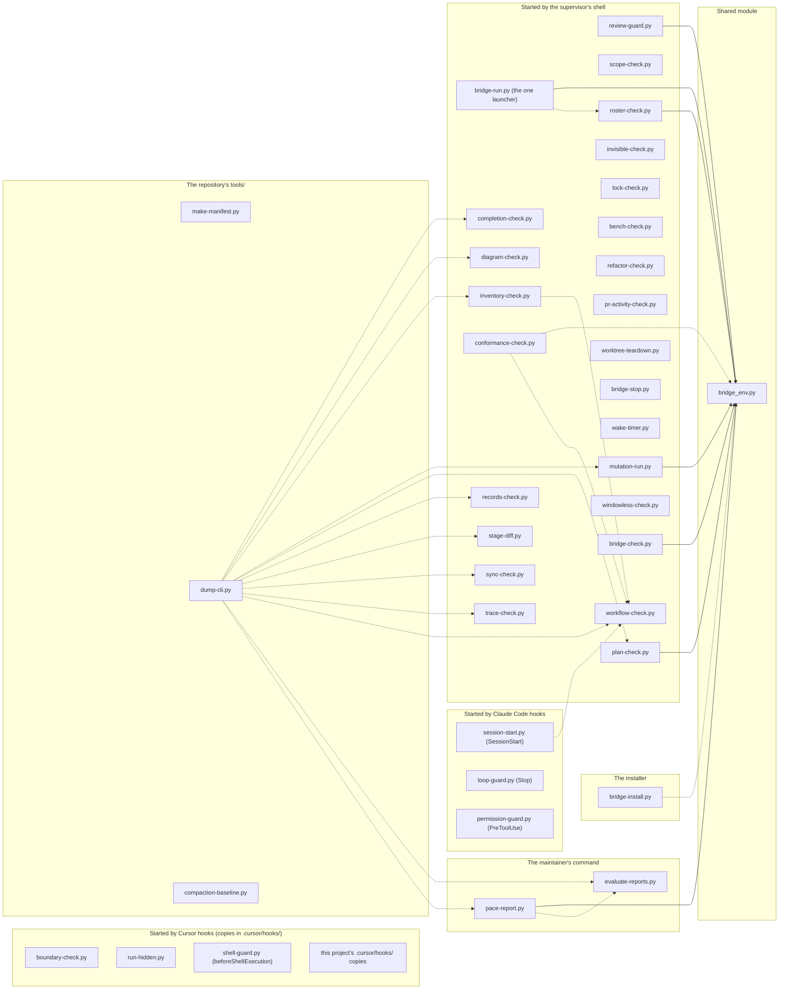

# D-002 component — the bridge's programs (as built)

Level 3. Drawn as built (conventions §8) from the code on 2026-11-01. Every program of `bridge/cursor-bridge/` is a component whose path is its file, grouped by what starts it: the supervisor's shell; Claude Code's hooks (`bridge/cursor-bridge/settings.bridge.json`); the Cursor hooks, which a project's `.cursor/hooks/` holds as verbatim copies; the installer; the maintainer's command (`bridge/commands/evaluate-reports.md`). The repository's `tools/` programs and this project's own installed hook copies are elements too, so every tracked Python file outside `tests/` belongs to one. An edge `a --> b` or `a -.-> b` means `a` may depend on `b` by importing or loading it; every edge joins two components, never a subgraph.

The dependency rule (`docs/DESIGN.md`, "Architecture — the retrofit's diagrams", D-002) allows two kinds of edge. A program may import the shared module `bridge_env`. A program may also load a sibling program by file (`importlib.util.spec_from_file_location`) where it reuses that program's one copy of a rule, the shared judge, or, for the one tool `dump_cli`, to read the sibling's argument parser. Each such load is its own edge. Every other dependency between programs is by running one or reading its record as a file. Those are not edges and are not drawn. `bridge-run.py` is the one launcher.

Notes:

- **Plain imports** (solid edges, `-->`): an `import bridge_env` statement, which `check:components` sees. This covers `bridge_run`, `review_guard`, `plan_check`, `roster_check`, `pace_report` (at module level), `mutation_run` (at module level, inside a `try`) and `bridge_check` (inside `check_agent_home`).
- **Loads by file** (dotted edges, `-.->`): `importlib.util.spec_from_file_location` of a sibling file. `check:components` reads only `import` and `from` lines, so it does not see these. They are enforced by `diff-reviewer`'s named review item: a `spec_from_file_location` of a sibling program is a D-002 edge the diff must draw or raise. As of the code:
  - `conformance_check` loads `bridge_env` (`_load_bridge_env`);
  - `bridge_install` loads the source release's `bridge_env.py` (`prepare_agent_home`);
  - `bridge_run` loads `roster_check` (`roster_program`, the family and built-by rules);
  - `conformance_check` loads `workflow_check` (`escape_field`; `_load_escape_field` and two report writers);
  - `inventory_check` loads `workflow_check` (`escape_field`);
  - `session_start` loads `workflow_check` (`load_checker_module`: `slash`, `is_link`, `read_utf8`, `load_tables`);
  - `pace_report` loads `evaluate_reports` (`_load_evaluate_reports`, the project keys);
  - `dump_cli` loads each program of `bridge/cursor-bridge/` that has a `__main__` block and a top-level `build_parser`, to read its parser. As of the code that is 12: `completion_check`, `diagram_check`, `inventory_check`, `mutation_run`, `plan_check`, `records_check`, `stage_diff`, `sync_check`, `trace_check`, `workflow_check` in `sg_shell`, and `evaluate_reports`, `pace_report` in `sg_maintainer`. It reads every other program's docstring with `ast` and does not load it. The selection is made at run time; each of the twelve is drawn as its own edge. A thirteenth program gaining a `build_parser` changes no `import` and no `spec_from_file_location` call, so the enforcement of these edges is a test: `tests/test_dump_cli.py`, naming D-002, asserts that the programs `dump-cli.py` loads (computed as the tool computes them) equal this diagram's `dump_cli` edges read from this file (the addendum's test increment, R-055).
- **Not edges:** `mutation_run` contains `import` lines inside the source strings of the pytest plugins it generates (`OUTCOMES_PLUGIN_CODE`, `write_resolution_plugin`). These are text that mutation-run writes to a file, not imports of its own. `make_manifest` and `compaction_baseline` import nothing of the project.
- **Grouping:** `shell_guard` is Cursor's `beforeShellExecution` hook, copied to a project's `.cursor/hooks/shell-guard.py`; `settings.bridge.json` has no entry for it. Only the maintainer's command starts `pace_report` (`evaluate-reports.md`, step 3). `windowless_check` is started by the supervisor's shell (an allow rule in `settings.bridge.json`) and by a project's pre-commit gate from its copy. `project_cursor_hooks` is this project's installed copies of the Cursor hooks (`boundary-check.py`, `run-hidden.py`, `windowless-check.py`). It has no edges.
- `tests/` is outside `check:components`.

| Element | Paths |
|---|---|
| bridge_env | bridge/cursor-bridge/bridge_env.py |
| bridge_run | bridge/cursor-bridge/bridge-run.py |
| review_guard | bridge/cursor-bridge/review-guard.py |
| scope_check | bridge/cursor-bridge/scope-check.py |
| plan_check | bridge/cursor-bridge/plan-check.py |
| completion_check | bridge/cursor-bridge/completion-check.py |
| diagram_check | bridge/cursor-bridge/diagram-check.py |
| inventory_check | bridge/cursor-bridge/inventory-check.py |
| conformance_check | bridge/cursor-bridge/conformance-check.py |
| workflow_check | bridge/cursor-bridge/workflow-check.py |
| trace_check | bridge/cursor-bridge/trace-check.py |
| records_check | bridge/cursor-bridge/records-check.py |
| stage_diff | bridge/cursor-bridge/stage-diff.py |
| invisible_check | bridge/cursor-bridge/invisible-check.py |
| lock_check | bridge/cursor-bridge/lock-check.py |
| bench_check | bridge/cursor-bridge/bench-check.py |
| refactor_check | bridge/cursor-bridge/refactor-check.py |
| pr_activity_check | bridge/cursor-bridge/pr-activity-check.py |
| roster_check | bridge/cursor-bridge/roster-check.py |
| sync_check | bridge/cursor-bridge/sync-check.py |
| worktree_teardown | bridge/cursor-bridge/worktree-teardown.py |
| bridge_stop | bridge/cursor-bridge/bridge-stop.py |
| wake_timer | bridge/cursor-bridge/wake-timer.py |
| mutation_run | bridge/cursor-bridge/mutation-run.py |
| windowless_check | bridge/cursor-bridge/windowless-check.py |
| bridge_check | bridge/cursor-bridge/bridge-check.py |
| session_start | bridge/cursor-bridge/session-start.py |
| loop_guard | bridge/cursor-bridge/loop-guard.py |
| permission_guard | bridge/cursor-bridge/permission-guard.py |
| shell_guard | bridge/cursor-bridge/shell-guard.py |
| boundary_check | bridge/cursor-bridge/boundary-check.py |
| run_hidden | bridge/cursor-bridge/run-hidden.py |
| project_cursor_hooks | .cursor/hooks/** |
| bridge_install | bridge/cursor-bridge/bridge-install.py |
| evaluate_reports | bridge/cursor-bridge/evaluate-reports.py |
| pace_report | bridge/cursor-bridge/pace-report.py |
| make_manifest | tools/make-manifest.py |
| dump_cli | tools/dump-cli.py |
| compaction_baseline | tools/compaction-baseline.py |

