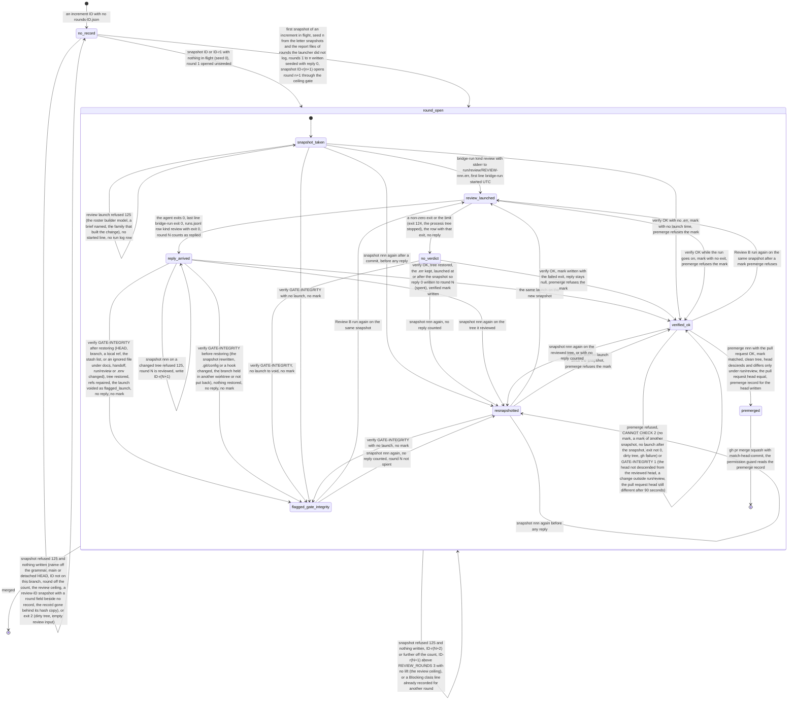

# D-003 component-state: the Review B round of an increment

Level 3, refines D-002 (`review_guard` = `bridge/cursor-bridge/review-guard.py`, `bridge_run` = `bridge/cursor-bridge/bridge-run.py`; the ceiling's constant `REVIEW_ROUNDS = 3` and the grammar readers live in `bridge/cursor-bridge/bridge_env.py`). Realizes R-042, R-055. Drawn as built (conventions §8) from the code of 2026.10.30d.

**Subject.** One Review B round `N` of one increment `ID`, named `nnn` = `ID` or `ID-r1` for round 1 and `ID-rN` after it, as `review_guard` holds it in `<git common dir>/bridge/rounds-ID.json` (each round: `round`, `name`, `branch`, `tree`, `time`, `lift`, `lift_line`, `reply`, and `seeded` for a seeded one; the record's hash copy beside the snapshot hash copies outside the checkout), in the snapshot `review-nnn.json`, in the verified mark `verified-nnn.json` and in the pre-merge record `premerge/<head>`, and as `bridge_run` writes it in `run/review/REVIEW-nnn.err` (first line `bridge-run: started <UTC>Z`, last line `bridge-run: exit <code>`) and in its `run/launcher/runs.jsonl` row (kind `review`, no `brief` and no `round`). A `DESIGN-` name passes the grammar and has no rounds record; it is not drawn.

**The ceiling's count, as built.** `snapshot` reads `current`, the highest round recorded for the ID (replied or not), and admits round `current` or `current + 1` only (round 1 from no record). Whether round `N` has a reply (`reply` not null, or the `.err` holding exit 0 launched at or after the round's first snapshot and not voided as `flagged_launch`) decides only whether round `N` may be taken again on a changed tree. A round above `REVIEW_ROUNDS` opens only with the owner's line (`Review rounds above the ceiling: ID <rounds> (<words>)` in `docs/RUN_PARAMETERS.md`, recorded as lift `owner`), with a lift already recorded on that round, or with a `Blocking class: <class> - <finding>` line in `run/review/SCOPE-ID.md` (or `SCOPE-STAGE-ID.md`) that no other round has recorded (lift `class`). Every refusal exits 125 and writes nothing.

**The seed (ISS-021, as the code now has it).** With no rounds record, the first snapshot seeds an increment in flight: `n` = the larger of the ID's letter snapshots on one branch and the highest `N` of a tracked `handoff/ID-rN-report.md` (a letter after `N` included) **whose round `N` has no launcher builder row carrying `brief` = ID and `round` = N**; rounds 1 to `n` are written `seeded` with reply 0, so round `n` is reviewed and the snapshot opens round `n + 1`, through the ceiling's gate. A builder round the launcher logged is never a Review B round.

**Readers of the rounds record.** `review_guard` (snapshot, verify, the flag's voiding); `bridge_env`'s branch rule (`_branch_events` reads each round's `branch`, `time` and the record's `merge_ids`); `pace-report.py` (the rounds per ID).

| State | What holds | Element | Exercised by (behaviour, before the build adds the ID) |
|---|---|---|---|
| `no_record` | no `rounds-ID.json`; a refused snapshot leaves it so | review_guard | both: `tests/test_review_guard_ceiling.py` (`test_r042_refused_snapshot_writes_no_rounds_file`, the grammar refusal), `tests/test_bug036.py` (every test starts here; the off-the-count refusal) |
| `round_open` | round `N` is the highest recorded; the composite of the states below | review_guard | both (every admitted snapshot) |
| `snapshot_taken` | `review-nnn.json` and its hash copy written, round `N` entry with `tree`, `time`, `reply` null; the ID's verified marks cleared | review_guard | both: ceiling (`test_r042_rounds_one_two_three`, `test_r042_class_line_in_scope_allows_fourth`), bug036 (`snap_ok` in every seed test) |
| `review_launched` | `REVIEW-nnn.err` with the started line and no exit line yet; Review B running, no slot | bridge_run | partly: ceiling writes the launcher's two `.err` lines by hand; no test runs the launch or its `runs.jsonl` row (OPEN POINT) |
| `reply_arrived` | `.err` ends `bridge-run: exit 0`, launched at or after the round's snapshot; the review row logged with exit 0; round `N` counts as replied | bridge_run, review_guard | partly: ceiling (the hand-written exit 0 read by `verify`); the re-snapshot's reading of the `.err` by neither (OPEN POINT) |
| `no_verdict` | `.err` ends a non-zero exit (124 at the limit); no reply | bridge_run | neither (OPEN POINT) |
| `verified_ok` | tree restored, `.err` kept; with exit 0 after the snapshot, `reply` 0 written (round spent); `verified-nnn.json` written | review_guard | `tests/test_review_guard_ceiling.py` (`verify` returns 0 for rounds 1 to 3) |
| `flagged_gate_integrity` | verify exit 1, no mark, no reply; after restoring, the launch voided as `flagged_launch` | review_guard | neither (OPEN POINT) |
| `resnapshotted` | round `N` taken again: `tree` new, `time`, `reply` and lifts kept, marks cleared | review_guard | neither (OPEN POINT) |
| `premerged` | the mark read and matched, the head confirmed, `premerge/<head>` written | review_guard | neither (OPEN POINT) |

Transitions no enforcing test exercises yet: the owner's-line lift; the refusal `round N is reviewed: write ID-r(N+1)` (bug036 asserts only its absence); a class line already recorded; the launch refusals of `bridge_run`. `tests/test_review_guard.py` already exercises the verify flags, a failed review run and premerge, but is not in D-003's `Enforced by`.

Not drawn (free space or other diagrams): the builder rounds' own ceiling in `bridge_run` (`launcher_effective_round`, the brief rule); the design critique's `DESIGN-` rounds; the content checks of `verify` beyond the outcome each one leads to.

