# D-003 component-state: the Review B round of an increment

Level 3, refines D-002 (`review_guard` = `bridge/cursor-bridge/review-guard.py`, `bridge_run` = `bridge/cursor-bridge/bridge-run.py`; the ceiling's constant `REVIEW_ROUNDS = 3` and the grammar readers live in `bridge/cursor-bridge/bridge_env.py`). Realizes R-042, R-055 and, as designed for the program release (2026-11-13, the paragraph below so headed), R-067, R-083, R-089. Drawn as built (conventions §8). No deviation stands: the three once listed in `docs/diagrams/DEVIATIONS.md` (the four early GATE-INTEGRITY returns of `verify`, which left the launch unvoided; a flag raised while the run still went on, whose launch `record_flagged_launch` left unvoided since it had no exit yet; a re-snapshot of a flagged round, whose rebuilt entry dropped `flagged_launch`, so the flagged launch's exit 0 counted as the reply) were closed by BUG-039 (TASK-043, 2026-11-02), and the diagram is now drawn from that code.

**Subject.** One Review B round `N` of one increment `ID`, named `nnn` = `ID` or `ID-r1` for round 1 and `ID-rN` after it, as `review_guard` holds it in `<git common dir>/bridge/rounds-ID.json` (each round: `round`, `name`, `branch`, `tree`, `time`, `lift`, `lift_line`, `reply`, `flagged_launch` once a flagged verify voided its launch, `seeded` for a seeded one, and, by the program release's design (TASK-069, R-089), `cause`, the round's cause, written by `snapshot` from the round's SCOPE file line `Round cause: <cause>` (or `unstated`), read by `pace-report.py`, deciding no count, lift or verdict — eleven fields; the record also holds `merge_ids`, which the branch rule reads; the record's hash copy beside the snapshot hash copies outside the checkout), in the snapshot `review-nnn.json`, in the verified mark `verified-nnn.json` and in the pre-merge record `premerge/<head>`, by the program release's design (TASK-083, R-083) in the ready record `ready/<pr>-<head>` beside it, and as `bridge_run` writes it in `run/review/REVIEW-nnn.err` (first line `bridge-run: started <UTC>Z`, last line `bridge-run: exit <code>`) and in its `run/launcher/runs.jsonl` row (kind `review`, no `brief` and no `round`). A `DESIGN-` name passes the grammar and has no rounds record; it is not drawn.

**The ceiling's count, as built.** `snapshot` reads `current`, the highest round recorded for the ID (replied or not), and admits round `current` or `current + 1` only (round 1 from no record). Whether round `N` has a reply (`reply` not null, or the `.err` holding exit 0 launched at or after the round's first snapshot and not voided as `flagged_launch`) decides only whether round `N` may be taken again on a changed tree. A round above `REVIEW_ROUNDS` opens only with the owner's line (`Review rounds above the ceiling: ID <rounds> (<words>)` in `docs/RUN_PARAMETERS.md`, recorded as lift `owner`), with a lift already recorded on that round, or with a `Blocking class: <class> - <finding>` line in `run/review/SCOPE-ID.md` (or `SCOPE-STAGE-ID.md`) that no other round has recorded (lift `class`). Every refusal exits 125 and writes nothing.

**The seed (ISS-021, as the code now has it).** With no rounds record, the first snapshot seeds an increment in flight: `n` = the larger of the ID's letter snapshots on one branch and the highest `N` of a tracked `handoff/ID-rN-report.md` (a letter after `N` included) **whose round `N` has no launcher builder row carrying `brief` = ID and `round` = N**; rounds 1 to `n` are written `seeded` with reply 0, so round `n` is reviewed and the snapshot opens round `n + 1`, through the ceiling's gate. A builder round the launcher logged is never a Review B round.

**Readers of the rounds record.** `review_guard` (snapshot, verify, the flag's voiding); `bridge_env`'s branch rule (`_branch_events` reads each round's `branch`, `time` and the record's `merge_ids`); `pace-report.py` (the rounds per ID, and, by the program release's design, each round's `cause` for its cause line).

**The program release (2026-11-13; by its design, not yet built: `docs/DESIGN.md`, "Change: the program release").** The round's `cause` (TASK-069, R-089): written by `snapshot` into the round's entry beside its `time`, from the first line `Round cause: <cause>` of the round's SCOPE file, a missing line or a word outside the round causes' list written `unstated` and never a refusal; read by `pace-report.py` alone; no count, lift or verdict reads it, so it adds no state and no transition. The `ready` check and its record (TASK-083, R-083, the T-CONTEXT bullet): `review-guard.py ready <pr>`, run after the CI watch that follows `premerge`, is drawn as the choice `ready_check`, its three answers the edges that leave it, and the record its READY answer writes as the state `ready_recorded`. READY (exit 0) where the pull request's head on GitHub is the local branch's head, compared as `premerge` compares them, the premerge record for that head stands and CI is proven on it writes `<git common dir>/bridge/ready/<pr>-<head>` beside the premerge record; NOT READY (exit 1) and CANNOT CHECK (exit 2) write nothing and remove nothing. What proves CI: where the base branch names required check contexts, or, where it names none, the default branch does, each has a check on the head with the conclusion success, or skipped where no check and no run of the head failed or was cancelled; where neither branch names one or a rule cannot be read, the head's workflow runs prove it (the latest run of each workflow, a superseded run counting for nothing: at least one succeeded, none queued, waiting or in progress, none failed or cancelled, no check on the head failed; both lists read to their last page), the answer's line saying which reading it used. A rule that cannot be read is therefore not CANNOT CHECK; CANNOT CHECK is GitHub or the pull request that cannot be read, or the premerge record for the local head absent or unreadable. The permission guard takes the pull request's number from the merge command and refuses a `gh pr merge` that has no ready record for that number and its `--match-head-commit` head, or that names no number, after and in the same way as its check of the premerge record, so the supervisor's merge is reachable only from `ready_recorded`: from `premerged` a merge attempted before READY is refused and writes nothing, NOT READY on a context or run goes back to the watch, NOT READY on a moved head takes the changed tree's existing path, and CANNOT CHECK rests at `premerged` with no merge following. The edge `premerged --> [*]` is today's code, the guard reading the premerge record alone; it is labelled so, and TASK-083 removes it, the designed merge being `ready_recorded --> [*]`. Under the run parameter `Merge authority: owner` the owner merges on GitHub, outside the permission guard, as today; it is not drawn. The short gate (release S, R-067), drawn as built, with the same proof that `premerge-records <pr>` gains by this design (TASK-083) before it writes, and then both records or neither, so `records_premerged` holds both: a records-only pull request has no rounds record, no snapshot, no Review B and no round counted, so it is drawn beside the round from its own start; its FULL GATE joins the round at its start, a snapshot.

| State | What holds | Element | Exercised by (behaviour, before the build adds the ID) |
|---|---|---|---|
| `no_record` | no `rounds-ID.json`; a refused snapshot leaves it so | review_guard | both: `tests/test_review_guard_ceiling.py` (`test_r042_refused_snapshot_writes_no_rounds_file`, the grammar refusal), `tests/test_bug036.py` (every test starts here; the off-the-count refusal); `tests/test_d003_review_round_states.py` (`test_d003_state_no_record_a_refused_snapshot_leaves_it_so`, the off-the-count refusal) |
| `round_open` | round `N` is the highest recorded; the composite of the states below | review_guard | both (every admitted snapshot) |
| `snapshot_taken` | `review-nnn.json` and its hash copy written, round `N` entry with `tree`, `time`, `reply` null; the ID's verified marks cleared | review_guard | both: ceiling (`test_r042_rounds_one_two_three`, `test_r042_class_line_in_scope_allows_fourth`), bug036 (`snap_ok` in every seed test); `tests/test_d003_review_round_states.py` (`test_d003_state_snapshot_taken_opens_the_round`) |
| `review_launched` | `REVIEW-nnn.err` with the started line and no exit line yet; Review B running, no slot | bridge_run | ceiling writes the launcher's two `.err` lines by hand; `tests/test_d003_review_round_states.py` (`test_d003_state_review_launched_in_flight_and_its_log_row`) runs the real launcher with a stand-in agent, reading the `.err` in flight and the `runs.jsonl` row at its end |
| `reply_arrived` | `.err` ends `bridge-run: exit 0`, launched at or after the round's snapshot; the review row logged with exit 0; round `N` counts as replied | bridge_run, review_guard | ceiling (the hand-written exit 0 read by `verify`); the re-snapshot's reading of the `.err`: `tests/test_d003_review_round_states.py` (`test_d003_state_reply_arrived_the_err_counts_before_any_verify`, the launcher's exit 0 with no verify run, a snapshot on a changed tree refused) |
| `no_verdict` | `.err` ends a non-zero exit (124 at the limit); no reply | bridge_run | `tests/test_bug039.py` (`test_bug039_site2_the_void_holds_whatever_the_exit`, its exit 1 case, the launch voided and refused at the next verify; `test_bug039_site7_a_real_windows_exit_code_is_read`, a crash's exit after an earlier exit 0, reply null and `premerge` refusing), each `.err` written by hand; the launcher's own non-zero exit, its limit and its row: `tests/test_d003_review_round_states.py` (`test_d003_state_no_verdict_the_launchers_own_exit`, exit 3 and the limit's exit 124, the mark holding the exit, no reply, `premerge` refusing) |
| `verified_ok` | tree restored, `.err` kept, `verified-nnn.json` written; two arms: with exit 0 launched after the snapshot, `reply` 0 written (round spent) and the mark is one `premerge` accepts; with no launch, no exit yet or a failed exit, `reply` stays null and the mark is one `premerge` refuses | review_guard | the spent arm: `tests/test_review_guard_ceiling.py` (`verify` returns 0 for rounds 1 to 3), `tests/test_d003_review_round_states.py` (`test_d003_state_verified_ok_the_spent_arm`); the failed-exit mark: `tests/test_review_guard.py`; the no-launch and no-exit arms: `tests/test_d003_review_round_states.py` (`test_d003_transition_verified_ok_with_no_launch`; `test_d003_transition_verified_ok_with_no_exit_yet`, on the `.err` alone; `test_d003_state_review_launched_in_flight_and_its_log_row`, while the real launcher runs) |
| `flagged_gate_integrity` | verify exit 1 (exit 2 beside CANNOT VERIFY where a later git step failed after the flag), no mark, no reply written by this verify (a `reply` 0 an earlier verify wrote stays, and that round stays spent); the launch voided as `flagged_launch` by its start time, whether the flag came before or after restoring and whether the run has ended, where the `.err` holds a started line at or after the snapshot's `taken` (at the snapshot-rewritten return, at or after the round's `time`), an older launch or an `.err` with no started line voiding nothing; nothing voided where the rounds record itself is what cannot be read | review_guard | `tests/test_review_guard.py` (a commit, a moved main, a tag, a changed config, a planted or modified hook, an ignored record each flagged; a flagged verify withdrawing the mark); the launch's voiding: `tests/test_bug039.py` (each early return, during the run, whatever the exit, a git failure after a flag, a voided launch verified again, a tampered record, a launch before the snapshot not voided, a `reply` 0 kept); after restoring, a commit and a ref the reviewer left: `tests/test_d003_review_round_states.py` (`test_d003_state_flagged_gate_integrity_after_restoring`) |
| `resnapshotted` | round `N` taken again: `tree` rewritten (the same tree after a failed launch, a new one after a commit before any reply), `time`, `reply` and lifts kept, marks cleared; `flagged_launch` kept too | review_guard | `tests/test_bug039.py` (`test_bug039_site4_a_resnapshot_keeps_the_flag`, `test_bug039_site4_negative_a_resnapshot_counts_no_reply_on_either_tree`, `test_bug039_site4_negative_a_resnapshot_of_an_unflagged_round_gains_no_key`); `tests/test_d003_review_round_states.py` (`test_d003_state_resnapshotted_keeps_the_time_and_clears_the_marks`) |
| `premerged` | the mark read and matched, the head confirmed, `premerge/<head>` written | review_guard | `tests/test_review_guard.py` (premerge accepted; refused without a mark, with a failed run's mark, with a change outside run/review, with a head not descended; the record the permission guard reads); `tests/test_d003_review_round_states.py` (`test_d003_state_premerged_writes_the_record_for_the_head`) |
| `ready_check` | a choice, not a resting state (by this design, TASK-083): `review-guard.py ready <pr>` after the CI watch compares the pull request's head on GitHub with the local branch's head, requires the premerge record for it and proves CI on it, by the required check contexts of the base branch, or of the default branch where the base names none, each with a check concluded success (or skipped where nothing of the head failed or was cancelled), or, where neither names one or a rule cannot be read, by the head's workflow runs (the latest of each workflow: at least one succeeded, none queued, waiting or in progress, none failed or cancelled, no check on the head failed); READY exit 0 writes the ready record, NOT READY exit 1 and CANNOT CHECK exit 2 write nothing and remove nothing | review_guard | by this design: `tests/test_program_ready.py` (the three answers on the recorded replies under each reading), `tests/test_d003_review_round_states.py` (TASK-083, one test per transition) |
| `ready_recorded` | by this design (TASK-083): the premerge record and the ready record `ready/<pr>-<head>` both written for the pull request's head; the only state from which the permission guard allows the supervisor's `gh pr merge`, reading the premerge record by the head the command names and the ready record by that head and the pull request's number; a ready record standing for another head or another pull request is left and proves nothing for this one | review_guard | by this design: `tests/test_program_ready.py` (the record written on READY and never on NOT READY or CANNOT CHECK), `tests/test_permission_guard.py` (the merge refused without the ready record, allowed with both), `tests/test_d003_review_round_states.py` (TASK-083) |
| `records_branch` | a branch whose changes are records only, with no rounds record and no snapshot; `premerge-records` with no pull request reads it against origin/main and writes nothing | review_guard | `tests/test_release_s_records_gate.py`; `tests/test_d003_review_round_states.py` (TASK-056) |
| `short_gate` | SHORT GATE answered before the push: no snapshot, no Review B, no round counted; CI and one Review A read awaited, neither checked by the guard as built; no premerge record yet | review_guard | `tests/test_release_s_records_gate.py`; `tests/test_d003_review_round_states.py` (TASK-056) |
| `records_premerged` | `premerge-records <pr>` after CI answered `OK - records only`, `premerge/<head>` written (review `records`, the files), the merge command printed; by this design only where CI is proven on the head as `ready_check` proves it, and then the ready record `ready/<pr>-<head>` written too, both records or neither | review_guard | `tests/test_release_s_records_gate.py`; `tests/test_d003_review_round_states.py` (TASK-056, the state as built); by this design `tests/test_program_ready.py` (the short gate's check and its two records) and `tests/test_d003_review_round_states.py` (TASK-083) |

Transitions the retrofit found unexercised, each now followed by the test of `tests/test_d003_review_round_states.py` that exercises it (the addendum's test increment, R-055): the owner's-line lift, `test_d003_transition_the_owners_line_lifts_rounds_up_to_its_number`; the refusal `round N is reviewed: write ID-r(N+1)` (bug036 asserts only its absence), `test_d003_transition_the_changed_tree_refusal_names_the_next_round`; the changed-tree refusal, `test_d003_transition_the_changed_tree_refusal_names_the_next_round`; a class line already recorded, `test_d003_transition_a_class_line_lifts_one_round_and_is_then_recorded` and `test_d003_transition_a_class_line_recorded_refuses_a_round_below_the_ceiling`; the launch refusals of `bridge_run`, `test_d003_transition_a_review_launch_refused_leaves_no_started_line`; the `verified_ok` arms marked above, `test_d003_transition_verified_ok_with_no_launch` and `test_d003_transition_verified_ok_with_no_exit_yet`; of no verdict, the launcher's own non-zero exit and limit, `test_d003_state_no_verdict_the_launchers_own_exit`, and `no_verdict --> resnapshotted`, `test_d003_transition_no_verdict_to_resnapshotted`; a void write failing at a pre-git or end-of-verify return, `test_d003_transition_a_void_write_failing_at_a_pre_git_or_end_of_verify_return`; a flag while the rounds record is tampered with, `test_d003_transition_a_flag_while_the_rounds_record_is_tampered_with`; the snapshot rewritten voiding an earlier launch at `resnapshotted`, `test_d003_transition_the_snapshot_rewritten_voids_an_earlier_launch_at_resnapshotted`; a flagged round with nothing voided verifying clean, `test_d003_transition_a_flagged_round_with_nothing_voided_verifies_clean`; `premerge` refused on no hash copy, `test_d003_transition_premerge_refused_on_no_hash_copy`, a git failure, `test_d003_transition_premerge_refused_on_a_git_failure`, or the premerge record not written, `test_d003_transition_premerge_refused_when_the_record_cannot_be_written`; `verify` or `premerge` at `no_record` with a hash copy standing, `test_d003_transition_verify_or_premerge_at_no_record_with_a_hash_copy_standing`. `tests/test_review_guard.py` exercises the verify flags, a failed review run and premerge, as the table says, and is in D-003's `Enforced by`. `tests/test_bug039.py` exercises the flag's voiding, the re-snapshot and, of no verdict, the void whatever the exit (`test_bug039_site2_the_void_holds_whatever_the_exit`) and the failed run's mark (`test_bug039_site7_a_real_windows_exit_code_is_read`); D-003's `Enforced by` names it (TASK-044, R-055).

Stated limits, not states. A record tampered with while a flag is raised and later restored byte for byte loses that void, the GATE-INTEGRITY line having been printed and the rules stopping the merge on it. A void that cannot be written leaves the launch admissible at the next verify, the printed line holding it the same way. Two more are deliberate acts on a copy lying outside the checkout. With the record and its hash copy both deleted, `verify` finds no error and writes no reply, and its mark, with the launch's exit 0, is one `premerge` accepts. A record changed with its hash copy deleted is taken as it stands, the copy rewritten from it, so a `flagged_launch` taken out that way no longer stops the launch. The snapshot's own (BUG-041): the guard holds the deletion a reviewer makes in the checkout, not an act outside it. The snapshot and its hash copy both deleted reads as a snapshot never taken, CANNOT VERIFY exit 2, and a reviewer that runs the guard's own `snapshot` rewrites both, each a deliberate reach past KP-032's "in passing". After the flag, the next `snapshot` on the same tree still takes what was left as its baseline, as it does after a rewritten snapshot: the GATE-INTEGRITY line printed is what stops the supervisor, who reads the configuration and the hooks first and opens the flag and an issue, and the launch it flagged stays voided under that snapshot. A hash copy is never cleaned up, so a repository re-created at the same path, or a cleared `.git/bridge`, reads as GATE-INTEGRITY and no longer as CANNOT VERIFY for a name that had a snapshot, until `snapshot` runs again: this fails closed. Where the rounds record went with it, that `snapshot` of an increment's name is itself refused 125 while the record's hash copy stands.

Not drawn (free space or other diagrams): the builder rounds' own ceiling in `bridge_run` (`launcher_effective_round`, the brief rule); the design critique's `DESIGN-` rounds; the content checks of `verify` beyond the outcome each one leads to.

```mermaid
stateDiagram-v2
    direction TB
    [*] --> no_record : an increment ID with no rounds-ID.json
    no_record --> no_record : snapshot refused 125 and nothing written (name off the grammar, main or detached HEAD, ID not on this branch, round off the count, the review ceiling, a review-ID snapshot with a round field beside no record, the record gone behind its hash copy), or exit 2 (dirty tree, empty review input)
    no_record --> no_record : verify or premerge of a name that had a snapshot, the snapshot file gone and its hash copy standing (a repository re-created at the same path, or a cleared .git/bridge), GATE-INTEGRITY exit 1, nothing restored, nothing voided since no rounds record holds the launch, no mark, no premerge record
    no_record --> round_open : snapshot ID or ID-r1 with nothing in flight (seed 0), round 1 opened unseeded
    no_record --> round_open : first snapshot of an increment in flight, seed n from the letter snapshots and the report files of rounds the launcher did not log, rounds 1 to n written seeded with reply 0, snapshot ID-r(n+1) opens round n+1 through the ceiling gate
    state round_open {
        [*] --> snapshot_taken
        snapshot_taken --> snapshot_taken : review launch refused 125 (the roster builder model, a brief named, the family that built the change), no started line, no run log row
        snapshot_taken --> review_launched : bridge-run kind review with stderr to run/review/REVIEW-nnn.err, first line bridge-run started UTC
        resnapshotted --> review_launched : the same launch on the new snapshot
        verified_ok --> review_launched : Review B run again on the same snapshot after a mark premerge refuses
        flagged_gate_integrity --> review_launched : Review B run again on the same snapshot
        review_launched --> reply_arrived : the agent exits 0, last line bridge-run exit 0, runs.jsonl row kind review with exit 0, round N counts as replied
        review_launched --> no_verdict : a non-zero exit or the limit (exit 124, the process tree stopped), the row with that exit, no reply
        reply_arrived --> verified_ok : verify OK, tree restored, the .err kept, the rounds record read and the launch not voided, launched at or after the snapshot so reply 0 written to round N (spent), verified mark written
        no_verdict --> verified_ok : verify OK, mark written with the failed exit, reply stays null, premerge refuses the mark
        snapshot_taken --> verified_ok : verify OK with no .err, mark with no launch time, premerge refuses the mark
        resnapshotted --> verified_ok : verify OK with no launch since the snapshot and no voided launch in the .err, premerge refuses the mark
        review_launched --> verified_ok : verify OK while the run goes on, mark with no exit, premerge refuses the mark
        flagged_gate_integrity --> verified_ok : verify finds nothing left to flag and nothing was voided (no .err, no started line, a launch before the snapshot), mark written, premerge refuses the mark, or the record restored after a tamper with the void lost, the stated limit, an exit 0 then a mark premerge accepts
        reply_arrived --> reply_arrived : verify CANNOT VERIFY 2, no mark (no copy of the snapshot hash, a git failure with no flag found yet, or a flag found before the git failure or at the branch-held or not-put-back return whose void cannot be written, the flag printed and a GATE-INTEGRITY line saying not recorded)
        reply_arrived --> reply_arrived : verify with a flag at a pre-git return or at the end of verify whose void write fails, the flag printed then main's CANNOT VERIFY exit 2, no not-recorded line, no void, no reply, no mark, the launch admissible at the next verify, the same at review_launched and no_verdict
        reply_arrived --> flagged_gate_integrity : verify with a flag already found when a later git step fails, the flag printed, the launch voided as flagged_launch beside the CANNOT VERIFY, exit 2, no reply, no mark, the same at review_launched and no_verdict
        reply_arrived --> flagged_gate_integrity : verify GATE-INTEGRITY after restoring (HEAD, branch, a local ref, the stash list, or an ignored file under docs, handoff, run/review or .env changed), tree restored, refs repaired, the launch voided as flagged_launch, no reply, no mark
        reply_arrived --> flagged_gate_integrity : verify GATE-INTEGRITY before restoring (the snapshot rewritten, any content that is not a JSON object or the snapshot file deleted while its hash copy stands included, .git/config or a hook changed, the branch held in another worktree or not put back), nothing restored, no reply, no mark, the launch voided as flagged_launch, the snapshot rewritten voiding by the round's recorded time and reading nothing of the snapshot
        reply_arrived --> flagged_gate_integrity : verify with a flag while the rounds record is changed outside the guard or unreadable, the flag printed with its own exit, nothing voided and no line saying so, no reply, no mark, the next snapshot refused 125 while the record stays so
        reply_arrived --> flagged_gate_integrity : verify at its end finds the rounds record changed outside the guard or unreadable, tree restored, GATE-INTEGRITY exit 1, no reply, no mark, no void possible since the record is what cannot be read, the next snapshot refused 125 while the record stays so, the same from every other state verify runs in
        review_launched --> flagged_gate_integrity : verify GATE-INTEGRITY while the run goes on, the launch voided as flagged_launch by its start time, no mark
        no_verdict --> flagged_gate_integrity : verify GATE-INTEGRITY, the launch voided as flagged_launch, no mark
        snapshot_taken --> flagged_gate_integrity : verify GATE-INTEGRITY with no launch, no mark
        resnapshotted --> flagged_gate_integrity : verify GATE-INTEGRITY with no launch since the snapshot, no mark, nothing voided, but the snapshot rewritten voids an earlier launch of this round still in the .err, by the round's recorded time
        resnapshotted --> flagged_gate_integrity : verify on a voided launch still in the .err (its start equals the round's flagged_launch, whether or not at or after this snapshot), tree restored, GATE-INTEGRITY exit 1, no reply, no mark, Review B runs again
        verified_ok --> flagged_gate_integrity : a later verify finds a flag, the mark removed and not written again, the void recorded, a reply 0 already written kept so the round stays spent and a snapshot on a changed tree refused 125
        flagged_gate_integrity --> flagged_gate_integrity : verify again on a voided launch (its start equals the round's flagged_launch), tree restored, GATE-INTEGRITY exit 1, no reply, no mark, Review B runs again
        snapshot_taken --> resnapshotted : snapshot nnn again after a commit, before any reply
        resnapshotted --> resnapshotted : snapshot nnn again before any reply
        no_verdict --> resnapshotted : snapshot nnn again, no reply counted
        flagged_gate_integrity --> resnapshotted : snapshot nnn again, no reply counted, round N not spent, unless an earlier verify wrote reply 0, then on the same tree only
        reply_arrived --> resnapshotted : snapshot nnn again on the tree it reviewed
        verified_ok --> resnapshotted : snapshot nnn again on the reviewed tree, or with no reply counted
        reply_arrived --> reply_arrived : snapshot nnn on a changed tree refused 125, round N is reviewed, write ID-r(N+1)
        verified_ok --> verified_ok : snapshot nnn on a changed tree refused 125, round N is reviewed, write ID-r(N+1)
        verified_ok --> verified_ok : premerge refused, CANNOT VERIFY 2 (no snapshot with no hash copy either, no copy of the snapshot hash, a git failure), CANNOT CHECK 2 (no mark, a mark of another snapshot, no launch after the snapshot, exit not 0, dirty tree, gh failure, the premerge record not written) or GATE-INTEGRITY 1 (the snapshot rewritten, any content that is not a JSON object or the snapshot file deleted while its hash copy stands included, the head not descended from the reviewed head, a change outside run/review, the pull request head still different after 90 seconds)
        verified_ok --> premerged : premerge nnn with the pull request OK, mark matched, clean tree, head descends and differs only under run/review, the pull request head equal, premerge record for the head written
        premerged --> premerged : gh pr merge refused (the permission guard finds no premerge record for the head, or gh refuses), nothing written
        premerged --> premerged : by this design gh pr merge before READY refused by the permission guard, no ready record for the match-head-commit head, its message naming review-guard.py ready, nothing written
    premerged --> [*] : as built today and removed by TASK-083, merged, gh pr merge squash with match-head-commit, the permission guard reads the premerge record alone
        state ready_check <<choice>>
        premerged --> ready_check : by this design the CI watch returns, review-guard.py ready with the pull request number
        ready_check --> ready_recorded : READY exit 0, the pull request head on GitHub equals the local branch head, compared as premerge compares them, the premerge record for that head stands and CI is proven on it (every required check context with a check concluded success, or skipped where nothing of the head failed or was cancelled, the default branch's contexts where the base names none, or where neither names one or a rule cannot be read the head's workflow runs, the latest run of each workflow and a superseded run counting for nothing, at least one succeeded, none queued, waiting, in progress, failed or cancelled, no check failed, both lists read to their last page), the line naming the reading, the ready record for the pull request and the head written beside the premerge record
        ready_check --> premerged : NOT READY exit 1, a required check context or a workflow run missing, pending or failed on the head, each named, nothing written and nothing removed, back to the watch
        ready_check --> verified_ok : NOT READY exit 1, the head moved, the pull request head on GitHub differing from the local branch head, nothing written, the existing path a changed tree takes, premerge nnn again on the new head (GATE-INTEGRITY 1 where it changes outside run/review) or a snapshot on the changed tree refused 125 and ID-r(N+1) taken
        ready_check --> premerged : CANNOT CHECK exit 2, GitHub, the pull request or the premerge record cannot be read, a stop and never a pass, nothing written and nothing removed, no merge follows since the permission guard refuses without the ready record
        ready_recorded --> [*] : by this design merged, gh pr merge squash with match-head-commit, the permission guard reads the premerge record and the ready record for that pull request and head, the number taken from the merge command
    }
    round_open --> round_open : snapshot ID-r(N+1) admitted, round N+1 opened at snapshot_taken, the ID's verified marks cleared, when N+1 is at most REVIEW_ROUNDS 3, or above it with the owner's line covering N+1 (lift owner) or a Blocking class line in SCOPE-ID.md no other round recorded (lift class)
    round_open --> round_open : snapshot refused 125 and nothing written, ID-r(N+2) or further off the count, ID-r(N+1) above REVIEW_ROUNDS 3 with no lift (the review ceiling), a Blocking class line already recorded for another round, or the rounds record changed outside the guard or unreadable
    [*] --> records_branch : a pull request that changes records only, no rounds record, no snapshot, no Review B, no round counted
    records_branch --> records_branch : premerge-records before the push CANNOT CHECK 2 and nothing written (not a git repository, the tree not clean, origin/main not known or sharing no history with HEAD, HEAD changing nothing), or CANNOT VERIFY 2 on a git error
    records_branch --> short_gate : premerge-records before the push SHORT GATE exit 0, every changed file a record no program reads to decide a gate, nothing written, then the push, CI and one Review A read, neither checked by the guard
    records_branch --> no_record : premerge-records before the push FULL GATE exit 1, a changed file keeps the whole round, the full gate joins the round at its start, a snapshot
    short_gate --> no_record : premerge-records with the pull request number FULL GATE exit 1 (into another branch than main, as many files as its list shows whole or more, a changed file in GitHub's list or the local diff that keeps the whole round), the full gate from a snapshot
    short_gate --> short_gate : premerge-records with the pull request number after CI, NOT READY exit 1 (the pull request head still not the local head after 90 seconds, and by this design CI not proven on the head, a required check context or, where the base names none or the rule cannot be read, a workflow run missing, pending or failed) or CANNOT CHECK 2 (the tree not clean, gh failure, the base not known, nothing changed, the record not written, and by this design GitHub or the pull request cannot be read) or CANNOT VERIFY 2 on a git error, no record written
    short_gate --> records_premerged : premerge-records with the pull request number after CI, OK - records only, the pull request head equal to the local head and by this design CI proven on it as ready proves it, premerge record for the head written with review records and the files, and by this design the ready record for the pull request and the head too, both or neither, the merge command printed
    records_premerged --> [*] : merged, gh pr merge squash with match-head-commit, the permission guard reads the premerge record as built today and by this design the ready record too
```

