# D-004 context-dfd — what crosses the bridge's trust boundaries (as built)

Level 2. Drawn as built (conventions §8) from the code on 2026-11-01; revised as designed on 2026-11-13 for the program release (`docs/DESIGN.md`, "Change: the program release", "Architecture — the diagrams the change touches"; the last note below), whose flows are built by its increments. Realizes R-055, R-080, R-081, R-083, R-085, R-087, R-097, R-100. Enforced by review: `security-auditor` checks every edge crossing a `tb_` subgraph. A process that is a D-002 component has D-002's name behind `p_`.

Notes:

- `SECRET:` marks a flow carrying a secret or credential; `UNTRUSTED:` one carrying what another vendor's agent wrote or chose. `--x` is withheld by the code; a dotted edge is reachable only by a deliberate act the bridge does not prevent (KP-032: not a sandbox; the agents run as the owner's Windows user).
- **Stripped environment** (`bridge_env.stripped_env`; the shim applies the same test). Withheld: `GH_TOKEN`, `GITHUB_TOKEN`, `GH_ENTERPRISE_TOKEN`, `GITHUB_ENTERPRISE_TOKEN`, `GIT_ASKPASS`, `SSH_ASKPASS`, `GIT_CONFIG_COUNT`, `GIT_CONFIG_KEY_0`, `GIT_CONFIG_VALUE_0`, every name `SECRET_LIKE` matches (whole-word TOKEN or SECRET, PASSWORD, PASSWD, PASSPHRASE, CREDENTIAL, API, ACCESS or PRIVATE KEY, a `_KEY` or `_KEYS` ending) but `CURSOR_*` and `GIT_CONFIG_KEY_*`. Set: `GH_CONFIG_DIR` (the empty folder), `GIT_TERMINAL_PROMPT=0`, `GIT_CONFIG_GLOBAL` (the bridge's gitconfig: includes `~/.gitconfig`, resets the helper list), `GIT_CONFIG_PARAMETERS='credential.helper='` (read after the checkout's `.git/config`), `HOME`, `USERPROFILE`, `HOMEDRIVE`, `HOMEPATH` (the agent home), `APPDATA`, `LOCALAPPDATA` (the agent home's skeleton, `AppData/Roaming` and `AppData/Local`, each where the launcher's own environment has the variable: a program the run starts that writes its key file, cache or state through either writes there and never into the owner's real folders; one link in the redirected `Roaming` folder, `Cursor`, leads to the owner's `%APPDATA%/Cursor`, where `cursor-agent` reads its login, and where that link cannot be made or leads elsewhere `APPDATA` keeps the owner's folder for the run; release S, probed on the owner's computer on 2026-11-11), `HF_HUB_CACHE`, `TORCH_HOME`, `PUPPETEER_CACHE_DIR`, `UV_CACHE_DIR`, `UV_PYTHON_INSTALL_DIR`, `PIP_CACHE_DIR`, `PYTHONUSERBASE`, `NPM_CONFIG_CACHE`, `YARN_CACHE_FOLDER`, `PLAYWRIGHT_BROWSERS_PATH`, `GOCACHE` (the owner's caches and installed packages, where present and the variable unset). Passed: the rest; a program that asks Windows itself for a known folder is not redirected. An unusable agent home refuses the run (exit 125). The program release adds (R-080, its list above written by TASK-060 with its test): a key file that names a home variable (`USERPROFILE`, `HOME`, `HOMEDRIVE`, `HOMEPATH`, `APPDATA` or `LOCALAPPDATA`) is refused before the run (exit 125, the name printed, the value never), since its value is applied after the strip; the secret-like test also matches PAT, CREDS and AUTH as name parts, DATABASE_URL and SSH_AUTH_SOCK; a secret-like CURSOR_ name is withheld from test and driver runs.
- `bridge-run.py` strips for `cursor-agent` and with `--strip`; the loop's and the calibration's suite and driver launch commands carry `--strip` (R-052, TASK-041), the increment's own test files with them (BUG-043), the driver with `--scratch` naming its folder under the owner's profile, outside the agent home the strip names as `HOME`. A test, driver or watch run without the flag still gets the owner's environment; of the launcher's runs of builder-written code, the loop's text leaves the flag off by name for a driver whose suite needs a variable beyond `.env`, under a recorded Decision in `docs/INVENTORY.md` naming the variable. Whatever does not go through the launcher runs in a session's own environment, stated limits (`docs/INVENTORY.md`, Decisions; BUG-043), among them: a runner the launcher refuses, and a benchmark or profile; a build, a type check or a linter; a hook a commit runs; a reviewer's or auditor's own run beside its reading; a root-cause reproduction; an installer rehearsal; a live smoke and a stage demonstration's start of the product. A stripped run can still write `.git`, which a later git command of the session runs: step 4's check, not a boundary (KP-032). `--key-file` is refused with `cursor-agent` and a driver; a driver's copy carries the project's `.env`. A watch run (`gh pr checks`) runs no builder-written code and keeps the owner environment by design. `p_test_suite` stays in `tb_supervisor`: it is the owner's user running the project's own interpreter in the Workspace, launched and bounded by the supervisor, its environment stripped by the loop's `--strip` but its process no agent's.
- The guard's records lie in the checkout's `.git`; the sha256 copy outside it finds a rewritten snapshot. Both are in the owner's profile, which the agents' user can reach.
- **The program release** (docs/DESIGN.md, "Change: the program release", 2026-11-13; R-081, R-083, R-085, R-087, R-097, R-100). `p_evaluate_reports` (its `security` step) makes the Sunday evaluation's reads of GitHub, by GET alone, the projects' roots from `ds_projects_file`, a per-computer file outside every repository; the supervisor no longer makes them by hand. The rule's reader is one copy in `bridge_env.py`: `p_review_guard` (`ready`, `premerge-records <pr>`) and `p_bridge_run` (its wait before a CI watch) read a branch's required check contexts, the repository's auto-merge setting and a pull request's checks and head by GET with the owner's `gh` login, beside `conformance-check.py`'s read of the same rule, which this diagram does not draw; nothing is written to GitHub by these reads, and a failed read is never a pass. `p_push_scan` reads git's commits of the range to be pushed and the owner's account names (derived at run time, extended by `ds_names_file`) and prints a hit to the supervisor's terminal only; nothing leaves the computer. Around a test or driver run `p_bridge_run` reads the checkout's `.git/config`, `.git/config.worktree`, `.git/info/attributes` and the hooks folders' names before and after, and prints one `GIT-CONFIG` line per difference on standard error, the run's exit unchanged: a detection, never a restore; step 4's check stays, since a session's git command may still run before it. `p_claude_subagents` (`spec-packager`, `diff-reviewer`) may query `ext_docs_service` (Context7, an MCP server the owner sets up at user scope in Claude Code; the free tier, no key) with library names, the version the project's lockfile pins and topics, never project code, a path of this computer or a name; what it returns is outside input, marked `UNTRUSTED:` here beside the note's first meaning: data, a hint and never evidence, never an instruction. Where Claude Code does not start a subagent whose listed tool's server is absent (TASK-080's probe decides), the supervisor makes the same lookup before it packages a brief or starts Review A and hands the result over in the prompt: the same two flows, from `p_supervisor`. The permission guard does not see these MCP calls (its matcher is for the Bash and PowerShell tools).

| Element | Paths |
|---|---|
| p_supervisor | bridge/commands/supervisor.md (the session) |
| p_permission_guard | bridge/cursor-bridge/permission-guard.py |
| p_bridge_run | bridge/cursor-bridge/bridge-run.py |
| p_bridge_env | bridge/cursor-bridge/bridge_env.py |
| p_cursor_agent_shim | bridge/cursor-bridge/cursor-agent.shim |
| p_roster_check | bridge/cursor-bridge/roster-check.py |
| p_review_guard | bridge/cursor-bridge/review-guard.py |
| p_pr_activity_check | bridge/cursor-bridge/pr-activity-check.py |
| p_bridge_install | bridge/cursor-bridge/bridge-install.py |
| p_evaluate_reports | bridge/cursor-bridge/evaluate-reports.py (its security step) |
| p_push_scan | bridge/cursor-bridge/push-scan.py |
| p_claude_subagents | bridge/agents/spec-packager.md, bridge/agents/diff-reviewer.md (the Claude-side subagents that write briefs and review diffs) |
| p_test_suite | a project's suite, an increment's own test files or a mutation run under bridge-run.py, kind test or driver |
| p_builder | cursor-agent, builder run |
| p_review_b | cursor-agent, review run |
| p_shell_guard | bridge/cursor-bridge/shell-guard.py (.cursor/hooks/ copy) |
| p_ci_tests | .github/workflows/tests.yml, job tests |
| p_ci_security_floor | .github/workflows/tests.yml, job security-floor |
| p_dependency_scan | .github/workflows/dependency-scan.yml |
| ds_checkout | the Workspace and Worktrees/ checkouts |
| ds_run_outputs | run/agent/\*.err, run/agent/\*.out, run/review/REVIEW-nnn.err |
| ds_runs_log | run/launcher/runs.jsonl |
| ds_guard_records | git common dir bridge/ |
| ds_review_hashes | ~/.cursor-bridge/review-hashes/ |
| ds_heavy_lock | ~/.cursor-bridge/heavy.lock |
| ds_agent_home | ~/.cursor-bridge/agent-home/ |
| ds_bridge_gitconfig | ~/.cursor-bridge/gitconfig |
| ds_projects_file | ~/.cursor-bridge/projects.json |
| ds_names_file | ~/.cursor-bridge/names.txt |
| ds_gh_empty | ~/AppData/Local/cursor-bridge/gh-empty/ |
| ds_no_hooks | the system's temporary folder, review-guard-no-hooks-\*/ (outside the repository; made fresh and empty per process by tempfile.mkdtemp, removed at exit while it is empty, nothing checking that it is empty) |
| ds_actions_secrets | Actions secret SOCKET_SECURITY_API_KEY |
| ext_owner | the owner |
| ext_user_env | the Windows user environment |
| ext_credential_store | the system credential store |
| ext_owner_profile | ~/.gitconfig, ~/.ssh, ~/.aws, ~/AppData |
| ext_key_file | a key file outside the Workspace |
| ext_claude_home | ~/.claude |
| ext_cursor_home | ~/.cursor |
| ext_beside_workspace | the files beside the Workspace |
| ext_cursor_service | Cursor's service |
| ext_github | GitHub account, repository, API |
| ext_advisory | OSV, Socket, Semgrep registry |
| ext_docs_service | Context7, the documentation service (an MCP server the owner sets up at user scope in Claude Code) |

```mermaid
flowchart LR
ext_owner["Owner"]
ext_user_env["Windows user environment"]
ext_credential_store["Credential store"]
ext_owner_profile["Owner's profile stores"]
ext_key_file["Key file"]
ext_claude_home["~/.claude"]
ext_cursor_home["~/.cursor"]
ext_beside_workspace["Files beside the Workspace"]
ext_cursor_service["Cursor's service"]
ext_github["GitHub"]
ext_advisory["Advisory sources"]
ext_docs_service["Documentation service, Context7"]

subgraph tb_supervisor["Supervisor's session: the owner's identity"]
p_supervisor("Supervisor session")
p_permission_guard("permission-guard")
p_bridge_run("bridge-run: job, limit, BOUNDARY")
p_bridge_env("stripped_env, agent_home")
p_cursor_agent_shim("cursor-agent shim")
p_roster_check("roster-check probe")
p_review_guard("review-guard")
p_pr_activity_check("pr-activity-check")
p_bridge_install("bridge-install")
p_test_suite("Suite or mutation run")
p_evaluate_reports("evaluate-reports security")
p_push_scan("push-scan")
p_claude_subagents("spec-packager, diff-reviewer")
ds_review_hashes[("review-hashes")]
ds_heavy_lock[("heavy.lock")]
ds_bridge_gitconfig[("bridge gitconfig")]
ds_gh_empty[("gh-empty")]
ds_no_hooks[("review-guard-no-hooks")]
ds_projects_file[("projects.json")]
ds_names_file[("names.txt")]
end

subgraph tb_agents["Agent processes: identity withheld"]
p_builder("Builder")
p_review_b("Review B, force")
p_shell_guard("shell-guard, fail-closed")
ds_agent_home[("agent-home: one link .cursor")]
end

subgraph tb_checkout["Checkout: agent-writable, Review B under snapshot and verify"]
ds_checkout[("Checkout")]
ds_run_outputs[("Agent replies")]
ds_runs_log[("runs.jsonl")]
ds_guard_records[("Guard records")]
end

subgraph tb_ci["GitHub's CI: secrets as step-level env only"]
p_ci_tests("CI tests")
p_ci_security_floor("CI security floor")
p_dependency_scan("Weekly scan")
ds_actions_secrets[("Actions secret")]
end

ext_owner -->|"instructions, decisions"| p_supervisor
ext_claude_home -->|"commands, agents, hooks, digest"| p_supervisor
ext_user_env -->|"SECRET: whole environment, tokens and keys included"| p_supervisor
p_supervisor -->|"each Bash or PowerShell command"| p_permission_guard
p_permission_guard -->|"deny: admin or API merge, force-push, worktree remove, chains, no-verify, agent around the shim, merge without premerge record"| p_supervisor
ds_guard_records -->|"premerge record"| p_permission_guard
p_supervisor -->|"SECRET: owner's gh and git login: push, PR, merge with --match-head-commit"| ext_github
p_supervisor -->|"briefs, checkpoints, nothing during a review"| ds_checkout
ds_run_outputs -->|"UNTRUSTED: builder note, Review B verdict"| p_supervisor

p_supervisor -->|"SECRET: owner environment, command"| p_bridge_run
p_bridge_run -->|"SECRET: environment to strip"| p_bridge_env
p_bridge_env -->|"stripped environment"| p_bridge_run
p_bridge_env -->|"empty folder"| ds_gh_empty
ext_owner_profile -->|"~/.gitconfig included: identity, safe.directory"| ds_bridge_gitconfig
p_bridge_env -->|"helper list reset"| ds_bridge_gitconfig
p_bridge_env -->|"link checked, skeleton"| ds_agent_home
p_bridge_run -->|"stripped environment, prompt, in the job"| p_builder & p_review_b
p_supervisor -->|"SECRET: owner environment"| p_cursor_agent_shim
p_cursor_agent_shim -->|"stripped environment"| p_builder
p_supervisor --> p_roster_check
p_roster_check -->|"SECRET: environment to strip"| p_bridge_env
p_roster_check -->|"probe run, one word, stripped environment"| p_builder & p_review_b
p_bridge_run -->|"kind, limit, seconds, exit, model, branch, boundary, never the prompt"| ds_runs_log
ds_runs_log -->|"learned limits, last builder model"| p_bridge_run
ds_guard_records -->|"rounds for the ceiling"| p_bridge_run
p_bridge_run <-->|"heavy slot, holder"| ds_heavy_lock
p_bridge_run -->|"listing before and after"| ext_beside_workspace
ext_key_file -->|"SECRET: NAME=value to the child only, not to cursor-agent or a driver"| p_bridge_run
p_bridge_run -->|"SECRET: stripped environment (--strip, R-052) on every suite and increment's own test files the loop launches and on every driver but one under a recorded Decision, a suite's or own-file run's named key values by --key-file, handed to that code, a driver's from the project's .env in its scratch copy, its scratch folder named by --scratch under the owner's profile, outside the agent home"| p_test_suite
ds_checkout -->|"UNTRUSTED: code and tests the builder wrote; SECRET: the .env service passwords a driver copies into its scratch copy"| p_test_suite
ds_checkout -->|"UNTRUSTED: code and tests the builder wrote, run in the session's own environment: stated limits (BUG-043)"| p_supervisor
p_test_suite -.->|"UNTRUSTED: a deliberate write, .git config, hooks, which a later git command of the session runs (BUG-043)"| ds_checkout
p_bridge_run -->|"SECRET: owner's gh login, CI watch"| ext_github
ds_checkout -->|"UNTRUSTED: .git/config, .git/config.worktree, .git/info/attributes, the hooks folders' names, read before and after a test or driver run"| p_bridge_run
p_bridge_run -->|"GIT-CONFIG line per difference on standard error, exit unchanged: a detection, never a restore (R-081)"| p_supervisor
p_bridge_run -->|"SECRET: owner's gh login, GET only, the rule's reader in bridge_env: the wait before a CI watch (R-085)"| ext_github
ext_github -->|"the base branch's required check contexts, the pushed head's checks"| p_bridge_run

ds_agent_home -->|"link .cursor"| ext_cursor_home
ext_cursor_home -->|"SECRET: Cursor account login"| p_builder & p_review_b
ds_gh_empty -->|"no gh login"| p_builder & p_review_b
ds_bridge_gitconfig -->|"no credential helper"| p_builder & p_review_b
p_builder & p_review_b -->|"prompt, checkout content"| ext_cursor_service
ext_cursor_service -->|"UNTRUSTED: model output"| p_builder & p_review_b
ds_checkout -->|"SECRET: source, .env service passwords"| p_builder & p_review_b
p_builder & p_review_b -->|"UNTRUSTED: edits, commits, refs, .git config, hooks, ignored files"| ds_checkout
p_builder & p_review_b -->|"UNTRUSTED: reply"| ds_run_outputs
p_builder & p_review_b -->|"each shell command"| p_shell_guard
p_shell_guard -->|"deny: irreversible git, protected deletes, download into a shell, exfiltration, hook tampering"| p_builder & p_review_b
ds_checkout -->|"UNTRUSTED: .cursor hook wiring"| p_shell_guard
p_builder & p_review_b --x|"withheld: gh login, token, credential helper, prompt"| ext_github
p_builder & p_review_b --x|"no .claude in the home: hooks not imported"| ext_claude_home
p_builder & p_review_b -.->|"deliberate only"| ext_credential_store
p_test_suite -.->|"deliberate only"| ext_credential_store
p_builder & p_review_b -.->|"deliberate only, not found by default: the profile root's stores (~/.gitconfig, ~/.ssh, ~/.aws)"| ext_owner_profile
p_builder & p_review_b -->|"found by default: cursor-agent's login folder under APPDATA, by one link, and the tools' caches by their own variables; APPDATA and LOCALAPPDATA otherwise name the agent home since release S (KP-038)"| ext_owner_profile
p_builder & p_review_b -.->|"UNTRUSTED: write, reported after as BOUNDARY"| ext_beside_workspace
p_review_b -.->|"deliberate only: same user"| ds_review_hashes

p_supervisor -->|"snapshot, verify, premerge nnn"| p_review_guard
ds_checkout -->|"UNTRUSTED: HEAD, refs, stashes, .git config, hooks, ignored files"| p_review_guard
p_review_guard -->|"snapshot, rounds, verified mark, premerge record"| ds_guard_records
ds_guard_records -->|"UNTRUSTED: snapshot, hash-checked"| p_review_guard
p_review_guard <-->|"sha256 copy"| ds_review_hashes
p_review_guard -->|"restore: reset, clean, refs back, hooks off"| ds_checkout
p_review_guard -->|"empty folder"| ds_no_hooks
ds_run_outputs -->|"UNTRUSTED: exit line of REVIEW-nnn.err"| p_review_guard
p_review_guard -->|"OK, GATE-INTEGRITY, LEFT BEHIND, CANNOT VERIFY, hash, merge command"| p_supervisor
ext_github -->|"SECRET: PR head, read with the owner's gh login"| p_review_guard
p_supervisor -->|"ready, premerge-records with the PR number"| p_review_guard
p_review_guard -->|"SECRET: owner's gh login, GET only, the rule's reader in bridge_env: ready, premerge-records (R-083)"| ext_github
ext_github -->|"a branch's required check contexts, allow_auto_merge, the PR's checks and head"| p_review_guard
p_review_guard -->|"READY, NOT READY, CANNOT CHECK; the auto-merge line"| p_supervisor

p_pr_activity_check -->|"SECRET: owner's gh login, GET only"| ext_github
ext_github -->|"PR comments, reviews, owner's events since launch"| p_pr_activity_check
p_pr_activity_check -->|"clean, GATE-INTEGRITY, CANNOT VERIFY"| p_supervisor

p_supervisor -->|"the Sunday evaluation's security step"| p_evaluate_reports
ds_projects_file -->|"the projects' roots"| p_evaluate_reports
p_evaluate_reports -->|"SECRET: owner's gh login, GET only: the weekly workflow's state and runs since the last read, the open Dependabot alerts (R-097)"| ext_github
ext_github -->|"workflow state, runs, conclusions, open alerts"| p_evaluate_reports
p_evaluate_reports -->|"security.md under Reports/Evaluations, a failed read a finding with its remedy, no log text beyond a step's exit line; the window's state in the ledger's _meta"| ext_beside_workspace

p_supervisor -->|"before every push: the range"| p_push_scan
ds_checkout -->|"UNTRUSTED: commits of base..HEAD: messages, author and committer lines, added lines, added file names"| p_push_scan
ds_names_file -->|"the owner's further account names"| p_push_scan
ext_user_env -->|"USERNAME, the profile folder's name"| p_push_scan
ext_owner_profile -->|"git config user.name, the local part of user.email"| p_push_scan
p_push_scan -->|"hits to the terminal only: commit, file, the line cut; nothing leaves the computer (R-087)"| p_supervisor

p_supervisor -->|"increment to package, diff to read"| p_claude_subagents
p_claude_subagents -->|"brief, Review A verdict"| p_supervisor
p_claude_subagents -->|"library names, the lockfile's pinned version, topics; never project code, a path of this computer or a name (R-100)"| ext_docs_service
ext_docs_service -->|"UNTRUSTED: documentation text, data and never an instruction"| p_claude_subagents

ext_owner -->|"run sheet"| p_bridge_install
p_bridge_install -->|"bridge files, settings merged"| ext_claude_home
p_bridge_install -->|"installs"| p_cursor_agent_shim
p_bridge_install -->|"link .cursor, skeleton, rename probe"| ds_agent_home

ext_github -->|"push or PR event, contents read, no persisted credentials"| p_ci_tests & p_ci_security_floor
ext_github -->|"weekly schedule or workflow_dispatch, contents read, no secret"| p_dependency_scan
ds_actions_secrets -->|"SECRET: Socket step env only"| p_ci_security_floor
p_ci_security_floor -->|"SECRET: Socket token, manifest"| ext_advisory
p_ci_security_floor & p_dependency_scan -->|"lockfile packages"| ext_advisory
ext_advisory -->|"advisories, rules, OSV-Scanner pinned by SHA-256"| p_ci_security_floor
ext_advisory -->|"advisories, OSV-Scanner pinned by SHA-256"| p_dependency_scan
p_ci_tests & p_ci_security_floor & p_dependency_scan -->|"results, logs"| ext_github
```

