# D-004 context-dfd — what crosses the bridge's trust boundaries (as built)

Level 2. Drawn as built (conventions §8) from the code on 2026-11-01. Realizes R-055. Enforced by review: `security-auditor` checks every edge crossing a `tb_` subgraph. A process that is a D-002 component has D-002's name behind `p_`.

Notes:

- `SECRET:` marks a flow carrying a secret or credential; `UNTRUSTED:` one carrying what another vendor's agent wrote or chose. `--x` is withheld by the code; a dotted edge is reachable only by a deliberate act the bridge does not prevent (KP-032: not a sandbox; the agents run as the owner's Windows user).
- **Stripped environment** (`bridge_env.stripped_env`; the shim applies the same test). Withheld: `GH_TOKEN`, `GITHUB_TOKEN`, `GH_ENTERPRISE_TOKEN`, `GITHUB_ENTERPRISE_TOKEN`, `GIT_ASKPASS`, `SSH_ASKPASS`, `GIT_CONFIG_COUNT`, `GIT_CONFIG_KEY_0`, `GIT_CONFIG_VALUE_0`, every name `SECRET_LIKE` matches (whole-word TOKEN or SECRET, PASSWORD, PASSWD, PASSPHRASE, CREDENTIAL, API, ACCESS or PRIVATE KEY, a `_KEY` or `_KEYS` ending) but `CURSOR_*` and `GIT_CONFIG_KEY_*`. Set: `GH_CONFIG_DIR` (the empty folder), `GIT_TERMINAL_PROMPT=0`, `GIT_CONFIG_GLOBAL` (the bridge's gitconfig: includes `~/.gitconfig`, resets the helper list), `GIT_CONFIG_PARAMETERS='credential.helper='` (read after the checkout's `.git/config`), `HOME`, `USERPROFILE`, `HOMEDRIVE`, `HOMEPATH` (the agent home), `HF_HUB_CACHE`, `TORCH_HOME`, `PUPPETEER_CACHE_DIR` (the owner's caches, where present). Passed: the rest. An unusable agent home refuses the run (exit 125).
- `bridge-run.py` strips for `cursor-agent` and with `--strip`; a test, driver or watch run gets the owner's environment. `--key-file` is refused with `cursor-agent` and a driver.
- The guard's records lie in the checkout's `.git`; the sha256 copy outside it finds a rewritten snapshot. Both are in the owner's profile, which the agents' user can reach.
- `p_dependency_scan` is designed (docs/DESIGN.md, "The weekly dependency scan", R-052), not yet in the tree.

| Element | Paths |
|---|---|
| p_supervisor | bridge/commands/supervisor.md (the session) |
| p_permission_guard | bridge/cursor-bridge/permission-guard.py |
| p_bridge_run | bridge/cursor-bridge/bridge-run.py |
| p_bridge_env | bridge/cursor-bridge/bridge_env.py |
| p_cursor_agent_shim | bridge/cursor-bridge/cursor-agent.shim |
| p_roster_check | bridge/cursor-bridge/roster-check.py |
| p_review_guard | bridge/cursor-bridge/review-guard.py |
| p_pr_activity_check | bridge/cursor-bridge/pr-activity-check.py |
| p_bridge_install | bridge/cursor-bridge/bridge-install.py |
| p_test_suite | a project's tests under bridge-run.py, kind test |
| p_builder | cursor-agent, builder run |
| p_review_b | cursor-agent, review run |
| p_shell_guard | bridge/cursor-bridge/shell-guard.py (.cursor/hooks/ copy) |
| p_ci_tests | .github/workflows/tests.yml, job tests |
| p_ci_security_floor | .github/workflows/tests.yml, job security-floor |
| p_dependency_scan | .github/workflows/dependency-scan.yml (designed) |
| ds_checkout | the Workspace and Worktrees/ checkouts |
| ds_run_outputs | run/agent/\*.err, run/review/REVIEW-nnn.err |
| ds_runs_log | run/launcher/runs.jsonl |
| ds_guard_records | git common dir bridge/ |
| ds_review_hashes | ~/.cursor-bridge/review-hashes/ |
| ds_heavy_lock | ~/.cursor-bridge/heavy.lock |
| ds_agent_home | ~/.cursor-bridge/agent-home/ |
| ds_bridge_gitconfig | ~/.cursor-bridge/gitconfig |
| ds_gh_empty | ~/AppData/Local/cursor-bridge/gh-empty/ |
| ds_actions_secrets | Actions secret SOCKET_SECURITY_API_KEY |
| ext_owner | the owner |
| ext_user_env | the Windows user environment |
| ext_credential_store | the system credential store |
| ext_owner_profile | ~/.gitconfig, ~/.ssh, ~/.aws, ~/AppData |
| ext_key_file | a key file outside the Workspace |
| ext_claude_home | ~/.claude |
| ext_cursor_home | ~/.cursor |
| ext_beside_workspace | the files beside the Workspace |
| ext_cursor_service | Cursor's service |
| ext_github | GitHub account, repository, API |
| ext_advisory | OSV, Socket, Semgrep registry |

```mermaid
flowchart LR
ext_owner["Owner"]
ext_user_env["Windows user environment"]
ext_credential_store["Credential store"]
ext_owner_profile["Owner's profile stores"]
ext_key_file["Key file"]
ext_claude_home["~/.claude"]
ext_cursor_home["~/.cursor"]
ext_beside_workspace["Files beside the Workspace"]
ext_cursor_service["Cursor's service"]
ext_github["GitHub"]
ext_advisory["Advisory sources"]

subgraph tb_supervisor["Supervisor's session: the owner's identity"]
p_supervisor("Supervisor session")
p_permission_guard("permission-guard")
p_bridge_run("bridge-run: job, limit, BOUNDARY")
p_bridge_env("stripped_env, agent_home")
p_cursor_agent_shim("cursor-agent shim")
p_roster_check("roster-check probe")
p_review_guard("review-guard")
p_pr_activity_check("pr-activity-check")
p_bridge_install("bridge-install")
p_test_suite("Test suite run")
ds_review_hashes[("review-hashes")]
ds_heavy_lock[("heavy.lock")]
ds_bridge_gitconfig[("bridge gitconfig")]
ds_gh_empty[("gh-empty")]
end

subgraph tb_agents["Agent processes: identity withheld"]
p_builder("Builder")
p_review_b("Review B, force")
p_shell_guard("shell-guard, fail-closed")
ds_agent_home[("agent-home: one link .cursor")]
end

subgraph tb_checkout["Checkout: agent-writable, Review B under snapshot and verify"]
ds_checkout[("Checkout")]
ds_run_outputs[("Agent replies")]
ds_runs_log[("runs.jsonl")]
ds_guard_records[("Guard records")]
end

subgraph tb_ci["GitHub's CI: secrets as step-level env only"]
p_ci_tests("CI tests")
p_ci_security_floor("CI security floor")
p_dependency_scan("Weekly scan, designed")
ds_actions_secrets[("Actions secret")]
end

ext_owner -->|"instructions, decisions"| p_supervisor
ext_claude_home -->|"commands, agents, hooks, digest"| p_supervisor
ext_user_env -->|"SECRET: whole environment, tokens and keys included"| p_supervisor
p_supervisor -->|"each Bash or PowerShell command"| p_permission_guard
p_permission_guard -->|"deny: admin or API merge, force-push, worktree remove, chains, no-verify, agent around the shim, merge without premerge record"| p_supervisor
ds_guard_records -->|"premerge record"| p_permission_guard
p_supervisor -->|"SECRET: owner's gh and git login: push, PR, merge with --match-head-commit"| ext_github
p_supervisor -->|"briefs, checkpoints, nothing during a review"| ds_checkout
ds_run_outputs -->|"UNTRUSTED: builder note, Review B verdict"| p_supervisor

p_supervisor -->|"SECRET: owner environment, command"| p_bridge_run
p_bridge_run -->|"SECRET: environment to strip"| p_bridge_env
p_bridge_env -->|"stripped environment"| p_bridge_run
p_bridge_env -->|"empty folder"| ds_gh_empty
ext_owner_profile -->|"~/.gitconfig included: identity, safe.directory"| ds_bridge_gitconfig
p_bridge_env -->|"helper list reset"| ds_bridge_gitconfig
p_bridge_env -->|"link checked, skeleton"| ds_agent_home
p_bridge_run -->|"stripped environment, prompt, in the job"| p_builder & p_review_b
p_supervisor -->|"SECRET: owner environment"| p_cursor_agent_shim
p_cursor_agent_shim -->|"stripped environment"| p_builder
p_supervisor --> p_roster_check
p_roster_check -->|"SECRET: environment to strip"| p_bridge_env
p_roster_check -->|"probe run, stripped environment"| tb_agents
p_bridge_run -->|"kind, limit, seconds, exit, model, branch, boundary, never the prompt"| ds_runs_log
ds_runs_log -->|"learned limits, last builder model"| p_bridge_run
ds_guard_records -->|"rounds for the ceiling"| p_bridge_run
p_bridge_run <-->|"heavy slot, holder"| ds_heavy_lock
p_bridge_run -->|"listing before and after"| ext_beside_workspace
ext_key_file -->|"SECRET: NAME=value to the child only, not to cursor-agent or a driver"| p_bridge_run
p_bridge_run -->|"SECRET: owner environment and key values, not stripped"| p_test_suite
ds_checkout -->|"UNTRUSTED: code and tests the builder wrote"| p_test_suite
p_bridge_run -->|"SECRET: owner's gh login, CI watch"| ext_github

ds_agent_home -->|"link .cursor"| ext_cursor_home
ext_cursor_home -->|"SECRET: Cursor account login"| p_builder & p_review_b
ds_gh_empty -->|"no gh login"| p_builder & p_review_b
ds_bridge_gitconfig -->|"no credential helper"| p_builder & p_review_b
p_builder & p_review_b -->|"prompt, checkout content"| ext_cursor_service
ext_cursor_service -->|"UNTRUSTED: model output"| p_builder & p_review_b
ds_checkout -->|"SECRET: source, .env service passwords"| p_builder & p_review_b
p_builder & p_review_b -->|"UNTRUSTED: edits, commits, refs, .git config, hooks, ignored files"| ds_checkout
p_builder & p_review_b -->|"UNTRUSTED: reply"| ds_run_outputs
p_builder & p_review_b -->|"each shell command"| p_shell_guard
p_shell_guard -->|"deny: irreversible git, protected deletes, download into a shell, exfiltration, hook tampering"| p_builder & p_review_b
ds_checkout -->|"UNTRUSTED: .cursor hook wiring"| p_shell_guard
p_builder & p_review_b --x|"withheld: gh login, token, credential helper, prompt"| ext_github
p_builder & p_review_b --x|"no .claude in the home: hooks not imported"| ext_claude_home
p_builder & p_review_b -.->|"deliberate only"| ext_credential_store
p_builder & p_review_b -.->|"deliberate only, not found by default"| ext_owner_profile
p_builder & p_review_b -.->|"UNTRUSTED: write, reported after as BOUNDARY"| ext_beside_workspace
p_review_b -.->|"deliberate only: same user"| ds_review_hashes

p_supervisor -->|"snapshot, verify, premerge nnn"| p_review_guard
ds_checkout -->|"UNTRUSTED: HEAD, refs, stashes, .git config, hooks, ignored files"| p_review_guard
p_review_guard -->|"snapshot, rounds, verified mark, premerge record"| ds_guard_records
ds_guard_records -->|"UNTRUSTED: snapshot, hash-checked"| p_review_guard
p_review_guard <-->|"sha256 copy"| ds_review_hashes
p_review_guard -->|"restore: reset, clean, refs back, hooks off"| ds_checkout
ds_run_outputs -->|"UNTRUSTED: exit line of REVIEW-nnn.err"| p_review_guard
p_review_guard -->|"OK, GATE-INTEGRITY, LEFT BEHIND, CANNOT VERIFY, hash, merge command"| p_supervisor
ext_github -->|"SECRET: PR head, read with the owner's gh login"| p_review_guard

p_pr_activity_check -->|"SECRET: owner's gh login, GET only"| ext_github
ext_github -->|"PR comments, reviews, owner's events since launch"| p_pr_activity_check
p_pr_activity_check -->|"clean, GATE-INTEGRITY, CANNOT VERIFY"| p_supervisor

ext_owner -->|"run sheet"| p_bridge_install
p_bridge_install -->|"bridge files, settings merged"| ext_claude_home
p_bridge_install -->|"installs"| p_cursor_agent_shim
p_bridge_install -->|"link .cursor, skeleton, rename probe"| ds_agent_home

ext_github -->|"push or PR event, contents read, no persisted credentials"| p_ci_tests & p_ci_security_floor
ext_github -->|"weekly schedule, contents read, no secret"| p_dependency_scan
ds_actions_secrets -->|"SECRET: Socket step env only"| p_ci_security_floor
p_ci_security_floor -->|"SECRET: Socket token, manifest"| ext_advisory
p_ci_security_floor & p_dependency_scan -->|"lockfile packages"| ext_advisory
ext_advisory -->|"advisories, rules, OSV-Scanner pinned by SHA-256"| p_ci_security_floor & p_dependency_scan
p_ci_tests & p_ci_security_floor & p_dependency_scan -->|"results, logs"| ext_github
```

