# D-005 class: the header schemas of the eight record kinds

Level 4, refines D-002 (`bridge_env` = `bridge/cursor-bridge/bridge_env.py`, which holds these schemas once, as data, in `HEADER_SCHEMAS`, beside `read_header` and `check_header`). Realizes R-057, R-058, R-059, R-060, R-061, R-062 (the migration writes every schema below and reads them back). Drawn from docs/DESIGN.md, "Change: release B2", the table "The records and their headers" and the paragraphs after it. Nothing else of `bridge_env` is drawn: the reader, the agreement helper and the fallback readers (one copy per field, moved into `bridge_env` by the release) are the builder's free implementation space, held by their tests. Revised 2026-11-04 at the critique's round 1: the eighth kind, `deviations`; `statuses` as a list of the four status words; the brief's `id` and `round` read from the file's name. Revised at its round 2: an increment's `kind` and `parallel` nullable, null allowed only where `historic` is true; the brief's `round` an integer (1 for a plain name); the value rules and normalisations noted below. Revised at its round 4: `kind` compared against the absent line's default; the template's fillers as absent lines; `title` compared with the heading; `inventory-check.py` among the readers of the status file and the run parameters, for the agreement check. Revised at its confirming read: `kind` and `parallel` never null, each the absent line's default (the round-2 nullable rule retired); the guard's reads of the branch's first brief, `merge_unit`, `id` and `round`, its `Blocking class:` line the SCOPE file's. Corrected after the gate (Review A of the records' pull request): `phase`'s set is the hook's eleven values, `configuring` and `configure` added.

**Load-bearing: integrity.** The header is the one persistent structure every program of release B2 reads; a key or type drifting between the design's text, `HEADER_SCHEMAS` and a record breaks every check at once.

**Enforced by** `tests/test_header_schemas.py` (naming D-005), which reads the classes and attributes below from this file and compares them with `bridge_env.HEADER_SCHEMAS`: a key in one and not the other, or a type that differs, fails. Review: `plan-critic`, the schema's fit to each program's reads.

## The record kinds, their files and their readers

| Class | `record:` | Record file | Programs that read it (and so read the header) |
|---|---|---|---|
| ProjectStatusHeader | `project-status` | `docs/PROJECT_STATUS.md` | `loop-guard.py` (phase, awaiting_user_on), `session-start.py` (phase, awaiting_user_on, bridge_version, workflows), `conformance-check.py` (phase, stage, bridge_version, workflows), `workflow-check.py --status` (workflows, and phase's placement), `inventory-check.py` (every key, for the agreement check; workflows through `workflow-check.py`; the body's length), `evaluate-reports.py` (open_issues) |
| BuildPlanHeader | `build-plan` | `docs/BUILD_PLAN.md` and every `docs/BUILD_PLAN*.md` addendum, each its own header | `plan-check.py` (every field), `completion-check.py` (satisfies), `bridge_env.plan_increment_ids` for `bridge-run.py` (id) |
| BriefHeader | `brief` | `handoff/<ID>[-r<N>].md` | `scope-check.py` (scope; as the brief's checker, the agreement of every key with its prose or, for id and round, with the file's name), `plan-check.py` (scope, satisfies), `bridge_env.merge_unit_ids`, `merge_unit_line_present` and `read_blocking_class_line` for `bridge-run.py` (merge_unit, blocking_class; and every key, for its refusal) and `review-guard.py` (merge_unit, of the branch's first brief, with its id and round, for its refusal; the guard's `Blocking class:` line is the SCOPE file's) |
| InventoryHeader | `inventory` | `docs/INVENTORY.md` | `inventory-check.py` (the sections, the header rows, reflected_through, the Resources names), `conformance-check.py` (the Resources rows' spending limits and env-var rows, development_data) |
| RequirementsHeader | `requirements` | `docs/REQUIREMENTS.md` | `completion-check.py` (the register), `diagram-check.py` (the R-ids, from the id column) |
| DiagramIndexHeader | `diagram-index` | `docs/diagrams/INDEX.md` | `diagram-check.py` (every column), `plan-check.py` (id, status) |
| DeviationsHeader | `deviations` | `docs/diagrams/DEVIATIONS.md` | `diagram-check.py` (`known_deviations`: every column) |
| RunParametersHeader | `run-parameters` | `docs/RUN_PARAMETERS.md` | `loop-guard.py` (agent_ceiling, ceiling_above_twice), `bridge-run.py` (ceiling_above_twice, design_rounds_above_five, review_rounds_above_ceiling through `bridge_env.review_owner_lifts`), `review-guard.py` (review_rounds_above_ceiling), `inventory-check.py` (every key, for the agreement check); the five values by this repository's tests (`test_r001_run_parameters_owner_values`) and no program but that check |

The nested mappings: WorkflowPart (ProjectStatusHeader.workflows), Stage and Increment (BuildPlanHeader.stages), InventoryTables and TableShape (InventoryHeader.tables), RequirementsRoles (RequirementsHeader.roles), DiagramIndexRoles (DiagramIndexHeader.roles), DeviationsRoles (DeviationsHeader.roles), CeilingLift, DesignLift and ReviewLift (RunParametersHeader's three lift lists). Revised at the critique's round 3: `ceiling_above_twice` a list of CeilingLift (one per `Ceiling above twice: <kind> <seconds> (<words>)` line, as the two programs read them); an absent list line the empty list; a `roles` value naming a column absent from `columns` malformed.

## How the attributes are written (machine-readable)

- Every attribute is one line `name : type`, the name exactly the header key (lower-case words joined by underscores).
- A type is one of: `string`, `integer`, `boolean`; `enum of a, b, c` (a string from the stated set, the items separated by `, `, an item itself may hold a space); a class name of this diagram (a mapping with fixed, typed keys); `list of <type>`; and `<type> or null`, where `or null` applies to the whole type before it (`list of string or null` is a list of strings, or null; the test strips a trailing ` or null` first, then splits an enum's items on `, `, so `blocking_class`'s `enum of ... or null` is its five-word set, nullable).
- The two keys every header opens with, `record` then `header`, are on HeaderRecord, which the eight kinds inherit; each kind's own `record` value is its class annotation (`<<project-status>>` and so on), and `header` is typed `integer` with the value rule that it is exactly `1`, the schema's version (a `header: 2` is malformed under this release's `check_header`; the type is the attribute's, the value rule the checker's, as every value rule below).
- Relationship labels name the key that holds the nested mapping; multiplicities are the list's length (`0..*`) or one (`1`) for a fixed mapping.

## Notes on values, from the design

- `phase`: one of the eleven `Phase:` values the session-start hook's table, `PHASE_MODULES`, maps (the set in the attribute), the Glossary's eight among them. `awaiting_user_on`: the empty string means no wait ("nothing", "none" and "n/a" in the prose, a dash and a blank too, all become `""`, as `loop-guard.py`'s `names_a_wait` reads them, which strips `<` and `>` at the ends only). `bridge_version`: the release stamp `YYYY.MM.DD` with an optional letter, or `""`. `workflows`: one WorkflowPart per part, in the open list's names; an empty list means not yet classified. `open_issues`: one entry per segment of the `Open issues:` line as `evaluate-reports.py`'s `status_segments` splits it. A key typed `string` whose prose line is absent (`stage`, `bridge_version`, `development_data`, the five run-parameter values) is `""`, never null, compared against the absent line, so a status file with no `Stage:` line has a legal header (corrected at TASK-046's round 2, Review A).
- Increment `id`: the plan's ID grammar. `title`: the `### <id> — <title>` heading's title, compared with it. `kind`: `increment` where the `Kind:` line is absent or empty, `plan-check.py`'s default and the fallback's reading, which the header is compared against, the prose read stripped and in lower case as `plan-check.py` reads it. `scope`: paths, each entry the bullet's path as `split_entry` reads it, a folder's `/` kept. `satisfies`: R-ids. `deferred`: the owner and the date. `parallel`: the prose `yes` is `true`, `no` is `false`, and an absent `Parallel:` line is `false`, `plan-check.py`'s default, which the header is compared against. A list key whose prose line is absent (`scope`, `depends_on`, `diagrams`, `satisfies`) is the empty list, the fallback's reading today, never null; an optional scalar's absent line (`parent`, `deferred`) is null; a `Parent:`, `Depends on:` or `Diagrams:` line holding the template's filler `none` reads as an absent line. `historic: true`: an increment merged before the plan's fields existed, written by the migration where the fallback reads no `Scope:` line and no `Kind:` line (the lines, which the plan reader's whole reading carries beside the values) and the ID is in the merged set, read by the one function both programs call, `bridge_env.squash_merged_ids(folder, PLAN_ID_PATTERN, ref=<--base>)`, `origin/main` the default of both programs' `--base`; it has no prose line and is compared by that derivation; `plan-check.py` exempts it from the shape rules (a missing `Scope:` line; the `Kind:` value check) and from nothing else, and only where that set holds the ID, so a hand-written mark on an unmerged increment is a finding (under `--no-git` the mark is accepted with a note). `kind` and `parallel` are never null: where the `Kind:` or `Parallel:` line is absent each is the fallback's default, `increment` and `false`, compared against the absent line, so a historic increment carries those defaults. Stage `name` is compared with the stage heading; `demonstration` is `true` where a `Demonstration:` line with text follows the heading (the presence `plan-check.py`'s `DEMO_RX` reads), `false` where none does, and is compared with that presence.
- Brief `id` and `round`: read from the file's name by `bridge_env.parse_review_name` (`handoff/<ID>[-r<N>].md`), which is their fallback, the header's values having to equal the name's; `round` is an integer, 1 for a plain name, as that reader gives it. `scope`: the paths the `## Scope` section allows, one entry per bullet, a folder entry ending in `/`. `satisfies`: the brief's `Satisfies:` line. `merge_unit` and `blocking_class`: the brief's `Merge unit:` and `Blocking class:` lines; `blocking_class` one of `bridge_env.BLOCKING_CLASSES` (the set in the attribute). Every key is compared with its prose by the brief's checker, `scope-check.py`; for their refusals, the launcher compares every key before a launch and the guard the `merge_unit`, `id` and `round` of the branch's first brief before a snapshot (the guard's `Blocking class:` line is the SCOPE file's, which carries no header). Brief and increment `id`: `bridge_env`'s ID grammar.
- Inventory `development_data`: the first cell of the Decisions row that begins `Development data:`, the one value a tabular header copies from its table. TableShape `key`: the name of the column that identifies a row.

```mermaid
classDiagram
    class HeaderRecord {
        <<abstract>>
        record : enum of project-status, build-plan, brief, inventory, requirements, diagram-index, deviations, run-parameters
        header : integer
    }

    class ProjectStatusHeader {
        <<project-status>>
        phase : enum of intake, design, mockups, interface, planning, configuration, configuring, configure, building, done, changing
        workflows : list of WorkflowPart
        awaiting_user_on : string
        bridge_version : string
        stage : string
        open_issues : list of string
    }
    class WorkflowPart {
        type : string
        subtype : string or null
        traits : list of string
    }

    class BuildPlanHeader {
        <<build-plan>>
        stages : list of Stage
    }
    class Stage {
        name : string
        demonstration : boolean
        increments : list of Increment
    }
    class Increment {
        id : string
        title : string
        kind : enum of increment, group
        parent : string or null
        depends_on : list of string
        parallel : boolean
        diagrams : list of string
        scope : list of string
        satisfies : list of string
        deferred : string or null
        historic : boolean
    }

    class BriefHeader {
        <<brief>>
        id : string
        round : integer
        satisfies : list of string
        scope : list of string
        merge_unit : list of string or null
        blocking_class : enum of behaviour, security, data integrity, safety mechanism, failing test or null
    }

    class InventoryHeader {
        <<inventory>>
        reflected_through : string or null
        development_data : string
        tables : InventoryTables
    }
    class InventoryTables {
        features : TableShape
        resources : TableShape
        decisions : TableShape
        deferred : TableShape
    }
    class TableShape {
        columns : list of string
        key : string
    }

    class RequirementsHeader {
        <<requirements>>
        columns : list of string
        roles : RequirementsRoles
        statuses : list of enum of planned, built, deferred, dropped
    }
    class RequirementsRoles {
        id : string
        status : string
        evidence : string
    }

    class DiagramIndexHeader {
        <<diagram-index>>
        columns : list of string
        roles : DiagramIndexRoles
    }
    class DiagramIndexRoles {
        id : string
        level : string
        kind : string
        status : string
        file : string
        refines : string
        realizes : string
        enforced_by : string
        why : string
    }

    class DeviationsHeader {
        <<deviations>>
        columns : list of string
        roles : DeviationsRoles
    }
    class DeviationsRoles {
        diagram : string
        from : string
        to : string
        as_built : string
        since : string
        resolved_by : string
    }

    class RunParametersHeader {
        <<run-parameters>>
        stage_pause : string
        merge_authority : string
        refactoring_pass : string
        installer_verification : string
        parallel_increments : string
        agent_ceiling : integer or null
        ceiling_above_twice : list of CeilingLift
        design_rounds_above_five : list of DesignLift
        review_rounds_above_ceiling : list of ReviewLift
    }
    class CeilingLift {
        kind : string
        seconds : integer
        words : string
    }
    class DesignLift {
        subject : string
        rounds : integer
        words : string
        date : string
    }
    class ReviewLift {
        id : string
        rounds : integer
        words : string
        date : string
    }

    HeaderRecord <|-- ProjectStatusHeader
    HeaderRecord <|-- BuildPlanHeader
    HeaderRecord <|-- BriefHeader
    HeaderRecord <|-- InventoryHeader
    HeaderRecord <|-- RequirementsHeader
    HeaderRecord <|-- DiagramIndexHeader
    HeaderRecord <|-- DeviationsHeader
    HeaderRecord <|-- RunParametersHeader

    ProjectStatusHeader "1" *-- "0..*" WorkflowPart : workflows
    BuildPlanHeader "1" *-- "0..*" Stage : stages
    Stage "1" *-- "0..*" Increment : increments
    InventoryHeader "1" *-- "1" InventoryTables : tables
    InventoryTables "1" *-- "4" TableShape : features, resources, decisions, deferred
    RequirementsHeader "1" *-- "1" RequirementsRoles : roles
    DiagramIndexHeader "1" *-- "1" DiagramIndexRoles : roles
    DeviationsHeader "1" *-- "1" DeviationsRoles : roles
    RunParametersHeader "1" *-- "0..*" CeilingLift : ceiling_above_twice
    RunParametersHeader "1" *-- "0..*" DesignLift : design_rounds_above_five
    RunParametersHeader "1" *-- "0..*" ReviewLift : review_rounds_above_ceiling
```

- RequirementsRoles, DiagramIndexRoles and DeviationsRoles: each value the name of the column that plays the role, one of the header's own `columns` (a role naming a column absent from `columns` is malformed, `check_header`'s rule; a role's column absent from the table's header row is the owning checker's `HEADER DISAGREES: roles.<role>`). Requirements `statuses`: the allowed set, exactly the four words `planned`, `built`, `deferred`, `dropped` in this release, in any order (a value rule `check_header` holds: a list of fewer or other words, or a repeat, is malformed), and a Status cell opening with a word outside them is the register check's finding, as today. Every `date` is `YYYY-MM-DD`, written quoted, since the reader's plain form refuses a date; the empty string (`awaiting_user_on`, `bridge_version`) is written `""`, since a blank reads as null; each kind's `record` value is its class annotation, which `tests/test_header_schemas.py` reads.
- Run parameters: the five values as the owner gave them, `n/a` where one does not apply; `agent_ceiling` in seconds; `ceiling_above_twice` one CeilingLift per `Ceiling above twice: <kind> <seconds> (<words>)` line (`kind` the launch kind the line names, `seconds` the integer, `words` the parenthesis's text whole, as `bridge-run.py`'s `owner_cap` reads it), an empty list where no line stands, the launcher and the loop guard reading the lift by kind. The header mirrors the owner's lines and never creates them.

