# D-005 class: the header schemas of the seven record kinds

Level 4, refines D-002 (`bridge_env` = `bridge/cursor-bridge/bridge_env.py`, which holds these schemas once, as data, in `HEADER_SCHEMAS`, beside `read_header` and `check_header`). Realizes R-057, R-058, R-059, R-060, R-061. Drawn from docs/DESIGN.md, "Change: release B2", the table "The records and their headers" and the paragraphs after it. Nothing else of `bridge_env` is drawn: the reader, the agreement helper and the fallbacks are the builder's free implementation space, held by their tests.

**Load-bearing: integrity.** The header is the one persistent structure every program of release B2 reads; a key or type drifting between the design's text, `HEADER_SCHEMAS` and a record breaks every check at once.

**Enforced by** `tests/test_header_schemas.py` (naming D-005), which reads the classes and attributes below from this file and compares them with `bridge_env.HEADER_SCHEMAS`: a key in one and not the other, or a type that differs, fails. Review: `plan-critic`, the schema's fit to each program's reads.

## The record kinds, their files and their readers

| Class | `record:` | Record file | Programs that read it (and so read the header) |
|---|---|---|---|
| ProjectStatusHeader | `project-status` | `docs/PROJECT_STATUS.md` | `loop-guard.py` (phase, awaiting_user_on), `session-start.py` (phase, awaiting_user_on, bridge_version, workflows), `conformance-check.py` (phase, stage, bridge_version, workflows), `workflow-check.py --status` (workflows, and phase's placement), `inventory-check.py` (workflows through `workflow-check.py`; the file's length), `evaluate-reports.py` (open_issues) |
| BuildPlanHeader | `build-plan` | `docs/BUILD_PLAN.md` and every `docs/BUILD_PLAN*.md` addendum, each its own header | `plan-check.py` (every field), `completion-check.py` (satisfies), `bridge_env.plan_increment_ids` for `bridge-run.py` (id) |
| BriefHeader | `brief` | `handoff/<ID>[-r<N>].md` | `scope-check.py` (scope), `plan-check.py` (scope, satisfies), `bridge_env.merge_unit_ids` and `read_blocking_class_line` for `bridge-run.py` and `review-guard.py` (merge_unit, blocking_class) |
| InventoryHeader | `inventory` | `docs/INVENTORY.md` | `inventory-check.py` (the sections, the header rows, reflected_through, the Resources names), `conformance-check.py` (the Resources rows' spending limits and env-var rows, development_data) |
| RequirementsHeader | `requirements` | `docs/REQUIREMENTS.md` | `completion-check.py` (the register), `diagram-check.py` (the R-ids, from the id column) |
| DiagramIndexHeader | `diagram-index` | `docs/diagrams/INDEX.md` | `diagram-check.py` (every column), `plan-check.py` (id, status) |
| RunParametersHeader | `run-parameters` | `docs/RUN_PARAMETERS.md` | `loop-guard.py` (agent_ceiling, ceiling_above_twice), `bridge-run.py` (ceiling_above_twice, design_rounds_above_five, review_rounds_above_ceiling through `bridge_env.review_owner_lifts`), `review-guard.py` (review_rounds_above_ceiling); the five values by this repository's tests (`test_r001_run_parameters_owner_values`) and no program |

The nested mappings: WorkflowPart (ProjectStatusHeader.workflows), Stage and Increment (BuildPlanHeader.stages), InventoryTables and TableShape (InventoryHeader.tables), RequirementsRoles (RequirementsHeader.roles), DiagramIndexRoles (DiagramIndexHeader.roles), DesignLift and ReviewLift (RunParametersHeader's two lift lists).

## How the attributes are written (machine-readable)

- Every attribute is one line `name : type`, the name exactly the header key (lower-case words joined by underscores).
- A type is one of: `string`, `integer`, `boolean`; `enum of a, b, c` (a string from the stated set, the items separated by `, `, an item itself may hold a space); a class name of this diagram (a mapping with fixed, typed keys); `list of <type>`; and `<type> or null`, where `or null` applies to the whole type before it (`list of string or null` is a list of strings, or null).
- The two keys every header opens with, `record` then `header`, are on HeaderRecord, which the seven kinds inherit; each kind's own `record` value is its class annotation (`<<project-status>>` and so on), and `header` is `1`, the schema's version.
- Relationship labels name the key that holds the nested mapping; multiplicities are the list's length (`0..*`) or one (`1`) for a fixed mapping.

## Notes on values, from the design

- `phase`: one of the `Phase:` values the Glossary lists and the session-start hook's table maps (the set in the attribute). `awaiting_user_on`: the empty string means no wait ("nothing", "none" and "n/a" in the prose all become `""`). `bridge_version`: the release stamp `YYYY.MM.DD` with an optional letter, or `""`. `workflows`: one WorkflowPart per part, in the open list's names; an empty list means not yet classified. `open_issues`: one entry per segment of the `Open issues:` line as `evaluate-reports.py`'s `status_segments` splits it.
- Increment `id`: the plan's ID grammar. `scope`: paths. `satisfies`: R-ids. `deferred`: the owner and the date. `historic: true`: an increment merged before the plan's fields existed, written by the migration, exempt from the shape rules (no Scope, no Kind) and from nothing else.
- Brief `scope`: the paths the `## Scope` section allows, one entry per bullet, a folder entry ending in `/`. `blocking_class`: one of `bridge_env.BLOCKING_CLASSES` (the set in the attribute). Brief and increment `id`: `bridge_env`'s ID grammar.
- Inventory `development_data`: the Decisions row's text. TableShape `key`: the name of the column that identifies a row.
- RequirementsRoles and DiagramIndexRoles: each value the name of the column that plays the role. Requirements `statuses`: the four status words a Status cell opens with (`planned`, `built`, `deferred`, `dropped`), a value rule of the list, not an enumeration of its type. Every `date` is `YYYY-MM-DD`; `header` is exactly `1`; each kind's `record` value is its class annotation, which `tests/test_header_schemas.py` reads.
- Run parameters: the five values as the owner gave them, `n/a` where one does not apply; `agent_ceiling` in seconds; `ceiling_above_twice` the owner's words. The header mirrors the owner's lines and never creates them.

```mermaid
classDiagram
    class HeaderRecord {
        <<abstract>>
        record : enum of project-status, build-plan, brief, inventory, requirements, diagram-index, run-parameters
        header : integer
    }

    class ProjectStatusHeader {
        <<project-status>>
        phase : enum of intake, design, mockups, interface, planning, configuration, building, done, changing
        workflows : list of WorkflowPart
        awaiting_user_on : string
        bridge_version : string
        stage : string
        open_issues : list of string
    }
    class WorkflowPart {
        type : string
        subtype : string or null
        traits : list of string
    }

    class BuildPlanHeader {
        <<build-plan>>
        stages : list of Stage
    }
    class Stage {
        name : string
        demonstration : boolean
        increments : list of Increment
    }
    class Increment {
        id : string
        title : string
        kind : enum of increment, group
        parent : string or null
        depends_on : list of string
        parallel : boolean
        diagrams : list of string
        scope : list of string
        satisfies : list of string
        deferred : string or null
        historic : boolean
    }

    class BriefHeader {
        <<brief>>
        id : string
        round : integer or null
        satisfies : list of string
        scope : list of string
        merge_unit : list of string or null
        blocking_class : enum of behaviour, security, data integrity, safety mechanism, failing test or null
    }

    class InventoryHeader {
        <<inventory>>
        reflected_through : string or null
        development_data : string
        tables : InventoryTables
    }
    class InventoryTables {
        features : TableShape
        resources : TableShape
        decisions : TableShape
        deferred : TableShape
    }
    class TableShape {
        columns : list of string
        key : string
    }

    class RequirementsHeader {
        <<requirements>>
        columns : list of string
        roles : RequirementsRoles
        statuses : list of string
    }
    class RequirementsRoles {
        id : string
        status : string
        evidence : string
    }

    class DiagramIndexHeader {
        <<diagram-index>>
        columns : list of string
        roles : DiagramIndexRoles
    }
    class DiagramIndexRoles {
        id : string
        level : string
        kind : string
        status : string
        file : string
        refines : string
        realizes : string
        enforced_by : string
        why : string
    }

    class RunParametersHeader {
        <<run-parameters>>
        stage_pause : string
        merge_authority : string
        refactoring_pass : string
        installer_verification : string
        parallel_increments : string
        agent_ceiling : integer or null
        ceiling_above_twice : string or null
        design_rounds_above_five : list of DesignLift
        review_rounds_above_ceiling : list of ReviewLift
    }
    class DesignLift {
        subject : string
        rounds : integer
        words : string
        date : string
    }
    class ReviewLift {
        id : string
        rounds : integer
        words : string
        date : string
    }

    HeaderRecord <|-- ProjectStatusHeader
    HeaderRecord <|-- BuildPlanHeader
    HeaderRecord <|-- BriefHeader
    HeaderRecord <|-- InventoryHeader
    HeaderRecord <|-- RequirementsHeader
    HeaderRecord <|-- DiagramIndexHeader
    HeaderRecord <|-- RunParametersHeader

    ProjectStatusHeader "1" *-- "0..*" WorkflowPart : workflows
    BuildPlanHeader "1" *-- "0..*" Stage : stages
    Stage "1" *-- "0..*" Increment : increments
    InventoryHeader "1" *-- "1" InventoryTables : tables
    InventoryTables "1" *-- "4" TableShape : features, resources, decisions, deferred
    RequirementsHeader "1" *-- "1" RequirementsRoles : roles
    DiagramIndexHeader "1" *-- "1" DiagramIndexRoles : roles
    RunParametersHeader "1" *-- "0..*" DesignLift : design_rounds_above_five
    RunParametersHeader "1" *-- "0..*" ReviewLift : review_rounds_above_ceiling
```

