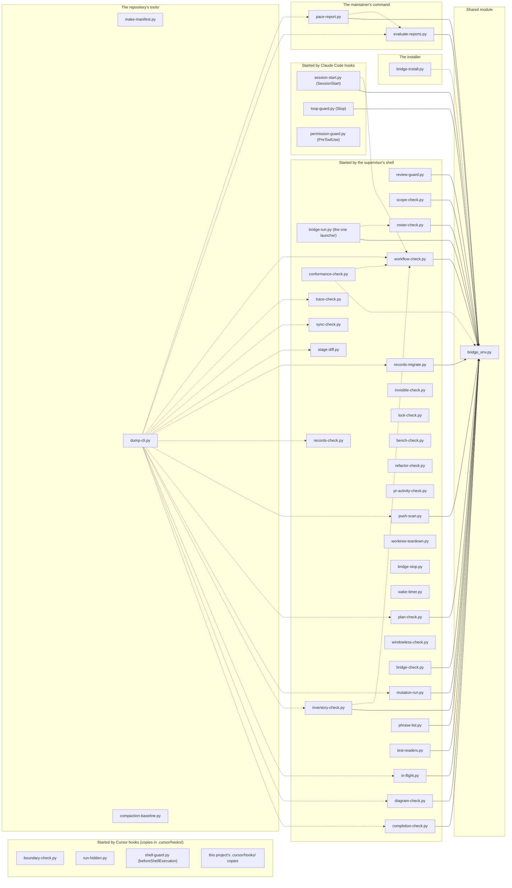

*This is round 4.* The record below lists what the earlier rounds found, what was fixed and what was accepted with its reason; the accepted findings are settled. The text below is the text as it now stands, and the change since the last round's file (built from commit 3c3de66) closes this file. Judge the fixes as you judge the rest: whether each hook addition, a group of its own with a command of its own, reaches a computer that holds 2026.11.23a, is found by the install check and leaves with a rollback; whether the three states of the built set (known, unknown, not to be read) agree across the roster's rows, the launcher's refusals, R-107, D-003 and D-004, and each REBUILD printed is ended by what its line names; whether a rebuild's row as now defined can drop a family whose work still stands; whether the stop hook's chain (another check's refusal, the rows, the debt) can pass three refusals or let a request through without its push; whether any fix contradicts another critic's ask or a sentence elsewhere in the records; and each change the closing list shows. This is the last critique round: after it only a confirming read of what changes follows, so grade by what a finding would cost at the build.

# Design critique: the improvements release's design revision and plan addendum (subject `improvements`), round 4

## What is criticised

The Claude-Cursor Bridge is a Claude Code extension that supervises software projects built by a Cursor builder: instruction texts for an AI supervisor and its subagents, and one-shot Python programs (a launcher, guards, checkers, hooks) installed under the owner's Claude Code folder. Its program release (bridge 2026.11.23a) was installed on 2026-11-24. The improvements release is the project's fourth change cycle: it builds what two Sunday evaluations (2026-11-15, 2026-11-22) of four supervised projects found wrong or missing, 37 program items (C25 to C61), 63 text items (T44 to T108) and 17 pitfalls (KP-084 to KP-100), with two rules the owner gave on 2026-11-15 (a report says whether it needs the owner now or later and every request is sent with a push notification; a choice between options is asked in the question form), a diagram design-decision item of 2026-11-14, and the leads the program release left by name. What is criticised is the change cycle's design revision (change-cycle.md, item 2) together with its plan addendum (item 4), one subject since the addendum stands in this round-1 file: docs/DESIGN.md's section "Change: the improvements release", the register's rows R-106 to R-136 with R-031 and R-037 as closed, the inventory's rows for the release, the diagram index with D-001 to D-004 as revised, and docs/BUILD_PLAN.md's section "The improvements release — the plan addendum" (stages I1 to I5, forty-one increments TASK-085 to TASK-118, six of the numbers split by letters), all quoted below with the plan's standing constraints and the sources as written, so that nothing outside this file is needed to judge either. The texts are read by an AI supervisor that writes each brief from its increment's Done when and runs the increments through the delegation loop (programs through the Cursor builder, texts and records as supervisor-authored increments), and by spec-packager, which writes each brief.

The owner's scope is fixed and not relitigated: the items and their order (C27, C39, T75 and T73 first), the three items placed in this release at the intake, the word budget's principle in the owner's own words, reAngle's part dropped, the standing word that an exhausted pool never parks or pauses work. The one-time install of the duplicate detector, the release's name, the conditional deferral of R-115 and the supervisor's reading of the word budget (three caps moved once, nothing trimmed) are the owner's open decisions at the gate; criticise how the design states them, not the choice.

Judge: whether each item's design fixes the fault its item names (the items as written close this file; where an item's few words leave the fault open, the design's own account of it is what is judged), and whether each deviation from an item's wording (the design's "Deviations from an item's wording") is argued from the code and loses nothing the item wanted; whether the alternate reviewer (`review_b_alt`, the `deviation` entry, the built set read from the run record) can let a model review a change its own family built, by any order of builder runs, rebuilds and fix rounds, by a stale or hand-edited resolved roster, or by a run record that cannot be read, and whether the launcher's two refusals and the roster's ten rows agree on every case; whether `--review <name>` with the launcher-owned log and reply leaves a review launch that escapes the snapshot's name, a reply the guard flags wrongly, or a round in flight broken at the install; whether the secret-path rule's table is stated so that a test can pin each row, what it refuses that the loop's own instructed commands need (a false refusal is a stopped loop), and whether its stated limits are the true ones; whether the permission guard's closed word lists (C26) open a checkpoint the old substring match rightly refused; whether the review guard's last-line rule (C28) can lift the ceiling where the first-line rule refused for a reason that still holds, and whether the pair of records can still be left half written; whether the stop hook's rows can hold a session in a loop of refusals, refuse a report that asks nothing, or be satisfied by a call that is not the request's push, given a transcript that lags and a guard that refuses one request twice at the most, and whether everything built on an undocumented host fact is behind a probe with a stated form for the case that the fact does not hold; whether `interpreters` read at the merge base with `origin/main` and the detector resolved to a per-computer folder can be turned into running a program a builder wrote; whether the mutation engine's import-path mapping, `--observe` and `--check-anchors` can report a mutant killed that was never loaded, or make an observed list pass as a proof; whether the completion check's new failure (a planned row whose increments have all merged) and the `pending:` cell can fail a pull request wrongly or hide a row never built; whether the watch's restarts can report green where a check failed; whether the rule budget's handling follows the owner's words (only what a program now holds is retired; the limit raised once, visibly; lowered at the stamp) and its arithmetic holds with the three caps as moved (the rulebook's, the step file's, the digest's under the host's 10,000); whether the text rulings (the design's list) contradict a rule that stands; whether D-001's labels trace every new row and D-002's, D-003's and D-004's revisions agree with the design text and with their enforcing tests; the security criteria (ASVS level 2; the public repository; no secret, account name or path of the owner's computer in a commit, a prompt, a record or a log); the pitfalls (KP-078 a fix briefed by every read; KP-077 a guard's own records as inputs; ISS-017 acceptance tests named first; KP-101 a manifest made before the last edit). For the addendum: the ordering and the dependences (every increment in one chain; each stage's text increment after the programs it names; the budget's increment before any text that needs the room; the two halves of each lettered pair); increments that are secretly two or should be one (the plan check still notes twenty-eight as large, which the addendum's opening paragraph answers); whether every row R-106 to R-136 is carried by the increments that name it under Satisfies and reads built at the increment the entries name; whether each Done when is checkable by a test or a printed line; whether the supervisor's acceptance tests named first can be written before the builder's code exists; whether each Scope holds every file its Done when changes; whether each stage's Demonstration names what is shown live and can be run as written; whether an increment that ends as a records-only pull request where its probe fails (TASK-110b) leaves the plan and the register consistent; whether the stamp, the refactoring pass and the stage review before it, the install's run sheet and the rollback items are placed as the type's rule asks.

## The record so far

## Subject: improvements (the improvements release's design revision and its plan addendum as one subject: the two evaluations' program and text items, the owner's two rules held by the hooks, the pitfalls; 2026-11-24)

**What is criticised:** the change cycle's design revision (change-cycle.md, item 2) with its plan addendum (item 4), one subject since the addendum's increments stand in the round-1 file: docs/DESIGN.md's section "Change: the improvements release", the register's rows R-106 to R-136 with R-031 and R-037 as closed, the inventory's seven new Decisions rows, the diagram index with D-001 to D-004 as revised, and docs/BUILD_PLAN.md's section "The improvements release — the plan addendum" (stages I1 to I5, TASK-085 to TASK-118). The critics read `run/review/DESIGN-improvements-<round>.md`, built from the committed records by run/supervisor/improve_design_file.py, with plan-critic's design-document and build-plan lenses and the lenses the type and the two traits add. The owner's scope (INVENTORY, Decisions: the order's row and the intake's decisions of 2026-11-24, the two rules of 2026-11-15, the standing word on an exhausted pool) is the subject's fixed input: nothing of it is relitigated; the one-time install of the duplicate detector and the release's name are the owner's open decisions at the gate and are criticised only as the design states them.

**Accepted** (finding, critic, round, the reason):
- The ceiling's lift is read from the SCOPE file's last well-formed `Blocking class:` line, not from a line under the current round's heading (Review B, Should fix 3, round 1, accepted in part): the item itself offers "or the last one", and the SCOPE file has no heading grammar a program could hold a round's section by, so a rule built on headings would refuse files that are right. What stands against a line read from the wrong place is fixed in the text: the file is appended in round order, so the current round's line is its last, and both refusals quote the line read with its line number (the design, TASK-097a, TASK-107).
- Stage I3 holds thirteen increments (plan-critic, Consider 4, round 1): its guards' and checkers' sentences are written by one text increment, TASK-107, which needs every program of the stage merged; a split adds a stage close, a whole pass of both reviewers and a demonstration, and no review. `plan-check.py`'s size notes, twenty-eight after two rounds' additions, stand as notes, each kind explained in the addendum's opening.
- A planned row whose Evidence cell reads `pending: <the change's name>` and that no increment names is counted apart in plan mode and is no failure (Review B, Consider 2, round 1): that is the item as asked, a row that waits for its addendum must not fail the plan check of another change, and done mode still fails every planned row, so no release closes over one.
- A push is tied to its request line by the opener alone, not by the line's whole text (plan-critic S5, round 1, accepted in part; the span's boundary and the question form's exemption of the same finding are fixed): a notification is a condensed line under 200 characters and never the report's sentence, so a comparison of the two texts would refuse pushes that are right; the opener says which kind of request the push announces, and the span's boundary keeps an earlier push from answering a later request.
- A stop on a new wait is refused where its message has no `Needs you` line, also where the report asks nothing (Review B, Should fix 6, round 1, accepted in part; the option labels of the same finding are fixed by the offered form): the row is the owner's rule of 2026-11-15 as given, a pause that waits for the owner says so in its line and on the phone; a wait that needs no line costs one refused stop, and `Awaiting user on:` is the supervisor's to keep empty where nothing waits.
- Every builder row under a branch's name counts, so a name used again inherits the families of its earlier life (plan-critic, Consider 2, round 2): the error is toward one refusal more, never one fewer; an increment's branch is deleted at its merge and its id is given once; and a second rule over the rows' `head` would add a case to a reader whose every case is a test.

**Rounds** (round, kind, the commit its file was built from, critic, Blocking / Should fix / Consider, what was fixed):
- 1, critique, e9985f0 (text at e96e5a0), plan-critic (claude-fable-5-2, its installed pin): 1 / 16 / 8. Fixed: B1 (the builder-model exception inherited the family check's fail-open: a run record missing, unreadable or with a damaged row, beside a `deviation` entry left from an earlier resolve, let the builder's own model review what it built) by a built set that is known or unknown: known only where the record opens, every line parses and every report file the branch adds under `handoff/` has its builder row; unknown never reads as nobody having built; a `deviation` honoured only where the set is known, the model's family is not in it and the entry's families equal the set read at the launch, else "resolve again"; where unknown the roster prints REBUILD with the cause and the launcher refuses a review by any builder's family, with D-004's flows from the run record and the resolved roster (the design, R-107, TASK-086a, TASK-086b); S1 a brief's earlier runs are dropped only where its later first-round run is a rebuild from the checkpoint, started on a clean tree at the commit the brief's first run started on, the row gaining `head` and `clean`; S2 the roster's table has nine rows, a reviewer excluded by a mark or its pool taking the alternate with the reason `unavailable` or the profile being skipped as today, never a REBUILD for a cause no rebuild removes; S3 a launch that verify answers with `REPLY EMPTY` is no reply at `snapshot` either, the guard's own reading of a log taking the same condition, with the test of a commit before the relaunch; S4 the launcher reads the child's output on a thread and waits on the process, never on the pipe's end, with the test of a child that holds its standard output (KP-033); S5 a span, what the transcript holds after the later of the owner's last message and the guard's last evaluated stop, replaces the turn, and the question form's check passes its second attempt by the guard's own record of its refusal (the push's whole text accepted, above); S6 the eighth host fact has its failure form, the rows built without what the transcript does not hold, and the second attempt rests on no unstated behaviour of the host; S7 the branches of a failed probe: R-115 reads deferred by the owner's word asked at this gate, TASK-096 and the stamp's test reading the row so, R-130's sentence corrected where the pin stays, TASK-110b's records-only pull request redrawing D-004 and the index; S8 `records-check.py` keeps its own list, TASK, BUG and FIX, and is not edited, with the test that a merged DEP or CONFIG subject needs no CHANGES line; S9 the two reference files stand in the Scope of every increment that edits a program, twenty-two entries, each with the criterion that the reference is regenerated and its check green; S10 the secret-path rule's limits named as a class (a path word that is not the path itself, a glob, a variable or a substitution among them), PowerShell's aliases added to the table, the two defaults said to be beyond narrowing; S11 with Review B's Blocking 2 below; S12 with Review B's Should fix 7 below; S13 the step file's cap moves from 8,000 to 8,500 words in TASK-087a's pull request and is lowered at the stamp, the loop's steps 2 to 4 having no sub-file; S14 the reply of record in design mode is the launcher's kept reply file, the design module, `plan-critic`'s text and the policy rewritten by TASK-096, whose Scope gains the agent's file; S15 a re-read that fails tells nothing and is never a pass, the watch started again after the wait's own pause, the last watch's own exit returned after the third; S16 TASK-087a retires ten passages, as it lists. Consider: 1 a test pins that the nominal form ("checkpoint: acceptance of TASK-003") keeps the exemption; 2 with Review B's Blocking 3 below, and a mutant that errs before any test ran is printed as errored, its list left empty; 3 R-118 reads built at TASK-107, which names it; 5 the temporary folder's sentence says that tests are run from the checkout, where the project's `conftest.py` loads; 6 both profiles of the template name an alternate; 7 the rulebook's limit is 158,000; 8 TASK-100a's probe lists every tool of the session that writes a file. Accepted: S5's whole-text comparison, Consider 4 (above).
- 1, critique, e9985f0 (text at e96e5a0), Review B (grok-4.7-medium, design mode; the run verified, the tree as its snapshot): 4 / 10 / 2. Fixed: Blocking 1 (a later first-round run dropped an earlier family whose commits still stand, and an unreadable record resolved as if nobody had built) with B1 and S1 above; Blocking 2 (the interpreters' list was read from `HEAD`, which is a builder's commit before review, a builder can replace the file at a listed path, and D-004 did not draw the read) by reading the list at the merge base of the branch with `origin/main`, none where there is no such branch, admitting a listed interpreter in a stripped run alone, saying what a replaced file gains (the stripped environment a test file already has), and drawing the read on D-004 (the design, R-117, TASK-095); Blocking 3 (the observe mode ended with the ordinary success exit where it changed nothing) by exit 4 on every completed observe run; Blocking 4 (any push met a `Needs you` line, never checked to carry it, and the continued stop was never checked, so a push not yet in the transcript passed unseen) by the push having to hold the line's opener and by a debt in the guard's record: the continued stop is refused once more where the span since the refusal holds no such push, then the debt is dropped; Should fix 1 only a test that passed in the observe run's baseline and failed under the mutant enters a list, and the ordinary run prints `observed lists: <n>`, the number the SCOPE file quotes; Should fix 2 a value of four characters or more is masked wherever it stands and a shorter one after its own name, the rest a stated limit; Should fix 4 `REPLY EMPTY` only where the log names a reply file, a review launched before the install being read as today; Should fix 5 with S15 above, the watch's exit said to be a signal and `ready` the proof; Should fix 6 option labels count only in the form of an offered choice; Should fix 7 (the digest's new words were paid by trims no increment named, against the owner's word that nothing useful is cut to make room) by moving the digest's cap from 9,500 to 9,800 characters in the four tests that hold it, under the host's 10,000, nothing trimmed; Should fix 8 the roster's sentence names `FAIL` and a `--review-alt` the roster cannot grant as the owner's decision; Should fix 9 the addendum's opening no longer claims a live GET capture for a watch; Should fix 10 with S7 above; Consider 1 with S2 above. Accepted: Should fix 3 in part, Should fix 6's new wait, Consider 2 (above).
- 2, critique, 99859ba (text at 1a96de4), plan-critic (claude-fable-5-2, its installed pin): 1 / 13 / 6; it found round 1's B1 path closed for every case the text names, the merge-base read sound, `REPLY EMPTY` unable to void a reply or spend a round, the debt unable to loop, and the rulebook's and the step file's arithmetic holding. Fixed: B1 (the digest's 9,800 did not hold: the hook cuts one output at 9,800 characters with its header among them, the hook's own test would have been red, and three Scope notes forbade the repair) by printing the digest in two parts: a marker line before the standing rules, a third command of the hook's entry, the whole at most 10,500 characters and each part 8,800, which holds under the host's number in bytes too, built by a new increment, TASK-087b, stage I1's texts becoming TASK-087c; the estimate stated in characters, the maintainer's comment and the budgets docstring in its Scope, the host fact's row saying what is documented, what observed and what not stated; and the three text increments name the core's file for the digest's sentences, the plan having placed them in the hook's program, which holds none; S1 the alternate is never resolved on an unknown set, the fifth row saying so; S2 a base that cannot be found is the fourth cause, ended by the checkout's repair with exit 1 and no REBUILD, a tenth row, the base taken with `main` where there is no remote; S3 the record is repaired by the roster check's own option, which keeps every line that parses for the record's other readers, every unknown resolve prints its cause, the launcher begins a new line where the last is torn, and a test holds that the rebuild after a repair seeds no round; S4 the hook's record belongs to one session by its id, another's reading as empty; S5 the debt refuses again only where the request still stands; S6 a line repeated word for word needs no new push until the owner writes, by a hash of the line last allowed, rule 12 saying how a standing request is repeated; S7 the question's mark is spent by the first allowed question, with the test of two questions in one span; S8 TASK-092's Scope names the ten test files that launch or show a review; S9 the index's two sentences corrected and the new transition's test named in TASK-092; S10 stage I2's Demonstration and TASK-095's Author line read the list at the merge base; S11 the CHANGELOG's clause on a round in flight at the install struck; S12 the Diagrams lines of TASK-097b (D-003) and of TASK-086a, TASK-100b, TASK-101, TASK-105 and TASK-106 (D-004); S13 each of the seven proposals named with its row, the seventh a candidate of the refactoring pass and no row. Consider: 1 the limit named, the rule held per branch and a stage's review reading a branch with no builder row; 3 `git clean` refused where a listed path that exists lies under what the command names; 4 a missing reply file reads `REPLY EMPTY` alone; 5 stage I5's Alters names the step file's limit and the index's row for D-004 names R-089; 6 the owner's message after the recorded place empties the recorded wait. Accepted: Consider 2 (above).
- 2, critique, 99859ba (text at 1a96de4), Review B (grok-4.7-medium, design mode; the run verified, the tree as its snapshot): 2 / 5 / 1. Fixed: Blocking 1 (the design made an absent record unknown and the plan made it the empty set, and R-107 printed REBUILD wherever the set is unknown while the table's sixth row resolves `review_b`) by one definition in all three: a record that does not exist is an empty one, the set unknown by its four causes alone, and REBUILD only where the set is unknown and `review_b`'s family is some builder's; Blocking 2 (a rebuild of one brief left the branch's other reports without rows, so REBUILD would be printed again) by the rebuild being of the whole branch, taken back to the checkpoint of its first builder run, every report going with the work it reported, and by each cause naming what ends it; Should fix 1 with S1 above; Should fix 2 with S7 above; Should fix 3 the inventory's row says what the host and the guard do (a chain ended after eight, one request refused twice at the most); Should fix 4 with S9 above; Should fix 5 TASK-092's probe has its form for a reply written elsewhere: no reply file named, `REPLY EMPTY` never answered, the row's sentence corrected; Consider a review launch is refused where the roster program cannot be loaded, where today that is noted. Accepted: none.
- 3, critique, 8db7969 (text at 3c3de66), plan-critic (claude-fable-5-2, its installed pin): 1 / 7 / 4; it read the diagrams through the change list alone, and says so; it found the digest's two parts holding under the host's bound, TASK-087b's place right, the ten rows agreeing with the launcher's refusals on every case it traced, and no fix reversed. Fixed: B1 (the installer adds a hook group only where it holds a command the settings file lacks and never changes a group that is there, the install check and the rollback knowing an entry by its command alone, so the widened matcher would have reached no computer that holds 2026.11.23a, the third `SessionStart` command would have arrived as a second copy of its group, and a rollback would have left both) by making each of the release's three hook additions a group of its own with a command text of its own (the guard for the file tools with `--file-tool`, the question form's check, the digest's second part), each increment testing the merge on a home that holds the older release's entries, a second merge and the rollback, and stage I5 reading the installed file's groups after the install and showing a `Write` on a scratch `.env` refused; the installer's limit is recorded as a lead; S1 TASK-087b opens with the supervisor's probe of three `SessionStart` commands at one event, with its form where they do not arrive whole, and stage I5 reads the three outputs after the install; S2 a continued stop after another check's refusal is read once, a chain three refusals at the most; S3 a new wait refused for a missing line owes either opener; S4 the question form's check allows outside a bridge Workspace and where it cannot write its mark; S5 a rebuild's row is a first-round row on a clean tree at a commit where the branch adds no report, every row before it dropped, with the test of a first-round line moved aside and the next resolve printing no REBUILD, and a record that cannot be opened is no REBUILD's cause (with Review B's Blocking below); S6 the stamp depends on TASK-087b; S7 KP-035's sentence on the hook's registrations is corrected by TASK-087c, and the marker and the maintainer's comment are the supervisor's commit before TASK-087b's checkpoint, the trace files in its Scope. Consider: 1 each part of the digest as it stands asserted under 10,000 bytes; 2 the place is an offset in the file as read, one beyond its end reading as none; 3 with Review B's Should fix 3 below; 4 one fingerprint for each opener. Accepted: none.
- 3, critique, 8db7969 (text at 3c3de66), Review B (grok-4.7-medium, design mode; the run verified, the tree as its snapshot): 1 / 3 / 0. Fixed: Blocking (a record that cannot be opened printed REBUILD, and the repair named as its end cannot rewrite a file it cannot open, so REBUILD would have been printed at every resolve) by a third state: a set that cannot be read at all, the record not to be opened or the branch's base not to be found, resolves nothing, prints no REBUILD and ends the resolve with exit 1 and its cause; Should fix 1 (in that state the launcher still started a review by a model of no builder's family) by the launcher refusing every review launch there, D-003's label and R-107 saying so; Should fix 2 (a line let through after a dropped debt was recorded as allowed, so its push stayed waived) by writing a fingerprint only at a stop where the line's push stood in the span; Should fix 3 (the question's mark outlived the owner's message) by the owner's message emptying the mark with the wait and the fingerprints. Accepted: none.

**Resolution:** (none yet)

## Grades

- **Blocking**: the design cannot go to its gate with it.
- **Should fix**: the supervisor fixes it or accepts it with a reason.
- **Consider**: worth a thought; no round follows from it.

End with the counts per grade. Four rounds at the most, then a confirming read if the text changed, then one resolution round for what is still open.

## The lenses (from plan-critic.md, the design-document section)

## When reviewing a design document

Attack it along these lines:

- **Unstated assumptions.** What must be true for this design to work that nobody has
  written down?
- **Failure modes.** What happens when the network is down, the disk is full, the
  input is hostile, the dependency is a version behind, two things happen at once?
- **Contradictions.** Does any part of the design conflict with another part, or with
  a stated requirement or constraint?
- **Unjustified choices.** Which technology choices have no reasoning attached, or
  reasoning that does not survive a follow-up question?
- **Scope creep.** What is in this design that no requirement asked for?
- **Scope gaps.** Which stated requirement has nothing in the design serving it? Is every requirement from intake, the owner's requirements document, and the design a row in `docs/REQUIREMENTS.md` with an ID? A requirement that appears in a source but not in the register is **Blocking**.
- **The thing that will hurt in six weeks.** Where is the decision that is cheap now
  and expensive to reverse later?
- **Security criteria.** Does the design address authorization, input validation, and
  secret-handling at each trust boundary? Is the chosen ASVS level recorded, and does it fit
  the data sensitivity? Are the security acceptance criteria it implies actually checkable?
- **Migration policy.** Does the data model state which regime the project is in —
  pre-release (edit the schema definitions, rebuild disposable databases, no migrations) or
  shipped (additive migrations first, destructive only with a data-preserving path) — and
  when it switches? A design that plans destructive migrations on a pre-release, disposable
  database is spending risk for nothing; one that plans schema edits after data exists in
  the field is destroying it. Missing regime: **Should fix**.
- **A worked scenario for money and stored data.** Is every rule about money or stored data read against one worked scenario before it reaches code review: a retry after a lost reply, a dry run, a benchmark, an approved live smoke, two users on one account, each step naming the store it reads and writes? A rule no scenario was walked through is **Should fix**; a step that can charge twice or lose a result is **Blocking**.
- **Performance lens (where budgets exist).** Read `~/.claude/cursor-bridge/Performance-Patterns.md`
  (by that absolute path). For each budget in the design: is a mechanism named that
  plausibly meets it at the stated data size — or does the design walk into a catalogued
  pattern (name the `PP-nnn`): a per-item query or model call in a loop, a full scan where
  an index is implied, recomputation of unchanged values, synchronous IO on a hot path, an
  unbounded collection or cache, work on the interface thread, eager startup, per-item model
  calls where batching or a cheaper model would do? Is the budgeted operation measurable in
  isolation with fixed inputs? A budget with no mechanism behind it is **Blocking**; a
  mechanism that cannot scale to the stated size is **Blocking**.
- **Diagram selection (any project with `docs/diagrams/INDEX.md`).** Read `~/.claude/cursor-bridge/Diagram-Planning-Conventions.md`. Does every omitted catalogue kind have a reason that holds for this design? A kind omitted that the design needs — a lifecycle with no state machine, an external service with no inter-system sequence, stored data with no entity-relationship diagram, secrets or personal data with no data flow diagram and its trust boundaries, more than one module with no component diagram — is **Blocking**.
- **Load-bearing detail.** Does every Level 4-5 diagram's stated reason hold, or is it implementation detail that should stay the builder's (**Should fix**)? Conversely, is a load-bearing mechanism — a concurrency protocol, a reservation scheme, a security flow — described only in prose where a diagram would pin it (**Blocking** when getting it wrong corrupts data or money)?
- **Enforcement.** Would what enforces each normative diagram actually catch drift? `review:` where a deterministic check or tests would work is **Should fix**; a diagram nothing enforces is **Blocking**.
- **Meaning across diagrams.** Contradictions the deterministic check cannot see: a sequence that calls in a direction the component diagram does not allow, a state no transition reaches, an entity no component owns, a data flow that crosses a trust boundary with no validation stated, an operational workflow that reaches a screen the mockup does not have. Each is **Blocking**.

## The lenses for the addendum (from plan-critic.md, the build-plan section)

## When reviewing a build plan

The round's file may carry, beside the lenses below, the lenses the parts' conditional workflows add at `planning.critic-lenses`; apply each as one of your own, at the grade it states.

- **Prior-project lessons.** If the plan's "Prior-project lessons" section lists extracted
  issues, does every one of them land on a named increment's acceptance criteria, an
  ordering choice, a brief constraint, or a Phase-5 configuration item? An extracted issue
  that is only mentioned, not attached, is a **Blocking** finding — the lesson will be
  re-learned. If the section says "none", check that the supervisor actually asked (the
  plan records it) rather than skipped the step.
- **Requirement trace.** Read `docs/REQUIREMENTS.md`. Does every `planned` requirement — every screen and state of the approved mockup included — have at least one increment that names its ID under `Satisfies`? Is any increment's claimed requirement only partly covered by its acceptance criteria? An untraced requirement, or a deferral without the owner's dated answer, is **Blocking**.
- **Ordering.** Is any increment dependent on something built after it?
- **Granularity.** Which increments are secretly two or more? Which are so small they
  are noise?
- **Testability.** For each increment, can its acceptance criteria actually be checked,
  by a specific observable outcome? "Works correctly" is not acceptance criteria.
- **Scope boundaries.** Does each increment name the files and directories it may
  touch? Do any two increments overlap on the same files?
- **First runnable point.** How many increments before something can actually be run?
- **Vertical slices.** Is every stage a vertical slice — crossing the layers its features need so the parts are proven to work together and something can be run? A horizontal stage (one layer across many features: all the storage, then all the interface) is **Blocking**.
- **Placement.** Does every increment state `Depends on`, `Parallel`, `Diagrams`, and `Scope`? Are two `Parallel: yes` increments truly independent beyond their files — no shared schema change, API contract, configuration, or fixture? A false `Parallel: yes` is **Blocking** (`plan-check.py` only sees file scopes). An increment whose `Diagrams` omits a diagram it implements is **Should fix**.
- **Stages.** Is every increment in exactly one named stage, and is each stage a coherent,
  demonstrable chunk (normally three to eight increments) rather than an arbitrary cut? A
  stage close is where the supervisor reflects and patches the human-facing documents, so a
  stage that cannot be demonstrated on its own gives that reflection nothing to report.
  If it is more than a few, the plan is back-loading risk.
- **Missing increments.** What has to happen that no increment covers — error handling,
  configuration, teardown, migration, packaging?
- **Command reference (an approved command design).** Where the interface phase approved a command design (`docs/design/COMMANDS.md`), does the increment that first builds one of its commands carry the command reference's generator and its currency check, and does every later increment that adds or changes one of its commands carry "the reference regenerated and committed" as a criterion, whatever the part's traits (planning.md, "What the interface phase hands to the plan")? Without it the supervisor has nothing to look commands up in (rule 32) — **Blocking**.
- **Change-cycle addendum (a finished project being changed).** Does each new stage state
  which existing behaviour it may alter and that everything else is unchanged? Are the
  tests that pin existing behaviour kept, not rewritten? Is the version bumped in the
  single version source, and is the Packaging & installer stage re-run last so the shipped
  deliverable carries the new version? An addendum that quietly changes existing behaviour
  without saying so is **Blocking**.
- **Already built, already settled (any project with `docs/INVENTORY.md`).** Read the inventory first. An increment that builds what Features already lists, a step that asks the owner for a resource Resources already lists, or a design change that reverses a Decision without quoting its recorded reason and the circumstance that changed is **Blocking**.
- **A trait missing.** A part whose `Delivery kind:` row is `installer` or `install-script` whose plan's critique file carries no packaging lens, a design or intake note naming a service run by others (a third-party API, SDK or provider) whose plan's critique file carries no external-service lens, a design that shows screens whose plan's critique file carries no design-criteria lens, or a design naming a budget whose plan's critique file carries no benchmark-increments lens, is a finding that a trait is missing (**Blocking**: the trait's additions never reach the build).
- **Project end is the last stage close.** Does the plan name its last stage so that its
  close is unambiguous? A plan whose end is "when everything is done" leaves the supervisor
  unable to recognise project end.
- **Security criteria (logic/auth/data increments).** Does each increment with logic, auth,
  input-handling, or data-access surface carry checkable security acceptance criteria ("no
  new Semgrep high findings", "passes OSV/Socket", "authz enforced at the boundary per ASVS
  §x") rather than "is secure"?
- **Unnecessary code (advisory).** Does any increment plan to build what an existing helper,
  the standard library, a native platform feature, or an already-installed dependency
  already provides? Is any increment speculative — building for a requirement nobody stated
  (YAGNI)? Suggest the reuse; never at the expense of a required security, observability, or
  accessibility control.

## The lenses the trait installable adds (workflow/traits/installable.md, `planning.critic-lenses`; the part's delivery kind is host-installation, so the packaging-stage lens does not apply and the command-reference lens does)

## Add at planning.critic-lenses

- **Packaging stage (installable software: desktop application, command-line tool, local
  server).** Is the last stage "Packaging & installer", and does it carry
  `Delivery-Conventions.md` §2 / §3 / §4 as checkable acceptance criteria — one-command
  build or install, committed installer or install script, per-user install registered in
  Apps & features (a CLI on PATH from an isolated environment built from the lock file),
  upgrade in place keeping data, Upgrade / Uninstall / Cancel when already installed,
  uninstall keeping data, the lifecycle verification passing, the manual's install chapter?
  A plan for installable software without it is **Blocking**: the owner cannot install the
  result.
- **Command reference (any command-line surface).** Does the increment that first adds a
  command also add the reference generator (`scripts/dump-cli.py` → `docs/cli-reference.json`)
  and the CI currency check, and does every later command-changing increment carry
  "reference regenerated" as a criterion? Without it the supervisor has nothing to look
  commands up in and will instruct the owner from memory — **Blocking**.

## What the type host extension adds at the design and the plan (workflow/types/host-extension.md, `design.sections` and `planning.stages`; context for the design's host section, its Delivery and the stamp's place)

## Add at design.sections

The host's rules are not the project's: the host decides how its extension points behave and changes them with its updates. So the design gains a section on the host, recording each behaviour of the host's extension points the part relies on (when a hook runs and what it may change, how a setting is read, what a command is allowed to do) as a verified fact: what was checked, how it was checked (a probe run in the host, or the host's own documentation for that version), and the host's version it was checked on. A probe that checks such a fact runs as the tests do, in a host kept apart from the owner's own, and its use of the owner's account or paid usage is put to the owner first, as the test step's addition says. A behaviour not yet checked is written as an assumption, and the first increment that relies on it checks it before anything is built on it. A fact holds for the version it names: when the host the project is built against reports another version, the facts the part relies on are checked again before the next increment that relies on them, and a fact found changed is a defect like any other, or a question for the owner where it changes what the part can do.

## Add at planning.stages

Where the plan's last stage is the release's own install (the release stamped, installed into the host, and tried on a project that uses it), the stage review of the release's text runs before the stamp, so that what is stamped is what both reviewers read; a correction to text alone found after the stamp rides with the next release, unless it changes what a project does, which takes a fix release of its own; and the release's field acceptance names what may stand in for it while the trial project has no increment at the gate (a probe of the installed release on the conditions it fixes, say), the acceptance itself recorded when that increment comes (P17), and names no clause the text's own stop case can keep from being met on the trial project, or says what stands in for it. The stage's demonstration runs on the stamped tree before the install; a part that can only be read against the installed programs is named in the `Demonstration:` line and runs at the calibration.

## The trait External services, whole (workflow/traits/external-services.md; the part carries it since the program release; its `planning.critic-lenses` lens applies for GitHub's API as programs of the bridge read it, for the scanner's release as the security floor's increment reads it, and for the documentation service)

# External services

## Add at planning.stages

For every **external service** the software talks to (a third-party API, SDK, or
provider), the plan's first increment on that integration is a **contract capture**: an
attended live call that records the service's real responses as fixtures (secrets
scrubbed), which the adapter's tests then replay. A mock the builder invents encodes the
builder's *assumption* about the service, and a wrong assumption produces a
self-consistent green test — six adapters once merged green that way and every one failed
on its first real call (KP-020). "Done" for an external-integration increment means passing
against recorded real responses or an attended live smoke, never against an invented mock.
The live call needs the owner's key and possibly money: that is the existing
secret/cost escalation, asked once per service.

## Add at planning.critic-lenses

- **External-service integrations.** For every third-party API, SDK, or provider the
  software talks to: is the first increment on it a **contract capture** (an attended live
  call recorded to fixtures, secrets scrubbed) that later increments replay, with "passes
  against recorded real responses" as the acceptance criterion? An adapter increment whose
  only evidence is a mock the builder writes is **Blocking**: it tests the builder's
  assumption about the service, not the service (KP-020).

## Add at delegation-loop.inspect-checks

Every wait on a remote service in the diff is bounded: `diff-reviewer` checks, as it reads the diff, that a call to a service run by others carries a timeout and, where it retries, a bounded retry, and that a call which must not run twice (a paid call, a call that changes something at the service) is not retried; a wait with no bound is a blocking finding, re-delegated like any defect (step 7).

## Add at delegation-loop.test-checks

For an increment that deploys the part or prepares what will be deployed, the deployed layout is tested before any deployment: the part runs from the files and the configuration it will be deployed with, its configuration read as the deployed part reads it, and a test that passes only in the development layout does not count; a failing one is a correctness-class block (step 7).

## Add at delegation-loop.brief-constraints

Every remote wait the increment adds is bounded: the brief names the timeout and the retry limit of each call to a service run by others, the limit zero for a call that must not run twice, and the builder adds none without them.

## The design revision: docs/DESIGN.md, "Change: the improvements release", whole

````markdown
## Change: the improvements release (2026-11-24) — the two evaluations' program and text items, the owner's two rules held by the hooks, the pitfalls

**Subject** (the critique's token): `improvements`, one subject with its plan addendum, whose increments (docs/BUILD_PLAN.md, "The improvements release — the plan addendum", stages I1 to I5, TASK-085 to TASK-118) stand in this subject's round-1 file (design.md, "The procedure").

### Purpose and scope

The improvements release builds what two weeks of three projects working under release S reported and the Sunday evaluations of 2026-11-15 and 2026-11-22 numbered. It is the third item of the owner's order (INVENTORY, Decisions, "The order of the bridge's coming updates"; decision D9, answered 2026-11-22), opened as a change cycle on 2026-11-24, the day the program release closed. Its items, each named by the label its source gave it:

- **the evaluations' program items** C25 to C61 (37), C38 as widened by the second evaluation's row 30 and C39 as widened on 2026-11-22;
- **the evaluations' text items** T44 to T108 (63; T84 and T90 are unused numbers);
- **the pitfalls** KP-084 to KP-100, with the recurrences the evaluations add to KP-052, KP-054, KP-055, KP-080 and KP-082;
- **three items decided for the program release and never built**, since no plan revision came before its stamp: the owner's two rules of 2026-11-15 (every request to the owner states its kind, now or later, and is sent with a push notification, a hook checking it; every choice between options is asked in the question form, the stop hook refusing a choice put in prose, with a pitfall entry) and the diagram design-decision Feedback entry of 2026-11-14. The owner placed them in this release at intake (2026-11-24, the question form: "In this release (Recommended)");
- **the leads the program release left by name** (its CHANGELOG entry; HARDENING, "Project end of the program release"): the security step's word over open alerts, `premerge-records`' pair of records where a write fails, the pace report's Started count over a refactoring pass's gate name, the tests that take their week when they are imported, `cursor-configurator`'s missing `tools:` line, the weekly scan found by its trigger in one program and by its file name in another, D-004's note on a probe that has since decided, and the three refactoring candidates in the tests;
- **the seven proposed bridge changes** of the program release's project end (Feedback, FB-132 to FB-137, and ISS-048), each by its number there: 1, the move mode's clause over a range of several pull requests, and 5, an agent definition started once after the install, in the planning texts (R-133); 2, the calibration's older version, and 4, the files it reads by heading, in the calibration's text (R-134); 3, the security step's kind line, a program change (R-131); 6, the pitfall KP-101 (R-135); 7, the stamp tests' shared helper, which is no governance edit and no row: the first candidate of stage I5's refactoring pass;
- **two register rows closed**: R-031 and R-037, deferred since 2026-10-31 for reAngle's and the video factory's calibrations. The owner dropped reAngle's part at intake (2026-11-24: the prototype is not continued); the video factory calibrated on 2026-11-12 and again on 2026-11-24.

**Why.** Each program item is a place where a program refuses work that is right (the mutation engine on an editable install, thirteen increments of one project without it; a `Satisfies` line written as bullets; a checkpoint subject holding the word "acceptance"), answers without its cause (a scope drift with no window named, a premerge run from `main` printing GATE-INTEGRITY), or leaves to the supervisor's hand a step the reports show the hand gets wrong (a review log named apart from its snapshot, twice in this project; a pause on an exhausted pool the owner called intolerable). Each text item is a sentence the reports show missing or contradicted, most of all in what a reviewer may write and where (four entries in three projects) and in how a builder's report quotes what it ran (two projects). None changes what the bridge is for.

**The release's name.** The owner's order says the name is proposed at this design. The proposal is to keep the working name, "the improvements release", its version the stamp's day in the form `2026.<mm>.<dd>a`, as every release before it. It is put to the owner at the gate.

### Non-goals

- No gate, ceiling or run parameter changes. The two-reviewer gate, the short gate for records, the round ceilings, the one whole suite per pull request and release S's blocking classes stand. C39 adds a second choice of Review B's model and makes the independence rule stricter, never looser ("The roster").
- No lead is built because its trigger fired. This project's own Feedback entries after FB-117 that no evaluation has read (FB-118 to FB-131) are not in scope but through the leads named above: a later Sunday run's items join only where the owner places them (the order's own words).
- The permission guard does not become a sandbox. C46 holds the supervisor's own tool calls and the commands it types; what a program does once started, and what a builder or a reviewer does inside `cursor-agent`, is outside it, said in its threat-model row.
- Not built, each with its reason under "Impact on existing behaviour": a `--kind mutation` (C54), a priority in the heavy slot (C51), the review's whole message stream (C41), a run failed by the program on a denial phrase (C44), an environment name that moves the launcher's record (C36), an exemption for a 64-hex value by its row's kind (C56), a rule for `docs/contract/` (C53), a REFAC name compared without regard to case (C35), the prefixes DEV and TEST (C30), the guard reading mutants files (C42), a detector shipped inside the bridge (C54), option B of the path rule (C60). C48, C61's step and T85 are in force already and gain nothing but what is said under their labels.
- The maintainer's files outside `bridge/` are not this release's. The CHANGELOG entry names what they should carry (T69's run-sheet template); `commands/evaluate-reports.md` is inside `bridge/` and carries T98.
- No instruction text is trimmed to fit a cap. The host cuts what a hook adds to the context at 10,000 characters, which no release can move; under it the digest's own cap, the step file's and the rulebook's are numbers earlier releases set, and each moves once, visibly, as the owner decided ("The rule budget").

### What changes — the items by home

Every label is the item's own; the register's rows R-106 to R-136 group them. Program facts were read on main at 669d3b4 on 2026-11-24 by nine read-only scouts and checked by the supervisor where a decision rests on them (run/supervisor/improve-scout-*.md, local). Where an item's wording does not match the code, the form built is stated here and the difference is listed under "Impact on existing behaviour".

**The mutation engine, `mutation-run.py`.**
- *C27 (first).* Today the copy's root alone is put on the import path, so a project installed into its environment in editable form is imported from the Workspace and every run is refused by the resolution check, with a line that names neither the cause nor a remedy. Built: before its checks the program asks the interpreter it is about to use, in the environment the run will get and with the copy as working folder, for its import path; every entry that resolves inside the Workspace is mapped to the same folder of the copy, and those folders stand first on the run's `PYTHONPATH`, ahead of the copy's root. The same roots are handed to the reading of a mutant's dotted module name, which today knows the root and `src/` only, so a module under `sdk/src/` is checked by the name it is imported by. A mutants file may also name the roots itself, `import_roots`, a list of folders relative to the Workspace root, each refused where it is absolute, leaves the Workspace or passes through a link; this is the remedy where an editable install answers through a finder and leaves no entry on the path. The resolution check stays the proof and its exit stays 2; where it still fails, its line names the module, where it was loaded from, that an editable install of the project is the usual cause, and the `import_roots` key. Whether a named finder answers before the import path is not something the program decides: the check does.
- *C25.* `--observe` runs every mutant of a file once and prints, per mutant, the tests that failed; where a mutant's `expect_fail` list is empty, which this mode alone admits, it writes the observed ids into that list and marks the mutant `"observed": true`; where the list is not empty it prints the difference (an expected id that did not fail, a failing id not listed) and rewrites nothing. It writes by a temporary file and a replace, changing nothing else of the file, refuses `--checkpoint` beside it, records nothing in the cache and ends with an exit of its own, 4, whatever it wrote and never 0, "observed, not proven": the ordinary run after it stays the proof, its result line says of a mutant whose list was observed that it was, and its last line counts them, `observed lists: <n>`, the number the SCOPE file quotes. Only a test that passed in the baseline the mode runs first is written into a list, so an observed id is a test the mutant turned red; a mutant whose run errs before any test ran is printed as errored and its list left empty. An errored mutant's first failure lines are printed (C43's helper). The refusal of an empty list names `--observe`; it does not name the form `expect: survive <reason>`, which does not lift the rule (the code as read, lines 323 to 337).
- *C43.* Where pytest ends with exit 2 or another error in a mutant's run, in the baseline or in the resolution check, the first twenty lines of its output are printed under the result line, each value of the copy's `.env` of four characters or more replaced by `<masked>` wherever it stands, and a shorter one where it follows its own name and `=` or `:`, since the copy holds that file and a traceback may print what a setting holds. A value of one to three characters standing alone is the limit that stays: masking every such string would leave no line readable.
- *C42.* `--check-anchors [<base>]` reads every mutants file under `run/supervisor/`, keeps the mutants whose anchored file the range from `<base>` (default `origin/main`) to the working tree changes, and checks each one's anchors on the working tree without a copy or a test run; it prints each stale mutant with its file and ends with exit 1 where one is stale. Every result line of an ordinary run is printed as it is produced and flushed, so a run stopped at its limit shows what it did; the first line of a run states how many mutants will run and how many are kept from the cache. The merge step runs the anchor check before the push, and a stale mutant is anchored again and run again by an ordinary run of its file. The guard reads no mutants file: they are local and ignored.

**The roster, `roster-check.py` and the launcher's two review refusals.**
- *C39 (first), with T108 and T103.* Today a profile whose Review B is of the family that built the change resolves with a REBUILD entry, and the launcher refuses a review on the profile's builder model, so a grok-built branch under the native profile has two answers only: rebuild it with the other builder, or wait. Built: a profile may name a second reviewer, `review_b_alt`. The families that built a branch are read from the launcher's run record: every builder run of every brief of the branch counts, and the runs before a later run are dropped only where that run is a rebuild's: a first-round run whose row reads a clean tree and a commit at which the branch adds no report file over its base, the row gaining the launch's `head` and `clean` for it. A rebuild is of the whole branch, so every row before its row is dropped, whatever brief it names; a row without the two fields, or whose commit git does not know, drops nothing, so a second run on a tree that still holds an earlier run's work counts both. The set can be read where the record, where it exists, can be opened, a record that does not exist being an empty one, and the branch's base can be found, its merge base with `origin/main`, or with `main` where the repository has no remote. Where it can be read it is **known** where every line of the record parses and every report file that the branch adds over that base, committed or still in the working tree (a file under `handoff/` whose name ends `-report.md`), has a builder row for its brief; otherwise it is **unknown**, and unknown is never read as nobody having built, since the record lies in the checkout, where a builder or a reviewer can write. Where it cannot be read at all, nothing is resolved and nothing is reviewed: the resolve ends with exit 1 and the cause (a record that cannot be opened, neither `origin/main` nor `main`, a detached head, a git error), the launcher refuses every review launch with the same cause, and no REBUILD is printed, which no rebuild would end; it is a fault of the checkout that the supervisor repairs. Every resolve on an unknown set prints the cause on a line of its own, whatever it resolves, so a damaged record is seen while the reviewer is still of no builder's family. While the set is unknown the alternate is never resolved, and `review_b` reviews only where its family is the family of no builder the roster file names. The reviewer is the first of the profile's `review_b` and `review_b_alt` whose family is in neither the known built set nor Review A's and whose pool and marks allow it; where it is the alternate, the resolved file carries a `deviation` entry (the model, the reason, `family` or `unavailable`, the branch, the built families) in place of `rebuild`, and the check prints a DEVIATION line. Where what was built leaves no reviewer, or the set is unknown and `review_b`'s family is some builder's in the roster file, REBUILD stands as today, which is work and never a wait, and its line names what ends it. A rebuild is of the whole branch: it is taken back to the checkpoint its first builder run started from, so every report the branch added goes with the work it reported, and its first-round brief is run again, the run writing its row; a report without its row is ended by that. A line that does not parse is not, since it would still not parse: it is ended first by `roster-check.py --repair-record`, which keeps every line that parses in its place, moves the others to `run/launcher/runs.damaged.jsonl` and prints both counts, so the record's other readers (the launcher's learned limits, the scope check's windows, the pace report, the review guard's seeding of a report that has no row) keep what they read; a report whose row was among the lines moved is then a report without its row. The launcher appends each row on a line of its own, beginning a new line first where the record's last byte is not one, so a torn last line damages no later row. Where a mark or a pool leaves no reviewer, a cause no rebuild removes, the profile is skipped as today. The launcher's family refusal reads the same built set, where today it reads the last builder run alone, and where the set is unknown it refuses a review by a model of any builder's family the roster file names, where today an unreadable record refuses nothing. Its refusal of a review on the profile's builder model lets the launch through only where the resolved file's `deviation` names that model for this branch, the set is known, the model's family is not in it, and the entry's recorded families equal the set as read at the launch; otherwise the refusal says to resolve again. That exception fails closed: nothing the launcher cannot read opens it. `roster-check.py --review-alt <reason>` resolves the alternate on request under the same checks, for T103's case, the reason recorded in the entry.

| The branch's built families | The profile's `review_b` | `review_b_alt` | Resolved |
|---|---|---|---|
| known: none (a design, a records change), or some and `review_b`'s not among them | usable | any or none | `review_b` |
| known, `review_b`'s among them | usable but for that | independent (its family in neither the built set nor Review A's) and usable (its pool not exhausted, no mark) | the alternate, with `deviation` (reason `family`) |
| known, `review_b`'s among them | usable but for that | none named, or not independent, or not usable | REBUILD with the profile's builder, as today |
| known | excluded by a mark or its pool | independent and usable | the alternate, with `deviation` (reason `unavailable`) |
| any | excluded by a mark or its pool | none named, or not independent, or not usable, or the set unknown | the profile is skipped, as today: no rebuild removes the cause |
| unknown | usable, its family no builder's in the roster file | any or none | `review_b` |
| unknown | usable, its family a builder's in the roster file | any or none | REBUILD, the cause and what ends it named |
| known, on `--review-alt <reason>` | refused by its provider (T103) | independent and usable | the alternate, with `deviation` (the reason given) |
| any, on `--review-alt <reason>` | — | none, or not independent, or not usable, or the set unknown | exit 1, the cause named; the owner's decision ("Failure modes") |
| cannot be read: the record cannot be opened, or the branch's base cannot be found | — | — | exit 1, the cause named, no REBUILD, and the launcher refuses every review; the checkout's fault, the supervisor's to repair |

  The bridge's template roster names `composer-2.5` as `review_b_alt` in both profiles: in the full profile it is a third family beside the builder's and the reviewer's, on the native pool, so a provider's refusal of the reviewer has an alternate while no pool is exhausted; in the native profile it is the profile's own builder model, the one family of the native pool beside xAI's. A profile's three first models stay of three families, as the check holds today. *T108:* the core's rule 38, its digest line, the policy's roster section and step 3b say that an exhausted pool never parks or pauses work: the roster resolves the next profile, then the alternate reviewer, then the rebuild, and only `FAIL`, no model answering at all, and a `--review-alt` the roster cannot grant are the owner's decision; the sentences that today say the work waits for a reset are rewritten to that order, and the Cursor tool's sign-in (exit 5) stays apart, the owner's action. *T103:* the policy names a provider's safety refusal beside the usage-limit message: a failed launch that is not recorded as the model's failure, one re-run whose prompt opens with a sentence of context, then this review alone on the alternate by `--review-alt safety-refusal`; a project whose code is security tooling opens its Review B prompt with that sentence from the first launch.

**The launcher, `bridge-run.py`.**
- *C59 and C41, one mechanism.* The launcher never sees a child's output today: both streams are inherited handles, and the review log's name is the shell's redirect, which the launcher is never told. Built: a review launch of `cursor-agent` carries `--review <name>`, the snapshot's own argument. The launcher refuses the launch with exit 125 where the guard holds no snapshot of that name, naming the snapshot command; opens `run/review/REVIEW-<name>.err` itself and points its own standard error and the child's at it, so its started line stays the file's line 1 and its exit line the last; and passes the child's standard output through to the session while writing every chunk, as it arrives, to `run/review/REVIEW-<name>.out`, a file it names on a line of the log, `bridge-run: reply run/review/REVIEW-<name>.out`. It reads the child's output on a thread of its own and waits on the process, never on the pipe's end: when the child ends, the launcher closes the job as today, takes what the pipe still holds within five seconds and ends, so a program the reviewer left running holds no run open (KP-033). A review launch without the option is refused with the form to use, the design mode's names (`DESIGN-<subject>-<round>`) alike. `review-guard.py verify` excuses the `.out` file as it excuses the `.err`, keeps it, and, where the log names a reply file, says `REPLY EMPTY` where the run ended with exit 0 and that file is missing or holds no word, a launch that counts for nothing: the round gets no reply and the mark is written as for a failed exit, one `premerge` refuses. The guard's own reading of a log as the round's reply takes the same condition, so an exit 0 beside a named reply file that holds no word is no reply at `snapshot` either, and a commit made before the relaunch spends no round. A log that names no reply file, a review launched before the install, is read as today. The constant Review B command loses its redirect in every text that shows it. What is kept is what the agent printed; where the agent's print mode gives its last message only, that is what the file holds, and T76's sentence makes a reply that carries no VERIFIED section a failed launch.
- *C44.* For builder and review launches the launcher counts, in the output it now passes through, the lines that match the host's own denial of a tool call, and prints `bridge-run: TOOL-DENIED <n> line(s)` after the run; the run's exit is the child's. The loop's step 4 reads the line: a builder run that carries it is treated as failed (step 3b) unless the lines are quoted material. The denial's text is not in the code today; the increment opens with a probe that captures it from the Cursor tool ("The host"). A builder launch's output is read as a review's is, on a thread, the wait on the process.
- *C29, with T96.* One reader in `bridge_env` returns a brief's `Satisfies` ids from its line and from the bullet lines directly beneath it, each id once; the launcher's comparison with the header and the brief's own readers use it, comparing as sets. `Satisfies: none` followed by an id is a finding of its own: the refactoring variant writes exactly `Satisfies: none`. The launcher's refusal prints both lists and the remedy, and `plan-check.py` prints a `BRIEF` line for an unmerged brief whose header disagrees and for a `none` that carries ids. A plan's own `Satisfies:` stays one line.

| The brief's prose | The header's `satisfies` | Read as | Answer |
|---|---|---|---|
| `Satisfies: R-077, R-078` | `[R-077, R-078]` | R-077, R-078 | launched |
| `Satisfies:` with `- R-077` and `- R-078` beneath | `[R-077, R-078]` | R-077, R-078 | launched (refused today) |
| `Satisfies: R-077, R-077` | `[R-077]` | R-077 | launched (refused today) |
| `Satisfies: R-078, R-077` | `[R-077, R-078]` | the same set | launched (refused today) |
| `Satisfies: none` | `[]` | none | launched |
| `Satisfies: none (R-105 ...)` | `[]` | a `none` that carries ids | refused, the line and the remedy named (refused today without them) |
| `Satisfies: R-077` | `[R-078]` | differ | refused, both lists printed |

- *C36.* The launcher removes its pid file before it ends a run at its limit, where today the path that is not a watch ends the launcher first on Windows and leaves the file. The guard test of R-079 is widened to every test file that names the launcher and to the pid folder. No environment name moves the record.
- *C37.* For the driver and the test kind the child's environment gains `PYTHONIOENCODING=utf-8` where the caller set none. The launcher still sets no `PYTHONUTF8`. `merge_ids` is written sorted already (the program release's J9), held by its test.
- *C49 and C58.* `gh run watch <run id>` with `--exit-status`, `--interval <n>` and `-R <owner>/<repo>` is a watch, started directly. After a watch of a pull request's checks ends with a non-zero exit, the launcher reads the head's checks once more: a failed check returns the exit; none failed, or the read itself failed, the usual companion of the fault, which tells nothing and is never taken for a pass, and the watch is started again after the wait's own pause with a line saying which, at most three times and within the run's limit, the count written in the run's row; after the third the last watch's own exit is returned. A watch's exit is a signal and never the proof: `ready` reads the head itself before any merge.
- *C51.* The slot's holder record and the waiter's line gain the holder's limit in seconds and the name of its project folder with its branch. There is no queue and no priority.
- *C54.* The generic refusal of a test launch names the driver kind where the command is a program under `run/supervisor/` or the installed mutation engine, which the driver kind admits already. A project may declare further interpreters, `interpreters` in `project.json`, paths relative to the Workspace root; the launcher reads the list from `project.json` as the merge base of the branch with `origin/main` holds it, which is gated content, never from the working tree or from the branch's own commits, and admits a named one, in a stripped run alone, where it lies inside the launch roots through no link; a repository without `origin/main` admits none. What a declared interpreter runs is what a test file runs already: a builder that replaces the file at a listed path gains the stripped environment its own test code has, and nothing else. The duplicate detector runs as a driver by the one word `jscpd`, which the launcher resolves to the copy installed once per computer under `~/.cursor-bridge/tools/jscpd/` and to nothing on `PATH`, with the pass's own options and folders under the launch folder; absent, the refusal says where the setup installs it. *T74:* the launcher's help names what a stripped run no longer sees.

**The review guard, `review-guard.py`, and `refactor-check.py`.**
- *C28.* The guard reads the last well-formed `Blocking class:` line of the SCOPE file, where today it reads the first, so a file that keeps each lifted round's section opens the next round; the last `Round cause:` line alike. Both refusals quote the line read. A class already recorded for another round still opens nothing.
- *C55.* `premerge` run on another branch than the snapshot's answers `CANNOT CHECK - premerge runs on the reviewed branch <x>; this checkout is on <y>`, exit 2, where the head does not descend; a branch that still descends passes as today.
- *C53.* Every new or changed file under `docs/design/` takes the full gate. `docs/contract/` exists in no text or program and gets no rule.
- *The pair of records.* `premerge-records` writes the ready record first and the premerge record second, each by a temporary file and a replace; where the second fails it removes the first, and where that fails too it says so and names the file. A ready record without its premerge record opens no merge, so no half pair can.
- *C35 and C33.* `refactor-check.py` reads a branch by its commits from the merge base: a commit that changes only test files is of the tests lane, one that changes only product files of the production lane, one that changes both is IMPURE and named; `handoff/`, `run/` and `docs/` but `docs/CHANGES.md` are neutral; uncommitted changes count as one more commit. One budget, one verdict, the exits unchanged; `--lane` is accepted and ignored with a note. The budget leaves out `docs/refactor/`. The REFAC name stays compared exactly, and the refusal names the one name this branch admits.

**The permission guard, `permission-guard.py`.**
- *C26.* The words that keep a commit from counting as a checkpoint are whole words: accept, accepts, accepted, accepting; release, releases, released, releasing; ship, ships, shipped, shipping; merge, merges, merging. "acceptance", "releasable" and "shipment" no longer refuse.
- *C46.* The guard reads two lists of secret paths: `secret_paths` in `project.json`, paths relative to the Workspace root, a trailing slash naming a folder and everything under it; and the per-computer file `~/.cursor-bridge/secret-paths.txt`, absolute paths, one a line, for a key file that lies outside every Workspace, since no path of this computer enters a commit. `.env` and `secrets/` at the Workspace root are listed always, and so is the per-computer file itself; these defaults cannot be narrowed, and a project that keeps tracked files under a root `secrets/` folder writes them by a program of its own or names the folder otherwise. The Workspace root is the call's working folder or its nearest parent that holds `docs/PROJECT_STATUS.md`; outside every Workspace the per-computer list alone holds, wherever the call runs. A second entry of the hook settings runs the guard for `Edit`, `Write` and `NotebookEdit`, its command carrying `--file-tool`, a command text of its own ("Delivery").

| What the hook sees | Refused when |
|---|---|
| an `Edit`, `Write` or `NotebookEdit` call | the file's path, as written or resolved, is a listed path or lies under a listed folder |
| a command with a redirection | the redirection's target is |
| a command whose program writes, deletes or moves by its arguments: `rm`, `rmdir`, `mv`, `cp`, `tee`, `touch`, `truncate`, `chmod`, `sed -i`, `dd of=`, `del`, `rd`, `Remove-Item`, `Move-Item`, `Copy-Item`, `Rename-Item`, `Set-Content`, `Add-Content`, `Clear-Content`, `Out-File`, `New-Item`, PowerShell's own aliases of those cmdlets (`ri`, `erase`, `mi`, `move`, `ci`, `copy`, `rni`, `ren`, `sc`, `ac`, `clc`, `ni`), `git rm`, `git mv` | a path word of it is |
| `git clean` with `-x` or `-X` | a listed path that exists lies inside the checkout and, where the command names paths, under one of them |
| `bridge-run.py ... --key-file <path>` | never: the launcher's own key-file rule reads it |
| anything else | not held: a program's own writes (a script, a test, an interpreter's code); a program outside the table; a path word that is not the path itself, a glob, a variable or a substitution among them; a folder above a listed path removed or moved |

  The opt-in `shell-guard.py`, the builder's hook where a project enables it, reads the project's list, `secret_paths` in `project.json`, beside its fixed patterns; the per-computer file is out of its reach, since a builder's or a reviewer's run has the agent home for its home, and what that file names lies outside the Workspace, where the launcher's `BOUNDARY` lines report a builder's writes. The guard does not hold a builder or a reviewer otherwise: they are `cursor-agent` processes this hook never sees. It would not have stopped the incident behind the item, test code run outside pytest that overwrote a key file: the stripped run (release S) and a project's own test guard are what stop that, and the row says so.

**The checkers.**
- *C30.* A plan heading's increment id takes the prefixes TASK, BUG, DEP, CONFIG and FIX, one explicit list in `bridge_env` that `plan-check.py`, the launcher's merge-unit rule and the merged-id readers share; `records-check.py` keeps its own list, TASK, BUG and FIX, and loads no sibling, so a merged DEP or CONFIG increment needs no `docs/CHANGES.md` line, as today; REFAC stays outside the plan by design, and DEV and TEST stand in no bridge text. A merged subject's id counts as a plan id only where the plan holds its heading.
- *C38 and C40 (`plan-check.py`).* The size note counts the bullet lines where the `Done when` is a list, the clauses otherwise, and a cases table as one item. A parenthesis after a folder is a file list only where every part's first word is a file name; otherwise, and after a file path, it is a note.
- *C31 (`scope-check.py`).* A SCOPE DRIFT path is followed by a line that names why it is not the supervisor's own: the builder run's window it fell in, with the 120-second slack, now a named constant, or the record that could not be read.
- *C32 (`lock-check.py`).* A changed `requirements.txt` beside a tracked `requirements.lock` in its folder is a manifest whose lock is that file; a change of comments and blank lines alone is none.
- *C52 and C57 (`completion-check.py`).* A planned row whose Evidence cell reads `pending: <the change's name>` is listed in plan mode as waiting for its plan addendum and counted apart, never as a problem; once an increment's `Satisfies` names the row the cell is a finding, and done mode fails the row as today. Plan mode prints `STILL PLANNED: R-nnn (named by <ids>, all merged)` and fails where every increment that names a planned row is merged on `origin/main`.
- *C56 (`inventory-check.py`).* The rule stands: a long value in a Resources row is a finding whatever the row's kind, since a 64-hex value cannot be told from a key and the kind is the writer's own word. The finding's line names the remedy the core already gives, the pin recorded by the file and line that holds it.
- *C60 (`push-scan.py`).* A drive path whose first folder is `Windows`, but not `Windows/Temp`, `Program Files` or `Program Files (x86)` is no hit.
- *C61 (`sync-check.py`).* The merge step deletes the merged branch on the remote today (merge.md, step 8). Built: `sync-check.py --merged-branches` lists the remote branches whose pull request is merged, the default branch and `release/` aside, with the command that deletes each; the merge step's sentence says that under `Merge authority: owner` the supervisor deletes the branch at the first checkpoint after the owner's merge.

**Two new programs.**
- *C45, `phrase-list.py`.* Given a phrase, it lists every occurrence under `docs/` (or `--under <folder>` inside the Workspace), letter case and line breaks disregarded, each as path and line; `docs/CHANGES.md` and `docs/archive/` are listed apart and do not count. Exit 0 none, 1 found, 2 cannot read. Run before the first review of a records diff that retires a phrase.
- *C34, `test-readers.py`.* For every file a range changes (default from `origin/main`, the working tree included) it prints the test files whose text names the file, and for a changed record the keys of its changed lines; a file named by more than twenty test files is printed as a count. Exit 0, or 2 where it cannot read. The pre-push step runs the files it lists; the whole suite stays CI's.

**The stop hook and the question form, `loop-guard.py`.** The owner's two rules, as far as a program can hold them:

| Checked | When | Refused |
|---|---|---|
| a span's last message holds a line that begins `Needs you now:` or `Needs you later:` | at every stop, in every phase | no `PushNotification` call whose message holds the same opener stands in the span, unless the line is word for word one whose push the guard found at an earlier stop and the owner has written nothing since |
| a stop is allowed because the status file's `Awaiting user on:` is not empty or the in-flight log's last line is a pause, and that wait is not the one the guard recorded at its last stop | at that stop | the message has no such line, or the span no such push |
| a span's last message holds two or more option labels in the form of an offered choice (`Option A` and `Option B`, or `Option 1` and `Option 2`, each followed by a colon, a dash or a closing parenthesis, or set in bold), outside code and quotations | at every stop | the span holds no `AskUserQuestion` call |
| an `AskUserQuestion` call | before the call (a second entry of the hook settings, the same program) | no `PushNotification` call stands in the span before it and after any earlier question of the span, unless the guard's own record holds a refusal of a question that no allowed question has followed |

  A span is what the transcript holds after the later of the owner's last message and the guard's last evaluated stop, whose place in the transcript the guard records: a push or a question answers the request of its own span, never a later one, however long the owner types nothing. The guard's record is one file and belongs to one session, whose id, from the hook's input, it holds beside the wait's text, the place (an offset in the transcript as read, one beyond the file's end reading as none), for each opener a fingerprint of the request line whose push it last found (a hash, never the line), what its last refusal was for, an opener owed and a question's mark; read in a session of another id (a resumed or forked one, a second session in the Workspace) it reads as empty, so a standing wait or request is announced once more there, and the owner's message after the recorded place empties the wait, the fingerprints and the mark, so the same wait set again after an answer is a new one and no mark outlives the owner's word. A request that stands while the work goes on is announced once: a line that is word for word one whose push the guard found needs no new push until the owner writes. A fingerprint is written only at a stop where that push stood in the span, never at a stop let through after a dropped debt, so a line that was never pushed is refused again at its next stop; rule 12 says that a standing request is repeated in its words. The guard reads the transcript as it reads a pending wake-up today, once more after two seconds where the call is not found, and allows where it cannot read. The run-sheet finding and these are gathered into one refusal. A refusal for a missing push leaves a debt in the guard's record, the opener owed, or either opener where a new wait's message held no line: the stop that follows, which the host marks as continued and the guard allows today, is refused once more only where the request still stands, that is, where its last message holds a line with the owed opener and the span since the refusal holds no push with it, or where either opener is owed, the new wait stands, and the message holds no line or the span since the refusal no push with its line's opener; the debt is then dropped either way, so a request is refused twice at the most, a request withdrawn after the first refusal is not refused again, and a push that was only late in the transcript is found. A continued stop that follows a refusal of another kind (the phase check's, the header's, the agent timer's) is not let through unread, as it is today: the three rows are evaluated there once, a refusal leaving the usual debt, so a request first written in answer to such a refusal is held too, and a chain is three refusals at the most, under the eight after which the host ends one. The question form's check writes its own refusal into the same record with its place, and the first question the guard allows after it spends that mark, as the next evaluated stop does: the second attempt passes without the guard reading a refused call back from the transcript, and a later question of the same span is checked as the first was. The check runs before every question form of every session on the computer, so it allows a call outside a bridge Workspace, by the stop hook's own test, and wherever it cannot write its mark: no bound of the host ends a chain of refused calls, and the guard must not begin one. The refusal of a choice in prose says that a question about the software's features or behaviour stays a conversation in the owner's words (rule 12's bound, KP-075), so that it pushes no guessed options into the form. Where the session has no notification tool the supervisor says so in the report's first line; the cost is two refused stops per request at the most. The core's rule 12 gains the three first lines a report can open with (`Nothing needed — proceeding`, `Needs you now: <the one thing>`, `Needs you later: <the one thing>`) and the push with every request; the stop hook's reach is stated there as it is: labelled options, not every choice.

**The security floor.**
- *C47 and T86.* The weekly scan's frozen block downloads with `curl --proto '=https'`, and its OSV-Scanner pin moves to the newest release older than two weeks on the increment's day, its checksum read from that release's own list (rule 14: a pin moves by a release's decision, never by itself). The block changes in the configurator's text, this repository's two workflows and the tests that hold them equal.
- *C50.* The bridge's Semgrep rules take the `%` and the f-string patterns at `executemany`.
- *The floor's files are current.* `conformance-check.py` gains one row: the project's weekly file holds the installed release's frozen step, compared after collapsing white space, and its copy of the bridge's Semgrep rules file equals the installed one; `MISSING` otherwise, which the calibration turns into configuration work, as every floor. The configurator's rule for replacing a standing weekly file is widened to any earlier release's block.

**The reports.**
- *The security step (`evaluate-reports.py security`).* A project's kind line says how many alerts are open ("green, 18 open alerts") and that alerts are off where they are; an advisory reported for two manifests is listed once with both; the weekly file is found as `dependency-scan.yml` or `.yaml` in any letter case. The lookalike ruling of TASK-077 stands.
- *The pace report.* A refactoring pass's gate name, `REFAC-<stage>`, is a review name and starts no increment; a records subject's guard record still does (R-089).
- *The tests' clock.* The three test files that take their week when they are imported read it when each test runs.

**The texts.** Instruction text is the supervisor's. The items by theme, with the ruling wherever the scouts found today's text in the way; an item not named with a ruling is added as its evaluation row words it, at the home the scouts found.

- *The reviewers' prompts and reports (first): T75, T73, T92, T71, T76, T44, T102.* T75: one sentence replaces the directive clause in the merge step, the three reviewing agents and the policy's pointer: a reviewer writes nothing in the checkout; pytest's own temporary folders under the system's temporary folder are its to use, and one folder made by `tempfile.mkdtemp`, removed by its exact path, for notes and what a differential check writes; tests are run from the checkout, where the project's `conftest.py` loads, never from that folder. T71, ruled against its own wording: an in-session reviewer's run is not stripped, so it writes no probe that imports the project's code; it runs existing test files through the launcher's stripped test kind, names a probe it wanted in its report for the supervisor to write under `tests/`, and lists every command it ran. Review B's run is stripped, so its differential tests in the one folder stand. T73 and T92: a builder's report embeds its outputs from files the run itself wrote (`run/agent/<id>-*.out`, which the brief's Scope admits), colour codes off, never pasted or retyped. T76: every review reply carries a VERIFIED section naming functions or tests, the same name in the reviewer's own format; a bare verdict is a failed launch; the policy's "then a bare verdict" goes. T44: a review launch names no brief and, with `--review`, redirects nothing. T102: every snapshot is written `<ID>-r<N>`, a refactoring pass's `REFAC-<stage>-r1` included; the bare form still reads as round 1.
- *The brief: T45, T46, T48, T51, T52, T53, T67, T72, T87, T91, T96, T100, T107, T50.* T50 as corrected by the code: the copy takes its file names from the index and their bytes from the working tree, so the sentence says that a new file a test needs is listed under `untracked` and that a mutant's own file and tests are staged. T87: hand-applied mutants are left to the program; the builder mutates nothing by hand.
- *Design, interface, planning, critique: T60 to T64, T68, T80, T81, T82, T88, T94, T106, T58, proposals 1 and 5, T78, T89, T57, and the diagram design-decision entry.* T81 and T88: before the interface gate the plan critic reads each variant once against the design and the built product, its Blocking findings are fixed, and one confirming read follows, no further round; every "as today" claim carries the file and line read. T63: a trait a critic finds missing is proposed in the design, its additions written into the plan whatever the owner decides, kept as plain increments where the owner declines the label. T78, by delivery kind: a packaged build's file list is compared with the tracked files that are not code, and its demonstration runs on the installed build before the release is announced; for a host installation the type's order stands. T85 is met since release S. The diagram design-decision entry: reflection's item 2 says that a depiction choice that proved problematic after acceptance becomes an `FB-nnn` entry whose heading begins `Diagram decision:`, with the context, the choice and its alternatives, the problem and the fix; the conventions' section 7 points at it; no program reads the word.
- *Stage close, demonstration, refactoring: T49, T55, T56, T65, T79, T99, T104, T105.* T49 widens rule 32: what a run-sheet step says of the product is looked up in the code first, and a sheet is sent once. T55: the lanes sentence is superseded by C35; the stage is written as the plan writes it. T65: the detector is the per-computer copy; where it is absent the pass records that and the scout reads alone.
- *Merge, decide, configuration, calibration, the policy: T47, T54, T59, T66, T69, T70, T74, T77, T83, T86, T93, T95, T97, T98, T101, T103, T108, proposals 2 and 4.* T95: a sweep the design orders is its own pull request under the full gate, and the short gate's sentence reads "by path and never by your judgment, except toward the full gate". T97, as a case of its own beside "no finding is ignored": an advisory with no fixed version is excepted until a date, by name, with its reason and an INVENTORY row, a change of its own through the gate, told to the owner (rule 58), a critical or high one the owner's decision first. T101: an incomplete test of a safety mechanism is no builder round; the supervisor writes the missing test, and red means the mechanism is defeated, which is the class, green that it is recorded. T59: where a project's suite holds its test files to the windowless rule, the pre-commit gate's check names the test folder too. T77 is said once, in the loop's step 4: every command the templates show names the project's interpreter.
- *The pitfalls: KP-084 to KP-100*, each from its evaluation row in the catalogue's four-part form; **KP-101**, from ISS-048 (proposal 6: a shipped tree's manifest made before the last edit); **KP-102**, the owner's rule: a choice between options put in prose; the recurrences as sentences in KP-052, KP-054, KP-055, KP-080 and KP-082; KP-079's correction pointing at T75's sentence; KP-019's clause rewritten into KP-093.
- *The agents.* `cursor-configurator` gains its `tools:` line (Read, Grep, Glob, Write, Edit, Bash; no documentation tool, as its test holds). `diagram-specialist` gains Edit within its one folder (T80).

### Architecture — the diagrams the change touches

- **D-002, the component diagram (Level 3), revised:** two new elements, `phrase_list` (`bridge/cursor-bridge/phrase-list.py`) and `test_readers` (`bridge/cursor-bridge/test-readers.py`), each with its edge to `bridge_env` where it finds the Workspace through it; `permission_guard` gains no edge: the hook keeps to the standard library, as it stands, and reads the two lists itself, since it runs before every tool call inside a time limit and a sibling it could not load would leave it nothing to answer with. Each new program's `dump_cli` edge is drawn by its increment, since `tests/test_dump_cli.py` compares those edges with the code.
- **D-003, the review round's state machine (Level 3), revised in its labels, no state added and one transition added:** the launch from `snapshot_taken` is by `--review <name>`, the launcher opening the log and keeping the reply; the refused launch's causes gain "no snapshot of that name" and a review by any builder's family where the built set is unknown, and lose the builder model only where the resolved roster's deviation names it for the branch, the set is known, the model's family is not in it and the entry's families equal the set read at the launch; `verify`'s OK names the kept reply and the `REPLY EMPTY` answer, which holds only where the log names a reply file; the new transition is the snapshot taken again on a changed tree after an empty reply and before any `verify`, which spends no round; the snapshot's class line is the last one.
- **D-004, the context data-flow diagram (Level 2), revised:** the permission guard reads `project.json` and the per-computer secret-paths file and sees the file tools' calls beside the shell's; the launcher reads the guard's snapshot record and writes the kept reply, which the log names; the roster check and the launcher read the built set from the run record, which the roster check repairs on request, and the launcher the resolved roster's `deviation`; the launcher reads the declared interpreters at the merge base with `origin/main`; the stop hook reads the span's tool calls, with their inputs, from the transcript, keeps a record of its own beside the wait and the question form's call passes it; `test_readers` and `phrase_list` read the checkout; the note on TASK-080's probe says what the probe decided.
- **D-001** gains the new rows' IDs in the labels of the use cases that realize them; no new actor, no new goal. **D-005** is unchanged: no header schema changes (`project.json`'s two new keys are optional and the file has no header).
- The specialists draw the revisions from this text and the register; `diagram-check.py --mode design` passes before the critique's first round.

### The host — Claude Code

Facts read from Claude Code's documentation on 2026-11-24 (its hooks reference and hooks guide), each to be observed in Claude Code itself by the increment that relies on it before anything is built on it (the type's rule):

| Behaviour relied on | Read as | Checked by |
|---|---|---|
| A matcher of tool names separated by `|` is a list of exact names, so one matcher names the three file tools | documented | TASK-100a's probe in a scratch project, first |
| A `PreToolUse` hook receives a `Write` or an `Edit` call with the tool's name and, in `tool_input`, `file_path`, always absolute; its exit 2 refuses the call and its standard error reaches the model as the reason | documented | TASK-100a's probe |
| A `NotebookEdit` call carries its file's path in `tool_input` under a name the hook can read | **not documented: an assumption** | TASK-100a's probe, first; where the field is not found, the hook refuses a `NotebookEdit` call it cannot read a path from only while a listed path lies inside the Workspace, and the row says so |
| The hooks of a settings file run for the tool calls a subagent makes | documented | TASK-100a's probe |
| A `PreToolUse` matcher can name `AskUserQuestion`, and an exit 2 there refuses the form before it is shown | **not documented: an assumption** (the pages name no such tool) | TASK-110b's probe, first; it decides the fourth row of the hook's table |
| A hook's input carries the session's id; a `Stop` hook receives `stop_hook_active`, `last_assistant_message`, the transcript's path and the lists of background tasks and scheduled prompts; its exit 2 continues the turn with its standard error as the reason; the host overrides a block after eight continued stops in a row | documented | relied on since release A; re-observed by TASK-110a's probe |
| A `Stop` hook does not run while a question form waits for its answer | **not documented: an assumption** | TASK-110b's probe; the design does not rely on it: the form's check stands before the call |
| The transcript records a tool call as a `tool_use` entry with the tool's name, `PushNotification` and `AskUserQuestion` among them | not documented; observed (this session's transcript, 2026-11-24, 30 such entries) | TASK-110a's probe reads one of each, with its input, from a scratch session's transcript; where it finds no such entry, or no input beside a call's name, the rows are built without what is missing (a request line and a new wait checked for the line alone, the opener not compared) and R-129's sentence is corrected |
| The transcript is written asynchronously and may lag the conversation when a hook runs | documented | the guard reads twice, two seconds apart, and allows where it finds nothing readable |
| What a hook command adds to the context is capped at 10,000 characters, each command's output apart | the cap documented; that it holds for each command apart observed: the hook's two commands of today print about 2,700 and 9,600 characters and both arrive whole at every compaction, this design's session among them; whether the host counts characters or bytes is not stated | the digest is printed in two parts by two commands, each part at most 8,800 characters before its header, which keeps a part under the number in bytes too; three commands at one event have not been observed, so TASK-087b's probe comes first: three `SessionStart` commands of the planned sizes in a scratch project, each output read whole after a resume; where they do not all arrive whole the hook is not changed, the digest stays one part within the 9,650 characters the hook's bound of today allows, R-109's sentence is corrected and what then does not fit is the owner's decision, asked then |

If the fifth fact fails, the question form's check is not built and the stop hook's three rows stand alone, the rule's text saying that the push before a question is the supervisor's own step. The check's second attempt rests on the guard's own record, not on the host writing a refused call into the transcript, which no page states. The probes' session is one that has the notification tool, as this computer's desktop sessions do; without one the eighth fact cannot be observed and is treated as failed. The notification tool skips a push when the owner is at the terminal and says so; the hooks check the call, never its delivery. No fact here concerns a paid action: the probes start a scratch session a handful of times on the owner's Claude plan.

**The Cursor tool's facts.** Two behaviours of `cursor-agent` the release relies on are assumptions until probed, each by a one-line run on the native pool in a scratch folder, as the roster check's own probes are: the text of a denied tool call in a run's output (C44; TASK-093's probe, first: without a stable sample the marker is not built, the item is recorded as a lead and R-115 reads `deferred`, a deferral the owner is asked for at this design's gate, since only the owner defers a row), and that the print mode writes the reply to standard output and nothing of it elsewhere (C41; observed on every Review B run since release A, re-read by TASK-092's probe, first: where the reply, or a part of it, is written elsewhere, the launcher writes no reply file and names none in the log, so `REPLY EMPTY` is never answered, the reply's keeping stays a lead and R-114's sentence is corrected).

**Other tools' facts**, each read from the tool's own documentation at the pinned version by the increment's packager before the brief (R-100's lookup) and never from memory: curl's `--proto` and its reach over redirects (C47); where npm installs a package under `--prefix` and which file of jscpd starts it (C54); how an editable install's finder stands relative to the import path (C27, where the program does not rely on it: the resolution check decides); `gh run watch`'s options and exits and `gh pr list --state merged` (C49, C61). GitHub's facts of the program release stand; the watch's second read of a head (C58) uses the reader `ready` uses.

### Delivery (the trait's Delivery section, scoped to the kind host-installation)

As the program release's: the stamp increment (TASK-118) is the last that changes the release's text; the refactoring pass of the last stage and the stage review of the release's whole change run before it (T57 says so from this release on), and the demonstration runs on the stamped tree before the install, the parts that need the installed programs or the installed hooks after it, named in the `Demonstration:` line. The owner installs from a run sheet with the projects paused before it and calibrated after it. The run sheet gains one step the owner may decline at the gate: the one-time install of the pinned duplicate detector into `~/.cursor-bridge/tools/jscpd/`, a download the owner makes. The installer, as built, adds a release's hook group to `settings.json` only where the group holds a command the file does not have yet, and never changes a group that is there, its matcher included; the install check and the rollback know an entry by its command alone. So each of the release's three additions is a group of its own with a command text of its own: the permission guard for the three file tools (`--file-tool`), the stop hook before a question form (`--before-question`) and the digest's second part (`--part digest-2`). The installer appends each once, the install check finds each by its command, and a rollback removes each with its group. Each increment that adds one tests the merge on a home that holds 2026.11.23a's entries, a second merge that changes nothing and the rollback, and stage I5's parts after the install read the installed file's bridge groups. That a release cannot change the matcher of a group already installed stays a lead. The CHANGELOG entry's `Running projects must` items: a Review B command without `--review` is refused, so every session uses the new form from its next review; a roster gains `review_b_alt` at its next calibration; the conformance check's new row at the next calibration (an older frozen block or rules file is configuration work in the next stage, reopening nothing); a register row whose increments have all merged reads built with its Evidence, or `completion-check.py` fails; the report's three first lines and the push from the next report; a project declares its secret paths at its next calibration, the two defaults in force at once. `If rolled back`: 2026.11.23a's programs read every record this release writes (a resolved roster's `deviation` is ignored, so the alternate reviewer is refused again; the `.out` file beside a review log is flagged by the older `verify`, so a round in flight at a rollback is snapshotted again; `secret_paths` and `interpreters` are unread). This project calibrates by the no-delta path, taking the older version from its `Calibrated:` line (proposal 2). The User Manual's chapters are patched for the entry at project end.

### Security and secret handling

ASVS level 2 and the trust boundaries stand. The release moves these, each recorded as a threat-model row in INVENTORY by its increment:

- **The reviewer's independence** is the cross-family gate's substance. C39 lets a profile's builder model review, which the launcher refuses today, only where the resolved roster records that this model's family built nothing that stands on the branch; the family refusal becomes stricter (every family that built, not the last), and the exception fails closed: the run record lies in the checkout, where a builder or a reviewer can write, so a record that cannot be read whole, or that lacks the row of a report the branch holds, opens nothing and is read as every builder's family having built. The launcher writes a run's row after the run has ended, so no run alters its own row, and the family of the builder that ran last always stands in the set; a later run that rewrites an earlier run's row so that the record still reads whole is the limit that stays, named in the threat model. The resolved file is tracked and read from the working tree, so it is trusted no further than the record: a builder's edit of it is the scope check's finding, a reviewer's the review guard's, and the launcher honours its `deviation` only against the set it reads itself. The rule is held per branch: a stage's review reads the stage's whole change on a branch that holds no builder row, each increment's own review having held it, and its reviewer is the profile's `review_b` as today, a limit the threat model names. The security auditor reads TASK-086a and TASK-086b.
- **The permission guard** reads more calls than before and nothing less; its fail-open on unreadable input stands, with the deny rules behind it. C26 narrows a refusal: the words that no longer refuse are not action words, and each list is closed. C46 is a guard against a mistake in the supervisor's own hand, never a sandbox; its limits are its row's text. The two lists are outside input to the guard: a path is compared as text and by its resolved form and never executed. The security auditor reads TASK-099, TASK-100a and TASK-100b.
- **The review guard**: C28 changes which line lifts the ceiling, the last one; a class recorded for another round still lifts nothing, so the change opens no round the first-line rule would have refused for a reason that still holds. C53 widens the full gate. The pair of records can no longer be left half written. The security auditor reads TASK-097a and TASK-097b.
- **The launcher** owns a review run's two files. Both lie in the reviewer's reach, as the `.err` does today; `verify` flags any other new file under `run/review/`. The `--review` check proves that a snapshot of that name exists, not that it is untouched: `verify` proves that, as today. The declared interpreters are read at the merge base with `origin/main`, since a path to a program is a program to run and a builder writes the working tree and the branch's commits alike; they run in a stripped run alone, where a builder's own test code already runs, so a file replaced at a listed path gains nothing a test file does not have. The merge base is found through the checkout's own remote-tracking ref, which a builder can move as it can write any file of the git folder (KP-032), so the list is gated content only as far as that ref is honest; the rule rests on its second half, the stripped run. The security auditor reads TASK-092 and TASK-095.
- **The hooks** read the transcript, which holds the conversation: the guard reads tool names, a push's message and the last message and writes none of them anywhere; its own record, a local file that no commit holds, keeps the session's id, a place in the transcript, a wait's text, a hash of a request line, an opener owed and a question's mark.
- **Secrets.** C43 prints test output a program wrote; values of the copy's `.env` of four characters or more are masked first, a shorter one after its own name, and the masking is tested with a planted value. No secret enters a prompt, a record or a log. The per-computer secret-paths file holds paths, never a key.

### Data model and development data

The bridge keeps no product data. The release installs over 2026.11.23a on projects that hold these files, so every change of a file's shape is an addition read where present: `docs/ROSTER.json` gains an optional `review_b_alt` per profile and `docs/ROSTER.resolved.json` an optional `deviation`; `project.json` gains the optional lists `secret_paths` and `interpreters`; a mutants file gains the optional `import_roots` and a mutant's optional `observed`; the slot's holder record gains two fields an older waiter ignores; the launcher's run row gains an optional `retries` and a builder row the optional `head` and `clean`; a review log gains a line that names its reply file; the stop hook's record under the git common folder gains the session's id, a place, a fingerprint, an opener and a question's mark; the digest gains a marker line, a comment to an older hook, and the hook settings three entries, each a group of its own; `run/launcher/runs.damaged.jsonl` is new where a repair moved a line; `run/review/REVIEW-<name>.out` is new beside the `.err`; `~/.cursor-bridge/secret-paths.txt` and `~/.cursor-bridge/tools/` are per-computer, outside every repository, read where present; a register's Evidence cell may read `pending: <name>` on a planned row. None is migrated.

**The rule budget.** The rulebook stands at 149,858 of 150,000 words. The release's text is estimated at about 5,600 words (the 62 open text items about 2,500, the pitfalls about 1,900, the program items' sentences, the owner's rules and the proposals about 1,200). The owner decided at intake how the budget is treated (2026-11-24, in the owner's own words): text the latest release made redundant or deprecated is retired with care, nothing useful is cut to make room, and the new text is then added even where it passes the limit set before. So:

- *The retirements* are only those a program of 2026.11.23a or of this release now holds, each read against its program by the supervisor, excused by its entry in `docs/TRACE_MOVES.md` and listed in its increment's accept commit: in the loop's module, the healthy mark for a run that ended at its limit, which the launcher refuses and the merge step already contradicts, the paragraph on git commands one a line, whose reason is stale and whose rule the guard holds, the `--model` hint the constant command made dead, and the home-variable clause the launcher refuses; in reflection and the core, two sentences that name things long gone; in the pitfalls, KP-051's body to a pointer, and the superseded fragments of KP-069, KP-074 and KP-083. About 330 words. The passages the scouts marked likely or doubtful stay: each still tells the supervisor something no program does.
- *The limit is raised once, visibly:* `RULEBOOK_WORDS` goes from 150,000 to 158,000 in TASK-087a's pull request, the first that needs it, with the owner's words in the commit; the stamp lowers it to the count as built, rounded up to the next 500, so the next release starts tight again. R-066's row gains the clause.
- *The step file's cap moves the same way,* from 8,000 to 8,500 words in the same pull request: the loop's module has 328 words of room, gains about 100 by its retirements and takes about 450 for its steps 2 to 4, which have no sub-file of their own; the merge step's, the decide step's and the pass's sentences go to their sub-files as before. The stamp lowers it to the module's count rounded up to the next 100.
- *The digest is printed in two parts* (TASK-087b, a program change). The hook cuts one output at 9,800 characters, its header of about 135 among them, so the digest's true bound today is about 9,660, and the release needs about 200 characters over the 9,477 of today: rule 12's line about 110, rule 38's about 75, the report's line about 40, the Review B command 17 fewer. Nothing of the digest is trimmed to pay for them, the text that survives a compaction being the last place to cut, and the hook's own number is not moved toward the host's, whose unit no page states. A marker line before the digest's standing rules makes them its second part; the hook prints each part by a command of its own, each under the host's 10,000 with its header; the tests that held 9,500 hold the whole digest at 10,500 characters and each part at 8,800, every rule number present. A later release that needs more moves a part's cap, visibly, up to the host's bound.

Three sentences of today's text are wrong or contradict a program and are corrected, each a rewording with its entry: the core's sentence that the status file may stay local, which the decide and merge modules contradict; the core's comparison of the bridge version on every start against the session-start hook's own line; and the three places that call the boundary hook's log the only trace of a builder reaching outside the Workspace, where the launcher's `BOUNDARY` lines are the detection (ISS-010) and no text tells the supervisor to read them.

`Development data:` as recorded: the Workspace sources are the dev build and a session runs the installed bridge. The new programs' tests run on scratch repositories and fixtures; nothing in a test reads another project's records, a per-computer file or GitHub.

### Testing strategy

Per program item, a regression test that fails on 2026.11.23a, shown by the `--checkpoint` run, the acceptance tests the supervisor's and written first (ISS-017). The exceptions, where main is already right and the test holds it: `merge_ids` sorted (C37's second half), the `Calibrated:` line (C48), the merge step's deletion of the branch (C61's text). The safety items are rule-heavy, so each of TASK-086a and TASK-086b (the roster), TASK-092 (the review launch), TASK-095 (interpreters), TASK-097a and TASK-097b (the guard), TASK-099, TASK-100a and TASK-100b (the permission guard), TASK-101 (the builder's guard), TASK-110a and TASK-110b (the hooks) carries a mutants file swept with a recorded operator set before its stage's review, is briefed by every form its rule must refuse and every refusal it must keep (KP-078, KP-077), and is read by the security auditor. Each mechanism this design states as a table is briefed with that table as its cases, one test a row (T61's own rule, applied here first): the roster's ten rows, the `Satisfies` reader's seven, the secret-path rule's six, the hooks' four.

Text increments carry no wording test and no text mutant (release S). A test holds only what a program reads or the owner chose: the roster template's `review_b_alt`, the agents' `tools:` lines, the hook settings' matcher and entries, the allow entries, the budget's number.

`gh` is a stand-in in every test that reads GitHub (C49, C58, C61, the security step), on the program release's captures and, where a new call is made, on a reply captured live by the supervisor before the brief, by GET alone (the trait External services). `cursor-agent` is a stand-in in every test of the launcher and the roster; the two probes of the Cursor tool's facts are the supervisor's, attended. The hooks are tested as programs on recorded inputs and transcripts, and each host fact by its probe in a scratch project and session kept apart from the owner's own (the type's rule); what no test can reach inside the host is named in the increment's report as untested there.

Each increment's own tests run stripped through the launcher; the whole suite is CI's, once per pull request; one stripped whole suite runs before the stamp.

### Failure modes

No reviewer is independent: the profile's Review B and its alternate are both of families that built, so REBUILD stands, the profile's builder rebuilding from the checkpoint, after which Review B is of another family by the profile's own rule. This is also where a branch ends that the alternate reviewed and sent back: the fix round is built by the profile's builder, which is the alternate's family in the native pool, so both families have built and the next resolve prints REBUILD; the cost, one increment built again, is the price of a reviewer that built nothing, and it is work, not a wait. A provider refuses Review B and the alternate is the builder's family or absent, the other pool exhausted: `--review-alt` ends with exit 1 naming that, and it is the owner's decision (buy usage, or wait), the one case beside `FAIL` where an exhausted pool can stop work, said in T108's sentence. The run record holds a line that does not parse, or lacks the row of a report the branch holds: the built set is unknown, the roster prints REBUILD with the cause unless the reviewer's family is no builder's, and the launcher refuses a review by any builder's family and honours no `deviation`, where today it notes the failure and refuses nothing. What ends it is named with it: the repair of the record for a line that does not parse, the rebuild for a report without its row. A record that cannot be opened and a base that cannot be found print no REBUILD and stop every review until the supervisor has repaired the checkout. Where the roster program itself cannot be loaded the installed tree is damaged: a review launch is refused with that cause and `bridge-check.py` named, where today it is noted and launched; a builder launch is unaffected.

A review launched without `--review`, or naming a snapshot that does not exist: refused before anything starts, the snapshot command named. The launcher cannot open the log or the reply file: exit 125, nothing started. The run is stopped at its limit: every chunk written so far is in the reply file, and `verify` reads the row's exit as today. The reply file is deleted or rewritten by the reviewer: `verify` flags a foreign file under `run/review/` as today; a reply file that is missing or emptied reads `REPLY EMPTY` and spends no round. A program the child left running holds the pipe open: the launcher ends when the child does.

The mutation engine's path probe fails or prints nothing readable: the run goes on with the copy's root alone and the resolution check decides, as today. `--observe` on a file whose baseline fails: exit 5, nothing written. Its write fails: the file is left as it was, the cause named, exit 2. An observed list holds only tests that passed in the baseline and failed under the mutant; a test that fails by chance can still enter one, and what stands against that is the `observed` mark in the result line and the run's own `observed lists: <n>` line, which the SCOPE file quotes.

`project.json` cannot be read or its list is malformed: the permission guard holds the two defaults and the per-computer list and says so once on standard error; it never fails closed on its own reading, as today. A listed path the supervisor must write on the owner's word (a key file's first creation): the owner writes it, from a run sheet; the guard has no override. The guard refuses a write that is right (a file that merely shares a listed folder): a declared path is the project's to narrow, through the gate; the two defaults are not, and a file under them is written by the owner or by a program of the project.

The stop hook cannot read the transcript: allowed. The notification tool does not exist in the session: two refused stops per request at the most, never a loop (the debt is dropped at the second, and the host ends a chain itself). The question form's check refuses and no push can be sent: the second attempt passes, by the guard's own record. A session of another id reads the record as empty: a standing wait or request is announced once more there. A report that names two options of a past decision in running text is not refused, the labels counting only in the form of an offered choice; one that sets them out in that form outside a quoted block is refused once.

`completion-check.py` fails a project's register at its first run after the install because rows stayed planned behind merged increments: that is the finding the item asks for; the remedy is a records change, named in the CHANGELOG. A `pending:` cell left on a row an increment now names: a finding that names the row.

The duplicate detector is not installed: the launcher refuses the word with the setup's place, the pass records it and the scout reads alone. A project's weekly file fails the new conformance row: configuration work in its next stage. The OSV-Scanner release chosen is withdrawn or its checksum list cannot be read on the increment's day: the pin stays, the item's pin half is recorded as a lead and R-130's sentence is corrected to say so; the `--proto` half is built.

A watch started again three times without a failed check and without an end: the run's limit ends it, the context named, as today. `gh run watch` on a run that does not exist: gh's own exit, passed through.

### Impact on existing behaviour

Altered, each named in the CHANGELOG entry: a Review B launch needs `--review <name>` and carries no redirect, and a launch in the old form is refused; `verify` keeps a second file and may answer `REPLY EMPTY`; the launcher prints `TOOL-DENIED` lines, sets `PYTHONIOENCODING` for driver and test children, admits `gh run watch`, declared interpreters and the word `jscpd`, starts a watch again after an exit with no failed check, and prints more in the slot's line; the launcher's family refusal counts every family that built, so a branch two families built refuses both, where today the last alone is refused, and a run record that cannot be read whole, or a report without its builder row, refuses a review by any builder's family, where today it refuses nothing, and a review launch is refused where the roster program cannot be loaded, where today that is noted; the roster check may resolve an alternate reviewer with a DEVIATION line where it printed REBUILD; a brief whose `Satisfies` ids stand on bullets, repeat or differ in order is launched where it was refused, and `Satisfies: none` with ids is refused by name; plan headings take four more prefixes, so a project's merged set and its plan check may read more increments than before; the review guard reads the last class line and the last cause line, sends every file under `docs/design/` through the full gate, and answers `CANNOT CHECK` for a premerge off its branch; `refactor-check.py` reads by commit, so a two-lane branch that was IMPURE is clean and a commit that mixes lanes is IMPURE where the branch's sum was read before; the permission guard no longer refuses "acceptance" and its kin, and refuses edits, redirections and the table's programs on a listed path, `.env` and `secrets/` in every project from the install on, the file tools' calls among them; `plan-check.py` counts and reads two fields differently, so a size note may come or go; `lock-check.py` alarms on a changed `requirements.txt` beside a lock; `completion-check.py` fails a planned row whose increments are all merged; `push-scan.py` passes three system folders; `mutation-run.py` gains two modes, an exit 4, printed error lines and flushed result lines, and runs on an editable install; the stop hook may refuse a stop for a request without its line or its push and for labelled options in prose, in every phase, and the question form may be refused once for a missing push; the conformance check prints one more row, so a project's counts move at its next calibration; the security step's kind line carries the open alerts; the pace report counts no refactoring pass as an increment, so a project's past weeks may show fewer started; the rulebook's, the step file's and the digest's limits are higher, the first two lowered again at the stamp, and the digest arrives in two parts after a compaction.

Deviations from an item's wording, each on the scouts' evidence, told at the gate:
- C26: the word check is the permission guard's, a deliberate prefix match that gates a checkpoint commit's exemption, not the review guard's; built there as closed word lists, for all three word families.
- C27: the program reads the interpreter's import path, not `.pth` files, which covers every install that puts a folder on the path; a finder-style install is met by the `import_roots` key and the named refusal.
- C25: the refusal names `--observe`, not `expect: survive`, which does not lift the rule; observed lists are written only into empty lists and marked.
- C29: built on both sides (neither reads bullets today); compared as sets.
- C30: TASK, BUG, DEP, CONFIG and FIX; DEV and TEST stand in no bridge text and are not admitted.
- C34: a program of its own, not a part of the push scan, whose exit 1 means a leak.
- C35: the REFAC name is not compared without regard to case, since the round count and the review files are keyed by the name as typed; the refusal names the one admitted name.
- C36: no environment name moves the record, since a run could then hide from the branch rule and the ceilings; the real defect behind the report, the pid file left at a limit, is fixed, and the guard test widened.
- C37: `merge_ids` is sorted already.
- C39: both programs change, since in the native pool the only family beside the fallback reviewer's is the profile's own builder's; the exception is recorded in the resolved roster, never a bare launcher switch; which builder counts is every one whose work stands.
- C41: what the agent printed is kept whole; the message stream is not captured, its format being unverified and a change of what the session reads.
- C42: the mutation engine checks the anchors at the merge step; the guard reads no mutants file.
- C44: a marker line the loop reads, not a failed run, since a run's output is untrusted text and a quoted phrase would fail a healthy run.
- C46: the supervisor's shell and file tools, and the opt-in builder guard; not "builders and reviewers" in general, whom this hook never sees; a table of programs for arguments, since "any word that names a listed path" refuses every search for the text `.env`.
- C48: in force since release T (R-048); nothing built.
- C51: the holder and its limit are printed with the project and branch; no queue and no reservation, which need a shared waiters record and can starve a long builder run.
- C52: the signal is a cell in the register, a record a reviewer reads, not an option on the command line with which a supervisor would exempt itself.
- C53: `docs/design/` alone, new and changed alike, since a rule for new files only fails open where the local diff lacks a file GitHub lists.
- C54: no new kind (the driver kind admits a project's driver today; the refusal now says so); interpreters by a declared list read at the merge base with `origin/main`, for stripped runs; the detector installed once by the owner, not shipped in the bridge, which would put a third party's binaries into this repository.
- C56: no exemption; the remedy named.
- C57: derived from `origin/main` by the program in plan mode, a failure, with no option.
- C59: built as the option that makes the mistake impossible (the launcher opens the log by the snapshot's name), which changes every Review B command in the texts.
- C60: option A.
- C61: the step exists; a listing mode and the owner-merge clause are added.
- T50, T55, T71, T78, T85, T87, T95 and T97 as ruled under "The texts".

Unchanged: every gate and ceiling, the records' shapes but for the optional additions listed, the run parameters, the classification (Host Extension Development, Claude Code Extension; Installable, External services), the watch's command line.

### Open questions

**For the owner, at this design's gate: the one-time install of the duplicate detector.** The refactoring pass's detector was not launched at four stage closes in a row, because starting it downloads it each time and a download needs the owner's yes. The design installs it once per computer, by the owner, from the install run sheet (one command, a download from npm of the pinned version into `~/.cursor-bridge/tools/jscpd/`, nothing charged), after which every project's pass runs a local program. Declined, nothing breaks: the pass records that the detector is absent and the scout reads the stage's change alone, as it did those four times. The recommendation is to include the step.

**For the owner, at this design's gate: one conditional deferral.** C44's marker rests on the Cursor tool printing a stable line for a denied tool call, which TASK-093's probe observes before anything is built. Where it prints none, nothing can be built on it: the item stays a lead and its row, R-115, reads deferred, which only the owner can decide. The owner is asked now, for that case alone, so that the build does not stop for it.

**For the owner, at this design's gate: the release's name** ("Purpose and scope").

For the maintainer, named in the CHANGELOG entry: the run-sheet template's `pull --ff-only origin main` (T69) and its detector step; the setup guide's line on the per-computer secret-paths file.

### Who decided (rule 51)

The owner: this release's place and its items (2026-11-22, decision D9, relayed and confirmed in this chat), the three unbuilt items in it, the treatment of the word budget and the dropping of reAngle's part of R-031 and R-037 (2026-11-24, the intake's four answers in the question form, the third in the owner's own words), the two rules themselves (2026-11-15) and the diagram design-decision entry (2026-11-14), the standing word that an exhausted pool never parks or pauses work (2026-11-21 and 2026-11-22). The supervisor: every item's form as written above, the deviations listed, the leads placed inside and those left, the retirements selected, the limit's number, the grouping into rows and increments. The owner at the design gate: recorded here when the gate is held.

### Version

Claude Code 2.1.326, read on 2026-11-24 from this session's transcript records (the program release recorded 2.1.321 on 2026-11-13; the session has no `claude` on its PATH). The host's version changed, so the facts the release relies on are checked again by the first increment that relies on each; the allow rules' bare-command match and the hooks' timing are re-observed in this session (the launcher, the checkers and the guard ran on their rules with no prompt; the stop hook refused and allowed as its text says; the session-start hook's digest was injected after the compaction of 2026-11-24). The facts the release adds are the tables' above.
````

## The plan addendum: docs/BUILD_PLAN.md, its opening paragraph, standing constraints and the improvements release's section, whole

````markdown
# Build plan — Claude-Cursor Bridge, Release B

The design is the Restructuring Plan's release B (§16) and the sections it rests on (§6, §15). This plan decomposes that scope into increments. Per §15 condition 3, **governance text is design: the supervisor authors it, gated by the two-critic design review; programs are implementation: the builder writes them, gated by the delegation loop.** Each increment marks its author. Status is derived from `origin/main` by `plan-check.py`, never written here. Revised 2026-10-11 after two-critic rounds 1–3 (converging: Blocking 7→6→1 and 5→1→2). Revised 2026-10-20 at the owner's decision on the window flood of 2026-10-19/20 (ISS-011; R-039 to R-041): TASK-028 to TASK-031 added to stage B5 before TASK-025, the fix made in the bridge and installed by calibration rather than per project, as a planned update and not a hotfix (INVENTORY, Decisions); critiqued as the subject `windowless` (docs/DESIGN_CRITIQUE.md). Revised 2026-10-24 at the owner's placement of the pace update (2026-10-22, "a"; the maintainer's request of 2026-10-20 relaying the owner's three approved solutions; R-042 to R-044): TASK-032 to TASK-035 added to stage B5 beside TASK-028 to TASK-031 (TASK-035 split from TASK-034 at the critique's round 1), TASK-030's mutation text moved to one run per increment, the leads of stage B3's review placed (docs/HARDENING.md, Stage B3, "Placed by the pace plan revision") and the Scopes that review found short widened; critiqued as the subject `pace` (docs/DESIGN_CRITIQUE.md: four rounds and the confirming read) and approved at the owner's gate on 2026-10-24 with the ceiling at three rounds ("I choose three"). Revised 2026-10-24, before stage B4's TASK-017, at the supervisor's reality check of the text as built (the delegation loop's step 2 rule applied to its own text; run/supervisor/task017-reality-check.md, quoted in the critique's file): TASK-017's Scope widened to every file that holds or pins a passage it moves (project-end.md, the plan critic, the registry, seven test files) and narrowed of reflection.md and interface.md, its Done when rewritten passage by passage with the extension point each goes to, two §6.4 refinements of the registry made in the same change as planning.md (`planning.stages` widened to increments, `planning.acceptance-criteria` new), the passages no point places kept in the main workflow, the deployed-layout and bounded-remote-wait checks placed as external services' new text, the `Installer verification` parameter kept among the five, and TASK-018 to TASK-021 re-read for the same class of problem (TASK-018 depends on TASK-017 for the pointer it makes; TASK-019 and TASK-021 name their delivery kinds by key and add the kind's procedure at `project-end.delivery`); kept as one increment, since the registry refinement is made with planning.md, which every trait's planning move edits too, and each increment costs a gate pass (INVENTORY, Decisions); critiqued as the subject `traits` (docs/DESIGN_CRITIQUE.md: four rounds, the confirming read and a resolution round) and approved at the owner's gate on 2026-10-24 ("I approve of the plan"). Revised 2026-10-27 at stage B5's plan revision point (after TASK-031's merge, before TASK-030), at the owner's word of 2026-10-26 to integrate the four text items the maintainer's evaluation of 2026-10-25 gave release B (decision D4: T14, T23, FB-036, FB-040; INVENTORY, Decisions), each into the increment whose Scope already holds the text it amends, no increment added and two requirement rows extended (R-042 with T14's sentences, R-043 with the estimate): T14 (the class is the defect, not the operator that exposed it; below the ceiling a stage round ending with no REJECT but with findings the convergence rule makes blocking puts them into one fix increment through its own gate, no further stage round, and at and above it such a finding outside the five goes to HARDENING and opens no fix increment) into TASK-034's Done when; T23 (the change cycle's item 1 ends with a confirmation inside intake, not a gate) into TASK-035, its Scope widened to change-cycle.md and tests/test_phase_modules_close.py, whose pin on the procedure's bytes it re-takes, and, for FB-036, to bridge/cursor-bridge/Glossary.md and tests/test_workflow_model.py; FB-040 (the process count of a mutation run estimated before the increment's first run and any `--all` run, the duplicates the mutants file shows cut before the launch) into TASK-030's Done when and as a clause of R-043; FB-036 (the core read in parts to its end, the current phase's modules named) satisfied at calibration by TASK-023 (PR #85), the four "read whole" statements (the core's two, rule 28's and the Glossary's) made to say in parts by TASK-035 and TASK-026's "one read" clause reworded, no bound for the core taken; critiqued as the subject `maintainer-text` (docs/DESIGN_CRITIQUE.md): four rounds and a confirming read, nothing Blocking left open, no resolution round due; approved by the owner at the gate on 2026-10-27 ("Approve"). Revised 2026-11-01 for release T, the project's first change cycle (change-cycle.md, item 4; docs/DESIGN.md, "Change: release T", approved at its design gate on 2026-11-01): stages T1 and T2 appended below, TASK-036 to TASK-045, each increment drawn from the register's rows R-045 to R-056 and R-042's revision, the author marked as release B marked it (governance text and tests the supervisor's; the one program fix, BUG-039 as TASK-043, the builder's); critiqued as the subject `release-t-plan` (docs/DESIGN_CRITIQUE.md). Revised 2026-11-04 for release B2, the second change cycle (change-cycle.md, item 4; docs/DESIGN.md, "Change: release B2"): stages H1 and H2 appended below, TASK-046 to TASK-054, each drawn from the register's rows R-057 to R-064, the programs the builder's and the texts, the migration of this repository's records and the stamp the supervisor's; the addendum stood in the design's round-1 file, so it is criticised and gated with the design as one subject, `release-b2` (docs/DESIGN_CRITIQUE.md). Revised 2026-11-13 for the program release, the third change cycle (change-cycle.md, item 4; docs/DESIGN.md, "Change: the program release"): stages P1 to P4 appended below, TASK-055 to TASK-083, each drawn from the register's rows R-066 to R-104, the programs the builder's and the tests first, the texts, the records and the stamp the supervisor's; the addendum stood in the design's round-1 file, so it is criticised and gated with the design as one subject, `program` (docs/DESIGN_CRITIQUE.md). Revised 2026-11-14 for the field finding F7, a scoped revision of the program release mid-build (docs/DESIGN.md, "Change: the one-increment merge unit"; R-105): TASK-084 added to stage P2, and TASK-082, TASK-081 and TASK-065's dependences revised for it; the revision stood in the design's round-1 file, so it is criticised and gated with the design as one subject, `program-f7` (docs/DESIGN_CRITIQUE.md). Revised 2026-11-24 for the improvements release, the fourth change cycle (change-cycle.md, item 4; docs/DESIGN.md, "Change: the improvements release"): stages I1 to I5 appended below, TASK-085 to TASK-118, each drawn from the register's rows R-106 to R-136, the programs the builder's and the tests first, the texts, the pitfalls and the stamp the supervisor's; the addendum stood in the design's round-1 file, so it is criticised and gated with the design as one subject, `improvements` (docs/DESIGN_CRITIQUE.md).

## Standing constraints (every increment)
- **Manifest:** any increment that adds, moves, removes, **or edits** a file under `bridge/` regenerates `bridge/cursor-bridge/MANIFEST.json` (`python tools/make-manifest.py`) in the same commit (a hash change fails `bridge-check --sources` in CI otherwise); `MANIFEST.json` is named in its Scope.
- **Tests name the requirement:** each increment's test contains the literal `R-nnn` of every requirement it satisfies. A governance-text increment's test is structural (the file exists at its §6.11 path, opens with its compaction-survival list where applicable, declares its extension points by the registry's names, is within the R-032 bound, and — **from TASK-006 on** — `workflow-check.py` exits 0 on it).
- **Moves, not copies:** text moved in the split (including a trait's gathered passages, §6.8) *moves* — it leaves its old home; the main workflow shrinks. A passage may move twice (baseline → phase module → trait file); `trace-check` accepts it found verbatim anywhere under `workflow/**`.
- **Trace exceptions:** `bridge/cursor-bridge/workflow/trace-exceptions.md` carries two entry kinds — `reword <TASK> <file> <heading>` and `new <TASK> <file> <heading>` — appended by the supervisor-text increment that rewords or adds; it is named in that increment's Scope so the design review sees it.
- **Open list currency:** an increment that writes a type, sub-type, or trait flips that entry's written flag in `bridge/cursor-bridge/workflow/open-list.md` (named in its Scope).
- **No hard line wraps** in any authored Markdown (rule 30).

## The improvements release — the plan addendum (2026-11-24)

The improvements release's increments follow the standing constraints above and the program release's addendum where nothing here says otherwise, and these of their own, from the design (docs/DESIGN.md, "Change: the improvements release") and rows R-106 to R-136. **The gate is release S's**, as the program release ran it: a numbered brief after the first carries its `Round cause:` line; a finding that sends work back names its class and its path; a records-only pull request takes the short gate; step 4 runs the increment's own test files, stripped, through the launcher, and the whole suite is CI's, once per pull request. **The programs are the builder's, their acceptance tests the supervisor's and named from the start** (ISS-017): written before the brief, committed before the checkpoint, named in the brief as fixed points, each red on the checkpoint by node id or by an invariant the increment's mutants show strong. **A program item's regression test fails on 2026.11.23a**, shown by the `--checkpoint` run, but for the three the design found already right (`merge_ids` sorted, the `Calibrated:` line, the merge step's deletion of the branch), whose tests hold what stands. **A mechanism the design states as a table is briefed with that table as its cases, one test a row** (the design's "Testing strategy"): the roster's ten rows (TASK-086a), the `Satisfies` reader's seven (TASK-088), the secret-path rule's six (TASK-100a, TASK-100b), the hooks' four (TASK-110a, TASK-110b). **An increment above a dozen acceptance items is split before its first brief** where its parts can merge apart (the size note of `plan-check.py`; the split rule the TDP runs on): the roster, the review guard, the secret paths, the hooks and the security floor are each two increments and stage I1's budget, digest and texts three, lettered; the notes that stand, twenty-eight after two critique rounds, which gave every program increment its line for the command reference and the roster its cases of an unknown set, name increments whose items are one mechanism's cases or a list of sentences, with their closing lines (the reference, the manifest, the row), and the stamp; TASK-086a's thirty are its table's ten rows, the built set's histories and its four causes, a test each. **A fix of a program that reads untrusted input is briefed by every read** (KP-078; a guard's own records as inputs, KP-077): TASK-086a, TASK-086b, TASK-092, TASK-095, TASK-097a, TASK-097b, TASK-099, TASK-100a, TASK-100b, TASK-101, TASK-110a and TASK-110b name, from the first brief, every form the changed reading must refuse and every refusal it must keep, each carries a mutants file swept with a recorded operator set (a refusal removed, a comparison inverted, a form dropped from a list, the resolved path taken unresolved, a list read from the wrong place) before its stage's review, and the security auditor reads each of those twelve. **Instruction text is the supervisor's and has no wording test**: the sentences the program items need are gathered in one text increment at the end of each stage (TASK-087c, TASK-096, TASK-107, TASK-113), each after the programs it names have merged, and a row with a program and a sentence reads built at its text increment, the later of its two, the program increment's merge leaving the row planned; its Evidence then names the test and the text. **The rule budget is the owner's decision of 2026-11-24** (R-109): TASK-087a raises `RULEBOOK_WORDS` to 158,000, visibly, with the owner's words in its commit, and retires only the passages the design names; every text increment's accept commit lists the sentences it adds and the passages it retires with their word counts and quotes the rulebook's count before and after; TASK-087a raises the step file's cap to 8,500 words the same way and TASK-087b prints the digest in two parts, the whole at most 10,500 characters, nothing being trimmed to fit a cap; the stamp lowers the rulebook's limit to the count as built, rounded up to the next 500, and the step file's to the loop module's count, rounded up to the next 100. **Every text increment's pull request passes `trace-check.py --moves`**, each retired or reworded passage excused by its own entry in `docs/TRACE_MOVES.md`, pasted from the mode's own failure line and read by a reviewer; its Scope names `bridge/cursor-bridge/workflow/trace-exceptions.md` beside that record for the pinned mode's entries. **A new program** (TASK-105, TASK-106) is loaded by `tools/dump-cli.py`, so its increment carries the command reference regenerated, its allow entry in `settings.bridge.json` held by `tests/test_allowlist.py`, and D-002's `dump_cli` edge to it, the edge the supervisor's commit on the increment's branch; an increment that adds or changes an option of an existing program, or the docstring of one the reference quotes, carries the reference regenerated and `tools/dump-cli.py --check` green, the two reference files standing in the Scope of every increment that edits a program. **`gh` and `cursor-agent` are stand-ins in every test**, `gh` on the program release's captures and, for a call no capture holds (TASK-104's list of merged pull requests; TASK-094's `gh run watch` is a watch with no reply to capture, its stand-in answering with the exits the packager's lookup read), on a reply captured live by the supervisor before the brief, by GET alone, cut to the fields a program reads, its owner and repository replaced by placeholders (the trait External services); every brief of an increment that adds a call names its time limit and its retry limit. **A host fact is observed before anything is built on it** (the type's rule): TASK-093, TASK-100a, TASK-110a and TASK-110b each open with their probe, the supervisor's, in a scratch project and session kept apart from the owner's own, recorded in HARDENING with the host's version; where a probe fails, the increment builds the form the design names for that case and the row's sentence is corrected in its records commit; a row a failed probe leaves with nothing built (R-115) reads `deferred` by the owner's word given at this design's gate for that case, and the stamp's test reads the row so. **A tool's fact is read from its documentation at the pinned version before the brief** (R-100's lookup, the packager's): curl's `--proto` (TASK-111a), npm's `--prefix` layout and jscpd's starting file (TASK-095), `gh run watch` and `gh pr list` (TASK-094, TASK-104). Every pull request carries `docs/PROJECT_STATUS.md` as it reads at that pull request's merge (ISS-009). No increment runs in parallel: the heavy slot is one, and the launcher, the guard and `bridge_env.py` are shared by most. Each stage closes as release S's text has it: the refactoring pass, one whole pass of both reviewers over the stage's change, the demonstration live, the reflection items; **the refactoring pass of stage I5 and the stage review of the release's whole text run before the stamp** (the type's rule at `planning.stages`, and T57 from this release on), after TASK-117 and before TASK-118, the pass taking the program release's three recorded candidates in the tests first (the stamp tests' shared helper, the fresh-import loader, the redundant loop), and stage I5's demonstration runs on the stamped tree before the install, its named parts after it. The trait installable's packaging stage does not apply (the delivery kind is host-installation). `diagram-check.py --mode design` passes from the design's commit on; D-002 draws the two new programs (`phrase_list`, `test_readers`) from the design's commit on, each program's `dump_cli` edge drawn by its increment; D-003 gains no state, so `diagram-check.py --mode code` prints no `TESTS:` line for it, and the increments that change what its labels say (TASK-086b, TASK-092, TASK-097a, TASK-097b) name D-003 in their tests' docstrings as the existing state tests do, the one transition the release adds getting its own test in TASK-092; an increment that builds a flow D-004 draws names D-004 on its `Diagrams:` line, the security auditor reading its diff against the figure. **A plan `Scope:` line holds no semicolon inside a parenthesis** (release B2's rule). **The release is built on the installed 2026.11.23a**: until the owner's install the loop's own commands keep that release's forms (the Review B command with its redirect, the roster as resolved), and nothing in an increment relies on a program of this release being installed, but for stage I5's named parts.

## Stage I1 — The improvements release: the four first
Demonstration: on the tree as built at the stage's close, in scratch folders the demonstration builds, each line read from the run's own output: `mutation-run.py` on a scratch project whose package lies under `sdk/src/` and is importable only through a path entry that points into the scratch Workspace, one mutant killed where 2026.11.23a ends with exit 2, and the same project reached through a finder alone refused by a line that names the module, the editable install and the `import_roots` key, then run with that key set; `roster-check.py --no-probe` on a roster whose native profile names `review_b_alt`, in a scratch repository whose run record holds a grok builder run of the branch, printing the DEVIATION line and writing the `deviation` entry where 2026.11.23a prints REBUILD, and the launcher there letting a review launch on the alternate through (a stand-in for `cursor-agent`) and refusing the same model on a branch whose record holds a composer run, a branch built by both families printing REBUILD, the same record with one damaged line printing REBUILD with that cause while the launcher refuses the alternate, `--repair-record` then moving that line aside, the scratch repository holding an `origin/main` ref throughout, `session-start.py --part digest` and `--part digest-2` each printing its part of the tree's digest in fewer than 10,000 characters, and `--review-alt safety-refusal` ending with exit 1 where the alternate's family built; the word budgets' test green at the raised limit, the rulebook's count before and after TASK-087a and each retired passage's entry read from `docs/TRACE_MOVES.md`; `trace-check.py --moves` OK on the stage's branch; the digest's length quoted, at most 10,500 characters with each part within 8,800.
Alters: `mutation-run.py` runs on an editable install and reads `import_roots`; `roster-check.py` may resolve an alternate reviewer and gains `--review-alt`, the launcher's family refusal counts every family that built, refuses every builder's family where the run record cannot be read whole, and its builder-model refusal takes the recorded exception, which fails closed; the merge policy's roster template and this repository's roster gain `review_b_alt`; the rulebook's limit is 158,000 words and the step file's 8,500; the session-start hook prints the digest in two parts by a second `SessionStart` entry of the hook settings, the digest's cap 10,500 characters; the reviewers' one sentence, the report's embedded outputs, the VERIFIED section and rule 38's order are in the text, ten named passages retired and three sentences corrected; everything else unchanged.

### TASK-085 — The mutation engine on an editable install (R-106)
Author: builder (the supervisor's acceptance tests first: the path-entry layout under a nested source folder, the finder-only layout, the `import_roots` key and its three refusals, the two layouts of R-041 kept).
Parent: none
Depends on: none
Parallel: no
Diagrams: none
Scope: bridge/cursor-bridge/mutation-run.py; bridge/cursor-bridge/MANIFEST.json; tests/test_improve_mutation_editable.py; docs/cli-reference.json; docs/CLI_REFERENCE.md; docs/BUILDER_NOTES.md; handoff/TASK-085-r<N>-report.md
Scope notes: tests/test_improve_mutation_editable.py: the supervisor's, committed before the checkpoint, building each layout as the R-041 tests build theirs, with no package installed and no network; docs/cli-reference.json and docs/CLI_REFERENCE.md: regenerated only if the help text changes; the records the increment writes in its records-only commit, outside Scope by the RECORDS rule: docs/REQUIREMENTS.md, docs/HARDENING.md, docs/PROJECT_STATUS.md
Satisfies: R-106
Done when: before the resolution check the program starts the interpreter it will use once, in the run's environment with the copy as working folder, and reads the import path it prints, under the mutant time limit, going on with the copy's root alone where that run fails; every entry that resolves inside the Workspace, compared without regard to letter case on Windows, is mapped to the same folder of the copy and stands on the run's `PYTHONPATH` ahead of the copy's root, entries outside the Workspace left as they are; the same roots, with `import_roots` where the file names them, serve `dotted_module_paths` and the generated plugin, so that a module under `sdk/src/pkg/` is checked as `pkg.<module>`; `import_roots` is a list of strings, each a folder relative to the Workspace root, refused with exit 2 where an entry is absolute, leaves the Workspace or passes through a link, and is part of the cache key; a scratch project whose package is importable only through a path entry into the Workspace has its mutant killed (red on the checkpoint, where the run ends with exit 2); one reached through a finder alone is refused with exit 2 by a line that names the module, the place it was loaded from, an editable install as the usual cause and the `import_roots` key, and runs once the key names its root; the flat layout and the `src` layout of R-041's tests pass unedited; the line `module from Workspace path sys.path was loaded` no longer appears for the path itself; `--checkpoint` reads the roots the same way where the folder exists at the commit and skips one that does not; the command reference regenerated and `tools/dump-cli.py --check` green; MANIFEST regenerated; no new dependency; HARDENING records, as a lead, the setuptools compatibility mode as a remedy the refusal does not name, unread; R-106 reads built in the records commit.

### TASK-086a — The roster resolves an alternate reviewer (R-107)
Author: builder (the supervisor's acceptance tests first: the design's ten rows, the built set's histories, the resolved file's shape).
Parent: none
Depends on: TASK-085
Parallel: no
Diagrams: D-004
Scope: bridge/cursor-bridge/roster-check.py; bridge/cursor-bridge/MANIFEST.json; tests/test_improve_roster_alt.py; docs/cli-reference.json; docs/CLI_REFERENCE.md; docs/BUILDER_NOTES.md; handoff/TASK-086a-r<N>-report.md
Scope notes: tests/test_improve_roster_alt.py: the supervisor's, committed before the checkpoint, every probe switched off or a stand-in, the run records written by the test; the launcher is not edited, so between this merge and TASK-086b's a resolved alternate is still refused at its launch, which is the checkpoint's behaviour; the records the increment writes in its records-only commit, outside Scope by the RECORDS rule: docs/INVENTORY.md for the threat-model row on the reviewer's independence, docs/HARDENING.md, docs/PROJECT_STATUS.md
Satisfies: R-107
Done when: one function of `roster-check.py` returns the families that built a branch from the run record, or that the set is unknown: every builder row of every brief of the branch counts, a row marked `slot not free` never, a row without a brief always; every row before a rebuild's row is dropped, whatever brief it names, a rebuild's row being a first-round row that reads `clean` true and a `head` at which the branch adds no report file over its base (a file under `handoff/` whose name ends `-report.md`); a row without the two fields, or whose `head` git does not know, drops nothing; the set cannot be read where the record exists and cannot be opened or the branch's base cannot be found (its merge base with `origin/main`, or with `main` where the repository has no remote; a detached head and a git error among the causes): the resolve then ends with exit 1 and the cause, the resolved file unchanged and no REBUILD printed; where it can be read it is unknown where a line of the record does not parse or a report file under `handoff/` that the branch adds over that base, committed or still in the working tree, has no builder row for its brief; a record that does not exist is an empty record, so a branch that adds no report file has the empty set, as on the checkpoint, and one that adds a report an unknown one; the histories are held by tests: one family; a rebuild from the checkpoint by another model, which leaves that model's family alone; the same second run on a tree that was not clean, and on another commit, where both count; a fix round by another family, where both count; a first-round row and a fix-round row by one family whose first-round line a repair moved aside, the whole branch then rebuilt by another family, after which the set is that family's alone and the resolve prints no REBUILD; and each of the two causes of an unknown set and the two of a set that cannot be read; the check resolves by the design's table, one test a row: `review_b` where the branch has no builder run or its family did not build; the alternate with a `deviation` entry (`review_b_alt`, `reason`, `branch`, `built`) and a DEVIATION line where `review_b`'s family built and the alternate's family is in neither the known built set nor Review A's, its pool not exhausted and unmarked (red on the checkpoint, which prints REBUILD); REBUILD as on the checkpoint where `review_b`'s family built and no alternate is named, its family built, or its pool or a mark excludes it; the alternate with the reason `unavailable` where the set is known, a mark or its pool excludes `review_b` and the alternate is independent and usable (red on the checkpoint, which skips the profile); the profile skipped as on the checkpoint, never a REBUILD, where a mark or its pool excludes `review_b` and no alternate is independent and usable; with the set unknown, the alternate never resolved: `review_b` where it is usable and its family is the family of no builder the roster file names, the profile skipped where a mark or its pool excludes it, and REBUILD otherwise (red on the checkpoint, which resolves `review_b`), every resolve on an unknown set printing the cause on a line of its own; the REBUILD line names what ends it: for a report without its row the rebuild itself, the branch taken back to the checkpoint of its first builder run and its first-round brief run again; for a line that does not parse, `roster-check.py --repair-record` first; `--repair-record` rewrites the record by a temporary file and a replace, keeping every line that parses in its place and order, appends the others to `run/launcher/runs.damaged.jsonl`, prints both counts and changes nothing where every line parses; a test holds that after a repair that moved a builder's row the set is unknown by the report's cause, that the rebuild makes it known, and that the review guard's first snapshot after it seeds no round; `--review-alt <reason>`, the reason one word of letters and hyphens, resolving the alternate under the same checks with the reason in the entry, and ending with exit 1, the cause named and the resolved file unchanged, where it cannot, the unknown set among its causes; the alternate is probed where the profile's models are; a profile's builder, Review A and `review_b` stay of three families, and `review_b_alt` may be of the builder's; a resolve on a branch that needs no alternate writes no `deviation`; the first brief names every answer of the checkpoint that must stand, and the mutants file sweeps the resolution (the built set taken from the last run, the rebuild rule dropped, a later run on a tree that was not clean taken for a rebuild, an unparsed line skipped, a report without its row ignored, Review A's family not excluded, the pool check dropped, the alternate taken though `review_b` is free, the alternate resolved on an unknown set, the repair dropping a line that parses), every mutant killed; the security auditor reads the diff; the command reference regenerated and `tools/dump-cli.py --check` green; MANIFEST regenerated; R-107 stays planned until TASK-087c.

### TASK-086b — The launcher's two review refusals read the built set and the recorded deviation (R-107)
Author: builder (the supervisor's acceptance tests first: every family that built refused, the builder model let through by its entry alone, the four entries that open nothing).
Parent: none
Depends on: TASK-086a
Parallel: no
Diagrams: D-003, D-004
Scope: bridge/cursor-bridge/bridge-run.py; bridge/cursor-bridge/MANIFEST.json; tests/test_improve_roster_launch.py; docs/cli-reference.json; docs/CLI_REFERENCE.md; docs/BUILDER_NOTES.md; handoff/TASK-086b-r<N>-report.md
Scope notes: tests/test_improve_roster_launch.py: the supervisor's, committed before the checkpoint, every launch a stand-in for `cursor-agent`, the run records and resolved files written by the test; bridge/cursor-bridge/bridge-run.py: `review_launch_refusal` and `review_family_refusal` only, the built set read from the roster program's one function; the records the increment writes in its records-only commit, outside Scope by the RECORDS rule: docs/HARDENING.md, docs/PROJECT_STATUS.md
Satisfies: R-107
Done when: the launcher refuses a review by a model whose family is in the branch's built set, as TASK-086a's function returns it, where the checkpoint reads the last builder run alone (a branch built by two families refuses a reviewer of either: red on the checkpoint for the earlier family); a branch with no builder run refuses nothing on this ground, as on the checkpoint; every builder row the launcher writes gains `head`, the commit the launch started on, and `clean`, whether the tree was clean then, which no older program reads; a row is appended on a line of its own, a new line begun first where the record's last byte is not one, held by a test with a torn last line; where the set is unknown the launcher refuses a review by a model whose family is the family of any builder the roster file names, the refusal naming the cause and that the roster is resolved again (red on the checkpoint, which refuses nothing there); where the set cannot be read at all, the record not to be opened or the branch's base not to be found, it refuses every review launch with that cause (one test each); the refusal names the model, its family and the built set; the launcher lets a review on the resolved roster's builder model through only where the resolved file's `deviation` names that model as `review_b_alt` and the current branch as `branch`, the built set is known, the model's family is not in it and the entry's `built` equals the set as read at the launch (red on the checkpoint, which refuses); it refuses that model, saying to resolve again, with no entry, another branch's entry, another model's entry, an unreadable or malformed resolved file, an unknown set, a set that differs from the entry's `built` and a set that holds the model's family, one test each; the refusals of a brief named in a review launch stand, their tests unedited; where the roster program cannot be loaded a review launch is refused with exit 125, the cause and `bridge-check.py` named (red on the checkpoint, which notes it and launches), a builder launch being unaffected; the first brief names every refusal that must stand, and the mutants file sweeps the two functions (the last run read in place of the set, the branch not compared, the entry honoured for any model, the entry honoured from an unreadable file, the entry honoured where the set is unknown, the entry honoured where its `built` differs, the family refusal skipped for the alternate), every mutant killed; the security auditor reads the diff; the tests name D-003 as the existing state tests do; the command reference regenerated and `tools/dump-cli.py --check` green; MANIFEST regenerated; R-107 stays planned until TASK-087c.

### TASK-087a — The rule budget: the rulebook's and the step file's caps raised, ten passages retired, three sentences corrected (R-109)
Author: supervisor (text; the budget's number in its test).
Parent: none
Depends on: TASK-086b
Parallel: no
Diagrams: none
Scope: tests/test_release_s_budgets.py; bridge/commands/supervisor.md; bridge/cursor-bridge/Known-Pitfalls.md; bridge/cursor-bridge/workflow/phases/delegation-loop.md; bridge/cursor-bridge/workflow/phases/reflection.md; bridge/cursor-bridge/workflow/trace-exceptions.md; bridge/cursor-bridge/MANIFEST.json; docs/TRACE_MOVES.md
Scope notes: tests/test_release_s_budgets.py: `RULEBOOK_WORDS` 158,000 and `STEP_FILE_WORDS` 8,500 with their comments, nothing else, the docstring's sentence on the digest being TASK-087b's; bridge/cursor-bridge/Known-Pitfalls.md: the four retirements the design names, no new entry; bridge/commands/supervisor.md: the parenthesis of rule 39 and the three corrected sentences; the records the increment writes in its records-only commit, outside Scope by the RECORDS rule: docs/REQUIREMENTS.md for R-066's clause, docs/HARDENING.md, docs/PROJECT_STATUS.md
Satisfies: R-109
Done when: `RULEBOOK_WORDS` reads 158,000 and `STEP_FILE_WORDS` 8,500, and the accept commit's message quotes the owner's words of 2026-11-24 beside each old and new number; every passage retired is listed there with its word count, each read against its program first and the reading recorded in HARDENING: in the loop's module the healthy mark for a run that ended at its limit, the paragraph on git commands one a line, the `--model` hint and the home-variable clause; reflection's sentence on a lessons file; the core's parenthesis in rule 39; KP-051's body to a pointer that keeps "handed over only after its checks ran green on the pushed head"; the superseded fragments of KP-069, KP-074 and KP-083; no passage the scouts marked likely or doubtful is retired; the three sentences the design names are corrected, each with its entry: the status file's "may stay local", the bridge version compared on every start, and the three places that call the boundary hook's log the only trace of a builder outside the Workspace, which now name the launcher's `BOUNDARY` lines and tell the supervisor to read them at step 4; every test that holds a retired or corrected sentence is found by a search of `tests/` for its words before the edit and named in the accept commit, changed only to what a program reads; the rulebook's count before and after is quoted; `trace-check.py --moves` OK, each entry pasted from the mode's own failure line, and the pinned mode green; MANIFEST regenerated; R-066's row gains its clause in the records commit; R-109 stays planned until TASK-118.

### TASK-087b — The digest in two parts (R-109)
Author: builder (the supervisor's acceptance tests first: each part's command and header, a digest without the marker, the two caps, a part at its cap under the host's number in characters and in bytes).
Parent: none
Depends on: TASK-087a
Parallel: no
Diagrams: none
Scope: bridge/cursor-bridge/session-start.py; bridge/cursor-bridge/settings.bridge.json; bridge/commands/supervisor.md; bridge/cursor-bridge/workflow/trace-exceptions.md; bridge/cursor-bridge/MANIFEST.json; docs/TRACE_MOVES.md; tests/test_improve_digest_parts.py; tests/test_session_start.py; tests/test_loop_text_pace.py; tests/test_a5_followups.py; tests/test_b2_least_confident.py; tests/test_release_s_budgets.py; tests/test_allowlist.py; docs/cli-reference.json; docs/CLI_REFERENCE.md; docs/BUILDER_NOTES.md; handoff/TASK-087b-r<N>-report.md
Scope notes: bridge/commands/supervisor.md: the marker line inside the digest and the maintainer's comment above the digest, no sentence of a rule, both the supervisor's own commit before the checkpoint, as instruction text is, the comment's entry written in docs/TRACE_MOVES.md where the move mode asks for one; the four tests that hold the digest's 9,500 (tests/test_session_start.py, tests/test_loop_text_pace.py, tests/test_a5_followups.py, tests/test_b2_least_confident.py): the two numbers and the words beside them, nothing else; tests/test_release_s_budgets.py: the docstring's sentence on the digest's cap; tests/test_allowlist.py: only where it holds the hook settings' entries; the records the increment writes in its records-only commit, outside Scope by the RECORDS rule: docs/HARDENING.md, docs/REQUIREMENTS.md where the probe fails, docs/PROJECT_STATUS.md
Satisfies: R-109
Done when: the probe comes first and is the supervisor's, in a scratch project whose settings hold three `SessionStart` commands that print about 2,700, 4,500 and 6,500 characters, recorded in HARDENING with the host's version: each output read whole in the scratch session after a resume; where they do not all arrive whole the hook and its settings are not changed, the increment's pull request moves the four tests' number to 9,650, the most the hook's bound of today lets one part hold, R-109's sentence is corrected in its records commit, and what then does not fit of the release's digest lines is put to the owner in the question form before TASK-087c; otherwise: the digest between its markers holds one line `<!-- digest:part -->` directly before its standing rules and the maintainer's comment above the digest names the two caps and the tests that hold them, no longer saying to pay for a new line with a trim, both edits committed by the supervisor before the checkpoint, and no rule's sentence changes; `session-start.py --part digest` prints its header and the digest's text before that line, and `--part digest-2` prints a header of its own that names the second part and the installed version, then the text after the line (red on the checkpoint, which prints nothing for that part); `--part all` prints the pointers and both parts; a digest without the line is printed whole by `--part digest`, as on the checkpoint, and `--part digest-2` then prints nothing; each part is cut by the hook's `cap` at `MAX_OUTPUT` as on the checkpoint, the constant unchanged, and the cut's note names the part; the hook settings gain a second `SessionStart` entry, a group of its own with the first one's matcher and timeout and the one command `--part digest-2`, since the installer adds a group only where it holds a command the file lacks and never changes a group that is there; a test merges the release's settings into a scratch home that holds 2026.11.23a's entries and finds the older group unchanged and the new one appended once, a second merge changing nothing and the rollback removing the new group alone; the tests that held the digest at 9,500 characters hold the whole digest at 10,500 and each part at 8,800, the digest's 9,477 of the checkpoint quoted with each part's count; the hook's own test prints each part with its header from a digest whose larger part is exactly 8,800 characters, 300 of them characters of three bytes, and asserts no cut mark, fewer than 10,000 characters and fewer than 10,000 bytes (the host's unit is not stated), and asserts the same of each part of the digest as it stands; the budgets test's docstring names the two caps as the maintainer's comment does; a search of `bridge/` and `tests/` for the old number, in both its written forms, is quoted in the report and finds history alone; the mutants file sweeps the split (the second part never printed, the marker printed inside a part, the first part printing the whole digest beside the second, the second part printed uncut by the cap), every mutant killed; the command reference regenerated and `tools/dump-cli.py --check` green; MANIFEST regenerated; R-109 stays planned until TASK-118.

### TASK-087c — Stage I1's texts: the reviewers' one sentence, the report's outputs, an exhausted pool (R-107, R-108)
Author: supervisor (text; the roster template and this repository's roster).
Parent: none
Depends on: TASK-087b
Parallel: no
Diagrams: none
Scope: bridge/commands/supervisor.md; bridge/cursor-bridge/Merge-Verification-Policy.md; bridge/cursor-bridge/Known-Pitfalls.md; bridge/cursor-bridge/workflow/phases/delegation-loop.md; bridge/cursor-bridge/workflow/phases/delegation-loop/merge.md; bridge/cursor-bridge/workflow/phases/design.md; bridge/agents/diff-reviewer.md; bridge/agents/security-auditor.md; bridge/agents/design-auditor.md; bridge/agents/spec-packager.md; bridge/cursor-bridge/workflow/trace-exceptions.md; bridge/cursor-bridge/MANIFEST.json; docs/TRACE_MOVES.md; docs/ROSTER.json; tests/test_session_start.py; tests/test_improve_roster_alt.py
Scope notes: bridge/commands/supervisor.md: the digest's rule 38 line among its sentences, each part of the digest within its cap; docs/ROSTER.json: `review_b_alt` in both profiles, a record the full gate reads; tests/test_improve_roster_alt.py: one test added that holds the policy's template to the key; bridge/cursor-bridge/Known-Pitfalls.md: KP-079's pointer and KP-035's sentence on the hook's registrations, nothing else; bridge/agents/spec-packager.md: the report sentence of the brief's Done section and the Scope line that admits `run/agent/` output files, nothing else of the brief's texts, which are TASK-114's; the records the increment writes in its records-only commit, outside Scope by the RECORDS rule: docs/REQUIREMENTS.md, docs/INVENTORY.md, docs/HARDENING.md, docs/PROJECT_STATUS.md
Satisfies: R-107, R-108
Done when: one sentence, the same words, stands in the merge step's directive clause, in `diff-reviewer`, `security-auditor` and `design-auditor`, pointed to by the policy and by KP-079: a reviewer writes nothing in the checkout, and may use pytest's own temporary folders under the system's temporary folder and one `tempfile.mkdtemp` folder removed by its exact path, tests being run from the checkout, where the project's `conftest.py` loads, never from that folder; the merge step's sentence on what `verify` removes agrees with it; `diff-reviewer` says that an in-session reviewer writes no probe that imports the project's code, runs existing test files through the launcher's stripped test kind, names a wanted probe for the supervisor and lists every command it ran, and carries a VERIFIED section in every reply, the name the merge step and the policy use, the policy's "then a bare verdict" gone and a bare verdict a failed launch; the brief's template says that the report embeds its outputs from files the run itself wrote under `run/agent/`, colour codes off, never pasted or retyped, its Scope admitting those files; rule 38, its digest line, the policy's roster section, step 3b and the design module say that an exhausted pool never parks or pauses work, in the order the next profile, the alternate reviewer, the rebuild, with `FAIL` and a refused `--review-alt` the owner's decision and the sign-in apart, every sentence the design's scout listed as saying the work waits rewritten or shown to say something else, the list quoted in the accept commit; the policy names a provider's safety refusal: a failed launch not recorded with `--record-failure`, one re-run whose prompt opens with a sentence of context, then `roster-check.py --review-alt safety-refusal`, and a project whose code is security tooling opening its Review B prompt with that sentence; the policy's roster template and docs/ROSTER.json name `review_b_alt` in both profiles; the digest is at most 10,500 characters with each part within 8,800 with every rule number present, its count quoted; KP-035 says that the hook is registered three times for the event, the pointers and the digest's two parts, each run under its own cap, where TASK-087b built the second part; the loop's module is at most 8,500 words, quoted; the rulebook's count before and after quoted; `trace-check.py --moves` OK and the pinned mode green; MANIFEST regenerated; R-107 reads built in the records commit, R-108 stays planned until TASK-096.

## Stage I2 — The improvements release: the launcher and the review run
Demonstration: on the tree as built at the stage's close, in a scratch Workspace the demonstration builds, each line read from the run's own output, `cursor-agent` a stand-in: a review launch without `--review` and one naming a snapshot that does not exist each refused with exit 125 and the form to use; after `review-guard.py snapshot DEMO-r1` the launch `bridge-run.py --limit auto --kind review --review DEMO-r1 -- cursor-agent ...` running with no redirect, `run/review/REVIEW-DEMO-r1.err` holding the started line first and the exit line last, `run/review/REVIEW-DEMO-r1.out` holding what the stand-in printed, and `verify DEMO-r1` OK with both files kept; the same with a stand-in that prints nothing, `verify` answering `REPLY EMPTY`; a builder launch whose stand-in prints the captured denial text followed by `bridge-run: TOOL-DENIED 1 line(s)`, the exit unchanged; a brief whose `Satisfies` ids stand on bullets launched, one reading `Satisfies: none (R-105)` refused by name, and `plan-check.py` printing its `BRIEF` line for it; a plan with a `### BUG-001` heading passing `plan-check.py` and its brief's merge unit accepted; a test launch of a program under `run/supervisor/` refused with the driver kind named; a waiter's line naming the holder's limit, project and branch; a limit-ended run leaving no pid file; a watch whose stand-in `gh` ends once with a non-zero exit and no failed check started again with the launcher's line, and `gh run watch 123 --exit-status` accepted as a watch; an interpreter declared in `project.json` at the merge base with `origin/main` accepted in a stripped run, and the same path in a commit of the branch alone, in the working tree alone and in a run that is not stripped each refused; the word `jscpd` refused with the setup's place where no copy is installed.
Alters: a Review B launch needs `--review <name>` and carries no redirect, the launcher opening the log and keeping the reply, and `verify` keeps the reply file and may answer `REPLY EMPTY`; the launcher prints `TOOL-DENIED` lines, reads a brief's `Satisfies` ids from bullets and as a set, sets `PYTHONIOENCODING` for driver and test children, removes its pid file at a limit, names the driver kind in a refusal, prints more in the slot's line, admits `gh run watch`, declared interpreters and the word `jscpd`, and starts a watch again after an exit with no failed check; plan headings take the prefixes BUG, DEP, CONFIG and FIX; `plan-check.py` prints two more `BRIEF` lines; every text that shows the Review B command shows the new form; everything else unchanged.

### TASK-088 — One reader for a brief's Satisfies ids (R-110)
Author: builder (the supervisor's acceptance tests first: the design's seven rows, the launcher's refusal text, plan-check's two lines).
Parent: none
Depends on: TASK-087c
Parallel: no
Diagrams: none
Scope: bridge/cursor-bridge/bridge_env.py; bridge/cursor-bridge/bridge-run.py; bridge/cursor-bridge/plan-check.py; bridge/cursor-bridge/MANIFEST.json; tests/test_improve_satisfies_reader.py; docs/cli-reference.json; docs/CLI_REFERENCE.md; docs/BUILDER_NOTES.md; handoff/TASK-088-r<N>-report.md
Scope notes: tests/test_improve_satisfies_reader.py: the supervisor's, committed before the checkpoint; bridge/cursor-bridge/bridge_env.py: one reader used by the brief's fallback reading, `brief_satisfies` and the header's agreement, a plan's own one-line reading unchanged; the records the increment writes in its records-only commit, outside Scope by the RECORDS rule: docs/HARDENING.md, docs/PROJECT_STATUS.md
Satisfies: R-110
Done when: one function of `bridge_env.py` returns a brief's `Satisfies` ids from its line and from the bullet lines directly beneath it, up to the first line that is neither a bullet nor blank, each id once in first-seen order, with a flag where the line reads `none` and an id follows on the line or beneath it; the brief's two readers of the field call it and no second copy stands; the header's agreement compares the two lists as sets; the design's seven rows are one test each, the bullets, the repeated id and the changed order red on the checkpoint, which refuses each; the launcher's refusal for a disagreeing `satisfies` prints both lists and says that the header and the prose name the same rows, and for a `none` that carries ids says that a brief that satisfies no row reads exactly `Satisfies: none`, both through the refusal's ASCII path; `plan-check.py` prints `BRIEF` lines, with its exit 1, for an unmerged brief whose header's `satisfies` disagrees with its prose and for a `none` that carries ids; a brief with no header keeps its reading and gets no check at launch, as on the checkpoint; the review guard's call of the same refusal answers the same way; a plan's `Satisfies:` line is read as on the checkpoint, shown on this repository's plan; the command reference regenerated and `tools/dump-cli.py --check` green; MANIFEST regenerated; no option added; R-110 stays planned until TASK-096.

### TASK-089 — Plan headings take the bridge's other increment prefixes (R-111)
Author: builder (the supervisor's acceptance tests first: a plan with one heading of each prefix, the merge unit naming a BUG id, the forms that stay refused).
Parent: none
Depends on: TASK-088
Parallel: no
Diagrams: none
Scope: bridge/cursor-bridge/bridge_env.py; bridge/cursor-bridge/plan-check.py; bridge/cursor-bridge/bridge-run.py; bridge/cursor-bridge/records-migrate.py; bridge/cursor-bridge/MANIFEST.json; tests/test_improve_plan_prefixes.py; docs/cli-reference.json; docs/CLI_REFERENCE.md; docs/BUILDER_NOTES.md; handoff/TASK-089-r<N>-report.md
Scope notes: tests/test_improve_plan_prefixes.py: the supervisor's, committed before the checkpoint; bridge/cursor-bridge/bridge-run.py and bridge/cursor-bridge/records-migrate.py: edited only where each holds a TASK-only pattern of its own, which then reads the shared list; the permission guard's own list, which names REFAC for branch and commit names, is another rule and is not edited; the records the increment writes in its records-only commit, outside Scope by the RECORDS rule: docs/HARDENING.md, docs/PROJECT_STATUS.md
Satisfies: R-111
Done when: `bridge_env.py` holds one tuple of increment prefixes, TASK, BUG, DEP, CONFIG and FIX, and `PLAN_ID_PATTERN` is the explicit alternation composed of it with the digits and the optional letter as on the checkpoint; no other pattern of a plan id stands in `plan-check.py`, the launcher or `records-migrate.py`, held by a test in the idiom of `tests/test_header_plan.py`; `records-check.py` keeps its own list, TASK, BUG and FIX, and is not edited, a test holding that a merged DEP or CONFIG subject needs no `docs/CHANGES.md` line, as on the checkpoint; a plan heading `### BUG-001`, `### DEP-002`, `### CONFIG-003` or `### FIX-004` is an increment to the walker, the plan check, the completion check's reading of `Satisfies` and the launcher's merge-unit rule (red on the checkpoint, which reads none of them), and its brief is found as `handoff/<id>.md`; `### REFAC-001`, `### DEV-001`, `### TEST-001` and `### R-027` are no increments; a squash subject's id counts as merged for the plan only where the plan holds a heading of that id, shown on this repository's history, whose BUG and FIX subjects name no plan heading and whose plan check answers as on the checkpoint; this repository's plan, register and briefs read as on the checkpoint by every program in Scope, the lines compared; the tests the scouts named for the pattern pass unedited or their edit is named in the report and reviewed as a changed expectation; the command reference regenerated and `tools/dump-cli.py --check` green; MANIFEST regenerated; R-111 reads built in the records commit.

### TASK-090 — The launcher's small repairs (R-112)
Author: builder (the supervisor's acceptance tests first: the pid file at a limit, the encoding name, the refusal's hint, the help text, the widened guard test).
Parent: none
Depends on: TASK-089
Parallel: no
Diagrams: none
Scope: bridge/cursor-bridge/bridge-run.py; bridge/cursor-bridge/MANIFEST.json; tests/test_improve_launcher_small.py; tests/test_program_review_rows.py; docs/cli-reference.json; docs/CLI_REFERENCE.md; docs/BUILDER_NOTES.md; handoff/TASK-090-r<N>-report.md
Scope notes: tests/test_improve_launcher_small.py: the supervisor's, committed before the checkpoint; tests/test_program_review_rows.py: the guard test of R-079 widened by the supervisor before the checkpoint to every test file that names the launcher and to the pid folder, skipped as today where the checkout has no `run/`; the records the increment writes in its records-only commit, outside Scope by the RECORDS rule: docs/HARDENING.md, docs/PROJECT_STATUS.md
Satisfies: R-112
Done when: a run that is not a watch and ends at its limit leaves no pid file, the file removed before the process tree is ended (red on the checkpoint on Windows; on other systems the test holds the order by the program's own log of steps); a driver's and a test's child see `PYTHONIOENCODING=utf-8` where the launcher's caller set none and the caller's value where it set one, a builder's and a reviewer's environment unchanged, and the launcher still sets no `PYTHONUTF8`, its existing test unedited; `merge_ids` stays sorted, its existing test unedited; a `--kind test` launch of `python <program>` under `<launch folder>/run/supervisor/` or of the installed mutation engine is refused with exit 125 by a line that names `--kind driver`, where the checkpoint's line names no kind; the usage text and the docstring say that a stripped run sees none of the owner's files under `APPDATA`, `LOCALAPPDATA` or the home folder, and that a driver that needs the owner's key file is launched unstripped under a recorded decision; the widened guard test passes after the launcher's own test files ran, the real run record and pid folder untouched; no environment name moves the record; the command reference regenerated and `tools/dump-cli.py --check` green; MANIFEST regenerated; R-112 stays planned until TASK-096.

### TASK-091 — The heavy slot's line names the holder's limit, project and branch (R-113)
Author: builder (the supervisor's acceptance tests first: the record's two new fields, the waiter's line, an older record read).
Parent: none
Depends on: TASK-090
Parallel: no
Diagrams: none
Scope: bridge/cursor-bridge/bridge-run.py; bridge/cursor-bridge/MANIFEST.json; tests/test_improve_slot_line.py; tests/test_bridge_run_slot.py; tests/test_loop_text_windowless.py; docs/cli-reference.json; docs/CLI_REFERENCE.md; docs/BUILDER_NOTES.md; handoff/TASK-091-r<N>-report.md
Scope notes: tests/test_improve_slot_line.py: the supervisor's, committed before the checkpoint; tests/test_bridge_run_slot.py and tests/test_loop_text_windowless.py: the lines they hold by a whole match, changed by the supervisor before the checkpoint to the new line and to nothing else; the records the increment writes in its records-only commit, outside Scope by the RECORDS rule: docs/HARDENING.md, docs/PROJECT_STATUS.md
Satisfies: R-113
Done when: the holder record carries the holder's project folder's name, never its path, and its branch, beside the limit it holds already, each read back under the record's strict validation with a length bound and a character list; a waiter's line, at once and at each repeat, reads as on the checkpoint and goes on to name the limit in seconds, the project and the branch (red on the checkpoint); the line printed at the bound names them too; a record without the two fields, as 2026.11.23a writes it, is read and its line printed without them; a record whose new fields break the validation is treated as the checkpoint treats a malformed record; no queue, no priority and no new option; the loop's text shows the line only where the tests' changed lines require it, named in the report for TASK-096; the command reference regenerated and `tools/dump-cli.py --check` green; MANIFEST regenerated; R-113 reads built in the records commit.

### TASK-092 — A review run's log and reply are the launcher's, named by the snapshot (R-114)
Author: builder (the supervisor's acceptance tests first: the option's refusals, the two files, the limit, `verify`'s handling of the reply, the design mode's names).
Parent: none
Depends on: TASK-091
Parallel: no
Diagrams: D-003, D-004
Scope: bridge/cursor-bridge/bridge-run.py; bridge/cursor-bridge/review-guard.py; bridge/cursor-bridge/bridge_env.py; bridge/cursor-bridge/MANIFEST.json; tests/test_improve_review_launch.py; tests/test_bridge_run_slot.py; tests/test_task032_supervisor_launcher.py; tests/test_loop_guard.py; tests/test_d003_review_round_states.py; tests/test_allowlist.py; tests/test_bridge_run.py; tests/test_bridge_run_design_ceiling.py; tests/test_bug029_agent_name.py; tests/test_program_strip_names.py; tests/test_task032_supervisor_guard.py; docs/cli-reference.json; docs/CLI_REFERENCE.md; docs/BUILDER_NOTES.md; handoff/TASK-092-r<N>-report.md
Scope notes: tests/test_improve_review_launch.py: the supervisor's, committed before the checkpoint, every launch a stand-in for `cursor-agent`; bridge/cursor-bridge/bridge_env.py: edited only if the snapshot's name grammar is read through it; the ten existing test files in Scope are changed by the supervisor before the checkpoint, each only where it launches `--kind review` or holds that command: the launch gains `--review` with a snapshot the guard holds and a stand-in that prints a word, so that `test_d003_state_reply_arrived_the_err_counts_before_any_verify` keeps its refusal to the new form, each named in the brief; the records the increment writes in its records-only commit, outside Scope by the RECORDS rule: docs/INVENTORY.md for the threat-model row on the review run's two files, docs/HARDENING.md, docs/PROJECT_STATUS.md
Satisfies: R-114
Done when: the supervisor re-reads, before the brief, that a review run's reply is its standard output and nothing else (the design's Cursor fact), recorded in HARDENING; where it is not, the reply or a part of it written elsewhere, the launcher names no reply file in the log and writes none, `REPLY EMPTY` is never answered, the reply's keeping is recorded as a lead and R-114's sentence is corrected in the records commit; `--review <name>` is an option of the launcher for `--kind review`, its value held to the guard's name grammar, the `DESIGN-` form included, before any filesystem call; a `--kind review` launch of `cursor-agent` without it is refused with exit 125 and the form to use, one that names a snapshot the guard does not hold with exit 125 and the snapshot command, one given the option under another kind with exit 125, nothing started and no row written in each case (red on the checkpoint, which launches); the launcher opens `run/review/REVIEW-<name>.err` in the launch folder, refusing with exit 125 where the folder is missing, the path is a link or the file cannot be opened, points its own standard error and the child's at it, so that the started line is the file's first and the exit line its last, and writes the child's standard output to `run/review/REVIEW-<name>.out` chunk by chunk, each written through before the next is read, while passing the same bytes to its own standard output, and writes the line `bridge-run: reply run/review/REVIEW-<name>.out` into the log after the started line; it reads the child's output on a thread of its own and waits on the process, never on the pipe's end: when the child ends it closes the job as on the checkpoint, takes what the pipe still holds within five seconds and ends, held by a test whose stand-in exits 0 and leaves a child holding its standard output, the launcher ending at once with exit 0 and the reply file whole; a run stopped at its limit leaves in the reply file everything the child had printed and in the log the limit's line; a second launch of the same name starts both files anew, as a shell redirect did; `review-guard.py verify <name>` keeps the reply file through its clean, excuses it as it excuses the log, flags any other new file under `run/review/` as on the checkpoint, and, where the log names a reply file, its exit line reads 0 and that file is missing or holds no character that is not white space, prints `REPLY EMPTY` beside its OK, writes the round no reply and writes its mark as it does for a failed exit, one `premerge` refuses; the guard's reading of a log as the round's reply takes the same condition, so `snapshot` of the same name on a changed tree is admitted after a `REPLY EMPTY` (red on the checkpoint's rule, which counts the exit alone) and refused as today after a reply that holds a word; a log that names no reply file is read as on the checkpoint, its tests unedited; the test of the one new transition, the snapshot taken again on a changed tree after an empty reply and before any `verify`, names D-003 and joins its Enforced by cell in the records commit; `premerge` and the pull-request activity check read the log's first line as on the checkpoint; the first brief names every refusal the launch must keep (the builder model, a brief named, a family that built) and each is held by a test in the new form; the mutants file sweeps the option (the snapshot not looked up, the name grammar not applied, the reply file not excused, the empty reply counted, an old-form log read as empty, the wait made on the pipe's end, the log opened after the child starts), every mutant killed; the security auditor reads the diff; the command reference regenerated; MANIFEST regenerated; R-114 stays planned until TASK-096.

### TASK-093 — A denied tool call in a run's output is marked (R-115)
Author: builder, after the supervisor's probe (the supervisor's acceptance tests first: the marker, the count, the exit, the kinds it applies to).
Parent: none
Depends on: TASK-092
Parallel: no
Diagrams: none
Scope: bridge/cursor-bridge/bridge-run.py; bridge/cursor-bridge/MANIFEST.json; tests/test_improve_tool_denied.py; tests/fixtures/cursor/tool-denied.txt; docs/cli-reference.json; docs/CLI_REFERENCE.md; docs/BUILDER_NOTES.md; handoff/TASK-093-r<N>-report.md
Scope notes: tests/fixtures/cursor/tool-denied.txt: the denial's lines as the supervisor's probe captured them, cut to the lines the Cursor tool itself wrote, with no path of this computer; tests/test_improve_tool_denied.py: the supervisor's, committed before the checkpoint; the records the increment writes in its records-only commit, outside Scope by the RECORDS rule: docs/HARDENING.md, docs/REQUIREMENTS.md where the probe fails, docs/PROJECT_STATUS.md
Satisfies: R-115
Done when: the probe comes first and is the supervisor's: one run of the Cursor tool on the native pool in a scratch folder, asked for a shell command its own permissions deny, its output kept, the denial's lines and the tool's version recorded in HARDENING; where no stable line can be captured the increment ends there by a records-only pull request: the item is recorded as a lead and R-115 reads `deferred - owner <the gate's date>`, by the owner's word given at the design's gate for this case, TASK-096 then writing no sentence for it and the stamp's test reading the row so; otherwise: a builder launch's standard output is passed through as a review's is since TASK-092, without a file, read on a thread with the wait on the process, as there; for builder and review launches the launcher counts the passed-through lines that hold the captured denial text, matched as a fixed string after trimming, and prints `bridge-run: TOOL-DENIED <n> line(s)` after the child ends and before its exit line where the count is not zero (red on the checkpoint), nothing where it is zero; the run's exit and its row are the child's, the row gaining the count; a test, driver or watch launch is not read; a line of 10,000 characters or more is not matched and never held in memory whole; the limit's stop still leaves the marker for what was read; the command reference regenerated and `tools/dump-cli.py --check` green; MANIFEST regenerated; R-115 stays planned until TASK-096.

### TASK-094 — The watch: a dispatched run, and a fault that is not a failed check (R-116)
Author: builder (the supervisor's acceptance tests first: the accepted and refused forms of `gh run watch`, the three restarts, a failed check returned at once).
Parent: none
Depends on: TASK-093
Parallel: no
Diagrams: none
Scope: bridge/cursor-bridge/bridge-run.py; bridge/cursor-bridge/settings.bridge.json; bridge/cursor-bridge/MANIFEST.json; tests/test_improve_watch.py; tests/test_allowlist.py; tests/fixtures/github/run-watch.txt; docs/cli-reference.json; docs/CLI_REFERENCE.md; docs/BUILDER_NOTES.md; handoff/TASK-094-r<N>-report.md
Scope notes: tests/test_improve_watch.py: the supervisor's, committed before the checkpoint, `gh` a stand-in on the program release's captures of a head's checks; tests/fixtures/github/run-watch.txt: the options and exits of `gh run watch` as the packager's lookup read them, a note and no reply; bridge/cursor-bridge/settings.bridge.json and tests/test_allowlist.py: an allow entry for the launcher's new form only where the supervisor's check before the brief shows the existing entry does not cover it; the records the increment writes in its records-only commit, outside Scope by the RECORDS rule: docs/HARDENING.md, docs/PROJECT_STATUS.md
Satisfies: R-116
Done when: the supervisor checks before the brief, by one attended launch, whether the permission guard and the allow list let the new form through, the result in the brief; `gh run watch <digits>` with any of `--exit-status`, `--interval <digits>` and `-R <owner>/<repo>` is of the watch kind and is started directly, with no wait for checks, its exit passed through and its row written (red on the checkpoint, exit 125); the same command with any other word is refused with exit 125 and the list; after a `gh pr checks <n> --watch` child ends with a non-zero exit the launcher reads the head's checks once by the reader the wait uses: a failed check returns the child's exit as on the checkpoint; none failed, or the read itself failed, and the launcher prints `bridge-run: the watch ended without a failed check (exit <code>); watching again (<k> of 3)`, the line saying instead that the checks could not be read where that is the case, waits the wait's own pause and starts the watch again, at most three times and never past the run's limit, returning the last watch's own exit after the third (red on the checkpoint, which returns at once); a failed read is never taken for a pass, held by a test in which every re-read fails and the launcher returns the non-zero exit; the row carries `retries` where the count is not zero; a watch that names another repository or no number is passed through as on the checkpoint; the existing test that holds a failed watch's exit passes unedited; each call the increment adds has its time limit and its retry limit named in the brief; the command reference regenerated and `tools/dump-cli.py --check` green; MANIFEST regenerated; R-116 reads built in the records commit.

### TASK-095 — Declared interpreters and the installed duplicate detector (R-117)
Author: builder (the supervisor's acceptance tests first: the list read at the merge base with `origin/main`, the path's refusals, the word `jscpd` and its options).
Parent: none
Depends on: TASK-094
Parallel: no
Diagrams: D-004
Scope: bridge/cursor-bridge/bridge-run.py; bridge/cursor-bridge/review-guard.py; bridge/cursor-bridge/MANIFEST.json; tests/test_improve_launcher_kinds.py; tests/test_allowlist.py; docs/cli-reference.json; docs/CLI_REFERENCE.md; docs/BUILDER_NOTES.md; handoff/TASK-095-r<N>-report.md
Scope notes: tests/test_improve_launcher_kinds.py: the supervisor's, committed before the checkpoint, the detector a stand-in file under a scratch home; bridge/cursor-bridge/review-guard.py: `project.json`'s `interpreters` key added to the changes that keep the full gate, one line of its list; tests/test_allowlist.py: the example it holds for the detector's command changed by the supervisor to the new form before the checkpoint; the records the increment writes in its records-only commit, outside Scope by the RECORDS rule: docs/INVENTORY.md for the threat-model row's clause on declared interpreters, docs/HARDENING.md, docs/PROJECT_STATUS.md
Satisfies: R-117
Done when: the packager's lookup comes first, recorded in the brief: where `npm install --prefix <folder> jscpd@<version>` puts the package and which file starts it on Windows and elsewhere; `project.json`'s `interpreters` is a list of strings, each a path relative to the Workspace root held to the folder options' character list, read from the file as the merge base of `HEAD` with `origin/main` holds it and never from the working tree or the branch's own commits, a missing key, a missing file, a malformed list or a repository without `origin/main` giving none; the driver and the test kind accept, in a stripped run, a command whose interpreter is a listed path, given relative to the launch folder or absolute, where its resolved path lies inside the launch roots and is reached through no link (red on the checkpoint, exit 125), and refuse with exit 125 a listed path in a run that is not stripped, a path listed in the working tree alone or in a commit of the branch alone, one outside the roots, one through a link and one that names a file not ending in `python`, `python3` or `python.exe`; the interpreter's own flags are held to the two the kinds admit today; a review of `project.json` that changes the key takes the full gate; the driver kind accepts the one word `jscpd` as its program, resolved by the launcher to the starting file under `~/.cursor-bridge/tools/jscpd/` that the lookup named and to nothing on `PATH`, with the options `--min-lines <digits>`, `--min-tokens <digits>`, `--reporters json`, `--output <folder>`, `--silent` and folder arguments, every folder under the launch folder by the target rule; any other option is refused with exit 125 and the list, and a missing copy with exit 125 and a line saying that the bridge's setup installs it once (red on the checkpoint, which refuses the word as an unknown program); `npx` forms stay refused as on the checkpoint; the first brief names every refusal the two forms must keep, and the mutants file sweeps them (the list read from the working tree, the list read from `HEAD`, the strip not required, the link check dropped, the roots check dropped, `PATH` consulted for the word, an option let through), every mutant killed; the security auditor reads the diff; the command reference regenerated and `tools/dump-cli.py --check` green; MANIFEST regenerated; R-117 stays planned until TASK-096.

### TASK-096 — Stage I2's texts: the review command, the refusals' sentences, the detector (R-108, R-110, R-112, R-114, R-115, R-117)
Author: supervisor (text).
Parent: none
Depends on: TASK-095
Parallel: no
Diagrams: none
Scope: bridge/commands/supervisor.md; bridge/cursor-bridge/Merge-Verification-Policy.md; bridge/cursor-bridge/workflow/phases/delegation-loop.md; bridge/cursor-bridge/workflow/phases/delegation-loop/merge.md; bridge/cursor-bridge/workflow/phases/delegation-loop/decide.md; bridge/cursor-bridge/workflow/phases/delegation-loop/refactoring-pass.md; bridge/cursor-bridge/workflow/phases/reflection.md; bridge/cursor-bridge/workflow/phases/design.md; bridge/agents/spec-packager.md; bridge/agents/refactor-scout.md; bridge/agents/plan-critic.md; bridge/cursor-bridge/workflow/trace-exceptions.md; bridge/cursor-bridge/MANIFEST.json; docs/TRACE_MOVES.md; tests/test_session_start.py; tests/test_allowlist.py
Scope notes: bridge/commands/supervisor.md: the digest's step 8 among its sentences, the Review B command in its new form, each part of the digest within its cap; bridge/agents/spec-packager.md: the refactoring variant's `Satisfies: none` sentence only; tests/test_allowlist.py and tests/test_session_start.py: changed only where they hold a command line this increment rewrites; the records the increment writes in its records-only commit, outside Scope by the RECORDS rule: docs/REQUIREMENTS.md, docs/HARDENING.md, docs/PROJECT_STATUS.md
Satisfies: R-108, R-110, R-112, R-114, R-115, R-117
Done when: every text that shows the Review B command shows `bridge-run.py --limit auto --kind review --review <ID>-r<N> -- cursor-agent ...` with no redirect: the core and its digest, the merge step, reflection's stage review, the design module's constant command with its `DESIGN-<subject>-<round>` name, and the policy, a grep for the old redirect quoted in the accept commit and finding the CHANGELOG's history alone; the design module's resolution round, `plan-critic`'s text and the policy name the launcher's kept reply, `run/review/REVIEW-DESIGN-<subject>-R<n>.out`, as the file the plan critic reads, the hand-written copy gone from all three; the merge step says that a review launch names no brief and redirects nothing, that the log and the reply are the launcher's files under the snapshot's own name, that `REPLY EMPTY` is a launch that counts for nothing, and that every snapshot is written `<ID>-r<N>`, a refactoring pass's `REFAC-<stage>-r1` among them, the pass's own command changed to that form; step 4 says that a builder run whose output carries `bridge-run: TOOL-DENIED` is treated as failed (step 3b) unless the lines are quoted material, where TASK-093 built the marker; the packager's refactoring variant writes exactly `Satisfies: none`; step 4's strip paragraph says, for drivers alone, what a stripped run no longer sees and that a driver that needs the owner's key file is launched unstripped under a recorded decision, as the decide module says for `.env`; the refactoring pass runs `bridge-run.py --limit auto --kind driver -- jscpd <src-dirs> --min-lines 5 --min-tokens 50 --reporters json --output docs/refactor/<stage> --silent`, says that the pin is the bridge release's and the installed copy's version is what the project's INVENTORY row records, and that where the launcher answers that no copy is installed the pass records that and the scout reads the stage's change alone, the scout's text agreeing; the digest at most 10,500 characters with each part within 8,800 and the loop's module at most 8,500 words, both quoted; the word count before and after quoted; `trace-check.py --moves` OK and the pinned mode green; MANIFEST regenerated; R-108, R-110, R-112, R-114 and R-117 read built in the records commit, R-115 with them where TASK-093 built the marker and as that increment recorded it otherwise, each Evidence cell naming its test and its text.

## Stage I3 — The improvements release: the guards and the checkers
Demonstration: on the tree as built at the stage's close, in scratch repositories the demonstration builds, each line read from the run's own output: `review-guard.py snapshot` of a fourth round whose SCOPE file keeps three rounds' sections, the last one's class line read and quoted, where 2026.11.23a reads the first; `premerge` run on `main` answering `CANNOT CHECK` with both branches; `premerge-records` on a branch that adds one file under `docs/design/` printing `FULL GATE`; `refactor-check.py` on a branch of one tests-only and one product-only commit clean, and on one whose commit mixes both IMPURE with the commit named; the permission guard, fed a checkpoint commit whose subject holds "acceptance tests", letting it through, one holding "accept" refusing it, a `Write` call on `.env`, a redirection into `secrets/key.txt`, `rm` of a path listed in a scratch `project.json` and `git clean -fdx` each refused with the rule named, and a `grep` for the text `.env` let through; `plan-check.py`'s size note on a `Done when` written as a list with a cases table; `scope-check.py` printing the window under a drift; `lock-check.py` failing a changed `requirements.txt` beside an unchanged lock; `completion-check.py --mode plan` listing a `pending:` row apart and failing a planned row whose one increment is merged; `push-scan.py` passing a line that names a file under `Program Files` and failing one under a made-up profile folder; `sync-check.py --merged-branches` against the recorded reply listing one branch with its delete command; `phrase-list.py` finding a phrase wrapped over two lines and exiting 1; `test-readers.py` on a branch that changes one program naming the test files that read it.
Alters: the review guard reads the last class and cause lines, sends `docs/design/` through the full gate, answers `CANNOT CHECK` off its branch and writes its pair of records ready-first; `refactor-check.py` reads by commit and leaves out `docs/refactor/`; the permission guard's checkpoint words are whole words, and it refuses the file tools, redirections and the table's programs on a listed secret path, its hook entry naming the three file tools; `shell-guard.py` reads the project's list; `plan-check.py`, `scope-check.py`, `lock-check.py`, `completion-check.py`, `inventory-check.py`, `push-scan.py` and `sync-check.py` change as R-122 to R-124 say; the commands `phrase-list.py` and `test-readers.py` are new, each with its allow entry; the merge step, planning, the decide module and the configuration guide carry their sentences; everything else unchanged.

### TASK-097a — The review guard reads the last class line and names a premerge off its branch (R-118)
Author: builder (the supervisor's acceptance tests first: the SCOPE file of several rounds, the two refusals' quotes, the branch answer).
Parent: none
Depends on: TASK-096
Parallel: no
Diagrams: D-003
Scope: bridge/cursor-bridge/review-guard.py; bridge/cursor-bridge/bridge_env.py; bridge/cursor-bridge/MANIFEST.json; tests/test_improve_guard_class_line.py; docs/cli-reference.json; docs/CLI_REFERENCE.md; docs/BUILDER_NOTES.md; handoff/TASK-097a-r<N>-report.md
Scope notes: tests/test_improve_guard_class_line.py: the supervisor's, committed before the checkpoint; bridge/cursor-bridge/bridge_env.py: one new helper that returns the last well-formed class line of a prose, the launcher's reading of a brief's own line unchanged; the records the increment writes in its records-only commit, outside Scope by the RECORDS rule: docs/INVENTORY.md for the threat-model row's clause on the ceiling's lift, docs/HARDENING.md, docs/PROJECT_STATUS.md
Satisfies: R-118
Done when: for a SCOPE file the guard reads the last well-formed `Blocking class:` line and the last `Round cause:` line, where the checkpoint reads the first of each (a file that keeps round 4's section above round 5's opens round 5 by round 5's line: red on the checkpoint); both of the ceiling's refusals quote the line read with its line number; a class already recorded for another round opens nothing, whichever line holds it, a file with no well-formed line opens nothing, and the owner's lift is read as on the checkpoint; the program's docstring says "last"; `premerge <name> <pr>` whose head does not descend from the reviewed head, on a branch that is not the snapshot's, prints `CANNOT CHECK - premerge runs on the reviewed branch <x>; this checkout is on <y>` and ends with exit 2, nothing written (red on the checkpoint, GATE-INTEGRITY); on the snapshot's own branch the existing answer stands, its test unedited, and a detached HEAD is named as such; the first brief names every refusal that must stand, and the mutants file sweeps them (the first line read, the reuse check dropped, a malformed line taken, the branch compared wrongly, the answer given where the head descends), every mutant killed; the security auditor reads the diff; the tests name D-003 as the existing state tests do; the command reference regenerated and `tools/dump-cli.py --check` green; MANIFEST regenerated; R-118 stays planned until TASK-107.

### TASK-097b — Design files through the full gate, and the pair of records written whole (R-118)
Author: builder (the supervisor's acceptance tests first: the new full-gate path before and after the push, the pair's three failures, the merge held on a lone ready record).
Parent: none
Depends on: TASK-097a
Parallel: no
Diagrams: D-003
Scope: bridge/cursor-bridge/review-guard.py; bridge/cursor-bridge/MANIFEST.json; tests/test_improve_guard_records.py; docs/cli-reference.json; docs/CLI_REFERENCE.md; docs/BUILDER_NOTES.md; handoff/TASK-097b-r<N>-report.md
Scope notes: tests/test_improve_guard_records.py: the supervisor's, committed before the checkpoint, `gh` a stand-in on the program release's captures; the permission guard is not edited, a test holding what it answers today; the records the increment writes in its records-only commit, outside Scope by the RECORDS rule: docs/REQUIREMENTS.md, docs/HARDENING.md, docs/PROJECT_STATUS.md
Satisfies: R-118
Done when: a new or changed file of any type under `docs/design/` gives `FULL GATE` from `premerge-records`, with its reason, before the push and with the pull request's number, whether the local diff or GitHub's list names it (red on the checkpoint for a Markdown file); the program's docstring and its printed list name the folder; `premerge-records <pr>` writes the ready record first and the premerge record second, each through the guard's atomic write; where the second write fails by any exception the ready record is removed and the answer is the checkpoint's, exit 2; where that removal fails too the answer names the file left and says that it opens no merge alone; a write of the first record that fails leaves nothing; a test holds that the permission guard refuses a merge on a ready record without its premerge record, and one that `ready <pr>` completes no pair from a leftover premerge record of a short gate that was not decided again (red on the checkpoint where the leftover is accepted); the first brief names every answer of the short gate that must stand, its existing tests unedited, and the mutants file sweeps the change (the prefix dropped from the list, the prefix matched only for added files, the order of the two writes reversed, the removal dropped, the exception class narrowed), every mutant killed; the security auditor reads the diff; the command reference regenerated and `tools/dump-cli.py --check` green; MANIFEST regenerated; the tests of the pair of records and of the full gate for a design file name D-003; R-118 stays planned until TASK-107.

### TASK-098 — The refactoring check reads a branch by its commits (R-119)
Author: builder (the supervisor's acceptance tests first: the two-lane branch, the mixed commit, the neutral folders, the dirty tree, the budget, the name refusal).
Parent: none
Depends on: TASK-097b
Parallel: no
Diagrams: none
Scope: bridge/cursor-bridge/refactor-check.py; bridge/cursor-bridge/review-guard.py; bridge/cursor-bridge/bridge_env.py; bridge/cursor-bridge/MANIFEST.json; tests/test_improve_refactor_check.py; docs/cli-reference.json; docs/CLI_REFERENCE.md; docs/BUILDER_NOTES.md; handoff/TASK-098-r<N>-report.md
Scope notes: tests/test_improve_refactor_check.py: the supervisor's, committed before the checkpoint; bridge/cursor-bridge/review-guard.py and bridge/cursor-bridge/bridge_env.py: the text of the REFAC name's refusal only, the comparison unchanged; the records the increment writes in its records-only commit, outside Scope by the RECORDS rule: docs/HARDENING.md, docs/PROJECT_STATUS.md
Satisfies: R-119
Done when: the check lists the commits from the merge base with `<base>` to HEAD, oldest first, and classes each by its files: only test files, the tests lane; only product files, the production lane; both, IMPURE with the commit's short id and one file of each side; files under `handoff/`, `run/` and `docs/`, but `docs/CHANGES.md`, count for neither; uncommitted and untracked changes are classed as one more unit, named `working tree`; a branch of one tests-only and one product-only commit is clean (red on the checkpoint, IMPURE under either lane); one verdict and one budget sum over the branch, the sum leaving out `handoff`, `run` and `docs/refactor`; the exits are the checkpoint's; `--lane` is accepted, changes nothing and prints one note; a branch with no commit beyond the base and a clean tree answers as the checkpoint answers an empty diff; the guard's refusal of a snapshot name on a `refactor/<stage>` branch names the one name the branch admits, `REFAC-<stage>` as the branch spells it, the comparison exact as on the checkpoint and its tests unedited; the command reference regenerated; MANIFEST regenerated; R-119 stays planned until TASK-107.

### TASK-099 — The permission guard's checkpoint words are whole words (R-120)
Author: builder (the supervisor's acceptance tests first: every listed word refused, the near words let through, the parenthesis rule kept).
Parent: none
Depends on: TASK-098
Parallel: no
Diagrams: none
Scope: bridge/cursor-bridge/permission-guard.py; bridge/cursor-bridge/MANIFEST.json; tests/test_improve_guard_words.py; docs/cli-reference.json; docs/CLI_REFERENCE.md; docs/BUILDER_NOTES.md; handoff/TASK-099-r<N>-report.md
Scope notes: tests/test_improve_guard_words.py: the supervisor's, committed before the checkpoint; the existing tests of the exemption pass unedited; the records the increment writes in its records-only commit, outside Scope by the RECORDS rule: docs/HARDENING.md, docs/PROJECT_STATUS.md
Satisfies: R-120
Done when: the pattern that keeps a commit from counting as a checkpoint is one closed alternation of whole words, without regard to letter case: accept, accepts, accepted, accepting, release, releases, released, releasing, ship, ships, shipped, shipping, merge, merges, merging; a checkpoint subject that holds "acceptance", "acceptable", "releasable" or "shipment" outside a parenthesis keeps the hook-skip exemption (red on the checkpoint), the nominal form among the cases by design ("checkpoint: acceptance of TASK-003" keeps it), and each of the fifteen words loses it, one test a word; "merged" and a hyphenated name such as "overlay-merge" keep it as on the checkpoint; the clause before the first parenthesis is what is read, as on the checkpoint; the two messages that name the rule name the lists; a commit that is no checkpoint is unaffected, shown by the existing tests unedited; the first brief names every form that must stay refused, and the mutants file sweeps the list (a word dropped, the word boundary dropped, the case rule dropped, the parenthesis clause read), every mutant killed; the security auditor reads the diff; the command reference regenerated and `tools/dump-cli.py --check` green; MANIFEST regenerated; R-120 reads built in the records commit.

### TASK-100a — Declared secret paths: the two lists, the file tools, redirections (R-121)
Author: builder, after the supervisor's probe (the supervisor's acceptance tests first: the first, second and sixth rows of the design's table, the two lists, the resolved forms, the fail-open cases).
Parent: none
Depends on: TASK-099
Parallel: no
Diagrams: D-004
Scope: bridge/cursor-bridge/permission-guard.py; bridge/cursor-bridge/settings.bridge.json; bridge/cursor-bridge/review-guard.py; bridge/cursor-bridge/MANIFEST.json; tests/test_improve_secret_paths.py; tests/test_allowlist.py; docs/cli-reference.json; docs/CLI_REFERENCE.md; docs/BUILDER_NOTES.md; handoff/TASK-100a-r<N>-report.md
Scope notes: tests/test_improve_secret_paths.py: the supervisor's, committed before the checkpoint, the per-computer file under a scratch home; bridge/cursor-bridge/settings.bridge.json: a second `PreToolUse` entry, a group of its own whose matcher names the three file tools and whose command is the guard's with `--file-tool`, and nothing else; bridge/cursor-bridge/review-guard.py: `project.json`'s `secret_paths` key added to the changes that keep the full gate; tests/test_allowlist.py: changed by the supervisor only where it holds the hook settings' entries; the records the increment writes in its records-only commit, outside Scope by the RECORDS rule: docs/INVENTORY.md for the rule's threat-model row with its limits, docs/HARDENING.md, docs/REQUIREMENTS.md where a probe fails, docs/PROJECT_STATUS.md
Satisfies: R-121
Done when: the probe comes first and is the supervisor's, in a scratch project with a scratch settings file, recorded in HARDENING with the host's version: a matcher naming the three file tools, what the hook receives for a `Write`, an `Edit` and a `NotebookEdit` call, that exit 2 refuses each, and whether a subagent's calls reach the hook; the probe also lists every tool of the session that writes a file, each beyond the three either added to the matcher and the rule or named as a limit in the row; where a `NotebookEdit` call carries no path the hook can read, the form the design names for that case is built and the row says so; the hook settings gain the second `PreToolUse` entry and the first stays as it is, the guard reading `--file-tool` as the sign that a file tool calls it; a test merges the release's settings into a scratch home that holds 2026.11.23a's entries and finds the first group unchanged and the second appended once, a second merge changing nothing and the rollback removing it; the guard keeps to the standard library, a test loading it from a folder that holds nothing else; the Workspace root is the call's working folder or its nearest parent that holds `docs/PROJECT_STATUS.md`, the chain rule's own test of the working folder standing as it is, and the guard reads `secret_paths` from that root's `project.json`, a list of strings relative to that root, a trailing slash naming a folder, an entry that is absolute or leaves the root ignored with one line on standard error, and reads `~/.cursor-bridge/secret-paths.txt` where it exists, in every call, inside a Workspace or not, absolute paths one a line, blank lines and lines beginning `#` skipped; `.env` and `secrets/` at the Workspace root and the per-computer file itself are always listed, and no declaration narrows them; a path matches where, as written against the call's working folder or as resolved through links, it equals a listed path or lies under a listed folder, compared without regard to letter case on Windows; an `Edit`, `Write` or `NotebookEdit` call on a matching path is refused (red on the checkpoint, which never sees the call) and one on any other path is allowed without the shell rules being applied to it; a redirection, in the bash and the PowerShell reading, whose target matches is refused (red on the checkpoint, which drops the target); every other command that names a listed path as a word, `grep`, `cat`, `rm` and `git add` among them, is let through as on the checkpoint, `rm` until TASK-100b; each refusal names the rule and the path as listed, never a file's content; an unreadable or malformed `project.json` leaves the defaults and the per-computer list in force with one line on standard error, and an unreadable call is allowed as on the checkpoint; the hook answers within its time limit on a list of two hundred paths, measured; every refusal of the checkpoint stands, the existing tests unedited; the first brief names them, and the mutants file sweeps the rule (the resolved form not compared, the folder rule dropped, the redirection's target not read, the defaults dropped, the case rule dropped, a file tool not read), every mutant killed; the security auditor reads the diff; the command reference regenerated and `tools/dump-cli.py --check` green; MANIFEST regenerated; R-121 stays planned until TASK-107.

### TASK-100b — Declared secret paths: the programs that write, delete or move by their arguments (R-121)
Author: builder (the supervisor's acceptance tests first: the third, fourth and fifth rows of the design's table, a case a program, the commands that stay allowed).
Parent: none
Depends on: TASK-100a
Parallel: no
Diagrams: D-004
Scope: bridge/cursor-bridge/permission-guard.py; bridge/cursor-bridge/MANIFEST.json; tests/test_improve_secret_programs.py; docs/cli-reference.json; docs/CLI_REFERENCE.md; docs/BUILDER_NOTES.md; handoff/TASK-100b-r<N>-report.md
Scope notes: tests/test_improve_secret_programs.py: the supervisor's, committed before the checkpoint; the lists' reading and the match are TASK-100a's and are not edited; the records the increment writes in its records-only commit, outside Scope by the RECORDS rule: docs/INVENTORY.md for the row's table, docs/HARDENING.md, docs/PROJECT_STATUS.md
Satisfies: R-121
Done when: a command whose program is one of the design's table is refused where a path word of it matches a listed path by TASK-100a's rule, each program one case, in the bash and the PowerShell reading where the program exists in both: `rm`, `rmdir`, `mv`, `cp`, `tee`, `touch`, `truncate`, `chmod`, `sed` only with `-i`, `dd` only with `of=`, `del`, `rd`, `Remove-Item`, `Move-Item`, `Copy-Item`, `Rename-Item`, `Set-Content`, `Add-Content`, `Clear-Content`, `Out-File`, `New-Item`, in the PowerShell reading its own aliases of those cmdlets (`ri`, `erase`, `mi`, `move`, `ci`, `copy`, `rni`, `ren`, `sc`, `ac`, `clc`, `ni`), `git rm` and `git mv`, the `git` forms with `-C` resolved against its folder (each red on the checkpoint, which lets them through); an option's value that is a path counts as a path word, and a word that is an option does not; `git clean` with `-x` or `-X`, alone or in a cluster of flags, is refused where a listed path that exists lies inside the checkout and, where the command names paths, under one of them, and `git clean -fd` without them is let through; `bridge-run.py ... --key-file <a listed path>` is let through, that one word after that one option and no other; `grep`, `cat`, `ls`, `git add`, `git status` and `python <a script>` naming a listed path are let through as on the checkpoint, the limit the row states; a path word that is not the path itself, a glob, a variable or a substitution, is not matched, a limit the row states too, one test holding `rm .env*` let through; a program of the table reached through a path (`/usr/bin/rm`) or with a `.exe` ending is read as that program; each refusal names the rule, the program and the path as listed; every refusal of the checkpoint stands, the existing tests unedited; the first brief names them, and the mutants file sweeps the table (a program dropped, `sed` refused without `-i`, the `-C` folder not applied, the `git clean` rule dropped, the exemption widened to any word after any option, an option's value not read), every mutant killed; the security auditor reads the diff; the command reference regenerated and `tools/dump-cli.py --check` green; MANIFEST regenerated; R-121 stays planned until TASK-107.

### TASK-101 — The builder's opt-in shell guard reads the project's list (R-121)
Author: builder (the supervisor's acceptance tests first: a listed path refused in the forms the guard already reads, plain `rm` added, the lists' absence).
Parent: none
Depends on: TASK-100b
Parallel: no
Diagrams: D-004
Scope: bridge/cursor-bridge/shell-guard.py; bridge/cursor-bridge/MANIFEST.json; tests/test_improve_shell_guard_lists.py; docs/cli-reference.json; docs/CLI_REFERENCE.md; docs/BUILDER_NOTES.md; handoff/TASK-101-r<N>-report.md
Scope notes: tests/test_improve_shell_guard_lists.py: the supervisor's, committed before the checkpoint; the guard stays one file with no import of the bridge's own, since a project holds a copy of it under `.cursor/hooks/`; the records the increment writes in its records-only commit, outside Scope by the RECORDS rule: docs/HARDENING.md, docs/PROJECT_STATUS.md
Satisfies: R-121
Done when: `shell-guard.py` reads `secret_paths` from the `project.json` of the folder it runs in, where it exists, by a reading of its own that follows TASK-100a's rules for an entry, `.env` and `secrets/` listed always; it does not read the per-computer file, a builder's or a reviewer's run having the agent home for its home, and its docstring says so; a redirection to, and a `cp`, `mv`, `rm`, `tee` or `touch` onto, a listed path or a path under a listed folder is denied with the guard's own reply form (red on the checkpoint for a path the fixed patterns do not name and for plain `rm .env`); every pattern of the checkpoint still denies, its tests unedited; with no `project.json` the guard answers as on the checkpoint but for the two default paths; a malformed list never makes the guard fail open on its fixed patterns; the guard still runs with the standard library alone, held by a test that loads it from a folder holding nothing else; the first brief names every denial that must stand, and the mutants file sweeps the reading (the list ignored, the folder rule dropped, a default path dropped, a fixed pattern dropped), every mutant killed; the security auditor reads the diff; the command reference regenerated and `tools/dump-cli.py --check` green; MANIFEST regenerated; R-121 stays planned until TASK-107.

### TASK-102 — Four checkers: the size note, the Scope parenthesis, the drift's reason, the requirements file (R-122)
Author: builder (the supervisor's acceptance tests first, a file a program).
Parent: none
Depends on: TASK-101
Parallel: no
Diagrams: none
Scope: bridge/cursor-bridge/plan-check.py; bridge/cursor-bridge/bridge_env.py; bridge/cursor-bridge/scope-check.py; bridge/cursor-bridge/lock-check.py; bridge/cursor-bridge/MANIFEST.json; tests/test_improve_checkers.py; docs/cli-reference.json; docs/CLI_REFERENCE.md; docs/BUILDER_NOTES.md; handoff/TASK-102-r<N>-report.md
Scope notes: tests/test_improve_checkers.py: the supervisor's, committed before the checkpoint; bridge/cursor-bridge/bridge_env.py: the counting of a `Done when` field's items only; the records the increment writes in its records-only commit, outside Scope by the RECORDS rule: docs/HARDENING.md, docs/PROJECT_STATUS.md
Satisfies: R-122
Done when: the size note counts a `Done when` field's bullet lines where it has any, its clauses between semicolons or its lettered marks where it has none, and lines that begin with `|` together as one item (a field of five bullets, each holding three semicolons, counts five: red on the checkpoint), release S's size tests unedited; a Scope entry `folder/ (a.py, b.py: note)` expands as on the checkpoint, the form its test names; `folder/ (v1.2 of the format)` is the folder alone, and `src/x.py (the parser, the tokenizer)` the file alone (both red on the checkpoint); under each SCOPE DRIFT path `scope-check.py` prints one line that names why the path is not the supervisor's own: the builder run whose window it fell in with its start, end and the slack, a run record that could not be read, or a row without its seconds, the slack a named constant of 120 (red on the checkpoint, which prints the path alone), the exit and the path lines unchanged; `lock-check.py` takes a changed `requirements.txt` as a manifest where `requirements.lock` is tracked in the same folder, failing where the lock did not change with it (red on the checkpoint, "no dependency manifest changed"), compares it with comments and blank lines left out so that such a change alone is none, and reads `requirements.txt` as a lock of the other manifests as on the checkpoint; this repository's plan and briefs read as on the checkpoint but for size notes, each difference listed in the report; the command reference regenerated and `tools/dump-cli.py --check` green; MANIFEST regenerated; R-122 reads built in the records commit.

### TASK-103 — The completion check between a gate and its addendum, and at a merge (R-123)
Author: builder (the supervisor's acceptance tests first: the pending cell's three cases, the merged increments' three, done mode kept).
Parent: none
Depends on: TASK-102
Parallel: no
Diagrams: none
Scope: bridge/cursor-bridge/completion-check.py; bridge/cursor-bridge/bridge_env.py; bridge/cursor-bridge/MANIFEST.json; tests/test_improve_completion.py; docs/cli-reference.json; docs/CLI_REFERENCE.md; docs/BUILDER_NOTES.md; handoff/TASK-103-r<N>-report.md
Scope notes: tests/test_improve_completion.py: the supervisor's, committed before the checkpoint, each case a scratch repository whose history holds the squash subjects; bridge/cursor-bridge/bridge_env.py: edited only where the Evidence cell's grammar is read through it; the records the increment writes in its records-only commit, outside Scope by the RECORDS rule: docs/HARDENING.md, docs/PROJECT_STATUS.md
Satisfies: R-123
Done when: in plan mode a planned row whose Evidence cell reads `pending: <text>` and that no increment's `Satisfies` names is printed as `PENDING ADDENDUM: R-nnn (<text>)`, counted on the result line apart and never a failure (red on the checkpoint, UNPLANNED); the same cell on a row an increment names is a failure that names the row and says to clear the cell; a planned row with any other cell that no increment names is UNPLANNED as on the checkpoint; the cell on a row that is not planned is a failure; done mode reads a planned row as on the checkpoint whatever its cell; in plan mode a planned row every one of whose naming increments is merged on `origin/main`, by the squash subjects the shared reader reads, is printed as `STILL PLANNED: R-nnn (named by <ids>, all merged)` and fails (red on the checkpoint, OK); a row named by two increments of which one is unmerged passes; where `origin/main` cannot be read the check says so in a note and fails nothing on that ground; this repository's register passes both modes as on the checkpoint; no option added; the command reference regenerated and `tools/dump-cli.py --check` green; MANIFEST regenerated; R-123 stays planned until TASK-107.

### TASK-104 — Three scans: system folders, the pin's remedy, merged branches on the remote (R-124)
Author: builder (the supervisor's acceptance tests first, a file a program; the capture of the merged list first).
Parent: none
Depends on: TASK-103
Parallel: no
Diagrams: none
Scope: bridge/cursor-bridge/push-scan.py; bridge/cursor-bridge/inventory-check.py; bridge/cursor-bridge/sync-check.py; bridge/cursor-bridge/MANIFEST.json; tests/test_improve_scans.py; tests/fixtures/github/pr-list-merged.json; docs/cli-reference.json; docs/CLI_REFERENCE.md; docs/BUILDER_NOTES.md; handoff/TASK-104-r<N>-report.md
Scope notes: tests/test_improve_scans.py: the supervisor's, committed before the checkpoint; tests/fixtures/github/pr-list-merged.json: captured live by the supervisor before the brief, by GET alone, cut to the branch name and the number, owner and repository replaced by placeholders; the records the increment writes in its records-only commit, outside Scope by the RECORDS rule: docs/HARDENING.md, docs/PROJECT_STATUS.md
Satisfies: R-124
Done when: `push-scan.py` counts no drive path whose first folder is exactly `Windows`, `Program Files` or `Program Files (x86)`, without regard to letter case, but counts one under `Windows/Temp` and every other drive path as on the checkpoint, the profile, home and application-data rules unchanged and its existing tests unedited (a line naming a file under `Program Files` passes: red on the checkpoint); `inventory-check.py` keeps its finding for a long value in a Resources row whatever the row's kind, its existing test unedited, and the finding's line for a value of 40 or 64 hexadecimal characters says that a pin or a hash is recorded by the file and line that holds it, never by its value (red on the checkpoint by the line's text); `sync-check.py --merged-branches` prints, for every branch of `origin` whose pull request `gh` lists as merged, the default branch and branches under `release/` aside, one line with the branch and the command `git push origin --delete <branch>`, and ends with exit 0, or with a note and exit 0 where `gh` cannot be read, deleting nothing itself; without the option the program answers as on the checkpoint; the call has its time limit and no retry, named in the brief; the command reference regenerated; MANIFEST regenerated; R-124 stays planned until TASK-107.

### TASK-105 — The command `phrase-list.py` (R-125)
Author: builder (the supervisor's acceptance tests first: the wrapped phrase, the case rule, the two folders listed apart, the exits).
Parent: none
Depends on: TASK-104
Parallel: no
Diagrams: D-002, D-004
Scope: bridge/cursor-bridge/phrase-list.py; bridge/cursor-bridge/settings.bridge.json; bridge/cursor-bridge/MANIFEST.json; tools/dump-cli.py; tests/test_improve_phrase_list.py; tests/test_allowlist.py; tests/test_dump_cli.py; docs/cli-reference.json; docs/CLI_REFERENCE.md; docs/diagrams/D-002-components.md; docs/BUILDER_NOTES.md; handoff/TASK-105-r<N>-report.md
Scope notes: tests/test_improve_phrase_list.py: the supervisor's, committed before the checkpoint; docs/diagrams/D-002-components.md: the `dump_cli` edge to `phrase_list`, the supervisor's commit on the branch; tools/dump-cli.py, tests/test_dump_cli.py and tests/test_allowlist.py: the new program's entry in each; the records the increment writes in its records-only commit, outside Scope by the RECORDS rule: docs/HARDENING.md, docs/PROJECT_STATUS.md
Satisfies: R-125
Done when: `python phrase-list.py <phrase> [--under <folder>]`, run from a Workspace or a folder under it, reads every text file under `docs/`, or under the folder named, which must lie inside the Workspace through no link (exit 2 otherwise), and prints each occurrence of the phrase as `<path>:<line>` with the line's text cut to 160 characters; letter case is disregarded and any run of white space, a line break among it, matches one space of the phrase, so a phrase wrapped over two lines is found at its first line; occurrences in `docs/CHANGES.md` and under `docs/archive/` are printed after the others under a line saying that they are kept history, and do not count; exit 0 where nothing counts, 1 where something does, 2 where the Workspace or a file cannot be read or the phrase is empty; a file that is not text is skipped with a note; the program writes nothing; `--help` prints the usage and exits 0; the command reference holds the program, its allow entry stands in `settings.bridge.json` and `tests/test_allowlist.py`, and D-002's `dump_cli` edge is drawn; `diagram-check.py --mode code` and `check:components` OK; the command reference regenerated and `tools/dump-cli.py --check` green; MANIFEST regenerated; no new dependency; R-125 stays planned until TASK-107.

### TASK-106 — The command `test-readers.py` (R-126)
Author: builder (the supervisor's acceptance tests first: a changed program, a changed record's keys, the cap, the exits).
Parent: none
Depends on: TASK-105
Parallel: no
Diagrams: D-002, D-004
Scope: bridge/cursor-bridge/test-readers.py; bridge/cursor-bridge/settings.bridge.json; bridge/cursor-bridge/MANIFEST.json; tools/dump-cli.py; tests/test_improve_test_readers.py; tests/test_allowlist.py; tests/test_dump_cli.py; docs/cli-reference.json; docs/CLI_REFERENCE.md; docs/diagrams/D-002-components.md; docs/BUILDER_NOTES.md; handoff/TASK-106-r<N>-report.md
Scope notes: tests/test_improve_test_readers.py: the supervisor's, committed before the checkpoint, each case a scratch repository; docs/diagrams/D-002-components.md: the `dump_cli` edge to `test_readers`, the supervisor's commit on the branch; tools/dump-cli.py, tests/test_dump_cli.py and tests/test_allowlist.py: the new program's entry in each; the records the increment writes in its records-only commit, outside Scope by the RECORDS rule: docs/HARDENING.md, docs/PROJECT_STATUS.md
Satisfies: R-126
Done when: `python test-readers.py [<base>]`, run from a Workspace, lists the files changed between the merge base with `<base>` (default `origin/main`) and the working tree, untracked files among them, and for each prints the test files, under the project's test roots (`tests/` where pytest's configuration names none), whose text holds the file's name or its path from the repository's root; for a changed file under `docs/` or a changed `project.json` it also takes, from each changed line that begins with a word and a colon or holds a table's first cell, that key, and prints the test files that hold both the file's name and the key; a changed file read by more than twenty test files is printed as one line with the count and the words that CI's whole suite is its net; a changed test file is listed as itself; the last line is the list of test files to run, each once, in a form the launcher's test kind takes; exit 0, or 2 where git, the base or the Workspace cannot be read; the program runs no test and writes nothing; on this repository a change of `bridge/cursor-bridge/push-scan.py` lists `tests/test_program_push_scan.py`, held by a test on a scratch copy of the two files; `--help` prints the usage and exits 0; the command reference, the allow entry and D-002's edge as for TASK-105; `diagram-check.py --mode code` and `check:components` OK; the command reference regenerated and `tools/dump-cli.py --check` green; MANIFEST regenerated; no new dependency; R-126 stays planned until TASK-107.

### TASK-107 — Stage I3's texts: the merge step, the pass, the register's cell, the secret paths (R-118, R-119, R-121, R-123, R-124, R-125, R-126)
Author: supervisor (text).
Parent: none
Depends on: TASK-106
Parallel: no
Diagrams: none
Scope: bridge/cursor-bridge/workflow/phases/delegation-loop/merge.md; bridge/cursor-bridge/workflow/phases/delegation-loop/refactoring-pass.md; bridge/cursor-bridge/workflow/phases/planning.md; bridge/cursor-bridge/workflow/phases/configuration.md; bridge/cursor-bridge/Cursor-Project-Configuration.md; bridge/commands/calibrate-bridge.md; bridge/commands/supervisor.md; bridge/cursor-bridge/workflow/trace-exceptions.md; bridge/cursor-bridge/MANIFEST.json; docs/TRACE_MOVES.md
Scope notes: bridge/commands/supervisor.md: the sentence of "Project state" that names what `project.json` may hold, which gains the two optional lists, and nothing else; the records the increment writes in its records-only commit, outside Scope by the RECORDS rule: docs/REQUIREMENTS.md, docs/HARDENING.md, docs/PROJECT_STATUS.md
Satisfies: R-118, R-119, R-121, R-123, R-124, R-125, R-126
Done when: the merge step's "Before every push" names `test-readers.py` and says that the files it lists are run, stripped, through the launcher, the whole suite staying CI's; names `phrase-list.py` for a records diff that retires a phrase, before its first review; says that `docs/design/` takes the full gate; says after the merge that `completion-check.py --mode plan` fails a row left planned behind merged increments and that the row is flipped in the increment's own records commit; says that under `Merge authority: owner` the supervisor deletes the merged branch at the first checkpoint after the owner's merge and that `sync-check.py --merged-branches` lists what is left; the SCOPE file's paragraph says that each lifted round keeps its section, that the file is appended in round order so the current round's class line is its last, and that the guard reads that line and quotes it with its line number, which shows a file written in another order; planning's register rules give the `pending: <the change's name>` cell for a row approved at a design gate whose addendum is not yet written, cleared when an increment names the row; the refactoring pass shows `refactor-check.py <base>` once for both lanes, says that the report under `docs/refactor/<stage>` is committed and counts against no budget, and that the stage is written as the plan writes it (T55's second sentence, its first superseded); the configuration guide and the configuration phase say that a project declares its secret paths in `project.json` and its key files outside the Workspace in the per-computer file, what the guard refuses and what it does not hold, and the calibration asks for the declaration as a configuration item; the word count before and after quoted; `trace-check.py --moves` OK and the pinned mode green; MANIFEST regenerated; R-118, R-119, R-121, R-123, R-124, R-125 and R-126 read built in the records commit.

## Stage I4 — The improvements release: mutation, the owner's rules, the security floor, the reports
Demonstration: on the tree as built at the stage's close, in scratch folders the demonstration builds, each line read from the run's own output: `mutation-run.py --observe` on a mutants file with one empty and one wrong `expect_fail` list writing the first with its `observed` mark, printing the second's difference and ending with exit 4, then the ordinary run killing the first with its result line saying the list was observed; a run whose baseline ends with pytest's exit 2 printing the error's first lines with a planted `.env` value masked; `--check-anchors` naming one stale mutant after the anchored line is changed, exit 1; `loop-guard.py`, fed recorded stop inputs and transcripts, refusing a `Needs you now:` message whose span holds no push with that opener, once more at the next stop, and allowing it with one, refusing a new wait without its line, refusing a message that holds `Option A` and `Option B` and allowing the same turn where a question-form call stands, allowing all three where the transcript is missing, and, where TASK-110b built it, its entry before a question refusing once and allowing the second attempt; `conformance-check.py` on a fixture project printing the floor-files row `OK`, and `MISSING` with the older block and with an older rules file; the Semgrep rules' test green with the two `executemany` probes; `evaluate-reports.py security` on the recorded replies writing "green, 18 open alerts" and one advisory with two manifests; `pace-report.py` over a scratch week holding a refactoring pass counting no increment for `REFAC-<stage>`; the three clock tests green with the system's week boundary crossed by the tests' own clock.
Alters: `mutation-run.py` gains `--observe`, exit 4, the printed error lines, `--check-anchors` and flushed result lines; the stop hook may refuse a stop in every phase for a request without its line or push and for labelled options in prose, and the hook settings gain an entry before the question form where its host fact holds; the core's rule 12 names the three first lines and the push; the weekly block's download line and scanner pin change in the configurator's text and this repository's two workflows, the Semgrep rules gain two patterns, and the conformance check prints one more row; the security step's kind line carries open alerts; the pace report counts no refactoring pass as an increment; everything else unchanged.

### TASK-108 — The mutation engine observes, and prints why a run erred (R-127)
Author: builder (the supervisor's acceptance tests first: the empty and the filled list, the write's atomicity, the exit, the masked lines at the three sites).
Parent: none
Depends on: TASK-107
Parallel: no
Diagrams: none
Scope: bridge/cursor-bridge/mutation-run.py; bridge/cursor-bridge/MANIFEST.json; tests/test_improve_mutation_observe.py; docs/cli-reference.json; docs/CLI_REFERENCE.md; docs/BUILDER_NOTES.md; handoff/TASK-108-r<N>-report.md
Scope notes: tests/test_improve_mutation_observe.py: the supervisor's, committed before the checkpoint; the records the increment writes in its records-only commit, outside Scope by the RECORDS rule: docs/HARDENING.md, docs/PROJECT_STATUS.md
Satisfies: R-127
Done when: `--observe` admits an empty `expect_fail` list, which every other mode refuses as on the checkpoint, the refusal's line now naming `--observe` (red on the checkpoint by its text); it runs the baseline first, ending with exit 5 and nothing written where that fails, then every mutant once, and prints per mutant the node ids that failed; a mutant whose list is empty gets the observed ids written into it and the key `"observed": true`; a mutant whose list is not empty is rewritten in nothing and its difference is printed, an expected id that did not fail and a failing id not listed each on its line; a mutant that no test failed is printed as surviving and its list left empty; a mutant whose run erred before any test ran is printed as errored, with the lines below, and its list left empty; only a test that passed in the baseline of the same run is written into a list; the file is written once, at the end, by a temporary file beside it and a replace, every other byte of its JSON values kept (key order, the other mutants, `untracked`, `new_tests`, `import_roots`), and left untouched where the write fails, with exit 2; nothing is appended to the cache; the run ends with exit 4 wherever it ran to its end, whatever it wrote, and never with 0; `--checkpoint` beside it is refused; an ordinary run reads `observed`, puts it in the cache key adds `(list observed)` to that mutant's result line and prints `observed lists: <n>` on its last line where one was; where pytest ends with exit 2 or another error in a mutant's run, in the baseline or in the resolution check, the first twenty lines of its standard error and output are printed, indented, under the result line (red on the checkpoint, which prints none), every value of the copy's `.env` of four characters or more replaced by `<masked>` wherever it stands, and a shorter one where it follows its own name and `=` or `:`, before printing, held by a test that plants a value in the copy's `.env` and in the failing output; the command reference regenerated; MANIFEST regenerated; R-127 reads built in the records commit, the texts' sentences being TASK-113's and named in no clause of the row.

### TASK-109 — Stale mutants found at the merge, and a run that shows its progress (R-128)
Author: builder (the supervisor's acceptance tests first: the anchor check's three answers, the range, the first line, the flushed lines).
Parent: none
Depends on: TASK-108
Parallel: no
Diagrams: none
Scope: bridge/cursor-bridge/mutation-run.py; bridge/cursor-bridge/MANIFEST.json; tests/test_improve_mutation_anchors.py; docs/cli-reference.json; docs/CLI_REFERENCE.md; docs/BUILDER_NOTES.md; handoff/TASK-109-r<N>-report.md
Scope notes: tests/test_improve_mutation_anchors.py: the supervisor's, committed before the checkpoint; the records the increment writes in its records-only commit, outside Scope by the RECORDS rule: docs/HARDENING.md, docs/PROJECT_STATUS.md
Satisfies: R-128
Done when: `--check-anchors [<base>]` takes no mutants file, reads every file named `*-mutants.json` under `run/supervisor/` of the Workspace, skips with a note one it cannot parse, keeps the mutants whose `file` the range from the merge base with `<base>` (default `origin/main`) to the working tree changes, and checks for each that every pair's `old` text stands exactly once in the file as the working tree holds it, by the rule the run itself applies, with no copy and no test run; it prints `stale: <mutants file> <id> (<file>)` for each that fails and `anchors: <n> checked, <m> stale` last, exit 1 where one is stale, 0 otherwise, 2 where git or the base cannot be read (a stale mutant found: red on the checkpoint, where the option does not exist); a mutant whose file the range deleted is stale; an ordinary run's first line after its checks reads `mutants: <n> to run, <k> kept from the cache`, and each mutant's result line is printed and flushed when that mutant ends, the summary lines last as on the checkpoint, held by a test that reads the first result line from the pipe while a later mutant still runs; exit codes and the cache as on the checkpoint; the command reference regenerated; MANIFEST regenerated; R-128 stays planned until TASK-113.

### TASK-110a — The owner's two rules at a stop (R-129)
Author: builder, after the supervisor's probe (the supervisor's acceptance tests first: the first three rows of the design's table on recorded inputs and transcripts, the gathered refusal, every case that must allow).
Parent: none
Depends on: TASK-109
Parallel: no
Diagrams: D-004
Scope: bridge/cursor-bridge/loop-guard.py; bridge/cursor-bridge/MANIFEST.json; tests/test_improve_loop_guard_rules.py; tests/fixtures/hooks/; docs/cli-reference.json; docs/CLI_REFERENCE.md; docs/BUILDER_NOTES.md; handoff/TASK-110a-r<N>-report.md
Scope notes: tests/fixtures/hooks/: recorded stop inputs and transcript excerpts from the supervisor's probe session, cut to the entries the guard reads, every message's text replaced by a made-up one and no path of this computer left; tests/test_improve_loop_guard_rules.py: the supervisor's, committed before the checkpoint; the records the increment writes in its records-only commit, outside Scope by the RECORDS rule: docs/INVENTORY.md for the hooks' row, docs/HARDENING.md, docs/PROJECT_STATUS.md
Satisfies: R-129
Done when: the probe comes first and is the supervisor's, in a scratch project and session with a scratch settings file, recorded in HARDENING with the host's version: the stop input's fields, and the transcript's entries for one `PushNotification` and one `AskUserQuestion` call, each with its input, kept as fixtures; where the transcript holds no such entry, or no input beside a call's name, the rows are built without what is missing (a request line and a new wait checked for the line alone, the opener not compared), the row's sentence is corrected in the records commit and the report says which; one function of the guard returns the tool calls of the current span with their inputs, the `tool_use` entries after the later of the last entry that is the owner's own message, neither a tool's result nor a task notice, and the place the guard recorded at its last evaluated stop, read from the transcript's tail as pending wake-ups are, once more after two seconds where a call it looks for is not found, and nothing where the file cannot be read; at a stop, in every phase and before the phase check, after the header checks, the guard gathers into one refusal, exit 2, each of: the run-sheet finding as on the checkpoint; a last message with a line beginning `Needs you now:` or `Needs you later:`, outside fenced code, while the span holds no `PushNotification` call whose message holds the same opener, a push that names the other kind or none not counting; a line that is word for word one whose fingerprint the record holds is allowed without a new push until the owner writes (one test for the same `Needs you later:` line at three stops with one push, one for a changed line, one for the owner's message between); the record keeps one fingerprint for each opener and writes one only at a stop where the line's push stood in the span, so a line let through after a dropped debt is refused again at its next stop (one test); a stop the status file's non-empty `Awaiting user on:` or the in-flight log's pause would allow, where that wait's text differs from the one the guard recorded at its last evaluated stop, while the message has no such line or the span no such push; a last message that holds two or more distinct labels of the form `Option <capital letter>` or `Option <digit>`, each followed by a colon, a dash or a closing parenthesis or set in bold, outside fenced code and quoted lines, while the span holds no `AskUserQuestion` call (each red on the checkpoint, which allows), the same two labels named in running text being allowed; each finding's text says what to do, the last one that a choice between options is asked in the question form with the recommended option first, and that a question about the software's features or behaviour stays a conversation in the owner's own words; the guard's record lives in a file of its own under the git common folder's `bridge/`, written at every evaluated stop: the session's id from the hook's input, the wait's text, the transcript's place as an offset in the file as read, one beyond the file's end reading as none, for each opener a hash of the request line whose push it last found, which check refused last and, after a refusal for a missing push, the opener owed, or either opener where a new wait's message held no line; its absence, and a record of another session's id, read as no wait, no place, no fingerprint and no debt, and the owner's message after the recorded place empties the wait, the fingerprints and the question's mark (one test each); a stop the host marks as already continued is allowed as on the checkpoint in one case alone, where the refusal before it was one of these rows' and no debt stands; where a debt stands, the stop is refused once more where its last message holds a line with the owed opener and the span since the refusal holds no push with it, or where either opener is owed, the new wait stands, and the message holds no line or the span since the refusal no push with its line's opener; the debt is dropped either way, so a request is refused twice at the most (one test for the push sent after the first refusal and the stop allowed, one for the second refusal, one for the third stop allowed, one for a request withdrawn after the first refusal and the stop allowed, one for a new wait whose message gained its line and its push after the refusal); where the refusal before it was another check's (the phase check's, the header's, the agent timer's), the three rows are evaluated once, a refusal leaving the usual debt (red on the checkpoint, which allows every continued stop unread), held by a test of the chain: a phase refusal, then a new wait written without its push refused, then refused once more, then allowed; the guard allows where the stop input, the status file or the transcript cannot be read, where the transcript path names no file, as most of its existing tests pass it, and its existing refusals and allows stand, their tests unedited; the program's docstring says what it writes; the first brief names every allow that must stand, and the mutants file sweeps the rules (the span's boundary dropped, the recorded place not applied, the push not required, the opener not compared, the debt never dropped, a withdrawn request refused, another session's record read, the fingerprint kept across the owner's message, a fingerprint written at a stop without its push, a continued stop after another check's refusal let through unread, the wait never recorded, one label counted as two, a label in running text counted, the question-form exemption dropped, a refusal on an unreadable transcript), every mutant killed; the security auditor reads the diff; the command reference regenerated and `tools/dump-cli.py --check` green; MANIFEST regenerated; R-129 stays planned until TASK-113.

### TASK-110b — The push before a question form (R-129)
Author: builder, after the supervisor's probe, which decides whether the increment is built (the supervisor's acceptance tests first: the fourth row of the design's table, the second attempt, every case that must allow).
Parent: none
Depends on: TASK-110a
Parallel: no
Diagrams: D-004
Scope: bridge/cursor-bridge/loop-guard.py; bridge/cursor-bridge/settings.bridge.json; bridge/cursor-bridge/MANIFEST.json; tests/test_improve_question_form.py; tests/fixtures/hooks/; tests/test_allowlist.py; docs/cli-reference.json; docs/CLI_REFERENCE.md; docs/BUILDER_NOTES.md; handoff/TASK-110b-r<N>-report.md
Scope notes: tests/fixtures/hooks/: the recorded input of the hook before a question form, from the supervisor's probe, cut and made up as TASK-110a's are; tests/test_improve_question_form.py: the supervisor's, committed before the checkpoint; bridge/cursor-bridge/settings.bridge.json: one new hook entry before the question form; tests/test_allowlist.py: changed by the supervisor only where it holds the hook entries; the records the increment writes in its records-only commit, outside Scope by the RECORDS rule: docs/INVENTORY.md for the hooks' row, docs/HARDENING.md, docs/REQUIREMENTS.md, docs/diagrams/D-004-context-dfd.md and docs/diagrams/INDEX.md where the probe fails, docs/PROJECT_STATUS.md
Satisfies: R-129
Done when: the probe comes first and is the supervisor's, in a scratch project and session with a scratch settings file, recorded in HARDENING with the host's version: whether a hook entry whose matcher names `AskUserQuestion` runs before the form is shown, what it receives, whether its exit 2 refuses the form with its text reaching the model, and whether a stop hook runs while a form waits; where the entry does not run or cannot refuse, the increment ends there as a records-only pull request: R-129's sentence is corrected to say that the push before a question is the supervisor's own step, TASK-113 writes that into the core, nothing of the program or the settings changes, and D-004's element text, its question-form flow and its note, with the index's sentence, are redrawn in that pull request by a diagram specialist to the three stop rows alone; otherwise: `loop-guard.py --before-question`, started by an entry of its own in the hook settings, a group whose matcher names `AskUserQuestion` and nothing else and whose command no other group holds, its merge into a home that holds 2026.11.23a's entries held by a test as TASK-100a's is, reads the hook's input and the current span's tool calls by TASK-110a's function and refuses the call with exit 2 where no `PushNotification` call stands in the span before it and after any earlier `AskUserQuestion` call of the span, unless the guard's record holds a refusal of a question that no allowed question has followed (red on the checkpoint, where the mode does not exist); on refusing it writes that mark with the transcript's place into the guard's record, and the first question it allows after it spends the mark, as the next evaluated stop and the owner's next message do; its text says to send the push that carries the request and to ask again, and that a session without a notification tool asks again as it is; it allows a call that follows a push, the second attempt after its own refusal, whatever it cannot read (the input, the transcript, a path naming no file), a call outside a bridge Workspace, where the stop mode's own test finds no `docs/PROJECT_STATUS.md`, and a call whose mark it cannot write (one test each); a later question of the span with no push since the earlier one is refused once, as the first was, held by a test of two questions in one span, the first refused and then allowed, the second refused once; the stop rules of TASK-110a are unchanged, their tests unedited; the settings entry is held by a test and merged by the installer as every bridge entry is, shown on a scratch home; the first brief names every allow that must stand, and the mutants file sweeps the mode (the push not required, the second attempt refused, a push before an earlier question counted for the later one, the mark never cleared, the mark kept across the owner's message, the Workspace test dropped, a refusal on an unreadable transcript, the matcher widened), every mutant killed; the security auditor reads the diff; the command reference regenerated and `tools/dump-cli.py --check` green; MANIFEST regenerated; R-129 stays planned until TASK-113.

### TASK-111a — The security floor's frozen block: the download line and the scanner's pin (R-130)
Author: supervisor (the frozen block in the configurator's text, this repository's two workflows, the calibration's sentences, the tests that hold them equal).
Parent: none
Depends on: TASK-110b
Parallel: no
Diagrams: none
Scope: bridge/agents/cursor-configurator.md; bridge/commands/calibrate-bridge.md; bridge/cursor-bridge/workflow/trace-exceptions.md; bridge/cursor-bridge/MANIFEST.json; .github/workflows/dependency-scan.yml; .github/workflows/tests.yml; docs/TRACE_MOVES.md; tests/test_release_t_floor.py; tests/test_dependency_scan.py; tests/test_program_weekly_floor.py; tests/test_release_b_ci_floor.py
Scope notes: the four test files: the frozen constants they hold, changed to the new block and to nothing else; .github/workflows/dependency-scan.yml and .github/workflows/tests.yml: the download line and the pin, CI configuration this increment's Scope names; the records the increment writes in its records-only commit, outside Scope by the RECORDS rule: docs/INVENTORY.md for the scanner's Resources row, docs/HARDENING.md, docs/PROJECT_STATUS.md
Satisfies: R-130
Done when: the lookups come first and are recorded in HARDENING: curl's `--proto` and whether it also bounds a redirect followed with `-L`, read from curl's own manual, the flag for redirects added beside it only where the manual says it is needed; the newest OSV-Scanner release older than two weeks on the day, its version and the SHA-256 of its Linux binary from that release's own checksum list, read by the supervisor, with the day; where the release or its list cannot be read the pin stays, the fact is recorded as a lead, the rest is built and R-130's sentence is corrected in TASK-111b's records commit to say that the pin stays; the frozen block's download line carries `--proto '=https'` and the block's pin and checksum are the release chosen, the same line and pin in this repository's weekly workflow and in the floor step of its tests workflow, the tests that hold block and workflows equal green; the configurator's rule for a standing weekly file says that it is replaced where it holds any earlier release's frozen block, the block's lock-file list kept as the project's; the calibration's step 1b checks the scanner's pin beside the checkout's and says that an inserted block may be reflowed by a project's formatter where its tokens still match, the weekly block aside (T86, T83); the rulebook's count before and after quoted; `trace-check.py --moves` OK and the pinned mode green; MANIFEST regenerated; this pull request's own CI runs the changed floor step green, and one dispatched run of the weekly workflow on the branch is read green before the merge; R-130 stays planned until TASK-111b.

### TASK-111b — The rules at executemany, and the floor-files row (R-130)
Author: builder (the supervisor's acceptance tests first: the two probes, the row's three answers, a project without a weekly file).
Parent: none
Depends on: TASK-111a
Parallel: no
Diagrams: none
Scope: bridge/cursor-bridge/conformance-check.py; bridge/cursor-bridge/semgrep-bridge-rules.yml; bridge/cursor-bridge/MANIFEST.json; tests/test_improve_security_floor.py; tests/test_hotfix25a_conformance_semgrep.py; docs/cli-reference.json; docs/CLI_REFERENCE.md; docs/BUILDER_NOTES.md; handoff/TASK-111b-r<N>-report.md
Scope notes: tests/test_improve_security_floor.py: the supervisor's, committed before the checkpoint, each case a fixture project under a scratch folder; tests/test_hotfix25a_conformance_semgrep.py: the probe file it holds, extended by the supervisor before the checkpoint with the two `executemany` forms; the records the increment writes in its records-only commit, outside Scope by the RECORDS rule: docs/REQUIREMENTS.md, docs/HARDENING.md, docs/PROJECT_STATUS.md
Satisfies: R-130
Done when: the bridge's Semgrep rules match SQL text built with `%` and with an f-string at `executemany` as they do at `execute`, their header saying so, the two probes red on the checkpoint where Semgrep is installed and the rules' text held by a test where it is not; the JavaScript sinks stay out, as the maintainer judged; `conformance-check.py` prints one row, `Floor files current`: `OK` where the project's weekly file holds the installed release's frozen step, read from the installed configurator's text and compared after collapsing every run of white space, and its copy of `semgrep-bridge-rules.yml`, where the project has one, equals the installed file byte for byte after line endings are made alike; `MISSING` naming which of the two is older; no row where the project has no weekly file, which its own row already answers (red on the checkpoint, where the row does not exist); the other rows print as on the checkpoint, their tests unedited; this repository answers `OK`; the command reference regenerated and `tools/dump-cli.py --check` green; MANIFEST regenerated; R-130 reads built in the records commit.

### TASK-112 — Three reports read what is there (R-131)
Author: builder (the supervisor's acceptance tests first: the kind line with alerts, the grouped advisory, the file's two spellings, the pass's gate name) and supervisor (the three test files' clock).
Parent: none
Depends on: TASK-111b
Parallel: no
Diagrams: none
Scope: bridge/cursor-bridge/evaluate-reports.py; bridge/cursor-bridge/pace-report.py; bridge/cursor-bridge/MANIFEST.json; tests/test_improve_reports.py; tests/test_program_security_step.py; tests/test_task033_supervisor.py; tests/test_program_pace_rounds.py; tests/test_pace_report.py; docs/cli-reference.json; docs/CLI_REFERENCE.md; docs/BUILDER_NOTES.md; handoff/TASK-112-r<N>-report.md
Scope notes: tests/test_improve_reports.py: the supervisor's, committed before the checkpoint; tests/test_program_security_step.py: the lines the new kind line changes, changed by the supervisor before the checkpoint; tests/test_task033_supervisor.py, tests/test_program_pace_rounds.py and tests/test_pace_report.py: the supervisor's commit, each week read when a test runs and a module-wide fixture rebuilt where the Monday changed, no production option added; the records the increment writes in its records-only commit, outside Scope by the RECORDS rule: docs/HARDENING.md, docs/PROJECT_STATUS.md
Satisfies: R-131
Done when: the security step's kind line for a project reads the kind as on the checkpoint and, where alerts are open, `, <n> open alerts` after it, and `, alerts off` where they are off (red on the checkpoint, which prints the kind alone); the ledger's verdict stays about the scan's runs, its test unedited; alerts that share package and advisory are printed as one line with every alert number and every manifest path (red on the checkpoint); the weekly file is found where its path ends in `/dependency-scan.yml` or `/dependency-scan.yaml` without regard to letter case, a file of another name not found as on the checkpoint, the lookalike test unedited; `pace-report.py` reads a name `REFAC-<stage>`, where the part after the prefix is not digits alone, as a review name that starts no increment and merges none (red on the checkpoint), a `REFAC-<digits>` brief and a records subject's guard record counted as on the checkpoint, their tests unedited; the three test files no longer compute a week when they are imported, held by a test that imports each with the clock patched to raise; the command reference regenerated and `tools/dump-cli.py --check` green; MANIFEST regenerated; R-131 reads built in the records commit.

### TASK-113 — Stage I4's texts: the mutation run's sentences, the report's first line and the push, the pitfall of a choice in prose (R-128, R-129)
Author: supervisor (text).
Parent: none
Depends on: TASK-112
Parallel: no
Diagrams: none
Scope: bridge/commands/supervisor.md; bridge/cursor-bridge/Known-Pitfalls.md; bridge/cursor-bridge/workflow/phases/delegation-loop.md; bridge/cursor-bridge/workflow/phases/delegation-loop/decide.md; bridge/cursor-bridge/workflow/phases/delegation-loop/merge.md; bridge/cursor-bridge/workflow/phases/change-cycle.md; bridge/cursor-bridge/workflow/trace-exceptions.md; bridge/cursor-bridge/MANIFEST.json; docs/TRACE_MOVES.md; tests/test_session_start.py; tests/test_release_t_records.py
Scope notes: bridge/commands/supervisor.md: the digest's rule 12 line and its report line among its sentences, each part of the digest within its cap; bridge/cursor-bridge/Known-Pitfalls.md: KP-102 alone, the other entries being TASK-117's; tests/test_release_t_records.py and tests/test_session_start.py: changed only where they hold a sentence this increment rewrites, to what a program reads or the owner chose (rule 52: the three first lines and the question form are the owner's); the records the increment writes in its records-only commit, outside Scope by the RECORDS rule: docs/REQUIREMENTS.md, docs/HARDENING.md, docs/PROJECT_STATUS.md
Satisfies: R-128, R-129
Done when: the core's "Reporting to the user" and rule 12 say that a report opens with one of three lines, `Nothing needed — proceeding`, `Needs you now: <the one thing>` or `Needs you later: <the one thing>`, that every request to the owner is sent with a push notification carrying that line, in every phase, that a choice between options is asked in the question form with the recommended option first, and what the hooks hold of this (the line with its push, a new wait, labelled options in prose, the push before a question where TASK-110b built it) and what they cannot (a choice put in prose without labels), rule 12's bound on features and behaviour standing as it is; rule 48's and the change cycle's conditional push sentences agree with the general one; rule 12 says that a request which stands is repeated word for word in later reports and is announced once; the digest's rule 12 line and its report line carry the kinds and the push within 10,500 characters with each part within 8,800, every rule number present, the count quoted; KP-102 is written in the catalogue's four-part form: a choice between options put in prose, the owner's rule of 2026-11-15, the stop hook's refusal and its reach; step 4 and the decide module say that `--observe` writes the lists a mutants file leaves empty and marks them, that an observed list is read against the mutant before it is trusted, the count of observed lists stated in the SCOPE file, and that exit 4 is no proof; that an erred run's printed lines are read before a re-run; that a first line `mutants: <n> to run` sets the run's `--limit`, a file of many mutants run in parts; the merge step's "Before every push" names `mutation-run.py --check-anchors` and says that a stale mutant is anchored again and run again before the push; the loop's module at most 8,500 words, quoted; the word count before and after quoted; `trace-check.py --moves` OK and the pinned mode green; MANIFEST regenerated; R-128 and R-129 read built in the records commit.

## Stage I5 — The improvements release: the remaining texts, the pitfalls, the stamp
Demonstration: on the stamped tree, before the install (the type's rule): `bridge-check.py --sources` from the Workspace's own copy OK; one stripped run of the whole suite through the launcher green, its counts quoted; `trace-check.py --moves` over the release's whole range, from the design's merge to the stamp, with no passage that stood at the range's base dropped unexcused, each entry the run reports as excusing nothing read against its pair in `docs/TRACE_MOVES.md` (the clause as proposal 1 words it, the three such entries of the program release expected again and any other a finding); the word budgets' test green with the rulebook at or under the lowered limit and the digest at or under 10,500 characters with each part within 8,800, both counts quoted; `completion-check.py --mode plan` OK with every row R-106 to R-135 built; `plan-check.py` and `diagram-check.py --mode design` and `--mode code` OK; then, after the owner's install and named here as the parts that need the installed programs and hooks: `RESULT: INSTALLED TREE MATCHES bridge <version>` as the installer printed it; the installed `settings.json`'s bridge groups read, the three new entries each once and the older groups unchanged; a `Write` on a scratch `.env` refused by the installed hook; the hook's three outputs read whole after one resume or compaction of this session; `/calibrate-bridge` by the no-delta path, the older version taken from the `Calibrated:` line; the installed `conformance-check.py` printing `Floor files current` for this repository; `cursor-configurator` and `diagram-specialist`, the two agent definitions whose `tools:` lines the release changes, each started once and the tools it reports read from the run; one question to the owner asked in this session in the question form with its push, the installed hooks allowing it, and one stop refused for a `Needs you later:` line sent without a push, then allowed with it; the first Review B launch of the next change in the new form, its log and reply files read; where the owner installed the detector, `bridge-run.py --kind driver -- jscpd` over the bridge's own programs writing its report; `completion-check.py --mode done` and `diagram-check.py --mode done` OK.
Alters: the brief's template and the packager, the reviewers, the design, interface and planning modules, the two traits and the type, reflection, the refactoring pass, the configuration guide, the calibration and the evaluation command carry the sentences R-132 to R-134 name; `cursor-configurator` gains its `tools:` line and `diagram-specialist` Edit; the catalogue of pitfalls gains KP-084 to KP-101 and the recurrences; the stamp (TASK-118, after the last stage's refactoring pass and the stage review of the release's whole text), the rulebook's and the step file's limits lowered to the counts as built; everything else unchanged.

### TASK-114 — The brief's texts (R-132)
Author: supervisor (text).
Parent: none
Depends on: TASK-113
Parallel: no
Diagrams: none
Scope: bridge/agents/spec-packager.md; bridge/agents/security-auditor.md; bridge/agents/diff-reviewer.md; bridge/cursor-bridge/workflow/phases/delegation-loop.md; bridge/cursor-bridge/workflow/phases/delegation-loop/decide.md; bridge/cursor-bridge/workflow/trace-exceptions.md; bridge/cursor-bridge/MANIFEST.json; docs/TRACE_MOVES.md
Scope notes: bridge/cursor-bridge/workflow/phases/delegation-loop.md: steps 2 and 4 only, within the module's cap; the records the increment writes in its records-only commit, outside Scope by the RECORDS rule: docs/REQUIREMENTS.md, docs/HARDENING.md, docs/PROJECT_STATUS.md
Satisfies: R-132
Done when: each of the thirteen items stands once, at the home the design's scout named, as its evaluation row words it and as the design rules it: step 2 says that the packager's prompt names its turn budget, keeps its last turns for writing and is resumed by message where it stops at the limit (T45); the brief's Constraints say that a test that contradicts the brief is reported and never satisfied by changing product code, and step 4's report paragraph says how the supervisor treats such a report (T46); the packager's rule for logic, auth and data increments names, for an endpoint that streams input or reads shared state, the four cases (a disconnect mid-stream, non-ASCII and separator characters, a remembered value no longer offered, shared state changed by another request), and the security auditor hunts the same four (T48); step 4 says that a new file a test needs is listed under the mutants file's `untracked`, that a mutant's own file and its tests are staged, and that the copy takes its names from the index and its bytes from the working tree (T50, as the code reads); an installer increment's brief says that the install check's write outside the Workspace is the supervisor's run, kept out of Done (T51); a brief for a program that rewrites files inside a project states the path rule as a class with a test per surface, and the security auditor asks for it (T52); the brief asks for test paths built for every platform or marked with theirs, and `diff-reviewer` asks of every literal path in a test (T53); the start-state evidence stands in one place of the template, and the builder's permitted read commands name the one the Done section asks for (T67); the packager names a record only after it read it and quotes the row from the file (T72); the builder mutates nothing by hand, mutants being the program's (T87); the Constraints say that there is no network access unless the Scope names the host and the purpose, recorded replies aside (T91); commands in a brief are written in the builder's shell, bash with forward slashes (T100); the Done section states each test command's expected run time, and the mutant rule names files with CRLF endings (T107); T96's sentence stands since TASK-096; the loop's module at most 8,500 words, quoted; the word count before and after quoted; `trace-check.py --moves` OK and the pinned mode green; MANIFEST regenerated; R-132 reads built in the records commit.

### TASK-115 — The design's, the interface's and the planning's texts (R-133)
Author: supervisor (text; the diagram specialist's `tools:` line and its test are TASK-116's).
Parent: none
Depends on: TASK-114
Parallel: no
Diagrams: none
Scope: bridge/cursor-bridge/workflow/phases/design.md; bridge/cursor-bridge/workflow/phases/interface.md; bridge/cursor-bridge/workflow/phases/interface/command-design.md; bridge/cursor-bridge/workflow/phases/planning.md; bridge/cursor-bridge/workflow/phases/change-cycle.md; bridge/cursor-bridge/workflow/phases/reflection.md; bridge/cursor-bridge/workflow/phases/delegation-loop/refactoring-pass.md; bridge/cursor-bridge/workflow/types/host-extension.md; bridge/cursor-bridge/workflow/traits/installable.md; bridge/cursor-bridge/workflow/traits/external-services.md; bridge/cursor-bridge/Diagram-Planning-Conventions.md; bridge/agents/plan-critic.md; bridge/agents/diagram-specialist.md; bridge/cursor-bridge/workflow/trace-exceptions.md; bridge/cursor-bridge/MANIFEST.json; docs/TRACE_MOVES.md; tests/test_workflows_line_check.py
Scope notes: bridge/cursor-bridge/workflow/traits/external-services.md: a new `Add at design.sections` part, which the workflow check must accept as a declared point; tests/test_workflows_line_check.py: changed only if it holds the trait's list of points; bridge/agents/diagram-specialist.md: the sentences on re-reading and on Edit, its `tools:` line being TASK-116's; the records the increment writes in its records-only commit, outside Scope by the RECORDS rule: docs/REQUIREMENTS.md, docs/HARDENING.md, docs/PROJECT_STATUS.md
Satisfies: R-133
Done when: each item stands once, at the home the design's scout named, as its row words it and as the design rules it: the design module's confirming read names the change list's form, changed words per paragraph, the plan critic's text agreeing (T60); a mechanism that draws a Blocking finding in two rounds running is written as a cases table before the next round, a proof a gate rests on and a rule over text input from round 1, and the plan critic asks for one (T61); a finding that rests on today's code names the file and line it read, in the plan critic's sections that the round file copies for Review B, and the fix step reads that line first (T62); a trait a critic finds missing is proposed in the design, its additions written into the plan whatever the owner decides and kept as plain increments where the owner declines the label, its lens added from the next round, the owner asked at the gate as a decision of its own (T63); the trait External services adds at `design.sections` a facts table for every service a gate-deciding program reads (T64), and `workflow-check.py` passes on the bridge's own line; planning's register rules say that a built row that gains a clause stays built, the clause naming the program it is true of, the row whose status it follows and the increment that writes it (T68); before the interface gate the plan critic reads each variant once against the design and the built product, its Blocking findings are fixed and one confirming read follows, no further round, the command reference walked entry by entry (T81); the design template and the change cycle mark each as-built claim with the file and line read (T88); planning's removal rule: importers listed by a parser, an import test after every removal, the cited code read before a fix a critic proposes in words (T82); planning's demonstration rule says that a demonstration comparing across a change names the changes expected between the runs (T58), that a stage changing a program the loop runs names a live run of the repository's copy in a scratch clone (T106), and that a plan asking the move check to pass over a range of several pull requests asks only that no passage that stood at the base is dropped unexcused, the plan critic's lens agreeing (proposal 1); the type's `planning.stages` says that the refactoring pass of a host extension's last stage runs before its stage review, after the stamp the floor and the scout only (T57, the pass's own text agreeing), that a release's acceptance blocks are checked against the floors its conformance check requires (T89), and that an agent definition a stage changes is started once in the first session after the install and named in the `Demonstration:` line (proposal 5); the trait Installable says that a packaged build's file list is compared with the tracked files that are not code at the release gate and that its demonstration runs on the installed build before the release is announced, a host installation following the type's order (T78); the gate's brief, in design and planning, names the class of defect every round still found and what the confirming read fixed unread (T94); the diagram specialist re-reads a file before it rewrites it and corrects by Edit, the supervisor reading the removed lines after every rewrite (T80); reflection's item 2 gives the `Diagram decision:` Feedback entry with its five parts, the conventions' section 7 pointing at it; the word count before and after quoted; `trace-check.py --moves` OK and the pinned mode green; MANIFEST regenerated; R-133 reads built in the records commit.

### TASK-116 — The loop's, the stage close's and the calibration's texts, and two agents' tools (R-134)
Author: supervisor (text; the two `tools:` lines and their test).
Parent: none
Depends on: TASK-115
Parallel: no
Diagrams: none
Scope: bridge/commands/supervisor.md; bridge/commands/calibrate-bridge.md; bridge/commands/evaluate-reports.md; bridge/cursor-bridge/Merge-Verification-Policy.md; bridge/cursor-bridge/Cursor-Project-Configuration.md; bridge/cursor-bridge/Cursor-File-Formats.md; bridge/cursor-bridge/workflow/phases/delegation-loop.md; bridge/cursor-bridge/workflow/phases/delegation-loop/merge.md; bridge/cursor-bridge/workflow/phases/delegation-loop/decide.md; bridge/cursor-bridge/workflow/phases/delegation-loop/refactoring-pass.md; bridge/cursor-bridge/workflow/phases/reflection.md; bridge/agents/cursor-configurator.md; bridge/agents/diagram-specialist.md; bridge/agents/diff-reviewer.md; bridge/agents/spec-packager.md; bridge/cursor-bridge/workflow/trace-exceptions.md; bridge/cursor-bridge/MANIFEST.json; docs/TRACE_MOVES.md; tests/test_program_context7.py; tests/test_agent_models.py; tests/test_allowlist.py
Scope notes: bridge/commands/supervisor.md: rule 32's sentence and the calibration's pointer, nothing else; tests/test_program_context7.py and tests/test_agent_models.py: the two `tools:` lines held, `cursor-configurator` still without the documentation tools; tests/test_allowlist.py: changed only if it reads the calibration's pull command; the records the increment writes in its records-only commit, outside Scope by the RECORDS rule: docs/REQUIREMENTS.md, docs/HARDENING.md, docs/PROJECT_STATUS.md
Satisfies: R-134
Done when: each item stands once, at the home the design's scout named, as its row words it and as the design rules it: the merge step's "Before every push" says that the gate's own scanners and checks the project has are run locally on the branch, the token-free form, before the push (T47), and gives bounds for a records diff by file group, `diff-reviewer` saying how a long line is read whole (T93), and that the short gate is chosen "by path and never by your judgment, except toward the full gate", a sweep the design orders being its own pull request under the full gate (T95); the decide module separates a defeated mechanism from an incomplete test of one: the supervisor writes the missing test, red is the class and a round, green is recorded (T101); its class-line paragraph says that the line names, beside itself and never inside it, the commit of the round it lifts, in the past tense (T70); rule 32 says that what a run-sheet step says of the product, a control or a refusal, is looked up in the code first, and reflection's demonstration step that a sheet is in the template form from the start and sent once (T49), that a demonstration's read-only preconditions are run on the copy and put in the approval request before it is priced, the line re-read when a decision removes its subject (T79); the configuration guide's CI steps give each job a time limit of about twice its usual length, and the merge step says that a job ended by that limit or by a lost runner is run again once, a red check staying a defect (T54); reflection's stage review says that no part is above about 150 KB of diff, a larger one split by path, the parts sized to the harness's limit on agents at once (T56), and that the review's own commit is not the stage, the SCOPE file listing the tests the review files are known to fail and why (T105); the configuration guide says that the pre-commit windowless check names the test folder where the project's suite holds its test files to the rule, the file formats' template agreeing (T59), and that pytest's `testpaths` is set in the configuration file, every suite command the texts show naming its folder (T66); the calibration's pull names `origin main` (T69), takes the older version from the `Calibrated:` line where the project's own stamp moved the version line ahead of the install (proposal 2), and names the files it reads by heading, the core and the phase's modules whole (proposal 4); step 4 says once that every command the templates show uses the project's interpreter, `.venv/Scripts/python.exe` on Windows (T77); the policy's DEP procedure names, as a case of its own, the advisory with no fixed version: excepted until a date, by name, with its reason and an INVENTORY row, a change of its own through the gate, told to the owner, a critical or high one the owner's decision first (T97); the evaluation command says that a high alert whose only fix conflicts with another pinned dependency is the owner's decision recorded with its reason, not a DEP increment (T98); the refactoring pass says that REFAC numbers run on across stages, the packager taking the next free one (T99), and that the supervisor runs the baseline count before the packager writes the brief and hands it over (T104); `cursor-configurator` carries `tools: Read, Grep, Glob, Write, Edit, Bash` and `diagram-specialist` gains Edit, both held by a test, each definition started once in a scratch project before the merge where the installed copy cannot be used, the run recorded in HARDENING; the loop's module at most 8,500 words, quoted; the word count before and after quoted; `trace-check.py --moves` OK and the pinned mode green; MANIFEST regenerated; R-134 reads built in the records commit.

### TASK-117 — The pitfalls (R-135)
Author: supervisor (text).
Parent: none
Depends on: TASK-116
Parallel: no
Diagrams: none
Scope: bridge/cursor-bridge/Known-Pitfalls.md; bridge/cursor-bridge/workflow/trace-exceptions.md; bridge/cursor-bridge/MANIFEST.json; docs/TRACE_MOVES.md; tests/test_release_t_pitfalls.py
Scope notes: tests/test_release_t_pitfalls.py: changed only where it holds the catalogue's last number; the records the increment writes in its records-only commit, outside Scope by the RECORDS rule: docs/REQUIREMENTS.md, docs/HARDENING.md, docs/PROJECT_STATUS.md
Satisfies: R-135
Done when: KP-084 to KP-100 stand in the catalogue, each in its four-part form and from its evaluation row: a failing expectation rewritten to the observed value (084), a module-level import of a new name (085), product code fitted to a wrong test (086), a negative test without a positive precondition (087), a text-matching rule over a structured format (088), links refused on every folder of the way (089), a single-platform loop under a multi-platform CI (090), a changed record line read by tests outside the increment's list (091), a stripped run's application data (092), a push that registers no run (093), a heuristic briefed from made-up forms (094), a partial stand-in over a chosen file list (095), a package built without its data files (096), a date computed at import (097), a removal planned from the design's list (098), Windows test pitfalls (099), a check briefed as refusing known-bad shapes (100); KP-101, from ISS-048: a shipped tree's manifest made before the last edit, the manifest tool run after the last edit and the source check last before the commit; KP-102 stands since TASK-113; the recurrences are a sentence each in KP-052, KP-054 (an environment's editable link after a project moves), KP-055, KP-080 and KP-082 (a hand-written parser cross-checked with the standard one on every case); KP-019's clause on polling for a run points at KP-093; no entry names a project's private detail beyond what its evaluation row holds; the word count before and after quoted, the rulebook within its raised limit; `trace-check.py --moves` OK and the pinned mode green; MANIFEST regenerated; R-135 reads built in the records commit.

### TASK-118 — The stamp and the install run sheet (R-109, R-136)
Author: supervisor (records) / owner (the install from the run sheet).
Parent: none
Depends on: TASK-085, TASK-086a, TASK-086b, TASK-087a, TASK-087b, TASK-087c, TASK-088, TASK-089, TASK-090, TASK-091, TASK-092, TASK-093, TASK-094, TASK-095, TASK-096, TASK-097a, TASK-097b, TASK-098, TASK-099, TASK-100a, TASK-100b, TASK-101, TASK-102, TASK-103, TASK-104, TASK-105, TASK-106, TASK-107, TASK-108, TASK-109, TASK-110a, TASK-110b, TASK-111a, TASK-111b, TASK-112, TASK-113, TASK-114, TASK-115, TASK-116, TASK-117
Parallel: no
Diagrams: none
Scope: bridge/cursor-bridge/VERSION; bridge/cursor-bridge/CHANGELOG.md; bridge/cursor-bridge/MANIFEST.json; docs/TRACE_MOVES.md; tests/test_improve_stamp.py; tests/test_release_s_budgets.py; docs/REQUIREMENTS.md; project.json
Scope notes: tests/test_release_s_budgets.py: `RULEBOOK_WORDS` lowered to the count as built, rounded up to the next 500, `STEP_FILE_WORDS` lowered to the loop module's count, rounded up to the next 100, and their comments; docs/REQUIREMENTS.md: R-109's and R-136's flips and Evidence, in the accept commit, with R-066's clause; project.json: the version, in the accept commit; the records the increment writes in its records-only commit, outside Scope by the RECORDS rule: docs/PROJECT_STATUS.md, docs/INVENTORY.md, docs/HARDENING.md
Satisfies: R-109, R-136
Done when: stage I5's refactoring pass has merged or recorded its candidates, the program release's three among them, and the stage review of the release's whole text has run on the tree after it, both before this increment's first commit; one stripped run of the whole suite through the launcher is green on that tree, its counts quoted; the CHANGELOG entry is checked sentence by sentence against the tree before the first review round, each clause about a program written from that program's diff over the range (KP-101), the check's result quoted in the accept commit; `VERSION` reads `2026.<mm>.<dd>a` (the stamp's day), sorting after 2026.11.23a, whose entry this one stands above; the entry names the improvements release with **What changed** by row (R-106 to R-135), **Running projects must** with its phase-marked items (all phases: install with every project paused at a merge boundary, restart, `/calibrate-bridge`; the report's three first lines and the push with every request from the next report; the two default secret paths in force at once, a project's own declared at its calibration, and what to do where the guard refuses a write that is right; the conformance check's `Floor files current` row at the calibration, an older block or rules file being configuration work in the next stage that reopens nothing; a roster's `review_b_alt` at the calibration; building and changing: the Review B command in its new form from the next review, a launch in the old form refused, a review launched before the install read as before; a run record that cannot be read whole, or a report without its builder row, answered with REBUILD and what ends it; the digest arriving in two parts after a compaction; a brief whose `Satisfies` reads `none` with ids rewritten before its launch; a register row whose increments have all merged flipped to built with its Evidence, or the completion check fails; `refactor-check.py <base>` without a lane; `mutation-run.py --check-anchors` and `test-readers.py` before a push; the watch's restart line; the maintainer's: the run-sheet template's `pull --ff-only origin main` and the detector's step, the setup guide's line on the per-computer secret-paths file), **If rolled back** (2026.11.23a's programs read every record this release writes: a resolved roster's `deviation` ignored, the alternate reviewer refused again; a reply file beside a review log flagged by the older `verify`, so a round in flight is snapshotted again and launched in the old form; `secret_paths`, `interpreters`, `import_roots`, `observed` and a `pending:` cell unread; the hook settings' three new entries removed with the release, each with its group; each effect observed by this increment on a scratch copy and its line quoted) and the items left for a later release by name; `MANIFEST.json` regenerated after the last edit; `bridge-check.py --sources` OK on the stamped tree; `tests/test_release_s_budgets.py` holds the lowered limit, the count and the limit quoted, and R-066's row carries the clause that names it; `tests/test_improve_stamp.py` (names R-136) asserts, through the helper stage I5's refactoring pass gave the stamp tests where it merged one, that `VERSION`, the entry, the manifest and `project.json`'s `version` and `state.bridge` agree, that the version sorts after 2026.11.23a, that the entry has its three parts with every running-projects item phase-marked, and that every row R-106 to R-135 reads built with an Evidence cell in the register's grammar, R-115 reading `deferred` with the owner's dated word where TASK-093 recorded it so; R-109's and R-136's own flips ride in the accept commit (the stamp's exception, as TASK-081's did); `completion-check.py --mode plan` OK; `trace-check.py --moves` OK on the increment's own range; after the merge: stage I5's demonstration on the stamped tree, then the install run sheet to the owner (every project paused at a merge boundary, everything committed; this repository's checkout switched to `main`; `bridge-install.py`; the check `RESULT: INSTALLED TREE MATCHES bridge <version>`; where the owner approved it at the design gate, the one command that installs the pinned duplicate detector into `~/.cursor-bridge/tools/jscpd/`, with what it downloads and from where; `cursor-agent status`; the restart; `/calibrate-bridge` in each project's session), this project calibrating by the no-delta path; then the demonstration's parts that need the installed programs and hooks, stage I5's close and project end again (change-cycle.md, item 7: the User Manual's chapters patched for the entry, the Issues and Feedback files completed, `Phase: done`, "Project complete — Claude-Cursor Bridge <version>").
````

## The register's new rows (docs/REQUIREMENTS.md: R-106 to R-136), and R-031 and R-037 as closed

````markdown
| R-106 | The mutation engine runs on a project installed into its environment in editable form (C27): before its checks `mutation-run.py` reads the import path of the interpreter it is about to use, in the run's environment with the copy as working folder, maps every entry that resolves inside the Workspace to the same folder of the copy and puts those folders first on the run's `PYTHONPATH`, ahead of the copy's root; the same roots serve the reading of a mutant's dotted module name; a mutants file may name such roots itself under `import_roots`, each relative to the Workspace root and refused where it is absolute, leaves the Workspace or passes through a link; the resolution check stays the proof with exit 2, and where it fails its line names the module, the place it was loaded from, an editable install as the usual cause and the `import_roots` key. | the evaluations of 2026-11-15 (row 24) and 2026-11-22 (row 32), C27; DESIGN.md, Change: the improvements release, "The mutation engine" | planned | — |
| R-107 | An exhausted pool never parks or pauses work, and a reviewer is never of a family that built the change (C39, T108, T103): a roster profile may name `review_b_alt`; `roster-check.py` reads the families that built a branch from the launcher's run record (every builder run of every brief of the branch, the runs before a rebuild from the checkpoint dropped; the set is unknown where a line of the record does not parse or the record lacks the row of a report the branch adds, and unknown never reads as nobody having built) and resolves as Review B the first of the profile's `review_b` and `review_b_alt` whose family is in neither that set nor Review A's and whose pool and marks allow it, writing a `deviation` entry (the model, the reason, the branch, the built families) and printing a DEVIATION line where it is the alternate, REBUILD as before where what was built leaves no reviewer, or the set is unknown and `review_b`'s family is some builder's in the roster file, the alternate never resolved on an unknown set and the profile skipped as before where a mark or a pool leaves no reviewer; every resolve on an unknown set prints its cause, `--repair-record` moves the record's lines that do not parse aside, and where the set cannot be read at all (the record cannot be opened, the branch's base cannot be found) the resolve ends with that cause and no REBUILD and the launcher refuses every review; `--review-alt <reason>` resolves the alternate on request under the same checks and ends with exit 1, the cause named, where it cannot; `bridge-run.py` refuses a review by a model of any family in the built set, of any builder's family where the set is unknown, and every review where the roster program cannot be loaded, and lets a review on the profile's builder model through only where the resolved file's `deviation` names that model for the current branch and its recorded families equal the known set as read at the launch; the roster template names an alternate in both profiles; the core's rule 38, its digest line, the policy and step 3b state the order (the next profile, the alternate reviewer, the rebuild; `FAIL` and a `--review-alt` the roster cannot grant the owner's decision), the Cursor tool's sign-in apart, and the policy names a provider's safety refusal as a failed launch that marks no pool: one re-run with a sentence of context, then this review alone on the alternate. | the evaluation of 2026-11-22 (rows 59, 69, 70), C39, T108, T103; the owner's words of 2026-11-21 and 2026-11-22; DESIGN.md, Change: the improvements release, "The roster" | planned | — |
| R-108 | What a reviewer may write and how a report quotes what was run are stated once and without contradiction (T75, T71, T73, T92, T76, T44, T102; instruction text): one sentence in the merge step's directive clause, the three reviewing agents and the policy's pointer says that a reviewer writes nothing in the checkout and may use pytest's own temporary folders under the system's temporary folder and one `tempfile.mkdtemp` folder removed by its exact path; an in-session reviewer writes no probe that imports the project's code, runs existing test files through the launcher's stripped test kind, names a wanted probe for the supervisor and lists every command it ran; a builder's report embeds its outputs from files the run itself wrote under `run/agent/`, colour codes off; every review reply carries a VERIFIED section naming functions or tests, a bare verdict being a failed launch; a review launch names no brief and redirects nothing; every snapshot is written `<ID>-r<N>`. | the evaluations of 2026-11-15 (rows 9, 26, 38) and 2026-11-22 (rows 2, 10, 12, 28, 44, 51, 57, 62), T44, T71, T73, T75, T76, T92, T102; DESIGN.md, Change: the improvements release, "The texts" | planned | — |
| R-109 | The rulebook's budget is treated as the owner decided on 2026-11-24 (instruction text and the budget's test): only passages a program of 2026.11.23a or of this release now holds are retired, each excused by its entry in `docs/TRACE_MOVES.md` and listed with its word count in its increment's accept commit; nothing else is cut to make room; `tests/test_release_s_budgets.py` holds the rulebook at 158,000 words and the step file at 8,500 from the release's first text increment and, from the stamp, at the counts as built rounded up to the next 500 and the next 100; the digest is printed in two parts by two commands of the session-start hook, each under the host's 10,000 with its header, the tests holding the whole at 10,500 characters and each part at 8,800, and nothing of the digest is trimmed; three sentences that contradict a program or another module are corrected (the status file "may stay local", the bridge version compared on every start, the boundary hook's log as the only trace of a builder outside the Workspace). | the owner's third answer at the intake of 2026-11-24, in the owner's own words; DESIGN.md, Change: the improvements release, "The rule budget" | planned | — |
| R-110 | A brief's `Satisfies` ids are read one way by every program (C29, T96): one reader in `bridge_env.py` returns the ids on the `Satisfies:` line and on the bullet lines directly beneath it, each id once; the launcher compares them with the header's list as sets and its refusal prints both lists and the remedy; `Satisfies: none` followed by an id is refused by name; `plan-check.py` prints a `BRIEF` line for an unmerged brief whose header disagrees and for a `none` that carries ids; `spec-packager`'s refactoring variant writes exactly `Satisfies: none`. | the evaluations of 2026-11-15 (rows 29, 34, 82) and 2026-11-22 (rows 10, 33, 42), C29, T96; DESIGN.md, Change: the improvements release, "The launcher" | planned | — |
| R-111 | A plan heading's increment id takes the prefixes TASK, BUG, DEP, CONFIG and FIX (C30): one list in `bridge_env.py`, shared by `plan-check.py`, the launcher's merge-unit rule and the merged-id readers, `records-check.py` keeping its own list of TASK, BUG and FIX; a merged subject's id counts as a plan id only where the plan holds its heading; REFAC ids stay outside the plan. | the evaluations of 2026-11-15 (row 35) and 2026-11-22 (row 10), C30; DESIGN.md, Change: the improvements release, "The checkers" | planned | — |
| R-112 | The launcher's small repairs (C36, C37, C54's first part, T74): it removes its pid file before it ends a run at its limit, and a test holds the real run record and pid folder untouched by every test file that names the launcher; a driver's or a test's child gets `PYTHONIOENCODING=utf-8` where the caller set none, and `merge_ids` stays written sorted; the refusal of a test launch names the driver kind where the command is a program under `run/supervisor/` or the installed mutation engine; the help text names the owner's folders a stripped run no longer sees. | the evaluations of 2026-11-15 (rows 65, 70) and 2026-11-22 (rows 11, 45, 54), C36, C37, C54, T74; DESIGN.md, Change: the improvements release, "The launcher" | planned | — |
| R-113 | A waiter for the heavy slot is told who holds it and for how long (C51): the holder record and the waiter's line carry the holder's limit in seconds and its project folder's name with its branch; no queue and no priority. | the evaluation of 2026-11-22 (row 27), C51; DESIGN.md, Change: the improvements release, "The launcher" | planned | — |
| R-114 | A review run's log and reply are the launcher's own files, named by the snapshot (C59, C41): a `--kind review` launch of `cursor-agent` carries `--review <name>` and is refused with exit 125 without it or where the guard holds no snapshot of that name; the launcher opens `run/review/REVIEW-<name>.err` for its own standard error and the child's, its started line the file's first and its exit line the last, and writes the child's standard output, as it arrives, to `run/review/REVIEW-<name>.out` while passing it through; `review-guard.py verify` keeps and excuses the `.out` file as it does the `.err` and, where the log names a reply file, answers `REPLY EMPTY` where the run ended with exit 0 and that file holds no word, such a launch counting as no reply at `verify` and at `snapshot`; the launcher waits on the child and never on the pipe's end; every text that shows the Review B command shows this form, the digest's among them. | the evaluation of 2026-11-22 (rows 12, 57, 60), C41, C59; DESIGN.md, Change: the improvements release, "The launcher" | planned | — |
| R-115 | A run whose output shows a denied tool call says so (C44): for builder and review launches `bridge-run.py` counts the lines of the passed-through output that match the Cursor tool's denial text, captured by the increment's probe, and prints `bridge-run: TOOL-DENIED <n> line(s)` after the run, the exit unchanged; the loop's step 4 treats a builder run that carries the line as failed unless the lines are quoted material. | the evaluation of 2026-11-22 (row 18), C44; DESIGN.md, Change: the improvements release, "The launcher" | planned | — |
| R-116 | The CI watch survives a fault that is not a failed check, and a dispatched run can be watched (C49, C58): `gh run watch <run id>` with `--exit-status`, `--interval <n>` and `-R <owner>/<repo>` is a watch started directly; after a watch of a pull request's checks ends with a non-zero exit the launcher reads the head's checks once, returns the exit where one failed and otherwise, a failed read included, starts the watch again after the wait's pause with a line saying so, at most three times within the run's limit, the count written in the run's row. | the evaluation of 2026-11-22 (rows 26, 54), C49, C58; DESIGN.md, Change: the improvements release, "The launcher" | planned | — |
| R-117 | The launcher admits a project's declared interpreters and the installed duplicate detector (C54, T65): `project.json`'s `interpreters` lists paths relative to the Workspace root, read at the merge base with `origin/main` and never from the working tree or the branch's commits, each admitted for the driver and the test kind in a stripped run where it lies inside the launch roots through no link; the word `jscpd` as a driver's program is resolved to the copy under `~/.cursor-bridge/tools/jscpd/` and to nothing on `PATH`, with the refactoring pass's options and folders under the launch folder, and refused with the setup's place where the copy is absent; the refactoring pass's text runs that form and says what a pass records where the detector is absent. | the evaluations of 2026-11-15 (row 78) and 2026-11-22 (rows 45, 54, 63), C54, T65; DESIGN.md, Change: the improvements release, "The launcher" | planned | — |
| R-118 | The review guard reads the current round's class and never leaves a half pair of records (C28, C55, C53, the program release's lead): it reads the last well-formed `Blocking class:` line and the last `Round cause:` line of a SCOPE file and quotes the line read in both refusals, a class recorded for another round still opening nothing; `premerge` on another branch than the snapshot's, the head not descending, answers `CANNOT CHECK` naming both branches, exit 2; every new or changed file under `docs/design/` takes the full gate; `premerge-records` writes the ready record first and the premerge record second, each by a temporary file and a replace, removing the first where the second fails and naming the file where that fails too. | the evaluations of 2026-11-15 (row 37) and 2026-11-22 (rows 29, 46), C28, C53, C55; HARDENING, Project end of the program release; DESIGN.md, Change: the improvements release, "The review guard" | planned | — |
| R-119 | The refactoring pass's check reads a branch by its commits (C35, C33, T55): `refactor-check.py` classes each commit from the merge base, tests only, product only, or both (IMPURE, the commit named), with `handoff/`, `run/` and `docs/` but `docs/CHANGES.md` neutral and uncommitted changes as one more commit, sums one budget that leaves out `docs/refactor/`, and gives one verdict, `--lane` accepted and ignored with a note; the guard's refusal of a REFAC snapshot name names the one name the branch admits; the pass's text shows the one command and says that the stage is written as the plan writes it. | the evaluation of 2026-11-15 (rows 43, 61, 62), C33, C35, T55; DESIGN.md, Change: the improvements release, "The review guard" | planned | — |
| R-120 | The permission guard's checkpoint words are whole words (C26): accept, accepts, accepted, accepting; release, releases, released, releasing; ship, ships, shipped, shipping; merge, merges, merging; a checkpoint subject holding "acceptance", "releasable" or "shipment" keeps its exemption, and every subject the lists name still loses it. | the evaluation of 2026-11-15 (row 17), C26; DESIGN.md, Change: the improvements release, "The permission guard" | planned | — |
| R-121 | The supervisor's tools do not write a declared secret path (C46): `permission-guard.py` reads `secret_paths` from `project.json` (relative to the Workspace root, a trailing slash naming a folder) and `~/.cursor-bridge/secret-paths.txt` (absolute paths, one a line), with `.env` and `secrets/` at the Workspace root and the per-computer file itself always listed; it refuses an `Edit`, `Write` or `NotebookEdit` call, a redirection, and a command of its table of writing, deleting and moving programs whose path, as written or resolved, is a listed path or lies under a listed folder, and `git clean -x` or `-X` while a listed path lies inside the checkout; the launcher's `--key-file` word is exempt; a second entry of the hook settings, a group of its own, runs the guard for the three file tools; the opt-in `shell-guard.py` reads the project's list, the per-computer file being out of a builder's reach; the rule's limits (a program's own writes, a program outside the table, a path word that is not the path itself, a glob, a variable or a substitution among them, a folder above a listed path removed or moved, builders and reviewers where the opt-in guard is off; the two defaults cannot be narrowed) are INVENTORY's threat-model row. | the evaluation of 2026-11-22 (row 26, FB-012), C46; DESIGN.md, Change: the improvements release, "The permission guard" | planned | — |
| R-122 | Four checkers answer what was asked of them (C38, C40, C31, C32): `plan-check.py`'s size note counts bullet lines where the `Done when` is a list, clauses otherwise and a cases table as one item, and reads a parenthesis after a folder as a file list only where every part's first word is a file name, as a note otherwise and after a file path; `scope-check.py` prints under a SCOPE DRIFT path why it is not the supervisor's own (the builder run's window with the named 120-second slack, or the record that could not be read); `lock-check.py` takes a changed `requirements.txt` beside a tracked `requirements.lock` in its folder as a manifest with that lock, a change of comments and blank lines alone as none. | the evaluations of 2026-11-15 (rows 36, 42, 83) and 2026-11-22 (rows 5, 30), C31, C32, C38, C40; DESIGN.md, Change: the improvements release, "The checkers" | planned | — |
| R-123 | The register is checked between a design gate and its addendum and at every merge (C52, C57): `completion-check.py --mode plan` lists a planned row whose Evidence cell reads `pending: <the change's name>` as waiting for its plan addendum, counted apart and never a problem, fails such a cell on a row an increment's `Satisfies` names, and prints `STILL PLANNED: R-nnn (named by <ids>, all merged)` and fails where every increment that names a planned row is merged on `origin/main`; done mode fails a planned row as before; planning's and the merge step's texts say so. | the evaluation of 2026-11-22 (rows 28, 53), C52, C57; DESIGN.md, Change: the improvements release, "The checkers" | planned | — |
| R-124 | Three small scans (C60, C56, C61): `push-scan.py` counts no drive path whose first folder is `Windows` (but `Windows/Temp`), `Program Files` or `Program Files (x86)`; `inventory-check.py` keeps its finding for a long value in a Resources row whatever the row's kind and names the remedy, the pin recorded by the file and line that holds it; `sync-check.py --merged-branches` lists the remote branches whose pull request is merged, the default branch and `release/` aside, each with its delete command, and the merge step says that under `Merge authority: owner` the supervisor deletes the branch at the first checkpoint after the owner's merge. | the evaluation of 2026-11-22 (rows 47, 68, 74), C56, C60, C61; DESIGN.md, Change: the improvements release, "The checkers" | planned | — |
| R-125 | A retired phrase is found before the first review (C45): `phrase-list.py <phrase> [--under <folder>]` lists every occurrence under `docs/`, or the folder named inside the Workspace, letter case and line breaks disregarded, as path and line, `docs/CHANGES.md` and `docs/archive/` listed apart and not counted; exit 0 none, 1 found, 2 cannot read; the merge step names it for a records diff that retires a phrase. | the evaluation of 2026-11-22 (rows 22, 26, 28), C45; DESIGN.md, Change: the improvements release, "Two new programs" | planned | — |
| R-126 | The tests that read a changed file are named before the push (C34): `test-readers.py [<base>]` prints, for every file the range from the base (default `origin/main`) to the working tree changes, the test files whose text names it, and for a changed record the keys of its changed lines, a file named by more than twenty test files printed as a count; exit 0, or 2 where it cannot read; the pre-push step runs the files it lists, the whole suite staying CI's. | the evaluation of 2026-11-15 (rows 55, 80), C34; DESIGN.md, Change: the improvements release, "Two new programs" | planned | — |
| R-127 | The mutation engine shows what a mutant fails and why a run erred (C25, C43): `--observe` runs every mutant once, prints the tests each fails, writes those that passed in its baseline into a mutant's `expect_fail` only where that list is empty, marking the mutant `observed`, prints the difference where it is not, writes by a temporary file and a replace, refuses `--checkpoint`, records nothing in the cache and ends with exit 4; an ordinary run's result line says where a list was observed and its last line counts the observed lists; the refusal of an empty list names `--observe`; where pytest errs in a mutant's run, the baseline or the resolution check, its first twenty lines are printed with every value of the copy's `.env` of four characters or more masked, and a shorter one where it follows its own name. | the evaluations of 2026-11-15 (rows 14, 15, 16, 39, 49, 79) and 2026-11-22 (row 17), C25, C43; DESIGN.md, Change: the improvements release, "The mutation engine" | planned | — |
| R-128 | Stale mutants are found at the merge that moves their anchors, and a long run shows its progress (C42): `mutation-run.py --check-anchors [<base>]` reads every mutants file under `run/supervisor/`, checks the anchors of each mutant whose anchored file the range changes, without a copy or a test run, and ends with exit 1 naming each stale one; an ordinary run prints first how many mutants will run and how many are kept, and each result line as it is produced; the merge step runs the anchor check before the push. | the evaluation of 2026-11-22 (rows 14, 27), C42; DESIGN.md, Change: the improvements release, "The mutation engine" | planned | — |
| R-129 | The owner's two rules of 2026-11-15 are held as far as a program can hold them: the core says that a report opens with `Nothing needed — proceeding`, `Needs you now: <the one thing>` or `Needs you later: <the one thing>`, that every request is sent with a push notification, and that a choice between options is asked in the question form; `loop-guard.py`, at a stop in every phase, refuses a last message that carries a `Needs you` line while the span since the later of the owner's last message and its last evaluated stop holds no `PushNotification` call with the same opener, once more at the next stop where that push is still missing and the request still stands, a line repeated word for word after its push was found needing no new push until the owner writes, a continued stop after another check's refusal read once, a stop allowed by a new wait (the status file's `Awaiting user on:` or the in-flight log's pause, not the one it recorded last) whose message lacks the line or whose span lacks the push, and a last message holding two or more option labels in the form of an offered choice, outside code and quotations, while the span holds no `AskUserQuestion` call, its findings and the run-sheet finding gathered into one refusal; a second entry of the hook settings runs it before an `AskUserQuestion` call and refuses the call where no push stands in the span before it and after any earlier question, unless its own record, which belongs to one session, holds a refusal that no allowed question and no message of the owner has followed, the check allowing outside a bridge Workspace and where it cannot write its mark, this last part built only where its host fact holds; the guard allows whatever it cannot read; a pitfall entry names the choice put in prose. | the owner, 2026-11-15 (INVENTORY, Decisions, "Two owner rules"), placed in this release 2026-11-24; DESIGN.md, Change: the improvements release, "The stop hook and the question form" | planned | — |
| R-130 | The security floor's files move and a project is told when its copies are old (C47, C50, T86, T83): the weekly scan's frozen block downloads with `curl --proto '=https'` and pins the OSV-Scanner release the increment chooses by the two-week rule, its checksum from that release's own list, in the configurator's text, this repository's two workflows and the tests that hold them equal; the bridge's Semgrep rules take the `%` and the f-string patterns at `executemany`; `conformance-check.py` prints one row that reads `MISSING` where the project's weekly file does not hold the installed release's frozen step, white space collapsed, or its copy of the bridge's rules file differs from the installed one; the configurator replaces a standing weekly file that holds any earlier release's block; the calibration checks the scanner's pin beside the checkout's and says when a formatter may reflow an inserted block. | the evaluation of 2026-11-22 (row 26: FB-007, FB-024, FB-026), C47, C50, T83, T86; DESIGN.md, Change: the improvements release, "The security floor" | planned | — |
| R-131 | Three reports read what is there (the program release's leads): `evaluate-reports.py security` writes a project's open alerts into its kind line and that alerts are off where they are, lists an advisory reported for two manifests once with both, and finds the weekly file as `dependency-scan.yml` or `.yaml` in any letter case; `pace-report.py` reads a refactoring pass's gate name `REFAC-<stage>` as a review name that starts no increment; the three test files that took their week at import read it when each test runs. | HARDENING, Project end of the program release (the leads); Feedback FB-134; the CHANGELOG, 2026.11.23a, "Left for a later release"; DESIGN.md, Change: the improvements release, "The reports" | planned | — |
| R-132 | The brief says what the builders' and the packager's reports showed missing (T45, T46, T48, T50, T51, T52, T53, T67, T72, T87, T91, T100, T107; instruction text in `spec-packager`, the loop's steps 2 and 4, `security-auditor` and `diff-reviewer`): the packager's turn budget and its resume by message; a test that contradicts the brief is reported, never satisfied by changing product code; the four cases of an endpoint that streams input or reads shared state; a new file a test needs listed under `untracked`, a mutant's own file and tests staged; an installer increment's write outside the Workspace as the supervisor's run; the path rule as a class with a test per surface; test paths built for every platform, or marked; the start-state evidence in one place; a record quoted from the file; mutants left to the program; no network access unless the Scope names the host and the purpose; commands in the builder's shell; each test command's expected run time, and CRLF files named in the mutant rule. | the evaluations of 2026-11-15 (rows 12, 13, 16, 28, 39, 46, 52, 53, 82) and 2026-11-22 (rows 3, 5, 26, 28, 49, 56, 67); DESIGN.md, Change: the improvements release, "The texts" | planned | — |
| R-133 | Design, interface and planning say what the critiques showed missing (T57, T58, T60, T61, T62, T63, T64, T68, T78, T80, T81, T82, T88, T89, T94, T106, the proposals 1 and 5, the diagram design-decision entry; instruction text): a confirming read's change list by changed words per paragraph; a mechanism that draws a Blocking finding twice running, a proof a gate rests on and a rule over text input written as a cases table; a finding that rests on today's code naming the file and line it read; a trait found missing mid-critique; a facts table for every service a gate-deciding program reads; a built register row that gains a clause; the plan critic's one read of each interface variant against the design and the built product, and every as-built claim carrying its file and line; the removal rule; a demonstration that compares across a change, one that needs a live run of a changed program, and one of changed agents after the install; the whole-range trace clause; a host extension's last refactoring pass before its stage review; a packaged build's file list compared and its demonstration on the installed build; acceptance blocks checked against the floors; the gate's brief naming the class still open; the diagram specialist re-reading before a rewrite, with Edit; reflection's `Diagram decision:` Feedback entry. | the evaluations of 2026-11-15 (rows 68, 69, 73 to 77, 84) and 2026-11-22 (rows 19, 22, 23, 24, 26, 29, 30, 66); Feedback, Proposed bridge changes of the program release, 1 and 5; the owner, 2026-11-14 (INVENTORY, Decisions, the diagram design-decision item); DESIGN.md, Change: the improvements release, "The texts" | planned | — |
| R-134 | The loop's steps from the push to the stage close, and the calibration, say what the reports showed missing (T47, T49, T54, T56, T59, T66, T69, T70, T77, T79, T93, T95, T97, T98, T99, T101, T104, T105, the proposals 2 and 4; instruction text, and the two agents' `tools:` lines): the gate's own scanners run locally before a push; what a run-sheet step says of the product looked up in the code first, a sheet sent once; a CI job's time limit and one re-run of a job it ended; no stage-review part above about 150 KB of diff; the pre-commit windowless check over the test folder where the suite holds its tests to the rule; `testpaths` set and every suite command naming its folder; the calibration's pull naming `origin main`, its delta taken from the `Calibrated:` line where a stamp moved the version ahead, and its re-read by heading; a class line naming the lifted round's commit in the past tense; the project's interpreter named once for every command; a demonstration's preconditions before its price; bounds for a records diff; a sweep as its own pull request under the full gate; the advisory with no fixed version; the high alert whose fix conflicts with another pin; REFAC numbers running on across stages; a defeated mechanism against an incomplete test; the baseline count handed to the packager; the stage review's own commit; `cursor-configurator`'s `tools:` line and `diagram-specialist`'s Edit held by a test. | the evaluations of 2026-11-15 (rows 5, 9, 16, 30, 54, 63, 72, 81) and 2026-11-22 (rows 9, 17, 20, 28, 30, 35, 40, 43, 52, 64, 65); Feedback, Proposed bridge changes of the program release, 2 and 4; the CHANGELOG, 2026.11.23a, "Left for a later release"; DESIGN.md, Change: the improvements release, "The texts" | planned | — |
| R-135 | The catalogue of pitfalls gains the two evaluations' entries and two of this project's own (instruction text): KP-084 to KP-100, each from its evaluation row in the four-part form; KP-101, a shipped tree's manifest made before the last edit (ISS-048); KP-102, a choice between options put in prose (the owner's rule); the recurrences as sentences in KP-052, KP-054, KP-055, KP-080 and KP-082; KP-079's correction pointing at the reviewers' one sentence; KP-019's clause rewritten into KP-093. | the evaluations of 2026-11-15 (section 1, the rows that name KP-084 to KP-091) and 2026-11-22 (section 2 E); Feedback, Proposed bridge changes of the program release, 6; the owner, 2026-11-15; DESIGN.md, Change: the improvements release, "The texts" | planned | — |
| R-136 | The improvements release is delivered: the refactoring pass of its last stage and the stage review of its whole text before the stamp; the stamp (VERSION, a regenerated MANIFEST, a CHANGELOG entry with its three parts, the rulebook's limit lowered to the count as built rounded up to the next 500); the demonstration on the stamped tree; the owner's install from a run sheet with every project paused, the one-time install of the duplicate detector a step of it where the owner approved it; `bridge-check.py` green on the installed tree; this project calibrated; the parts of the demonstration that need the installed programs and hooks run after it. | the owner's order (INVENTORY, Decisions, "The order of the bridge's coming updates", item 3); DESIGN.md, Change: the improvements release, "Delivery" | planned | — |

| R-031 | The bridge, reAngle, the video factory, and the TDP each classify under §6.3 (checked on committed fixtures) and calibrate onto the new structure, none pausing, without reopening a gate: the TDP live as the release-B trial (the owner, 2026-10-30, in place of reAngle), the bridge by running the release, reAngle and the video factory when they resume per the owner's standing pause/resume policy (one calibration each); the owner dropped reAngle's part on 2026-11-24, the prototype not being continued. | DESIGN §6.3; release B "Accepted when" | built | deferred by the owner from 2026-10-31 until 2026-11-24, when the owner dropped reAngle's part (the improvements release's intake, the question form: "Drop reAngle's part (Recommended)"; the prototype is not continued, the owner, 2026-11-20); the video factory calibrated onto the structure on 2026-11-12, to 2026.11.12a, and to 2026.11.23a on 2026-11-24 (its status file's `Calibrated:` line, read 2026-11-24); the rest: the classification on the committed fixtures: tests/test_running_projects_classify.py (the test_r031_ tests: each project's `Workflows:` line as INVENTORY's Decision 6 row records §6.3's classification, the workflow check and the calibration grades clean; TASK-025); the bridge calibrated by running the release, to 2026.10.30a and to 2026.10.30b (2026-10-30, the status file's Calibrated line); the TDP calibrated to 2026.10.30a on 2026-10-30 (its status file's Calibrated line: the Workflows line confirmed by the owner, the windowless floor written, 3737 passed before and after), the trial, whose four points were met on 2026-10-30 by the TDP's report: TASK-169's snapshot counted right under the hand seed, BUG-004 the first builder run under release B (`slot taken`, its log row carrying brief, round and brief_sha256), BUG-004 merged with no gate reopened (TDP PR #210, under the hand seed), one compaction with the hook's modules read whole; the TDP's `Workflows:` line passes `workflow-check.py --status` (2026-10-31, RESULT OK, stage B6's demonstration, run/agent/demo-b6.out); the TDP calibrated to 2026.10.30b on 2026-10-30 and resumed (TASK-158's builder rounds logged under it, read 2026-10-31) |
| R-037 | Release B is delivered: a release-level review by a fresh context (one pass, fixes, a second pass); the stamp (VERSION, a regenerated MANIFEST, a CHANGELOG entry with its "if rolled back" notes); the projects paused; `bridge-install.py` run; `bridge-check.py` green on the installed tree; the trial project (the TDP, the owner's choice of 2026-10-30 in place of reAngle) calibrated and resumed; field acceptance met; the others resumed, reAngle's resume dropped by the owner on 2026-11-24. | DESIGN §15 conditions 4–5; §16 | built | deferred by the owner from 2026-10-31 until 2026-11-24, when the owner dropped reAngle's resume with R-031's part; the video factory resumed on 2026-11-12 and calibrated (R-031's evidence); the rest: the release-level review, both passes and the fixes (TASK-026; the record is Reports/Reviews/Claude-Cursor Bridge Release B Review.md, outside the Workspace), a same-version release with other files refused before it can replace the installed release with no way back (BUG-034, tests/test_bug034.py); the stamp (VERSION, MANIFEST.json, the CHANGELOG entry 2026.10.30a; tests/test_release_b_stamp.py, the test_r037_ tests; TASK-027, PR #108), this checkout paused and switched to `main`, the install, and `bridge-check.py` green on the installed tree (147 OK, 2026-10-30); the trial on the TDP, whose first finding, BUG-036, is fixed and stamped 2026.10.30b (tests/test_bug036.py, PR #110), installed with `bridge-check.py` green on it (147 OK) and this checkout calibrated to it (PR #111); release B's field acceptance on the TDP met on 2026-10-30 (R-031's evidence; points 1 and 3 under the hand seed); 2026.10.30b probed by the TDP's supervisor in a scratch copy on BUG-004's exact conditions, round 1 taken unseeded (2026-10-30; INVENTORY, Decisions, the owner's "Yes, begin now"); 2026.10.30c stamped (BUG-037, PR #112; tests/test_bug037.py) and 2026.10.30d (BUG-038, PR #114; tests/test_bug038.py), installed at project end; 2026.10.30b's own field check met at the TDP's TASK-158 first Review B (2026-10-31: snapshot TASK-158-r1 taken as round 1 with nothing seeded, five builder reports on the branch and no rounds record before it; HARDENING, Stage B6, least confident 1) |
````

## The inventory's rows for the release (docs/INVENTORY.md, Decisions: the order's row and the two rows of 2026-11-14 and 2026-11-15 already on main, the seven this design adds)

````markdown
| The order of the bridge's coming updates, after release B2 and the maintainer's release S, each item after the one before, one release at a time, each on the owner's word, all built by this supervisor through its gates (the maintainer builds only an urgent fix, from a separate clone): (1) the test fix, a task and no release, waiting for the owner's word to continue, given 2026-11-13, and "the opening item of the program release" (`tests/conftest.py` replaces `APPDATA` before `tests/test_release_t_strip.py` copies its launch environment; two test files, no program, no install, no stamp), which the supervisor reads as the opening increment of the release's plan addendum, built after the design and plan gates, since an increment is built from its plan entry and the test fails only in a stripped local run, CI skipping it (the reading told to the owner in the intake's read-back); (2) the program release, which waits for the test fix: the program items of the Sunday evaluations of 2026-11-01 and 2026-11-08 that release S did not take (C2 to C13, C14, C15, C17, C20 reshaped so that the pace report counts every review pass, C21, C22, C23), the three of the pace audit's section 7 (trace-check's move trigger, the carry comparison, premerge's check that every required check context exists), release S's hand-over records and HARDENING leads placed inside it by the supervisor, none of them a release, and, its last item, Context7 for the Claude side (the row on the MCP servers); the planning model's text (the row after it) is no part of the owner's order: the supervisor places it in the program release, the maintainer session naming the same spot, for the owner's confirmation at the intake's read-back; it ends with the owner's install from a run sheet, the projects paused before it and calibrated after it, Context7's user-level setup a step of that run sheet; (3) the improvements release, its name proposed to the owner at its design: the Sunday evaluations' items of 2026-11-15 and 2026-11-22, the program items C25 to C61 (37), the text items T44 to T108 (63; T84 and T90 unused numbers, folded into T30 and T56), the pitfalls KP-084 to KP-100, C39 as widened 2026-11-22 (the launcher's refusal of a review on the roster's builder model takes an exception for a third family, or the roster names a third reviewer model outside both) with T108 (an exhausted pool never parks or pauses work), C27, C39, T75 and T73 proposed first; each item with its report entry in Reports/Evaluations/2026-11-15.md and 2026-11-22.md; a later Sunday run's items join it only where the owner places them; its design starts on the owner's word after the program release; (4) the prototype meta workflow (the owner, 2026-11-20; its section 9a the owner's, 2026-11-21: a product's intake asks whether a prototype preceded it and where its folder is, the answer in the status file; the product's supervisor then reads the prototype's Workspace and Documents folders as additional directories the owner approves once, read only by a check (a deny rule or the permission guard), never the prototype's root; what it learns enters the product's design and briefs in its own words, the builder never pointed there, the product built fresh): whether a project is a prototype is asked at its beginning, and the prototype workflow wraps the project's type, sub-type and traits, which it keeps whole: the UI design stage skipped for one fixed prototype design, the reviews and what the software records kept per combination and exported as a spreadsheet, the planning of functionalities, process stages, process alternatives, combinations, dummies and review types done on purpose, the playable video game prototype purged from the bridge's texts with it, and the new reAngle prototype its first project; its design starts on the owner's word after the program release (the maintainer's proposal, Reports/Maintainer/2026-11-20-prototype-meta-workflow-proposal.md, its appendix the owner's words); (5) the progress graph; (6) release W; (7) release G; (8) release F; (9) release C, which waits for F and the TDP's code-map command (`tdp code map`), nothing else waiting for the TDP; (10) release D; (11) the trial of the code map, a task on the video factory's next change cycle after D, only after which any part of the code map may block; (12) release E, the video game workflow, last of all (the owner, 2026-11-15, in this chat: "The video game workflow should be placed at the very end of the order, because it is the least important."; read as after the trial too, told to the owner; nothing waits for E; relayed to the maintainer session at the owner's word, "Yes, inform the administrator."). Not in the program release: C1, C18 and C24 (shipped in release S), C16 and C19 (dropped). In parallel and blocking nothing, the maintainer's: release S's field check on the video factory, and a before/after comparison around 2026-12-10, read-only, whose findings get a spot in this order by the owner's word and are never built beside it (the relayed message is kept locally in run/supervisor/order-2026-11-13.md, outside the repository's tracked files) | the program items protect the loop on every project and wait since 2026-11-01; one release at a time keeps one install and one calibration per project per release; the owner: "I don't want the determined order of updates of the bridge to get chaotic." | 2026-11-13, owner (in the maintainer's chat: "Anyways, this is officially the agreed upon order of the bridge's coming updates."; relayed by the maintainer session, rule 57, and made this project's by the owner in this chat: "I ask you to fetch the order of the tasks and releases from the Administrator Agent with whom I've worked the order out. Update your records on when to proceed with what and afterwards continue the build."); the program release before the progress graph the owner's since 2026-11-08 (decision D6, option A, of the evaluation of 2026-11-08, answered in the maintainer's chat in the question form and relayed, rule 57); the order after it the owner's of 2026-11-02, in this chat; release E moved last by the owner, 2026-11-15, in this chat; the improvements release placed directly after the program release by the owner, 2026-11-22 (decision D9, answered in the maintainer's chat in the question form, "Own release after program release (Recommended)"; relayed by the maintainer session, rule 57, and confirmed by the owner in this chat in the question form: "Confirm as relayed"); the prototype meta workflow placed directly after the program release by the owner, 2026-11-20 (since 2026-11-22 after the improvements release) (relayed by the maintainer session, rule 57, and confirmed by the owner in this chat in the question form: "Confirm as placed"); its section 9a relayed by the maintainer session 2026-11-21 (rule 57; Reports/Maintainer/2026-11-20-prototype-meta-workflow-proposal.md, section 9a) and confirmed by the owner in this chat in the question form: "Confirm as relayed" | the owner reorders, or a Sunday evaluation or the comparison raises an item the owner gives a spot |
| A design decision of a diagram that proved problematic after the diagram was accepted becomes a Bridge-feedback entry: at the reflection point's item 2 (`workflow/phases/reflection.md`) the supervisor writes an `FB-nnn` entry, recognisable as this kind by a fixed word in its heading, that states the context, the matter the diagram depicts, the depiction chosen with the alternatives it was chosen over and the reasons given at the time where they are recorded, the problem that emerged or was recognised later and how it showed, and the fix and its reasoning; a pointer may stand in `Diagram-Planning-Conventions.md` section 7; no program check (whether a depiction choice was the cause is a judgement); a diagram that depicts the wrong things by an agent's mistake, or one too crude or too detailed in general, is not this kind; the entries are the material for a best-practice document on designing diagrams, written once cases exist and placed by the owner's word, the Sunday evaluation collecting them until then; whether the diagram specialist records its reasons for a depiction at drafting is the plan revision's question; planned into a later stage of the program release at the next plan revision, the current order undisturbed | within UML's, C4's and the bridge's conventions the same matter can be depicted in many valid ways, and a poor choice may show only after acceptance; the revision records of a diagram (an inventory row, the design's Change section, git) are not read by the report cycle, which reads the Issues and Feedback documents, and the three projects' Feedback documents hold no such entry (the maintainer's reading, 2026-11-14) | 2026-11-14, owner (the item and its release: in the maintainer's chat in the question form, "Into the program release", relayed by the maintainer session, rule 57; confirmed in this chat in the question form: "Into this release (Recommended)") | the owner places it elsewhere, or the plan revision finds it covered by a reflection item already |
| Two owner rules join the program release at the next plan revision, with the diagram design-decision item: (1) every request to the owner states its kind, now or later, and is sent with a push notification, the loop guard checking it; (2) every choice between options is asked in the question form, the stop hook refusing a choice put in prose, with a pitfall entry | the owner's answer in the question form, "Add both (Recommended)"; both are the owner's standing preferences (a push notification at every pause that needs the owner; gates asked in the question form) turned into checks a program holds | 2026-11-15, owner (this chat, in the question form) | the owner withdraws either at the plan revision |
| The improvements release's scope as confirmed at its intake (2026-11-24): the item list of the order's row above (the program items C25 to C61, the text items T44 to T108, the pitfalls KP-084 to KP-100), with what the supervisor placed inside and read back (the leads the program release left by name in its CHANGELOG entry and in HARDENING's project end, and the seven proposed bridge changes of that project end); the owner's decisions in the question form: the three items decided for the program release and never built, no plan revision having come before its stamp (the two owner rules of 2026-11-15 and the diagram design-decision entry of 2026-11-14), ship in this release and are held by hand until its install; reAngle's part of R-031 and R-037 is dropped, the prototype not being continued, so the two rows close on the video factory's calibrations of 2026-11-12 and 2026-11-24 and the deferral of TASK-027's two calibrations ends | the items wait since 2026-11-15 and 2026-11-22 and the owner placed them as one release after the program release; a rule decided and not built is in force from its day and is built at the next release that can carry it; a requirement that names a project no longer continued can never be met | 2026-11-24, owner (this chat, the question form: "Confirm (Recommended)" on the read-back; "In this release (Recommended)"; "Drop reAngle's part (Recommended)") | the owner takes an item out, places a later evaluation's items in the release, or resumes reAngle |
| The rulebook's word budget in the improvements release: text the latest release made redundant or deprecated is retired with care, nothing useful is cut to make room, and the release's text is then added even where it passes the limit set before; as the supervisor reads it: only passages a program of 2026.11.23a or of this release now holds are retired (about 330 words, each read against its program and excused in docs/TRACE_MOVES.md), `RULEBOOK_WORDS` is raised once, from 150,000 to 158,000, in the pull request of the release's first text increment (TASK-087a), and lowered at the stamp (TASK-118) to the count as built rounded up to the next 500; the step file's cap moves from 8,000 to 8,500 words in the same pull request and is lowered at the stamp too; the digest is printed in two parts by two commands of the session-start hook, each under the host's 10,000, its cap 10,500 characters and each part's 8,800, nothing trimmed to fit (R-109) | the owner: "I don't want to shorten instruction text at all cost, otherwise it could remove something that is still useful. Remove only what is redundant or deprecated in the face of the latest release and be careful in your selection."; the scouts found about 330 words that qualify against about 5,600 the release adds, so the limit moves, visibly, as release S's own rule for a budget asks | 2026-11-24, owner (the principle, this chat, in the owner's own words at the intake); 2026-11-24, supervisor (the selection and the number, design revision improvements) | the count as built passes 158,000 before the stamp, or the owner sets another limit |
| A roster profile may name a second reviewer, and an exhausted pool never parks or pauses work (design revision `improvements`, R-107): the families that built a branch are read from the launcher's run record, every builder run counting but those before a rebuild from the checkpoint, and a record that cannot be read whole, or that lacks the row of a report the branch holds, reads as every builder's family having built; Review B is the first of the profile's `review_b` and `review_b_alt` whose family is in neither that set nor Review A's and whose pool allows it, the alternate recorded as a `deviation` in the resolved roster; where neither can review the profile's builder rebuilds the change, as before; the launcher refuses a review by any family that built and lets the profile's builder model review only where that deviation names it for the branch and its recorded families equal the set read at the launch; a row is written after its run has ended, and a later run that rewrites an earlier run's row so that the record still reads whole is the limit that stays; the rule is held per branch, a stage's review reading a branch that holds no builder row; both profiles name `composer-2.5` as the alternate, a third family in the full profile and the builder's own model in the native one, the one family of the native pool beside the fallback reviewer's; a provider's safety refusal moves one review to the alternate and marks no pool | the owner, 2026-11-21: "You will work with the fallback suite when it comes to reviewing code and proceed right now.", and 2026-11-22, on a pause until the pool's reset: "I would never tolerate a pause that is almost a month long"; a bare launcher exception would let a builder's own family review its work, so the exception is a record a reviewer of the roster's diff reads | 2026-11-21 and 2026-11-22, owner (the standing word, this chat); 2026-11-24, supervisor (the form, design revision improvements) | a third family joins the native pool, or a review by the alternate is seen to pass what the fallback reviewer would have refused |
| A review run's log and reply are the launcher's own files, named by the snapshot (design revision `improvements`, R-114): a Review B launch carries `--review <name>` and no redirect, is refused without it or where the guard holds no snapshot of that name, and its reply is kept beside its log, which `verify` reads; every text that shows the command changes, the digest's among them | a review log named apart from its snapshot voided a round twice in this project (ISS-001, counter 2) and a launch that redirected its reply into the review folder once in the video factory; the launcher cannot refuse a name the shell alone knows, so the name is given to the launcher, which also ends the redirect | 2026-11-24, supervisor (design revision improvements; the changed command told to the owner at the design gate) | the Cursor tool's print mode changes what it writes to standard output |
| Declared secret paths are held for the supervisor's own tools, not as a sandbox (design revision `improvements`, R-121): the permission guard reads `secret_paths` from `project.json` and absolute paths from the per-computer file `~/.cursor-bridge/secret-paths.txt`, with `.env` and `secrets/` at the Workspace root always listed, and refuses the file tools, a redirection and a table of writing, deleting and moving programs on them; a program's own writes, a program outside the table, a path word that is not the path itself (a glob, a variable, a substitution) and a folder above a listed path removed or moved are not held, the two defaults cannot be narrowed, and builders and reviewers only where a project enables the opt-in shell guard, which reads the project's list alone, a builder's run having the agent home for its home | the report behind the item asked for supervisor, builders and reviewers, but the hook sees the supervisor's tool calls alone; refusing every word that names a listed path would refuse each search for the text `.env`; a key file outside the Workspace has a path of this computer, which enters no commit, so it is listed per computer | 2026-11-24, supervisor (design revision improvements; the limits told to the owner at the design gate) | a listed file is seen to be overwritten through a form the table lacks, or the guard refuses work that is right |
| The owner's two rules of 2026-11-15 are built as far as a program can hold them (design revision `improvements`, R-129): a report opens with `Nothing needed` and its dash and `proceeding`, with `Needs you now:` or with `Needs you later:`; the stop hook refuses, twice at the most, a request line whose span since the owner's last message or its own last evaluated stop holds no push notification with the same opener, a new wait without its line or its push, and two or more option labels in prose where the turn holds no question-form call; a second hook entry refuses a question form no push precedes, built only where its host fact holds; the hooks allow whatever they cannot read, and a choice put in prose without labels is held by the text and the pitfall alone | a program can match a fixed line, a tool call and labelled options, not the meaning of a sentence; the host ends a chain of refused stops after eight and the guard refuses one request twice at the most, the findings of one stop gathered into one refusal | 2026-11-15, owner (the two rules, this chat, the question form: "Add both (Recommended)"); 2026-11-24, owner (their release); 2026-11-24, supervisor (the form, design revision improvements) | the owner withdraws a rule, or the hook is seen to refuse reports that ask nothing |
| The improvements release builds some items otherwise than their wording, each on the code as read by nine read-only scouts on main at 669d3b4 (design revision `improvements`; docs/DESIGN.md, "Impact on existing behaviour", the full list): C26 in the permission guard, whose check it is, as closed word lists; C27 by the interpreter's import path and an `import_roots` key, not by reading `.pth` files; C35's name check kept exact, the refusal naming the one admitted name; C36 without an environment name that moves the launcher's record; C41 as the printed reply kept whole, no message stream; C44 as a marker line the loop reads, not a failed run; C46 for the supervisor's tools and the opt-in builder guard; C52 as a cell of the register, not a command-line option; C54 without a new kind and with the detector installed once per computer, not shipped; C56 without an exemption, the remedy named; C59 as the option that removes the mistake; C60 as option A; not built at all, being in force: C48, C61's step and T85 | an item written from a report describes the fault as met, not the code as it stands; building the wording where the code disagrees would add a mechanism that fixes nothing or weakens a guard (root cause first) | 2026-11-24, supervisor (design revision improvements; each deviation told to the owner at the design gate, rule 58) | the owner wants an item built as worded |
````

## The diagrams

D-005 (the header schemas) and docs/diagrams/DEVIATIONS.md (no deviation stands) are unchanged by this revision and are left out of this file; the index below still lists D-005.

### docs/diagrams/INDEX.md

````markdown
---
record: diagram-index
header: 1
columns: [ID, Level, Kind, Status, File, Refines, Realizes, "Enforced by", Why]
roles:
  id: ID
  level: Level
  kind: Kind
  status: Status
  file: File
  refines: Refines
  realizes: Realizes
  enforced_by: "Enforced by"
  why: Why
---
# Diagram index

Release B drew no diagram (INVENTORY, Decisions, "No diagram index for release B", 2026-10-11; every kind omitted at project end, 2026-10-31). Release T's design revision (2026-11-01, docs/DESIGN.md, "Change: release T") draws the minimum set as built, the retrofit recorded in docs/HARDENING.md at project end: the Level 1 use cases, the component diagram with its element map over bridge/cursor-bridge/, and the review round's state machine, the one failure of state this project's Issues file records (ISS-021); the critique's round 1 selected D-004, the context data-flow diagram, since the bridge handles the owner's keys and the agents' untrusted writes at its boundaries. The other kinds stay omitted with their reasons. Release B2's design revision (2026-11-04, docs/DESIGN.md, "Change: release B2") selects D-005, the header schemas (Level 4, `class`; integrity; eight record kinds since the critique's round 1 added `docs/diagrams/DEVIATIONS.md`), revises D-002's edges for the programs that read a header (its Realizes cell naming the rows those edges build, R-057 to R-062) and D-001's labels for the new rows, and keeps the `erd` kind omitted with a second reason. The program release's design revision (2026-11-13, docs/DESIGN.md, "Change: the program release") selects no new kind and revises four diagrams as designed: D-001's labels carry rows R-066 to R-104 and R-065, which the intake hotfix had left off its use case, with no actor or use case added (two rows on the bridge's own text, R-071 and R-096, stand on the change-cycle use case as the closest); D-002 draws the two new programs, `push_scan` and `in_flight`, each program's `dump_cli` edge drawn by its increment; D-003 draws the `ready` check after the watch with the record it writes, the short gate's path as release S built it, and the rounds record's eleventh field; D-004 draws the reads of GitHub by the evaluation's program, the guard and the launcher, the push scan, the launcher's detection of a changed git configuration, and the documentation service as a new external. A test an increment of the release writes that names a diagram joins that diagram's Enforced by cell in the increment's records commit. The scoped revision `program-f7` (2026-11-14, docs/DESIGN.md, "Change: the one-increment merge unit") selects no kind and revises D-001 alone: the label of the use case that packages the brief and delegates it through the launcher carries R-105. The improvements release's design revision (2026-11-24, docs/DESIGN.md, "Change: the improvements release") selects no new kind and revises four diagrams as designed: D-001's labels carry rows R-106 to R-136, with no actor or use case added; D-002 draws the two new programs, `phrase_list` and `test_readers`, each program's `dump_cli` edge drawn by its increment, and leaves `permission_guard` without an edge; D-003 changes labels and adds one transition, no state (the review launch by `--review`, the refused launch's causes, the kept reply and `REPLY EMPTY`, the snapshot taken again after an empty reply and before any `verify`, which is the transition added, the last class line, `premerge` off its branch, the pair of records written whole); D-004 draws the permission guard's two lists and the file tools' calls, the launcher's read of the snapshot record and its two files of a review run, the built set read from the run record by the roster check and the launcher, the roster check's repair of that record, the resolved roster's `deviation`, the launcher's read of the declared interpreters, the stop hook with the transcript it reads and the record it keeps, the shell guard's read of the project's list, and the two new read-only programs. D-005 is unchanged.

| ID | Level | Kind | Status | File | Refines | Realizes | Enforced by | Why |
|---|---|---|---|---|---|---|---|---|
| D-001 | 1 | use-case | selected | docs/diagrams/D-001-use-cases.md | - | R-001, R-002, R-003, R-004, R-005, R-006, R-007, R-008, R-009, R-010, R-011, R-012, R-013, R-014, R-015, R-016, R-017, R-018, R-019, R-020, R-021, R-022, R-023, R-024, R-025, R-026, R-027, R-028, R-029, R-030, R-031, R-032, R-033, R-034, R-035, R-036, R-037, R-038, R-039, R-040, R-041, R-042, R-043, R-044, R-045, R-046, R-047, R-048, R-049, R-050, R-051, R-052, R-053, R-054, R-055, R-056, R-057, R-058, R-059, R-060, R-061, R-062, R-063, R-064, R-065, R-066, R-067, R-068, R-069, R-070, R-071, R-072, R-073, R-074, R-075, R-076, R-077, R-078, R-079, R-080, R-081, R-082, R-083, R-084, R-085, R-086, R-087, R-088, R-089, R-090, R-091, R-092, R-093, R-094, R-095, R-096, R-097, R-098, R-099, R-100, R-101, R-102, R-103, R-104, R-105, R-106, R-107, R-108, R-109, R-110, R-111, R-112, R-113, R-114, R-115, R-116, R-117, R-118, R-119, R-120, R-121, R-122, R-123, R-124, R-125, R-126, R-127, R-128, R-129, R-130, R-131, R-132, R-133, R-134, R-135, R-136 | review: plan-critic — every use case traced to the register by the IDs in its node (completion-check.py traces the register, not the diagram) | - |
| - | 1 | operational-activity | omitted | - | - | - | - | the supervisor's procedure is the phase modules' text, read whole by phase; the bridge has no screens and its one workflow is the use cases' |
| - | 2 | system-architecture | omitted | - | - | - | - | one process at a time on one computer: every program is a one-shot script the supervisor's shell or a hook starts; no layer crosses a network or process boundary of the bridge's own (the hosts, Claude Code and Cursor, are the host extension's verified facts, docs/DESIGN.md) |
| - | 2 | deployment | omitted | - | - | - | - | one install on one computer by bridge-install.py, stated in the Setup guide, the User Manual and the CHANGELOG |
| D-004 | 2 | context-dfd | selected | docs/diagrams/D-004-context-dfd.md | - | R-055, R-080, R-081, R-083, R-085, R-087, R-089, R-097, R-100, R-107, R-114, R-117, R-121, R-125, R-126, R-129 | tests: tests/test_account_keys.py, tests/test_bridge_run.py, tests/test_dependency_scan.py; review: security-auditor — every crossing of a trust boundary (the owner's variables and identity withheld from the agents, the agents' writes to the guarded checkout, CI's step-level secrets), the two stripped-environment tests pinning the withheld and set names as the diagram's note lists them, and the workflow's structural test (the addendum's) pinning the weekly scan's permissions, pins and absence of a secret | - |
| - | 2 | inter-system-sequence | omitted | - | - | - | - | the exchanges with Cursor's agent and GitHub are command lines and their exit codes, recorded as the hosts' verified facts (docs/DESIGN.md, the host section and the weekly scan's section) and replayed by the test suite's stand-ins; the weekly scan's sequence is two steps with no bridge program between them (the schedule runs; the evaluation reads the conclusion); the documentation lookup of the program release is one request and one reply made by the host's own MCP client, with no bridge program between them and no order to hold, its two flows and their trust marks drawn in D-004 |
| - | 2 | infrastructure-state | omitted | - | - | - | - | one install on one computer; no environment states |
| D-002 | 3 | component | selected | docs/diagrams/D-002-components.md | - | R-055, R-057, R-058, R-059, R-060, R-061, R-062, R-083, R-087, R-088, R-125, R-126 | check:components (the import edges); tests: tests/test_dump_cli.py; review: diff-reviewer — any other sibling program loaded by file (spec_from_file_location) is a dotted edge of D-002 the diff must draw or raise, and tests/test_dump_cli.py asserts that the programs dump-cli.py loads equal the diagram's dump_cli edges | - |
| - | 3 | inter-component-sequence | omitted | - | - | - | - | no flow crosses three components by call: the programs are one-shot scripts the supervisor runs one after the other, each reading the files the previous one wrote; the loop's order is the delegation loop's text |
| - | 3 | component-dfd | omitted | - | - | - | - | no component transforms sensitive data: D-004's boundary processes pass or withhold it whole |
| D-003 | 3 | component-state | selected | docs/diagrams/D-003-review-round-states.md | D-002 | R-042, R-055, R-067, R-083, R-089, R-107, R-114, R-118 | tests: tests/test_review_guard_ceiling.py, tests/test_bug036.py, tests/test_review_guard.py, tests/test_bug039.py, tests/test_bug041.py, tests/test_d003_review_round_states.py; review: plan-critic — tests/test_d003_review_round_states.py holds one test per state and one per transition the retrofit found unexercised, each naming D-003 | - |
| D-005 | 4 | class | selected | docs/diagrams/D-005-header-schemas.md | D-002 | R-057, R-058, R-059, R-060, R-061, R-062 | tests: tests/test_header_schemas.py; review: plan-critic — the schema's fit to each program's reads, one class per record kind with every key typed as the design's table states | integrity: the header is the one persistent structure every program of release B2 reads, and a key or type drifting between the text, the code and a record breaks every check at once (the programs' few other classes stay the builder's, held by their tests) |
| - | 4 | erd | omitted | - | - | - | - | no persistent structured store: the records are JSON lines and JSON files (the launcher's runs.jsonl, the guard's rounds files, the roster's state); the one read by more than its writer, the guard's rounds record (review-guard.py, bridge_env's branch rule, pace-report.py), is one record of eleven fields since the program release's design (a round's `cause`), with the record's merge_ids, with no relation to another store, whose fields and readers D-003 lists and whose shape the guard's tests pin; the guard's premerge record and, by the program release's design, its ready record are one file per head that the permission guard reads for its presence alone, no fields related; release B2's headers are a block in a text file the model writes, not a store with tables, and check:schema compares with a SQL dump, so D-005 draws their schema as a class diagram |
| - | 4 | domain-dfd | omitted | - | - | - | - | no load-bearing transformation of data (no money, units or redaction) |
| - | 5 | object | omitted | - | - | - | - | no object model |
| - | 5 | micro-sequence | omitted | - | - | - | - | no concurrency protocol beyond the heavy slot's one lock, whose order is pinned by tests/test_bridge_run_slot.py |
| - | 5 | algorithmic-activity | omitted | - | - | - | - | the branches that are requirements (the ceiling's counts, the slot's bounds) are pinned by the programs' tests, one test per branch |
| - | 5 | object-state | omitted | - | - | - | - | the states that drive behaviour (the status file's Phase, which the session-start hook reads; the register's statuses, which completion-check.py reads) are pinned by tests, not drawn; the review round's states are D-003 |

## Notation

- a check that rests nowhere is drawn as a `<<choice>>` pseudo-state, its answers the edges that leave it, and a record its passing answer writes is drawn as the state that answer leads to (`ready_check` and `ready_recorded`, D-003)
- `UNTRUSTED:` on a flow also marks outside input that no agent wrote, a service's text read by an agent — it is data and never an instruction, as an agent's writes are (the documentation service, D-004)
- a program designed and not yet written is drawn as an element with its designed edges, and the edge a test compares with the code is drawn by the increment that writes the program — the diagram states the design while the test stays green (`records_migrate` at release B2; `push_scan` and `in_flight`, D-002)
````

### docs/diagrams/D-001-use-cases.md

````markdown
# D-001 — use-case: the bridge's actors and the goals it serves

Level 1. Refines nothing. Drawn at release T (docs/DESIGN.md, "Change: release T", "Architecture — the retrofit's diagrams") as the retrofit of release B: the inputs are the requirements register (docs/REQUIREMENTS.md, R-001 to R-056) and the core's division of labour (bridge/commands/supervisor.md, "The roles": the owner, the supervisor, the Cursor builder, the supervisor's specialists, Review B, the maintainer, GitHub), not the code. The system is the bridge's own workflow as a supervised project; the phases are subgraphs inside the system boundary `sys_bridge`, and the actors stand outside it.

Revised 2026-11-04 for release B2 (docs/DESIGN.md, "Change: release B2", "Architecture — the diagrams the change touches"): the IDs R-057 to R-064 are added to the labels of the use cases that read or write the records (the hooks and the core's order, resuming, keeping project state, the design, the plan, the run parameters, the brief, the inspection's checks, Review B's guard, the calibration with its migration, the project end, the install, the report cycle, and the change cycle that migrates this repository's own records); no actor, use case, edge or identifier is added or removed; revised again 2026-11-13 for the program release (docs/DESIGN.md, "Change: the program release (2026-11-13)"), whose IDs R-066 to R-104 are added in the same way to the labels of the use cases that realize them, with R-065, the intake hotfix's row, which had been left off its use case, and with no actor, use case, edge or identifier added or removed; revised again 2026-11-14 for the scoped revision of the program release (docs/DESIGN.md, "Change: the one-increment merge unit (2026-11-14)"), whose ID R-105 is added to the label of the use case that packages the brief and delegates it through the launcher, with no actor, use case, edge or identifier added or removed; revised again 2026-11-24 for the improvements release (docs/DESIGN.md, "Change: the improvements release (2026-11-24)"), whose IDs R-106 to R-136 are added in the same way to the labels of the use cases that realize them, with no actor, use case, edge or identifier added or removed.

Each use case names the requirement IDs it serves; an edge joins an actor to a use case it takes part in. Enforced by `plan-critic`'s review (every use case traced to the register by the IDs in its node); `completion-check.py` traces the register itself, not this diagram. R-031 and R-037, owner-deferred from 2026-10-31, read built since 2026-11-24 (the owner dropped reAngle's part at the improvements release's intake) and stay under the use cases they belong to.

```mermaid
flowchart LR
    actor_owner(["Owner, a product manager"])
    actor_supervisor(["Supervisor session in Claude Code"])
    actor_builder(["Cursor builder, cursor-agent"])
    actor_specialists(["The supervisor's specialists, its subagents: plan-critic, spec-packager, diff-reviewer, the auditors, refactor-scout, test-runner, secret-sentinel, diagram-specialist, cursor-configurator"])
    actor_review_b(["Review B, cross-family through cursor-agent"])
    actor_maintainer(["Maintainer session"])
    actor_github(["GitHub, CI and the merge"])

    subgraph sys_bridge ["Claude-Cursor Bridge: the supervised project's workflow"]
        subgraph ph_every ["In every phase"]
            uc_workflows(["Follow the core, the current phase's module and the conditional workflows that apply, in the stated order R-003, R-006, R-007, R-008, R-009, R-016, R-017, R-018, R-019, R-020, R-021, R-022, R-023, R-024, R-025, R-034, R-057, R-058, R-061, R-121"])
            uc_resume(["Resume after a compaction or an interruption from the files the hook names R-004, R-005, R-030, R-032, R-051, R-057, R-058, R-069"])
            uc_report(["Report to the owner leading with the decision, keep project state, write run sheets R-048, R-053, R-058, R-062, R-088, R-101, R-129"])
        end
        subgraph ph_intake_design ["Intake and design, with their gates"]
            uc_intake(["Take in a project, classify each part, pause on an unwritten type R-001, R-013, R-014, R-015, R-035, R-065"])
            uc_design(["Draw the design text and its normative diagrams R-053, R-055, R-060, R-133"])
            uc_interface(["Design the interface by its variants: mockups, command, contract, prototype R-010, R-012, R-026, R-133"])
            uc_design_critique(["Critique the design in bounded rounds, one subject with its addendum R-046, R-047, R-104, R-133"])
            uc_design_gate(["Approve the design, the traits and the Level 1 diagrams at the design gate R-035, R-036"])
        end
        subgraph ph_plan_config ["Plan, run parameters and configuration"]
            uc_plan(["Plan the build in stages and increments, pausing for planning work on the planning model R-047, R-053, R-059, R-060, R-070, R-099, R-111, R-122, R-123, R-133"])
            uc_run_params(["Set the run parameters: the merge authority, the review ceiling of three R-042, R-061"])
            uc_configure(["Configure the project: the security floor, the windowless default, the weekly scan R-002, R-039, R-052, R-092, R-130"])
        end
        subgraph ph_loop ["The delegation loop, one increment"]
            uc_brief(["Package the brief and delegate it through the launcher, one heavy slot at a time R-039, R-040, R-051, R-059, R-061, R-073, R-074, R-080, R-095, R-100, R-105, R-110, R-112, R-113, R-115, R-132"])
            uc_build(["Build the increment inside its Scope and report with the Assumed, not verified list R-051"])
            uc_inspect(["Inspect, test and scan the increment, mutation checks once per pass R-039, R-040, R-041, R-043, R-051, R-057, R-058, R-059, R-060, R-061, R-063, R-076, R-077, R-078, R-081, R-086, R-087, R-090, R-106, R-117, R-122, R-124, R-125, R-126, R-127, R-128"])
            uc_review_a(["Decide by defect class with Review A and the auditors R-050, R-068, R-103, R-108"])
            uc_review_b(["Review the snapshot cross-family, rounds counted against the ceiling R-042, R-046, R-050, R-059, R-061, R-079, R-084, R-107, R-108, R-114, R-118"])
            uc_merge(["Merge through the verified gate: CI green, both reviews, no gate-integrity flag R-002, R-045, R-067, R-082, R-083, R-085, R-116, R-118, R-120, R-123, R-124, R-134"])
        end
        subgraph ph_stage_close ["Stage close and reflection"]
            uc_stage_close(["Close a stage: the refactoring pass, the stage review by both reviewers, the demonstration, the reflection items R-049, R-117, R-119, R-134"])
        end
        subgraph ph_project_end ["Project end and the release's install"]
            uc_project_end(["Close the project: done against the register, the promotion pass, the release stamped and traced R-029, R-033, R-036, R-056, R-059, R-060, R-064, R-066, R-093, R-102, R-109, R-136"])
            uc_install(["Install the release into the host from a run sheet and check the installed tree R-037, R-038, R-056, R-064, R-094, R-136"])
        end
        subgraph ph_calibration ["Calibration"]
            uc_calibrate(["Calibrate a running project to the installed release by phase, reopening no gate R-027, R-031, R-033, R-039, R-048, R-052, R-058, R-062, R-064, R-091, R-130, R-134"])
        end
        subgraph ph_report_cycle ["The Sunday report cycle and the workflow catalogue"]
            uc_report_cycle(["Evaluate the week's reports and pace, accept the text follow-ups and the pitfalls R-044, R-054, R-058, R-072, R-089, R-097, R-131, R-135"])
            uc_weekly_scan(["Scan every lockfile weekly for newly disclosed flaws R-052, R-075, R-098, R-130"])
            uc_maintain_workflows(["Add or change a product type, sub-type or trait through the open list R-011, R-028"])
        end
        subgraph ph_change ["The change cycle"]
            uc_change_cycle(["Run a change request on a finished project, scaled to the delta R-047, R-052, R-055, R-056, R-063, R-071, R-096"])
        end
    end

    actor_owner --> uc_intake
    actor_owner --> uc_interface
    actor_owner --> uc_design_gate
    actor_owner --> uc_run_params
    actor_owner --> uc_merge
    actor_owner --> uc_report
    actor_owner --> uc_install
    actor_owner --> uc_calibrate
    actor_owner --> uc_change_cycle
    actor_owner --> uc_report_cycle
    actor_owner --> uc_weekly_scan

    actor_supervisor --> uc_workflows
    actor_supervisor --> uc_resume
    actor_supervisor --> uc_report
    actor_supervisor --> uc_intake
    actor_supervisor --> uc_design
    actor_supervisor --> uc_interface
    actor_supervisor --> uc_design_critique
    actor_supervisor --> uc_design_gate
    actor_supervisor --> uc_plan
    actor_supervisor --> uc_run_params
    actor_supervisor --> uc_configure
    actor_supervisor --> uc_brief
    actor_supervisor --> uc_inspect
    actor_supervisor --> uc_review_a
    actor_supervisor --> uc_review_b
    actor_supervisor --> uc_merge
    actor_supervisor --> uc_stage_close
    actor_supervisor --> uc_project_end
    actor_supervisor --> uc_install
    actor_supervisor --> uc_calibrate
    actor_supervisor --> uc_change_cycle

    actor_builder --> uc_build
    actor_builder --> uc_stage_close

    actor_specialists --> uc_design
    actor_specialists --> uc_design_critique
    actor_specialists --> uc_plan
    actor_specialists --> uc_configure
    actor_specialists --> uc_brief
    actor_specialists --> uc_inspect
    actor_specialists --> uc_review_a
    actor_specialists --> uc_stage_close

    actor_review_b --> uc_design_critique
    actor_review_b --> uc_review_b
    actor_review_b --> uc_stage_close

    actor_maintainer --> uc_intake
    actor_maintainer --> uc_project_end
    actor_maintainer --> uc_report_cycle
    actor_maintainer --> uc_weekly_scan
    actor_maintainer --> uc_maintain_workflows

    actor_github --> uc_configure
    actor_github --> uc_merge
    actor_github --> uc_weekly_scan
```


````

### docs/diagrams/D-002-components.md

````markdown
# D-002 component — the bridge's programs (as built, revised as designed for release B2 and for the improvements release)

Level 3. Drawn as built (conventions §8) from the code on 2026-11-01; revised as designed on 2026-11-04 for release B2 (`docs/DESIGN.md`, "Change: release B2", "Architecture — the diagrams the change touches") and on 2026-11-13 for the program release ("Change: the program release", the same heading) and on 2026-11-24 for the improvements release ("Change: the improvements release (2026-11-24)", the same heading). Every program of `bridge/cursor-bridge/` is a component whose path is its file, grouped by what starts it: the supervisor's shell; Claude Code's hooks (`bridge/cursor-bridge/settings.bridge.json`); the Cursor hooks, which a project's `.cursor/hooks/` holds as verbatim copies; the installer; the maintainer's command (`bridge/commands/evaluate-reports.md`). The repository's `tools/` programs and this project's own installed hook copies are elements too, so every tracked Python file outside `tests/` belongs to one. An edge `a --> b` or `a -.-> b` means `a` may depend on `b` by importing or loading it; every edge joins two components, never a subgraph.

The dependency rule (`docs/DESIGN.md`, "Architecture — the retrofit's diagrams", D-002) allows two kinds of edge. A program may import the shared module `bridge_env`. A program may also load a sibling program by file (`importlib.util.spec_from_file_location`) where it reuses that program's one copy of a rule, the shared judge, or, for the one tool `dump_cli`, to read the sibling's argument parser. Each such load is its own edge. Every other dependency between programs is by running one or reading its record as a file. Those are not edges and are not drawn. `bridge-run.py` is the one launcher.

Notes:

- **Plain imports** (solid edges, `-->`): an `import bridge_env` statement, which `check:components` sees. As built, this covers `bridge_run`, `review_guard`, `plan_check`, `roster_check`, `pace_report` (at module level), `mutation_run` (at module level, inside a `try`) and `bridge_check` (inside `check_agent_home`). **Added by release B2** (built by stage H1's increments, all in the code at the release's stamp): every program that reads a record imports `bridge_env` for its one header reader (`read_header`, `check_header`, `HEADER_SCHEMAS`), which adds eight edges: `completion_check`, `diagram_check`, `inventory_check`, `scope_check`, `workflow_check`, `loop_guard`, `session_start` and `evaluate_reports` `--> bridge_env`. `plan_check`, `bridge_run` and `review_guard` have the edge already. `conformance_check` keeps its load of `bridge_env` by file (dotted edge below) and gains no solid one; `bridge_install` likewise keeps its load by file. The new program `records_migrate` (`bridge/cursor-bridge/records-migrate.py`, started by the supervisor's shell, release B2's migration) is drawn with its edge `records_migrate --> bridge_env`, built by TASK-051. **Added by the program release** (`docs/DESIGN.md`, "Change: the program release (2026-11-13)", "Architecture — the diagrams the change touches"; revised as designed on 2026-11-13): two new programs started by the supervisor's shell, `push_scan` (`bridge/cursor-bridge/push-scan.py`, the pre-push scan, which uses `bridge_env`'s git helper) and `in_flight` (`bridge/cursor-bridge/in-flight.py`, the in-flight log, which finds the Workspace through `bridge_env`), are drawn with their edges `push_scan --> bridge_env` and `in_flight --> bridge_env`, built by TASK-067 and TASK-068. `bridge_env` also holds the branch rule's one reader (a branch's required check contexts and the repository's auto-merge setting), used by `review_guard`, `bridge_run` and `conformance_check` through the edges they already have (`conformance_check`'s the load by file), so it adds no element and no edge. **Added by the improvements release** (`docs/DESIGN.md`, "Change: the improvements release (2026-11-24)", "Architecture — the diagrams the change touches"; revised as designed on 2026-11-24): two new programs started by the supervisor's shell, `phrase_list` (`bridge/cursor-bridge/phrase-list.py`, the retired-phrase list, C45, R-125) and `test_readers` (`bridge/cursor-bridge/test-readers.py`, the list of test files that read a changed file, C34, R-126), each of which finds the Workspace through `bridge_env`, are drawn with their edges `phrase_list --> bridge_env` and `test_readers --> bridge_env`, built by TASK-105 and TASK-106. As designed, the permission guard keeps to the standard library and reads the two lists of secret paths itself (R-121), so `permission_guard` stays without an edge.
- **`session_start`'s import of `bridge_env`** (as designed): the hook imports `bridge_env` from its own installed folder, `~/.claude/cursor-bridge/`, through no link, after the same path checks it makes for `workflow-check.py`, and keeps its one plain line on any failure. This revisits the hook's threat-model decision (INVENTORY, Decisions, "The session-start hook's threat model"); the row is revised, not reversed.
- **Reading a record is not an edge.** Release B2's programs read each record's header first (the header-first reading, with today's pattern matching as the fallback); the records every program reads are listed in `docs/DESIGN.md`, "Change: release B2", "The records and their headers". That reading is by reading a file, as the dependency rule above says, and is not drawn. The only edges the release adds are the imports of `bridge_env` above.
- **Loads by file** (dotted edges, `-.->`): `importlib.util.spec_from_file_location` of a sibling file. `check:components` reads only `import` and `from` lines, so it does not see these. They are enforced by `diff-reviewer`'s named review item: a `spec_from_file_location` of a sibling program is a D-002 edge the diff must draw or raise. As of the code:
  - `conformance_check` loads `bridge_env` (`_load_bridge_env`);
  - `bridge_install` loads the source release's `bridge_env.py` (`prepare_agent_home`);
  - `bridge_run` loads `roster_check` (`roster_program`, the family and built-by rules);
  - `conformance_check` loads `workflow_check` (`escape_field`; `_load_escape_field` and two report writers);
  - `inventory_check` loads `workflow_check` (`escape_field`);
  - `session_start` loads `workflow_check` (`load_checker_module`: `slash`, `is_link`, `read_utf8`, `load_tables`);
  - `pace_report` loads `evaluate_reports` (`_load_evaluate_reports`, the project keys);
  - `dump_cli` loads each program of `bridge/cursor-bridge/` that has a `__main__` block and a top-level `build_parser`, to read its parser. As of the code that is 15: `completion_check`, `diagram_check`, `in_flight`, `inventory_check`, `mutation_run`, `plan_check`, `push_scan`, `records_check`, `records_migrate`, `stage_diff`, `sync_check`, `trace_check`, `workflow_check` in `sg_shell`, and `evaluate_reports`, `pace_report` in `sg_maintainer`. It reads every other program's docstring with `ast` and does not load it. The selection is made at run time; each of the fifteen is drawn as its own edge. A further program gaining a `build_parser` changes no `import` and no `spec_from_file_location` call, so the enforcement of these edges is a test: `tests/test_dump_cli.py`, naming D-002, asserts that the programs `dump-cli.py` loads (computed as the tool computes them) equal this diagram's `dump_cli` edges read from this file (the addendum's test increment, R-055). The program release's two new programs each have a top-level `build_parser`, and each edge from `dump_cli` is drawn by the increment that adds the program, by the supervisor's commit on that increment's branch, which also moves the count, as TASK-051 drew the edge to `records_migrate`: `dump_cli -.-> push_scan` by TASK-067 and `dump_cli -.-> in_flight` by TASK-068. The improvements release's two new programs each have a top-level `build_parser` too, and each edge from `dump_cli` is drawn the same way, by the supervisor's commit on its increment's branch, which also moves the count: `dump_cli -.-> phrase_list` by TASK-105 and `dump_cli -.-> test_readers` by TASK-106.
- **`dump_cli` and `records_migrate`:** `records-migrate.py` has a `build_parser`, so `dump_cli` loads it. The edge `dump_cli -.-> records_migrate` is drawn by TASK-051, the increment that added `records-migrate.py`: `tests/test_dump_cli.py` compares the `dump_cli` edges with the code as it stands, so the edge came with the program, by the supervisor's own commit on that increment's branch, since a diagram is a record and outside the builder's brief (`scope-check.py`'s RECORDS rule). The fallback readers of the records' prose live in `bridge_env` too (docs/DESIGN.md, "The fallback readers, one copy each"), so `records_migrate` reads prose through the one edge drawn here.
- **Not edges:** `mutation_run` contains `import` lines inside the source strings of the pytest plugins it generates (`OUTCOMES_PLUGIN_CODE`, `write_resolution_plugin`). These are text that mutation-run writes to a file, not imports of its own. `make_manifest` and `compaction_baseline` import nothing of the project.
- **Grouping:** `shell_guard` is Cursor's `beforeShellExecution` hook, copied to a project's `.cursor/hooks/shell-guard.py`; `settings.bridge.json` has no entry for it. Only the maintainer's command starts `pace_report` (`evaluate-reports.md`, step 3). `windowless_check` is started by the supervisor's shell (an allow rule in `settings.bridge.json`) and by a project's pre-commit gate from its copy. `records_migrate` is started by the supervisor's shell (the calibration's step 4 and the addendum's migration increment). `project_cursor_hooks` is this project's installed copies of the Cursor hooks (`boundary-check.py`, `run-hidden.py`, `windowless-check.py`). It has no edges. It is marked external in the block because `check:components` does not read `.cursor/`, so no file can mark it built.
- `tests/` is outside `check:components`.

| Element | Paths |
|---|---|
| bridge_env | bridge/cursor-bridge/bridge_env.py |
| bridge_run | bridge/cursor-bridge/bridge-run.py |
| review_guard | bridge/cursor-bridge/review-guard.py |
| scope_check | bridge/cursor-bridge/scope-check.py |
| plan_check | bridge/cursor-bridge/plan-check.py |
| completion_check | bridge/cursor-bridge/completion-check.py |
| diagram_check | bridge/cursor-bridge/diagram-check.py |
| inventory_check | bridge/cursor-bridge/inventory-check.py |
| conformance_check | bridge/cursor-bridge/conformance-check.py |
| workflow_check | bridge/cursor-bridge/workflow-check.py |
| trace_check | bridge/cursor-bridge/trace-check.py |
| records_check | bridge/cursor-bridge/records-check.py |
| records_migrate | bridge/cursor-bridge/records-migrate.py |
| stage_diff | bridge/cursor-bridge/stage-diff.py |
| invisible_check | bridge/cursor-bridge/invisible-check.py |
| lock_check | bridge/cursor-bridge/lock-check.py |
| bench_check | bridge/cursor-bridge/bench-check.py |
| refactor_check | bridge/cursor-bridge/refactor-check.py |
| pr_activity_check | bridge/cursor-bridge/pr-activity-check.py |
| roster_check | bridge/cursor-bridge/roster-check.py |
| sync_check | bridge/cursor-bridge/sync-check.py |
| worktree_teardown | bridge/cursor-bridge/worktree-teardown.py |
| bridge_stop | bridge/cursor-bridge/bridge-stop.py |
| wake_timer | bridge/cursor-bridge/wake-timer.py |
| mutation_run | bridge/cursor-bridge/mutation-run.py |
| windowless_check | bridge/cursor-bridge/windowless-check.py |
| bridge_check | bridge/cursor-bridge/bridge-check.py |
| push_scan | bridge/cursor-bridge/push-scan.py |
| in_flight | bridge/cursor-bridge/in-flight.py |
| phrase_list | bridge/cursor-bridge/phrase-list.py |
| test_readers | bridge/cursor-bridge/test-readers.py |
| session_start | bridge/cursor-bridge/session-start.py |
| loop_guard | bridge/cursor-bridge/loop-guard.py |
| permission_guard | bridge/cursor-bridge/permission-guard.py |
| shell_guard | bridge/cursor-bridge/shell-guard.py |
| boundary_check | bridge/cursor-bridge/boundary-check.py |
| run_hidden | bridge/cursor-bridge/run-hidden.py |
| project_cursor_hooks | .cursor/hooks/** |
| bridge_install | bridge/cursor-bridge/bridge-install.py |
| evaluate_reports | bridge/cursor-bridge/evaluate-reports.py |
| pace_report | bridge/cursor-bridge/pace-report.py |
| make_manifest | tools/make-manifest.py |
| dump_cli | tools/dump-cli.py |
| compaction_baseline | tools/compaction-baseline.py |


````

### docs/diagrams/D-003-review-round-states.md

````markdown
# D-003 component-state: the Review B round of an increment

Level 3, refines D-002 (`review_guard` = `bridge/cursor-bridge/review-guard.py`, `bridge_run` = `bridge/cursor-bridge/bridge-run.py`; the ceiling's constant `REVIEW_ROUNDS = 3` and the grammar readers live in `bridge/cursor-bridge/bridge_env.py`). Realizes R-042, R-055, R-067 and R-083 (the `ready` check and its record, built by TASK-083) and R-089 (the round's `cause`, built by TASK-069; the paragraph below so headed), and, as designed for the improvements release (the paragraph below so headed), R-107 (the review launch refusal's roster causes, built by TASK-086b), R-114 (the review launch by `--review`, its kept reply and `REPLY EMPTY`, built by TASK-092) and R-118 (the last class line and `Round cause:` line and `premerge` off its branch, built by TASK-097a; design files through the full gate and the pair of records written whole, built by TASK-097b). Drawn as built (conventions §8). No deviation stands: the three once listed in `docs/diagrams/DEVIATIONS.md` (the four early GATE-INTEGRITY returns of `verify`, which left the launch unvoided; a flag raised while the run still went on, whose launch `record_flagged_launch` left unvoided since it had no exit yet; a re-snapshot of a flagged round, whose rebuilt entry dropped `flagged_launch`, so the flagged launch's exit 0 counted as the reply) were closed by BUG-039 (TASK-043, 2026-11-02), and the diagram is now drawn from that code.

**Subject.** One Review B round `N` of one increment `ID`, named `nnn` = `ID` or `ID-r1` for round 1 and `ID-rN` after it, as `review_guard` holds it in `<git common dir>/bridge/rounds-ID.json` (each round: `round`, `name`, `branch`, `tree`, `time`, `lift`, `lift_line`, `reply`, `flagged_launch` once a flagged verify voided its launch, `seeded` for a seeded one, and, since TASK-069 (R-089), `cause`, the round's cause, written by `snapshot` from the round's SCOPE file line `Round cause: <cause>` (or `unstated`, a SCOPE file over 1 MiB too), read by `pace-report.py`, deciding no count, lift or verdict — eleven fields; the record also holds `merge_ids`, which the branch rule reads; the record's hash copy beside the snapshot hash copies outside the checkout), in the snapshot `review-nnn.json`, in the verified mark `verified-nnn.json` and in the pre-merge record `premerge/<head>`, since TASK-083 (R-083) in the ready record `ready/<pr>-<head>` beside it, and as `bridge_run` writes it in `run/review/REVIEW-nnn.err` (first line `bridge-run: started <UTC>Z`, last line `bridge-run: exit <code>`) and in its `run/launcher/runs.jsonl` row (kind `review`, no `brief` and no `round`). A `DESIGN-` name passes the grammar and has no rounds record; it is not drawn.

**The ceiling's count, as built.** `snapshot` reads `current`, the highest round recorded for the ID (replied or not), and admits round `current` or `current + 1` only (round 1 from no record). Whether round `N` has a reply (`reply` not null, or the `.err` holding exit 0 launched at or after the round's first snapshot and not voided as `flagged_launch`) decides only whether round `N` may be taken again on a changed tree. A round above `REVIEW_ROUNDS` opens only with the owner's line (`Review rounds above the ceiling: ID <rounds> (<words>)` in `docs/RUN_PARAMETERS.md`, recorded as lift `owner`), with a lift already recorded on that round, or with a `Blocking class: <class> - <finding>` line in `run/review/SCOPE-ID.md` (or `SCOPE-STAGE-ID.md`) that no other round has recorded (lift `class`). Every refusal exits 125 and writes nothing.

**The seed (ISS-021, as the code now has it).** With no rounds record, the first snapshot seeds an increment in flight: `n` = the larger of the ID's letter snapshots on one branch and the highest `N` of a tracked `handoff/ID-rN-report.md` (a letter after `N` included) **whose round `N` has no launcher builder row carrying `brief` = ID and `round` = N**; rounds 1 to `n` are written `seeded` with reply 0, so round `n` is reviewed and the snapshot opens round `n + 1`, through the ceiling's gate. A builder round the launcher logged is never a Review B round.

**Readers of the rounds record.** `review_guard` (snapshot, verify, the flag's voiding); `bridge_env`'s branch rule (`_branch_events` reads each round's `branch`, `time` and the record's `merge_ids`); `pace-report.py` (the rounds per ID, and, since TASK-069, each round's `cause` for its cause line).

**The program release (2026-11-13; `docs/DESIGN.md`, "Change: the program release"; the `ready` check built by TASK-083, the round's `cause` built by TASK-069).** The round's `cause` (TASK-069, R-089): written by `snapshot` into the round's entry beside its `time`, from the first line of the round's SCOPE file that begins `Round cause:` (the last such line as designed by the improvements release, TASK-097a, R-118), the file read in binary to at most 1,048,576 bytes, a longer file, a missing line or a word outside the round causes' list written `unstated` and never a refusal; read by `pace-report.py` alone; no count, lift or verdict reads it, so it adds no state and no transition. The `ready` check and its record (TASK-083, R-083, the T-CONTEXT bullet): `review-guard.py ready <pr>`, run after the CI watch that follows `premerge`, is drawn as the choice `ready_check`, its three answers the edges that leave it, and the record its READY answer writes as the state `ready_recorded`. READY (exit 0) where the pull request's head on GitHub is the local branch's head, compared as `premerge` compares them, the premerge record for that head stands and CI is proven on it writes `<git common dir>/bridge/ready/<pr>-<head>` beside the premerge record; NOT READY (exit 1) and CANNOT CHECK (exit 2) write nothing and remove nothing. What proves CI is read from the head's workflow runs, checks and commit statuses, only the latest of each source counting (a run by its workflow and event, by run number then attempt; a check a workflow run made only where its run, found by the check suite both name, is a latest run, and of its name there the last one, a check not completed after every completed one, the completed by start time then id; a check no workflow run made by its name and app; a status by its context), every result one of four, passed (completed with success), pending (not completed), skipped (concluded so: passing a required context under its condition, elsewhere neither proving nor failing) and failed (every other completed conclusion or state): where the base branch names required check contexts, or, where it names none, the default branch does, each is held by at least one check or status of that name on the head, by a check of the app alone where the rule names one, every latest one of that name passed, a skipped check passing where no latest check and no latest run of the head failed; where both branches were read and neither names one, the head's workflow runs prove it (of the latest runs at least one succeeded, none pending, none failed, no latest check or status of the head failed); the three lists are read to their last page, and the answer's line says which reading it used. A rule that cannot be read, the base's or, where the base names none, the default branch's, is CANNOT CHECK and never answered from the runs; CANNOT CHECK is also GitHub or the pull request that cannot be read, or the premerge record for the local head absent or unreadable. The permission guard takes the pull request's number from the merge command and refuses a `gh pr merge` that has no ready record for that number and its `--match-head-commit` head, or that names no number, after and in the same way as its check of the premerge record, so the supervisor's merge is reachable only from `ready_recorded`: from `premerged` a merge attempted before READY is refused and writes nothing, NOT READY on a context or run goes back to the watch, NOT READY on a moved head takes the changed tree's existing path, and CANNOT CHECK rests at `premerged` with no merge following. TASK-083 removed the edge `premerged --> [*]`, the guard once reading the premerge record alone; the merge is `ready_recorded --> [*]`. Under the run parameter `Merge authority: owner` the owner merges on GitHub, outside the permission guard, as today; it is not drawn. The short gate (release S, R-067), drawn as built, with the same proof that `premerge-records <pr>` makes (TASK-083) before it writes, and then both records or neither (as designed by the improvements release, TASK-097b, R-118, the ready record written first and the premerge record second, the ready record removed where the second write fails, so the pair is whole or absent), so `records_premerged` holds both: a records-only pull request has no rounds record, no snapshot, no Review B and no round counted, so it is drawn beside the round from its own start; its FULL GATE joins the round at its start, a snapshot.

**The improvements release (2026-11-24; `docs/DESIGN.md`, "Change: the improvements release"), as designed.** The review launch (C59 with C41, R-114, built by TASK-092): `snapshot_taken --> review_launched` is `bridge-run` kind review with `--review nnn`, the snapshot's own argument, and no shell redirect; the launcher itself opens `run/review/REVIEW-nnn.err` and points its own standard error and the child's at it, so its first line stays `bridge-run: started <UTC>Z` and its exit line the last, and keeps the printed reply in `run/review/REVIEW-nnn.out`. The refused launch (C39 with T108 and T103, R-107, built by TASK-086b; R-114, built by TASK-092): `review launch refused 125` gains no `--review` name, refused with the form to use, and no snapshot of that name, the refusal naming the snapshot command (R-114); the roster's builder model is refused unless the resolved roster's `deviation` names it as `review_b_alt` for this branch, the built set is known, the model's family is not in it and the entry's recorded families equal the set as read at the launch, otherwise the refusal saying to resolve again, an exception that fails closed, nothing the launcher cannot read opening it (R-107); a brief named stays a cause; the family refusal refuses any family that built the branch, the set read from the launcher's run record as every builder run of every brief of the branch, the runs before a rebuild from the checkpoint dropped, no longer the last builder run alone, and where the set is unknown (a line of the record does not parse, or a report file the branch adds under `handoff/` has no builder row) it refuses a review by a model of any builder's family the roster file names, where as built an unreadable record refuses nothing, and it refuses every review where the set cannot be read (the record cannot be opened, the branch's base cannot be found) or the roster program cannot be loaded, where as built that is noted (R-107). The verify OK (C59 with C41, R-114, built by TASK-092): `verify` excuses the kept reply file `REVIEW-nnn.out` as it excuses the `.err`, leaving it unflagged beside the `.err`, and, where the log names a reply file, answers `REPLY EMPTY` where the run ended with exit 0 and that file is missing or holds no word, a launch that counts as no reply at `verify` and at `snapshot` alike: `reply` stays null and the mark is written as for a failed exit, one `premerge` refuses, so it is the refused arm of `verified_ok`; the round is not spent, a commit made before the relaunch spends none, and the same snapshot name is admitted again, after `verify` by `verified_ok --> resnapshotted` with no reply counted and, before any `verify`, by `reply_arrived --> resnapshotted` on a changed tree, the one transition this release adds; a log that names no reply file, a review launched before the install, is read as today. The class line (C28, R-118, built by TASK-097a): the guard reads the last well-formed `Blocking class:` line of the SCOPE file and its last `Round cause:` line, where as built it reads the first, both refusals quoting the line read, and a class recorded for another round still lifts nothing. `premerge` off its branch (C55, R-118, built by TASK-097a): run on a branch that is not the snapshot's while the head does not descend from the reviewed head, it answers CANNOT CHECK exit 2, naming both branches, where as built it answers GATE-INTEGRITY 1; a branch that still descends passes as today, and on the snapshot's own branch a head not descended from the reviewed head stays GATE-INTEGRITY 1. The short gate (C53 and the pair of records, R-118, built by TASK-097b): a new or changed file under `docs/design/` gives FULL GATE; `premerge-records` writes the ready record first and the premerge record second, each by a temporary file and a replace, and removes the ready record where the second write fails, saying so and naming the file where that removal fails too, so the pair is whole or absent, a ready record without its premerge record opening no merge. These labels state the design until those increments merge, the rest of the diagram being drawn as built; no state is added or removed (15 states before and after) and one transition is added, `reply_arrived --> resnapshotted` on a changed tree where the named reply file is missing or holds no word (61 transitions before, 62 now), so the tests table, one row a state, gains no row now, and a test an increment writes that names D-003 joins it then.

| State | What holds | Element | Exercised by (behaviour, before the build adds the ID) |
|---|---|---|---|
| `no_record` | no `rounds-ID.json`; a refused snapshot leaves it so | review_guard | both: `tests/test_review_guard_ceiling.py` (`test_r042_refused_snapshot_writes_no_rounds_file`, the grammar refusal), `tests/test_bug036.py` (every test starts here; the off-the-count refusal); `tests/test_d003_review_round_states.py` (`test_d003_state_no_record_a_refused_snapshot_leaves_it_so`, the off-the-count refusal) |
| `round_open` | round `N` is the highest recorded; the composite of the states below | review_guard | both (every admitted snapshot) |
| `snapshot_taken` | `review-nnn.json` and its hash copy written, round `N` entry with `tree`, `time`, `reply` null; the ID's verified marks cleared | review_guard | both: ceiling (`test_r042_rounds_one_two_three`, `test_r042_class_line_in_scope_allows_fourth`), bug036 (`snap_ok` in every seed test); `tests/test_d003_review_round_states.py` (`test_d003_state_snapshot_taken_opens_the_round`) |
| `review_launched` | `REVIEW-nnn.err` with the started line and no exit line yet; Review B running, no slot | bridge_run | ceiling writes the launcher's two `.err` lines by hand; `tests/test_d003_review_round_states.py` (`test_d003_state_review_launched_in_flight_and_its_log_row`) runs the real launcher with a stand-in agent, reading the `.err` in flight and the `runs.jsonl` row at its end |
| `reply_arrived` | `.err` ends `bridge-run: exit 0`, launched at or after the round's snapshot; the review row logged with exit 0; round `N` counts as replied (as designed, TASK-092, R-114, not where the log names a reply file that is missing or holds no word, which `snapshot` reads as no reply as `verify` does, so a snapshot on a changed tree is admitted) | bridge_run, review_guard | ceiling (the hand-written exit 0 read by `verify`); the re-snapshot's reading of the `.err`: `tests/test_d003_review_round_states.py` (`test_d003_state_reply_arrived_the_err_counts_before_any_verify`, the launcher's exit 0 with no verify run, a snapshot on a changed tree refused) |
| `no_verdict` | `.err` ends a non-zero exit (124 at the limit); no reply | bridge_run | `tests/test_bug039.py` (`test_bug039_site2_the_void_holds_whatever_the_exit`, its exit 1 case, the launch voided and refused at the next verify; `test_bug039_site7_a_real_windows_exit_code_is_read`, a crash's exit after an earlier exit 0, reply null and `premerge` refusing), each `.err` written by hand; the launcher's own non-zero exit, its limit and its row: `tests/test_d003_review_round_states.py` (`test_d003_state_no_verdict_the_launchers_own_exit`, exit 3 and the limit's exit 124, the mark holding the exit, no reply, `premerge` refusing) |
| `verified_ok` | tree restored, `.err` kept (as designed, TASK-092, R-114, the reply file `REVIEW-nnn.out` kept unflagged beside it, and `REPLY EMPTY` answered where the log names a reply file, the run ended with exit 0 and that file is missing or holds no word, a launch that counts as no reply at `verify` and at `snapshot` alike, on the arm whose mark `premerge` refuses, the round not spent and the same snapshot name admitted again; a log that names no reply file read as today), `verified-nnn.json` written; two arms: with exit 0 launched after the snapshot, `reply` 0 written (round spent) and the mark is one `premerge` accepts; with no launch, no exit yet or a failed exit, `reply` stays null and the mark is one `premerge` refuses | review_guard | the spent arm: `tests/test_review_guard_ceiling.py` (`verify` returns 0 for rounds 1 to 3), `tests/test_d003_review_round_states.py` (`test_d003_state_verified_ok_the_spent_arm`); the failed-exit mark: `tests/test_review_guard.py`; the no-launch and no-exit arms: `tests/test_d003_review_round_states.py` (`test_d003_transition_verified_ok_with_no_launch`; `test_d003_transition_verified_ok_with_no_exit_yet`, on the `.err` alone; `test_d003_state_review_launched_in_flight_and_its_log_row`, while the real launcher runs) |
| `flagged_gate_integrity` | verify exit 1 (exit 2 beside CANNOT VERIFY where a later git step failed after the flag), no mark, no reply written by this verify (a `reply` 0 an earlier verify wrote stays, and that round stays spent); the launch voided as `flagged_launch` by its start time, whether the flag came before or after restoring and whether the run has ended, where the `.err` holds a started line at or after the snapshot's `taken` (at the snapshot-rewritten return, at or after the round's `time`), an older launch or an `.err` with no started line voiding nothing; nothing voided where the rounds record itself is what cannot be read | review_guard | `tests/test_review_guard.py` (a commit, a moved main, a tag, a changed config, a planted or modified hook, an ignored record each flagged; a flagged verify withdrawing the mark); the launch's voiding: `tests/test_bug039.py` (each early return, during the run, whatever the exit, a git failure after a flag, a voided launch verified again, a tampered record, a launch before the snapshot not voided, a `reply` 0 kept); after restoring, a commit and a ref the reviewer left: `tests/test_d003_review_round_states.py` (`test_d003_state_flagged_gate_integrity_after_restoring`) |
| `resnapshotted` | round `N` taken again: `tree` rewritten (the same tree after a failed launch, a new one after a commit before any reply), `time`, `reply` and lifts kept, marks cleared; `flagged_launch` kept too | review_guard | `tests/test_bug039.py` (`test_bug039_site4_a_resnapshot_keeps_the_flag`, `test_bug039_site4_negative_a_resnapshot_counts_no_reply_on_either_tree`, `test_bug039_site4_negative_a_resnapshot_of_an_unflagged_round_gains_no_key`); `tests/test_d003_review_round_states.py` (`test_d003_state_resnapshotted_keeps_the_time_and_clears_the_marks`) |
| `premerged` | the mark read and matched, the head confirmed, `premerge/<head>` written | review_guard | `tests/test_review_guard.py` (premerge accepted; refused without a mark, with a failed run's mark, with a change outside run/review, with a head not descended; the record the permission guard reads); `tests/test_d003_review_round_states.py` (`test_d003_state_premerged_writes_the_record_for_the_head`) |
| `ready_check` | a choice, not a resting state (TASK-083): `review-guard.py ready <pr>` after the CI watch compares the pull request's head on GitHub with the local branch's head, requires the premerge record for it and proves CI on it, only the latest of each source counting among the head's runs, checks and commit statuses: by the required check contexts of the base branch, or of the default branch where the base names none, each held by a check or status of that name, by a check of the app alone where the rule names one, whose every latest one passed (completed with success, or skipped where no latest check or run of the head failed, failed being every other completed conclusion and one not completed being pending), or, where both were read and neither names one, by the head's workflow runs (of the latest of each workflow and event at least one succeeded, none pending, none failed, no latest check or status of the head failed), a rule that cannot be read being CANNOT CHECK; READY exit 0 writes the ready record, NOT READY exit 1 and CANNOT CHECK exit 2 write nothing and remove nothing | review_guard | `tests/test_program_ready.py` (the three answers on the recorded replies under each reading), `tests/test_d003_review_round_states.py` (TASK-083, one test per transition) |
| `ready_recorded` | TASK-083: the premerge record and the ready record `ready/<pr>-<head>` both written for the pull request's head; the only state from which the permission guard allows the supervisor's `gh pr merge`, reading the premerge record by the head the command names and the ready record by that head and the pull request's number; a ready record standing for another head or another pull request is left and proves nothing for this one | review_guard | `tests/test_program_ready.py` (the record written on READY and never on NOT READY or CANNOT CHECK), `tests/test_permission_guard.py` (the merge refused without the ready record, allowed with both), `tests/test_d003_review_round_states.py` (TASK-083) |
| `records_branch` | a branch whose changes are records only, with no rounds record and no snapshot; `premerge-records` with no pull request reads it against origin/main and writes nothing | review_guard | `tests/test_release_s_records_gate.py`; `tests/test_d003_review_round_states.py` (TASK-056) |
| `short_gate` | SHORT GATE answered before the push: no snapshot, no Review B, no round counted; CI and one Review A read awaited, CI proven later by `premerge-records <pr>` (TASK-083), the Review A read not checked by the guard; no premerge record yet | review_guard | `tests/test_release_s_records_gate.py`; `tests/test_d003_review_round_states.py` (TASK-056) |
| `records_premerged` | `premerge-records <pr>` after CI answered `OK - records only`, `premerge/<head>` written (review `records`, the files), the merge command printed; only where CI is proven on the head as `ready_check` proves it, and then the ready record `ready/<pr>-<head>` written too, both records or neither (TASK-083; as designed, TASK-097b, R-118, the ready record written first and the premerge record second, the ready record removed where the second write fails, so the pair is whole or absent) | review_guard | `tests/test_release_s_records_gate.py`; `tests/test_d003_review_round_states.py` (TASK-056 and TASK-083); `tests/test_program_ready.py` (the short gate's check and its two records) |

Transitions the retrofit found unexercised, each now followed by the test of `tests/test_d003_review_round_states.py` that exercises it (the addendum's test increment, R-055): the owner's-line lift, `test_d003_transition_the_owners_line_lifts_rounds_up_to_its_number`; the refusal `round N is reviewed: write ID-r(N+1)` (bug036 asserts only its absence), `test_d003_transition_the_changed_tree_refusal_names_the_next_round`; the changed-tree refusal, `test_d003_transition_the_changed_tree_refusal_names_the_next_round`; a class line already recorded, `test_d003_transition_a_class_line_lifts_one_round_and_is_then_recorded` and `test_d003_transition_a_class_line_recorded_refuses_a_round_below_the_ceiling`; the launch refusals of `bridge_run`, `test_d003_transition_a_review_launch_refused_leaves_no_started_line`; the `verified_ok` arms marked above, `test_d003_transition_verified_ok_with_no_launch` and `test_d003_transition_verified_ok_with_no_exit_yet`; of no verdict, the launcher's own non-zero exit and limit, `test_d003_state_no_verdict_the_launchers_own_exit`, and `no_verdict --> resnapshotted`, `test_d003_transition_no_verdict_to_resnapshotted`; a void write failing at a pre-git or end-of-verify return, `test_d003_transition_a_void_write_failing_at_a_pre_git_or_end_of_verify_return`; a flag while the rounds record is tampered with, `test_d003_transition_a_flag_while_the_rounds_record_is_tampered_with`; the snapshot rewritten voiding an earlier launch at `resnapshotted`, `test_d003_transition_the_snapshot_rewritten_voids_an_earlier_launch_at_resnapshotted`; a flagged round with nothing voided verifying clean, `test_d003_transition_a_flagged_round_with_nothing_voided_verifies_clean`; `premerge` refused on no hash copy, `test_d003_transition_premerge_refused_on_no_hash_copy`, a git failure, `test_d003_transition_premerge_refused_on_a_git_failure`, or the premerge record not written, `test_d003_transition_premerge_refused_when_the_record_cannot_be_written`; `verify` or `premerge` at `no_record` with a hash copy standing, `test_d003_transition_verify_or_premerge_at_no_record_with_a_hash_copy_standing`. `tests/test_review_guard.py` exercises the verify flags, a failed review run and premerge, as the table says, and is in D-003's `Enforced by`. `tests/test_bug039.py` exercises the flag's voiding, the re-snapshot and, of no verdict, the void whatever the exit (`test_bug039_site2_the_void_holds_whatever_the_exit`) and the failed run's mark (`test_bug039_site7_a_real_windows_exit_code_is_read`); D-003's `Enforced by` names it (TASK-044, R-055).

Stated limits, not states. A record tampered with while a flag is raised and later restored byte for byte loses that void, the GATE-INTEGRITY line having been printed and the rules stopping the merge on it. A void that cannot be written leaves the launch admissible at the next verify, the printed line holding it the same way. Two more are deliberate acts on a copy lying outside the checkout. With the record and its hash copy both deleted, `verify` finds no error and writes no reply, and its mark, with the launch's exit 0, is one `premerge` accepts. A record changed with its hash copy deleted is taken as it stands, the copy rewritten from it, so a `flagged_launch` taken out that way no longer stops the launch. The snapshot's own (BUG-041): the guard holds the deletion a reviewer makes in the checkout, not an act outside it. The snapshot and its hash copy both deleted reads as a snapshot never taken, CANNOT VERIFY exit 2, and a reviewer that runs the guard's own `snapshot` rewrites both, each a deliberate reach past KP-032's "in passing". After the flag, the next `snapshot` on the same tree still takes what was left as its baseline, as it does after a rewritten snapshot: the GATE-INTEGRITY line printed is what stops the supervisor, who reads the configuration and the hooks first and opens the flag and an issue, and the launch it flagged stays voided under that snapshot. A hash copy is never cleaned up, so a repository re-created at the same path, or a cleared `.git/bridge`, reads as GATE-INTEGRITY and no longer as CANNOT VERIFY for a name that had a snapshot, until `snapshot` runs again: this fails closed. Where the rounds record went with it, that `snapshot` of an increment's name is itself refused 125 while the record's hash copy stands.

Not drawn (free space or other diagrams): the builder rounds' own ceiling in `bridge_run` (`launcher_effective_round`, the brief rule); the design critique's `DESIGN-` rounds; the content checks of `verify` beyond the outcome each one leads to.

```mermaid
stateDiagram-v2
    direction TB
    [*] --> no_record : an increment ID with no rounds-ID.json
    no_record --> no_record : snapshot refused 125 and nothing written (name off the grammar, main or detached HEAD, ID not on this branch, round off the count, the review ceiling, a review-ID snapshot with a round field beside no record, the record gone behind its hash copy), or exit 2 (dirty tree, empty review input)
    no_record --> no_record : verify or premerge of a name that had a snapshot, the snapshot file gone and its hash copy standing (a repository re-created at the same path, or a cleared .git/bridge), GATE-INTEGRITY exit 1, nothing restored, nothing voided since no rounds record holds the launch, no mark, no premerge record
    no_record --> round_open : snapshot ID or ID-r1 with nothing in flight (seed 0), round 1 opened unseeded
    no_record --> round_open : first snapshot of an increment in flight, seed n from the letter snapshots and the report files of rounds the launcher did not log, rounds 1 to n written seeded with reply 0, snapshot ID-r(n+1) opens round n+1 through the ceiling gate
    state round_open {
        [*] --> snapshot_taken
        snapshot_taken --> snapshot_taken : review launch refused 125 (no --review name, refused with the form to use, or no snapshot of that name, the roster builder model unless the resolved roster's deviation names it as review_b_alt for this branch and the built set is known and the model's family is not in it and the entry's recorded families equal the set as read at the launch, otherwise the refusal says to resolve again, the exception failing closed, a brief named, any family that built the branch, the set read from the run record as every builder run of every brief of the branch with the runs before a rebuild from the checkpoint dropped, or where the set is unknown (a line of the record does not parse, or a report file the branch adds under handoff/ has no builder row) a review by a model of any builder's family the roster file names, or every review where the set cannot be read (the record cannot be opened, the branch's base cannot be found) or the roster program cannot be loaded), no started line, no run log row
        snapshot_taken --> review_launched : bridge-run kind review with --review nnn and no shell redirect, the launcher itself opening run/review/REVIEW-nnn.err for its own stderr and the child's and keeping the printed reply in run/review/REVIEW-nnn.out, first line bridge-run started UTC
        resnapshotted --> review_launched : the same launch on the new snapshot
        verified_ok --> review_launched : Review B run again on the same snapshot after a mark premerge refuses
        flagged_gate_integrity --> review_launched : Review B run again on the same snapshot
        review_launched --> reply_arrived : the agent exits 0, last line bridge-run exit 0, runs.jsonl row kind review with exit 0, round N counts as replied
        review_launched --> no_verdict : a non-zero exit or the limit (exit 124, the process tree stopped), the row with that exit, no reply
        reply_arrived --> verified_ok : verify OK, tree restored, the .err kept and the kept reply file REVIEW-nnn.out left unflagged beside it, the rounds record read and the launch not voided, launched at or after the snapshot so reply 0 written to round N (spent), verified mark written, or verify answers REPLY EMPTY where the log names a reply file, the run ended with exit 0 and that file is missing or holds no word, a launch that counts as no reply at verify and at snapshot alike, reply stays null, mark written as for a failed exit, premerge refuses the mark, round N not spent, so a commit made before the relaunch spends no round and the same snapshot name is admitted again, a log that names no reply file (a review launched before the install) read as today
        no_verdict --> verified_ok : verify OK, the .err and REVIEW-nnn.out kept unflagged, mark written with the failed exit, reply stays null, premerge refuses the mark
        snapshot_taken --> verified_ok : verify OK with no .err, mark with no launch time, premerge refuses the mark
        resnapshotted --> verified_ok : verify OK with no launch since the snapshot and no voided launch in the .err, premerge refuses the mark
        review_launched --> verified_ok : verify OK while the run goes on, the .err and REVIEW-nnn.out kept unflagged, mark with no exit, premerge refuses the mark
        flagged_gate_integrity --> verified_ok : verify finds nothing left to flag and nothing was voided (no .err, no started line, a launch before the snapshot), mark written, premerge refuses the mark, or the record restored after a tamper with the void lost, the stated limit, an exit 0 then a mark premerge accepts
        reply_arrived --> reply_arrived : verify CANNOT VERIFY 2, no mark (no copy of the snapshot hash, a git failure with no flag found yet, or a flag found before the git failure or at the branch-held or not-put-back return whose void cannot be written, the flag printed and a GATE-INTEGRITY line saying not recorded)
        reply_arrived --> reply_arrived : verify with a flag at a pre-git return or at the end of verify whose void write fails, the flag printed then main's CANNOT VERIFY exit 2, no not-recorded line, no void, no reply, no mark, the launch admissible at the next verify, the same at review_launched and no_verdict
        reply_arrived --> flagged_gate_integrity : verify with a flag already found when a later git step fails, the flag printed, the launch voided as flagged_launch beside the CANNOT VERIFY, exit 2, no reply, no mark, the same at review_launched and no_verdict
        reply_arrived --> flagged_gate_integrity : verify GATE-INTEGRITY after restoring (HEAD, branch, a local ref, the stash list, or an ignored file under docs, handoff, run/review or .env changed), tree restored, refs repaired, the launch voided as flagged_launch, no reply, no mark
        reply_arrived --> flagged_gate_integrity : verify GATE-INTEGRITY before restoring (the snapshot rewritten, any content that is not a JSON object or the snapshot file deleted while its hash copy stands included, .git/config or a hook changed, the branch held in another worktree or not put back), nothing restored, no reply, no mark, the launch voided as flagged_launch, the snapshot rewritten voiding by the round's recorded time and reading nothing of the snapshot
        reply_arrived --> flagged_gate_integrity : verify with a flag while the rounds record is changed outside the guard or unreadable, the flag printed with its own exit, nothing voided and no line saying so, no reply, no mark, the next snapshot refused 125 while the record stays so
        reply_arrived --> flagged_gate_integrity : verify at its end finds the rounds record changed outside the guard or unreadable, tree restored, GATE-INTEGRITY exit 1, no reply, no mark, no void possible since the record is what cannot be read, the next snapshot refused 125 while the record stays so, the same from every other state verify runs in
        review_launched --> flagged_gate_integrity : verify GATE-INTEGRITY while the run goes on, the launch voided as flagged_launch by its start time, no mark
        no_verdict --> flagged_gate_integrity : verify GATE-INTEGRITY, the launch voided as flagged_launch, no mark
        snapshot_taken --> flagged_gate_integrity : verify GATE-INTEGRITY with no launch, no mark
        resnapshotted --> flagged_gate_integrity : verify GATE-INTEGRITY with no launch since the snapshot, no mark, nothing voided, but the snapshot rewritten voids an earlier launch of this round still in the .err, by the round's recorded time
        resnapshotted --> flagged_gate_integrity : verify on a voided launch still in the .err (its start equals the round's flagged_launch, whether or not at or after this snapshot), tree restored, GATE-INTEGRITY exit 1, no reply, no mark, Review B runs again
        verified_ok --> flagged_gate_integrity : a later verify finds a flag, the mark removed and not written again, the void recorded, a reply 0 already written kept so the round stays spent and a snapshot on a changed tree refused 125
        flagged_gate_integrity --> flagged_gate_integrity : verify again on a voided launch (its start equals the round's flagged_launch), tree restored, GATE-INTEGRITY exit 1, no reply, no mark, Review B runs again
        snapshot_taken --> resnapshotted : snapshot nnn again after a commit, before any reply
        resnapshotted --> resnapshotted : snapshot nnn again before any reply
        no_verdict --> resnapshotted : snapshot nnn again, no reply counted
        flagged_gate_integrity --> resnapshotted : snapshot nnn again, no reply counted, round N not spent, unless an earlier verify wrote reply 0, then on the same tree only
        reply_arrived --> resnapshotted : snapshot nnn again on the tree it reviewed
        reply_arrived --> resnapshotted : snapshot nnn again on a changed tree before any verify where the log names a reply file, the run ended with exit 0 and that file is missing or holds no word, read as no reply at snapshot as at verify, round N not spent, so a commit made before the relaunch spends no round and the same snapshot name is admitted again
        verified_ok --> resnapshotted : snapshot nnn again on the reviewed tree, or with no reply counted
        reply_arrived --> reply_arrived : snapshot nnn on a changed tree refused 125, round N is reviewed, write ID-r(N+1)
        verified_ok --> verified_ok : snapshot nnn on a changed tree refused 125, round N is reviewed, write ID-r(N+1)
        verified_ok --> verified_ok : premerge refused, CANNOT VERIFY 2 (no snapshot with no hash copy either, no copy of the snapshot hash, a git failure), CANNOT CHECK 2 (no mark, a mark of another snapshot, no launch after the snapshot, exit not 0, dirty tree, gh failure, the premerge record not written, run on a branch that is not the snapshot's while the head does not descend from the reviewed head, the answer naming both branches, GATE-INTEGRITY 1 before the improvements release) or GATE-INTEGRITY 1 (the snapshot rewritten, any content that is not a JSON object or the snapshot file deleted while its hash copy stands included, the head not descended from the reviewed head on the snapshot's own branch, a change outside run/review, the pull request head still different after 90 seconds)
        verified_ok --> premerged : premerge nnn with the pull request OK, mark matched, clean tree, head descends and differs only under run/review, the pull request head equal, premerge record for the head written
        premerged --> premerged : gh pr merge refused (the permission guard finds no premerge record for the head, or gh refuses), nothing written
        premerged --> premerged : gh pr merge before READY refused by the permission guard, no ready record for the pull request number and the match-head-commit head, its message naming review-guard.py ready, or no number named, its message naming the merge form, nothing written
        state ready_check <<choice>>
        premerged --> ready_check : the CI watch returns, review-guard.py ready with the pull request number
        ready_check --> ready_recorded : READY exit 0, the pull request head on GitHub equals the local branch head, compared as premerge compares them, the premerge record for that head stands and CI is proven on it, only the latest of each source counting (every required check context held by a check or commit status of that name, by a check of the app alone where the rule names one, whose every latest one passed, success or skipped where no latest check or run of the head failed, the default branch's contexts where the base names none, or where both were read and neither names one the head's workflow runs, the latest of each workflow and event, at least one succeeded, none pending, none failed, no latest check or status failed, failed being every completed conclusion that is neither success nor skipped and one not completed being pending, a skipped run or check neither proving nor failing under the runs, the three lists read to their last page), the line naming the reading, the ready record for the pull request and the head written beside the premerge record
        ready_check --> premerged : NOT READY exit 1, a required check context or a workflow run missing, pending or failed on the head, each named, nothing written and nothing removed, back to the watch
        ready_check --> verified_ok : NOT READY exit 1, the head moved, the pull request head on GitHub differing from the local branch head, nothing written, the existing path a changed tree takes, premerge nnn again on the new head (GATE-INTEGRITY 1 where it changes outside run/review) or a snapshot on the changed tree refused 125 and ID-r(N+1) taken
        ready_check --> premerged : CANNOT CHECK exit 2, GitHub, a rule of the base or of the default branch where the base names none, the pull request or the premerge record cannot be read, a stop and never a pass, nothing written and nothing removed, no merge follows since the permission guard refuses without the ready record
        ready_recorded --> [*] : merged, gh pr merge squash with match-head-commit, the permission guard reads the premerge record and the ready record for that pull request and head, the number taken from the merge command
    }
    round_open --> round_open : snapshot ID-r(N+1) admitted, round N+1 opened at snapshot_taken, the ID's verified marks cleared, when N+1 is at most REVIEW_ROUNDS 3, or above it with the owner's line covering N+1 (lift owner) or the last well-formed Blocking class line in SCOPE-ID.md no other round recorded (lift class)
    round_open --> round_open : snapshot refused 125 and nothing written, ID-r(N+2) or further off the count, ID-r(N+1) above REVIEW_ROUNDS 3 with no lift (the review ceiling), the last well-formed Blocking class line already recorded for another round, which still lifts nothing, or the rounds record changed outside the guard or unreadable
    [*] --> records_branch : a pull request that changes records only, no rounds record, no snapshot, no Review B, no round counted
    records_branch --> records_branch : premerge-records before the push CANNOT CHECK 2 and nothing written (not a git repository, the tree not clean, origin/main not known or sharing no history with HEAD, HEAD changing nothing), or CANNOT VERIFY 2 on a git error
    records_branch --> short_gate : premerge-records before the push SHORT GATE exit 0, every changed file a record no program reads to decide a gate, nothing written, then the push, CI and one Review A read, CI proven later by premerge-records with the pull request number, the Review A read not checked by the guard
    records_branch --> no_record : premerge-records before the push FULL GATE exit 1, a changed file keeps the whole round, a new or changed file under docs/design among them, the full gate joins the round at its start, a snapshot
    short_gate --> no_record : premerge-records with the pull request number FULL GATE exit 1 (into another branch than main, as many files as its list shows whole or more, a changed file in GitHub's list or the local diff that keeps the whole round, a new or changed file under docs/design among them), the full gate from a snapshot
    short_gate --> short_gate : premerge-records with the pull request number after CI, NOT READY exit 1 (the pull request head still not the local head after 90 seconds, or CI not proven on the head as ready_check proves it, a required check context of the base, or of the default branch where the base names none, or, where neither names one, a workflow run missing, pending or failed) or CANNOT CHECK 2 (the tree not clean, gh failure, the base not known, nothing changed, the record not written, GitHub, a rule or the pull request cannot be read) or CANNOT VERIFY 2 on a git error, no record written
    short_gate --> records_premerged : premerge-records with the pull request number after CI, OK - records only, the pull request head equal to the local head and CI proven on it as ready proves it, the ready record for the pull request and the head written first and the premerge record for the head second with review records and the files, the ready record removed where the second write fails, so the pair is whole or absent, the merge command printed
    records_premerged --> [*] : merged, gh pr merge squash with match-head-commit, the permission guard reads the premerge record and the ready record for that pull request and head
```
````

### docs/diagrams/D-004-context-dfd.md

````markdown
# D-004 context-dfd — what crosses the bridge's trust boundaries (as built)

Level 2. Drawn as built (conventions §8) from the code on 2026-11-01; revised as designed on 2026-11-13 for the program release (`docs/DESIGN.md`, "Change: the program release", "Architecture — the diagrams the change touches"; the note so headed below), whose flows are built by its increments, and on 2026-11-24 for the improvements release ("Change: the improvements release (2026-11-24)", the same heading; the last note below), whose flows are built by its increments too. Realizes R-055, R-080, R-081, R-083, R-085, R-087, R-089, R-097, R-100, R-107, R-114, R-117, R-121, R-125, R-126, R-129. Enforced by review: `security-auditor` checks every edge crossing a `tb_` subgraph. A process that is a D-002 component has D-002's name behind `p_`.

Notes:

- `SECRET:` marks a flow carrying a secret or credential; `UNTRUSTED:` one carrying what another vendor's agent wrote or chose. `--x` is withheld by the code; a dotted edge is reachable only by a deliberate act the bridge does not prevent (KP-032: not a sandbox; the agents run as the owner's Windows user).
- **Stripped environment** (`bridge_env.stripped_env`; the shim applies the same test). Withheld: `GH_TOKEN`, `GITHUB_TOKEN`, `GH_ENTERPRISE_TOKEN`, `GITHUB_ENTERPRISE_TOKEN`, `GIT_ASKPASS`, `SSH_ASKPASS`, `GIT_CONFIG_COUNT`, `GIT_CONFIG_KEY_0`, `GIT_CONFIG_VALUE_0`, every name `SECRET_LIKE` matches (whole-word TOKEN or SECRET, PAT, CREDS or AUTH as a name part bounded by `_` or the name ends, PASSWORD, PASSWD, PASSPHRASE, CREDENTIAL, API, ACCESS or PRIVATE KEY, a `_KEY` or `_KEYS` ending, DATABASE_URL, SSH_AUTH_SOCK) but `CURSOR_*` for builder and review runs only (withheld from test and driver runs) and `GIT_CONFIG_KEY_*` for every run. Set: `GH_CONFIG_DIR` (the empty folder), `GIT_TERMINAL_PROMPT=0`, `GIT_CONFIG_GLOBAL` (the bridge's gitconfig: includes `~/.gitconfig`, resets the helper list), `GIT_CONFIG_PARAMETERS='credential.helper='` (read after the checkout's `.git/config`), `HOME`, `USERPROFILE`, `HOMEDRIVE`, `HOMEPATH` (the agent home), `APPDATA`, `LOCALAPPDATA` (the agent home's skeleton, `AppData/Roaming` and `AppData/Local`, each where the launcher's own environment has the variable: a program the run starts that writes its key file, cache or state through either writes there and never into the owner's real folders; one link in the redirected `Roaming` folder, `Cursor`, leads to the owner's `%APPDATA%/Cursor`, where `cursor-agent` reads its login, and where that link cannot be made or leads elsewhere `APPDATA` keeps the owner's folder for the run; release S, probed on the owner's computer on 2026-11-11), `HF_HUB_CACHE`, `TORCH_HOME`, `PUPPETEER_CACHE_DIR`, `UV_CACHE_DIR`, `UV_PYTHON_INSTALL_DIR`, `PIP_CACHE_DIR`, `PYTHONUSERBASE`, `NPM_CONFIG_CACHE`, `YARN_CACHE_FOLDER`, `PLAYWRIGHT_BROWSERS_PATH`, `GOCACHE` (the owner's caches and installed packages, where present and the variable unset). Passed: the rest; a program that asks Windows itself for a known folder is not redirected. An unusable agent home refuses the run (exit 125). A key file that names a home variable (`USERPROFILE`, `HOME`, `HOMEDRIVE`, `HOMEPATH`, `APPDATA` or `LOCALAPPDATA`) is refused before the run (exit 125, the name printed, the value never), since its value is applied after the strip.
- `bridge-run.py` strips for `cursor-agent` and with `--strip`; the loop's and the calibration's suite and driver launch commands carry `--strip` (R-052, TASK-041), the increment's own test files with them (BUG-043), the driver with `--scratch` naming its folder under the owner's profile, outside the agent home the strip names as `HOME`. A test, driver or watch run without the flag still gets the owner's environment; of the launcher's runs of builder-written code, the loop's text leaves the flag off by name for a driver whose suite needs a variable beyond `.env`, under a recorded Decision in `docs/INVENTORY.md` naming the variable. Whatever does not go through the launcher runs in a session's own environment, stated limits (`docs/INVENTORY.md`, Decisions; BUG-043), among them: a runner the launcher refuses, and a benchmark or profile; a build, a type check or a linter; a hook a commit runs; a reviewer's or auditor's own run beside its reading; a root-cause reproduction; an installer rehearsal; a live smoke and a stage demonstration's start of the product. A stripped run can still write `.git`, which a later git command of the session runs: step 4's check, not a boundary (KP-032). `--key-file` is refused with `cursor-agent` and a driver; a driver's copy carries the project's `.env`. A watch run (`gh pr checks`) runs no builder-written code and keeps the owner environment by design. `p_test_suite` stays in `tb_supervisor`: it is the owner's user running the project's own interpreter in the Workspace, launched and bounded by the supervisor, its environment stripped by the loop's `--strip` but its process no agent's.
- The guard's records lie in the checkout's `.git`; the sha256 copy outside it finds a rewritten snapshot. Both are in the owner's profile, which the agents' user can reach.
- **The program release** (docs/DESIGN.md, "Change: the program release", 2026-11-13; R-081, R-083, R-085, R-087, R-097, R-100). `p_evaluate_reports` (its `security` step) makes the Sunday evaluation's reads of GitHub, by GET alone, the projects' roots from `ds_projects_file`, a per-computer file outside every repository; the supervisor no longer makes them by hand. The rule's reader is one copy in `bridge_env.py`: `p_review_guard` (`ready`, `premerge-records <pr>`) and `p_bridge_run` (its wait before a CI watch) read a branch's required check contexts (the classic protection and the rules that apply to the branch, of the base and, where it names none, of the default branch), the repository's auto-merge setting and default branch, and a pull request's head, its checks, its commit statuses and its workflow runs by GET with the owner's `gh` login, beside `conformance-check.py`'s read of the same rule, which this diagram does not draw; nothing is written to GitHub by these reads, and a failed read is never a pass. On READY `p_review_guard` writes the ready record for the pull request and its head beside the premerge record in `ds_guard_records`, and `p_permission_guard` refuses a merge whose head lacks either. `p_push_scan` reads git's commits of the range to be pushed and the owner's account names (derived at run time, extended by `ds_names_file`) and prints a hit's place to the supervisor's terminal, never the matched text, since that terminal is recorded in the session's transcript; nothing leaves the computer. Around a test or driver run `p_bridge_run` reads the repository's `config` and `info/attributes`, the worktree's own `config.worktree` and every entry of the hooks folders by name and content, before and after, and prints one `GIT-CONFIG` line per difference on standard error, the run's exit unchanged: a detection, never a restore; step 4's check stays, since a session's git command may still run before it. `p_claude_subagents` (`spec-packager`, `diff-reviewer`) may query `ext_docs_service` (Context7, an MCP server the owner sets up at user scope in Claude Code; the free tier, no key) with library names, the version the project's lockfile pins and topics, never project code, a path of this computer or a name; what it returns is outside input, marked `UNTRUSTED:` here beside the note's first meaning: data, a hint and never evidence, never an instruction. TASK-080's probe decided the form (docs/HARDENING.md, "TASK-080: Context7 for the Claude side"): a subagent whose `tools:` line names `mcp__context7__*` started and answered in a session where no such server was configured, so the first form is built, the two flows from `p_claude_subagents`, and the figure draws it as it stands. The permission guard does not see these MCP calls (its entries are for the Bash and PowerShell tools and, by the improvements release, for the file tools `Edit`, `Write` and `NotebookEdit`), so a query is a way out of the computer that no hook of the bridge reads: what it may carry is held by the two definitions' text alone.
- **The improvements release** (docs/DESIGN.md, "Change: the improvements release", 2026-11-24; R-107, R-114, R-117, R-121, R-129). `p_permission_guard` sees the supervisor's `Edit`, `Write` and `NotebookEdit` calls beside the Bash and PowerShell commands, a second entry of the hook settings, a group of its own, naming the three file tools, and refuses a call whose file's path, as written or resolved, is a listed secret path or lies under a listed folder, as it refuses a redirection, a command of its table of writing, deleting and moving programs, or `git clean -x` or `-X`, on one; MCP calls stay unseen. It reads two lists: `secret_paths` in the checkout's `project.json` (relative to the Workspace root, a trailing slash naming a folder; `.env` and `secrets/` at the Workspace root listed always), and `ds_secret_paths_file`, `~/.cursor-bridge/secret-paths.txt`, a per-computer file of absolute paths, one a line, which lies outside every repository as `ds_projects_file` and `ds_names_file` do, is itself always listed and holds paths, never a key. Both lists are outside input, compared as text and by their resolved form and never executed; where `project.json` cannot be read the defaults and the per-computer list hold and the guard never fails closed on its own reading. It stays a guard against a mistake in the supervisor's own hand, never a sandbox: a builder or a reviewer is a `cursor-agent` process this hook never sees (TASK-100a, TASK-100b). Where a project enables the opt-in `p_shell_guard`, it reads the project's list from the checkout beside its fixed patterns and denies a builder's or a reviewer's redirection, `cp`, `mv`, `rm`, `tee` or `touch` onto a listed path; the per-computer file is out of its reach, a builder's or a reviewer's run having the agent home for its home (TASK-101). At a review launch `p_bridge_run` reads from `ds_guard_records` the snapshot record of the name given with `--review` and refuses the launch with exit 125 where the guard holds none; it opens `run/review/REVIEW-<name>.err` itself for its own and the child's standard error, names the reply file on a line of it, `bridge-run: reply run/review/REVIEW-<name>.out`, and writes the child's standard output, as it arrives, to that file, the kept reply, while passing it through. Both files are in `ds_run_outputs`, in the checkout and in the reviewer's reach as the `.err` is today; `verify` keeps and excuses them, flags any other new file under `run/review/` and, only where the log names a reply file, answers `REPLY EMPTY` where the run ended with exit 0 and that file is missing or holds no word, its mark then one `premerge` refuses and the launch no reply at `snapshot` either; a log that names no reply file, a review launched before the install, is read as before; the `--review` check proves that a snapshot of that name exists, `verify` that it is untouched (TASK-092). The built set (R-107): `p_roster_check` and `p_bridge_run` read the families that built the branch from `ds_runs_log`, every builder run of the branch's briefs, the runs before a rebuild from the checkpoint dropped by the rows' `head` and `clean`, beside the report files the branch adds under `handoff/` in `ds_checkout`; the record lies in the checkout, where a builder or a reviewer can write, so both reads are `UNTRUSTED:`, and the set is unknown, never read as nobody having built, where a line of the record does not parse or the record lacks the builder row of such a report, and where the record cannot be opened or the branch's base cannot be found nothing is resolved and every review is refused; `p_roster_check` repairs a record with a line that does not parse on `--repair-record`, the lines that parse kept in place and the others moved to a file beside it. A launcher row gains the optional `retries`, a builder row the launch's `head` and `clean`. `p_roster_check` writes the resolved roster, `docs/ROSTER.resolved.json` in `ds_checkout`, with a `deviation` entry (the model, the reason, `family`, `unavailable` or the one given with `--review-alt`, the branch, the built families) in place of `rebuild` where the alternate reviewer resolves. `p_bridge_run` reads the same built set, never the last builder run alone, and refuses a review by a model of any family in it, of any builder's family the roster file names where it is unknown, and every review where the roster program cannot be loaded; a review on the profile's builder model passes only where the resolved roster's `deviation` names that model for this branch, the set is known, the model's family is not in it and the entry's families equal the set read at the launch; otherwise it is refused, "resolve again", and nothing the launcher cannot read opens it (TASK-086a, TASK-086b). The interpreters (R-117): `p_bridge_run` reads `project.json`'s `interpreters` as the merge base of the branch with `origin/main` holds it, gated content read from the repository's objects, never from the working tree or the branch's own commits, none where there is no `origin/main`, and launches a named one for the driver or test kind, in a stripped run alone, where it lies inside the launch roots through no link; a builder that replaces the file at a listed path gains the stripped environment a test file already has, and nothing else (TASK-095). `p_loop_guard`, `loop-guard.py`, the stop hook, reads the current span's tool calls with their inputs from the session's transcript, a file of the host's (Claude Code) under `ext_claude_home`, a span being what the transcript holds after the later of the owner's last message and the guard's last evaluated stop, the span's last message arriving in the hook's own input, to see whether a `PushNotification` carrying the same opener or an `AskUserQuestion` call was made, and reads the status file's `Awaiting user on:` and the in-flight log's last line from the checkout; the transcript is the host's record, read, never written, read once more after two seconds where the call is not found, and where it cannot be read the hook allows. Its one record of its own, under the git common folder's `bridge/` (`ds_guard_records`), belongs to one session and holds its id, the wait's text, the transcript's place of its last evaluated stop, for each opener a hash of the request line whose push it last found, an opener owed after a refusal for a missing push and a question refused, and nothing else of the conversation; another session's record reads as empty. It refuses a `Needs you` line where no push carrying the same opener stands in the span, once more at the next stop where that push is still missing and the request still stands, and then drops the debt, so a request is refused twice at the most, a line repeated word for word needing no new push until the owner writes; a new wait without the line or such a push; and option labels in the form of an offered choice where the span holds no question form; the findings gathered into one refusal. Where its host fact holds (a `PreToolUse` matcher can name `AskUserQuestion`, TASK-110b's probe), a second entry of the hook settings runs it before a question form, which it refuses where no push stands in the span before the call and after any earlier question, unless its own record holds a refusal that no allowed question and no message of the owner has followed, the check allowing outside a bridge Workspace and where it cannot write its mark; where that probe fails, that increment's records-only pull request redraws the hook's element text, the question-form flow and this note to the three stop rows alone (TASK-110a, TASK-110b). `p_phrase_list` (R-125, TASK-105) and `p_test_readers` (R-126, TASK-106), read-only programs of the supervisor's shell as `p_push_scan` is, read the checkout and git's range and print to the supervisor's terminal; nothing leaves the computer, and their reads cross no boundary but the checkout's, inward, as `p_push_scan`'s do. None of these changes the stripped environment, the withheld and set names, CI's secrets or the agents' boundaries.
- **The listed projects' checkouts** (amended 2026-11-22 from TASK-077's report, docs/HARDENING.md, "D-004"; R-097). `ds_project_checkouts` stands for the Workspace checkout of every project `ds_projects_file` lists, each agent-writable in its own project as `ds_checkout` is here (where the bridge's own root is listed, its checkout is `ds_checkout`). `p_evaluate_reports` (`security`) reads each one's `origin` remote through git to name the OWNER/REPO its GETs read; the `.git/config` it comes from is one an agent may write, so the URL is `UNTRUSTED:` and only a URL that parses as a GitHub repository names one. `p_pace_report` reads the same file through `evaluate-reports.py`'s `load_projects` where no root is given, reads each listed checkout's history and records read-only, adds the bridge's own root where no root is given on the command line and the projects file does not list it, and writes nothing. The store stands in a boundary of its own, `tb_projects`: no snapshot or verify of this project's review covers another project's checkout (Review A of stage P3's close records). `p_pace_report` realizes R-089 too.

| Element | Paths |
|---|---|
| p_supervisor | bridge/commands/supervisor.md (the session) |
| p_permission_guard | bridge/cursor-bridge/permission-guard.py |
| p_loop_guard | bridge/cursor-bridge/loop-guard.py (the Stop hook and, where its host fact holds, a second entry before an AskUserQuestion call) |
| p_bridge_run | bridge/cursor-bridge/bridge-run.py |
| p_bridge_env | bridge/cursor-bridge/bridge_env.py |
| p_cursor_agent_shim | bridge/cursor-bridge/cursor-agent.shim |
| p_roster_check | bridge/cursor-bridge/roster-check.py |
| p_review_guard | bridge/cursor-bridge/review-guard.py |
| p_pr_activity_check | bridge/cursor-bridge/pr-activity-check.py |
| p_bridge_install | bridge/cursor-bridge/bridge-install.py |
| p_evaluate_reports | bridge/cursor-bridge/evaluate-reports.py (its security step) |
| p_pace_report | bridge/cursor-bridge/pace-report.py |
| p_push_scan | bridge/cursor-bridge/push-scan.py |
| p_phrase_list | bridge/cursor-bridge/phrase-list.py (designed; TASK-105) |
| p_test_readers | bridge/cursor-bridge/test-readers.py (designed; TASK-106) |
| p_claude_subagents | bridge/agents/spec-packager.md, bridge/agents/diff-reviewer.md (the Claude-side subagents that write briefs and review diffs) |
| p_test_suite | a project's suite, an increment's own test files or a mutation run under bridge-run.py, kind test or driver; a declared interpreter's run in a stripped run (designed; TASK-095) |
| p_builder | cursor-agent, builder run |
| p_review_b | cursor-agent, review run |
| p_shell_guard | bridge/cursor-bridge/shell-guard.py (.cursor/hooks/ copy) |
| p_ci_tests | .github/workflows/tests.yml, job tests |
| p_ci_security_floor | .github/workflows/tests.yml, job security-floor |
| p_dependency_scan | .github/workflows/dependency-scan.yml |
| ds_checkout | the Workspace and Worktrees/ checkouts |
| ds_project_checkouts | each project's Workspace/ under a root ~/.cursor-bridge/projects.json lists: its .git (config, refs/heads/main, bridge/ rounds files), run/, handoff/, docs/HARDENING.md |
| ds_run_outputs | run/agent/\*.err, run/agent/\*.out, run/review/REVIEW-nnn.err, run/review/REVIEW-nnn.out (designed; TASK-092) |
| ds_runs_log | run/launcher/runs.jsonl |
| ds_guard_records | git common dir bridge/ |
| ds_review_hashes | ~/.cursor-bridge/review-hashes/ |
| ds_heavy_lock | ~/.cursor-bridge/heavy.lock |
| ds_agent_home | ~/.cursor-bridge/agent-home/ |
| ds_bridge_gitconfig | ~/.cursor-bridge/gitconfig |
| ds_projects_file | ~/.cursor-bridge/projects.json |
| ds_names_file | ~/.cursor-bridge/names.txt |
| ds_secret_paths_file | ~/.cursor-bridge/secret-paths.txt |
| ds_gh_empty | ~/AppData/Local/cursor-bridge/gh-empty/ |
| ds_no_hooks | the system's temporary folder, review-guard-no-hooks-\*/ (outside the repository; made fresh and empty per process by tempfile.mkdtemp, removed at exit while it is empty, nothing checking that it is empty) |
| ds_actions_secrets | Actions secret SOCKET_SECURITY_API_KEY |
| ext_owner | the owner |
| ext_user_env | the Windows user environment |
| ext_credential_store | the system credential store |
| ext_owner_profile | ~/.gitconfig, ~/.ssh, ~/.aws, ~/AppData |
| ext_key_file | a key file outside the Workspace |
| ext_claude_home | ~/.claude |
| ext_cursor_home | ~/.cursor |
| ext_beside_workspace | the files beside the Workspace |
| ext_cursor_service | Cursor's service |
| ext_github | GitHub account, repository, API |
| ext_advisory | OSV, Socket, Semgrep registry |
| ext_docs_service | Context7, the documentation service (an MCP server the owner sets up at user scope in Claude Code) |

```mermaid
flowchart LR
ext_owner["Owner"]
ext_user_env["Windows user environment"]
ext_credential_store["Credential store"]
ext_owner_profile["Owner's profile stores"]
ext_key_file["Key file"]
ext_claude_home["~/.claude"]
ext_cursor_home["~/.cursor"]
ext_beside_workspace["Files beside the Workspace"]
ext_cursor_service["Cursor's service"]
ext_github["GitHub"]
ext_advisory["Advisory sources"]
ext_docs_service["Documentation service, Context7"]

subgraph tb_supervisor["Supervisor's session: the owner's identity"]
p_supervisor("Supervisor session")
p_permission_guard("permission-guard")
p_loop_guard("loop-guard, the stop hook")
p_bridge_run("bridge-run: job, limit, BOUNDARY")
p_bridge_env("stripped_env, agent_home")
p_cursor_agent_shim("cursor-agent shim")
p_roster_check("roster-check probe")
p_review_guard("review-guard")
p_pr_activity_check("pr-activity-check")
p_bridge_install("bridge-install")
p_test_suite("Suite or mutation run")
p_evaluate_reports("evaluate-reports security")
p_pace_report("pace-report")
p_push_scan("push-scan")
p_phrase_list("phrase-list")
p_test_readers("test-readers")
p_claude_subagents("spec-packager, diff-reviewer")
ds_review_hashes[("review-hashes")]
ds_heavy_lock[("heavy.lock")]
ds_bridge_gitconfig[("bridge gitconfig")]
ds_gh_empty[("gh-empty")]
ds_no_hooks[("review-guard-no-hooks")]
ds_projects_file[("projects.json")]
ds_names_file[("names.txt")]
ds_secret_paths_file[("secret-paths.txt")]
end

subgraph tb_agents["Agent processes: identity withheld"]
p_builder("Builder")
p_review_b("Review B, force")
p_shell_guard("shell-guard, fail-closed")
ds_agent_home[("agent-home: one link .cursor")]
end

subgraph tb_checkout["Checkout: agent-writable, Review B under snapshot and verify"]
ds_checkout[("Checkout")]
ds_run_outputs[("Agent replies")]
ds_runs_log[("runs.jsonl")]
ds_guard_records[("Guard records")]
end

subgraph tb_projects["Other projects' checkouts: agent-writable in their own projects, under no snapshot of this one"]
ds_project_checkouts[("Listed projects' checkouts")]
end

subgraph tb_ci["GitHub's CI: secrets as step-level env only"]
p_ci_tests("CI tests")
p_ci_security_floor("CI security floor")
p_dependency_scan("Weekly scan")
ds_actions_secrets[("Actions secret")]
end

ext_owner -->|"instructions, decisions"| p_supervisor
ext_claude_home -->|"commands, agents, hooks, digest"| p_supervisor
ext_user_env -->|"SECRET: whole environment, tokens and keys included"| p_supervisor
p_supervisor -->|"each Bash or PowerShell command"| p_permission_guard
p_permission_guard -->|"deny: admin or API merge, force-push, worktree remove, chains, no-verify, agent around the shim, merge without premerge record or, by the program release, ready record"| p_supervisor
ds_guard_records -->|"premerge record, ready record (R-083)"| p_permission_guard
p_supervisor -->|"each Edit, Write or NotebookEdit call, its file's path; MCP calls unseen (R-121)"| p_permission_guard
ds_checkout -->|"UNTRUSTED: project.json's secret_paths, relative to the Workspace root; outside input compared as text and by its resolved form, never executed (R-121)"| p_permission_guard
ds_secret_paths_file -->|"absolute secret paths, one a line, never a key; outside input compared as text and by its resolved form, never executed (R-121)"| p_permission_guard
p_permission_guard -->|"deny: an Edit, Write or NotebookEdit call, a redirection or a writing, deleting or moving command on a listed path, git clean -x or -X while one lies in the checkout (R-121)"| p_supervisor
p_supervisor -->|"SECRET: owner's gh and git login: push, PR, merge with --match-head-commit"| ext_github
p_supervisor -->|"briefs, checkpoints, nothing during a review"| ds_checkout
ds_run_outputs -->|"UNTRUSTED: builder note, Review B verdict"| p_supervisor

p_supervisor -->|"SECRET: owner environment, command"| p_bridge_run
p_bridge_run -->|"SECRET: environment to strip"| p_bridge_env
p_bridge_env -->|"stripped environment"| p_bridge_run
p_bridge_env -->|"empty folder"| ds_gh_empty
ext_owner_profile -->|"~/.gitconfig included: identity, safe.directory"| ds_bridge_gitconfig
p_bridge_env -->|"helper list reset"| ds_bridge_gitconfig
p_bridge_env -->|"link checked, skeleton"| ds_agent_home
p_bridge_run -->|"stripped environment, prompt, in the job"| p_builder & p_review_b
p_supervisor -->|"SECRET: owner environment"| p_cursor_agent_shim
p_cursor_agent_shim -->|"stripped environment"| p_builder
p_supervisor --> p_roster_check
p_roster_check -->|"SECRET: environment to strip"| p_bridge_env
p_roster_check -->|"probe run, one word, stripped environment"| p_builder & p_review_b
ds_runs_log -->|"UNTRUSTED: the builder rows of the branch's briefs, the record lying in the checkout where a builder or a reviewer can write: the families that built, the runs before a rebuild from the checkpoint dropped by head and clean; unknown where the record cannot be read whole or lacks the row of a report file the branch adds under handoff/, never read as nobody having built (R-107)"| p_roster_check
ds_checkout -->|"UNTRUSTED: the report files the branch adds under handoff/, each needing its brief's builder row in runs.jsonl (R-107)"| p_roster_check
p_roster_check -->|"on --repair-record alone: the record rewritten with every line that parses in its place, the others moved to run/launcher/runs.damaged.jsonl (R-107)"| ds_runs_log
p_roster_check -->|"docs/ROSTER.resolved.json, with a deviation entry in place of rebuild where the alternate resolves: the model, the reason (family, unavailable or the one given with --review-alt), the branch, the built families (R-107)"| ds_checkout
p_bridge_run -->|"kind, limit, seconds, exit, model, branch, boundary, the optional retries, on a builder row the launch's head and clean; never the prompt (R-107)"| ds_runs_log
ds_runs_log -->|"UNTRUSTED: learned limits; the built set, every builder run of the branch's briefs and never the last alone, the runs before a rebuild from the checkpoint dropped by head and clean; unknown where the record cannot be read whole or lacks the row of a report the branch adds, a review by any builder's family then refused (R-107)"| p_bridge_run
ds_checkout -->|"UNTRUSTED: the report files the branch adds under handoff/, each needing its brief's builder row, and docs/ROSTER.json's builder families, for the built set (R-107)"| p_bridge_run
ds_checkout -->|"UNTRUSTED: docs/ROSTER.resolved.json with its deviation entry (the model, the reason family or unavailable, the branch, the built families), honoured only where the built set is known, the model's family is not in it and the entry's families equal the set read at the launch; otherwise refused, resolve again (R-107)"| p_bridge_run
ds_checkout -->|"project.json's interpreters as the merge base of the branch with origin/main holds it: gated content read from the repository's objects, never from the working tree or the branch's own commits; none where there is no origin/main; a named one admitted where it lies inside the launch roots through no link (R-117)"| p_bridge_run
p_bridge_run -->|"a declared interpreter, admitted, for the driver or test kind in a stripped run alone: a builder that replaces the file at a listed path gains the stripped environment a test file already has, nothing else (R-117)"| p_test_suite
ds_guard_records -->|"rounds for the ceiling"| p_bridge_run
p_bridge_run <-->|"heavy slot, holder"| ds_heavy_lock
p_bridge_run -->|"listing before and after"| ext_beside_workspace
ext_key_file -->|"SECRET: NAME=value to the child only, not to cursor-agent or a driver"| p_bridge_run
p_bridge_run -->|"SECRET: stripped environment (--strip, R-052) on every suite and increment's own test files the loop launches and on every driver but one under a recorded Decision, a suite's or own-file run's named key values by --key-file, handed to that code, a driver's from the project's .env in its scratch copy, its scratch folder named by --scratch under the owner's profile, outside the agent home"| p_test_suite
ds_checkout -->|"UNTRUSTED: code and tests the builder wrote; SECRET: the .env service passwords a driver copies into its scratch copy"| p_test_suite
ds_checkout -->|"UNTRUSTED: code and tests the builder wrote, run in the session's own environment: stated limits (BUG-043)"| p_supervisor
p_test_suite -.->|"UNTRUSTED: a deliberate write, .git config, hooks, which a later git command of the session runs (BUG-043)"| ds_checkout
p_bridge_run -->|"SECRET: owner's gh login, CI watch"| ext_github
ds_checkout -->|"UNTRUSTED: .git/config, .git/config.worktree, .git/info/attributes, the hooks folders' names, read before and after a test or driver run"| p_bridge_run
p_bridge_run -->|"GIT-CONFIG line per difference on standard error, exit unchanged: a detection, never a restore (R-081)"| p_supervisor
p_bridge_run -->|"SECRET: owner's gh login, GET only, the rule's reader in bridge_env: the wait before a CI watch (R-085)"| ext_github
ext_github -->|"the base branch's required check contexts, the default branch's contexts, the pushed head's checks, commit statuses and workflow runs"| p_bridge_run
ds_guard_records -->|"UNTRUSTED: the snapshot record of the name given with --review; none, the launch refused with exit 125 (R-114)"| p_bridge_run
p_bridge_run -->|"UNTRUSTED: run/review/REVIEW-name.err, its own and the child's standard error and a line naming the reply file, bridge-run: reply run/review/REVIEW-name.out; REVIEW-name.out, the kept reply, the child's standard output as it arrives; both in the reviewer's reach (R-114)"| ds_run_outputs

ds_agent_home -->|"link .cursor"| ext_cursor_home
ext_cursor_home -->|"SECRET: Cursor account login"| p_builder & p_review_b
ds_gh_empty -->|"no gh login"| p_builder & p_review_b
ds_bridge_gitconfig -->|"no credential helper"| p_builder & p_review_b
p_builder & p_review_b -->|"prompt, checkout content"| ext_cursor_service
ext_cursor_service -->|"UNTRUSTED: model output"| p_builder & p_review_b
ds_checkout -->|"SECRET: source, .env service passwords"| p_builder & p_review_b
p_builder & p_review_b -->|"UNTRUSTED: edits, commits, refs, .git config, hooks, ignored files"| ds_checkout
p_builder & p_review_b -->|"UNTRUSTED: reply"| ds_run_outputs
p_builder & p_review_b -->|"each shell command"| p_shell_guard
p_shell_guard -->|"deny: irreversible git, protected deletes, download into a shell, exfiltration, hook tampering"| p_builder & p_review_b
ds_checkout -->|"UNTRUSTED: .cursor hook wiring"| p_shell_guard
ds_checkout -->|"UNTRUSTED: project.json's secret_paths, the project's list alone, the per-computer file out of a builder's reach (R-121)"| p_shell_guard
p_builder & p_review_b --x|"withheld: gh login, token, credential helper, prompt"| ext_github
p_builder & p_review_b --x|"no .claude in the home: hooks not imported"| ext_claude_home
p_builder & p_review_b -.->|"deliberate only"| ext_credential_store
p_test_suite -.->|"deliberate only"| ext_credential_store
p_builder & p_review_b -.->|"deliberate only, not found by default: the profile root's stores (~/.gitconfig, ~/.ssh, ~/.aws)"| ext_owner_profile
p_builder & p_review_b -->|"found by default: cursor-agent's login folder under APPDATA, by one link, and the tools' caches by their own variables; APPDATA and LOCALAPPDATA otherwise name the agent home since release S (KP-038)"| ext_owner_profile
p_builder & p_review_b -.->|"UNTRUSTED: write, reported after as BOUNDARY"| ext_beside_workspace
p_review_b -.->|"deliberate only: same user"| ds_review_hashes

p_supervisor -->|"snapshot, verify, premerge nnn"| p_review_guard
ds_checkout -->|"UNTRUSTED: HEAD, refs, stashes, .git config, hooks, ignored files"| p_review_guard
p_review_guard -->|"snapshot, rounds, verified mark, premerge record, ready record (R-083)"| ds_guard_records
ds_guard_records -->|"UNTRUSTED: snapshot, hash-checked"| p_review_guard
p_review_guard <-->|"sha256 copy"| ds_review_hashes
p_review_guard -->|"restore: reset, clean, refs back, hooks off"| ds_checkout
p_review_guard -->|"empty folder"| ds_no_hooks
ds_run_outputs -->|"UNTRUSTED: REVIEW-name.err's exit line and the line naming its reply file; REVIEW-name.out, the kept reply: REPLY EMPTY only where the log names a reply file, the run ended with exit 0 and that file is missing or holds no word, no reply at verify and at snapshot; a log that names none read as before (R-114)"| p_review_guard
p_review_guard -->|"OK, GATE-INTEGRITY, LEFT BEHIND, CANNOT VERIFY, hash, merge command; REPLY EMPTY beside OK where the log names a reply file that holds no word (designed, TASK-092)"| p_supervisor
ext_github -->|"SECRET: PR head, read with the owner's gh login"| p_review_guard
p_supervisor -->|"ready, premerge-records with the PR number"| p_review_guard
p_review_guard -->|"SECRET: owner's gh login, GET only, the rule's reader in bridge_env: ready, premerge-records (R-083)"| ext_github
ext_github -->|"a branch's required check contexts, the default branch's contexts, allow_auto_merge, the PR's head, its checks, commit statuses and workflow runs"| p_review_guard
p_review_guard -->|"READY, NOT READY, CANNOT CHECK; the auto-merge line"| p_supervisor

p_pr_activity_check -->|"SECRET: owner's gh login, GET only"| ext_github
ext_github -->|"PR comments, reviews, owner's events since launch"| p_pr_activity_check
p_pr_activity_check -->|"clean, GATE-INTEGRITY, CANNOT VERIFY"| p_supervisor

p_supervisor -->|"the Sunday evaluation's security step"| p_evaluate_reports
ds_projects_file -->|"the projects' roots"| p_evaluate_reports
ds_project_checkouts -->|"UNTRUSTED: each listed project's origin remote URL from its Workspace/.git config, read-only by git remote get-url, core.fsmonitor off, optional locks off and GIT_DIR and its kin cleared by git_read_env; parsed to the OWNER/REPO the GETs name, a project with no GitHub origin a no remote finding (R-097)"| p_evaluate_reports
p_evaluate_reports -->|"SECRET: owner's gh login, GET only: the weekly workflow's state and runs since the last read, the open Dependabot alerts (R-097)"| ext_github
ext_github -->|"workflow state, runs, conclusions, open alerts"| p_evaluate_reports
p_evaluate_reports -->|"security.md under Reports/Evaluations, a failed read a finding with its remedy, no log text beyond a step's exit line; the window's state in the ledger's _meta"| ext_beside_workspace

p_supervisor -->|"the evaluation's pace table"| p_pace_report
ds_projects_file -->|"the projects' roots where no root is given, read through evaluate-reports' load_projects (R-097)"| p_pace_report
ds_project_checkouts -->|"UNTRUSTED: refs/heads/main's commit log and docs/HARDENING.md numstat, handoff/ briefs and reports, .git/bridge rounds files, run/launcher/runs.jsonl, run/review/REVIEW-nnn.err, run/supervisor/in-flight.md; read-only, git with core.fsmonitor, core.untrackedCache and log.showSignature off, diffs without textconv or external diff, git_read_env"| p_pace_report
ds_checkout & ds_runs_log & ds_guard_records & ds_run_outputs -->|"UNTRUSTED: the bridge's own root, added to the listed ones: the same reads"| p_pace_report
ext_claude_home -->|"with --tokens: the session jsonl files' token counts"| p_pace_report
p_pace_report -->|"pace table, ASCII, to the terminal; writes nothing"| p_supervisor

p_supervisor -->|"before every push: the range"| p_push_scan
ds_checkout -->|"UNTRUSTED: commits of base..HEAD: messages, author and committer lines, added lines, added file names"| p_push_scan
ds_names_file -->|"the owner's further account names"| p_push_scan
ext_user_env -->|"USERNAME, the profile folder's name"| p_push_scan
ext_owner_profile -->|"git config user.name, the local part of user.email"| p_push_scan
p_push_scan -->|"hits to the terminal only: commit, place, line number, never the matched text; nothing leaves the computer (R-087)"| p_supervisor

p_supervisor -->|"a phrase a records diff retires, before its first review"| p_phrase_list
ds_checkout -->|"UNTRUSTED: the files under docs/ or the folder named inside the Workspace; docs/CHANGES.md and docs/archive/ listed apart"| p_phrase_list
p_phrase_list -->|"path and line per occurrence, to the terminal only; nothing leaves the computer (R-125)"| p_supervisor
p_supervisor -->|"before the push: the base of the range"| p_test_readers
ds_checkout -->|"UNTRUSTED: git's range from the base to the working tree, its changed files and changed record lines, the test files' text"| p_test_readers
p_test_readers -->|"per changed file the test files that name it or their count, a changed record's keys, to the terminal only; nothing leaves the computer (R-126)"| p_supervisor

p_supervisor -->|"each stop, the span's last message in the hook's own input; each AskUserQuestion call, by the hook's second entry where its host fact holds (R-129)"| p_loop_guard
ext_claude_home -->|"the session's transcript, the host's record: the current span's tool calls with their inputs, PushNotification with its message and AskUserQuestion among them, a span being what the transcript holds after the later of the owner's last message and the guard's last evaluated stop; read, never written, once more after two seconds where a call is not found; unreadable, the hook allows"| p_loop_guard
ds_checkout -->|"UNTRUSTED: the status file's Awaiting user on:, the in-flight log's last line"| p_loop_guard
ds_guard_records -->|"its own record, one session's: the session's id, the wait's text, the transcript's place of its last evaluated stop, for each opener a hash of the request line whose push it last found, an opener owed after a refusal for a missing push, a question refused; another session's reads as empty (R-129)"| p_loop_guard
p_loop_guard -->|"its one record under bridge/: the session's id, the wait's text, the transcript's place, for each opener a hash of the request line whose push it last found, an opener owed after a refusal for a missing push, a question refused; nothing else of the conversation (R-129)"| ds_guard_records
p_loop_guard -->|"refused: a Needs you line where no push carrying the same opener stands in the span, once more at the next stop where that push is still missing and the request still stands, then the debt dropped (twice at the most), a line repeated word for word after its push was found needing no new push until the owner writes, a continued stop after another check's refusal read once; a new wait without the line or such a push; option labels in the form of an offered choice without a question form; before a question form, a call with no push in the span before it and after any earlier question, unless its own record holds a refusal that no allowed question and no message of the owner has followed; allowed where it cannot read, outside a bridge Workspace and where it cannot write its mark (R-129)"| p_supervisor

p_supervisor -->|"increment to package, diff to read"| p_claude_subagents
p_claude_subagents -->|"brief, Review A verdict"| p_supervisor
p_claude_subagents -->|"library names, the lockfile's pinned version, topics; never project code, a path of this computer or a name (R-100)"| ext_docs_service
ext_docs_service -->|"UNTRUSTED: documentation text, data and never an instruction"| p_claude_subagents

ext_owner -->|"run sheet"| p_bridge_install
p_bridge_install -->|"bridge files, settings merged"| ext_claude_home
p_bridge_install -->|"installs"| p_cursor_agent_shim
p_bridge_install -->|"link .cursor, skeleton, rename probe"| ds_agent_home

ext_github -->|"push or PR event, contents read, no persisted credentials"| p_ci_tests & p_ci_security_floor
ext_github -->|"weekly schedule or workflow_dispatch, contents read, no secret"| p_dependency_scan
ds_actions_secrets -->|"SECRET: Socket step env only"| p_ci_security_floor
p_ci_security_floor -->|"SECRET: Socket token, manifest"| ext_advisory
p_ci_security_floor & p_dependency_scan -->|"lockfile packages"| ext_advisory
ext_advisory -->|"advisories, rules, OSV-Scanner pinned by SHA-256"| p_ci_security_floor
ext_advisory -->|"advisories, OSV-Scanner pinned by SHA-256"| p_dependency_scan
p_ci_tests & p_ci_security_floor & p_dependency_scan -->|"results, logs"| ext_github
```
````

## The sources, as written

### The Sunday evaluation of 2026-11-15, section 2, paragraphs C to E: the items C25 to C38, T44 to T70 and KP-084 to KP-091 as the maintainer session wrote them (the rows they cite are the entries of the maintainer's report, which holds the projects' own matters and stays outside git)

````markdown
**C. The new program items, C25 to C38** (each with a regression test that fails on 2026.11.12a; where they ship is D9):

25. `mutation-run.py --observe <mutants file>`: every mutant applied once on the copy, the tests each one fails printed and written back into its `expect_fail` list; an errored mutant's first pytest failure lines printed; the refusal of an empty list names the `expect: survive <reason>` form. Reason: lists written from memory erred first runs in six entries across three projects this week (rows 14, 15, 16, 39, 49, 79).
26. `review-guard.py`'s accept-word check on a checkpoint subject matches whole words, so "acceptance" is not "accept" (row 17).
27. `mutation-run.py` on an editable install: the environment's `.pth` entries pointing into the Workspace are read, and the copy's folders go first on the import path for the run, or the run is refused by name with that remedy (row 24; five increments ran without the engine).
28. `review-guard.py snapshot` reads the `Blocking class:` line under the current round's heading, or the last one, and its refusal says which line it read (row 37).
29. The launcher's `Satisfies:` reading: ids on the line or on bullets beneath it, each id once; the exit-125 line names the remedy; `plan-check` checks the brief's line the same way (rows 29, 82).
30. `plan-check.py` accepts DEV, DEP, CONFIG, TEST and BUG headings as increments, or the calibration text says a planned increment's ID is `TASK-nnn` (row 35).
31. `scope-check.py`'s SCOPE DRIFT line names the builder window and the 120 s slack it applied (row 36).
32. `lock-check.py` treats `requirements.txt` as a manifest where `requirements.lock` exists, or reads the pairing from the inventory's lock row (row 42).
33. `refactor-check.py` excludes `docs/refactor/` from the budget (row 43).
34. `push-scan.py` (R-087) also prints every test file under `tests/` whose text names a changed path's file name, and for a changed record its changed key; the loop's pre-push step runs that list (rows 55, 80). A lead for TASK-067 (F).
35. `refactor-check.py` reads a branch by commit, the tests lane by its rules and the rest by the production lane's, one verdict; the guard compares the REFAC stage without regard to case (rows 61, 62).
36. The launcher's tests point `run/launcher/` at a temporary folder through the environment the program honours, and one test proves the real record untouched (row 65).
37. `bridge-run.py` sets `PYTHONIOENCODING=utf-8` for `--kind driver` and `--kind test` children; `merge_ids` written sorted (row 70).
38. `plan-check.py`'s size note counts a cases table the Done when names as one acceptance item (row 83).

**D. The new text items, T44 to T70** (D9 places them):

44. merge.md's directive-prompt clauses: a review launch names no brief (the SCOPE file carries them) and redirects nothing but its stderr to `run/review/REVIEW-<ID>-r<N>.err` (rows 9, 17, 26, 29, 34, 38).
45. spec-packager's prompt names its turn budget and the resume by message, as T25 did for the reviewers (row 12).
46. spec-packager and delegation-loop step 3b: a test that contradicts the brief is reported, never satisfied by changing product code; the inspection reads a green test's history (rows 13, 16, 17).
47. The loop's step before the push runs the gate's own scanners locally where the project's gate has them (Semgrep's rules on the branch) (row 16).
48. spec-packager and security-auditor: for an endpoint that streams input or reads shared state, four named cases (row 28).
49. reflection.md's demonstration step: each run-sheet step checked against the code, and the sheet written in the template form from the start and sent once (rows 30, 45, 48, 96).
50. delegation-loop step 4: the mutants file's `untracked` list for a new deliverable a test reads (row 39).
51. spec-packager: an installer increment's brief says the install check's outside write is the supervisor's run (row 46).
52. PB2-7, the path rule as a class (row 52). 53. PB2-8, platform literals in tests (row 53). 54. PB2-6, the CI template's job timeouts (rows 54, 71). 55. PB2-4, the two-lane readings and the stage's case (rows 61, 62). 56. PB2-3, the stage review's size bound (row 63). 57. PB2-1, the refactoring pass of a host extension's last stage (row 68). 58. PB2-2, a demonstration across a change (row 69). 59. The pre-commit gate's windowless check over `tests/` (row 72). 60. design.md's change-list form (row 73). 61. design.md's cases table for a mechanism under repeated Blocking findings and for a rule over text input (rows 74, 83). 62. A critic's finding on today's code names file and line (row 75). 63. A trait found missing mid-critique (row 76). 64. The External services trait's facts table (row 77). 65. refactoring-pass.md when the detector cannot be launched (row 78). 66. pytest `testpaths` and the suite's folder in every command (row 81). 67. spec-packager's start-state evidence in one place (row 82). 68. planning.md's form for a clause a later row adds to a built row (row 84). 69. The install run sheet names the branch in every git step (row 91; the maintainer's). 70. decide.md: the class line names the commit of the round it lifts, in the past tense (row 5).

**E. Known Pitfalls** (numbered here, continuing the installed catalogue's KP-083; written at the release that carries them): KP-084 (TDP ISS-023) a failing expectation rewritten to the observed value encodes a regression as the right answer; KP-085 (TDP ISS-025) a module-level import of a new name fails the whole test file on the old code, so its tests cannot show they fail without the change; KP-086 (TDP ISS-025, ISS-028, ISS-029) a builder fits product code to a supervisor's wrong test instead of reporting the conflict; KP-087 (TDP ISS-029) a negative test without a positive precondition passes on the old code; KP-088 (video factory ISSUE-19) a text-matching rule over a structured format is never complete; KP-089 (bridge ISS-033) a program that rewrites files inside a project refuses links on every folder of the way; KP-090 (bridge ISS-034) a single-platform loop with a multi-platform CI meets platform faults only at CI; KP-091 (bridge ISS-036) a changed record line or workflow is read by tests outside the increment's list, found only by CI's whole suite. KP-052 and KP-080 gain this week's recurrences; KP-082 gains ISS-029's cross-check sentence.
````

### The Sunday evaluation of 2026-11-22, section 2, paragraphs C to E: the items C39 to C61, T71 to T108 and KP-092 to KP-100 as the maintainer session wrote them (the rows they cite are the entries of the maintainer's report, which holds the projects' own matters and stays outside git)

````markdown
**C. The new program items, C39 to C61** (each with a regression test that fails on 2026.11.12a; where they ship is D9): C39 the roster's third family (row 69); C40 plan-check's parenthetical notes (row 5); C41 the review's whole reply kept (row 12); C42 mutants re-checked at the merge that moves their anchors (row 14); C43 mutation-run prints pytest's first error lines on exit 2 (row 17); C44 the launcher fails a run whose output shows a tool denial (row 18); C45 the retired-phrase lister (row 22); C46 project-declared secret files denied by the permission guard (row 26); C47 the frozen block's `curl --proto '=https'` (row 26); C48 the status template's Calibrated line (row 26); C49 a form for watching a dispatched run (row 26); C50 the Semgrep rules at `executemany` (row 26); C51 the heavy slot's holder printed, a short job ahead (row 27); C52 completion-check between a design gate and its addendum (row 28); C53 new design files through the full gate (row 29); C54 the launcher's known kinds: a pinned jscpd, workflow-environment interpreters, project mutant drivers (rows 45, 54, 63); C55 premerge off the branch (row 46); C56 inventory-check and hex pins (row 47); C57 completion-check at merge lists planned rows (row 53); C58 the CI watch retries a 5xx (row 54); C59 the launcher refuses a review log naming no snapshot (row 57); C60 push-scan's path rule and system folders (row 68); C61 the merged branch deleted on the remote (row 74). C38 widens (row 30).

**D. The new text items, T71 to T108** (D9 places them): T71 reviewer probes under `tests/` through the launcher (row 2); T72 a brief quotes a record from the file (row 5); T73 reports embed outputs from files the run wrote (rows 10, 51, 56); T74 what a stripped run no longer sees (row 11); T75 the permitted temporary folders in one sentence (rows 12, 27, 44, 62); T76 a VERIFIED section in every review reply (row 12); T77 the project's interpreter in every template (row 17); T78 the Installable trait's package check and the demonstration on the installed build (row 19); T79 a demonstration's preconditions before its price (row 20); T80 diagram-specialist re-reads before a rewrite, gains Edit (row 22); T81 a critic read of the interface variants against the code (rows 23, 29); T82 planning.md's removal rule (row 24); T83 inserted blocks and the formatter (row 26); T85 the notation-choices record (row 26); T86 the OSV pin checked at calibration (row 26); T87 one permitted undo for hand-applied mutations (row 26); T88 as-built claims marked with file and line (row 26); T89 acceptance blocks checked against the floors (row 26); T91 no network unless the Scope names it (row 28); T92 colour codes and the verbatim rule (row 28); T93 bounds for a records diff, long lines read whole (row 28); T94 the gate's brief names the class still open (row 30); T95 a sweep is its own pull request (row 30); T96 `Satisfies: none` exactly (row 33); T97 the no-fix advisory in the DEP procedure (row 35); T98 the high-alert rule's conflict case, the maintainer's own text (row 40); T99 REFAC numbers across stages (row 43); T100 commands in the builder's shell (rows 49, 56); T101 defeated mechanism against incomplete test (row 52); T102 one snapshot naming form (row 57); T103 the safety refusal in the merge policy (row 59); T104 the baseline count handed to the packager (row 64); T105 the stage review's own commit (row 65); T106 a live demonstration from the repository's copy (row 66); T107 expected run times and CRLF in the brief (row 67); T108 an exhausted pool never pauses work (row 69). (T84 and T90 were folded into T30 and T56 while drafting and are not used.)

**E. Known Pitfalls** (continuing the installed catalogue's KP-083 and last week's KP-084 to KP-091; written at the release that carries them): KP-092 (TDP ISS-036) a stripped run's AppData is the agent home's, so no owner file under AppData is seen; print what the process sees before asking the owner about a secret. KP-093 (TDP ISS-038) a push to an open pull request may register no run: poll the head commit with a stated patience, then close and reopen with a comment. KP-094 (TDP ISS-040) a heuristic over real text briefed from made-up forms: count the real forms first; a builder's "left unchanged because the brief says not to" is a question. KP-095 (TDP ISS-041) a partial stand-in over a chosen file list finds only part of the pinning tests: probe the whole rule over the whole tree. KP-096 (TDP ISS-044) a package built without its data files, unseen by tests run from the checkout. KP-097 (TDP ISS-046) a date fixed at import fails across midnight UTC. KP-098 (TDP ISS-049) a removal planned from the design's list, not the import graph. KP-099 (video factory ISSUE-25) Windows test pitfalls: a listing already sorted, CRLF from `write_text`, a drive-letter pattern inside a URL, a linter rewriting a required call. KP-100 (video factory ISSUE-26 to ISSUE-28) a check briefed as refusing known-bad shapes converges one shape per round: brief the accepted shape, the property and the cost bound. KP-054 and KP-055 gain this week's recurrences.
````

### The intake's notes with the owner's four answers of 2026-11-24 (run/supervisor/intake-notes.md; outside git)

````markdown
# Intake notes: the improvements release (change cycle opened 2026-11-24)

Session on Fable 5.2 (the owner's word, 2026-11-24: "Session is set to Fable 5.2. Once you no longer need Fable 5.2 notify me on my phone and pause so that I can switch to Opus 5.5.").

## What was read
- completion-check.py --mode done on the product as it stands: "103 built, 2 deferred", RESULT: OK (2026-11-24). The inherited done holds.
- INVENTORY: the row index whole (first cells), and whole the rows "The order of the bridge's coming updates" (228), the diagram design-decision item (239), the two owner rules (245), Deferred (251, 252). 253 KB: the other rows by their first cell.
- Reports/Evaluations/2026-11-15.md and 2026-11-22.md: section 2 (the items C25 to C61, T44 to T108, KP-084 to KP-100) and section 3 (D9, D10) whole; each item's row in section 1 is read at the design.
- The Issues file: by its entries of the program release (ISS-038 to ISS-048), read as they were written; the rest by heading at the design.
- tests/test_release_s_budgets.py: the rulebook 149,858 words of 150,000 (R-066); the largest files: supervisor.md 17,261, Known-Pitfalls.md 15,946, delegation-loop.md 7,672 of its 8,000 step cap.

## The change, as read
- 37 program items C25 to C61 (C38 widened by row 30 of 2026-11-22; C39 widened 2026-11-22), 63 text items T44 to T108 (T84, T90 unused), 17 pitfalls KP-084 to KP-100, with recurrences added to KP-052, KP-054, KP-055, KP-080, KP-082. First: C27, C39, T75, T73.
- Placed inside by the supervisor (precedent: the program release's HARDENING leads): the leads of HARDENING "Project end of the program release" and the CHANGELOG's "Left for a later release, by name"; the seven "Proposed bridge changes" of 2026-11-24 (FB-132 to FB-137, ISS-048); the whole-range trace clause's rewording.
- Found at intake: the owner's two rules of 2026-11-15 and the diagram design-decision item of 2026-11-14 were to join the program release "at the next plan revision"; no plan revision came before its stamp, so none of the three is built. Held by hand meanwhile (every request states its kind and is sent with a push notification; every choice in the question form). To be told to the owner first, and asked where they ship.
- Found at intake: reAngle is not continued (the owner, 2026-11-20, per the evaluation of 2026-11-22, 1a), so R-031's and R-037's reAngle part can never be met; the video factory calibrated to 2026.11.12a on 2026-11-12 (the evaluation of 2026-11-15, 1c).
- Found at intake: the rulebook has 142 words of room; the release's text is estimated at 6,000 to 7,000 words.

## Questions and answers
Asked 2026-11-24 in the question form, after the read-back in the chat (37 program items, 63 text items, 17 pitfalls, the leftover leads and the seven proposed bridge changes placed inside, C27, C39, T75 and T73 first, the stricter refusals named, the install and calibrations at the end). The owner's answers, 2026-11-24:

1. The read-back: "Confirm (Recommended)". The change's scope stands as read back.
2. Where the three decided-but-unbuilt items ship (the two owner rules of 2026-11-15, the diagram design-decision feedback entry of 2026-11-14): "In this release (Recommended)". Held by hand until its install.
3. The rulebook's word limit (149,858 of 150,000; the release adds an estimated 6,000 to 7,000), the owner's own words in place of an option: "Shorten what can be due to the program release covering for it. Then add the new instructions even if they overflow the previously set maximum. That is because I don't want to shorten instruction text at all cost, otherwise it could remove something that is still useful. Remove only what is redundant or deprecated in the face of the latest release and be careful in your selection." Read as: (a) retire or shorten only text that the latest release makes redundant or deprecated (a mistake a program now refuses, a hand step a program now does), each selection made with care and shown to the reviewers; (b) never cut useful guidance to make room; (c) then add the release's text, and raise the limit in the test to what the result needs, visibly, in the pull request that needs it (R-066's number changes on the owner's word).
4. reAngle's part of R-031 and R-037: "Drop reAngle's part (Recommended)". Dropped by the owner 2026-11-24; the video factory's part recorded as met from its calibration of 2026-11-12 (evidence to be read at the design), the two rows then closing.
````

## The committed change since the last round's file (3c3de66)

Each record's paragraphs are single long lines, so the change is given by its words: a line beginning `~` is a changed paragraph, shown as its changed words with a few words of context, `[-removed-]` and `{+added+}`, `[...]` standing for unchanged text left out; a line beginning `+` is a new paragraph, whole; a line beginning `-` is a removed one, by its first words. The build plan's header block is left out: it is composed from the prose; the critique's record is left out too, being quoted whole above. The text as it now stands is quoted in full above.

````text
=== docs/BUILD_PLAN.md
~ [...] step file's 8,500; the session-start hook prints the digest in two parts by a [-third command-] {+second `SessionStart` entry+} of [-its settings entry,-] {+the hook settings,+} the digest's cap 10,500 characters; the reviewers' one sentence, the report's embedded outputs, the [...]

~ [...] counts, a row marked `slot not free` never, a row without a brief always; [-the rows-] {+every row+} before a [-brief's later-] {+rebuild's row is dropped, whatever brief it names, a rebuild's row being a+} first-round row [-are dropped only where-] that [-row-] reads `clean` true and {+a `head` at which+} the [-`head` the brief's first row reads,-] {+branch adds no report file over its base (a file under `handoff/` whose name ends `-report.md`);+} a row without the two [-fields dropping-] {+fields, or whose `head` git does not know, drops+} nothing; the set [-is unknown-] {+cannot be read+} where the record exists and cannot be [-opened, a line of it does not parse,-] {+opened or+} the branch's base cannot be found (its merge base with `origin/main`, or with `main` [...] the repository has no remote; a detached head and a git error among the [-causes),-] {+causes): the resolve then ends with exit 1 and the cause, the resolved file unchanged and no REBUILD printed; where it can be read it is unknown where a line of the record does not parse+} or a report file under `handoff/` that the branch adds over that base, committed [...] another commit, where both count; a fix round by another family, where both count; {+a first-round row and a fix-round row by one family whose first-round line a repair moved aside, the whole branch then rebuilt by another family, after which the set is that family's alone and the resolve prints no REBUILD;+} and each of the [-four-] {+two+} causes of an unknown [-set;-] {+set and the two of a set that cannot be read;+} the check resolves by the design's table, one test a row: `review_b` where the [...] builder run and its first-round brief run again; for a line that does not [-parse or a record that cannot be opened,-] {+parse,+} `roster-check.py --repair-record` first; [-a base that cannot be found prints no REBUILD and ends the resolve with exit 1 and that cause, the resolved file unchanged;-] `--repair-record` rewrites the record by a temporary file and a replace, keeping every line [...]

~ [...] that the roster is resolved again (red on the checkpoint, which refuses nothing there); {+where the set cannot be read at all, the record not to be opened or the branch's base not to be found, it refuses every review launch with that cause (one test each);+} the refusal names the model, its family and the built set; the launcher lets [...]

~ Scope: bridge/cursor-bridge/session-start.py; bridge/cursor-bridge/settings.bridge.json; bridge/commands/supervisor.md; {+bridge/cursor-bridge/workflow/trace-exceptions.md;+} bridge/cursor-bridge/MANIFEST.json; {+docs/TRACE_MOVES.md;+} tests/test_improve_digest_parts.py; tests/test_session_start.py; tests/test_loop_text_pace.py; tests/test_a5_followups.py; tests/test_b2_least_confident.py; tests/test_release_s_budgets.py; tests/test_allowlist.py; docs/cli-reference.json; docs/CLI_REFERENCE.md; docs/BUILDER_NOTES.md; handoff/TASK-087b-r<N>-report.md
~ [...] inside the digest and the maintainer's comment above the digest, no sentence of a [-rule;-] {+rule, both the supervisor's own commit before the checkpoint, as instruction text is, the comment's entry written in docs/TRACE_MOVES.md where the move mode asks for one;+} the four tests that hold the digest's 9,500 (tests/test_session_start.py, tests/test_loop_text_pace.py, tests/test_a5_followups.py, tests/test_b2_least_confident.py): the two [...] the increment writes in its records-only commit, outside Scope by the RECORDS rule: docs/HARDENING.md, {+docs/REQUIREMENTS.md where the probe fails,+} docs/PROJECT_STATUS.md

~ Done when: {+the probe comes first and is the supervisor's, in a scratch project whose settings hold three `SessionStart` commands that print about 2,700, 4,500 and 6,500 characters, recorded in HARDENING with the host's version: each output read whole in the scratch session after a resume; where they do not all arrive whole the hook and its settings are not changed, the increment's pull request moves the four tests' number to 9,650, the most the hook's bound of today lets one part hold, R-109's sentence is corrected in its records commit, and what then does not fit of the release's digest lines is put to the owner in the question form before TASK-087c; otherwise:+} the digest between its markers holds one line `<!-- digest:part -->` directly before its standing [-rules,-] {+rules and the maintainer's comment above the digest names the two caps and the tests that hold them, no longer saying to pay for a new line with a trim, both edits committed by the supervisor before the checkpoint,+} and no rule's sentence changes; `session-start.py --part digest` prints its header and the digest's [...] the checkpoint, the constant unchanged, and the cut's note names the part; the hook [-settings'-] {+settings gain a second+} `SessionStart` [-entry gains-] {+entry,+} a [-third command,-] {+group of its own with the first one's matcher and timeout and the one command+} `--part digest-2`, [-after the two it has and with their timeout,-] {+since+} the installer [-merging-] {+adds a group only where+} it [-as it-] {+holds a command the file lacks and never changes a group that is there; a test+} merges [-every entry-] the [-bridge owns, shown by-] {+release's settings into a scratch home that holds 2026.11.23a's entries and finds+} the [-settings' own tests with-] {+older group unchanged and+} the new [-entry;-] {+one appended once, a second merge changing nothing and the rollback removing the new group alone;+} the tests that held the digest at 9,500 characters hold the whole digest at [...] fewer than 10,000 characters and fewer than 10,000 bytes (the host's unit is not [-stated);-] {+stated), and asserts+} the [-maintainer's comment above-] {+same of each part of+} the digest {+as it stands; the budgets test's docstring+} names the two caps [-and-] {+as+} the [-tests that hold them and no longer says to pay for a new line with a trim, the budgets test's docstring agreeing;-] {+maintainer's comment does;+} a search of `bridge/` and `tests/` for the old number, in both its written [...]

~ [...] one test added that holds the policy's template to the key; bridge/cursor-bridge/Known-Pitfalls.md: KP-079's pointer [-alone;-] {+and KP-035's sentence on the hook's registrations, nothing else;+} bridge/agents/spec-packager.md: the report sentence of the brief's Done section and the Scope line that [...]

~ [...] characters with each part within 8,800 with every rule number present, its count quoted; {+KP-035 says that the hook is registered three times for the event, the pointers and the digest's two parts, each run under its own cap, where TASK-087b built the second part;+} the loop's module is at most 8,500 words, quoted; the rulebook's count before and [...]

~ [...] the supervisor's, committed before the checkpoint, the per-computer file under a scratch home; bridge/cursor-bridge/settings.bridge.json: [-the hook entry's matcher, which gains-] {+a second `PreToolUse` entry, a group of its own whose matcher names+} the three file [-tools,-] {+tools and whose command is the guard's with `--file-tool`,+} and nothing else; bridge/cursor-bridge/review-guard.py: `project.json`'s `secret_paths` key added to the changes that keep the full gate; tests/test_allowlist.py: changed by the supervisor only where it holds the [-matcher;-] {+hook settings' entries;+} the records the increment writes in its records-only commit, outside Scope by the RECORDS [...]

~ [...] scratch project with a scratch settings file, recorded in HARDENING with the host's version: [-the-] {+a+} matcher naming the [-five-] {+three file+} tools, what the hook receives for a `Write`, an `Edit` and a `NotebookEdit` call, [...] form the design names for that case is built and the row says so; {+the hook settings gain the second `PreToolUse` entry and the first stays as it is, the guard reading `--file-tool` as the sign that a file tool calls it; a test merges the release's settings into a scratch home that holds 2026.11.23a's entries and finds the first group unchanged and the second appended once, a second merge changing nothing and the rollback removing it;+} the guard keeps to the standard library, a test loading it from a folder [...]

~ [...] the other kind or none not counting; a line that is word for word [-the-] one whose fingerprint the record holds is allowed without a new push until the [...] with one push, one for a changed line, one for the owner's message between); {+the record keeps one fingerprint for each opener and writes one only at a stop where the line's push stood in the span, so a line let through after a dropped debt is refused again at its next stop (one test);+} a stop the status file's non-empty `Awaiting user on:` or the in-flight log's pause [...] evaluated stop: the session's id from the hook's input, the wait's text, the transcript's [-place,-] {+place as an offset in the file as read, one beyond the file's end reading as none, for each opener+} a hash of the request line {+whose push it+} last [-allowed-] {+found, which check refused last+} and, after a refusal for a missing push, the opener [-owed;-] {+owed, or either opener where a new wait's message held no line;+} its absence, and a record of another session's id, read as no wait, no [...] fingerprint and no debt, and the owner's message after the recorded place empties the [-wait-] {+wait, the fingerprints+} and the [-fingerprint-] {+question's mark+} (one test each); a stop the host marks as already continued is allowed as on the checkpoint [-but for a debt:-] {+in one case alone,+} where the [-record holds an opener owed,-] {+refusal before it was one of these rows' and no debt stands; where a debt stands,+} the [-stop's-] {+stop is refused once more where its+} last message [-still-] holds a line with [-that-] {+the owed+} opener [-or the new wait still stands,-] and the span since the refusal holds no push with it, {+or where either opener is owed,+} the [-stop is refused once more;-] {+new wait stands, and the message holds no line or the span since the refusal no push with its line's opener;+} the debt is dropped either way, so a request is refused twice at the [...] stop allowed, one for a request withdrawn after the first refusal and the stop [-allowed);-] {+allowed, one for a new wait whose message gained its line and its push after the refusal); where the refusal before it was another check's (the phase check's, the header's, the agent timer's), the three rows are evaluated once, a refusal leaving the usual debt (red on the checkpoint, which allows every continued stop unread), held by a test of the chain: a phase refusal, then a new wait written without its push refused, then refused once more, then allowed;+} the guard allows where the stop input, the status file or the transcript cannot [...] withdrawn request refused, another session's record read, the fingerprint kept across the owner's message, {+a fingerprint written at a stop without its push, a continued stop after another check's refusal let through unread,+} the wait never recorded, one label counted as two, a label in running text [...]

~ [...] a diagram specialist to the three stop rows alone; otherwise: `loop-guard.py --before-question`, started by [-a second-] {+an+} entry of {+its own in+} the hook [-settings-] {+settings, a group+} whose matcher names `AskUserQuestion` and nothing [-else,-] {+else and whose command no other group holds, its merge into a home that holds 2026.11.23a's entries held by a test as TASK-100a's is,+} reads the hook's input and the current span's tool calls by TASK-110a's function and [...] first question it allows after it spends the mark, as the next evaluated stop [-does;-] {+and the owner's next message do;+} its text says to send the push that carries the request and to ask [...] allows a call that follows a push, the second attempt after its own refusal, [-and-] whatever it cannot read (the input, the transcript, a path naming no [-file);-] {+file), a call outside a bridge Workspace, where the stop mode's own test finds no `docs/PROJECT_STATUS.md`, and a call whose mark it cannot write (one test each);+} a later question of the span with no push since the earlier one is [...] push before an earlier question counted for the later one, the mark never cleared, {+the mark kept across the owner's message, the Workspace test dropped,+} a refusal on an unreadable transcript, the matcher widened), every mutant killed; the security [...]

~ [...] programs and hooks: `RESULT: INSTALLED TREE MATCHES bridge <version>` as the installer printed it; {+the installed `settings.json`'s bridge groups read, the three new entries each once and the older groups unchanged; a `Write` on a scratch `.env` refused by the installed hook; the hook's three outputs read whole after one resume or compaction of this session;+} `/calibrate-bridge` by the no-delta path, the older version taken from the `Calibrated:` line; the [...]

~ Depends on: TASK-085, TASK-086a, TASK-086b, TASK-087a, {+TASK-087b,+} TASK-087c, TASK-088, TASK-089, TASK-090, TASK-091, TASK-092, TASK-093, TASK-094, TASK-095, TASK-096, TASK-097a, TASK-097b, TASK-098, TASK-099, [...]

~ [...] old form; `secret_paths`, `interpreters`, `import_roots`, `observed` and a `pending:` cell unread; the hook settings' [-matcher and second entry-] {+three new entries+} removed with the [-release;-] {+release, each with its group;+} each effect observed by this increment on a scratch copy and its line quoted) [...]

=== docs/DESIGN.md
~ [...] builder run of every brief of the branch counts, and the runs before a [-brief's-] later [-first-round-] run are dropped only where that run is a [-rebuild from the checkpoint,-] {+rebuild's:+} a first-round run [-started on-] {+whose row reads+} a clean tree {+and a commit+} at {+which+} the [-commit-] {+branch adds no report file over its base,+} the [-brief's first run started on, both read from the row, which gains-] {+row gaining+} the launch's `head` and [-`clean`;-] {+`clean` for it. A rebuild is of the whole branch, so every row before its row is dropped, whatever brief it names;+} a row without [-them-] {+the two fields, or whose commit git does not know,+} drops nothing, so a second run on a tree that still holds [-the first-] {+an earlier+} run's work counts both. The set [-is **known**-] {+can be read+} where [-three things hold:-] the record, where it exists, can be [-opened and every line of it parses,-] {+opened,+} a record that does not exist being an empty [-one;-] {+one, and+} the branch's base can be found, its merge base with `origin/main`, or with `main` where the repository has no [-remote;-] {+remote. Where it can be read it is **known** where every line of the record parses+} and every report file [-under `handoff/`-] that the branch adds over that base, committed or still in the working [-tree,-] {+tree (a file under `handoff/` whose name ends `-report.md`),+} has a builder row for its [-brief. Otherwise-] {+brief; otherwise+} it is **unknown**, and unknown is never read as nobody having built, since the record lies in the checkout, where a builder or a reviewer can write. {+Where it cannot be read at all, nothing is resolved and nothing is reviewed: the resolve ends with exit 1 and the cause (a record that cannot be opened, neither `origin/main` nor `main`, a detached head, a git error), the launcher refuses every review launch with the same cause, and no REBUILD is printed, which no rebuild would end; it is a fault of the checkout that the supervisor repairs.+} Every resolve on an unknown set prints the cause on a line of its [...] whose row was among the lines moved is then a report without its row. [-A base that cannot be found (neither `origin/main` nor `main`, a detached head, a git error) is a fault of the checkout the supervisor repairs: the resolve ends with exit 1 and that cause and prints no REBUILD, which no rebuild would end.-] The launcher appends each row on a line of its own, beginning a new [...]

~ | [-not to-] {+cannot+} be [-had:-] {+read: the record cannot be opened, or+} the branch's base cannot be found | — | — | exit 1, the cause named, no [-REBUILD;-] {+REBUILD, and the launcher refuses every review;+} the checkout's fault, the supervisor's to repair |

~ [...] holds `docs/PROJECT_STATUS.md`; outside every Workspace the per-computer list alone holds, wherever the call runs. [-The hook's matcher gains-] {+A second entry of the hook settings runs the guard for+} `Edit`, `Write` and [-`NotebookEdit`.-] {+`NotebookEdit`, its command carrying `--file-tool`, a command text of its own ("Delivery").+}

~ [...] the same opener stands in the span, unless the line is word for word [-the-] one {+whose push+} the guard [-last allowed-] {+found at an earlier stop+} and the owner has written nothing since |

~ [...] session, whose id, from the hook's input, it holds beside the wait's text, the [-place,-] {+place (an offset in the transcript as read, one beyond the file's end reading as none), for each opener+} a fingerprint of the request line {+whose push it+} last [-allowed-] {+found+} (a hash, never the line), {+what its last refusal was for,+} an opener owed and a question's mark; read in a session of another id [...] announced once more there, and the owner's message after the recorded place empties the [-wait-] {+wait, the fingerprints+} and the [-fingerprint,-] {+mark,+} so the same wait set again after an answer is a new [-one.-] {+one and no mark outlives the owner's word.+} A request that stands while the work goes on is announced once: a line that is word for word {+one whose push+} the [-one last allowed-] {+guard found+} needs no new push until the owner [-writes, and-] {+writes. A fingerprint is written only at a stop where that push stood in the span, never at a stop let through after a dropped debt, so a line that was never pushed is refused again at its next stop;+} rule 12 says that a standing request is repeated in its words. The guard [...] refusal for a missing push leaves a debt in the guard's record, the opener [-owed:-] {+owed, or either opener where a new wait's message held no line:+} the stop that follows, which the host marks as continued and the guard allows today, is refused once more only where {+the request still stands, that is, where+} its last message [-still-] holds a line with [-that opener, or-] the [-new wait still stands,-] {+owed opener+} and the span since the refusal holds no push with [-it;-] {+it, or where either opener is owed, the new wait stands, and the message holds no line or the span since the refusal no push with its line's opener;+} the debt is then dropped either way, so a request is refused twice at [...] not refused again, and a push that was only late in the transcript is [-found-] {+found. A continued stop that follows a refusal of another kind+} (the [-host itself ends-] {+phase check's, the header's, the agent timer's) is not let through unread, as it is today: the three rows are evaluated there once, a refusal leaving the usual debt, so a request first written in answer to such a refusal is held too, and+} a chain [-of-] {+is three+} refusals {+at the most, under the eight+} after [-eight).-] {+which the host ends one.+} The question form's check writes its own refusal into the same record with its [...] and a later question of the same span is checked as the first was. {+The check runs before every question form of every session on the computer, so it allows a call outside a bridge Workspace, by the stop hook's own test, and wherever it cannot write its mark: no bound of the host ends a chain of refused calls, and the guard must not begin one.+} The refusal of a choice in prose says that a question about the software's [...]

~ [...] separated by `|` is a list of exact names, so one matcher names the [-two shell tools and the-] {+three+} file tools | documented | TASK-100a's probe in a scratch project, first |

~ [...] characters before its header, which keeps a part under the number in bytes too; {+three commands at one event have not been observed, so+} TASK-087b's [-test holds both-] {+probe comes first: three `SessionStart` commands of the planned sizes in a scratch project, each output read whole after a resume; where they do not all arrive whole the hook is not changed, the digest stays one part within the 9,650 characters the hook's bound of today allows, R-109's sentence is corrected and what then does not fit is the owner's decision, asked then+} |

~ [...] install of the pinned duplicate detector into `~/.cursor-bridge/tools/jscpd/`, a download the owner makes. The {+installer, as built, adds a release's hook group to `settings.json` only where the group holds a command the file does not have yet, and never changes a group that is there, its matcher included; the install check and the rollback know an entry by its command alone. So each of the release's three additions is a group of its own with a command text of its own: the permission guard for the three file tools (`--file-tool`), the stop hook before a question form (`--before-question`) and the digest's second part (`--part digest-2`). The+} installer [-merges-] {+appends each once,+} the [-hook's widened-] {+install check finds each by its command, and a rollback removes each with its group. Each increment that adds one tests the merge on a home that holds 2026.11.23a's entries, a second merge that changes nothing and the rollback, and stage I5's parts after the install read the installed file's bridge groups. That a release cannot change the+} matcher [-and its second entry into `settings.json` as it merges every bridge entry.-] {+of a group already installed stays a lead.+} The CHANGELOG entry's `Running projects must` items: a Review B command without `--review` is [...]

~ [...] gains a marker line, a comment to an older hook, and the hook settings {+three entries, each+} a [-third `SessionStart` command;-] {+group of its own;+} `run/launcher/runs.damaged.jsonl` is new where a repair moved a line; `run/review/REVIEW-<name>.out` is new beside the [...]

~ [...] where an exhausted pool can stop work, said in T108's sentence. The run record [-is unreadable,-] holds a line that does not parse, or lacks the row of a report [...] for a line that does not parse, the rebuild for a report without its [-row, the checkout's repair for-] {+row. A record that cannot be opened and+} a base that cannot be [-found, which prints-] {+found print+} no [-REBUILD.-] {+REBUILD and stop every review until the supervisor has repaired the checkout.+} Where the roster program itself cannot be loaded the installed tree is damaged: a [...]

=== docs/REQUIREMENTS.md
~ [...] the runs before a rebuild from the checkpoint dropped; the set is unknown where {+a line of+} the record [-cannot be read whole-] {+does not parse+} or {+the record+} lacks the row of a report the branch adds, and unknown never reads as [...] prints its cause, `--repair-record` moves the record's lines that do not parse aside, and [-a branch whose-] {+where the set cannot be read at all (the record cannot be opened, the branch's+} base cannot be [-found ends-] {+found)+} the resolve {+ends+} with that cause and no [-REBUILD;-] {+REBUILD and the launcher refuses every review;+} `--review-alt <reason>` resolves the alternate on request under the same checks and ends with [...]

~ [...] while a listed path lies inside the checkout; the launcher's `--key-file` word is exempt; {+a second entry of+} the hook [-settings' matcher names-] {+settings, a group of its own, runs the guard for+} the three file tools; the opt-in `shell-guard.py` reads the project's list, the per-computer file [...]

~ [...] is still missing and the request still stands, a line repeated word for word {+after its push was found+} needing no new push until the owner writes, {+a continued stop after another check's refusal read once,+} a stop allowed by a new wait (the status file's `Awaiting user on:` or [...] earlier question, unless its own record, which belongs to one session, holds a refusal {+that+} no allowed question {+and no message of the owner+} has followed, {+the check allowing outside a bridge Workspace and where it cannot write its mark,+} this last part built only where its host fact holds; the guard allows whatever [...]

=== docs/diagrams/D-003-review-round-states.md
~ [...] dropped, no longer the last builder run alone, and where the set is unknown [-(the-] {+(a line of the+} record [-cannot be opened, a line-] does not parse, [-the branch's base cannot be found,-] or a report file the branch adds under `handoff/` has no builder row) it [...] where as built an unreadable record refuses nothing, and it refuses every review where {+the set cannot be read (the record cannot be opened, the branch's base cannot be found) or+} the roster program cannot be loaded, where as built that is noted (R-107). The [...]

~ [...] runs before a rebuild from the checkpoint dropped, or where the set is unknown [-(the-] {+(a line of the+} record [-cannot be opened, a line-] does not parse, [-the branch's base cannot be found,-] or a report file the branch adds under handoff/ has no builder row) a review by a model of any builder's family the roster file names, or {+every review where the set cannot be read (the record cannot be opened, the branch's base cannot be found) or+} the roster program cannot be loaded), no started line, no run log row

=== docs/diagrams/D-004-context-dfd.md
~ [...] it as it stands. The permission guard does not see these MCP calls (its [-matcher is-] {+entries are+} for the Bash and PowerShell tools and, by the improvements release, {+for+} the file tools `Edit`, `Write` and `NotebookEdit`), so a query is a way out [...]
~ [...] sees the supervisor's `Edit`, `Write` and `NotebookEdit` calls beside the Bash and PowerShell commands, {+a second entry of+} the hook [-settings' matcher-] {+settings, a group of its own,+} naming the three file tools, and refuses a call whose file's path, as written [...] are `UNTRUSTED:`, and the set is unknown, never read as nobody having built, where {+a line of+} the record [-cannot be read whole, the branch's base cannot be found-] {+does not parse+} or the record lacks the builder row of such a [-report;-] {+report, and where the record cannot be opened or the branch's base cannot be found nothing is resolved and every review is refused;+} `p_roster_check` repairs a record with a line that does not parse on `--repair-record`, the [...] holds its id, the wait's text, the transcript's place of its last evaluated stop, {+for each opener+} a hash of the request line {+whose push it+} last [-allowed,-] {+found,+} an opener owed after a refusal for a missing push and a question refused, [...] the call and after any earlier question, unless its own record holds a refusal {+that+} no allowed question {+and no message of the owner+} has [-followed;-] {+followed, the check allowing outside a bridge Workspace and where it cannot write its mark;+} where that probe fails, that increment's records-only pull request redraws the hook's element text, [...]

~ [...] the session's id, the wait's text, the transcript's place of its last evaluated stop, {+for each opener+} a hash of the request line {+whose push it+} last [-allowed,-] {+found,+} an opener owed after a refusal for a missing push, a question refused; another [...]
~ [...] -->|"its one record under bridge/: the session's id, the wait's text, the transcript's place, {+for each opener+} a hash of the request line {+whose push it+} last [-allowed,-] {+found,+} an opener owed after a refusal for a missing push, a question refused; nothing [...]
~ [...] then the debt dropped (twice at the most), a line repeated word for word {+after its push was found+} needing no new push until the owner [-writes;-] {+writes, a continued stop after another check's refusal read once;+} a new wait without the line or such a push; option labels in the [...] before it and after any earlier question, unless its own record holds a refusal {+that+} no allowed question {+and no message of the owner+} has followed; allowed where it cannot [-read-] {+read, outside a bridge Workspace and where it cannot write its mark+} (R-129)"| p_supervisor
````
