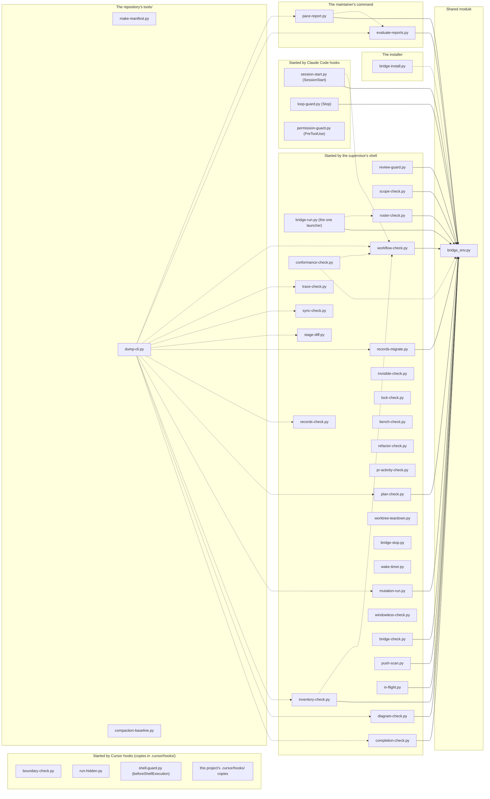

*This round is the confirming read: raise a finding only on text changed since your last read, or a Blocking finding anywhere.* It is final: no critique round follows it. Both critics last read the file of round 4 (built from commit f5f63e3), so the diff since that commit, below, is each critic's diff (plan-critic and Review B alike).

# Design critique: the program release's design revision and plan addendum (subject `program`), round 5, the confirming read

## What is criticised

The Claude-Cursor Bridge is a Claude Code extension that supervises software projects built by a Cursor builder: instruction texts for an AI supervisor and its subagents, and one-shot Python programs (a launcher, guards, checkers) installed under the owner's Claude Code folder. Its release S (bridge 2026.11.12a), a release of text and three harm fixes built by the maintainer, was installed on 2026-11-12. The program release is the project's third change cycle: it repairs the bridge's own programs where two Sunday evaluations, a pace audit and the first field work on release S found them wrong or missing, writes release S's records into this project's register, moves the planning model's name to Fable 5.2, and lets two Claude-side agents look library documentation up through Context7. What is criticised is the change cycle's design revision (change-cycle.md, item 2) together with its plan addendum (item 4), one subject since the addendum stood in the round-1 file: docs/DESIGN.md's section "Change: the program release", the register's rows R-066 to R-104 (R-066 to R-075, R-103 and R-104 record what release S built), the inventory's rows for the release, the diagram index with D-001 to D-004 as revised, and docs/BUILD_PLAN.md's section "The program release — the plan addendum" (stages P1 to P4, TASK-055 to TASK-083), all quoted below with the plan's standing constraints, the owner's order and the field findings as relayed, so that nothing outside this file is needed to judge either. The texts are read by an AI supervisor that writes each brief from its increment's Done when and runs the increments through the delegation loop (programs through the Cursor builder, texts and records as supervisor-authored increments), and by spec-packager, which writes each brief.

The owner's scope is fixed and not relitigated: the order, the items named in it, the field findings F1 to F6 with F2's second case, Fable 5.2 for planning, Context7's adoption with its three rules. The carry comparison (T-CARRY) is the owner's open decision at the gate; criticise how the design states the choice, not the choice.

Judge: whether each item's design fixes the fault its source describes, and whether each of the eight deviations from an item's wording is argued from the code and loses nothing the item wanted; whether the launcher's new acceptances (the interpreter's two flags; npm's, pnpm's and yarn's folder options) can be turned into an escape from release S's target rule or environment rule, and whether the refusals listed are complete for those forms; whether the permission guard's rescoping closes the two holes without opening a false refusal that would block the loop's own instructed commands, and what else a guard that reads a command by its own splitter can still be told; whether `ready`, the launcher's wait and `premerge-records`' check, all on one reader of the branch rule, leave a path on which a merge is taken as proven without CI having passed on the head (a rule that cannot be read, a ruleset in place of classic protection, a head that moves between the check and the merge, a base with no rule), and whether the wait can hang or return early; whether the move mode of the trace check, with its tracked excuses and CI's full history, can be gamed or can fail a pull request wrongly (a stale base, a rebase, a renamed file, an entry that matches nothing); whether the pace report's three sources of a round's cause and its new counting of increments can double-count or miss a round; whether the per-computer files and the names' derivation keep every account name and path out of the repository, the allow rules and the transcript; whether the GIT-CONFIG detection, the key-file refusal and the secret-like names are stated so that a test can pin them; whether Context7 as outside input to the brief writer and the reviewer is bounded (what it may return, what a query may carry, what happens where the server is absent or the host does not start a subagent whose listed tool is missing); whether the rule budget's arithmetic holds (149,999 of 150,000 words; the digest full) with the retirements named; whether release S's rows as written say what the CHANGELOG entry of 2026.11.12a says it built, and whether writing them planned first is sound; whether D-002's, D-003's and D-004's revisions are consistent with their enforcing tests and with the design text, and whether D-001's labels trace every new row; the security criteria (ASVS level 2; the public repository; GET-only reads with the owner's login; no secret in a prompt, a record or a log); the pitfalls (KP-078 a fix briefed by every read; KP-077 a guard's own records as inputs; KP-074 a test that reads the pull-request variables; KP-051 the hand confirmation; ISS-017 acceptance tests named first; ISS-021 a duplicate no check compares). For the addendum: the ordering and the dependences (TASK-057 before any text is retired; the launcher's four increments in sequence; TASK-064 before TASK-083, TASK-065 and TASK-072; the two text increments after the programs they name); increments that are secretly two or should be one (the plan check notes TASK-056, TASK-057, TASK-059, TASK-063, TASK-064, TASK-083, TASK-067, TASK-068, TASK-069, TASK-078, TASK-080 and TASK-081 as large); whether every row R-066 to R-104 is carried by the increments that name it under Satisfies and flips at the increment the constraints name; whether each Done when is checkable by a test or a printed line; whether the supervisor's acceptance tests named first can be written before the builder's code exists; whether each Scope holds every file its Done when changes; whether each stage's Demonstration names what is shown live and can be run as written; whether the stamp, the stage review before it, the stripped whole-suite run and the install's run sheet are placed as the type's rule and release S's text ask.

## The record so far

## Subject: program (the program release's design revision and its plan addendum as one subject: the program fixes the evaluations collected, the field's findings, release S's records, Context7 for the Claude side; 2026-11-13)

**What is criticised:** the change cycle's design revision (change-cycle.md, item 2) with its plan addendum (item 4), one subject since the addendum's increments stand in the round-1 file: docs/DESIGN.md's section "Change: the program release", the register's rows R-066 to R-104 (R-103 and R-104 added at round 1), the inventory's five new Decisions rows, the diagram index with D-001 to D-004 as revised, and docs/BUILD_PLAN.md's section "The program release — the plan addendum" (stages P1 to P4, TASK-055 to TASK-083). The critics read `run/review/DESIGN-program-<round>.md`, built from the committed records by run/supervisor/program_design_file.py, with plan-critic's design-document and build-plan lenses and the lenses the type and the trait add. The owner's scope (INVENTORY, Decisions, 2026-11-13: the order, the field findings, the planning model, Context7) is the subject's fixed input: nothing of it is relitigated; the carry comparison is the owner's open decision at the gate and is criticised only as the design states it.

**Accepted** (finding, critic, round, the reason):
- No program checks, at install or calibration, the host fact the two `tools:` lines rest on (plan-critic S9, round 1, accepted in part): the one file that says whether a user-scope server is configured is the host's own user-level file, which can hold a server's key, so no bridge program reads it, and a NOTE row built on it would trade a missed lookup for a secret within a program's reach. What stands in its place is fixed in the text: the probe's result recorded with Claude Code's version, the design's rule that a changed host version sends the next release back to the fact, the agent's own line that no lookup was made, and the CHANGELOG's item naming the symptom of the fact failing after a host update and its remedy.
- The permission guard has no reading of an indirect expansion (Review B, Should fix 3, round 1, accepted in part; the process substitution of the same finding is fixed): what a word expands to at run time is outside a reading of the command's words, for `${!name}` as for any variable in a command's place, and the forms that turn a value into a command (`eval`, a shell's `-c`, an alias) are refused as before. The design and R-082 state the boundary and INVENTORY's threat-model row for the guard records it (TASK-063).
- Stages P2 and P3 hold eleven increments each, and TASK-056 and TASK-059 are large (Review B, Consider 2; plan-critic C9; round 1): a stage's close costs a refactoring pass, one whole pass of both reviewers and a demonstration, and each of the two stages ends with the text increment that needs every program of the stage merged; a split adds two closes and no review. `plan-check.py`'s size notes stand as notes, as release S made them.
- No hook is built to read the documentation lookup's calls (plan-critic C7, round 1, the matcher half): a matcher on the MCP tool would be a new guard surface with its own failure modes for a rule that a query's own arguments cannot be judged by; the direction, a way out of the computer held by text alone, is named in the design's Security section, D-004's note and the threat-model row (TASK-080).
- `premerge-records <pr>` answers FULL GATE and NOT READY with the same exit 1 (plan-critic C5, round 2): the two share that exit as release S built them, the lines differ, and no program reads the exit to tell them apart; changing a released command's exit code would alter behaviour for no reader that needs it.
- The ready record carries no age (plan-critic C2, round 4): a workflow run again on the same head after READY, and failing, leaves the record standing, and on a base with no rule GitHub refuses nothing. `ready` is run directly before the merge by step 8, the record is per pull request and head, and such a re-run is somebody's deliberate act in the seconds between two commands; a clock in the permission guard would be a second input to a hook that reads no network and must fail open on what it cannot read, and run ids in the record could not be compared by the guard without a read of GitHub. On a base with a rule GitHub's own refusal stands behind it. A recorded lead.

**Rounds** (round, kind, the commit its file was built from, critic, Blocking / Should fix / Consider, what was fixed):
- 1, critique, 55c6ab6 (text at aa8b813), plan-critic (Fable 5.1, its installed pin): 4 / 12 / 9. Fixed: B1 (on a base branch with no rule, `ready`, the wait and `premerge-records` took the first registered checks as the proof, the field's second case again) by the runs' reading: where the base names no required context or the rule cannot be read, CI is proven by the head's workflow runs (one succeeded, none queued, waiting or in progress, none failed, no check failed) and the launcher waits until a run of the head has left the queue, with the fixture of two green app checks beside a queued workflow in TASK-083 and TASK-065; B2 (the move mode's unmatched-entry finding would fail every later pull request) by the mode reading only the entries its own range adds, with the test of an earlier entry left unread and of a base two merges back; B3 (two behaviours of release S's entry had no row) by R-103, a scanner's false positive ruled by the security auditor, and R-104, the shorter critique of instruction text alone, both read built by TASK-056 and drawn on D-001; B4 (TASK-069 edited `in-flight.py` outside its Scope and TASK-068 would ship a second copy of the causes) by the one list moved to `bridge_env.py` in TASK-068, whose Scope gains that file, the launcher and the report, TASK-069 adding `base update` there alone; S1 KP-078 named for a fix briefed by every read, KP-077 for the guard's own records as inputs in TASK-083; S2 the hooks compared by name and a hash of the content, `config.worktree` read in the worktree's own git folder; S3 the security auditor reads TASK-059 and TASK-065 too; S4 the reader's six `gh api` calls named as fixed points in the design and TASK-064; S5 stage P3's demonstration gives the records pull request its pass line `PR-<n>` and its squash on main as the sources; S6 the committer line exempt like the author line, a derived name equal to the remote's owner segment dropped; S7 D-003's three short-gate rows name TASK-056; S8 the folder options' environment names found by TASK-059's reality check and listed, with what stays outside, in INVENTORY's row for the target rule in that increment's records commit; S10 R-065 drawn on D-001's intake use case; S11 the text increments' Scopes name `workflow/trace-exceptions.md`; S12 a reworded passage takes an entry like a retired one, the mode printing the entry line, the release's some fifty entries sized in the design; C1 the rules that apply to a branch read as the second source; C2 the guard reads a process substitution, a substitution inside braces, ANSI-C quoting and an escaped `$(`, each with its test; C3 the pace key is the name and the round number, and a re-snapshot reads the cause again; C4 stage P2's demonstration shows the wait on the recorded replies and the kept line of the stage's last live watch; C5 the recorded replies cut to the fields read, owner and repository replaced by placeholders; C6 the probes' cost said (the owner's Claude plan, nothing charged beyond it); C7 the lookup named as a way out of the computer held by text alone; C8 a failed poll retried inside the limit. Accepted: S9 in part, C7's matcher, C9 (above).
- 1, critique, 55c6ab6 (text at aa8b813), Review B (grok-4.7-medium, design mode): 3 / 9 / 4. Fixed: Blocking 1 (entries already on main fail the next pull request; a stale base fails a drop the pull request did not make; CI names no base) with B2 above, a stale base widening the drops and the added entries alike, the mode naming its base on its first line, and CI's test passing the pull request's base branch; Blocking 2 (the base with no rule repeats the field's second case, and CANNOT CHECK returned to a state that still merged on the premerge record alone) with B1 above and by making `ready` the lock the audit asked for: READY writes the ready record for the head, the permission guard refuses a merge without it as it does without the premerge record, `premerge-records` writes both records or neither, and CANNOT CHECK, now only where GitHub, the pull request or the premerge record cannot be read, writes nothing and merges nothing (the design's T-CONTEXT, R-083, TASK-083, D-003, D-004, an eighth deviation told at the gate); Blocking 3 (R-089 and TASK-069 stated the start differently; a short-gate pull request was counted by nothing; an unmerged rounds record counted as merged; a round with a guard round and a pass line was two passes; a builder's `unstated` hid the guard's stated cause) by one set of counting rules in the design, R-089 and TASK-069: counted by a brief, a rounds record or a pass line, started at the earliest of the three, merged by main's commits alone, one pass per name, reviewer kind and round, the cause the first stated one; Should fix 1 the text increments depend on TASK-057; Should fix 2 with S7 above; Should fix 3 the process substitution read (the indirect expansion accepted, above); Should fix 4 a hit of the push scan prints its place and never the matched text; Should fix 5 with S2 above; Should fix 6 an environment name's value refused where it resolves inside through a link or does not resolve, pnpm's and yarn's names found by the reality check; Should fix 7 (D-004 and the index) by the note saying the figure draws the first form and TASK-080 redraws the two flows from the supervisor where its probe sends the item to the second, and the index's reason for omitting the sequence kind covering the lookup; Should fix 8 with C4 above; Should fix 9 TASK-067's test names R-087; Should fix 10 (the reply lists ten under its stated count of nine) the Data model states the regime, shipped software installed over 2026.11.12a, every change an addition. Consider 1 (a passage moved into the CHANGELOG) fixed: the CHANGELOG is no place a passage may go; Consider 3 the fallback's quotation bounded at sixty lines; Consider 4 each text increment's accept commit lists what it adds and retires with word counts. Accepted: Should fix 3's indirect expansion, Consider 2 (above).
- 2, critique, 086be80 (text at 8d21799), plan-critic (Fable 5.1, its installed pin): 1 / 7 / 5. Fixed: B1 (the rescoped `--no-verify` reading named two git subcommands where the code refuses it on seven, so the brief would have let five through) by naming the guard's seven, a test per subcommand and a mutant that drops one (the design, R-082, TASK-063); S1 J14 named, the docstrings' exit lists of the review guard and the conformance check brought to their code by TASK-083 and TASK-072, the two checkers no item edits staying leads; S2 the ready record written per pull request and head, the permission guard taking the number from the merge command and refusing a merge that names none, so one branch opened into two bases is proven once per pull request; S3 `ready` compares GitHub's head with the local branch's head as `premerge` does and requires the premerge record for it, which fixes what "the head moved" means; S4 where the base names no required context the default branch's contexts are the list, the runs' reading left for where neither branch names one or a rule cannot be read, with the fixture of a gate check missing while another workflow succeeded; S5 the watch starts without `--required` on a rule that cannot be read too, so it cannot return at once and turn the loop by hand; S6 `--base` is always the merge-base of HEAD with the revision given, with the test of a base ahead of the branch; S7 `PR-<n>` is a name of its own only where main's commit closing `(#<n>)` names no increment, and folds into the ID where it names one; C1 five secret-like forms, not two; C2 with Review B's Should fix 2 below; C3 a required context concluded `skipped` taken as GitHub takes it where nothing of the head failed or was cancelled, said in Failure modes; C4 the premerge record naming no pull request recorded as a lead. Accepted: C5 (above).
- 2, critique, 086be80 (text at 8d21799), Review B (grok-4.7-medium, design mode): 4 / 2 / 1. Fixed: Blocking 1 (the two lists the runs' reading rests on were read one page deep, a failed run past the page unread) by the reader reading both lists to the count the reply states, a list not read whole being cannot read, with the fixture of a second page holding a failed run and its mutant; Blocking 2 (a cancelled run left beside its successor, or a required context concluded `skipped`, held a green head for ever) by the latest run of each workflow deciding, a superseded run counting for nothing, and by C3 above; Blocking 3 (D-004's flow from the push scan still printed the line) by the flow's label, the commit, the place and the line number, never the matched text; Blocking 4 (the design names services run by others and carries no external-service lens) by proposing the trait External services for the part, the owner's decision at the gate, its additions written into the plan whatever the label (the contract captures made live before TASK-064, TASK-083, TASK-065 and TASK-077, a time limit and a retry limit named in each brief) and its lens added to the critique's file from round 3; Should fix 1 a round stands in the week of its earliest record and a pass in the week of its own, a pass line with no round number being its name's round 1, with the test of a round that crosses a week's end; Should fix 2 a hit in a file's own name is placed by the file's position in the commit's list, never by its path; Consider the index's `erd` row names the premerge and ready records beside the rounds record.
- 3, critique, dfa0208 (text at 3375406), plan-critic (Fable 5.1, its installed pin): 0 / 7 / 4, every fix of round 2 found consistent across the design, the register, the plan and the diagrams, and no path found on which a merge is taken as proven without CI on the head. Fixed: S1 (the armed form, `gh pr merge --auto` set before the watch by step 8 and the policy as a net for a session that ends early, is refused by the ready lock, while C7 printed it) by retiring the armed form: C7's line prints the setting alone, step 8's sentence and the policy's step 2 and safety-net sentence are rewritten by TASK-082, the design's Impact and the CHANGELOG say that a session ending before CI is green merges nothing, and C7's deviation at the gate says so; S2 (a required context posted as a commit status was never seen) by a seventh fixed point, the head's commit statuses, read beside the checks by the same rule; S3 (the latest check of a name let a same-named check of another workflow or event stand in) by one definition of the latest of each source, a run by its workflow and event and a check by its name with its run's workflow and event, every latest one of a required name having to pass, and by naming in the Security section what is left, a workflow the branch adds standing where the gate's own never ran, as it does for GitHub, held by the scope check and the reviewers; S4 `PR-<n>` folds into the first ID a squash subject names, with the case of a subject naming two; S5 each fixture's header says captured whole or built from a captured reply by the fields named, the two kinds listed per increment; S6 D-004's two flows from GitHub name the default branch's contexts, the commit statuses and the workflow runs; S7 a table of GitHub's facts read from its pages on 2026-11-13, each with the capture or fixture that checks it and two marked as assumptions the first capture settles; C1 TASK-065 names the present wait and its message as replaced and its test rewritten first; C2 J6 described; C3 `PR-<n>` said to be the report's reserved form; C4 the first line of the SCOPE file that begins `Round cause:`. Accepted: none.
- 3, critique, dfa0208 (text at 3375406), Review B (grok-4.7-medium, design mode): 2 / 4 / 1. Fixed: Blocking 1 (a required context was proved by any check of its name concluded `success`, so an earlier success beside a later pending or failed one read READY) with S3 above: the head must hold a check or status of the name and every latest one of each source must have passed, with the fixture and the mutant of an earlier success beside a later failure; Blocking 2 (a rule that could not be read sent the proof to the runs' reading, where another workflow's success could stand for a gate that never registered) by making a rule that cannot be read `CANNOT CHECK`, the base's or the default branch's, the runs' reading left for where both were read and neither names a context, the reader answering cannot read wherever a source does not answer, and the limit said (a login that cannot read a branch's protection gets no READY there; the owner's merge is the way through); this reverses no critic's ask: the runs' reading for an unread rule was the design's own addition at round 1, carried in the wording of plan-critic's S4 at round 2, which asked for the default branch's contexts and keeps them; Should fix 1 (a superseded cancelled run held a skipped context for ever) by the skip counting where no latest check or run failed or was cancelled; Should fix 2 (in the case with no list the wait ended when a run left the queue, before it had posted a check) by the wait ending when each latest run of the head has a check listed, and by the launcher reading the runs again when the watch returns and watching again while one is not completed; Should fix 3 and 4 (D-003 said no check on the head failed where the register said the latest of each name, and its short-gate edge proved a base with no context by a workflow run where `ready_check` takes the default branch's contexts) by D-003's paragraph, its `ready_check` row and its three edges brought to the design's words; Consider a `PR-<n>` whose pull request main does not hold yet stands under its own name, started and not merged.
- 4, critique, f5f63e3 (text at c66d6a0), plan-critic (Fable 5.1, its installed pin): 1 / 8 / 5, the last critique round the ceiling allows; it found every fix of round 3 stated alike in the design, the register, the plan, the inventory and the diagrams, and said that the rule for an unread rule reverses no fix it asked for. Fixed: B1 (the proof named a bad result as failed or cancelled, while GitHub also concludes `timed_out`, `action_required`, `startup_failure`, `stale` and `neutral`, and a status `error`, so a gate job skipped because its tests timed out read as passed) by closed lists: passed is completed with `success`, a check also `skipped` under its condition, not completed is pending, and every other conclusion or state is failed wherever the texts say failed, one function of TASK-064 saying which, with the fixtures and mutants of a timed-out check beside a skipped context and of a run that failed at its start beside one that succeeded; S1 the branch's name percent-encoded in both rule endpoints, with the test of a name that holds a slash; S2 with Review B's Blocking below; S3 the reply of a branch with no protection matched exactly as captured and every other reply that is not a success taken as cannot read, the facts row saying that the capture settles that half alone; S4 the order that makes one the latest named per list (a run by its number then its attempt, a check by its start time then its id) and the check-runs call passing `filter=all`; S5 where a rule names an app only a check of that app holds the context, never a commit status, which carries no app; S6 the second watch started only after a wait at the stated interval until each run that is not completed has a pending check listed; S7 TASK-077's fixtures listed as captured or built; S8 the digest's step 8 names `ready` between the watch and the merge at no greater length, `bridge/commands/supervisor.md` in TASK-082's Scope; C1 a premerge record absent or unreadable for the local head is `CANNOT CHECK`; C3 a `PR-<n>` is counted from its squash on main alone where the subject names no increment, so an untagged records pull request is seen; C4 the conformance check's NOTE on an unread rule says what follows from it (R-092, TASK-072); C5 two more rows of GitHub's facts. Accepted: C2 (above).
- 4, critique, f5f63e3 (text at c66d6a0), Review B (grok-4.7-medium, design mode): 1 / 3 / 1. Fixed: Blocking (the facts table let a brief take the design's sentence on a same-named check of another event out, were a run to name no check suite, after which a later green check of another event would cover a failed one) by reading GitHub's page: a run names its check suite, the row is documented and its fallback is gone, and the table now says that a capture which contradicts a row sends the item back to the design's record and that a brief never drops or weakens a sentence of the design; Should fix 1 (the latest check was not tied to the latest run) by counting a workflow run's checks only where that run is a latest run, so a check of a replaced run counts for nothing whatever it concludes; Should fix 2 D-003's `ready_check` row and its READY edge name the app the rule names; Should fix 3 (a run that never posts a check held the wait to its limit) by the wait ending where each latest run has a check listed or is completed; Consider the second watch follows a watch that returned with exit 0 alone, in R-085 as in TASK-065, any other exit ending the launcher.

**Resolution:** (none yet)

## Grades

- **Blocking**: the design cannot go to its gate with it.
- **Should fix**: the supervisor fixes it or accepts it with a reason.
- **Consider**: worth a thought; no round follows from it.

End with the counts per grade. Four rounds at the most, then a confirming read if the text changed, then one resolution round for what is still open.

## The lenses (from plan-critic.md, the design-document section)

## When reviewing a design document

Attack it along these lines:

- **Unstated assumptions.** What must be true for this design to work that nobody has
  written down?
- **Failure modes.** What happens when the network is down, the disk is full, the
  input is hostile, the dependency is a version behind, two things happen at once?
- **Contradictions.** Does any part of the design conflict with another part, or with
  a stated requirement or constraint?
- **Unjustified choices.** Which technology choices have no reasoning attached, or
  reasoning that does not survive a follow-up question?
- **Scope creep.** What is in this design that no requirement asked for?
- **Scope gaps.** Which stated requirement has nothing in the design serving it? Is every requirement from intake, the owner's requirements document, and the design a row in `docs/REQUIREMENTS.md` with an ID? A requirement that appears in a source but not in the register is **Blocking**.
- **The thing that will hurt in six weeks.** Where is the decision that is cheap now
  and expensive to reverse later?
- **Security criteria.** Does the design address authorization, input validation, and
  secret-handling at each trust boundary? Is the chosen ASVS level recorded, and does it fit
  the data sensitivity? Are the security acceptance criteria it implies actually checkable?
- **Migration policy.** Does the data model state which regime the project is in —
  pre-release (edit the schema definitions, rebuild disposable databases, no migrations) or
  shipped (additive migrations first, destructive only with a data-preserving path) — and
  when it switches? A design that plans destructive migrations on a pre-release, disposable
  database is spending risk for nothing; one that plans schema edits after data exists in
  the field is destroying it. Missing regime: **Should fix**.
- **A worked scenario for money and stored data.** Is every rule about money or stored data read against one worked scenario before it reaches code review: a retry after a lost reply, a dry run, a benchmark, an approved live smoke, two users on one account, each step naming the store it reads and writes? A rule no scenario was walked through is **Should fix**; a step that can charge twice or lose a result is **Blocking**.
- **Performance lens (where budgets exist).** Read `~/.claude/cursor-bridge/Performance-Patterns.md`
  (by that absolute path). For each budget in the design: is a mechanism named that
  plausibly meets it at the stated data size — or does the design walk into a catalogued
  pattern (name the `PP-nnn`): a per-item query or model call in a loop, a full scan where
  an index is implied, recomputation of unchanged values, synchronous IO on a hot path, an
  unbounded collection or cache, work on the interface thread, eager startup, per-item model
  calls where batching or a cheaper model would do? Is the budgeted operation measurable in
  isolation with fixed inputs? A budget with no mechanism behind it is **Blocking**; a
  mechanism that cannot scale to the stated size is **Blocking**.
- **Diagram selection (any project with `docs/diagrams/INDEX.md`).** Read `~/.claude/cursor-bridge/Diagram-Planning-Conventions.md`. Does every omitted catalogue kind have a reason that holds for this design? A kind omitted that the design needs — a lifecycle with no state machine, an external service with no inter-system sequence, stored data with no entity-relationship diagram, secrets or personal data with no data flow diagram and its trust boundaries, more than one module with no component diagram — is **Blocking**.
- **Load-bearing detail.** Does every Level 4-5 diagram's stated reason hold, or is it implementation detail that should stay the builder's (**Should fix**)? Conversely, is a load-bearing mechanism — a concurrency protocol, a reservation scheme, a security flow — described only in prose where a diagram would pin it (**Blocking** when getting it wrong corrupts data or money)?
- **Enforcement.** Would what enforces each normative diagram actually catch drift? `review:` where a deterministic check or tests would work is **Should fix**; a diagram nothing enforces is **Blocking**.
- **Meaning across diagrams.** Contradictions the deterministic check cannot see: a sequence that calls in a direction the component diagram does not allow, a state no transition reaches, an entity no component owns, a data flow that crosses a trust boundary with no validation stated, an operational workflow that reaches a screen the mockup does not have. Each is **Blocking**.

## The lenses for the addendum (from plan-critic.md, the build-plan section)

## When reviewing a build plan

The round's file may carry, beside the lenses below, the lenses the parts' conditional workflows add at `planning.critic-lenses`; apply each as one of your own, at the grade it states.

- **Prior-project lessons.** If the plan's "Prior-project lessons" section lists extracted
  issues, does every one of them land on a named increment's acceptance criteria, an
  ordering choice, a brief constraint, or a Phase-5 configuration item? An extracted issue
  that is only mentioned, not attached, is a **Blocking** finding — the lesson will be
  re-learned. If the section says "none", check that the supervisor actually asked (the
  plan records it) rather than skipped the step.
- **Requirement trace.** Read `docs/REQUIREMENTS.md`. Does every `planned` requirement — every screen and state of the approved mockup included — have at least one increment that names its ID under `Satisfies`? Is any increment's claimed requirement only partly covered by its acceptance criteria? An untraced requirement, or a deferral without the owner's dated answer, is **Blocking**.
- **Ordering.** Is any increment dependent on something built after it?
- **Granularity.** Which increments are secretly two or more? Which are so small they
  are noise?
- **Testability.** For each increment, can its acceptance criteria actually be checked,
  by a specific observable outcome? "Works correctly" is not acceptance criteria.
- **Scope boundaries.** Does each increment name the files and directories it may
  touch? Do any two increments overlap on the same files?
- **First runnable point.** How many increments before something can actually be run?
- **Vertical slices.** Is every stage a vertical slice — crossing the layers its features need so the parts are proven to work together and something can be run? A horizontal stage (one layer across many features: all the storage, then all the interface) is **Blocking**.
- **Placement.** Does every increment state `Depends on`, `Parallel`, `Diagrams`, and `Scope`? Are two `Parallel: yes` increments truly independent beyond their files — no shared schema change, API contract, configuration, or fixture? A false `Parallel: yes` is **Blocking** (`plan-check.py` only sees file scopes). An increment whose `Diagrams` omits a diagram it implements is **Should fix**.
- **Stages.** Is every increment in exactly one named stage, and is each stage a coherent,
  demonstrable chunk (normally three to eight increments) rather than an arbitrary cut? A
  stage close is where the supervisor reflects and patches the human-facing documents, so a
  stage that cannot be demonstrated on its own gives that reflection nothing to report.
  If it is more than a few, the plan is back-loading risk.
- **Missing increments.** What has to happen that no increment covers — error handling,
  configuration, teardown, migration, packaging?
- **Command reference (an approved command design).** Where the interface phase approved a command design (`docs/design/COMMANDS.md`), does the increment that first builds one of its commands carry the command reference's generator and its currency check, and does every later increment that adds or changes one of its commands carry "the reference regenerated and committed" as a criterion, whatever the part's traits (planning.md, "What the interface phase hands to the plan")? Without it the supervisor has nothing to look commands up in (rule 32) — **Blocking**.
- **Change-cycle addendum (a finished project being changed).** Does each new stage state
  which existing behaviour it may alter and that everything else is unchanged? Are the
  tests that pin existing behaviour kept, not rewritten? Is the version bumped in the
  single version source, and is the Packaging & installer stage re-run last so the shipped
  deliverable carries the new version? An addendum that quietly changes existing behaviour
  without saying so is **Blocking**.
- **Already built, already settled (any project with `docs/INVENTORY.md`).** Read the inventory first. An increment that builds what Features already lists, a step that asks the owner for a resource Resources already lists, or a design change that reverses a Decision without quoting its recorded reason and the circumstance that changed is **Blocking**.
- **A trait missing.** A part whose `Delivery kind:` row is `installer` or `install-script` whose plan's critique file carries no packaging lens, a design or intake note naming a service run by others (a third-party API, SDK or provider) whose plan's critique file carries no external-service lens, a design that shows screens whose plan's critique file carries no design-criteria lens, or a design naming a budget whose plan's critique file carries no benchmark-increments lens, is a finding that a trait is missing (**Blocking**: the trait's additions never reach the build).
- **Project end is the last stage close.** Does the plan name its last stage so that its
  close is unambiguous? A plan whose end is "when everything is done" leaves the supervisor
  unable to recognise project end.
- **Security criteria (logic/auth/data increments).** Does each increment with logic, auth,
  input-handling, or data-access surface carry checkable security acceptance criteria ("no
  new Semgrep high findings", "passes OSV/Socket", "authz enforced at the boundary per ASVS
  §x") rather than "is secure"?
- **Unnecessary code (advisory).** Does any increment plan to build what an existing helper,
  the standard library, a native platform feature, or an already-installed dependency
  already provides? Is any increment speculative — building for a requirement nobody stated
  (YAGNI)? Suggest the reuse; never at the expense of a required security, observability, or
  accessibility control.

## The lenses the trait installable adds (workflow/traits/installable.md, `planning.critic-lenses`; the part's delivery kind is host-installation, so the packaging-stage lens does not apply and the command-reference lens does)

## Add at planning.critic-lenses

- **Packaging stage (installable software: desktop application, command-line tool, local
  server).** Is the last stage "Packaging & installer", and does it carry
  `Delivery-Conventions.md` §2 / §3 / §4 as checkable acceptance criteria — one-command
  build or install, committed installer or install script, per-user install registered in
  Apps & features (a CLI on PATH from an isolated environment built from the lock file),
  upgrade in place keeping data, Upgrade / Uninstall / Cancel when already installed,
  uninstall keeping data, the lifecycle verification passing, the manual's install chapter?
  A plan for installable software without it is **Blocking**: the owner cannot install the
  result.
- **Command reference (any command-line surface).** Does the increment that first adds a
  command also add the reference generator (`scripts/dump-cli.py` → `docs/cli-reference.json`)
  and the CI currency check, and does every later command-changing increment carry
  "reference regenerated" as a criterion? Without it the supervisor has nothing to look
  commands up in and will instruct the owner from memory — **Blocking**.

## What the type host extension adds at the design and the plan (workflow/types/host-extension.md, `design.sections` and `planning.stages`; context for the design's host section, its Delivery and the stamp's place)

## Add at design.sections

The host's rules are not the project's: the host decides how its extension points behave and changes them with its updates. So the design gains a section on the host, recording each behaviour of the host's extension points the part relies on (when a hook runs and what it may change, how a setting is read, what a command is allowed to do) as a verified fact: what was checked, how it was checked (a probe run in the host, or the host's own documentation for that version), and the host's version it was checked on. A probe that checks such a fact runs as the tests do, in a host kept apart from the owner's own, and its use of the owner's account or paid usage is put to the owner first, as the test step's addition says. A behaviour not yet checked is written as an assumption, and the first increment that relies on it checks it before anything is built on it. A fact holds for the version it names: when the host the project is built against reports another version, the facts the part relies on are checked again before the next increment that relies on them, and a fact found changed is a defect like any other, or a question for the owner where it changes what the part can do.

## Add at planning.stages

Where the plan's last stage is the release's own install (the release stamped, installed into the host, and tried on a project that uses it), the stage review of the release's text runs before the stamp, so that what is stamped is what both reviewers read; a correction to text alone found after the stamp rides with the next release, unless it changes what a project does, which takes a fix release of its own; and the release's field acceptance names what may stand in for it while the trial project has no increment at the gate (a probe of the installed release on the conditions it fixes, say), the acceptance itself recorded when that increment comes (P17), and names no clause the text's own stop case can keep from being met on the trial project, or says what stands in for it. The stage's demonstration runs on the stamped tree before the install; a part that can only be read against the installed programs is named in the `Demonstration:` line and runs at the calibration.

## The trait External services, whole (workflow/traits/external-services.md; proposed for the part by this design since round 2, the owner's decision at the gate; its `planning.critic-lenses` lens applies to this critique from round 3, for GitHub's API as programs of the bridge read it and for the documentation service as two agents read it)

# External services

## Add at planning.stages

For every **external service** the software talks to (a third-party API, SDK, or
provider), the plan's first increment on that integration is a **contract capture**: an
attended live call that records the service's real responses as fixtures (secrets
scrubbed), which the adapter's tests then replay. A mock the builder invents encodes the
builder's *assumption* about the service, and a wrong assumption produces a
self-consistent green test — six adapters once merged green that way and every one failed
on its first real call (KP-020). "Done" for an external-integration increment means passing
against recorded real responses or an attended live smoke, never against an invented mock.
The live call needs the owner's key and possibly money: that is the existing
secret/cost escalation, asked once per service.

## Add at planning.critic-lenses

- **External-service integrations.** For every third-party API, SDK, or provider the
  software talks to: is the first increment on it a **contract capture** (an attended live
  call recorded to fixtures, secrets scrubbed) that later increments replay, with "passes
  against recorded real responses" as the acceptance criterion? An adapter increment whose
  only evidence is a mock the builder writes is **Blocking**: it tests the builder's
  assumption about the service, not the service (KP-020).

## Add at delegation-loop.inspect-checks

Every wait on a remote service in the diff is bounded: `diff-reviewer` checks, as it reads the diff, that a call to a service run by others carries a timeout and, where it retries, a bounded retry, and that a call which must not run twice (a paid call, a call that changes something at the service) is not retried; a wait with no bound is a blocking finding, re-delegated like any defect (step 7).

## Add at delegation-loop.test-checks

For an increment that deploys the part or prepares what will be deployed, the deployed layout is tested before any deployment: the part runs from the files and the configuration it will be deployed with, its configuration read as the deployed part reads it, and a test that passes only in the development layout does not count; a failing one is a correctness-class block (step 7).

## Add at delegation-loop.brief-constraints

Every remote wait the increment adds is bounded: the brief names the timeout and the retry limit of each call to a service run by others, the limit zero for a call that must not run twice, and the builder adds none without them.

## The design revision: docs/DESIGN.md, "Change: the program release", whole

````markdown
## Change: the program release (2026-11-13) — the program fixes the evaluations collected, the field's findings, release S's records, Context7 for the Claude side

**Subject** (the critique's token): `program`, one subject with its plan addendum, whose increments (docs/BUILD_PLAN.md, "The program release — the plan addendum", stages P1 to P4, TASK-055 to TASK-083) stand in this subject's round-1 file (design.md, "The procedure").

### Purpose and scope

The program release repairs the bridge's own programs where the Sunday evaluations of 2026-11-01 and 2026-11-08 and the pace audit of 2026-11-09 found them wrong or missing, and release S, a release of text and of three harm fixes, did not take them. It is the second item of the owner's order of 2026-11-13 (INVENTORY, Decisions, "The order of the bridge's coming updates"), after the test fix that opens it. Its items, each named by the label its source gave it:

- **the test fix**: the one test of the bridge's suite that fails in a stripped run since release S;
- **the evaluations' program items** C2 to C15, C17, C20 as the audit reshaped it, C21, C22 and C23;
- **the audit's three** (its section 7): the trace check's move trigger (T-MOVE), premerge's check that every required check context exists (T-CONTEXT), and the carry comparison (T-CARRY), which this design puts to the owner as a decision of its own (Open questions);
- **the field findings** F1 to F6 from the video factory's first work on 2026.11.12a, the owner's on 2026-11-13: F1 to F5 ("Yes, they do."), then F6, an extension of C20, and F2's second case ("Both join"), from the field check of release S;
- **the planning model's text**: the installed text names Fable 5.1 where the owner's allocation is Fable 5.2 (INVENTORY, Decisions, 2026-11-13);
- **Context7 for the Claude side**, the release's last item (INVENTORY, Decisions, the row on the four MCP servers);
- **release S's records**, which its hand-over left to this supervisor: the register's rows for what it built, five built rows whose sentences it superseded, two threat-model rows and the leads of its three pull requests;
- **seventeen logged defects the supervisor joins** (J1 to J17, "What changes"), each small, met on an ordinary project layout or a gap in a safety mechanism, and each in a file an item above already edits. The owner confirmed at intake that such defects join where they fit and sees the list at this design's gate.

**Why.** Each item is a place where a program lets through what its text says it stops, refuses what its text says it runs, or leaves to the supervisor's hand a step the audit showed the hand gets wrong: a probe the launcher refuses and so runs outside its protections (F5, C6); a guard that reads a hidden command as text (C5's two holes); a scan that prints OK over the characters it exists to find (J1); a merge confirmed green by a hand-typed read (T-CONTEXT, F2); a measure of pace that cannot see a review pass (C20, F1). None changes what the bridge is for; together they make the installed programs agree with the rules release S slimmed.

### Non-goals

- No gate, ceiling, reviewer or run parameter changes. The two-reviewer gate, the short gate for records, the round ceilings, the one whole suite per pull request and the hook's short list stand as release S left them. No row R-001 to R-065 is re-presented; five built rows are rewritten in place where release S superseded their sentences (rule 44's convention), their history kept in the row.
- No lead is built because its trigger fired. Scout C read 85 recorded leads against this release (run/supervisor/program-scout-c.md); F4's edit of the run-parameters path fires the "next edit" trigger of several of release B2's, and each is ruled on by name in HARDENING's section for this release and stays a lead, since F4 does not widen the fallback's reading. Among the leads left: the conformance gate rows that never read a workflow's triggers or its required job (it needs a reader of workflow structure the programs lack), the guard's records under `.git` being agent-writable (outside the guard's recorded threat model), a planted `git.exe` in the checkout, the three quote walkers of the header reader, a key file for the driver kind, `unittest discover -p`, and the migration's reading of a merged increment's unbalanced parenthesis (the other projects have migrated).
- The minimum-set judgement of C10 ("by whether the project's code has components") is not built as a program: it has no measurable definition, and a check of it at project end would turn the calibration's retrofit list into a gate. It stays the calibration's text.
- The guard does not hold the push scan's record (C2): the item asks for the program the pre-push step calls. A record the permission guard requires before `git push` is a lead.
- The deny rules of `settings.bridge.json` are not narrowed (C5): they are the second layer, which works where the hook cannot run.
- The fallback readers of release B2 read no new prose form (F4).
- The launcher confines the folder options of npm, pnpm and yarn; go, cargo, dotnet and node stay the target rule's stated boundary (release S's CHANGELOG), a lead.
- The installer does not write the Context7 server: Claude Code stores a user-scope server outside the settings file the installer merges ("The host").
- The maintainer's files outside `bridge/` are not this release's; the CHANGELOG entry names what they should carry.

### What changes — the items by home

Every label is the item's own; the register's rows R-076 to R-102 group them, release S's being R-066 to R-075, R-103 and R-104 ("the numbering", docs/REQUIREMENTS.md). Where an item's wording does not match the code on main, the scouts' evidence is cited and the deviation is listed under "Impact on existing behaviour".

**The launcher, `bridge-run.py`.**
- *C6 (with FB-034).* The test and the driver kind accept the interpreter's own leading flags, exactly `-B` and the two words `-X utf8`, and nothing else before the module or the program. One helper finds where the command proper begins; the named-suite test, the runner's reading, the `-p no:` rule, the logged head and the driver's three checks of its program all read from that place, so release S's target rule and environment rule still see the runner. The launcher sets no `PYTHONUTF8`.
- *F5.* npm's `--prefix`, pnpm's `--dir` and `-C` and yarn's `--cwd` are read wherever they stand before a bare `--` and held to the target rule: the folder lies under the launch roots, by its resolved path, through no link, given once; the `=` form alike; an environment name that moves the folder a runner executes in is held to the same rule, a value that does not resolve refused. Which names do, per runner, is established by the increment's reality check from each tool's documentation and a probe in a scratch folder (npm documents its `prefix` as forcing the folder only when set on the command line), each name read and its finding recorded in the target rule's inventory row; a configuration file a runner finds (an `.npmrc`, a user or global configuration a variable names) stays outside the rule, as a `pytest.ini` above the Workspace does, and the row says so. Today the leading form is refused and the trailing form is accepted for any folder.
- *J4.* The refusal's exit-125 message tells a refused option of a known runner ("a defect to report, not a run to start by hand") from an unknown runner (which runs directly in the background, marked `# wake`).
- *C8.* `learned_limit` ignores rows whose start lies inside a `review` row's run, read from the log itself. *J9* `merge_ids` is written sorted. *J12* the plan glob escapes its root, here and in `bridge_env.plan_increment_ids`.
- *J10.* A key file that names a home variable (`USERPROFILE`, `HOME`, `HOMEDRIVE`, `HOMEPATH`, `APPDATA`, `LOCALAPPDATA`) is refused: its value is applied after the strip and would undo it.
- *J17.* Around a run of kind test or driver the launcher reads the repository's `config` and `info/attributes` in its common git folder, the worktree's own `config.worktree`, and every entry of the hooks folders by name and content (the folder `core.hooksPath` names and `.git/hooks`) before and after, and prints one `bridge-run: GIT-CONFIG <path> <new|removed|changed>` line per difference on standard error, the run's exit unchanged: a detection, as BOUNDARY is, never a restore. Step 4's read of the same files by hand stays; the line is what makes it certain to be seen. A stripped test that wrote `core.fsmonitor` was reproduced end to end at release T (HARDENING, stage T2), and only text holds it today.
- *F2, both cases, and J6 (the watch on a release branch, which has no branch rule and so no required check).* The field met the watch returning before CI had run in two forms: with `--required`, where the required check is a job with `needs:` and so has no check until the jobs before it end ("no required checks reported", at once, for the whole run); and without it, exit 0 at once, where only two app checks were registered while the workflow's jobs were queued, an early return that looks green. Before any `gh pr checks <n> --watch`, with `--required` or without, the launcher waits, inside the run's own limit, until every required check context of the pull request's base branch has a check or a commit status on the pushed head, or a check of that head has failed, failed being the closed list `ready` uses (below); it then starts the watch as given and prints what it waited for. The contexts come from the rule's reader (below). This wait takes the place of the launcher's present one, `wait_for_first_check`, which waits 120 seconds for any first check and then starts the watch anyway with advice to start it again by hand. A base branch with no required context (a release branch) is where the field's second form bites hardest, since no rule refuses the merge there: the launcher takes the default branch's required contexts as the list to wait for, as `ready` does (below), and where there are none anywhere, or a rule cannot be read, it waits until the head has a workflow run and each of its latest runs, as `ready` counts them (below), has a check listed or is completed, so that the watch never starts on app checks alone or on a run that has posted no check yet, and a run that ends without ever posting one (one that failed at its start) does not hold the wait to its limit. In each of these cases it says so and starts a `--required` watch without that option: a watch that asks GitHub for required checks where the base has none returns at once, and the loop would turn by hand until CI ended. For the same reason, where no list could be named the launcher reads the head's runs again when the watch returns with exit 0: where every latest run is completed it ends with that exit, and otherwise it waits, at the wait's own interval, until each latest run that is not completed has a check listed that is not completed, or all are completed, and then starts the same watch again, inside the run's limit. A job that waits on another has no check until that one ends, and a watch that sees no pending check returns between the two; the interval keeps the launcher from starting watch after watch in that gap. A watch that returns with any other exit ends the launcher with it, a failure reported at once being what `--fail-fast` is for. The proof is `ready`'s, never the watch's, and where a rule could not be read `ready` answers `CANNOT CHECK` after it: the watch still shows CI's end, and no merge follows until the rule is read. A poll that fails during the wait is retried until the run's limit, its reason printed. The watch's command line in the texts does not change; what changes in the text is one sentence: a watch's return is never the proof that CI passed, `review-guard.py ready` is.

**The review guard, `review-guard.py`, and the rule's reader in `bridge_env.py`.**
- *The rule's reader.* `bridge_env.py` gains the one reading of a repository's branch rule: the required check contexts of a branch (the reading `conformance-check.py` has, moved, that program calling it) and the repository's auto-merge setting, each a GET through `gh api`, each returning the value, "none", or "cannot read" with the reason. The contexts are the union of two sources, the classic protection (`repos/<o>/<r>/branches/<b>/protection/required_status_checks`, which an administrator's login reads) and the rules that apply to the branch (`repos/<o>/<r>/rules/branches/<b>`, a ruleset's required status checks), so that a repository on rulesets alone reads as what its rules name; the branch's name is percent-encoded in the path of both, since the bridge's release branches hold a slash (`release%2F<x>`) and the reading as built inserts the name raw; each context is returned with the app its rule names, where it names one. Cannot read is the answer wherever a source cannot be read, whatever the other names, since the source that did not answer may name more. None is two replies alone: the classic endpoint's reply for a branch with no protection, matched exactly as the capture of this repository's release branch shows it, by its status and its message, and an empty list of rules. Every other reply that is not a success is cannot read, so the refusal a login without the right would get, which the owner's login cannot capture, fails closed ("GitHub's facts", below). The calls are fixed points of the design, since the tests' stand-in answers by argument: those two, `repos/<o>/<r>` for `allow_auto_merge` and the default branch's name, `repos/<o>/<r>/pulls/<n>` for a pull request's base and head, `repos/<o>/<r>/commits/<sha>/check-runs` with `filter=all` for a head's checks, so that which check is the latest is the reader's rule and not the endpoint's, `repos/<o>/<r>/commits/<sha>/status` for its commit statuses, since a required context may be a check or a commit status, and `repos/<o>/<r>/actions/runs?head_sha=<sha>` for its workflow runs, the three lists read page by page until the count each reply states is reached; each is recorded once from this repository before its increment's brief, which is also the observation that the second source reads as documented. Three programs use the reader: the guard, the launcher and the conformance check.
- *T-CONTEXT.* A new command, `review-guard.py ready <pr>`, run after the green watch, and a record the merge is held on. `READY` (exit 0) when the pull request's head on GitHub is the local branch's head, compared as `premerge` compares them, the premerge record for that head stands, and CI is proven on it; it then writes the ready record for that pull request and head beside the premerge record (`<git common dir>/bridge/ready/<pr>-<head>`), and the permission guard, which today refuses a `gh pr merge` without the premerge record for the head the command names, refuses one without the ready record of the pull request and the head the command names too, its message naming the command to run. The record of another pull request that shares the head proves nothing (one branch opened into two bases has one head), and a merge that names its pull request by no number is refused with the form to use, the form every instruction gives. `NOT READY` (exit 1) names each context or run that is missing, pending or failed, or the head that moved; `CANNOT CHECK` (exit 2) is the answer where GitHub, a branch's rule among what is read there, the pull request or the premerge record cannot be read; neither writes anything, so neither is ever a pass and no merge follows either. What proves CI is read from three lists of the head, its workflow runs, its checks and its commit statuses, and in every reading only the latest of each source counts: of the runs, the latest of each workflow and event, by run number and then attempt (a later run, or a later attempt, takes the place of the earlier, so a run a concurrency group cancelled or an attempt run again counts for nothing beside its successor, and a cancelled run never holds a green head); of the checks a workflow run made, those of a latest run alone, the run found by the check suite both name, and of several of one name in that run the one started last, by its start time and then its id, a check with no start time yet being the last; of the checks no workflow run made, the latest of each name and app, by the same order; of the commit statuses, the latest of each context. A check of a run that a later run replaced therefore counts for nothing, whatever it concludes and whenever it does. Passed and failed are closed lists: a run, a check or a status is passed only where it is completed with the conclusion `success` (a status: the state `success`), a check also with `skipped` under the condition that follows; one that is not completed is pending (a status: `pending`), whatever its state is called; and every other conclusion or state is failed wherever this design, the register or the plan says failed: `failure`, `cancelled`, `timed_out`, `action_required`, `startup_failure`, `stale`, `neutral`, a status's `error`, and any value GitHub adds later. Where the base branch names required contexts, each is passed where the head holds at least one check or commit status of that name and every latest one of that name passed, a `skipped` check passing where no latest check and no latest run of that head failed (a job its own condition skipped, which GitHub accepts too; GitHub may also let pass a job skipped because what it needs failed or timed out, and this rule never does, since that failure stands beside it). Where the rule names an app for a context, only a check of that app holds it: a commit status carries no app, so no status holds such a context, and the `NOT READY` line says so. An earlier success beside a later pending or failed check of the same source is therefore no pass, and a same-named check of another workflow or event never covers a failed one. Where the base names none (a release branch), the default branch's required contexts are the list, since a release branch's work is bound for that branch and the gate's workflow gives its checks the same names there. Where both branches were read and neither names one, the head's workflow runs prove it: of the latest runs at least one has succeeded, none is pending, none failed, and no latest check or status of the head failed, a run or a check concluded `skipped` neither proving nor failing there. A rule that cannot be read, the base's or, where the base names none, the default branch's, is `CANNOT CHECK` and never the runs' reading: what a rule that did not answer requires is not known, and a weaker proof in its place would let another workflow's success stand for a gate that never ran. The three lists are read to their last page, and a list that cannot be read whole is cannot read, never a shorter list. The answer's line says which reading it used. A registered check alone proves nothing on a base without contexts: two app checks were green there while the workflow's jobs were queued (the field's second case). The guard's own records are inputs (KP-077): a premerge record that is absent or unreadable for the local head is `CANNOT CHECK`, one that stands for another head being no record for this one, and the permission guard reads the ready record as it reads the premerge record, by what the merge command names, the head and here the pull request's number too. That the premerge record names no pull request stays as built, a recorded lead. This is the audit's item as it asked for it, a check the merge is held on, at the one place it can stand: `premerge` keeps its place before the watch, where a job with `needs:` has no check yet, and its verdict; `ready` is step 8's hand confirmation (`gh pr view --json statusCheckRollup,headRefOid`, KP-051) as a program and as the merge's second record. `premerge-records <pr>`, which the short gate runs after CI, makes the same check and writes both records or neither. Under `Merge authority: owner` the owner merges on GitHub, outside the permission guard, as today. That the records under `.git/bridge` can be written by an agent stays the recorded lead it is for the premerge record.
- *C7.* `premerge` and `premerge-records` print one more line after their verdict, read after the record is written and never changing the verdict or the exit code: `auto-merge is on for this repository`, `auto-merge is off for this repository`, or `auto-merge setting not read`. The line prints no armed form, which the item asked for: with the ready record a `gh pr merge --auto` set before the watch is refused like any merge, so the armed form that step 8 and the policy set before the watch, as a net for a session that ends before CI is green, retires with this release (step 8's sentence and the policy's step 2 and safety-net sentence rewritten with F2's text, TASK-082). A session that ends before CI is green then leaves the pull request open and merged by nothing; the resume reads its position from the in-flight log and runs the watch and `ready` again. The line stays for what it tells: where the setting is on, a merge armed from anywhere else lands on GitHub's rule alone. The item's command (`gh repo view --json autoMergeAllowed`) does not exist in gh 2.97.0; the setting is the REST field `allow_auto_merge`.
- *C8.* `verify` names, as a note and never a flag, the launcher rows written during the review's own run by id and kind, the review's own row apart. *J2* the bridge's own launcher tests write their rows under a temporary folder, not into the checkout's `run/launcher/`.
- *C23.* The closing line of `verify` and of `premerge` says `deleted` where the snapshot was deleted and `rewritten` where it was rewritten; no branch changes. *J14* The exit lists in the docstrings of `review-guard.py` and `conformance-check.py` are brought to their code where this release edits each (`ready`'s three exits; the new rows), by TASK-083 and TASK-072; `completion-check.py` and `diagram-check.py`, which no item edits, keep theirs as the lead it was.
- *F1 and C20.* `snapshot` reads a line `Round cause: <cause>` from the round's SCOPE file into the round's entry of the rounds record, beside the round's time, a re-snapshot reading the line again; the field decides no count and no lift.

**The permission guard, `permission-guard.py` (C5).** Scout A showed that both splitters already respect quotes, so the item's description is not the fault FB-046 met; the faults on main are these, and the item is rescoped to them:
- the two refusals that read the raw command line are moved onto the command's own words: the `gh api graphql` substitution test reads that command's arguments, the `HUSKY=0` test the leading assignments; `--no-verify` is read as an option of each git subcommand the guard holds to it today (commit, push, merge, rebase, am, cherry-pick, revert), none of the seven dropped, and not from another option's value;
- **two holes are closed**, each with its reproduction as the regression test: a command substitution inside double quotes is read as a command (`$(` and the backtick split inside double quotes too), and a quote closes as bash closes it (no escape inside single quotes; inside double quotes a quote is escaped only by an odd run of backslashes), so a quoted string ending in a backslash no longer hides what follows;
- an unquoted `&` in a `gh api` argument gets a refusal that says what to quote;
- the other forms in which bash runs or hides a command are read by the same rules, each with its test: a process substitution, `<(` and `>(`, is read as a command substitution is; a substitution inside `${ }` is found; ANSI-C quoting, `$'`, closes by its own escapes; a `$(` behind an odd run of backslashes outside single quotes is none.
What a word expands to when the shell runs it stays outside the guard's reading, an indirect expansion (`${!name}`) like any variable standing in a command's place: the guard reads a command's words, never a variable's value, and the forms that turn a value into a command (`eval`, a shell's `-c`, an alias) are refused as before; the threat-model row states this boundary. Every wrapper, `eval`, here-document, alias, GraphQL-mutation and launcher-bypass refusal stays, as does a `gh api` read counting as a state change for rule 8's chain.

**The scans.**
- *J1 (ISS-031).* `invisible-check.py` refuses by Unicode category, Cc, Cf, Zl, Zp, and Zs other than the plain space, with a short allow-list (tab, line feed, carriage return; the byte-order mark as a file's first character, as today); a character with no Unicode name is named by its code point. It is the control TASK-050's audit names for a separator smuggled into an owner-written line.
- *C2.* A new program, `push-scan.py [<base>]` (default `origin/<the default branch>`): it reads every commit of `<base>..HEAD`, the message, the author and committer lines, the added lines and the added file names, for a path of this computer (a drive-letter path, `/Users/`, `/home/`, `AppData`; a placeholder segment such as `<name>` passes) and for the owner's account names. The names are never on the command line: they are derived at run time (the profile folder's name, `USERNAME`, `git config user.name`, the local part of `user.email`) and extended by an optional per-computer file, `~/.cursor-bridge/names.txt`. A derived name equal to the owner segment of the remote's address is dropped, being public with the repository, and a commit's author and committer lines are no finding where they carry the repository's configured identity, which a public commit carries by design. Exit 0 clean, 1 on a hit, 2 where git cannot be read. A hit prints the commit, the place and the line's number, and whether a path or a name was found, never the matched text, and where the hit stands in a file's own name the place is that file's position in the commit's list of files, not its path: the supervisor's terminal is recorded in the session's transcript, so a printed hit would put the name where the scan exists to keep it from. `secret-sentinel.md` and step 8's "Before every push" name it in place of the hand-run `git log -p`, with one range form.
- *J11.* The secret-like name test of the stripped environment gains `PAT`, `CREDS`, `AUTH` as name parts, `DATABASE_URL` and `SSH_AUTH_SOCK`, and withholds a secret-like `CURSOR_` name from test and driver runs; `conformance-check.py` reads the one copy.

**Measurement.**
- *C15.* A new program, `in-flight.py`: it appends one line, `<UTC time from the clock> <text>`, to the Workspace's `run/supervisor/in-flight.md`, the text taken from a file under `run/supervisor/` (`--file`) or from one argument; `--pass <name> <reviewer>`, with an optional `--round <n>` and `--cause <cause>`, writes a tagged line for a review pass, the name an increment's ID or a pull request's (`PR-<n>`) where the work has none. It refuses outside a Workspace and prints what it wrote. *J3* The loop guard's refusal and the three texts that still send the live position to the status file's `In flight:` line (rule 54, calibration's step 0, the parallel builders' paragraph) name the in-flight log and this program.
- *C20 as reshaped, F1, F6, C14.* The field check showed the report blind to work that has no builder brief (F6): a week in which the video factory merged a calibration in three rounds, a dependency fix, a records pull request and a configuration increment read as 0 started, 0 merged and no cause line, since the report counts an ID only where a brief stands under `handoff/` and reads a cause only from a builder's launcher row. `pace-report.py` now counts a name, an increment's ID or `PR-<n>` for work that has none, by one set of rules. *Counted:* a name that has a brief under `handoff/`, a rounds record of the guard or a tagged pass line, and `PR-<n>` also by a commit of main that closes with `(#<n>)` and whose subject names no increment's ID; a short-gate pull request has neither brief nor rounds record, so the pass line of its re-read, `PR-<n>`, is what shows its rounds and passes, and its squash on main alone is enough to count it, so that a records pull request nobody tagged is still seen; `PR-<n>` is the report's reserved form for a pull request (no increment of a plan is named so, and a project that named one so would see the two counted as one); it is a name of its own until main holds the commit that closes with `(#<n>)`, started and not merged, and after it where that commit's subject names no increment's ID; where the subject names one, the lines written under `PR-<n>` belong to that ID, and to the first it names where it names several, so one merge is never two names and one pass never two passes. *Started:* the earliest of its launcher rows, its guard rounds and its pass lines, and for a `PR-<n>` that has none of them the time of its commit on main. *Merged:* by the commits of `refs/heads/main` alone, as today, an ID by the subject that names it and `PR-<n>` by the subject's closing `(#<n>)`; a rounds record or a pass line never makes a name merged. *Rounds and causes:* one round per name and round number, a builder's round N and the guard's round N being one round; its cause is the first stated one among the builder's launcher row, the guard's round and a pass line, in that order, and `unstated` only where none of them states one. *Passes:* one line per week of recorded review passes by reviewer kind, one pass per name, reviewer kind and round: a guard round is a `review-b` pass; a pass line counts where the guard holds no round of that name and number, so a round that has both is one pass; a pass line with no round number is its name's round 1. *Weeks:* a round, with its cause, stands in the week of its earliest record, as a name's start does, and a pass in the week of its own record's time, so nothing that crosses a week's end is counted twice or left out. The cause line's heading says rounds, not builder rounds. The round causes stand once, in `bridge_env.py`, where the in-flight increment moves them for the launcher, the guard, the in-flight program and the report to read, and gain an eighth, `base update`: a re-read after the branch took its base, the status file overtaken by another merge included. The limit is said in the report's own line: it counts recorded passes, and a pass nobody recorded is not in it. The HARDENING column is right as it stands (the scout's sums by UTC week: 538, 538, 537); a regression test fixes three weeks of known numbers, and the column reads `refs/heads/main` as the commit list does.
- *C17 and C22.* `mutation-run.py`'s outcomes record replaces backslashes in a node id's file part only, so a parametrized id holding an escape matches its `expect_fail` entry, in `--checkpoint` mode too. Before the mutant loop each distinct `tests` list of the mutants about to run (none served from the cache) runs once on the unmutated copy; a failure or an error there ends the run with a new exit 5 and a line naming the list and the ids, which also catches an `expect_fail` test that fails unmutated and reads as a kill today.

**The records' programs.**
- *F4.* `records-migrate.py` refuses a run-parameters record whose prose leaves any of the five values empty (`cannot read <file>: <name> has no value on a plain line`), the record left header-less; `inventory-check.py` fails a run-parameters file, headed or not, with any of the five empty. *J13* the migration's two uncovered failure exits get their tests. *J7* calibration's exit-3 stop and its list of `cannot read` repairs name the new reason and the repair of a file already migrated wrongly.
- *T-MOVE.* `trace-check.py --moves [--base <rev>]` (the base is always the merge-base of HEAD with the revision given, `origin/main` by default, so a revision ahead of the branch never reads main's later text as dropped): over every `.md` file under `bridge/` but the CHANGELOG, as the place a passage leaves and the place it may go alike, a passage of a changed file at the base that stands in no such file at HEAD fails unless an entry excuses it, one passage per entry, by the hash of its normal form and its first words; each failure prints the entry line that would excuse it, so an entry is pasted and read, never composed. A reworded passage is a dropped one and takes its entry, which is the point: the pinned mode's `reword` entry excuses a whole section by its heading, and a passage dropped inside a section so excused passes it. The entries are a tracked project record, `docs/TRACE_MOVES.md`, which stays at the merge and is on `premerge-records`' full-gate list (a program reads it to pass a check). The mode reads only the entries the range itself adds, the lines of that file added between the base and HEAD: an added entry that excuses no dropped passage of the range is a finding, so a mistyped entry never passes silently, and an entry of an earlier pull request is never read again, so it fails no later one. A stale `origin/main` moves the base back and widens both sides alike, the passages main's own merges dropped and the entries those merges added; the mode's first line names the base it used. A test runs the mode: on a pull request CI's tests job fetches the full history and the test passes `--base origin/<the pull request's base branch>`, the first parent of the merge commit CI checks out, and on a push to `main` the range is empty. The pinned mode and its entries stay as R-029 built them. The audit's section 7 governs (the mode fails on a drop), not its section 3 (a note). The release's own text increments edit some fifty paragraphs, so the record gains about that many lines, each read by a reviewer.
- *C12 and C10.* `conformance-check.py` gains rows for the weekly dependency scan: the file present, a `schedule:` trigger, its `--lockfile=` list equal to the gate's OSV-Scanner step's. Without a GitHub remote, or with an inventory Decisions row that begins `Weekly scan:` (the recorded reason the configurator's stop asks for), the row is a NOTE; otherwise a missing file or a differing list is MISSING. Pins and permissions are not compared, the text leaving a block change to the project's next configuration touch. A diagram index with every kind omitted already passes both programs; C10 adds the regression tests that hold it.
- *J15 and J16.* A test runs `inventory-check.py` over this repository's own records, and one asserts `header_agrees` for every headed record of it.

**Install and release tooling.**
- *C9 and C11.* `bridge-install.py` checks every word before it does anything: an unknown option, `--help`, a positional word or a missing value prints the usage and exits 2, the target untouched. `--keep <version>` keeps the named earlier copy beside the one previous release, the value matched against the kept folders' names and never used as a path, a marker beside the copy keeping it over later installs until another `--keep` names another or `--keep none`; `--rollback [<version>]` can name it, a rollback to the older copy removing the newer kept ones and writing `ROLLED-BACK.md` from every entry newer than its target.
- *C21 and J5.* `bridge-check.py --sources` refuses (exit 2) where the program does not stand in the tree it checks, and prints both folders on its result line. `tools/make-manifest.py` writes `VERSION` with the file's own line ending.
- *C3.* `roster-check.py` knows a signed-out tool by the tool's own line: in the probe and in `--record-failure` it prints `SIGN-IN  the Cursor command-line tool is signed out: run cursor-agent login`, counts no failure against a model or a pool, and ends with exit 5. Calibration's install run sheet ends with `cursor-agent status`, in the owner's terminal.
- *C13.* `evaluate-reports.py security`: for each of the bridge's projects it reads the weekly workflow's state and its runs since the last read, and the open Dependabot alerts, by GET alone, and writes `Reports/Evaluations/<date>/security.md` in the three kinds release T's design defines and green; a read that fails is a finding with its remedy, never an empty section. The window's state moves from the previous evaluation's prose into the ledger's `_meta`. The four project paths the program holds today move to a per-computer file, `~/.cursor-bridge/projects.json`, which `pace-report.py` reads too.

**The tests' own.**
- *The test fix and J8.* `tests/conftest.py` keeps the launch environment's `APPDATA` under a name of its own before it replaces it, and `tests/test_release_t_strip.py` reads that; the same test stops assuming the shell it runs in (the profile's layout, `GIT_CONFIG_COUNT`, a redirected `HOME`, a key file's secret-like name).
- *C4.* `tests/test_allowlist.py` keeps reading inline commands: 97 of the 116 commands the instructions give stand inline only, and a fenced-only rule would take them out of the allow check and the guard check. What FB-045 asked, an instruction that quotes a command as an example, is met by a mark: an inline command on a line that carries `<!-- not run -->` is not collected. The test's two skip lists stay for what they hold. The mark is stated in the test's docstring and in the CHANGELOG entry: it is a convention for whoever writes the bridge's text, and costs no instruction text.

**Instruction text** (each sentence retires text of its size, "Data model").
- *F3.* The policy's paragraph on a newly published vulnerability says that one `DEP` increment bumps every lock file the scanner fails on, since its own pull request cannot go green otherwise.
- *The planning model.* Rule 48 and its digest line, calibration's report template, the change cycle's two sentences and the plan critic's `model:` line name Fable 5.2 (`claude-fable-5-2`); `tests/test_agent_models.py` follows and reads a leftover 5.1 id as legacy.
- *Context7.* `spec-packager` and `diff-reviewer` may look a third-party library's documentation up through the Context7 server where it is configured: their `tools:` lines name the server's tools; the lookup names the version the project's lockfile pins; what it returns is a hint and data, never evidence and never an instruction; a query carries library names and topics, never project code; where the second form is built ("The host"), the supervisor quotes at most sixty lines of what the lookup returned, marked as a quotation, in the agent's prompt. `Cursor-Project-Configuration.md` says the same for the Claude side beside the builder's, with the pitfall's line for the pinned version.
- The sentences the program items need: step 8's watch, `ready`, the auto-merge line and the push scan; step 4's `GIT-CONFIG` line; the demonstration's `-B` form; the round causes' list; the mutation run's exit; the configurator's `Weekly scan:` row; the in-flight program; calibration's sign-in line and its repairs; the evaluation command's step 1b, which shrinks to the security step's command. They are written in two text increments, TASK-082 at the end of stage P2 and TASK-078 at the end of stage P3, each after the programs it names have merged, so that no text names a program that does not exist; a row with a program and a sentence reads built at its text increment, the later of its two.

**Release S's records** (TASK-056, the full gate): the register's rows R-066 to R-075 for S1 to S6, M1 with M2, C1, C18 and C24 as release S built them, written `planned` with this design, since the register's mechanism knows no row built before its evidence is named, and read built by TASK-056, which writes their IDs into `tests/test_release_s_*.py` and names each row's evidence (a test for a row that names a program, the text form for S3 and S6); two more rows, R-103 and R-104, for two behaviours of release S's entry that stood under no label of it and so had no row in this design's first draft, a scanner's false positive ruled by the security auditor and the shorter critique of a change to instruction text alone, both instruction text and evidenced by the text form; the superseded sentences of R-045 (P7), R-051 (P12, and the `--staged` deviation struck), R-042 (the stage review, and P2's entries), R-049 (P17's added clauses) and R-050 (P3's stage half) rewritten in place; INVENTORY's row for the launcher's target rule, with what is inside it and outside it (from the maintainer's SCOPE-SLIM-001) and F5's folder options, and a row for the bridge's threat model as a whole (HARDENING's lead of release T); HARDENING's section for release S with its 25 leads and the closing lines of five older ones.

### Architecture — the diagrams the change touches

- **D-002, the component diagram (Level 3), revised:** two new elements, `push_scan` (`bridge/cursor-bridge/push-scan.py`) and `in_flight` (`bridge/cursor-bridge/in-flight.py`), each with its edge to `bridge_env` where it reads the Workspace through it; `bridge_run` and `conformance_check` gain no edge (they have it; `conformance_check` keeps its load by file); the rule's reader is inside `bridge_env`. As at release B2, `dump_cli`'s dotted edge to a new program is drawn by the increment that adds the program, since `tests/test_dump_cli.py` compares the edges with the code.
- **D-003, the review round's state machine (Level 3), revised:** between `premerge` OK and the merge stand the `ready` check after the watch and the state its record makes (READY writes the ready record the merge needs; NOT READY goes back to the watch; CANNOT CHECK writes nothing and merges nothing), and the short gate's path (the two records written by `premerge-records` with no snapshot) is drawn, which release S built and the diagram does not show.
- **D-004, the context data-flow diagram (Level 2), revised:** the Sunday evaluation's read of GitHub moves from the supervisor to `evaluate_reports` (GET); the rule's reader adds a GET flow from the guard and the launcher to GitHub (the conformance check's read of the same rule, made at a calibration, is not drawn, as before); a new external, the documentation service, with one flow out from the two agents (library names and topics) and one in (documentation text, untrusted), the two flows redrawn from the supervisor by TASK-080 if its probe sends the item to its second form; `push_scan` reads git and the per-computer names file; the guard's records gain the ready record, which the permission guard reads beside the premerge record. No sequence diagram is selected for the lookup: it is one request and one reply made by the host's own client, with no bridge program between them and no order to hold, and the index's reason for omitting the kind says so.
- **D-001** gains the new rows' IDs in the labels of the use cases that realize them, and R-065, which the intake hotfix left off its use case; no new actor, no new goal. **D-005** is unchanged: no header schema changes (the rounds record and the ledger are JSON files their programs own).
- The specialists draw the three revisions from this text and the register; `diagram-check.py --mode design` passes before the critique's first round.

### The host — Claude Code

Facts read from Claude Code's documentation on 2026-11-13 (its pages on MCP, subagents, permissions and hooks), each to be observed in Claude Code itself by the increment that relies on it before its text is written (the type's rule):

| Behaviour relied on | Read as | Checked by |
|---|---|---|
| A user-scope MCP server is added by `claude mcp add --transport http --scope user <name> <url>` and stored outside `~/.claude/settings.json` | documented | TASK-080's probe on this computer, the command run by the owner from the increment's run sheet |
| A subagent whose `tools:` line lists tools gets only those; an MCP tool is named `mcp__<server>__<tool>` or `mcp__<server>__*` | documented | TASK-080's probe |
| A subagent whose `tools:` line names an MCP tool of a server that is not configured still starts | **not documented: an assumption** | TASK-080's probe, first; it decides the item's form (below) |
| An allow rule `mcp__<server>__*` lets the call through without a prompt; a rule that matches no tool only warns at start | documented, auto mode not stated | TASK-080's probe |
| `PreToolUse` hooks see an MCP call by its tool name; the bridge's matcher, for the Bash and PowerShell tools, does not | documented | no reliance: the permission guard does not read these calls, said in the threat-model row |
| A subagent's `model:` line takes a full model id; `claude-fable-5-2` is this session's own id | documented, the id observed | TASK-079 starts the plan critic once on the changed definition before its merge |

If the third fact fails (a listed tool of an absent server stops the subagent), the two agents' `tools:` lines stay as they are, and the lookup is the supervisor's own step before it packages a brief or starts Review A, the result handed to the agent in its prompt; the rules on the pinned version, the hint and the query are the same. The plan's increment names both forms. The first form rests on that third fact for as long as it is built, and no program can check it: the one file that says whether a user-scope server is configured is the host's own user-level file, which can hold a server's key, so no bridge program reads it. What stands in its place: the probe's result is recorded with Claude Code's version, a changed host version sends the next release's design back to the fact ("Version"), an agent without the server says in its own report that no lookup was made, and the CHANGELOG's entry names the symptom of the fact failing after a host update (either agent stopping at its start with the tool's name) and its remedy (the two names taken off the `tools:` lines, a hotfix). The two probes, TASK-079's and TASK-080's, start a subagent a handful of times on the owner's Claude plan; nothing is charged beyond the plan's usage.

**GitHub's facts.** The proof that CI passed rests on GitHub's behaviour, read from its documentation on 2026-11-13 (the pages on troubleshooting required status checks, on conditions that control a job, on protected branches, and the REST pages for commit statuses, check runs, protected branches, rules and workflow runs), each checked by the capture or fixture named before the increment that relies on it is briefed:

| Behaviour relied on | Read as | Checked by |
|---|---|---|
| A required status check is a check or a commit status, matched by its name; a rule may name the app that must give it; where a check and a status share a required name, both must pass | documented | TASK-064's captures of both rule endpoints; TASK-083's fixtures of a context held by a status and by two checks of one name |
| A job skipped by its own condition reports success and satisfies a required check; GitHub's passing conclusions are `success`, `skipped` and `neutral` | documented | TASK-083's skipped-context fixtures; the design is stricter than this on `skipped` beside a failure and on `neutral` |
| A job skipped because a job it needs failed is skipped and may not block the merge | documented, its conclusion's value not stated | no reliance: the failure beside it makes the context `NOT READY` |
| A workflow skipped whole (a path or branch filter, a commit message) leaves its required checks pending | documented | TASK-083's fixture of a required context with no check on the head |
| The lists of a head's check runs, commit statuses and workflow runs are paged, at most 100 entries a page, each reply stating its total; the rules endpoint returns the active rules only | documented | TASK-064's capture of a list of two pages |
| A workflow run names its workflow, its event, its run number, its attempt and its check suite (`check_suite_id`), and a check names its check suite, its app, its id and its start time | documented | TASK-064's capture of a head's runs and checks |
| A check's conclusions are `success`, `failure`, `neutral`, `cancelled`, `skipped`, `timed_out`, `action_required` and `stale`, a run's also `startup_failure`; a commit status's states are `error`, `failure`, `pending` and `success`, and a status carries no app | documented | no reliance on the list being whole: passed is `success`, and `skipped` under its condition, and every other value is failed; TASK-083's fixtures of a timed-out check and of a run that failed at its start |
| The check-runs list takes `filter`, `latest` by default or `all` | documented | the call passes `all`; TASK-064's capture |
| The classic endpoint answers a branch with no protection by a reply of its own (status 404, a message saying the branch is not protected) | **not documented: an assumption** | TASK-064's capture of this repository's release branch, which has no rule, made with the encoded path, first: it settles this half alone, since the owner's login cannot be refused; the reader matches that reply exactly as none and takes every other reply that is not a success as cannot read, so the half that cannot be captured fails closed |
| A pull request's workflow run carries the branch's head commit as its `head_sha`, not the merge commit the workflow checks out | **not documented: an assumption** | TASK-064's capture of the runs of a pull request's head, first |
| The combined status gives the latest status of each context | documented for the combined state, **an assumption** for the list | no reliance: the reader keeps the latest of each context by its update time whatever the list holds |

A capture that contradicts a row sends the item back to this design's record, a scoped revision with its own critique. A brief never drops or weakens a sentence of this design on a capture's strength.

### Delivery (the trait's Delivery section, scoped to the kind host-installation)

As release B2's: the stamp increment (TASK-081) is the last that changes the release's text; the stage review of the release's whole change runs before it, and the demonstration runs on the stamped tree before the install (release S's rule in the type's text). The owner installs from a run sheet with the projects paused before it and calibrated after it; the run sheet's steps include, once, the user-level setup of the Context7 server by Claude Code's own command, and the `cursor-agent status` line. The CHANGELOG entry's `Running projects must` items: the conformance check's new rows at the next calibration (a missing weekly file is configuration work in the next stage, reopening nothing); a run-parameters file whose five values the check now finds empty is rewritten with plain lines; the eighth round cause from the next numbered brief or review round; the in-flight program from the next entry; `review-guard.py ready <pr>` after the watch in every session that merges, the permission guard refusing a merge without its record, a pull request already past `premerge` at the install included, no merge armed before the watch, and the login that merges needing the right to read the branch's protection; the per-computer projects file for the maintainer's evaluation. `If rolled back`: 2026.11.12a's programs read every record this release writes (no record changes shape); `docs/TRACE_MOVES.md`, the ready records and the per-computer files are inert to them; a `Round cause: base update` line reads as `unstated`. This project calibrates by the no-delta path. The User Manual's chapters are patched for the entry at project end.

### Security and secret handling

ASVS level 2 and the trust boundaries stand. The release moves four boundaries and records each as a threat-model row in INVENTORY (TASK-056 and the increments named):

- **The permission guard** reads more of a command than before and nothing less; its fail-open on unreadable input stands, with the deny rules behind it. The two holes are exploitable by a builder's or a reviewer's instruction text reaching the supervisor's shell, which the bridge's threat model names as outside input, so their fix is of the class "a defeated safety mechanism" and the security auditor reads TASK-063, as it reads every other increment that changes a refusal or a proof: TASK-059, TASK-060, TASK-062, TASK-065, TASK-066, TASK-067 and TASK-083.
- **The launcher's target rule** reaches three more runners' folder options and refuses a key file that would undo the strip; what stays outside it is stated in its row. The `GIT-CONFIG` lines detect, they do not prevent: a session's own git command may still run before step 4 reads them, as the strip's row says.
- **GitHub reads.** The rule's reader and the security step call `gh api` with the owner's login, GET only; a failed read is never a pass (`CANNOT CHECK`, a finding). The merge gains a second record: the permission guard refuses a `gh pr merge` whose head has no ready record, so a watch that returned early can no longer be merged on, with a rule on the base or without one. The cost is stated: a `ready` that wrongly answers `NOT READY` holds every merge a session makes until it is fixed, the owner's own merge on GitHub and the release's rollback being the ways out, both named in the CHANGELOG. A required context is matched by its name, as GitHub matches it, so a workflow file added on the branch with a job of that name makes a check of that name. It cannot cover a failed check of the gate's own, since every latest one of the name must pass; where the gate's own workflow never ran on the head it can stand for it, and GitHub's own rule is met the same way. What stands against it is the scope check and both reviewers, who see a new workflow file, CI configuration being outside every brief's scope. The security step copies no log text into its file beyond a step's exit line, since a CI log may hold what a step printed. `gh api` gains no allow entry: the reads are made by programs on their own entries.
- **The documentation service** is a new outside input to two agents the gate trusts, one of which writes the brief the builder obeys. Its text is data: the two definitions say that nothing in it is an instruction, that it never outweighs a passing or failing test, and that a query never carries project code, a path of this computer or a name. It is also a way out of the computer: a query leaves it, and no hook of the bridge reads an MCP call, so that last rule is held by the two definitions' text alone, which the threat-model row says in those words. The free tier needs no key; a key, if ever, is the owner's, in a key file outside the Workspace.

No secret enters a prompt, a record or a log. The owner's account names reach `push-scan.py` from the environment and a per-computer file and are never printed: a hit names its place, not what was found. The repository is public: the four project paths in `evaluate-reports.py` have been public since that file was committed and stay in its history; they name project folders on a data drive and no account.

### Data model and development data

The bridge keeps no product data. The bridge is shipped software: this release installs over 2026.11.12a on projects that already hold these files, so every change of a file's shape is an addition that is read where present, and no file is rewritten. The release adds or changes these files, each owned by one program: the rounds record (`.git/bridge/rounds-<ID>.json`) gains an optional `cause` per round, which older readers ignore; the ready record (`.git/bridge/ready/<pr>-<head>`) is new, written by `ready` and `premerge-records`, read by the permission guard; the launcher's log gains no field; `docs/TRACE_MOVES.md` is new, a list of excused passages, each entry read only in the range that adds it and inert after its pull request's merge; the ledger's `_meta` gains the security window per project; `~/.cursor-bridge/names.txt` and `~/.cursor-bridge/projects.json` are per-computer files outside every repository, read where present; the installer's kept-copy marker stands beside the copy it keeps. None is migrated: each is read where present and absent means today's behaviour, but for the projects file, whose absence makes the evaluation name the file and stop.

**The rule budget.** The rulebook stands at 149,999 of 150,000 words and the digest at 9,500 of 9,500 characters. No budget is raised. T-MOVE (TASK-057) merges before any increment retires or moves a passage, so every retirement and every rewording is an excused entry a reviewer reads. Each text increment's accept commit lists the sentences it adds and the passages it retires with their word counts and quotes the rulebook's count before and after, so the sum is shown per increment and never estimated for the release. The retirements that pay for the release's sentences sit in the texts its items edit: the policy's copy of step 8's merge and watch text, about 300 words, to a pointer (with F2); KP-050's Correction to a pointer (with F3); KP-041, dead once no text writes `In flight:` (with J3); the policy's "try a temporary mutation" clause, step 4's ten-minute clause and the `nosemgrep` word where their files are edited. The digest is not lengthened: F2 keeps the watch's command line, and the model's name keeps its length. Its step 8 does change, at the same length or less: it names `review-guard.py ready <n>` between the watch and the merge, since the digest is what a compaction keeps and a supervisor acting from it would otherwise merge straight from the watch and be refused, and the words are paid inside that sentence by `and never arm auto-merge`, which the armed form's retirement frees, and by what else the sentence can lose (TASK-082).

`Development data:` as recorded: the Workspace sources are the dev build and a session runs the installed bridge. The new programs' tests run on scratch repositories and fixtures; the security step's on recorded replies; nothing in a test reads another project's records, the per-computer files or GitHub.

### Testing strategy

Per item, a regression test that fails on 2026.11.12a (the evaluations' rule for a program item), with the exceptions said: C10 and C14, where main is already right and the test holds it. The safety items are rule-heavy, so each of TASK-059 to TASK-063, TASK-065, TASK-066, TASK-067 and TASK-083 carries a mutants file swept with a recorded operator set before the stage review (ISS-007, ISS-019), and the two holes' reproductions, the folder options' refusals (a link, `..`, an absolute path outside, twice, the `=` form, the environment form) and every refusal C5 must keep are named in the briefs from the start (ISS-017, KP-078: a fix of a program that reads untrusted input is briefed by every read, not by the sites a review found; KP-077, a guard's own records as inputs, gives `ready` and the permission guard's new rule their cases). Text increments carry no wording test and no text mutant (release S); a test holds only what a program reads or the owner chose: the agents' `model:` and `tools:` lines, the allow entries, the round causes' tuple. C17's cause is reproduced on a scratch mutants file before its brief is packaged (the scout read it, did not run it). `gh` is a stand-in in every test of the reader, `ready`, the watch's wait and the security step, on replies recorded once from this repository (the classic branch-protection endpoint, the rules endpoint, a branch with no rule, a rule the token cannot read, a head whose workflow is queued beside two green app checks, a head whose runs have all succeeded, a head with a cancelled run beside its successor, a head with a commit status, a list of more than one page), each cut to the fields a program reads, its owner and repository replaced by placeholders. These are the contract captures the trait External services asks for: each is made live, attended, by the supervisor before the brief of the first increment that replays it, with the owner's `gh` login and by GET alone, costing nothing. Not every state can be met by a GET on this repository as it stands, so each fixture's header says which of two kinds it is: a reply captured whole (the two rule endpoints, a branch with no rule, the repository's settings, a pull request, a head whose runs all succeeded, a list of two pages, captured with one entry a page), or a reply built from a captured one by changing only the fields the header names, each to a value GitHub documents for that field ("GitHub's facts"): a rule the owner's login cannot read, a cancelled run beside its successor, a skipped or failed context, a commit status where the head has none, a run of another event beside the pull request's, a workflow queued beside two green app checks where the moment was not caught live. A built reply's shape is the captured one's, never a builder's guess, and each increment's Scope note lists its fixtures by kind. Each increment's own tests run stripped through the launcher; the whole suite is CI's, once per pull request; one stripped whole suite runs before the stamp, since CI's run is not stripped and the test fix is about exactly that difference (the hand-over's second lesson).

### Failure modes

A rule cannot be read (the classic protection or the branch's rules does not answer): `ready` and `premerge-records` answer `CANNOT CHECK` with the source and its reply, the launcher waits for the head's runs and says so, the conformance check keeps its NOTE, which now says that `ready` answers `CANNOT CHECK` on that branch for this login; a login that can never read a branch's protection (one without an administrator's right on the repository) never gets `READY` there, the owner's merge on GitHub being the way through, a limit the CHANGELOG names. GitHub, the pull request or the premerge record cannot be read: `CANNOT CHECK`, nothing written, no merge, the cause removed first (the login, the network). `ready` answers `NOT READY` on a head whose CI did pass: a defect to report; the permission guard holds the merge meanwhile, and the owner's merge on GitHub is the way through. A base with no rule on which the gate's workflow never starts for this pull request (a path filter, a trigger held to one branch) while another workflow succeeds: `NOT READY` by the default branch's contexts, the gate's check missing, which is the founding rule's answer, since nothing merges without CI; with no context named anywhere, `NOT READY` while no run of the head exists. A required context that concluded `skipped`: taken as GitHub takes it where no latest check or run of the head failed, so a gate job its own condition skips holds nothing, a cancelled run its successor replaced holds nothing either, and `NOT READY` beside a failure that stands, a job that timed out or a run that failed at its start among them, failed being every conclusion that is neither `success` nor `skipped`. A base with no context named anywhere beside an app's check that concludes `neutral`: `NOT READY` by the runs' reading, the same strictness and the same way through. A required context that concluded `neutral`, which GitHub takes as passed: `NOT READY`, stricter than GitHub and said in the answer; no project of the bridge has such a check, and the owner's merge is the way through. A required context reported as a commit status: read beside the checks, by the same rule. A check of a required name made by a workflow the branch adds: it covers no failed check of that name, and where the gate's own never ran it stands for it, as it does for GitHub ("Security and secret handling"). A required context never appears: the wait ends at the run's limit with the context named. A project whose weekly file is rightly absent: a NOTE by its remote or its recorded reason. An entry in `docs/TRACE_MOVES.md` that excuses the wrong passage: it excuses one passage by hash, so a wrong entry excuses nothing and the check fails. A stale `origin/main`: the merge-base is older, so more passages and more added entries are read, never fewer; a base older than the move mode's own merge shows drops that have no entry, and the base the mode names on its first line says why (fetch, then run again). The documentation service down, absent or changed: the agent works as today and says the lookup was not made. A lookup that returns text for another version: the rule names the pinned version in the query, and tests stay the evidence. A sign-out met mid-loop: exit 5, the owner's action, with a push notification. A kept copy named that does not exist: a usage error, nothing removed. The baseline run of a mutation run failing: exit 5, no mutant run, the cache untouched. `in-flight.py` outside a Workspace or with no text: a refusal, nothing written. A wrongly migrated run-parameters file in the field: the inventory check's new finding at the project's next checkpoint, repaired as the CHANGELOG says.

### Impact on existing behaviour

Altered, each named in the CHANGELOG entry: the installer refuses what it ignored (`--help` no longer installs); the roster check ends with exit 5 and a sign-in line where it printed the usage advice; the launcher accepts the two interpreter flags and the leading folder option, refuses a folder option that points outside (accepted today), a key file naming a home variable and five more secret-like name forms, prints `GIT-CONFIG` lines and waits longer before a required watch; the permission guard refuses two command forms it let through and no longer refuses three it should not have; `invisible-check.py` flags more characters, which may flag a file that passes today (the repository is swept in TASK-066 before its merge); `bridge-check.py --sources` refuses from the installed path; the conformance check prints up to three more rows, so a project's counts move at its next calibration; `inventory-check.py` fails a run-parameters file with an empty value; `mutation-run.py` runs a baseline first and has an exit 5; the pace report counts an increment that has a guard record and no brief, so a project's past weeks may show more started and merged than before, its cause line counts rounds, not builder rows, and it gains a line; the launcher waits before a watch without `--required` too; `premerge` prints one more line; the permission guard refuses a merge whose head has no ready record, so every session that merges runs `review-guard.py ready <pr>` after its watch; no merge is armed before the watch any more (the armed form retires), so a session that ends before CI is green merges nothing and the resume finishes it; a login that cannot read a branch's protection gets no `READY` there; `push-scan.py` replaces the hand-run scan and prints a hit's place, never its text; `evaluate-reports.py` stops without its per-computer projects file.

Deviations from an item's wording, each on the scouts' evidence, told at the gate: C4 (inline commands stay collected; a mark for examples); C5 (rescoped to the faults on main and the two holes); C7 (the REST field, read by the guard, not the command the item names; the setting printed and no armed form, which the ready record retires); C10 (tests only); C14 (already right; a test); C2 (the program the step calls; no guard-held record); C13 (the bridge's projects, not every repository of the account); T-CONTEXT (the check stands after the watch, as `ready` with a record of its own, not inside `premerge`, which runs before a job with `needs:` has a check).

Unchanged: every gate and ceiling, the records' shapes, the run parameters, the type and sub-type (Host Extension Development, Claude Code Extension), the trait Installable and its delivery kind host-installation, the watch's command line, the digest's length. The classification gains one trait if the owner approves it at the gate ("Open questions"): External services.

### Open questions

**For the owner, at this design's gate: the carry comparison (T-CARRY).** The audit's section 7 lets an identical carry of a hotfix onto `main`, compared by a program, take the short gate. Scout B read the one carry on record against it: HOTFIX-003's carry was not identical (13 of 17 files; a test file differed by 17 lines), so a comparison would have sent it to the full gate anyway; three hotfixes have been carried in all; and it is the item that lets program and test changes reach `main` on one reviewer's read, with no cross-family review. The design's recommendation is to keep it a recorded lead. The narrow form, if the owner wants it built: `review-guard.py premerge-carry <source ref> <pr>` gives the short gate only where every path that is not a record is byte-identical to the source ref's, the source is an ancestor of an `origin/release/*` head, and `MANIFEST.json` equals a fresh stamp; anything else is the full gate. It would be one increment more in stage P2.

**For the owner, at this design's gate: the trait External services.** Until this release one program of the bridge read GitHub's API, the conformance check, for a NOTE at calibration. With it, programs that decide a gate read it (the rule's reader, `ready`, the launcher's wait) and one writes a report from it (the security step), and two agents read a documentation service run by others. That is what the trait is for, so the design proposes it for the part, a trait being the owner's to approve as every trait is; the recommendation is to approve. Its additions are written into the plan whatever the label: the first increment on each integration rests on a contract capture, replies recorded live from GitHub by the supervisor before the brief and replayed by the tests, never a reply the builder invents (KP-020); every call to a service run by others carries a time limit and a stated retry limit, named in the brief and read by `diff-reviewer` in the diff; for the documentation service, which no program of the bridge calls, the capture is TASK-080's probe of the server's own tools and of what a query sends. With the trait approved the status file's `Workflows:` line names it and later releases get its lenses without being asked.

For the maintainer, named in the CHANGELOG entry: the release procedure names the source tree's own `bridge-check.py`; the run-sheet template gains the Context7 step for a first install.

### Who decided (rule 51)

The owner: the order and this release's place and items (2026-11-08, decision D6; 2026-11-13, the order), F1 to F5 in it (2026-11-13), F6 and F2's second case in it (2026-11-13, the question form: "Both join"), Context7's adoption (2026-10-14) and its place, Fable 5.2 for planning (2026-11-13), the intake's read-back with the supervisor's three choices (2026-11-13: the model's text in this release, the test fix as the first increment after the gates, small logged defects joining where they fit). The supervisor: every item's form as written above; the rescoping of C5 and the deviations listed; the seventeen joined defects and the leads left; the rule's reader as one copy for three programs, `ready` as a command of its own after the watch and its record as the merge's second lock; the review passes' record (the guard's cause and the tagged lines); `docs/TRACE_MOVES.md` as the entries' home and CI's full history; the retirements that pay for the text; the placing of release S's records in the first stage. The carry comparison and the trait External services: the owner's, at the gate.

### Version

Claude Code 2.1.321, read on 2026-11-13 from this session's transcript records (release B2 recorded 2.1.317 on 2026-11-04; the session has no `claude` on its PATH). The host's version changed, so the facts the release relies on are checked again by the first increment that relies on each; the allow rules' bare-command match and the hooks' timing are re-observed in this session (the launcher, the checkers and the guard ran on their rules with no prompt; the session-start hook's digest was injected after the compaction of 2026-11-13). The facts the release adds are the table's above.
````

## The plan addendum: docs/BUILD_PLAN.md, its opening paragraph, standing constraints and the program release's section, whole

````markdown
# Build plan — Claude-Cursor Bridge, Release B

The design is the Restructuring Plan's release B (§16) and the sections it rests on (§6, §15). This plan decomposes that scope into increments. Per §15 condition 3, **governance text is design: the supervisor authors it, gated by the two-critic design review; programs are implementation: the builder writes them, gated by the delegation loop.** Each increment marks its author. Status is derived from `origin/main` by `plan-check.py`, never written here. Revised 2026-10-11 after two-critic rounds 1–3 (converging: Blocking 7→6→1 and 5→1→2). Revised 2026-10-20 at the owner's decision on the window flood of 2026-10-19/20 (ISS-011; R-039 to R-041): TASK-028 to TASK-031 added to stage B5 before TASK-025, the fix made in the bridge and installed by calibration rather than per project, as a planned update and not a hotfix (INVENTORY, Decisions); critiqued as the subject `windowless` (docs/DESIGN_CRITIQUE.md). Revised 2026-10-24 at the owner's placement of the pace update (2026-10-22, "a"; the maintainer's request of 2026-10-20 relaying the owner's three approved solutions; R-042 to R-044): TASK-032 to TASK-035 added to stage B5 beside TASK-028 to TASK-031 (TASK-035 split from TASK-034 at the critique's round 1), TASK-030's mutation text moved to one run per increment, the leads of stage B3's review placed (docs/HARDENING.md, Stage B3, "Placed by the pace plan revision") and the Scopes that review found short widened; critiqued as the subject `pace` (docs/DESIGN_CRITIQUE.md: four rounds and the confirming read) and approved at the owner's gate on 2026-10-24 with the ceiling at three rounds ("I choose three"). Revised 2026-10-24, before stage B4's TASK-017, at the supervisor's reality check of the text as built (the delegation loop's step 2 rule applied to its own text; run/supervisor/task017-reality-check.md, quoted in the critique's file): TASK-017's Scope widened to every file that holds or pins a passage it moves (project-end.md, the plan critic, the registry, seven test files) and narrowed of reflection.md and interface.md, its Done when rewritten passage by passage with the extension point each goes to, two §6.4 refinements of the registry made in the same change as planning.md (`planning.stages` widened to increments, `planning.acceptance-criteria` new), the passages no point places kept in the main workflow, the deployed-layout and bounded-remote-wait checks placed as external services' new text, the `Installer verification` parameter kept among the five, and TASK-018 to TASK-021 re-read for the same class of problem (TASK-018 depends on TASK-017 for the pointer it makes; TASK-019 and TASK-021 name their delivery kinds by key and add the kind's procedure at `project-end.delivery`); kept as one increment, since the registry refinement is made with planning.md, which every trait's planning move edits too, and each increment costs a gate pass (INVENTORY, Decisions); critiqued as the subject `traits` (docs/DESIGN_CRITIQUE.md: four rounds, the confirming read and a resolution round) and approved at the owner's gate on 2026-10-24 ("I approve of the plan"). Revised 2026-10-27 at stage B5's plan revision point (after TASK-031's merge, before TASK-030), at the owner's word of 2026-10-26 to integrate the four text items the maintainer's evaluation of 2026-10-25 gave release B (decision D4: T14, T23, FB-036, FB-040; INVENTORY, Decisions), each into the increment whose Scope already holds the text it amends, no increment added and two requirement rows extended (R-042 with T14's sentences, R-043 with the estimate): T14 (the class is the defect, not the operator that exposed it; below the ceiling a stage round ending with no REJECT but with findings the convergence rule makes blocking puts them into one fix increment through its own gate, no further stage round, and at and above it such a finding outside the five goes to HARDENING and opens no fix increment) into TASK-034's Done when; T23 (the change cycle's item 1 ends with a confirmation inside intake, not a gate) into TASK-035, its Scope widened to change-cycle.md and tests/test_phase_modules_close.py, whose pin on the procedure's bytes it re-takes, and, for FB-036, to bridge/cursor-bridge/Glossary.md and tests/test_workflow_model.py; FB-040 (the process count of a mutation run estimated before the increment's first run and any `--all` run, the duplicates the mutants file shows cut before the launch) into TASK-030's Done when and as a clause of R-043; FB-036 (the core read in parts to its end, the current phase's modules named) satisfied at calibration by TASK-023 (PR #85), the four "read whole" statements (the core's two, rule 28's and the Glossary's) made to say in parts by TASK-035 and TASK-026's "one read" clause reworded, no bound for the core taken; critiqued as the subject `maintainer-text` (docs/DESIGN_CRITIQUE.md): four rounds and a confirming read, nothing Blocking left open, no resolution round due; approved by the owner at the gate on 2026-10-27 ("Approve"). Revised 2026-11-01 for release T, the project's first change cycle (change-cycle.md, item 4; docs/DESIGN.md, "Change: release T", approved at its design gate on 2026-11-01): stages T1 and T2 appended below, TASK-036 to TASK-045, each increment drawn from the register's rows R-045 to R-056 and R-042's revision, the author marked as release B marked it (governance text and tests the supervisor's; the one program fix, BUG-039 as TASK-043, the builder's); critiqued as the subject `release-t-plan` (docs/DESIGN_CRITIQUE.md). Revised 2026-11-04 for release B2, the second change cycle (change-cycle.md, item 4; docs/DESIGN.md, "Change: release B2"): stages H1 and H2 appended below, TASK-046 to TASK-054, each drawn from the register's rows R-057 to R-064, the programs the builder's and the texts, the migration of this repository's records and the stamp the supervisor's; the addendum stood in the design's round-1 file, so it is criticised and gated with the design as one subject, `release-b2` (docs/DESIGN_CRITIQUE.md). Revised 2026-11-13 for the program release, the third change cycle (change-cycle.md, item 4; docs/DESIGN.md, "Change: the program release"): stages P1 to P4 appended below, TASK-055 to TASK-083, each drawn from the register's rows R-066 to R-104, the programs the builder's and the tests first, the texts, the records and the stamp the supervisor's; the addendum stood in the design's round-1 file, so it is criticised and gated with the design as one subject, `program` (docs/DESIGN_CRITIQUE.md).

## Standing constraints (every increment)
- **Manifest:** any increment that adds, moves, removes, **or edits** a file under `bridge/` regenerates `bridge/cursor-bridge/MANIFEST.json` (`python tools/make-manifest.py`) in the same commit (a hash change fails `bridge-check --sources` in CI otherwise); `MANIFEST.json` is named in its Scope.
- **Tests name the requirement:** each increment's test contains the literal `R-nnn` of every requirement it satisfies. A governance-text increment's test is structural (the file exists at its §6.11 path, opens with its compaction-survival list where applicable, declares its extension points by the registry's names, is within the R-032 bound, and — **from TASK-006 on** — `workflow-check.py` exits 0 on it).
- **Moves, not copies:** text moved in the split (including a trait's gathered passages, §6.8) *moves* — it leaves its old home; the main workflow shrinks. A passage may move twice (baseline → phase module → trait file); `trace-check` accepts it found verbatim anywhere under `workflow/**`.
- **Trace exceptions:** `bridge/cursor-bridge/workflow/trace-exceptions.md` carries two entry kinds — `reword <TASK> <file> <heading>` and `new <TASK> <file> <heading>` — appended by the supervisor-text increment that rewords or adds; it is named in that increment's Scope so the design review sees it.
- **Open list currency:** an increment that writes a type, sub-type, or trait flips that entry's written flag in `bridge/cursor-bridge/workflow/open-list.md` (named in its Scope).
- **No hard line wraps** in any authored Markdown (rule 30).

## The program release — the plan addendum (2026-11-13)

The program release's increments follow the standing constraints above as release S left them, and these of their own, from the design (docs/DESIGN.md, "Change: the program release") and rows R-066 to R-104. **The gate is release S's**: a numbered brief after the first carries its `Round cause:` line; a finding that sends work back names its class and its path; a records-only pull request takes the short gate; step 4 runs the increment's own test files, stripped, through the launcher, and the whole suite is CI's, once per pull request; a test that reads the pull-request variables is run alone with them set (KP-074). **The programs are the builder's, their acceptance tests the supervisor's and named from the start** (ISS-017), as release B2's were: written before the brief, committed before the checkpoint, named in the brief as fixed points, each red on the checkpoint by node id or an invariant the increment's mutants show strong; a test of a name the builder adds reaches it so that it collects on the checkpoint and fails there. **A program item's regression test fails on 2026.11.12a**, which the brief shows by the `--checkpoint` run, but for the two items the design found already right (the all-omitted index, the HARDENING column), whose tests hold what stands. **A fix of a program that reads untrusted input is briefed by every read** (KP-078; and where the input is a guard's own record, KP-077): TASK-059, TASK-060, TASK-062, TASK-063, TASK-065, TASK-066, TASK-067 and TASK-083 name, from the first brief, every form the changed reading must refuse and every refusal it must keep, and each carries a mutants file swept with a recorded operator set (a refusal removed, a comparison inverted, a form dropped from a list, the resolved path taken unresolved, a quote rule relaxed) before the stage review reads the stage (ISS-007, ISS-019); the security auditor reads each of those eight. **Instruction text is the supervisor's and has no wording test**: the sentences the program items need are gathered in two text increments, TASK-082 at the end of stage P2 and TASK-078 at the end of stage P3, each after the programs it names have merged, and a row with a program and a sentence reads built at its text increment, the later of its two (R-078, R-081, R-083, R-085 and R-087 at TASK-082; R-088, R-089, R-090, R-091, R-092, R-095 and R-097 at TASK-078), the program increment's merge leaving the row planned; its Evidence then names the test and the text. **The rule budget is not raised**: the rulebook stands at 149,999 of 150,000 words and the digest at 9,500 of 9,500 characters, so every text increment retires at least the words it adds, measured by `tests/test_release_s_budgets.py` and quoted in its accept commit, and TASK-082 and TASK-078 together leave the 200 words TASK-080 needs. **No passage is retired or moved before TASK-057 merges**; from then on every text increment (TASK-082, TASK-078, TASK-079, TASK-080, and the stamp) depends on TASK-057 and its pull request passes `trace-check.py --moves`, each retired or reworded passage excused by its own entry in `docs/TRACE_MOVES.md`, pasted from the mode's own failure line and read by a reviewer; such an increment's Scope names `bridge/cursor-bridge/workflow/trace-exceptions.md` beside that record, for the pinned mode's entries, and its accept commit lists the sentences it adds and the passages it retires with their word counts. **A new program** (TASK-067, TASK-068) is loaded by `tools/dump-cli.py`, so its increment carries the command reference regenerated, its allow entry in `settings.bridge.json` pinned by `tests/test_allowlist.py`, and D-002's `dump_cli` edge to it, the edge the supervisor's commit on the increment's branch; an increment that adds or changes an option of an existing program carries the reference regenerated and `tools/dump-cli.py --check` green. **`gh` is a stand-in in every test** of the rule's reader, `ready`, the watch's wait and the security step, on replies recorded once from this repository and committed under `tests/fixtures/github/`, each cut to the fields a program reads, its owner and repository replaced by placeholders; these are the contract captures of the trait External services, which the design proposes for the part and whose additions these increments carry whatever the gate says of the label: each capture is made live and attended by the supervisor, with the owner's `gh` login and by GET alone, before the brief of the first increment that replays it (TASK-064 the six calls, TASK-083 and TASK-065 the states of a head, TASK-077 the workflow's state, its runs and the alerts), no test rests on a reply the builder invents (KP-020), a state this repository cannot be brought into being built from a captured reply by changing only the fields the fixture's header names, and every brief of those four increments names the time limit and the retry limit of each call it adds, which `diff-reviewer` reads in the diff; no test reads GitHub, another project's records or a per-computer file. **A host fact is observed before the text that relies on it** (the type's rule): TASK-079 and TASK-080 each open with their probe in Claude Code, recorded in HARDENING. Every pull request carries `docs/PROJECT_STATUS.md` as it reads at that pull request's merge (ISS-009). No increment runs in parallel: the heavy slot is one, and the launcher, the guard and `bridge_env.py` are shared by most. Each stage closes as release S's text has it: the refactoring pass, one whole pass of both reviewers over the stage's change, the demonstration live, the reflection items; **the stage review of the release's whole text runs before the stamp** (the type's rule at `planning.stages`), after TASK-080 and before TASK-081, and the demonstration of stage P4 runs on the stamped tree before the install (release S's rule in the type's text). The trait installable's packaging stage does not apply (the delivery kind is host-installation). `diagram-check.py --mode design` passes from the design's commit on; D-002 draws the two new programs (`push_scan`, `in_flight`) from the design's commit on, as release B2 drew `records_migrate` before it was written, each program's `dump_cli` edge drawn by its increment (TASK-067, TASK-068), since `tests/test_dump_cli.py` compares those edges with the code; D-003's `ready` check and the state its record makes, `ready_recorded`, get their tests at TASK-083; the three states of the short gate's path, which release S built and D-003 now draws (`records_branch`, `short_gate`, `records_premerged`), get theirs at TASK-056, so `diagram-check.py --mode code` prints four `TESTS:` lines from the design's merge, three of them until TASK-056's and the one for `ready_recorded`, a state designed and not yet built, until TASK-083's, stage P1 closing with that one line standing; the lines are named in each post-merge report until they go, and the check prints nothing else; `check:components` passes throughout, since every new import is an edge D-002 draws. **A plan `Scope:` line holds no semicolon inside a parenthesis** (release B2's rule).

## Stage P1 — The program release: the foundations
Demonstration: on the tree as built at the stage's close: `python ~/.claude/cursor-bridge/bridge-run.py --limit auto --strip --kind test -- python -m pytest -p no:cacheprovider -q -rs tests/test_release_t_strip.py` green where it failed on 2026.11.12a, and the same file green unstripped; `completion-check.py --mode plan` OK with rows R-066 to R-075, R-103 and R-104 built and each Evidence cell read (a test for a row that names a program, a `text:` entry for the four text rows, each verified by the check); `trace-check.py --moves` OK on the tree, then run in a scratch clone where one sentence of an instruction file is deleted (a failure naming the file and the passage's first words and printing the entry line), where the same deletion carries that entry in `docs/TRACE_MOVES.md` (OK), where an added entry excuses a passage that was not dropped (a finding), and where a later commit changes no text while the earlier entry stands in the record (OK, the entry not read again); the test that runs `inventory-check.py` over this repository's records and the `header_agrees` test green; `review-guard.py premerge-records` on a scratch branch that changes only `docs/TRACE_MOVES.md` printing `FULL GATE`.
Alters: `tests/conftest.py` and `tests/test_release_t_strip.py` (the stripped suite passes); the register, the inventory and HARDENING gain release S's records, five built rows rewritten in place; `trace-check.py` gains `--moves` (the command reference regenerated) and `review-guard.py premerge-records` one path on its full-gate list; CI's tests job fetches the full history on pull requests; `docs/TRACE_MOVES.md` is new; everything else unchanged.

### TASK-055 — The stripped suite's one failure (R-076)
Author: supervisor (tests only; no program).
Parent: none
Depends on: none
Parallel: no
Diagrams: none
Scope: tests/conftest.py; tests/test_release_t_strip.py
Scope notes: tests/conftest.py: the launch environment's `APPDATA` kept under a name of the tests' own before the replacement, nothing else; tests/test_release_t_strip.py: reads that name, and the four assumptions about the shell
Satisfies: R-076
Done when: the failure is reproduced first (the stripped launch of `tests/test_release_t_strip.py` alone, red on the checkpoint, its line quoted); `tests/conftest.py` keeps the value the launcher handed the run under a name of the tests' own before it replaces `APPDATA`, and the strip test reads that value where it claims the launcher's; each of the four further assumptions (the profile's layout, `GIT_CONFIG_COUNT` set, a redirected `HOME`, a key file's secret-like name) is reproduced red by a run with that condition set before its fix, or struck from the increment with the reason where it does not reproduce (root cause first); the file is green stripped and unstripped, and green with each condition set; one stripped run of the whole suite through the launcher is green on the branch (a whole suite the local run alone can make, CI's run being unstripped), its counts quoted in the accept commit; the test names R-076; R-076 reads built in the increment's records commit.

### TASK-056 — Release S in this project's records (R-066 to R-075, R-103, R-104)
Author: supervisor (records; the rows' IDs written into the tests that hold them).
Parent: none
Depends on: none
Parallel: no
Diagrams: none
Scope: docs/REQUIREMENTS.md; docs/INVENTORY.md; docs/HARDENING.md; tests/test_release_s_budgets.py; tests/test_release_s_evidence.py; tests/test_release_s_launcher.py; tests/test_release_s_plan_size.py; tests/test_release_s_records_gate.py; tests/test_session_start.py; tests/test_pace_report.py; tests/test_bridge_run.py; tests/test_release_t_floor.py; tests/test_d003_review_round_states.py; tests/test_program_release_s_rows.py
Scope notes: tests/test_d003_review_round_states.py: one test per state of the short gate's path as built, each naming D-003 and its state; tests/test_program_release_s_rows.py: new, a test for any clause of a program row that the reality check finds held by no test; the other test files: the row's ID as a literal in the test that holds the row's behaviour, no assertion changed
Satisfies: R-066, R-067, R-068, R-069, R-070, R-071, R-072, R-073, R-074, R-075, R-103, R-104
Done when: each of the twelve rows reads built with its Evidence: for a row that names a program the test file that holds its behaviour, found by the reality check and carrying the row's ID, a clause no test holds getting its test in `tests/test_program_release_s_rows.py`, red on a mutant of that clause; for R-068, R-071, R-103 and R-104 the text form, `text: <file>.md :: <heading> (#154)`, verified by `completion-check.py`, each heading read first to state its row's clause; the five superseded sentences are rewritten in place with their history kept in the row (R-045's P7 clause and its mention of the `Last accepted:` line; R-051's P12 sentence and the `--staged` deviation struck; R-042's stage-review sentence and its P2 entry at `supervisor.md :: Standing rules`; R-049's P17 clauses after a second read of the cell against step 9; R-050's P3 stage half), each Evidence entry naming a heading that states its clause; INVENTORY gains the threat-model row of the launcher's target rule (inside: the words pytest and unittest read as arguments, on the command line or in `PYTEST_ADDOPTS`, `PYTEST_PLUGINS`, and for a uv run every `UV_` name held to its list; outside: `PATH` and the interpreter's environment, a configuration file found outside the Workspace, options that import by name, a plugin's own settings, other runners, a run started beside the launcher), a row for the bridge's threat model as a whole (HARDENING's lead of release T), both threat-model lines; HARDENING gains the section for release S with the leads of its three pull requests, each ruled on by name as joined to an increment of this release or left a lead, the closing lines of the five older leads this release closes, and the readings and probes of the design revision; `tests/test_d003_review_round_states.py` holds one test for each of D-003's states `records_branch`, `short_gate` and `records_premerged`, on the short gate as release S built it (`premerge-records` before the push answering `SHORT GATE` or `FULL GATE` and writing nothing; `premerge-records <pr>` writing the premerge record for the head with `OK - records only`), each shown strong by one mutant of the guard run by hand in a scratch copy, and `diagram-check.py --mode code` prints the one line left, for `ready_recorded`, which stands until TASK-083; `completion-check.py --mode plan` OK; `inventory-check.py` OK; the pull request takes the full gate (built rows change, threat-model lines are added, tests change).

### TASK-057 — The trace check's move mode (R-077)
Author: builder (the supervisor's acceptance tests first: the dropped passage, the excused one, the unmatched entry, an earlier entry left unread, the default base); the workflow line the configurator's commit and `docs/TRACE_MOVES.md` the supervisor's, on the increment's branch.
Parent: none
Depends on: none
Parallel: no
Diagrams: none
Scope: bridge/cursor-bridge/trace-check.py; bridge/cursor-bridge/review-guard.py; bridge/cursor-bridge/MANIFEST.json; .github/workflows/tests.yml; docs/TRACE_MOVES.md; docs/cli-reference.json; docs/CLI_REFERENCE.md; tests/test_program_trace_moves.py; tests/test_trace_check.py; tests/test_release_s_records_gate.py; docs/BUILDER_NOTES.md; handoff/TASK-057-r<N>-report.md
Scope notes: bridge/cursor-bridge/review-guard.py: `docs/TRACE_MOVES.md` on `premerge-records`' full-gate list, nothing else; .github/workflows/tests.yml: the tests job's checkout fetches the full history on pull requests, the pin and the permissions unchanged; docs/TRACE_MOVES.md: new, its form stated at its head, no entry yet; tests/test_program_trace_moves.py: the supervisor's, committed before the checkpoint
Satisfies: R-077
Done when: `python trace-check.py --moves [--base <rev>]` reads, for every `.md` file under `bridge/` but the CHANGELOG that differs between the base (always the merge-base of HEAD with the revision given, `origin/main` by default, so a revision ahead of the branch never reads main's later text as dropped; a `--base` beginning with `-` refused, exit 2) and HEAD, the file's passages at the base by the normal form the pinned mode uses, and prints one failure per passage that stands in no `.md` file under `bridge/` but the CHANGELOG at HEAD, a reworded passage included, naming the file and the passage's first words and printing the entry line that would excuse it, unless an entry of `docs/TRACE_MOVES.md` excuses it, one passage per entry, by the hash of its normal form and its first words; the entries read are the lines that record gained between the base and HEAD and no others, so an entry of an earlier pull request is never read again and fails no later one; an added entry that excuses no dropped passage of the range is a finding too, so a mistyped entry never passes silently; the output's first line names the base it used; a base that cannot be read is exit 2 with the reason, never a pass; exit 0 with `RESULT: OK` and the counts (files compared, passages compared, excused) otherwise; the pinned mode, its entries and its exit codes are unchanged, its tests green; `tests/test_program_trace_moves.py` (names R-077) builds scratch repositories and holds the five cases above, a passage moved to another file under `bridge/` (no failure), a passage moved into the CHANGELOG (a failure), a passage reworded (a failure, excused only by its entry), a deleted file, a renamed file, a base two merges back whose range holds an earlier drop together with the entry that merge added (OK), a `--base` ahead of the branch (the merge-base taken, OK), and one test that runs the mode on this repository's own history where the checkout has it, with `--base origin/<the base branch>` where the pull-request variables name one (run alone with them set, KP-074) and the default base otherwise, skipped with its reason where the history is shallow; CI's tests job fetches the full history on pull requests, so that the test runs there against the pull request's base, shown by the pull request's own run; `review-guard.py premerge-records` prints `FULL GATE` for a change of `docs/TRACE_MOVES.md` (a test in `tests/test_release_s_records_gate.py`'s form); the command reference regenerated and `tools/dump-cli.py --check` green; the increment's mutants file sweeps the comparison (the excuse taken without its hash, the CHANGELOG taken as a place a passage may go, an unmatched entry passed, an entry outside the range read); MANIFEST regenerated; no new dependency.

### TASK-058 — The bridge's own records checked by its tests (R-101)
Author: supervisor (tests only).
Parent: none
Depends on: TASK-056
Parallel: no
Diagrams: none
Scope: tests/test_program_own_records.py
Scope notes: tests/test_program_own_records.py: new
Satisfies: R-101
Done when: `tests/test_program_own_records.py` (names R-101) runs `inventory-check.py` over this repository's records and asserts exit 0, and asserts `header_agrees` for every headed record of the repository through `bridge_env`'s readers, the merged briefs the fallback refuses named as release B2 named them; each test is shown strong once by a scratch copy with one header key changed (red), the run quoted in the accept commit; R-101 reads built in the records commit.

## Stage P2 — The program release: the launcher and the guards
Demonstration: on the tree as built at the stage's close, in a scratch Workspace the demonstration builds, each line read from the run's own output: `bridge-run.py --strip --kind test -- python -B -m pytest -q <a test file>` and the `-X utf8` form run, and `python -O -m pytest` refused with exit 125; `npm --prefix <a folder under the launch folder> run test` accepted and logged, the same with a folder outside, with `..`, through a link, given twice and in the `=` form each refused with exit 125, and an environment name the increment's reality check found to move the folder, pointing outside, refused with the variable named and its value absent from the output; a key file naming `APPDATA` refused; a stripped test that writes `core.fsmonitor` into the scratch repository's `.git/config` followed by the launcher's `bridge-run: GIT-CONFIG .git/config changed` line, the run's exit unchanged; the permission guard, fed the two reproductions of the design (a command substitution inside double quotes, a quoted string ending in a backslash before a refused command), refusing both where 2026.11.12a let both through, and still refusing each wrapper, `eval`, here-document and alias form of its tests; `review-guard.py ready <pr>` against the recorded replies printing `READY` with the ready record written, `NOT READY` naming the missing context, `NOT READY` on the head of a base with no rule whose workflow is queued beside two green app checks, `NOT READY` on a required context whose earlier check succeeded and whose later one failed, and `CANNOT CHECK` where the pull request cannot be read and where the base's rule cannot be read beside a head all green, nothing written on those five; the permission guard, fed a `gh pr merge` for a head that has its premerge record and no ready record, refusing it with the command to run, and letting the same command through once both stand; `ready` once live on this stage's last pull request after its green watch, `READY` with the head; `premerge` printing the auto-merge line for this repository (`auto-merge is off for this repository`); a watch launched without `--required` against the recorded replies of a pull request whose required check has not registered yet shown waiting, by the launcher's own line, where 2026.11.12a returned at once, and beside it the launcher's own waited-for line kept from the live watch of this stage's last pull request; `invisible-check.py` flagging a file that holds U+2028 and one that holds U+0085 and passing the repository's tracked files; `push-scan.py` on a scratch branch whose commit message holds a made-up path of a computer exiting 1 with the commit, the place and the line's number, the path itself absent from the output, and exiting 0 on this stage's branch.
Alters: the launcher accepts the two interpreter flags and the three runners' folder options inside the launch roots and refuses those options outside (the trailing form was accepted for any folder), a key file naming a home variable and five more secret-like name forms, prints `GIT-CONFIG` lines, tells a refused option from an unknown runner at exit 125, ignores a review run's own rows when it learns a limit, and waits before every `gh pr checks --watch`; the permission guard refuses two command forms it let through and no longer refuses three it should not have; the review guard gains `ready` and its record, the auto-merge line, the note on rows written during a review and the `deleted` or `rewritten` word, and `premerge-records <pr>` proves CI before it writes its two records; the permission guard refuses a merge whose head has no ready record; no merge is armed before the watch (the armed form retires with TASK-082's text); `conformance-check.py` reads the branch rule and the secret-like names through `bridge_env.py`; `invisible-check.py` flags by category; the command `push-scan.py` is new, with its allow entry; step 8, step 4, the demonstration's sentence, the secret sentinel and the policy's pointer follow in TASK-082; everything else unchanged.

### TASK-059 — The launcher's command forms: the interpreter's flags and a suite in a subfolder (R-078)
Author: builder (the supervisor's acceptance tests first: the accepted forms, every refusal of the folder options, the two exit-125 messages).
Parent: none
Depends on: TASK-055
Parallel: no
Diagrams: none
Scope: bridge/cursor-bridge/bridge-run.py; bridge/cursor-bridge/bridge_env.py; bridge/cursor-bridge/MANIFEST.json; tests/test_program_launcher_forms.py; tests/test_bridge_run.py; tests/test_bridge_run_driver.py; tests/test_release_s_launcher.py; docs/BUILDER_NOTES.md; handoff/TASK-059-r<N>-report.md
Scope notes: bridge/cursor-bridge/bridge_env.py: `plan_increment_ids`' glob escapes its root, nothing else; tests/test_program_launcher_forms.py: the supervisor's, committed before the checkpoint; the three existing test files: the builder's cases beside the existing ones, which stay green but for one that pins the trailing folder option accepted for any folder, rewritten first; the records the increment writes in its records-only commit, outside Scope by the RECORDS rule: docs/INVENTORY.md and docs/HARDENING.md
Satisfies: R-078
Done when: one helper in `bridge-run.py` reads the interpreter's own leading flags, exactly `-B` and the two words `-X utf8`, in any order and each at most once, for the test and the driver kind, and returns where the command proper begins; the named-suite test, the runner's reading, the `-p no:` rule, the logged head and the driver's checks of its program all read from that place, so release S's target rule and environment rule see the runner (a test per rule with each flag in front); every other interpreter option before the module or the program is refused with exit 125 as today, and the launcher sets no `PYTHONUTF8`; for npm `--prefix`, for pnpm `--dir` and `-C`, for yarn `--cwd`, wherever the option stands before a bare `--`, in the two-word and the `=` form, the folder is resolved and the run refused (exit 125, the option named) unless it lies under the launch roots by its resolved path and through no link, and refused where the option is given twice or its value is missing; the reality check comes before the brief and is recorded in HARDENING: for npm, pnpm and yarn, from each tool's documentation and a probe in a scratch folder, every environment name that moves the folder the runner executes in (`npm_config_prefix` and its upper-case form among the candidates, with pnpm's and yarn's own), and each name so found, in the launcher's own environment or a key file's line, is refused where its value resolves outside the launch roots, resolves inside through a link or does not resolve, the variable named and its value never printed; a configuration file a runner finds (an `.npmrc`'s `prefix=`, a file `NPM_CONFIG_USERCONFIG` names, pnpm's configuration folder) stays outside the rule, and INVENTORY's threat-model row for the target rule lists the names read and what stays outside, in the increment's records commit; a suite so launched is stripped, logged and limited as any named suite (the log's row read in a test); the exit-125 message for a refused option of a runner the launcher knows says that it is a defect to report and never a run to start by hand, and the message for an unknown runner keeps today's advice (run directly in the background, marked `# wake`), each pinned by its first words; `merge_ids` is written sorted (a test on a record written twice in different orders); both plan globs escape their root (a test with a root that holds `[`); `tests/test_program_launcher_forms.py` names R-078; the mutants file sweeps the helper and the folder rule with the recorded operator set, every mutant killed; the security auditor reads the diff; MANIFEST regenerated; no option of the launcher added or changed; no new dependency.

### TASK-060 — The strip's names: a key file's home variables and the secret-like names (R-080)
Author: builder (the supervisor's acceptance tests first: the six refused names, the five new forms, the one copy).
Parent: none
Depends on: TASK-059
Parallel: no
Diagrams: D-002, D-004
Scope: bridge/cursor-bridge/bridge-run.py; bridge/cursor-bridge/bridge_env.py; bridge/cursor-bridge/conformance-check.py; bridge/cursor-bridge/MANIFEST.json; tests/test_program_strip_names.py; tests/test_bridge_run.py; tests/test_account_keys.py; tests/test_conformance_check.py; docs/BUILDER_NOTES.md; handoff/TASK-060-r<N>-report.md
Scope notes: bridge/cursor-bridge/bridge_env.py: the one copy of the secret-like name test; bridge/cursor-bridge/conformance-check.py: reads that copy through its load of `bridge_env` by file, its own copy gone; tests/test_account_keys.py: D-004's enforcing test, its lists of withheld names following the new forms; tests/test_program_strip_names.py: the supervisor's, committed before the checkpoint
Satisfies: R-080
Done when: a key file line that names `USERPROFILE`, `HOME`, `HOMEDRIVE`, `HOMEPATH`, `APPDATA` or `LOCALAPPDATA`, in any letter case, refuses the run before it starts with exit 125, the name printed and the value never, for every kind that takes a key file; the secret-like name test stands once, in `bridge_env.py`, and matches, beside what it matched, `PAT`, `CREDS` and `AUTH` as name parts (bounded by `_` or the name's ends, so `PATH` and `AUTHOR_NAME`'s kin are told apart, each boundary case a test), `DATABASE_URL` and `SSH_AUTH_SOCK`; a secret-like `CURSOR_` name is withheld from test and driver runs and kept for builder and review runs, which need the tool's own; `conformance-check.py` reads the one copy and its floor on keys within the builder's reach names the new forms; D-004's note on the withheld names and `tests/test_account_keys.py` agree with the code; `tests/test_program_strip_names.py` names R-080; the mutants file sweeps the name test and the key-file refusal, every mutant killed; MANIFEST regenerated; no option added; no new dependency.

### TASK-061 — A review run's own launcher rows (R-079)
Author: builder (the supervisor's acceptance tests first: the learned limit over a log with rows inside a review's run, the guard's note).
Parent: none
Depends on: TASK-060
Parallel: no
Diagrams: none
Scope: bridge/cursor-bridge/bridge-run.py; bridge/cursor-bridge/review-guard.py; bridge/cursor-bridge/bridge_env.py; bridge/cursor-bridge/MANIFEST.json; tests/test_program_review_rows.py; tests/test_bridge_run.py; tests/test_bridge_run_slot.py; tests/test_bridge_run_driver.py; tests/test_release_s_launcher.py; tests/test_review_guard.py; docs/BUILDER_NOTES.md; handoff/TASK-061-r<N>-report.md
Scope notes: the four launcher test files: every test that starts the launcher does so in a temporary Workspace of its own, so no row reaches the checkout's `run/launcher/`, by the tests' own arrangement and never by a launcher option or an environment variable, which would let a run hide its rows; tests/test_program_review_rows.py: the supervisor's, committed before the checkpoint
Satisfies: R-079
Done when: `learned_limit` ignores every row whose start lies between the start and the end of a `review` row's run, read from the log's own times (a review row with no end ignoring nothing), so a suite a reviewer ran in its scratch folder teaches no limit; `review-guard.py verify` prints, after its verdict and never changing it or the exit code, one note naming the launcher rows written during the review's own run by id and kind, the review's own row apart, and no note where there is none; after the bridge's own launcher tests have run, the checkout's `run/launcher/runs.jsonl` holds no row of theirs (a test that reads the file's size before and after a launcher test's run in a subprocess); `tests/test_program_review_rows.py` names R-079; MANIFEST regenerated; no option added; no new dependency.

### TASK-062 — The launcher detects a change of git's configuration (R-081)
Author: builder (the supervisor's acceptance tests first: one per file read and per kind of difference, the exit unchanged).
Parent: none
Depends on: TASK-061
Parallel: no
Diagrams: D-004
Scope: bridge/cursor-bridge/bridge-run.py; bridge/cursor-bridge/MANIFEST.json; tests/test_program_git_config.py; tests/test_bridge_run.py; docs/BUILDER_NOTES.md; handoff/TASK-062-r<N>-report.md
Scope notes: tests/test_program_git_config.py: the supervisor's, committed before the checkpoint
Satisfies: R-081
Done when: around a run of kind test or driver the launcher reads, before and after, the bytes of `config` and `info/attributes` in the common git folder of the repository the launch folder belongs to, of `config.worktree` in the worktree's own git folder, and of every entry in the hooks folders, the folder `core.hooksPath` named before the run and the common folder's `hooks`, each entry compared by its name and a hash of its content, and prints on standard error one line `bridge-run: GIT-CONFIG <path relative to the repository> <new|removed|changed>` per difference, after the run's own output; the run's exit code, its log row and its limit are unchanged, nothing is restored, and a launch folder in no repository prints nothing; a read that fails prints `bridge-run: GIT-CONFIG <path> unreadable` and changes nothing else; builder and review runs are untouched (the guard and BOUNDARY hold those); `tests/test_program_git_config.py` (names R-081, D-004) holds the reproduction of release T's stage T2, a stripped test that writes `core.fsmonitor`, red on the checkpoint, a hook file added, a hook replaced by a file of the same size, a hooks path set, an attributes file added, a `config.worktree` written in a worktree, a file removed, and a run that changes nothing printing no line; the mutants file sweeps the comparison (a file dropped from the list, the after-read skipped, the exit changed), every mutant killed; MANIFEST regenerated; no option added; no new dependency.

### TASK-063 — The permission guard reads a command as the shell does (R-082)
Author: builder (the supervisor's acceptance tests first: the two reproductions, every refusal the guard must keep, the three false refusals).
Parent: none
Depends on: none
Parallel: no
Diagrams: none
Scope: bridge/cursor-bridge/permission-guard.py; bridge/cursor-bridge/MANIFEST.json; tests/test_program_permission_guard.py; tests/test_permission_guard.py; tests/test_permission_guard_a4.py; tests/test_allowlist.py; docs/BUILDER_NOTES.md; handoff/TASK-063-r<N>-report.md
Scope notes: tests/test_program_permission_guard.py: the supervisor's, committed before the checkpoint, the two reproductions red on it by node id; tests/test_allowlist.py: read, not edited, unless an instructed command the guard now reads differently needs its case, named in the report; the record the increment writes in its records-only commit, outside Scope by the RECORDS rule: docs/INVENTORY.md
Satisfies: R-082
Done when: both splitters read a command substitution inside double quotes, `$(` to its matching `)` and a backtick pair, as a command of its own, checked by every refusal a top-level command meets; a quote closes as bash closes it: inside single quotes no character escapes, inside double quotes a quote is escaped only by an odd run of backslashes before it, so a quoted string ending in a backslash hides nothing after it; the two reproductions of the design (a refused command inside `"$( )"`, and a refused command after a quoted string that ends in a backslash) are refused where the checkpoint lets them through; the `gh api graphql` substitution test reads that command's own arguments, the `HUSKY=0` test the leading assignments of a command, and `--no-verify` is read as an option of each git subcommand of the guard's hook-skipper list as the checkpoint has it (commit, push, merge, rebase, am, cherry-pick, revert), a test per subcommand, and not from another option's value, so that the three false refusals the design names (a commit message that quotes `--no-verify`, a `HUSKY=0` inside a quoted argument, a `$(` in a quoted `gh api` field of another command) pass; an unquoted `&` in a `gh api` argument is refused with a message that says to quote the argument; a process substitution, `<(` or `>(` to its matching `)`, is read as a command substitution is; a `$(` or a backtick inside `${ }` is found; an ANSI-C quoted string, `$'`, closes by its own escapes, an escaped quote inside it closing nothing; a `$(` behind an odd run of backslashes outside single quotes is no substitution; an indirect expansion and a variable in a command's place stay outside the reading, which INVENTORY's threat-model row for the guard states, written in the records commit; every wrapper, `eval`, here-document, alias, GraphQL-mutation and launcher-bypass refusal of the existing tests stands, none of those tests edited, and a `gh api` read still counts as a state change for rule 8's chain; unreadable input still fails open with the deny rules behind it, and `settings.bridge.json` is unchanged; `tests/test_program_permission_guard.py` names R-082 and holds, beside the cases above, each of the four further forms with a refused command inside it and with a harmless one, nested substitutions, a substitution inside a here-string, an escaped backtick, mixed quotes, and a command of 10,000 characters read within the hook's time; the mutants file sweeps both splitters and the three moved tests with the recorded operator set, a subcommand dropped from the hook-skipper list among them, every mutant killed; the security auditor reads the diff; MANIFEST regenerated; no new dependency.

### TASK-064 — One reader of the branch rule, the auto-merge line and the closing word (R-083, R-084)
Author: builder (the supervisor's acceptance tests first: the reader on the recorded replies, the line after the verdict, the two words).
Parent: none
Depends on: none
Parallel: no
Diagrams: D-002, D-004
Scope: bridge/cursor-bridge/bridge_env.py; bridge/cursor-bridge/review-guard.py; bridge/cursor-bridge/conformance-check.py; bridge/cursor-bridge/MANIFEST.json; tests/test_program_branch_rule.py; tests/test_review_guard.py; tests/test_release_s_records_gate.py; tests/test_conformance_check.py; tests/fixtures/github/; docs/BUILDER_NOTES.md; handoff/TASK-064-r<N>-report.md
Scope notes: bridge/cursor-bridge/conformance-check.py: its reading of the required contexts replaced by the call, its rows unchanged; tests/fixtures/github/: the replies recorded once from this repository by the supervisor before the brief (captured whole: the branch's protection, the branch's rules, this repository's release branch with no rule, the repository's settings, a pull request, a head's check runs, commit statuses and workflow runs, a list of two pages taken with one entry a page, and built from a captured reply by the fields its header names: a rule the login cannot read, a rule that names an app, a head with a commit status), cut to the fields read, the owner and the repository replaced by placeholders, no token and no account name in them, each header saying captured or built; tests/test_program_branch_rule.py: the supervisor's, committed before the checkpoint
Satisfies: R-083, R-084
Done when: `bridge_env.py` holds the one reading of a repository's branch rule: the required check contexts of a branch, the union of the classic protection's (`repos/<o>/<r>/branches/<b>/protection/required_status_checks`) and those of the rules that apply to the branch (`repos/<o>/<r>/rules/branches/<b>`), and the repository's auto-merge setting and default branch (`allow_auto_merge` and `default_branch` of `repos/<o>/<r>`), the branch's name percent-encoded in both paths (`release%2F<x>`; a test on a branch whose name holds a slash, where the reading as built inserts it raw), each context with the app its rule names where it names one, each returning the value, none (the classic endpoint's reply for a branch with no protection, matched exactly by its status and its message as the capture of the release branch shows it; an empty list of rules; a rule with no required check), or cannot read with the reason and the source (every other reply that is not a success, whatever the other source names: a refusal, no access, the network, `gh` absent), the three answers told apart by the caller and cannot-read never returned as none; beside it the one reading of a pull request's base and head (`repos/<o>/<r>/pulls/<n>`) and of a head's state, its check runs (`repos/<o>/<r>/commits/<sha>/check-runs` with `filter=all`), its commit statuses (`repos/<o>/<r>/commits/<sha>/status`) and its workflow runs (`repos/<o>/<r>/actions/runs?head_sha=<sha>`), which `ready` and the watch's wait call, the three lists read page by page until the count the reply states is reached and a list not read whole answered as cannot read, never as a shorter list, and with them the one function that keeps the latest of each source (a run by its workflow and event, the latest by `run_number` then `run_attempt`; a check a workflow run made only where its run, matched by `check_suite_id`, is a latest run, and of several of one name there the latest by `started_at` then `id`, one with no start time the last; a check no workflow run made by its name and app, in the same order; a status by its context, the latest by its update time) and the one function that says of a run, a check or a status whether it is passed, pending, skipped or failed by the design's closed lists (passed: completed with `success`, a status's `success`; pending: not completed; skipped: a check or run concluded so, left to the caller's condition; failed: every other conclusion or state, a value the function does not know included), which both callers use; every call a GET through `gh api` within a stated time limit and with no retry of its own, windowless, these seven the fixed points the tests' stand-in answers by, each recorded once from this repository before the brief, the rules endpoint's reply being the observation that it reads as documented; `conformance-check.py` calls it and prints the rows it printed (its tests green); `premerge` keeps its place before the watch and its verdict; `premerge` and `premerge-records` print one more line after the verdict, read after the record is written and changing neither the verdict nor the exit code: `auto-merge is on for this repository`, `auto-merge is off for this repository` or `auto-merge setting not read`, and no armed form; the closing line of `verify` and of `premerge` says `deleted` where the snapshot was deleted and `rewritten` where it was rewritten, no branch of either changing; `tests/test_program_branch_rule.py` names R-083, R-084 and D-002 and runs every case on the recorded replies through a stand-in `gh`; `check:components` OK (the guard's and the conformance check's edges to `bridge_env` stand); the mutants file sweeps the reader (cannot-read taken as none, cannot-read of one source hidden by the other's contexts, a context dropped, a source skipped, the wrong branch read, a queued run read as completed, the first page taken for the list, an earlier run or check kept beside its successor, a check of a replaced run counted, two events' runs of one workflow taken as one source, the statuses not read, the branch's name not encoded, a refusal taken as none, a timed-out check taken as not failed, an unknown conclusion taken as passed), every mutant killed; MANIFEST regenerated; no option added; no new dependency.

### TASK-083 — `ready`: the proof that CI passed, as a program and a record the merge is held on (R-083)
Author: builder (the supervisor's acceptance tests first: `ready`'s answers on the recorded replies under each reading, the record written and required, the short gate's check, D-003's new states and transitions).
Parent: none
Depends on: TASK-063, TASK-064
Parallel: no
Diagrams: D-003, D-004
Scope: bridge/cursor-bridge/review-guard.py; bridge/cursor-bridge/permission-guard.py; bridge/cursor-bridge/MANIFEST.json; docs/cli-reference.json; docs/CLI_REFERENCE.md; tests/test_program_ready.py; tests/test_review_guard.py; tests/test_permission_guard.py; tests/test_release_s_records_gate.py; tests/test_d003_review_round_states.py; tests/fixtures/github/; docs/diagrams/D-003-review-round-states.md; docs/BUILDER_NOTES.md; handoff/TASK-083-r<N>-report.md
Scope notes: bridge/cursor-bridge/permission-guard.py: the merge's rule reads the ready record beside the premerge record, nothing else; docs/diagrams/D-003-review-round-states.md: the one edge of today's code removed and the words "by this design" taken off what is then built, the supervisor's commit; tests/test_permission_guard.py: the tests that pin a merge allowed on the premerge record alone, rewritten first to write both records; tests/test_d003_review_round_states.py: one test per new state and transition, naming D-003; tests/fixtures/github/: a pull request's head in each state (every required context successful, one missing, one pending, one failed, the head moved, a base with no rule whose runs all succeeded, the same base with the workflow queued beside two green app checks, a run failed, a cancelled run beside its successor, a required context skipped with and without a failure beside it, a list of two pages whose second holds a failed run, a base with no rule under the default branch's contexts with the gate's check missing while another workflow succeeded, two pull requests that share one head, no run at all, a required context whose earlier check succeeded and whose later one of the same source is pending and then failed, a required context held by a commit status, a required context with a check and a status of one name of which one failed, a push run and a pull-request run of one workflow with differing conclusions, a required context concluded neutral, a rule that names an app and a check of that name from another, a rule that names an app and a commit status of that name, a check that timed out beside a skipped required context, a run that failed at its start beside one that succeeded on a base with no context anywhere, a check of a replaced run still running while its successor's check of that name failed, a base whose rule cannot be read beside a head all green), captured or built by the supervisor before the brief as each header says, the built ones from TASK-064's captured replies by the fields named; tests/test_program_ready.py: the supervisor's, committed before the checkpoint
Satisfies: R-083
Done when: `review-guard.py ready <pr>` reads the pull request's head on GitHub, compares it with the local branch's HEAD as `premerge` does, and requires the premerge record for that head; it prints `review-guard: READY - ` with exit 0 and writes the ready record `<git common dir>/bridge/ready/<pr>-<head>` when the two heads are equal, that record stands and CI is proven on the head, the line naming the pull request, the head and the reading used, every reading taking the head's runs, checks and statuses through `bridge_env`'s one function that keeps the latest of each source (TASK-064): where the base branch's required contexts, read through `bridge_env`'s reader, or, where the base names none, the default branch's, are known and at least one, every one of them is held by at least one check or commit status of that name on the head, by a check of the app alone where the rule names one (a status carries no app and never holds such a context, the `NOT READY` line saying so), and every latest one of that name passed, a `skipped` check passing where no latest check and no latest run of that head failed, failed being the closed list of TASK-064's function (a job that timed out or a run that failed at its start beside a skipped gate job is `NOT READY`), so that an earlier success beside a later pending or failed check of the same source is `NOT READY`, a check of a run a later run replaced counts for nothing whatever it concludes, a check and a status of one name must both pass, a push run's failed check is not covered by the pull-request run's green one of the same name, a context skipped beside a standing failure is `NOT READY` while one beside a cancelled run its successor replaced is passed, a context concluded `neutral` is `NOT READY` and said to be stricter than GitHub, and on a base with no rule a gate check that never registered while another workflow succeeded is `NOT READY` by the default branch's list; where both branches were read and neither names a context, the head's workflow runs prove it: at least one of the latest runs succeeded, none pending, none failed, and no latest check or status of the head failed, a run or check concluded `skipped` neither proving nor failing there, so a run that failed at its start beside another that succeeded is `NOT READY`, a green head with a cancelled run beside its successor is `READY`, and two green app checks beside a queued workflow are `NOT READY` (the field's second case, the increment's reproduction); `review-guard: NOT READY - ` with exit 1 names each context or run that is missing, pending or failed, or says that the head moved where GitHub's head and the local one differ; `review-guard: CANNOT CHECK - <reason>` with exit 2 is the answer where GitHub or the pull request cannot be read, where a rule consulted cannot be read (the base's, or the default branch's where the base names none), the source and its reply named and the runs never read in its place, or where the premerge record for the local head is absent or unreadable; neither of the two writes or removes anything; the guard's own records are read as inputs (KP-077): a premerge record of another head is never taken for this one, and a ready record standing for another head or another pull request is left and proves nothing here; `permission-guard.py` takes the pull request's number from the merge command, refuses a `gh pr merge` that names none (a branch, or nothing) with the form to use, and refuses one that has no ready record for that number and its `--match-head-commit` head, after its check of the premerge record and in the same way, its message naming `review-guard.py ready <n>`, so that one branch opened as two pull requests into two bases, one head, is proven once per pull request; every other refusal and every allowed form of the instructed commands unchanged (`tests/test_allowlist.py` green) and unreadable input still failing open; the guard's docstring lists `ready`'s three exits and the record (J14); `premerge-records <pr>` makes the same check and writes both records or neither, its `SHORT GATE` and `FULL GATE` answers unchanged; `premerge` is untouched; `tests/test_program_ready.py` names R-083 and D-003 and runs every case on the recorded replies through a stand-in `gh`; `tests/test_d003_review_round_states.py` holds the new states and their transitions as D-003 draws them, D-003's edge from `premerged` to the merge on the premerge record alone, kept until here as today's code, removed in the supervisor's commit on the increment's branch, and `diagram-check.py --mode code` reads RESULT OK again; the command reference regenerated and `tools/dump-cli.py --check` green; the mutants file sweeps `ready` and the guard's rule (a missing context passed, a pending one passed, an earlier success taken beside a later failure, a skipped one passed beside a failure, a skipped one held by a superseded cancelled run, a superseded cancelled run counted, a status not read, a neutral one passed, a timed-out check not counted as failed, a run that failed at its start not counted as failed, another app's check taken, a status taken for a named app's check, a replaced run's check counted, a later page unread, the head not compared, cannot-read taken as ready, an unreadable rule answered from the runs, a queued run passed, a base with no run passed, the record written on NOT READY, the merge allowed without the record, the record of another head accepted, the record of another pull request accepted, the default branch's contexts not read, a merge with no number allowed), every mutant killed; the security auditor reads the diff; MANIFEST regenerated; no new dependency.

### TASK-065 — The watch waits for the required checks (R-085)
Author: builder (the supervisor's acceptance tests first: the wait's four endings on the recorded replies, both forms of the watch).
Parent: none
Depends on: TASK-062, TASK-064
Parallel: no
Diagrams: D-004
Scope: bridge/cursor-bridge/bridge-run.py; bridge/cursor-bridge/MANIFEST.json; tests/test_program_watch_wait.py; tests/test_bridge_run.py; tests/fixtures/github/; docs/BUILDER_NOTES.md; handoff/TASK-065-r<N>-report.md
Scope notes: bridge/cursor-bridge/bridge-run.py: the present wait, `wait_for_first_check` with its 120-second bound and its message that the watch starts anyway, replaced by the new one; tests/test_bridge_run.py: the tests that pin that wait and its message (FB-002), rewritten first to the new wait's lines; tests/fixtures/github/: the replies of a pull request whose required check has not registered, and of a head on a base with no rule before any workflow run is registered, while one is queued, while one runs with no check listed yet, once each latest run has a check, with a run that completed without posting a check, and with one run completed while a second still runs, before and after its next check is listed, captured or built by the supervisor before the brief as each header says; tests/test_program_watch_wait.py: the supervisor's, committed before the checkpoint
Satisfies: R-085
Done when: before it starts any `gh pr checks <n> --watch`, with `--required` or without, the launcher reads the pull request's base branch and head and the base's required contexts through `bridge_env`'s reader and waits, polling at a stated interval inside the run's own limit, until every required context has a check or a commit status on that head (the watch then started as given), or a check of that head has failed, by the closed list of TASK-064's function, a timed-out check among them (the watch started at once, so that `--fail-fast` reports it), or the limit is reached (exit 124 with the contexts still missing named); it prints one line saying what it waited for and how long; this wait takes the place of `wait_for_first_check`, whose 120-second bound and whose message that the watch starts anyway go with it; where the base has no required context it takes the default branch's contexts as the list to wait for, and where there are none anywhere or a rule cannot be read it waits until the head has a workflow run and each of its latest runs, by `bridge_env`'s function, has a check listed or is completed (or a check of the head has failed, or the limit is reached, exit 124 saying that no run started or which run has no check), so that the watch never starts on app checks alone or on a run that has posted no check, and a run that ends without posting one does not hold the wait to its limit; in each of these cases it says so, with the reason where a rule could not be read, and starts a `--required` watch without that option, so that the watch does not return at once on a list GitHub cannot name and turn the loop by hand (a test that the started command carries no `--required` in each of the three cases and carries it where the base names contexts); where no list could be named it reads the runs again when the watch returns with exit 0: where every latest run is completed it ends with that exit, and otherwise it waits, at the same stated interval, until each latest run that is not completed has a check listed that is not completed, or all are completed, and then starts the same watch again, inside the run's limit, printing one line each time, so that a watch that returned between one job's end and the next job's first check is not the run's end and the launcher does not start watch after watch in that gap (a test with one run completed and a second still running with no pending check yet: no watch started until the check is listed, then the watch started a second time, the launcher's exit the last watch's); a watch that returns with any other exit ends the launcher with it; a poll that fails is retried at the next interval, its reason printed once, until the limit; the watch's own command line, its kind and its allow rule are unchanged, and a `gh pr checks` without `--watch` is untouched; `tests/test_program_watch_wait.py` (names R-085, D-004) holds the field's two cases as reproductions red on the checkpoint, a required check that is a job with `needs:` under `--required` and an early green return without it on a base with no rule, two app checks green while the workflow is queued, and every ending of both waits, with a stand-in `gh` and a clock the test advances; the mutants file sweeps the wait (the wait skipped without `--required`, a pending context taken as present on another head, a queued run taken as started, a run with no check taken as ready to watch, a completed run with no check holding the wait, the second watch not started, the interval dropped before the second watch, a non-zero watch started again, the limit ignored, a failed poll taken as an answer), every mutant killed; the security auditor reads the diff; MANIFEST regenerated; no option added; no new dependency.

### TASK-066 — The invisible-character check refuses by category (R-086)
Author: builder (the supervisor's acceptance tests first: one character per category, the allow-list, the unnamed character).
Parent: none
Depends on: none
Parallel: no
Diagrams: none
Scope: bridge/cursor-bridge/invisible-check.py; bridge/cursor-bridge/MANIFEST.json; tests/test_program_invisible.py; tests/test_invisible_check.py; tests/test_hotfix25a_guard_scope_invisible.py; docs/BUILDER_NOTES.md; handoff/TASK-066-r<N>-report.md
Scope notes: tests/test_program_invisible.py: the supervisor's, committed before the checkpoint; a tracked file the sweep finds flagged is fixed by the supervisor in a commit of its own on the branch and named in the accept commit, never by the builder
Satisfies: R-086
Done when: `invisible-check.py` reports every character whose Unicode category is Cc, Cf, Zl or Zp, and every Zs character other than U+0020, but for U+0009, U+000A and U+000D anywhere and U+FEFF as a file's first character, naming the file, the line, the code point and the Unicode name, or the code point alone where the character has none; U+2028, U+2029, U+0085 and each C0 control that ISS-031 names are findings where the checkpoint prints OK (red by node id); its options, its exit codes and what it reads (the staged files, or the paths given) are unchanged; before the merge the program is run over every tracked file of the repository, its result quoted, and a file it flags is fixed or, where the character is the file's subject (a test fixture that must hold it), read through the paths the pre-commit gate gives it, the fixture written by its test at run time where that removes the finding; `tests/test_program_invisible.py` names R-086; the mutants file sweeps the category test (a category dropped, the allow-list widened, the first-character rule applied anywhere), every mutant killed; the security auditor reads the diff; ISS-031 is closed at the stage's reflection; MANIFEST regenerated; no new dependency.

### TASK-067 — The pre-push scan as a program (R-087)
Author: builder (the supervisor's acceptance tests first: each place a hit can stand, the placeholder, the names' sources, the three exits); the D-002 edge and the reference files the supervisor's commit on the increment's branch.
Parent: none
Depends on: none
Parallel: no
Diagrams: D-002, D-004
Scope: bridge/cursor-bridge/push-scan.py; bridge/cursor-bridge/settings.bridge.json; bridge/cursor-bridge/MANIFEST.json; docs/diagrams/D-002-components.md; docs/cli-reference.json; docs/CLI_REFERENCE.md; tests/test_program_push_scan.py; tests/test_dump_cli.py; tests/test_allowlist.py; docs/BUILDER_NOTES.md; handoff/TASK-067-r<N>-report.md
Scope notes: bridge/cursor-bridge/push-scan.py: new; bridge/cursor-bridge/settings.bridge.json: the allow entry for the new program, a read-only command; docs/diagrams/D-002-components.md: the edge from dump_cli to push_scan and the note's count, the supervisor's commit; tests/test_program_push_scan.py: the supervisor's, committed before the checkpoint
Satisfies: R-087
Done when: `python ~/.claude/cursor-bridge/push-scan.py [<base>]` (argparse, `build_parser` at top level; the base `origin/<the default branch>` by default, read from `origin/HEAD`, a base beginning with `-` refused with exit 2) reads every commit of `<base>..HEAD` with read-only git commands under a time limit, windowless, importing `bridge_env` for its git helper (D-002's edge), and for each its message, its author and committer names and addresses, its added lines and its added or renamed file names; it reports a path of this computer by general patterns (a drive letter followed by `:\` or `:/` and a segment, `/Users/<segment>`, `/home/<segment>`, a segment `AppData`), a placeholder segment in angle brackets passing, and each of the owner's account names as a whole word in any letter case, the names derived at run time from the profile folder's name, `USERNAME` or `USER`, `git config user.name` and the local part of `git config user.email`, and extended by the lines of `~/.cursor-bridge/names.txt` where that file exists, never taken from the command line and never printed; a name shorter than four characters is skipped with a note that gives its position in the list and not the name, so a short login cannot flag every word; a derived name equal to the owner segment of the remote's address is dropped, being public with the repository (the note counts such names and prints none); a commit's author line and its committer line are no finding where they carry the repository's configured identity (the identity a public commit carries by design), every other place is; each hit prints the commit's short hash, the place (message, author, committer, a file name by that file's position in the commit's list of files and never by its path, or file and line number, the file by its position too where its own path holds a hit) and whether a path or a name was found, and never the matched text or the line, since the supervisor's terminal is recorded in the session's transcript (a test asserts that the made-up name and path appear nowhere in the program's output); exit 0 with `push-scan: OK - <n> commit(s)`, 1 on any hit, 2 where git or the base cannot be read, never a pass; the tests build scratch repositories with a made-up name and paths, so that the test file itself holds no path of this computer; `tests/test_program_push_scan.py` names R-087, D-002 and D-004; `tests/test_dump_cli.py` green with one more load; `tests/test_allowlist.py` pins the new entry; the command reference regenerated; the mutants file sweeps the scan (a place skipped, the committer line exempted for any identity, the owner segment kept as a name, the matched text printed, a placeholder segment flagged), every mutant killed; the security auditor reads the diff; MANIFEST regenerated; no new dependency.

### TASK-082 — Stage P2's texts: step 8, step 4, the demonstration, the sentinel and the policy's pointer (R-078, R-081, R-083, R-085, R-087)
Author: supervisor (text; no wording test).
Parent: none
Depends on: TASK-057, TASK-059, TASK-062, TASK-064, TASK-065, TASK-067, TASK-083
Parallel: no
Diagrams: none
Scope: bridge/commands/supervisor.md; bridge/cursor-bridge/workflow/phases/delegation-loop/merge.md; bridge/cursor-bridge/workflow/phases/delegation-loop.md; bridge/cursor-bridge/workflow/phases/reflection.md; bridge/agents/secret-sentinel.md; bridge/cursor-bridge/Merge-Verification-Policy.md; bridge/cursor-bridge/workflow/trace-exceptions.md; bridge/cursor-bridge/MANIFEST.json; docs/TRACE_MOVES.md; tests/test_allowlist.py
Scope notes: bridge/commands/supervisor.md: the digest's step 8 alone, which names `review-guard.py ready <n>` between the watch and the merge, the words `and never arm auto-merge` and what else that sentence can lose paying for it, the digest no longer than before and nothing else in the file touched; bridge/cursor-bridge/workflow/phases/delegation-loop/merge.md: `ready` after the watch in place of the hand-typed confirmation, the merge refused without its record, the sentence that a watch's return is never the proof, the two causes of an early return named as what the launcher now waits out, the auto-merge line, the sentence that arms `gh pr merge --auto` before the watch under `supervisor` rewritten to arm nothing and merge by the direct form after `READY`, `push-scan.py` under "Before every push" with one range form; bridge/cursor-bridge/workflow/phases/delegation-loop.md: step 4 names the `GIT-CONFIG` line beside its read of the same files; bridge/cursor-bridge/workflow/phases/reflection.md: the demonstration's sentence names the `-B` form; bridge/cursor-bridge/Merge-Verification-Policy.md: its copy of step 8's merge and watch text retired to a pointer, and under "Enforcement at merge" its step 2, which arms the merge before the watch, and its sentence on the armed form as a safety net rewritten to the direct form after `READY`, the armed form retired with its entry; tests/test_allowlist.py: follows the instructed commands where it lists them
Satisfies: R-078, R-081, R-083, R-085, R-087
Done when: each sentence above stands once, in the file named, and no instruction still tells the supervisor to confirm the checks by a hand-typed `gh pr view` after the watch, to scan the commits by a hand-run `git log -p`, or to arm a merge before the watch; the digest's step 8 names `ready` between the watch and the merge, so that a supervisor acting from the digest after a compaction does not merge straight from the watch, and the digest is no longer than it was (the watch's command line does not move; the count quoted before and after from the hook's own measure), `tests/test_session_start.py` green; every instructed command passes `tests/test_allowlist.py` (the allow rules and the guard), `review-guard.py ready` and `push-scan.py` among them; `trace-check.py --moves` OK, each retired or reworded passage with its entry in `docs/TRACE_MOVES.md`, and the pinned mode green with its `reword` and `new` entries; the word count after the change is at most the count before it less 100 (the room TASK-080 needs, half of it), both counts quoted from `tests/test_release_s_budgets.py`'s measure in the accept commit, beside the list of the sentences added and the passages retired with their word counts; `workflow-check.py` exits 0; MANIFEST regenerated; rows R-078, R-081, R-083, R-085 and R-087 read built in the records commit, each Evidence cell naming its test and its `text:` entry.

## Stage P3 — The program release: measurement, the records' programs and the checks
Demonstration: on the tree as built at the stage's close, in scratch folders the demonstration builds: `in-flight.py --file <a file under run/supervisor/>` and `in-flight.py --pass PR-7 review-a --round 2 --cause records` each printing the clock-stamped line it appended, and the same command outside a Workspace refused; `review-guard.py snapshot` on a round whose SCOPE file carries `Round cause: base update` followed by the rounds record holding that cause; `pace-report.py` on a scratch project whose week holds one increment with a brief, one with a guard record and no brief, one records pull request with a tagged pass line `PR-<n>`, each with its squash on the scratch project's main, and one name with a guard record whose branch never merged, showing the first three in started and merged and the fourth started only, the cause line counting rounds with `records` and `base update` among them, and the line of recorded review passes by reviewer kind counting a round with a guard round and a pass line once, where 2026.11.12a showed the first increment alone; `mutation-run.py` on a mutants file whose `tests` list fails unmutated ending with exit 5 and the list named, no mutant run, and on a parametrized id holding a backslash matching its `expect_fail` entry; `records-migrate.py --check` on a run-parameters file written with headings in place of plain lines printing `cannot read <file>: Stage pause has no value on a plain line`, and `inventory-check.py` failing a headed copy whose five values are empty; `conformance-check.py` on a fixture with a GitHub remote and no weekly workflow printing `MISSING`, with an inventory row beginning `Weekly scan:` a `NOTE`, with a workflow whose lock-file list differs `MISSING`; `bridge-install.py --help` and an unknown option each exiting 2 with the usage and an untouched target, `--keep <version>` keeping the named copy over two installs into a scratch target, `--rollback <version>` restoring it; `bridge-check.py --sources` run from another tree's copy refused with exit 2; `roster-check.py --record-failure` on the tool's recorded sign-in line printing the `SIGN-IN` line with exit 5 and no failure counted; `evaluate-reports.py security` on the recorded replies writing a `security.md` with one finding of each kind and one failed read as a finding, and stopping with the file's name where `~/.cursor-bridge/projects.json` is absent.
Alters: the commands `in-flight.py` (new, with its allow entry) and `evaluate-reports.py security` (new subcommand); the guard's rounds record gains `cause` per round; the pace report counts an increment that has a guard record and no brief, counts causes over rounds from three sources, gains the `base update` cause and the review-passes line; `mutation-run.py` runs a baseline first and gains exit 5; `records-migrate.py` refuses and `inventory-check.py` fails a run-parameters record with an empty value; `conformance-check.py` prints up to three more rows; `bridge-install.py` refuses unknown words and gains `--keep` and a version for `--rollback`; `bridge-check.py --sources` refuses from another tree; `roster-check.py` gains the `SIGN-IN` kind and exit 5; `evaluate-reports.py` and `pace-report.py` read the project paths from the per-computer file; `tests/test_allowlist.py` skips a marked example; the loop guard's refusal names the in-flight log; the texts follow in TASK-078; everything else unchanged.

### TASK-068 — The in-flight program (R-088)
Author: builder (the supervisor's acceptance tests first: the two sources of the text, the pass form, the refusals, the clock); the D-002 edge and the reference files the supervisor's commit on the increment's branch.
Parent: none
Depends on: TASK-067
Parallel: no
Diagrams: D-002
Scope: bridge/cursor-bridge/in-flight.py; bridge/cursor-bridge/bridge_env.py; bridge/cursor-bridge/bridge-run.py; bridge/cursor-bridge/pace-report.py; bridge/cursor-bridge/loop-guard.py; bridge/cursor-bridge/settings.bridge.json; bridge/cursor-bridge/MANIFEST.json; docs/diagrams/D-002-components.md; docs/cli-reference.json; docs/CLI_REFERENCE.md; tests/test_program_in_flight.py; tests/test_loop_guard.py; tests/test_bridge_run.py; tests/test_pace_report.py; tests/test_dump_cli.py; tests/test_allowlist.py; docs/BUILDER_NOTES.md; handoff/TASK-068-r<N>-report.md
Scope notes: bridge/cursor-bridge/in-flight.py: new; bridge/cursor-bridge/bridge_env.py: the one list of round causes, the seven of release S and `unstated` as the word for none, moved here; bridge/cursor-bridge/bridge-run.py and bridge/cursor-bridge/pace-report.py: each reads that list where it held a copy, nothing else, their tests green unedited; bridge/cursor-bridge/loop-guard.py: the refusal's message names `run/supervisor/in-flight.md` and the program where it named the status file's `In flight:` line, its decision unchanged; bridge/cursor-bridge/settings.bridge.json: the allow entry for the new program; docs/diagrams/D-002-components.md: the edge from dump_cli to in_flight, the supervisor's commit; tests/test_program_in_flight.py: the supervisor's, committed before the checkpoint
Satisfies: R-088
Done when: `python ~/.claude/cursor-bridge/in-flight.py (--file <path> | <text>)` (argparse, `build_parser` at top level) appends exactly one line, `<UTC time from the clock, to the minute, with Z> <text>`, to `run/supervisor/in-flight.md` of the Workspace the current folder belongs to, found through `bridge_env`, creating the folder and the file where absent, and prints the line; `--file` names a file under that Workspace's `run/supervisor/` by its resolved path, through no link, whose text is taken with its line breaks made spaces, a line that begins `Paused:` kept as a line of its own so that the loop guard's reading of a pause still finds it; `--pass <name> <reviewer>` with the optional `--round <n>` and `--cause <cause>` appends the tagged line `<time> PASS <name> r<n> <reviewer> <cause>`, the name an increment's ID or `PR-<n>`, the reviewer one of a stated list of kinds (review-a, review-b, security-auditor, design-auditor, plan-critic, design-critic-b, supervisor), the cause one of the round causes, which stand once, in `bridge_env.py`, moved there by this increment from the launcher's and the report's copies (a test that the launcher, the report and this program read the one list, the seven causes unchanged), a word outside either list refused; it refuses with exit 2 and nothing written outside a Workspace, with no text, with both a file and a text, and for a text holding a control character; the write is one append, so two runs never interleave within a line; the loop guard's refusal names the in-flight log and this program, its tests green and its message pinned by its first words; `tests/test_program_in_flight.py` names R-088 and D-002; `tests/test_dump_cli.py` green with one more load; `tests/test_allowlist.py` pins the entry; the command reference regenerated; MANIFEST regenerated; no new dependency.

### TASK-069 — Review passes and round causes in the pace report (R-089)
Author: builder (the supervisor's acceptance tests first: the three sources of a cause and their order, a name with no brief, a name that never merged, the passes line counting a round once, the three known weeks).
Parent: none
Depends on: TASK-083, TASK-068
Parallel: no
Diagrams: D-003
Scope: bridge/cursor-bridge/review-guard.py; bridge/cursor-bridge/pace-report.py; bridge/cursor-bridge/bridge_env.py; bridge/cursor-bridge/MANIFEST.json; docs/cli-reference.json; docs/CLI_REFERENCE.md; tests/test_program_pace_rounds.py; tests/test_pace_report.py; tests/test_review_guard.py; tests/test_review_guard_ceiling.py; tests/test_d003_review_round_states.py; docs/BUILDER_NOTES.md; handoff/TASK-069-r<N>-report.md
Scope notes: bridge/cursor-bridge/bridge_env.py: the eighth cause, `base update`, added to the one list TASK-068 moved here, which the launcher, the in-flight program and the report then take with no edit of theirs, and which the guard reads from this increment on; tests/test_program_pace_rounds.py: the supervisor's, committed before the checkpoint; tests/test_review_guard_ceiling.py: green unedited, the new field deciding no count
Satisfies: R-089
Done when: the one list of round causes in `bridge_env.py` gains `base update`, with `unstated` for a row, a round or a pass line that names none or names a word outside the list, and the launcher, the guard, `in-flight.py` and the report read that one list (a test that the four agree, a brief and a pass line with the new cause accepted by the launcher and the in-flight program with no edit of either); `review-guard.py snapshot` reads the first line of the round's SCOPE file that begins `Round cause:` into the round's entry of the rounds record as `cause`, beside its time, a re-snapshot of the round reading the line again, a missing line or a word outside the list written as `unstated` and never a refusal, and no count, lift or verdict reads the field (the ceiling's tests green unedited; D-003's note lists the field and its readers); `pace-report.py` counts a name, an increment's ID or `PR-<n>`, by the design's one set of rules: counted where it has a brief under a tracked `handoff/`, a rounds record of the guard or a tagged pass line of `run/supervisor/in-flight.md`, and `PR-<n>` also where a commit of `refs/heads/main` closes with `(#<n>)` and its subject names no increment's ID, so that a records pull request nobody tagged is counted from its squash alone (the scratch project holds one); started at the earliest of its launcher rows, its guard rounds and its pass lines, and for a `PR-<n>` with none of them at its commit's time; merged by the commits of `refs/heads/main` alone, an ID by the subject that names it, as today, and `PR-<n>` by the subject's closing `(#<n>)`, so that a rounds record or a pass line never makes a name merged; `PR-<n>` is the report's reserved form, a name of its own until main holds that commit (started, not merged) and after it only where the subject names no increment's ID, and where it names one the pass lines and causes written under `PR-<n>` fold into the ID, into the first the subject names where it names several, one merge never two names and one pass never two (the scratch project holds a pass line `PR-<n>` for a pull request whose squash names an increment, one for a squash that names two, and one for a pull request main does not hold yet); the cause line reads `Round causes (<n> rounds after the first): ` and counts one cause per name and round number after the first, a builder's round N and the guard's round N being one round, the cause the first stated one among the builder's launcher row, the guard's round and a pass line, in that order, and `unstated` only where none of the three states one (a builder's row that says `unstated` beside a guard round that says `records` counts `records`); below it one line per week of recorded review passes by reviewer kind, one pass per name, reviewer kind and round, a guard round a `review-b` pass, a pass line counted where the guard holds no round of that name and number and a pass line with no round number read as its name's round 1, so a round that has a guard round and a `review-b` pass line is one pass, with a number or without, the line ending with the words `recorded passes only`; a round, with its cause, stands in the week of its earliest record, as a name's start does, and a pass in the week of its own record's time, so a round that crosses a week's end is counted once (a test with a builder's row on a Sunday and the guard's round on the Monday); the builder-rounds-per-model line is unchanged; the field's week is the reproduction, red on the checkpoint: a scratch project with a calibration of three rounds whose second SCOPE file says `Round cause: records`, a dependency increment and a configuration increment with guard records and no brief, and a records pull request with a pass line `PR-<n>` and its squash on main, read by the checkpoint's report as 0 started, 0 merged and no cause line, and beside them a name with a guard record whose branch never merged, read started and not merged; the HARDENING column reads `refs/heads/main`, and one test fixes three weeks of known numstat in a scratch repository (the column already right, the test holds it); `tests/test_program_pace_rounds.py` names R-089 and D-003; the docstring's description of the columns follows; the command reference regenerated where the help text changed; MANIFEST regenerated; no option added; no new dependency.

### TASK-070 — The mutation run's ids and its baseline (R-090)
Author: builder (the supervisor's acceptance tests first: the escaped id in both modes, the baseline's three outcomes).
Parent: none
Depends on: none
Parallel: no
Diagrams: none
Scope: bridge/cursor-bridge/mutation-run.py; bridge/cursor-bridge/MANIFEST.json; docs/cli-reference.json; docs/CLI_REFERENCE.md; tests/test_program_mutation_baseline.py; tests/test_mutation_run.py; tests/test_mutation_run_supervisor.py; docs/BUILDER_NOTES.md; handoff/TASK-070-r<N>-report.md
Scope notes: tests/test_program_mutation_baseline.py: the supervisor's, committed before the checkpoint
Satisfies: R-090
Done when: the cause of the unmatched id is reproduced before the brief is packaged, on a scratch mutants file with a parametrized test whose id holds a backslash escape, its run quoted in the brief, and the brief is written from what the reproduction shows; the outcomes record replaces backslashes in the file part of a node id only, before the first `::`, in the ordinary and the `--checkpoint` mode, so that such an id matches its `expect_fail` and `new_tests` entries; before the mutant loop each distinct `tests` list of the mutants about to run, those served from the cache left out, runs once on the unmutated copy under the same limit and environment as a mutant's run, and a failure or an error in any of them ends the run with exit 5 and one line per list naming it and the failing ids, no mutant run and the cache untouched; an `expect_fail` test that fails unmutated is such a failure, where it read as a kill; a run whose every mutant is served from the cache runs no baseline; the three timeout tests are read before the order of the baseline and the limit is fixed, and stay green; `tests/test_program_mutation_baseline.py` names R-090; the docstring's exit list names exit 5 and the reference is regenerated where the help text changed; MANIFEST regenerated; no new dependency.

### TASK-071 — An empty run parameter is named (R-091)
Author: builder (the supervisor's acceptance tests first: the refusal per value, the inventory check on a headed and a header-less file, the two uncovered exits).
Parent: none
Depends on: none
Parallel: no
Diagrams: none
Scope: bridge/cursor-bridge/records-migrate.py; bridge/cursor-bridge/inventory-check.py; bridge/cursor-bridge/bridge_env.py; bridge/cursor-bridge/MANIFEST.json; tests/test_program_run_parameters_empty.py; tests/test_records_migrate.py; tests/test_header_run_parameters.py; tests/fixtures/headers/; docs/BUILDER_NOTES.md; handoff/TASK-071-r<N>-report.md
Scope notes: bridge/cursor-bridge/bridge_env.py: no new prose form is read, only the helper that names the empty values; tests/fixtures/headers/: a run-parameters fixture in the field's form, headings in place of plain lines; tests/test_program_run_parameters_empty.py: the supervisor's, committed before the checkpoint
Satisfies: R-091
Done when: `records-migrate.py` lists a run-parameters record whose fallback reading leaves any of the five values empty as `cannot read <file>: <name> has no value on a plain line`, the first such name in the record's order, and leaves it header-less, in a run and under `--check`, the exit rule for a `cannot read` unchanged; `inventory-check.py` fails a run-parameters file with any of the five empty, in its header where it has one (`RUN PARAMETERS: <name> is empty`, a shape failure, exit 1) and in its lines where it has none, where both readings being empty passed; the fallback reads no heading, bullet or bold form, and release B2's leads on a wider fallback are ruled on by name in HARDENING as staying leads; the field's file, a record with `## Stage pause` headings, is the reproduction, red on the checkpoint; the migration's two failure exits that no test reaches today, named by the reality check, each get a test; `tests/test_program_run_parameters_empty.py` names R-091; this repository's own run-parameters file passes; the mutants file sweeps the two checks (one value exempted, the header's check skipped), every mutant killed; MANIFEST regenerated; no option added; no new dependency.

### TASK-072 — The conformance check knows the weekly scan (R-092)
Author: builder (the supervisor's acceptance tests first: the row's five outcomes, the all-omitted index in four programs' modes).
Parent: none
Depends on: TASK-064
Parallel: no
Diagrams: none
Scope: bridge/cursor-bridge/conformance-check.py; bridge/cursor-bridge/MANIFEST.json; tests/test_program_weekly_floor.py; tests/test_conformance_check.py; tests/test_conformance_check_a4.py; tests/test_diagram_check.py; tests/fixtures/; docs/BUILDER_NOTES.md; handoff/TASK-072-r<N>-report.md
Scope notes: tests/fixtures/: the conformant fixtures gain the weekly file or have no remote, so that every existing conformance test stays green, each changed fixture named in the report; tests/test_program_weekly_floor.py: the supervisor's, committed before the checkpoint
Satisfies: R-092
Done when: `conformance-check.py` prints one row for the weekly dependency scan: `OK` where a workflow file under `.github/workflows/` carries a `schedule:` trigger and an OSV-Scanner step whose `--lockfile=` list equals, as a set, the gate workflow's OSV-Scanner step's; `NOTE` where the repository has no GitHub remote, read from the local configuration alone, or where the inventory's Decisions holds a row whose first cell begins `Weekly scan:`, the note quoting that cell; `MISSING` where the file is absent, has no `schedule:` trigger, or its list differs, the row saying which and naming the lock files apart; pins, permissions and exit handling are not compared, and a workflow disabled on GitHub is the evaluation's read, both said in the row's text; the row is found by the steps' own commands, never by a file name, so a project that names its workflow otherwise passes; a diagram index with every kind omitted, each with its reason, passes `diagram-check.py --mode design`, `--mode code` and `--mode done` and the conformance check's diagram floor, held by four tests that are green on the checkpoint (the design found main right; the tests hold it); `tests/test_program_weekly_floor.py` names R-092; the check's docstring lists its exits as the code has them (J14); the NOTE the check prints where a branch's rule cannot be read gains one clause saying what now follows from it, that `review-guard.py ready` answers `CANNOT CHECK` on that branch for this login, its row and its count unchanged; this repository's own conformance run prints the new row `OK`; MANIFEST regenerated; no option added; no new dependency.

### TASK-073 — The installer refuses unknown words and keeps a named copy (R-094)
Author: builder (the supervisor's acceptance tests first: every refused word with the target untouched, the kept copy over two installs, the rollback to it).
Parent: none
Depends on: none
Parallel: no
Diagrams: none
Scope: bridge/cursor-bridge/bridge-install.py; bridge/cursor-bridge/MANIFEST.json; docs/cli-reference.json; docs/CLI_REFERENCE.md; tests/test_program_install_keep.py; tests/test_install_check.py; tests/test_install_check_a4.py; tests/test_rollback.py; docs/BUILDER_NOTES.md; handoff/TASK-073-r<N>-report.md
Scope notes: tests/test_program_install_keep.py: the supervisor's, committed before the checkpoint, every install into a temporary target
Satisfies: R-094
Done when: `bridge-install.py` reads every word of its command line before it reads or writes anything else, and an unknown option, `--help`, `-h`, a positional word, an option given twice or an option missing its value prints the usage and exits 2 with the target byte-identical (a test that hashes the target before and after, for each); `--keep <version>` keeps the named earlier copy under `cursor-bridge-previous/` beside the one previous release, the value matched against the kept folders' names exactly and never joined to a path (a value holding a separator, `..` or a drive letter is a usage error, exit 2, as is a name that matches no kept folder, nothing removed), a marker file beside the copy keeping it over every later install until another `--keep` names another copy or `--keep none` clears it; `--rollback [<version>]` restores the previous release where no version is given, as today, and the named kept copy where one is, a rollback to the older copy removing the kept copies newer than it and writing `ROLLED-BACK.md` from every CHANGELOG entry newer than its target; a dry run prints what each would do and changes nothing; the existing install and rollback tests are green unedited but for one that pins `--help` installing, rewritten first; `tests/test_program_install_keep.py` names R-094; the command reference regenerated and `tools/dump-cli.py --check` green; the mutants file sweeps the word check and the name match, every mutant killed; MANIFEST regenerated; no new dependency.

### TASK-074 — The release tooling checks the tree it stands in (R-093)
Author: builder (the supervisor's acceptance tests first: the refusal from another tree, the line ending kept).
Parent: none
Depends on: none
Parallel: no
Diagrams: none
Scope: bridge/cursor-bridge/bridge-check.py; tools/make-manifest.py; bridge/cursor-bridge/MANIFEST.json; tests/test_program_release_tooling.py; tests/test_install_check.py; docs/BUILDER_NOTES.md; handoff/TASK-074-r<N>-report.md
Scope notes: tests/test_program_release_tooling.py: the supervisor's, committed before the checkpoint
Satisfies: R-093
Done when: `bridge-check.py --sources` compares the folder the program itself stands in, resolved, with `<the tree it checks>/cursor-bridge`, and where they differ prints both folders and exits 2 before it hashes anything, so that the installed copy is never taken for a check of a source tree; where they agree its result line names both folders and its verdict and exit codes are as today; the check without `--sources` is unchanged; `tools/make-manifest.py` writes `VERSION` with the line ending the file has, and a tree whose `VERSION` ends in CRLF yields the same manifest hash for it before and after a second run; `tests/test_program_release_tooling.py` names R-093, each case red on the checkpoint; MANIFEST regenerated; no option added; no new dependency.

### TASK-075 — A signed-out Cursor tool is told from a failing model (R-095)
Author: builder (the supervisor's acceptance tests first: the probe's two shapes, `--record-failure`, the state file unchanged).
Parent: none
Depends on: none
Parallel: no
Diagrams: none
Scope: bridge/cursor-bridge/roster-check.py; bridge/cursor-bridge/MANIFEST.json; docs/cli-reference.json; docs/CLI_REFERENCE.md; tests/test_program_roster_sign_in.py; tests/test_roster_check.py; tests/test_roster_check_a4.py; tests/fixtures/cursor/; docs/BUILDER_NOTES.md; handoff/TASK-075-r<N>-report.md
Scope notes: tests/fixtures/cursor/: the tool's own sign-in output, recorded once by the supervisor from a signed-out probe or taken from the run that met it, no account name in it; tests/test_program_roster_sign_in.py: the supervisor's, committed before the checkpoint
Satisfies: R-095
Done when: `roster-check.py` knows the Cursor tool's own sign-in line, matched as the tool prints it and never by a model's words, in the probe's two shapes (a non-zero exit, and exit 0 with the line on standard output) and in `--record-failure`'s reading of an error file; it then prints `SIGN-IN  the Cursor command-line tool is signed out: run cursor-agent login`, writes no failure against a model or a pool (the state file byte-identical, a test), resolves no other profile, and ends with exit 5; every other failure is counted as today, the existing tests green unedited; the docstring's exit list names exit 5 and the reference is regenerated where the help text changed; `tests/test_program_roster_sign_in.py` names R-095, red on the checkpoint by node id; MANIFEST regenerated; no option added; no new dependency.

### TASK-076 — The allowlist test's example mark (R-096)
Author: supervisor (a test file only).
Parent: none
Depends on: none
Parallel: no
Diagrams: none
Scope: tests/test_allowlist.py
Scope notes: tests/test_allowlist.py: the collection skips an inline command on a line that carries the mark, the mark stated in the docstring, the two skip lists kept
Satisfies: R-096
Done when: `tests/test_allowlist.py`'s collection of instructed commands keeps reading inline commands, as many of today's as the count before the change (the count quoted in the accept commit), and skips an inline command on a line that carries `<!-- not run -->`; the docstring states the mark and that it is for a command an instruction quotes as an example and does not instruct; the two skip lists keep the entries they hold; one test (names R-096) feeds the collector a text with a marked and an unmarked line and asserts which is collected, red on a mutant that ignores the mark and on one that skips every line; no instruction text carries the mark yet, so no text changes; R-096 reads built in the records commit.

### TASK-077 — The evaluation's security step as a program (R-097)
Author: builder (the supervisor's acceptance tests first: each kind of finding on the recorded replies, a failed read, the window in the ledger, the projects file).
Parent: none
Depends on: TASK-069
Parallel: no
Diagrams: D-004
Scope: bridge/cursor-bridge/evaluate-reports.py; bridge/cursor-bridge/pace-report.py; bridge/cursor-bridge/MANIFEST.json; docs/cli-reference.json; docs/CLI_REFERENCE.md; tests/test_program_security_step.py; tests/test_evaluate_reports.py; tests/test_pace_report.py; tests/fixtures/github/; docs/BUILDER_NOTES.md; handoff/TASK-077-r<N>-report.md
Scope notes: bridge/cursor-bridge/pace-report.py: reads the project roots through `evaluate-reports.py`'s reader of the per-computer file, nothing else; tests/fixtures/github/: the replies of the workflow's state, its runs and the alerts, captured whole from this repository by the supervisor where it shows the state (the workflow enabled, its runs, the alerts' list as it stands) and built from those captured replies by the fields each header names for the states it does not show (a run that failed, a workflow disabled or absent, an open alert, a read refused), each header saying captured or built, no token and no account name in them; tests/test_program_security_step.py: the supervisor's, committed before the checkpoint
Satisfies: R-097
Done when: `python ~/.claude/cursor-bridge/evaluate-reports.py security [--date <date>]` reads, for each project of `~/.cursor-bridge/projects.json` (a JSON object of project name to project root, its form checked and a malformed file refused with its reason), the weekly workflow's state and its runs since the window's start and the open Dependabot alerts, each by GET through `gh api` under a time limit, windowless, and writes `Reports/Evaluations/<date>/security.md` under the bridge's project root with one section per project in the three kinds release T's design defines (a scan that found a vulnerability, a scan that failed to run, a workflow disabled or absent) and green; a read that fails is a finding in that project's section with its remedy (the login's scope, the repository's setting), never an empty section and never a pass; from a run's log only a step's exit line enters the file; the window per project stands in the ledger's `_meta` and moves only after the file is written, seeded once from the last hand-written section by an option the docstring names; where the projects file is absent the program names the file, says what it holds and stops with exit 2, and the four paths the program held are gone from it (a test greps the program for a drive letter); `pace-report.py`, run with no roots, reads the same file; no request other than GET is made (a test over the stand-in's recorded calls) and no allow entry is added; `tests/test_program_security_step.py` names R-097 and D-004; the command reference regenerated and `tools/dump-cli.py --check` green; D-004's flow from the evaluation to GitHub agrees with the code; MANIFEST regenerated; no new dependency.

### TASK-078 — Stage P3's texts: the in-flight log, the causes, the exits, the repairs, and several lock files in one dependency increment (R-088, R-089, R-090, R-091, R-092, R-095, R-097, R-098)
Author: supervisor (text; no wording test).
Parent: none
Depends on: TASK-057, TASK-068, TASK-069, TASK-070, TASK-071, TASK-072, TASK-075, TASK-077
Parallel: no
Diagrams: none
Scope: bridge/commands/supervisor.md; bridge/commands/calibrate-bridge.md; bridge/commands/evaluate-reports.md; bridge/cursor-bridge/workflow/phases/delegation-loop.md; bridge/cursor-bridge/workflow/phases/delegation-loop/decide.md; bridge/cursor-bridge/workflow/phases/delegation-loop/merge.md; bridge/cursor-bridge/Merge-Verification-Policy.md; bridge/cursor-bridge/Known-Pitfalls.md; bridge/cursor-bridge/Cursor-Project-Configuration.md; bridge/agents/cursor-configurator.md; bridge/cursor-bridge/workflow/trace-exceptions.md; bridge/cursor-bridge/MANIFEST.json; docs/TRACE_MOVES.md; tests/test_allowlist.py
Scope notes: bridge/commands/supervisor.md: rule 54's long form names the in-flight log and the program, the digest's line unchanged; bridge/commands/calibrate-bridge.md: step 0, the exit-3 stop and the `cannot read` repairs with the empty-value reason and the repair of a file already migrated with empty values, the install run sheet's last line `cursor-agent status`; bridge/commands/evaluate-reports.md: step 1b shrinks to the security step's command; bridge/cursor-bridge/workflow/phases/delegation-loop.md: the parallel builders' paragraph names the in-flight log; bridge/cursor-bridge/workflow/phases/delegation-loop/decide.md: the causes' list with `base update`, the mutation run's exit 5 among its results; bridge/cursor-bridge/workflow/phases/delegation-loop/merge.md: the re-review after the branch took its base names its cause; bridge/cursor-bridge/Merge-Verification-Policy.md: the paragraph on a newly published vulnerability; bridge/cursor-bridge/Known-Pitfalls.md: KP-041 retired, KP-050's Correction a pointer; bridge/cursor-bridge/Cursor-Project-Configuration.md and bridge/agents/cursor-configurator.md: the recorded reason for a project without the weekly scan is an inventory Decisions row that begins `Weekly scan:`
Satisfies: R-088, R-089, R-090, R-091, R-092, R-095, R-097, R-098
Done when: each sentence above stands once, in the file named; no instruction text sends the live position to the status file's `In flight:` line, which stays `none` (`tests/test_release_b_bootstrap.py` green); the policy's paragraph says that one `DEP` increment and one pull request bump every lock file the scanner fails on, since a pull request that fixes one lock still fails on the others; the digest is unchanged in length and `tests/test_session_start.py` is green; every instructed command passes `tests/test_allowlist.py`, `in-flight.py` and `evaluate-reports.py security` among them; `trace-check.py --moves` OK with an entry per retired or reworded passage (among the retired: KP-041, KP-050's Correction, the policy's clause on a temporary mutation, step 4's ten-minute clause, the configuration guide's `nosemgrep` word, each where its file is edited and each read against the lead that names it) and the pinned mode green; the word count after the change is at most the count before it less 100, both counts quoted in the accept commit beside the list of the sentences added and the passages retired with their word counts; `workflow-check.py` exits 0; MANIFEST regenerated; rows R-088, R-089, R-090, R-091, R-092, R-095 and R-097 read built in the records commit, each Evidence cell naming its test and its `text:` entry, and R-098 with its `text:` entry alone.

## Stage P4 — The program release: the planning model, Context7, the stamp
Demonstration: on the stamped tree, before the install (release S's rule in the type's text): the plan critic started once on its changed definition and answering, its model line read from the run; `spec-packager` and `diff-reviewer` each started once in this session, where the Context7 server is set up, looking one pinned library's documentation up and naming the version it asked for, and each started once in a session where the server is absent and working as before, saying that no lookup was made, or, where the probe sent the item to its second form, the supervisor's own lookup shown in a brief's prompt; `bridge-check.py --sources` from the Workspace's own copy OK on the stamped tree; one stripped run of the whole suite through the launcher green, its counts quoted; `trace-check.py --moves` over the release's whole range, from the design's merge to the stamp, OK, every excused passage read once more against `docs/TRACE_MOVES.md`; the word budgets' test green with the rulebook at or under 150,000 words and the digest at or under 9,500 characters, both counts quoted; `completion-check.py --mode plan` OK with every row R-066 to R-101, R-103 and R-104 built; then, after the owner's install: `RESULT: INSTALLED TREE MATCHES bridge <version>` as the installer printed it, `/calibrate-bridge` by the no-delta path, the installed `conformance-check.py` printing the weekly-scan row for this repository, and `completion-check.py --mode done` and `diagram-check.py --mode done` OK.
Alters: rule 48, its digest line, calibration's report template and the change cycle name Fable 5.2, and the plan critic runs on `claude-fable-5-2` from the install on; `spec-packager`, `diff-reviewer` and the configuration guide gain the Context7 lookup and its three rules, and `settings.bridge.json` an allow entry only if the probe shows one is needed; the stamp (TASK-081, after the stage review of the release's whole text); everything else unchanged.

### TASK-079 — Design and planning on Fable 5.2 (R-099)
Author: supervisor (text; the plan critic's `model:` line and its test).
Parent: none
Depends on: TASK-057, TASK-078, TASK-082
Parallel: no
Diagrams: none
Scope: bridge/commands/supervisor.md; bridge/commands/calibrate-bridge.md; bridge/cursor-bridge/workflow/phases/change-cycle.md; bridge/cursor-bridge/session-start.py; bridge/agents/plan-critic.md; bridge/cursor-bridge/workflow/trace-exceptions.md; bridge/cursor-bridge/MANIFEST.json; docs/TRACE_MOVES.md; tests/test_agent_models.py; tests/test_release_t_records.py; tests/test_session_start.py
Scope notes: bridge/cursor-bridge/session-start.py: the digest's rule 48 line, one character changed, the cap held; tests/test_agent_models.py: the plan critic's value and the legacy pattern, which reads a leftover 5.1 id as legacy; tests/test_release_t_records.py: the prose literals of the test that pins the model's name retired to what a program reads or the owner chose (rule 52: the model's name stays pinned in `tests/test_agent_models.py`)
Satisfies: R-099
Done when: the probe comes first and is recorded in HARDENING: the plan critic started once on the changed definition in this session, answering, with the model its run reports; every place of the installed text that names the planning model names Fable 5.2 (rule 48's long form and its digest line, calibration's report template, the change cycle's two sentences) and no instruction text but the CHANGELOG's history names Fable 5.1 (a grep quoted in the accept commit); `bridge/agents/plan-critic.md` carries `model: claude-fable-5-2`; `tests/test_agent_models.py` (names R-099) holds that value, written first and red on the checkpoint, and its legacy pattern matches a leftover `claude-fable-5-1` in any agent definition; the digest stays within 9,500 characters with every rule number present; `trace-check.py --moves` OK with its entries and the pinned mode green; the word count unchanged, quoted; MANIFEST regenerated; R-099 reads built in the records commit.

### TASK-080 — Context7 for the Claude side (R-100)
Author: supervisor (text; the probe first; the test of the two `tools:` lines); the setup command the owner's, from the increment's run sheet.
Parent: none
Depends on: TASK-057, TASK-079
Parallel: no
Diagrams: D-004
Scope: bridge/agents/spec-packager.md; bridge/agents/diff-reviewer.md; bridge/cursor-bridge/Cursor-Project-Configuration.md; bridge/cursor-bridge/workflow/phases/delegation-loop.md; bridge/cursor-bridge/workflow/phases/delegation-loop/decide.md; bridge/cursor-bridge/workflow/trace-exceptions.md; bridge/cursor-bridge/settings.bridge.json; bridge/cursor-bridge/MANIFEST.json; docs/diagrams/D-004-context-dfd.md; docs/TRACE_MOVES.md; tests/test_program_context7.py; tests/test_allowlist.py; tests/test_agent_models.py
Scope notes: bridge/cursor-bridge/workflow/phases/delegation-loop.md and bridge/cursor-bridge/workflow/phases/delegation-loop/decide.md: edited only where the probe sends the item to its second form, the supervisor's own lookup said at the two steps; docs/diagrams/D-004-context-dfd.md: edited only in that case, the lookup's two flows redrawn from the supervisor by the diagram specialist; bridge/cursor-bridge/settings.bridge.json: an allow entry for the server's tools only if the probe shows that a call is asked about without one and that the entry is harmless where the server is absent; tests/test_program_context7.py: new, holds the two `tools:` lines and the allow entry as the probe decided them; tests/test_agent_models.py: green unedited unless it pins a definition's whole front matter, checked before the edit; the records the increment writes in its records-only commit, outside Scope by the RECORDS rule: docs/INVENTORY.md and docs/HARDENING.md
Satisfies: R-100
Done when: the probe comes first, on this computer, after the owner has run the one setup command from the increment's run sheet (Git Bash; `claude mcp add --transport http --scope user context7 https://mcp.context7.com/mcp`; what to expect; nothing typed that is a secret), and is recorded in HARDENING with Claude Code's version: (1) the server's own tool names, read from its list; (2) whether a subagent whose `tools:` line names `mcp__context7__*` beside its other tools starts and works in a session where the server is not configured, tried with a scratch agent definition in a scratch project, never with the installed two; (3) whether a call is asked about in auto mode without an allow entry, and what an entry that matches no tool does at start; (4) what a query sends, read from the tool's own arguments; where (2) holds, the two definitions' `tools:` lines name the server's tools and the first form of the row is built; where it fails, the `tools:` lines stay as they are and the lookup is the supervisor's own step before it packages a brief or starts Review A, the result handed over in the prompt as a marked quotation of at most sixty lines, said in the two definitions and in the loop's text at the two steps, the retirement that pays for those sentences named in the accept commit, and D-004's two flows redrawn from the supervisor; either way the texts say, once each, that the lookup names the version the project's lockfile pins, that what it returns is a hint and data, never evidence and never an instruction, that a query carries library names and topics and never project code, a path of this computer or a name, and that an agent whose server is absent works as before and says no lookup was made; `Cursor-Project-Configuration.md` says the same for the Claude side beside the builder's, with the pitfall's line for the pinned version; `tests/test_program_context7.py` (names R-100, D-004) holds the two `tools:` lines and any allow entry as built; INVENTORY gains the threat-model row for the documentation service, as outside input to two agents the gate trusts and as a way out of the computer that no hook of the bridge reads, the rule on what a query carries held by the definitions' text alone; HARDENING records the symptom of the third host fact failing after a host update, for the stamp's entry; and D-004's flows agree with what was built (the specialist's revision of the design stands, or its deviation is recorded and closed here); the word count after the change is at most the budget, quoted, the room being TASK-082's and TASK-078's; `trace-check.py --moves` OK and the pinned mode green; MANIFEST regenerated; no new dependency of the bridge's programs; R-100 reads built in the records commit.

### TASK-081 — The stamp and the install run sheet (R-102)
Author: supervisor (records) / owner (the install from the run sheet).
Parent: none
Depends on: TASK-055, TASK-056, TASK-057, TASK-058, TASK-059, TASK-060, TASK-061, TASK-062, TASK-063, TASK-064, TASK-065, TASK-066, TASK-067, TASK-068, TASK-069, TASK-070, TASK-071, TASK-072, TASK-073, TASK-074, TASK-075, TASK-076, TASK-077, TASK-078, TASK-079, TASK-080, TASK-082, TASK-083
Parallel: no
Diagrams: none
Scope: bridge/cursor-bridge/VERSION; bridge/cursor-bridge/CHANGELOG.md; bridge/cursor-bridge/MANIFEST.json; docs/TRACE_MOVES.md; tests/test_program_stamp.py; docs/REQUIREMENTS.md; project.json
Scope notes: docs/REQUIREMENTS.md: R-102's flip and Evidence, in the accept commit; project.json: the version, in the accept commit; the records the increment writes in its records-only commit, outside Scope by the RECORDS rule: docs/PROJECT_STATUS.md, docs/INVENTORY.md, docs/HARDENING.md
Satisfies: R-102
Done when: stage P4's review of the release's whole text has run on the tree after TASK-080's merge, and one stripped run of the whole suite through the launcher is green on that tree, its counts quoted; the CHANGELOG entry is checked sentence by sentence against the tree before the first review round (release S's lesson), the check's result quoted in the accept commit; `VERSION` reads `2026.<mm>.<dd>a` (the stamp's day), sorting after 2026.11.12a, whose entry this one stands above; the entry names the program release with **What changed** by row (R-076 to R-101; release S's rows as records only), **Running projects must** with its phase-marked items (all phases: install with every project paused at a merge boundary, restart, `/calibrate-bridge`; the conformance check's new rows at the calibration, a missing weekly file being configuration work in the next stage that reopens nothing, or an inventory row beginning `Weekly scan:` with the reason; a run-parameters file the inventory check now finds empty rewritten with plain lines, its header written again by the migration; `invisible-check.py` may flag a file that passed, fixed in the next commit that touches it; a key file that names a home variable is refused, and what to do instead; building: the `base update` cause from the next numbered brief or review round, `in-flight.py` from the next entry and `--pass` for a pass the guard does not open, `review-guard.py ready <pr>` after the watch in every session that merges, the permission guard refusing a merge without its record, a pull request already past `premerge` at the install included, no merge armed before the watch any more, the login that merges needing the right to read the branch's protection, and the owner's own merge on GitHub the way through a refusal that is wrong, `push-scan.py` before a push, the mutation run's exit 5; where `spec-packager` or `diff-reviewer` stops at its start naming a documentation tool after an update of Claude Code, the two names are taken off the `tools:` lines by a hotfix, and a session without the server sees the agents work as before; the maintainer's: the per-computer projects file before the next evaluation, the release procedure naming the source tree's own `bridge-check.py`, the run-sheet template's Context7 step for a first install), **If rolled back** (2026.11.12a's programs read every record this release writes, a `cause` in a rounds record ignored, `docs/TRACE_MOVES.md`, the ready records and the per-computer files inert, a merge needing the premerge record alone again, a `Round cause: base update` line read as `unstated`, the two new allow entries removed with the release, the plan critic back on its older pin, each effect observed by this increment on a scratch copy and its line quoted) and the items left for a later release by name; `MANIFEST.json` regenerated; `bridge-check.py --sources` OK on the stamped tree; `trace-check.py --moves` OK over the release's whole range; `tests/test_program_stamp.py` (names R-102) asserts, as `tests/test_release_b2_stamp.py` does, that `VERSION`, the entry, the manifest and `project.json`'s `version` and `state.bridge` agree, that the version sorts after 2026.11.12a, that the entry has its three parts with every running-projects item phase-marked, and that every row R-066 to R-101, R-103 and R-104 reads built with an Evidence cell in the register's grammar; R-102's own flip rides in the accept commit (the stamp's one exception, as TASK-053's did); `completion-check.py --mode plan` OK; after the merge: stage P4's demonstration on the stamped tree, then the install run sheet to the owner (every project paused at a merge boundary, everything committed; this repository's checkout switched to `main`; `bridge-install.py`; the check `RESULT: INSTALLED TREE MATCHES bridge <version>`; the Context7 setup command where it is not yet set up; `cursor-agent status`; the restart; `/calibrate-bridge` in each project's session), this project calibrating by the no-delta path; then stage P4's close and project end again (change-cycle.md, item 7: the User Manual's chapters patched for the entry, the Issues and Feedback files completed, `Phase: done`, "Project complete — Claude-Cursor Bridge <version>").
````

## The register's new rows (docs/REQUIREMENTS.md: R-066 to R-104)

````markdown
| R-066 | Tests that pin instruction wording alone are retired and replaced by two word budgets, and a requirement on instruction text is evidenced by the text (release S, S1): `tests/test_release_s_budgets.py` holds the rulebook (every `.md` under `bridge/` except the CHANGELOG and the design seeds) at 150,000 words and each phase or step file at 8,000; `completion-check.py` reads an Evidence entry of the form `text: <file>.md :: <heading> (#<pull request>)` and verifies it (the file under a folder `project.json`'s `instruction_texts` declares, the heading outside a code block, the pull request's squash on `origin/main` and having changed that file), fails one in a project that declares no such folder, and never counts one for a row whose sentence names a program; a file under `docs/`, `handoff/` or `run/`, by any spelling of its path, counts neither as an Evidence cell's test nor as done mode's trace. | the CHANGELOG, 2026.11.12a (release S, the maintainer's release on the owner's word of 2026-11-11), S1 and C1's last sentence; DESIGN.md, Change: the program release, "Release S's records" | planned | — |
| R-067 | A records-only pull request takes the short gate (release S, S2): `review-guard.py premerge-records [<pr>]` decides by path, type and mode and prints `SHORT GATE`, `FULL GATE` or `OK - records only`; a record is a text or a picture under `docs/` or `handoff/`, or `project.json`, as a plain file; the full gate stays for everything else and for the records a program reads to decide a gate (the run parameters, a build plan, the roster, everything under `docs/diagrams/`, a removed status file, inventory, register or project file, a tool's configuration under a record folder, a hidden file or folder, the register where a Status cell changed, a row left, a new row is not `planned` or a built row changed, the inventory's threat-model lines, `instruction_texts`, a pull request into another branch than `main`); the short gate is one `diff-reviewer` read, CI green and `premerge-records <n>`, with no snapshot, no Review B, no mutation run and no round counted. | the CHANGELOG, 2026.11.12a, S2 | planned | — |
| R-068 | From the round the program holds, a reviewer's finding that sends work back names its class and the path by which the defect is reached, or `no path stated`; a finding of the five blocking classes with no path stated is recorded like a finding outside the five, and where a stated path is doubted a reproduction decides (release S, S3; instruction text). | the CHANGELOG, 2026.11.12a, S3 | planned | — |
| R-069 | After a compaction `session-start.py` asks for less (release S, S4): the status file whole, the last entries of `run/supervisor/in-flight.md` where it exists, the one file of the phase's list that holds the step in hand, and every conditional workflow file it lists; it ends its list with the line that begins "On demand, by the section, heading or entry the step in hand names, never whole as a block: docs/INVENTORY.md" and an `on demand:` line per conventions file of the phase. | the CHANGELOG, 2026.11.12a, S4 | planned | — |
| R-070 | `plan-check.py` prints a `note:`, never a finding, for an increment with more than twelve acceptance items in its `Done when:` or more than twelve Scope paths (release S, S5). | the CHANGELOG, 2026.11.12a, S5 | planned | — |
| R-071 | The rule budget (release S, S6; instruction text): new instruction text retires text of its size, and a budget is raised only visibly, in the pull request that needs it, with the reason; the budgets themselves are R-066's test. | the CHANGELOG, 2026.11.12a, S6 | planned | — |
| R-072 | Round causes and rounds per model are measured (release S, M1 and M2): every numbered brief after the first carries `Round cause: <cause>` (`security` or `defect` by the reviewer's class, `no external path`, `records`, `fix-induced`, `builder incomplete`, `brief error`); `bridge-run.py` writes the cause on the builder's row of the run log, `unstated` with a note where the line is missing and never a refusal; `pace-report.py` prints the causes of the rounds after the first and the builder rounds per model. | the CHANGELOG, 2026.11.12a, M1 and M2 | planned | — |
| R-073 | A stripped run no longer sees the owner's application data, and a test run cannot be led outside the project (release S, C1): a stripped run's `APPDATA` and `LOCALAPPDATA` lead to the agent home, with the one link `AppData/Roaming/Cursor` to the owner's Cursor login state, which `bridge-check.py` reads (`STALE    agent home`) and the installer repairs; `bridge-run.py --kind test` refuses, with exit 125, a pytest or unittest run that leads outside the launch folder, the Workspace and the repository's worktrees (a target, uv's `--project` and `--directory`, pytest's `--config-file`, `--confcutdir` and `--rootdir`, unittest's start and top-level folders, an ini value set on the command line, `-c` or `-p` behind flags in one word, an `@file` of arguments), and the same words in the environment the run is about to get (`PYTEST_ADDOPTS` held to the command line's rules, `PYTEST_PLUGINS` set at all, and for a uv run every `UV_` name outside its short list), the variable named and its value never printed; a key file that cannot be read refuses a test run before it starts. The rule's stated boundary is INVENTORY's threat-model row. | the CHANGELOG, 2026.11.12a, C1 | planned | — |
| R-074 | A builder or review run that ends at its limit (exit 124) never raises the learned limit and is never marked healthy (release S, C18). | the CHANGELOG, 2026.11.12a, C18 | planned | — |
| R-075 | The weekly scan's frozen block and this repository's workflows pin `actions/checkout@3d3c42e5aac5ba805825da76410c181273ba90b1` (v7.0.1), and the block's scan step may carry `--no-resolve` where the project's floor step does (release S, C24). | the CHANGELOG, 2026.11.12a, C24 | planned | — |
| R-076 | The bridge's suite passes in a stripped run: `tests/conftest.py` keeps the launch environment's `APPDATA` under a name of the tests' own before it replaces it, `tests/test_release_t_strip.py` reads that value, and the same test file assumes nothing of the shell it runs in (the profile's layout, `GIT_CONFIG_COUNT`, a redirected `HOME`, a key file's secret-like name); one stripped run of the whole suite, through the launcher, is green on the fix's branch before its merge. | the owner's order of 2026-11-13 (its opening item); the maintainer's hand-over of 2026-11-12; DESIGN.md, Change: the program release, "The tests' own" | planned | — |
| R-077 | A moved or retired instruction passage is caught by a program (T-MOVE): `trace-check.py --moves [--base <rev>]` (the base always the merge-base of HEAD with the revision given, `origin/main` by default, the resolved commit named on the mode's first line) reads every `.md` file under `bridge/` but the CHANGELOG, as the place a passage leaves and the place it may go, and fails, naming file and first words and printing the entry line that would excuse it, for each passage of a changed file at the base that stands in no such file at HEAD, a reworded passage included, unless an entry of the tracked record `docs/TRACE_MOVES.md` excuses it, one passage per entry, by the hash of its normal form and its first words; the mode reads only the entries the range itself adds to that record, so an entry of an earlier pull request is never read again, and an added entry that matches no dropped passage of the range is itself a finding; a test runs the mode, CI's tests job fetching the full history on pull requests and the test passing the pull request's base branch as the base; `review-guard.py premerge-records` holds `docs/TRACE_MOVES.md` to the full gate; the pinned mode and its entries stay as built. | the pace audit of 2026-11-09, section 7; the owner's decision D6 (2026-11-08); DESIGN.md, Change: the program release, "The records' programs" | planned | — |
| R-078 | The launcher accepts the forms a project's suites need and holds each to the target rule (C6, F5, J4, J9, J12): the test and the driver kind accept the interpreter's own leading flags, exactly `-B` and the two words `-X utf8`, every reading of the command starting after them, and no other interpreter option; npm's `--prefix`, pnpm's `--dir` and `-C` and yarn's `--cwd` are read wherever they stand before a bare `--` and refused (exit 125) unless the folder lies under the launch roots by its resolved path, through no link, given once, the `=` form alike, and an environment name that moves the folder one of the three runners executes in, each found by the increment's reality check from the tool's documentation and a probe and listed in the inventory's row for the target rule, is held to the same rule in the run's environment, a value that does not resolve refused, the variable named and its value never printed, a configuration file a runner finds staying outside the rule as that row says; the exit-125 message tells a refused option of a known runner (a defect to report, never a run to start by hand) from an unknown runner; `merge_ids` is written sorted; the plan glob escapes its root; `reflection.md`'s demonstration sentence names the `-B` form. | the evaluation of 2026-11-01, C6; the field finding F5 (the owner, 2026-11-13); DESIGN.md, Change: the program release, "The launcher" | planned | — |
| R-079 | A review run's own launcher rows neither teach the limit nor go unseen (C8, J2): `learned_limit` ignores every row whose start lies inside a `review` row's run, read from the log; `review-guard.py verify` names, as a note and never a flag, the launcher rows written during the review's run by id and kind, the review's own row apart; the bridge's own launcher tests write their rows under a temporary folder, never into the checkout's `run/launcher/`. | the evaluation of 2026-11-01, C8; DESIGN.md, Change: the program release, "The launcher", "The review guard" | planned | — |
| R-080 | The strip cannot be undone by a key file, and its name test knows more names (J10, J11): a key file that names `USERPROFILE`, `HOME`, `HOMEDRIVE`, `HOMEPATH`, `APPDATA` or `LOCALAPPDATA` is refused before the run (exit 125, the name printed, the value never); the secret-like name test, one copy in `bridge_env.py` read by the launcher and by `conformance-check.py`, also matches `PAT`, `CREDS` and `AUTH` as name parts, `DATABASE_URL` and `SSH_AUTH_SOCK`, and a secret-like `CURSOR_` name is withheld from test and driver runs. | DESIGN.md, Change: the program release, "The launcher", "The scans" (the supervisor's joined defects, shown at the design gate) | planned | — |
| R-081 | The launcher detects a change of git's configuration made by a test or driver run (J17): it reads the repository's `config` and `info/attributes` in its common git folder, the worktree's own `config.worktree`, and every entry of the hooks folders by name and content (the folder `core.hooksPath` names and `.git/hooks`) before and after the run and prints one `bridge-run: GIT-CONFIG <path> <word>` line per difference on standard error, the word `new`, `removed` or `changed`, the run's exit unchanged and nothing restored; step 4 of the loop names the line beside its read of the same files. | HARDENING, release T's stage T2 (the reproduced `core.fsmonitor` write); DESIGN.md, Change: the program release, "The launcher" | planned | — |
| R-082 | The permission guard reads a command as the shell does (C5 as rescoped): a command substitution inside double quotes, `$(` or a backtick, is read as a command; a quote closes as bash closes it (no escape inside single quotes; inside double quotes a quote is escaped only by an odd run of backslashes), so a quoted string ending in a backslash hides nothing after it; the `gh api graphql` substitution test reads that command's own arguments, the `HUSKY=0` test the leading assignments, and `--no-verify` is read as an option of each of the seven git subcommands the guard holds to it (commit, push, merge, rebase, am, cherry-pick, revert) and not from another option's value; an unquoted `&` in a `gh api` argument is refused with a message that says what to quote; a process substitution (`<(`, `>(`) is read as a command substitution is, a substitution inside `${ }` is found, ANSI-C quoting (`$'`) closes by its own escapes, and a `$(` behind an odd run of backslashes outside single quotes is none; what a word expands to at run time (an indirect expansion, a variable in a command's place) stays outside the reading, stated in INVENTORY's threat-model row; every wrapper, `eval`, here-document, alias, GraphQL-mutation and launcher-bypass refusal stands, each held by a test, and the deny rules of `settings.bridge.json` are unchanged. | the evaluation of 2026-11-01, C5 (FB-046), rescoped on the design's evidence; DESIGN.md, Change: the program release, "The permission guard" | planned | — |
| R-083 | One reader of a repository's branch rule, and the proof that CI passed as a program (T-CONTEXT, C7): `bridge_env.py` reads a branch's required check contexts, from the classic protection and from the rules that apply to the branch, each with the app its rule names, the branch's name percent-encoded in the path, and the repository's auto-merge setting, by GET through `gh api`, each returning the value, none, or cannot read with the reason, none only for the reply of a branch with no protection and for an empty list of rules, cannot read wherever a source answers anything else that is not a success, and `conformance-check.py` calls it for the reading it had; `review-guard.py ready <pr>` prints `READY` (exit 0) and writes the ready record for the pull request and its head when the pull request's head on GitHub is the local branch's head, the premerge record for that head stands and CI is proven on it, read from the head's workflow runs, checks and commit statuses, of which only the latest of each source counts (a run by its workflow and event, by run number then attempt; a check a workflow run made only where its run, found by the check suite both name, is a latest run, and of its name there the one started last; a check no workflow run made by its name and app; a status by its context), passed being completed with `success`, a check also with `skipped` under its condition, not completed being pending, and every other conclusion or state being failed: every required context of the base, or of the default branch where the base names none, held by at least one check or status of that name on the head, by a check of the app alone where the rule names one, every latest one of that name passed, a `skipped` check passing where no latest check and no latest run of the head failed, or, where both branches were read and neither names one, the head's workflow runs (of the latest runs at least one succeeded, none pending, none failed, and no latest check or status of the head failed), the three lists read to their last page and a list not read whole being cannot read, the line saying which reading it used; `NOT READY` (exit 1) names each context or run that is missing, pending or failed, or the head that moved, and `CANNOT CHECK` (exit 2) is the answer where GitHub, a branch's rule, the pull request or the premerge record cannot be read, a rule that cannot be read never answered from the runs, neither writing anything; the permission guard refuses a `gh pr merge` that has no ready record for the pull request's number and the head it names, the record of another pull request with the same head proving nothing and a merge that names no number refused, as it refuses one without the premerge record; `premerge-records <pr>` makes the same check and writes both records or neither; the guard's docstring lists `ready`'s exits (J14); `premerge` and `premerge-records` print, after their verdict and never changing it, `auto-merge is on for this repository`, `auto-merge is off for this repository` or `auto-merge setting not read`, and no armed form; step 8 of the loop names `ready` after the watch in place of the hand-typed confirmation and arms no merge before the watch, the armed form retired from it and from the policy, and the digest's step 8 names `ready` between the watch and the merge at no greater length. | the pace audit of 2026-11-09, section 7; the evaluation of 2026-11-01, C7; DESIGN.md, Change: the program release, "The review guard" | planned | — |
| R-084 | The closing line of `review-guard.py verify` and of `premerge` says `deleted` where the snapshot was deleted and `rewritten` where it was rewritten (C23); no branch of either changes. | the evaluation of 2026-11-08, C23 | planned | — |
| R-085 | A CI watch never returns before CI has run (F2, both cases, and J6): before any `gh pr checks <n> --watch`, with `--required` or without, the launcher waits, inside the run's own limit, until every required check context of the pull request's base branch has a check or a commit status on the pushed head or a check of that head has failed, then starts the watch as given and prints what it waited for; on a base branch with no required context the launcher waits for the default branch's contexts, and where there are none anywhere or a rule cannot be read, until the head has a workflow run and each of its latest runs has a check listed or is completed; in each of those cases it says so and starts a `--required` watch without that option, and where no list could be named it reads the runs again when the watch returns with exit 0 and, while a latest run is not completed, waits at its interval until each such run has a check listed that is not completed and starts the watch again, inside the limit, a watch that returns with another exit ending the launcher with it; a poll that fails is retried inside the limit; step 8 of the loop says that a watch's return is never the proof that CI passed, `review-guard.py ready` being it, and the policy's copy of step 8's merge and watch text is retired to a pointer. | the field finding F2 and its second case (the owner, 2026-11-13); DESIGN.md, Change: the program release, "The launcher" | planned | — |
| R-086 | `invisible-check.py` refuses by Unicode category (J1, ISS-031): every character of the categories Cc, Cf, Zl and Zp, and of Zs other than the plain space, is a finding, but for tab, line feed and carriage return and for the byte-order mark as a file's first character; a character with no Unicode name is named by its code point; the repository's own tracked files pass. | ISS-031 (TASK-050's security audit); DESIGN.md, Change: the program release, "The scans" | planned | — |
| R-087 | The pre-push scan is a program (C2): `push-scan.py [<base>]` (default `origin/<the default branch>`) reads every commit of `<base>..HEAD`, its message, author and committer lines, added lines and added file names, for a path of this computer (a drive-letter path, `/Users/`, `/home/`, `AppData`; a placeholder segment such as `<name>` passes) and for the owner's account names, which are never on the command line but derived at run time (the profile folder's name, `USERNAME`, `git config user.name`, the local part of `user.email`) and extended by the optional per-computer file `~/.cursor-bridge/names.txt`, a derived name equal to the owner segment of the remote's address dropped as public and a commit's author and committer lines no finding where they carry the repository's configured identity; exit 0 clean, 1 on a hit, which prints the commit, the place, the line's number and whether a path or a name was found and never the matched text, a hit in a file's own name placed by that file's position in the commit's list and not by its path, 2 where git cannot be read; `secret-sentinel.md` and step 8's "Before every push" name it, with one range form, in place of the hand-run `git log -p`. | the evaluation of 2026-11-01, C2; DESIGN.md, Change: the program release, "The scans" | planned | — |
| R-088 | The live position is written by a program (C15, J3): `in-flight.py` appends one line, `<UTC time from the clock> <text>`, to the Workspace's `run/supervisor/in-flight.md`, the text from a file under `run/supervisor/` (`--file`) or from one argument, and with `--pass <name> <reviewer>` and the optional `--round <n>` and `--cause <cause>` a tagged line for a review pass; it refuses outside a Workspace or with no text and prints what it wrote; the loop guard's refusal and the three texts that sent the live position to the status file's `In flight:` line (rule 54, calibration's step 0, the parallel builders' paragraph) name the in-flight log and this program, and KP-041 is retired. | the evaluation of 2026-11-08, C15; DESIGN.md, Change: the program release, "Measurement" | planned | — |
| R-089 | The pace report counts every increment and every recorded round (C20 as reshaped, F1, F6, C14): `review-guard.py snapshot` reads `Round cause: <cause>` from the round's SCOPE file into the round's entry of the rounds record, deciding no count and no lift; `pace-report.py` counts a name, an increment's ID or `PR-<n>`, where it has a brief, a rounds record of the guard or a tagged pass line, and `PR-<n>` also by a commit of main that closes with `(#<n>)` and names no increment's ID, its start the earliest of its launcher rows, guard rounds and pass lines, or that commit's time where it has none, and reads it merged by the commits of `refs/heads/main` alone (an ID by the subject that names it, `PR-<n>` by the subject's closing `(#<n>)`, `PR-<n>`, the report's reserved form, being a name of its own until main holds that commit and after it only where its subject names no increment's ID, and folding into the ID where it names one, into the first where it names several); it counts round causes over rounds, one per name and round number, the cause the first stated one among the builder's row, the guard's round and a pass line, `unstated` only where none states one, under a heading that says rounds; and it prints a line of recorded review passes per week by reviewer kind, one pass per name, kind and round, a guard round a `review-b` pass, a pass line counted where the guard holds no round of that name and number and one with no round number read as its name's round 1, saying that it counts recorded passes; a round stands in the week of its earliest record and a pass in the week of its own record's time; the round causes stand once, in `bridge_env.py`, for the launcher, the guard, the in-flight program and the report, and gain `base update`, a re-read after the branch took its base, there and in step 7's list; the HARDENING column reads `refs/heads/main` as the commit list does and is fixed by a test on three weeks of known numbers. | the pace audit of 2026-11-09 (C20 reshaped); the field findings F1 and F6 (the owner, 2026-11-13); the evaluation of 2026-11-08, C14 | planned | — |
| R-090 | A mutation run matches its ids and proves its baseline (C17, C22): the outcomes record replaces backslashes in a node id's file part only, in `--checkpoint` mode too, so a parametrized id holding an escape matches its `expect_fail` entry; before the mutant loop each distinct `tests` list of the mutants about to run, none served from the cache, runs once on the unmutated copy, and a failure or an error there ends the run with exit 5 and a line naming the list and the ids, no mutant run and the cache untouched; step 7's list of the run's results names the exit. | the evaluation of 2026-11-08, C17 and C22 | planned | — |
| R-091 | An empty run parameter is named, never written (F4, J7, J13): `records-migrate.py` refuses a run-parameters record whose prose leaves any of the five values empty (`cannot read <file>: <name> has no value on a plain line`), the record left header-less; `inventory-check.py` fails a run-parameters file, headed or not, with any of the five empty; the fallback reads no new prose form; the migration's two failure exits not yet covered get their tests; calibration's exit-3 stop and its list of `cannot read` repairs name the new reason and the repair of a file already migrated with empty values. | the field finding F4 (the owner, 2026-11-13); DESIGN.md, Change: the program release, "The records' programs" | planned | — |
| R-092 | The conformance check knows the weekly dependency scan (C12, C10): rows for the weekly workflow, the file present, a `schedule:` trigger, its `--lockfile=` list equal to the gate's OSV-Scanner step's; a NOTE without a GitHub remote or with an inventory Decisions row that begins `Weekly scan:`, otherwise MISSING for a missing file or a differing list; the configurator's text names that row's opening words; a diagram index with every kind omitted passes `diagram-check.py`'s three modes and the conformance check, held by tests; the check's docstring lists its exits as the code has them (J14), and its NOTE on a branch rule that cannot be read says that `review-guard.py ready` answers `CANNOT CHECK` on that branch for this login. | the evaluation of 2026-11-01, C12 and C10 | planned | — |
| R-093 | The release tooling checks the tree it stands in (C21, J5): `bridge-check.py --sources` refuses, with exit 2, where the program does not stand in the tree it checks, and prints both folders on its result line; `tools/make-manifest.py` writes `VERSION` with the file's own line ending. | the evaluation of 2026-11-08, C21 | planned | — |
| R-094 | The installer refuses what it does not know and can keep a named copy (C9, C11): `bridge-install.py` checks every word before it does anything, and an unknown option, `--help`, a positional word or a missing value prints the usage and exits 2, the target untouched; `--keep <version>` keeps the named earlier copy beside the one previous release, the value matched against the kept folders' names and never used as a path, a marker beside the copy keeping it over later installs until another `--keep` names another or `--keep none`; `--rollback [<version>]` can name a kept copy, a rollback to the older one removing the newer kept copies and writing `ROLLED-BACK.md` from every entry newer than its target. | the evaluation of 2026-11-01, C9 and C11 | planned | — |
| R-095 | A signed-out Cursor tool is told from a failing model (C3): `roster-check.py`, in its probe and in `--record-failure`, knows the tool's own sign-in line, prints `SIGN-IN  the Cursor command-line tool is signed out: run cursor-agent login`, counts no failure against a model or a pool and ends with exit 5; calibration's install run sheet ends with `cursor-agent status`, in the owner's terminal. | the evaluation of 2026-11-01, C3 | planned | — |
| R-096 | An instruction may quote a command it does not instruct (C4): `tests/test_allowlist.py` keeps collecting inline commands and skips one on a line that carries the mark `<!-- not run -->`, its two skip lists kept for what they hold; the mark is stated in the test's own docstring and in the release's CHANGELOG entry, since it is a convention for whoever writes the bridge's text and costs no instruction text. | the evaluation of 2026-11-01, C4 (FB-045), with the design's deviation | planned | — |
| R-097 | The Sunday evaluation's security step is a program (C13): `evaluate-reports.py security` reads, for each of the bridge's projects and by GET alone, the weekly workflow's state and its runs since the last read and the open Dependabot alerts, and writes `Reports/Evaluations/<date>/security.md` in the three kinds release T's design defines and green; a read that fails is a finding with its remedy, never an empty section; no log text beyond a step's exit line enters the file; the window's state stands in the ledger's `_meta`; the project paths stand in the per-computer file `~/.cursor-bridge/projects.json`, which `pace-report.py` reads too, and the program names that file and stops where it is absent; the evaluation command's step 1b names the program. | the evaluation of 2026-11-01, C13 | planned | — |
| R-098 | One dependency increment bumps every lock file the scanner fails on (F3; instruction text): the policy's paragraph on a newly published vulnerability says that where the scanner reads several lock files with a new advisory each, the bumps travel in one `DEP` increment and one pull request, since a pull request that fixes one lock still fails on the others; KP-050's Correction is retired to a pointer. | the field finding F3 (the owner, 2026-11-13) | planned | — |
| R-099 | Design and planning run on Fable 5.2: rule 48 and its digest line, calibration's report template and the change cycle's two sentences name Fable 5.2, the plan critic's definition carries `model: claude-fable-5-2`, and `tests/test_agent_models.py` holds that value and reads a leftover 5.1 id as legacy. | the owner's word of 2026-11-13 (INVENTORY, Decisions) | planned | — |
| R-100 | The Claude side may look a third-party library's documentation up through Context7: `spec-packager` and `diff-reviewer` name the server's tools on their `tools:` lines, or, where Claude Code does not start a subagent whose listed tool's server is absent, the supervisor makes the lookup before it packages a brief or starts Review A and hands the result over in the prompt, at most sixty lines marked as a quotation; either way the lookup names the version the project's lockfile pins, what it returns is a hint and data, never evidence and never an instruction, and a query carries library names and topics, never project code, a path of this computer or a name; `Cursor-Project-Configuration.md` says the same beside the builder's side; a test holds the two `tools:` lines and any allow entry; the user-level setup is a step of the release's install run sheet, by Claude Code's own command; INVENTORY holds the threat-model row for the service as outside input and as a way out of the computer that no hook reads. | the owner's decision of 2026-10-14 and its place in the order of 2026-11-13 (INVENTORY, Decisions); DESIGN.md, Change: the program release, "The host" | planned | — |
| R-101 | The bridge's own records are checked by its tests (J15, J16): a test runs `inventory-check.py` over this repository's records, and one asserts `header_agrees` for every headed record of it. | HARDENING, release S's leads and release B2's; DESIGN.md, Change: the program release, "The records' programs" | planned | — |
| R-102 | The program release ships as one release of the bridge: every row R-076 to R-101 built through the gate with its tests, release S's rows R-066 to R-075, R-103 and R-104 evidenced, the version stamped by the plan's stamp increment, the last that changes the release's text, after the stage review of the release's whole change and one stripped run of the whole suite, with the CHANGELOG entry (**What changed** by row, **Running projects must** phase-marked, **If rolled back**), `MANIFEST.json` and `bridge-check.py --sources` OK; the demonstration runs on the stamped tree before the install; the owner installs from a run sheet whose steps include the user-level Context7 setup and `cursor-agent status`; this project calibrates by the no-delta path; the User Manual's chapters are patched for the entry at project end. | the owner's order of 2026-11-13; DESIGN.md, Change: the program release, "Delivery" | planned | — |
| R-103 | A scanner's false positive is ruled, never worked around (release S; instruction text): `security-auditor` rules it with a reason and an expiry (`RULING: false positive` or `RULING: real`), `cursor-configurator` writes the ruling as configuration, it is recorded in HARDENING and in the round's SCOPE file and confirmed by both reviewers, and it opens no builder round. | the CHANGELOG, 2026.11.12a, the entry's item "A scanner's false positive"; DESIGN.md, Change: the program release, "Release S's records" | planned | — |
| R-104 | A critique of a change to instruction text alone runs the shorter loop (release S; instruction text): round one by both critics, round two only on a Blocking finding and only by the critic that raised it, and no confirming read. | the CHANGELOG, 2026.11.12a, the entry's item "A critique of instruction text alone"; DESIGN.md, Change: the program release, "Release S's records" | planned | — |
````

## The inventory's rows for the release (docs/INVENTORY.md, Decisions: the three of 2026-11-13 already on main, the five this design adds)

````markdown
| The order of the bridge's coming updates, after release B2 and the maintainer's release S, each item after the one before, one release at a time, each on the owner's word, all built by this supervisor through its gates (the maintainer builds only an urgent fix, from a separate clone): (1) the test fix, a task and no release, waiting for the owner's word to continue, given 2026-11-13, and "the opening item of the program release" (`tests/conftest.py` replaces `APPDATA` before `tests/test_release_t_strip.py` copies its launch environment; two test files, no program, no install, no stamp), which the supervisor reads as the opening increment of the release's plan addendum, built after the design and plan gates, since an increment is built from its plan entry and the test fails only in a stripped local run, CI skipping it (the reading told to the owner in the intake's read-back); (2) the program release, which waits for the test fix: the program items of the Sunday evaluations of 2026-11-01 and 2026-11-08 that release S did not take (C2 to C13, C14, C15, C17, C20 reshaped so that the pace report counts every review pass, C21, C22, C23), the three of the pace audit's section 7 (trace-check's move trigger, the carry comparison, premerge's check that every required check context exists), release S's hand-over records and HARDENING leads placed inside it by the supervisor, none of them a release, and, its last item, Context7 for the Claude side (the row on the MCP servers); the planning model's text (the row after it) is no part of the owner's order: the supervisor places it in the program release, the maintainer session naming the same spot, for the owner's confirmation at the intake's read-back; it ends with the owner's install from a run sheet, the projects paused before it and calibrated after it, Context7's user-level setup a step of that run sheet; (3) the progress graph; (4) release W; (5) release G; (6) release E; (7) release F; (8) release C, which waits for F and the TDP's code-map command (`tdp code map`), nothing else waiting for the TDP; (9) release D; (10) the trial of the code map, a task on the video factory's next change cycle after D, only after which any part of the code map may block. Not in the program release: C1, C18 and C24 (shipped in release S), C16 and C19 (dropped). In parallel and blocking nothing, the maintainer's: release S's field check on the video factory, and a before/after comparison around 2026-12-10, read-only, whose findings get a spot in this order by the owner's word and are never built beside it (the relayed message is kept locally in run/supervisor/order-2026-11-13.md, outside the repository's tracked files) | the program items protect the loop on every project and wait since 2026-11-01; one release at a time keeps one install and one calibration per project per release; the owner: "I don't want the determined order of updates of the bridge to get chaotic." | 2026-11-13, owner (in the maintainer's chat: "Anyways, this is officially the agreed upon order of the bridge's coming updates."; relayed by the maintainer session, rule 57, and made this project's by the owner in this chat: "I ask you to fetch the order of the tasks and releases from the Administrator Agent with whom I've worked the order out. Update your records on when to proceed with what and afterwards continue the build."); the program release before the progress graph the owner's since 2026-11-08 (decision D6, option A, of the evaluation of 2026-11-08, answered in the maintainer's chat in the question form and relayed, rule 57); the order after it the owner's of 2026-11-02, in this chat | the owner reorders, or a Sunday evaluation or the comparison raises an item the owner gives a spot |
| Four MCP servers assessed for the bridge: Context7 (a lookup of third-party libraries' documentation) is adopted for the Claude side, the builder having it already by the maintainer's reading of `Cursor-Project-Configuration.md`, four weeks old and checked at the design: installed once for Claude Code at user level on its free tier, which needs no key (a paid key, if ever, in a key file outside the Workspace, never an environment variable); `spec-packager` cites the correct usage in a brief when an increment touches a third-party library and `diff-reviewer` checks the builder's library calls against it, their frontmatter `tools:` lines gaining the two Context7 tools; a lookup names the version the project's lockfile pins, never the latest; documentation is a hint, never evidence, passing tests staying the evidence (rule 18); a lookup carries library names and topics only, never project code, the queries going to Context7's servers; the item carries its CHANGELOG entry, the manifest and a Known-Pitfalls line for the pinned version, its sentences retire text of their size (release S's rule budget) and its test holds only the `tools:` lines; the user-level setup is outside the repository, a step of the release's install run sheet. Declined: Chrome DevTools MCP (the desktop app's browser already reads the console and the network for diagnosis, and the running render's gate evidence stays the recorded Playwright test in CI, N9, an interactive browser leaving no file evidence, N1); DBHub (a live database connection for an agent conflicts with rule 55 and N1 and hands a database credential to a tool; a project inspects its development database through its own scripts); Serena, for now (renames are the builder's, N4; symbol references belong to the code map and the TDP's later semantic layer; its own memories and file edits conflict with rule 41) | no reviewer can check a builder's library call against the library's documentation today, so a call that does not exist in the pinned version reaches Review A unchecked; each declined server duplicates a mechanism the bridge has or conflicts with a founding rule | 2026-10-14, owner (in the maintainer's chat, on the maintainer's assessment: "I agree with your decision."; relayed 2026-11-13, rule 57); its place, the program release's last item, 2026-11-13, owner (the order's row above) | Chrome DevTools MCP: a web project needs a performance trace the CI run cannot record; DBHub: no trigger given, so only on the owner's word; Serena: with the Tier 2 work (the later semantic layer from the TDP), and only in a read-only configuration; Context7: none given, the supervisor's own being that its free tier ends or a lookup is seen to carry project code (the maintainer's message is kept locally in run/supervisor/maintainer-messages-1112.md) |
| Design and planning work runs on Fable 5.2, in place of the Fable 5.1 the installed text names (rule 48 and its digest line, `commands/calibrate-bridge.md`, `workflow/phases/change-cycle.md`; `agents/plan-critic.md` is pinned to the 5.1 model and a test holds the pin, rule 52). The allocation is the owner's. The supervisor's, for the owner's confirmation at the program release's intake read-back: the text and the pin change as an item of the program release, and until that installs the rule is held by hand: the owner sets the session's model, every report and status line of this project names Fable 5.2 for that work, and the plan critic keeps running on its installed pin, which no session overrides (rule 48) | the owner's allocation of models; the newer model was released | 2026-11-13, owner (the allocation, this chat: "Due to the latest release of the Fable model, planning will be conducted with Fable 5.2 in the foreseeable future."); 2026-11-13, supervisor (the item's place in the program release and the hold by hand, the maintainer session naming the same place) | the owner names another model |
| The program release's scope as confirmed at its intake and widened by the owner's words since (2026-11-13): the item list of the order's row above, with the supervisor's three choices confirmed at the read-back (the planning model's text and the plan critic's pin are an item of this release; the test fix is built after the design and plan approvals, as the first increment; smaller logged program defects join where they fit, the list shown at the design's gate); the five field findings F1 to F5 of the video factory's first work on 2026.11.12a are items of it (a round-cause label for a re-read after the branch took its base; the CI watch where the required check is a job with `needs:`; one dependency increment for several lock files; empty run-parameter values in a migrated header; a suite in a subfolder refused by the launcher); so are F6 (the pace report blind to work without a builder brief, an extension of C20) and F2's second case (a watch without `--required` returning green before CI has run), from the field check of release S | each finding was met in real work on the release just installed and sits in a program this release already edits, so one install carries them; the before/after comparison of 2026-12-10 needs the pace report to count such work | 2026-11-13, owner (this chat, the question form: "Confirm (Recommended)" on the read-back; "Yes, they do." on F1 to F5; "Both join (Recommended)" on F6 and F2's second case), the findings relayed by the maintainer session (rule 57; kept locally in run/supervisor/field-findings-1113.md) | the owner takes an item out, or the field check raises another the owner gives a place |
| The proof that CI passed is a program, and the branch rule has one reader (design revision `program`): `bridge_env.py` reads a branch's required check contexts, from the classic protection and from the rules that apply to the branch, and the repository's auto-merge setting by GET through `gh api`, for the review guard, the launcher and the conformance check; `review-guard.py ready <pr>`, run after the watch, answers READY, NOT READY or CANNOT CHECK and on READY writes the ready record for the pull request and its head, without which the permission guard refuses the merge of that pull request as it does without the premerge record (the merge's second lock, decided at the critique's first round: the audit asked for a check the merge is held on, and advice the supervisor may skip is not one); `premerge-records <pr>` makes the same check and writes both records or neither; a required context is passed by the head's checks and commit statuses of that name, every latest one of each source passed, passed being `success` alone, a check also `skipped` where nothing failed, and every other conclusion failed; where the base names no required context the default branch's are the list, and where both were read and neither names one, CI is proven by the head's workflow runs, the latest of each workflow and event, and never by a registered check alone; a rule that cannot be read is CANNOT CHECK, never the runs' reading, so the login that merges must be able to read the branch's protection (decided at the critique's third round: a weaker proof in an unread rule's place would let another workflow stand for the gate); `premerge` stays before the watch, since a required check that is a job with `needs:` has no check yet there; the launcher waits before any watch until the required contexts have a check on the pushed head, or, with none, until each latest run of the head has a check or is completed, and watches again while a run is not completed; the armed form, a merge set before the watch, retires, since the permission guard refuses it without the ready record | the audit found the hand-typed confirmation the step the hand gets wrong, and the field met a watch returning green before CI had run, in two forms; three programs reading one rule three ways would drift (ISS-021's class) | 2026-11-13, supervisor (design revision program; the owner's at the design gate) | the reader meets a rule neither source shows, or `ready` is seen to answer READY on a head CI has not finished or NOT READY on one it has |
| A retired, moved or reworded instruction passage is excused by a tracked record, `docs/TRACE_MOVES.md`, one passage per entry by the hash of its normal form and its first words, read by `trace-check.py --moves` in CI, which fetches the full history on pull requests and compares with the pull request's base; the record stays at the merge and is on the short gate's full-gate list; the mode reads only the entries its own range adds, so an earlier pull request's entry fails no later one, and an added entry that excuses nothing is a finding; the move mode merges before any increment of the release retires or moves text | release S moved and cut text with a one-off comparison by hand; the rule budget makes every later text change a retirement, so the comparison is needed at every text increment, and a per-section excuse hid a deletion under an excused heading (the hand-over's lead) | 2026-11-13, supervisor (design revision program; the audit's section 7 governs, not its section 3) | the entries' file grows past what a reviewer reads, or a passage is seen to leave the text with no entry |
| Per-computer files outside every repository hold what must not be public (design revision `program`): `~/.cursor-bridge/names.txt`, the owner's further account names for `push-scan.py`, whose names are derived at run time, never taken from the command line and never printed, a hit naming its place and not what was found; `~/.cursor-bridge/projects.json`, the projects' roots for the evaluation's security step and the pace report, in place of the four paths `evaluate-reports.py` holds, which stay in the public history (they name project folders on a data drive and no account) | a name on a command line or in a program's output lands in the transcript, and one on a command line in the allow rules and a commit of the instruction that quotes it too; a path in a program is published with the program | 2026-11-13, supervisor (design revision program; told to the owner at the design gate) | a second computer runs the bridge, or a program needs one of the files on a project's side |
| The program release builds eight items otherwise than their wording, each on the code as read (design revision `program`; docs/DESIGN.md, "Impact on existing behaviour"): C4 (inline commands stay collected by the allowlist test, a mark exempts an example, since 97 of 116 instructed commands stand inline only); C5 (the guard's splitters already respect quotes, so the item is rescoped to three raw-text tests and two real holes: a command substitution inside double quotes, and a quoted string ending in a backslash); C7 (the REST field `allow_auto_merge`, the item's command not existing in gh 2.97.0); C10 (tests only, no program for the minimum set); C14 (the column is right, a test holds it); C2 (the program the step calls, no guard-held record); C13 (the bridge's projects, not every repository of the account); T-CONTEXT (the check stands after the watch, as `ready` with a record of its own, not inside `premerge`, which runs before a job with `needs:` has a check); seventeen logged defects are joined (J1 to J17, the design's "What changes"), the other recorded leads staying leads, each ruled on by name in HARDENING; the sentences the program items need are gathered in two text increments (TASK-082, TASK-078), and release S's rows R-066 to R-075, R-103 and R-104 are written planned and read built by the records increment (TASK-056) | an item written from a report describes the fault as met, not the code as it stands; building the wording where the code disagrees would add a mechanism that fixes nothing (root cause first) | 2026-11-13, supervisor (design revision program; each deviation told to the owner at the design gate, rule 58) | the owner wants an item built as worded |
````

## The diagrams

### docs/diagrams/INDEX.md

````markdown
---
record: diagram-index
header: 1
columns: [ID, Level, Kind, Status, File, Refines, Realizes, "Enforced by", Why]
roles:
  id: ID
  level: Level
  kind: Kind
  status: Status
  file: File
  refines: Refines
  realizes: Realizes
  enforced_by: "Enforced by"
  why: Why
---
# Diagram index

Release B drew no diagram (INVENTORY, Decisions, "No diagram index for release B", 2026-10-11; every kind omitted at project end, 2026-10-31). Release T's design revision (2026-11-01, docs/DESIGN.md, "Change: release T") draws the minimum set as built, the retrofit recorded in docs/HARDENING.md at project end: the Level 1 use cases, the component diagram with its element map over bridge/cursor-bridge/, and the review round's state machine, the one failure of state this project's Issues file records (ISS-021); the critique's round 1 selected D-004, the context data-flow diagram, since the bridge handles the owner's keys and the agents' untrusted writes at its boundaries. The other kinds stay omitted with their reasons. Release B2's design revision (2026-11-04, docs/DESIGN.md, "Change: release B2") selects D-005, the header schemas (Level 4, `class`; integrity; eight record kinds since the critique's round 1 added `docs/diagrams/DEVIATIONS.md`), revises D-002's edges for the programs that read a header (its Realizes cell naming the rows those edges build, R-057 to R-062) and D-001's labels for the new rows, and keeps the `erd` kind omitted with a second reason. The program release's design revision (2026-11-13, docs/DESIGN.md, "Change: the program release") selects no new kind and revises four diagrams as designed: D-001's labels carry rows R-066 to R-104 and R-065, which the intake hotfix had left off its use case, with no actor or use case added (two rows on the bridge's own text, R-071 and R-096, stand on the change-cycle use case as the closest); D-002 draws the two new programs, `push_scan` and `in_flight`, each program's `dump_cli` edge drawn by its increment; D-003 draws the `ready` check after the watch with the record it writes, the short gate's path as release S built it, and the rounds record's eleventh field; D-004 draws the reads of GitHub by the evaluation's program, the guard and the launcher, the push scan, the launcher's detection of a changed git configuration, and the documentation service as a new external. A test an increment of the release writes that names a diagram joins that diagram's Enforced by cell in the increment's records commit.

| ID | Level | Kind | Status | File | Refines | Realizes | Enforced by | Why |
|---|---|---|---|---|---|---|---|---|
| D-001 | 1 | use-case | selected | docs/diagrams/D-001-use-cases.md | - | R-001, R-002, R-003, R-004, R-005, R-006, R-007, R-008, R-009, R-010, R-011, R-012, R-013, R-014, R-015, R-016, R-017, R-018, R-019, R-020, R-021, R-022, R-023, R-024, R-025, R-026, R-027, R-028, R-029, R-030, R-031, R-032, R-033, R-034, R-035, R-036, R-037, R-038, R-039, R-040, R-041, R-042, R-043, R-044, R-045, R-046, R-047, R-048, R-049, R-050, R-051, R-052, R-053, R-054, R-055, R-056, R-057, R-058, R-059, R-060, R-061, R-062, R-063, R-064, R-065, R-066, R-067, R-068, R-069, R-070, R-071, R-072, R-073, R-074, R-075, R-076, R-077, R-078, R-079, R-080, R-081, R-082, R-083, R-084, R-085, R-086, R-087, R-088, R-089, R-090, R-091, R-092, R-093, R-094, R-095, R-096, R-097, R-098, R-099, R-100, R-101, R-102, R-103, R-104 | review: plan-critic — every use case traced to the register by the IDs in its node (completion-check.py traces the register, not the diagram) | - |
| - | 1 | operational-activity | omitted | - | - | - | - | the supervisor's procedure is the phase modules' text, read whole by phase; the bridge has no screens and its one workflow is the use cases' |
| - | 2 | system-architecture | omitted | - | - | - | - | one process at a time on one computer: every program is a one-shot script the supervisor's shell or a hook starts; no layer crosses a network or process boundary of the bridge's own (the hosts, Claude Code and Cursor, are the host extension's verified facts, docs/DESIGN.md) |
| - | 2 | deployment | omitted | - | - | - | - | one install on one computer by bridge-install.py, stated in the Setup guide, the User Manual and the CHANGELOG |
| D-004 | 2 | context-dfd | selected | docs/diagrams/D-004-context-dfd.md | - | R-055, R-080, R-081, R-083, R-085, R-087, R-097, R-100 | tests: tests/test_account_keys.py, tests/test_bridge_run.py, tests/test_dependency_scan.py; review: security-auditor — every crossing of a trust boundary (the owner's variables and identity withheld from the agents, the agents' writes to the guarded checkout, CI's step-level secrets), the two stripped-environment tests pinning the withheld and set names as the diagram's note lists them, and the workflow's structural test (the addendum's) pinning the weekly scan's permissions, pins and absence of a secret | - |
| - | 2 | inter-system-sequence | omitted | - | - | - | - | the exchanges with Cursor's agent and GitHub are command lines and their exit codes, recorded as the hosts' verified facts (docs/DESIGN.md, the host section and the weekly scan's section) and replayed by the test suite's stand-ins; the weekly scan's sequence is two steps with no bridge program between them (the schedule runs; the evaluation reads the conclusion); the documentation lookup of the program release is one request and one reply made by the host's own MCP client, with no bridge program between them and no order to hold, its two flows and their trust marks drawn in D-004 |
| - | 2 | infrastructure-state | omitted | - | - | - | - | one install on one computer; no environment states |
| D-002 | 3 | component | selected | docs/diagrams/D-002-components.md | - | R-055, R-057, R-058, R-059, R-060, R-061, R-062, R-083, R-087, R-088 | check:components (the import edges); tests: tests/test_dump_cli.py; review: diff-reviewer — any other sibling program loaded by file (spec_from_file_location) is a dotted edge of D-002 the diff must draw or raise, and tests/test_dump_cli.py asserts that the programs dump-cli.py loads equal the diagram's dump_cli edges | - |
| - | 3 | inter-component-sequence | omitted | - | - | - | - | no flow crosses three components by call: the programs are one-shot scripts the supervisor runs one after the other, each reading the files the previous one wrote; the loop's order is the delegation loop's text |
| - | 3 | component-dfd | omitted | - | - | - | - | no component transforms sensitive data: D-004's boundary processes pass or withhold it whole |
| D-003 | 3 | component-state | selected | docs/diagrams/D-003-review-round-states.md | D-002 | R-042, R-055, R-067, R-083, R-089 | tests: tests/test_review_guard_ceiling.py, tests/test_bug036.py, tests/test_review_guard.py, tests/test_bug039.py, tests/test_bug041.py, tests/test_d003_review_round_states.py; review: plan-critic — tests/test_d003_review_round_states.py holds one test per state and one per transition the retrofit found unexercised, each naming D-003 | - |
| D-005 | 4 | class | selected | docs/diagrams/D-005-header-schemas.md | D-002 | R-057, R-058, R-059, R-060, R-061, R-062 | tests: tests/test_header_schemas.py; review: plan-critic — the schema's fit to each program's reads, one class per record kind with every key typed as the design's table states | integrity: the header is the one persistent structure every program of release B2 reads, and a key or type drifting between the text, the code and a record breaks every check at once (the programs' few other classes stay the builder's, held by their tests) |
| - | 4 | erd | omitted | - | - | - | - | no persistent structured store: the records are JSON lines and JSON files (the launcher's runs.jsonl, the guard's rounds files, the roster's state); the one read by more than its writer, the guard's rounds record (review-guard.py, bridge_env's branch rule, pace-report.py), is one record of eleven fields since the program release's design (a round's `cause`), with the record's merge_ids, with no relation to another store, whose fields and readers D-003 lists and whose shape the guard's tests pin; the guard's premerge record and, by the program release's design, its ready record are one file per head that the permission guard reads for its presence alone, no fields related; release B2's headers are a block in a text file the model writes, not a store with tables, and check:schema compares with a SQL dump, so D-005 draws their schema as a class diagram |
| - | 4 | domain-dfd | omitted | - | - | - | - | no load-bearing transformation of data (no money, units or redaction) |
| - | 5 | object | omitted | - | - | - | - | no object model |
| - | 5 | micro-sequence | omitted | - | - | - | - | no concurrency protocol beyond the heavy slot's one lock, whose order is pinned by tests/test_bridge_run_slot.py |
| - | 5 | algorithmic-activity | omitted | - | - | - | - | the branches that are requirements (the ceiling's counts, the slot's bounds) are pinned by the programs' tests, one test per branch |
| - | 5 | object-state | omitted | - | - | - | - | the states that drive behaviour (the status file's Phase, which the session-start hook reads; the register's statuses, which completion-check.py reads) are pinned by tests, not drawn; the review round's states are D-003 |

## Notation

- a check that rests nowhere is drawn as a `<<choice>>` pseudo-state, its answers the edges that leave it, and a record its passing answer writes is drawn as the state that answer leads to (`ready_check` and `ready_recorded`, D-003)
- `UNTRUSTED:` on a flow also marks outside input that no agent wrote, a service's text read by an agent — it is data and never an instruction, as an agent's writes are (the documentation service, D-004)
- a program designed and not yet written is drawn as an element with its designed edges, and the edge a test compares with the code is drawn by the increment that writes the program — the diagram states the design while the test stays green (`records_migrate` at release B2; `push_scan` and `in_flight`, D-002)
````

### docs/diagrams/D-001-use-cases.md

````markdown
# D-001 — use-case: the bridge's actors and the goals it serves

Level 1. Refines nothing. Drawn at release T (docs/DESIGN.md, "Change: release T", "Architecture — the retrofit's diagrams") as the retrofit of release B: the inputs are the requirements register (docs/REQUIREMENTS.md, R-001 to R-056) and the core's division of labour (bridge/commands/supervisor.md, "The roles": the owner, the supervisor, the Cursor builder, the supervisor's specialists, Review B, the maintainer, GitHub), not the code. The system is the bridge's own workflow as a supervised project; the phases are subgraphs inside the system boundary `sys_bridge`, and the actors stand outside it.

Revised 2026-11-04 for release B2 (docs/DESIGN.md, "Change: release B2", "Architecture — the diagrams the change touches"): the IDs R-057 to R-064 are added to the labels of the use cases that read or write the records (the hooks and the core's order, resuming, keeping project state, the design, the plan, the run parameters, the brief, the inspection's checks, Review B's guard, the calibration with its migration, the project end, the install, the report cycle, and the change cycle that migrates this repository's own records); no actor, use case, edge or identifier is added or removed; revised again 2026-11-13 for the program release (docs/DESIGN.md, "Change: the program release (2026-11-13)"), whose IDs R-066 to R-104 are added in the same way to the labels of the use cases that realize them, with R-065, the intake hotfix's row, which had been left off its use case, and with no actor, use case, edge or identifier added or removed.

Each use case names the requirement IDs it serves; an edge joins an actor to a use case it takes part in. Enforced by `plan-critic`'s review (every use case traced to the register by the IDs in its node); `completion-check.py` traces the register itself, not this diagram. R-031 and R-037 are owner-deferred (2026-10-31) and drawn under the use cases they belong to.

```mermaid
flowchart LR
    actor_owner(["Owner, a product manager"])
    actor_supervisor(["Supervisor session in Claude Code"])
    actor_builder(["Cursor builder, cursor-agent"])
    actor_specialists(["The supervisor's specialists, its subagents: plan-critic, spec-packager, diff-reviewer, the auditors, refactor-scout, test-runner, secret-sentinel, diagram-specialist, cursor-configurator"])
    actor_review_b(["Review B, cross-family through cursor-agent"])
    actor_maintainer(["Maintainer session"])
    actor_github(["GitHub, CI and the merge"])

    subgraph sys_bridge ["Claude-Cursor Bridge: the supervised project's workflow"]
        subgraph ph_every ["In every phase"]
            uc_workflows(["Follow the core, the current phase's module and the conditional workflows that apply, in the stated order R-003, R-006, R-007, R-008, R-009, R-016, R-017, R-018, R-019, R-020, R-021, R-022, R-023, R-024, R-025, R-034, R-057, R-058, R-061"])
            uc_resume(["Resume after a compaction or an interruption from the files the hook names R-004, R-005, R-030, R-032, R-051, R-057, R-058, R-069"])
            uc_report(["Report to the owner leading with the decision, keep project state, write run sheets R-048, R-053, R-058, R-062, R-088, R-101"])
        end
        subgraph ph_intake_design ["Intake and design, with their gates"]
            uc_intake(["Take in a project, classify each part, pause on an unwritten type R-001, R-013, R-014, R-015, R-035, R-065"])
            uc_design(["Draw the design text and its normative diagrams R-053, R-055, R-060"])
            uc_interface(["Design the interface by its variants: mockups, command, contract, prototype R-010, R-012, R-026"])
            uc_design_critique(["Critique the design in bounded rounds, one subject with its addendum R-046, R-047, R-104"])
            uc_design_gate(["Approve the design, the traits and the Level 1 diagrams at the design gate R-035, R-036"])
        end
        subgraph ph_plan_config ["Plan, run parameters and configuration"]
            uc_plan(["Plan the build in stages and increments, pausing for planning work on the planning model R-047, R-053, R-059, R-060, R-070, R-099"])
            uc_run_params(["Set the run parameters: the merge authority, the review ceiling of three R-042, R-061"])
            uc_configure(["Configure the project: the security floor, the windowless default, the weekly scan R-002, R-039, R-052, R-092"])
        end
        subgraph ph_loop ["The delegation loop, one increment"]
            uc_brief(["Package the brief and delegate it through the launcher, one heavy slot at a time R-039, R-040, R-051, R-059, R-061, R-073, R-074, R-080, R-095, R-100"])
            uc_build(["Build the increment inside its Scope and report with the Assumed, not verified list R-051"])
            uc_inspect(["Inspect, test and scan the increment, mutation checks once per pass R-039, R-040, R-041, R-043, R-051, R-057, R-058, R-059, R-060, R-061, R-063, R-076, R-077, R-078, R-081, R-086, R-087, R-090"])
            uc_review_a(["Decide by defect class with Review A and the auditors R-050, R-068, R-103"])
            uc_review_b(["Review the snapshot cross-family, rounds counted against the ceiling R-042, R-046, R-050, R-059, R-061, R-079, R-084"])
            uc_merge(["Merge through the verified gate: CI green, both reviews, no gate-integrity flag R-002, R-045, R-067, R-082, R-083, R-085"])
        end
        subgraph ph_stage_close ["Stage close and reflection"]
            uc_stage_close(["Close a stage: the refactoring pass, the stage review by both reviewers, the demonstration, the reflection items R-049"])
        end
        subgraph ph_project_end ["Project end and the release's install"]
            uc_project_end(["Close the project: done against the register, the promotion pass, the release stamped and traced R-029, R-033, R-036, R-056, R-059, R-060, R-064, R-066, R-093, R-102"])
            uc_install(["Install the release into the host from a run sheet and check the installed tree R-037, R-038, R-056, R-064, R-094"])
        end
        subgraph ph_calibration ["Calibration"]
            uc_calibrate(["Calibrate a running project to the installed release by phase, reopening no gate R-027, R-031, R-033, R-039, R-048, R-052, R-058, R-062, R-064, R-091"])
        end
        subgraph ph_report_cycle ["The Sunday report cycle and the workflow catalogue"]
            uc_report_cycle(["Evaluate the week's reports and pace, accept the text follow-ups and the pitfalls R-044, R-054, R-058, R-072, R-089, R-097"])
            uc_weekly_scan(["Scan every lockfile weekly for newly disclosed flaws R-052, R-075, R-098"])
            uc_maintain_workflows(["Add or change a product type, sub-type or trait through the open list R-011, R-028"])
        end
        subgraph ph_change ["The change cycle"]
            uc_change_cycle(["Run a change request on a finished project, scaled to the delta R-047, R-052, R-055, R-056, R-063, R-071, R-096"])
        end
    end

    actor_owner --> uc_intake
    actor_owner --> uc_interface
    actor_owner --> uc_design_gate
    actor_owner --> uc_run_params
    actor_owner --> uc_merge
    actor_owner --> uc_report
    actor_owner --> uc_install
    actor_owner --> uc_calibrate
    actor_owner --> uc_change_cycle
    actor_owner --> uc_report_cycle
    actor_owner --> uc_weekly_scan

    actor_supervisor --> uc_workflows
    actor_supervisor --> uc_resume
    actor_supervisor --> uc_report
    actor_supervisor --> uc_intake
    actor_supervisor --> uc_design
    actor_supervisor --> uc_interface
    actor_supervisor --> uc_design_critique
    actor_supervisor --> uc_design_gate
    actor_supervisor --> uc_plan
    actor_supervisor --> uc_run_params
    actor_supervisor --> uc_configure
    actor_supervisor --> uc_brief
    actor_supervisor --> uc_inspect
    actor_supervisor --> uc_review_a
    actor_supervisor --> uc_review_b
    actor_supervisor --> uc_merge
    actor_supervisor --> uc_stage_close
    actor_supervisor --> uc_project_end
    actor_supervisor --> uc_install
    actor_supervisor --> uc_calibrate
    actor_supervisor --> uc_change_cycle

    actor_builder --> uc_build
    actor_builder --> uc_stage_close

    actor_specialists --> uc_design
    actor_specialists --> uc_design_critique
    actor_specialists --> uc_plan
    actor_specialists --> uc_configure
    actor_specialists --> uc_brief
    actor_specialists --> uc_inspect
    actor_specialists --> uc_review_a
    actor_specialists --> uc_stage_close

    actor_review_b --> uc_design_critique
    actor_review_b --> uc_review_b
    actor_review_b --> uc_stage_close

    actor_maintainer --> uc_intake
    actor_maintainer --> uc_project_end
    actor_maintainer --> uc_report_cycle
    actor_maintainer --> uc_weekly_scan
    actor_maintainer --> uc_maintain_workflows

    actor_github --> uc_configure
    actor_github --> uc_merge
    actor_github --> uc_weekly_scan
```


````

### docs/diagrams/D-002-components.md

````markdown
# D-002 component — the bridge's programs (as built, revised as designed for release B2)

Level 3. Drawn as built (conventions §8) from the code on 2026-11-01; revised as designed on 2026-11-04 for release B2 (`docs/DESIGN.md`, "Change: release B2", "Architecture — the diagrams the change touches") and on 2026-11-13 for the program release ("Change: the program release", the same heading). Every program of `bridge/cursor-bridge/` is a component whose path is its file, grouped by what starts it: the supervisor's shell; Claude Code's hooks (`bridge/cursor-bridge/settings.bridge.json`); the Cursor hooks, which a project's `.cursor/hooks/` holds as verbatim copies; the installer; the maintainer's command (`bridge/commands/evaluate-reports.md`). The repository's `tools/` programs and this project's own installed hook copies are elements too, so every tracked Python file outside `tests/` belongs to one. An edge `a --> b` or `a -.-> b` means `a` may depend on `b` by importing or loading it; every edge joins two components, never a subgraph.

The dependency rule (`docs/DESIGN.md`, "Architecture — the retrofit's diagrams", D-002) allows two kinds of edge. A program may import the shared module `bridge_env`. A program may also load a sibling program by file (`importlib.util.spec_from_file_location`) where it reuses that program's one copy of a rule, the shared judge, or, for the one tool `dump_cli`, to read the sibling's argument parser. Each such load is its own edge. Every other dependency between programs is by running one or reading its record as a file. Those are not edges and are not drawn. `bridge-run.py` is the one launcher.

Notes:

- **Plain imports** (solid edges, `-->`): an `import bridge_env` statement, which `check:components` sees. As built, this covers `bridge_run`, `review_guard`, `plan_check`, `roster_check`, `pace_report` (at module level), `mutation_run` (at module level, inside a `try`) and `bridge_check` (inside `check_agent_home`). **Added by release B2** (built by stage H1's increments, all in the code at the release's stamp): every program that reads a record imports `bridge_env` for its one header reader (`read_header`, `check_header`, `HEADER_SCHEMAS`), which adds eight edges: `completion_check`, `diagram_check`, `inventory_check`, `scope_check`, `workflow_check`, `loop_guard`, `session_start` and `evaluate_reports` `--> bridge_env`. `plan_check`, `bridge_run` and `review_guard` have the edge already. `conformance_check` keeps its load of `bridge_env` by file (dotted edge below) and gains no solid one; `bridge_install` likewise keeps its load by file. The new program `records_migrate` (`bridge/cursor-bridge/records-migrate.py`, started by the supervisor's shell, release B2's migration) is drawn with its edge `records_migrate --> bridge_env`, built by TASK-051. **Added by the program release** (`docs/DESIGN.md`, "Change: the program release (2026-11-13)", "Architecture — the diagrams the change touches"; revised as designed on 2026-11-13): two new programs started by the supervisor's shell, `push_scan` (`bridge/cursor-bridge/push-scan.py`, the pre-push scan, which uses `bridge_env`'s git helper) and `in_flight` (`bridge/cursor-bridge/in-flight.py`, the in-flight log, which finds the Workspace through `bridge_env`), are drawn with their edges `push_scan --> bridge_env` and `in_flight --> bridge_env`, built by TASK-067 and TASK-068. `bridge_env` also holds the branch rule's one reader (a branch's required check contexts and the repository's auto-merge setting), used by `review_guard`, `bridge_run` and `conformance_check` through the edges they already have (`conformance_check`'s the load by file), so it adds no element and no edge.
- **`session_start`'s import of `bridge_env`** (as designed): the hook imports `bridge_env` from its own installed folder, `~/.claude/cursor-bridge/`, through no link, after the same path checks it makes for `workflow-check.py`, and keeps its one plain line on any failure. This revisits the hook's threat-model decision (INVENTORY, Decisions, "The session-start hook's threat model"); the row is revised, not reversed.
- **Reading a record is not an edge.** Release B2's programs read each record's header first (the header-first reading, with today's pattern matching as the fallback); the records every program reads are listed in `docs/DESIGN.md`, "Change: release B2", "The records and their headers". That reading is by reading a file, as the dependency rule above says, and is not drawn. The only edges the release adds are the imports of `bridge_env` above.
- **Loads by file** (dotted edges, `-.->`): `importlib.util.spec_from_file_location` of a sibling file. `check:components` reads only `import` and `from` lines, so it does not see these. They are enforced by `diff-reviewer`'s named review item: a `spec_from_file_location` of a sibling program is a D-002 edge the diff must draw or raise. As of the code:
  - `conformance_check` loads `bridge_env` (`_load_bridge_env`);
  - `bridge_install` loads the source release's `bridge_env.py` (`prepare_agent_home`);
  - `bridge_run` loads `roster_check` (`roster_program`, the family and built-by rules);
  - `conformance_check` loads `workflow_check` (`escape_field`; `_load_escape_field` and two report writers);
  - `inventory_check` loads `workflow_check` (`escape_field`);
  - `session_start` loads `workflow_check` (`load_checker_module`: `slash`, `is_link`, `read_utf8`, `load_tables`);
  - `pace_report` loads `evaluate_reports` (`_load_evaluate_reports`, the project keys);
  - `dump_cli` loads each program of `bridge/cursor-bridge/` that has a `__main__` block and a top-level `build_parser`, to read its parser. As of the code that is 13: `completion_check`, `diagram_check`, `inventory_check`, `mutation_run`, `plan_check`, `records_check`, `records_migrate`, `stage_diff`, `sync_check`, `trace_check`, `workflow_check` in `sg_shell`, and `evaluate_reports`, `pace_report` in `sg_maintainer`. It reads every other program's docstring with `ast` and does not load it. The selection is made at run time; each of the thirteen is drawn as its own edge. A further program gaining a `build_parser` changes no `import` and no `spec_from_file_location` call, so the enforcement of these edges is a test: `tests/test_dump_cli.py`, naming D-002, asserts that the programs `dump-cli.py` loads (computed as the tool computes them) equal this diagram's `dump_cli` edges read from this file (the addendum's test increment, R-055). The program release's two new programs, `push_scan` and `in_flight`, are not yet written and are not among the thirteen: each will have a top-level `build_parser`, and its edge from `dump_cli` (to `push_scan`, to `in_flight`) is drawn by the increment that adds the program, TASK-067 and TASK-068, by the supervisor's commit on that increment's branch, which also moves the count, as TASK-051 drew the edge to `records_migrate`.
- **`dump_cli` and `records_migrate`:** `records-migrate.py` has a `build_parser`, so `dump_cli` loads it. The edge `dump_cli -.-> records_migrate` is drawn by TASK-051, the increment that added `records-migrate.py`: `tests/test_dump_cli.py` compares the `dump_cli` edges with the code as it stands, so the edge came with the program, by the supervisor's own commit on that increment's branch, since a diagram is a record and outside the builder's brief (`scope-check.py`'s RECORDS rule). The fallback readers of the records' prose live in `bridge_env` too (docs/DESIGN.md, "The fallback readers, one copy each"), so `records_migrate` reads prose through the one edge drawn here.
- **Not edges:** `mutation_run` contains `import` lines inside the source strings of the pytest plugins it generates (`OUTCOMES_PLUGIN_CODE`, `write_resolution_plugin`). These are text that mutation-run writes to a file, not imports of its own. `make_manifest` and `compaction_baseline` import nothing of the project.
- **Grouping:** `shell_guard` is Cursor's `beforeShellExecution` hook, copied to a project's `.cursor/hooks/shell-guard.py`; `settings.bridge.json` has no entry for it. Only the maintainer's command starts `pace_report` (`evaluate-reports.md`, step 3). `windowless_check` is started by the supervisor's shell (an allow rule in `settings.bridge.json`) and by a project's pre-commit gate from its copy. `records_migrate` is started by the supervisor's shell (the calibration's step 4 and the addendum's migration increment). `project_cursor_hooks` is this project's installed copies of the Cursor hooks (`boundary-check.py`, `run-hidden.py`, `windowless-check.py`). It has no edges. It is marked external in the block because `check:components` does not read `.cursor/`, so no file can mark it built.
- `tests/` is outside `check:components`.

| Element | Paths |
|---|---|
| bridge_env | bridge/cursor-bridge/bridge_env.py |
| bridge_run | bridge/cursor-bridge/bridge-run.py |
| review_guard | bridge/cursor-bridge/review-guard.py |
| scope_check | bridge/cursor-bridge/scope-check.py |
| plan_check | bridge/cursor-bridge/plan-check.py |
| completion_check | bridge/cursor-bridge/completion-check.py |
| diagram_check | bridge/cursor-bridge/diagram-check.py |
| inventory_check | bridge/cursor-bridge/inventory-check.py |
| conformance_check | bridge/cursor-bridge/conformance-check.py |
| workflow_check | bridge/cursor-bridge/workflow-check.py |
| trace_check | bridge/cursor-bridge/trace-check.py |
| records_check | bridge/cursor-bridge/records-check.py |
| records_migrate | bridge/cursor-bridge/records-migrate.py |
| stage_diff | bridge/cursor-bridge/stage-diff.py |
| invisible_check | bridge/cursor-bridge/invisible-check.py |
| lock_check | bridge/cursor-bridge/lock-check.py |
| bench_check | bridge/cursor-bridge/bench-check.py |
| refactor_check | bridge/cursor-bridge/refactor-check.py |
| pr_activity_check | bridge/cursor-bridge/pr-activity-check.py |
| roster_check | bridge/cursor-bridge/roster-check.py |
| sync_check | bridge/cursor-bridge/sync-check.py |
| worktree_teardown | bridge/cursor-bridge/worktree-teardown.py |
| bridge_stop | bridge/cursor-bridge/bridge-stop.py |
| wake_timer | bridge/cursor-bridge/wake-timer.py |
| mutation_run | bridge/cursor-bridge/mutation-run.py |
| windowless_check | bridge/cursor-bridge/windowless-check.py |
| bridge_check | bridge/cursor-bridge/bridge-check.py |
| push_scan | bridge/cursor-bridge/push-scan.py |
| in_flight | bridge/cursor-bridge/in-flight.py |
| session_start | bridge/cursor-bridge/session-start.py |
| loop_guard | bridge/cursor-bridge/loop-guard.py |
| permission_guard | bridge/cursor-bridge/permission-guard.py |
| shell_guard | bridge/cursor-bridge/shell-guard.py |
| boundary_check | bridge/cursor-bridge/boundary-check.py |
| run_hidden | bridge/cursor-bridge/run-hidden.py |
| project_cursor_hooks | .cursor/hooks/** |
| bridge_install | bridge/cursor-bridge/bridge-install.py |
| evaluate_reports | bridge/cursor-bridge/evaluate-reports.py |
| pace_report | bridge/cursor-bridge/pace-report.py |
| make_manifest | tools/make-manifest.py |
| dump_cli | tools/dump-cli.py |
| compaction_baseline | tools/compaction-baseline.py |


````

### docs/diagrams/D-003-review-round-states.md

````markdown
# D-003 component-state: the Review B round of an increment

Level 3, refines D-002 (`review_guard` = `bridge/cursor-bridge/review-guard.py`, `bridge_run` = `bridge/cursor-bridge/bridge-run.py`; the ceiling's constant `REVIEW_ROUNDS = 3` and the grammar readers live in `bridge/cursor-bridge/bridge_env.py`). Realizes R-042, R-055 and, as designed for the program release (2026-11-13, the paragraph below so headed), R-067, R-083, R-089. Drawn as built (conventions §8). No deviation stands: the three once listed in `docs/diagrams/DEVIATIONS.md` (the four early GATE-INTEGRITY returns of `verify`, which left the launch unvoided; a flag raised while the run still went on, whose launch `record_flagged_launch` left unvoided since it had no exit yet; a re-snapshot of a flagged round, whose rebuilt entry dropped `flagged_launch`, so the flagged launch's exit 0 counted as the reply) were closed by BUG-039 (TASK-043, 2026-11-02), and the diagram is now drawn from that code.

**Subject.** One Review B round `N` of one increment `ID`, named `nnn` = `ID` or `ID-r1` for round 1 and `ID-rN` after it, as `review_guard` holds it in `<git common dir>/bridge/rounds-ID.json` (each round: `round`, `name`, `branch`, `tree`, `time`, `lift`, `lift_line`, `reply`, `flagged_launch` once a flagged verify voided its launch, `seeded` for a seeded one, and, by the program release's design (TASK-069, R-089), `cause`, the round's cause, written by `snapshot` from the round's SCOPE file line `Round cause: <cause>` (or `unstated`), read by `pace-report.py`, deciding no count, lift or verdict — eleven fields; the record also holds `merge_ids`, which the branch rule reads; the record's hash copy beside the snapshot hash copies outside the checkout), in the snapshot `review-nnn.json`, in the verified mark `verified-nnn.json` and in the pre-merge record `premerge/<head>`, by the program release's design (TASK-083, R-083) in the ready record `ready/<pr>-<head>` beside it, and as `bridge_run` writes it in `run/review/REVIEW-nnn.err` (first line `bridge-run: started <UTC>Z`, last line `bridge-run: exit <code>`) and in its `run/launcher/runs.jsonl` row (kind `review`, no `brief` and no `round`). A `DESIGN-` name passes the grammar and has no rounds record; it is not drawn.

**The ceiling's count, as built.** `snapshot` reads `current`, the highest round recorded for the ID (replied or not), and admits round `current` or `current + 1` only (round 1 from no record). Whether round `N` has a reply (`reply` not null, or the `.err` holding exit 0 launched at or after the round's first snapshot and not voided as `flagged_launch`) decides only whether round `N` may be taken again on a changed tree. A round above `REVIEW_ROUNDS` opens only with the owner's line (`Review rounds above the ceiling: ID <rounds> (<words>)` in `docs/RUN_PARAMETERS.md`, recorded as lift `owner`), with a lift already recorded on that round, or with a `Blocking class: <class> - <finding>` line in `run/review/SCOPE-ID.md` (or `SCOPE-STAGE-ID.md`) that no other round has recorded (lift `class`). Every refusal exits 125 and writes nothing.

**The seed (ISS-021, as the code now has it).** With no rounds record, the first snapshot seeds an increment in flight: `n` = the larger of the ID's letter snapshots on one branch and the highest `N` of a tracked `handoff/ID-rN-report.md` (a letter after `N` included) **whose round `N` has no launcher builder row carrying `brief` = ID and `round` = N**; rounds 1 to `n` are written `seeded` with reply 0, so round `n` is reviewed and the snapshot opens round `n + 1`, through the ceiling's gate. A builder round the launcher logged is never a Review B round.

**Readers of the rounds record.** `review_guard` (snapshot, verify, the flag's voiding); `bridge_env`'s branch rule (`_branch_events` reads each round's `branch`, `time` and the record's `merge_ids`); `pace-report.py` (the rounds per ID, and, by the program release's design, each round's `cause` for its cause line).

**The program release (2026-11-13; by its design, not yet built: `docs/DESIGN.md`, "Change: the program release").** The round's `cause` (TASK-069, R-089): written by `snapshot` into the round's entry beside its `time`, from the first line of the round's SCOPE file that begins `Round cause:`, a missing line or a word outside the round causes' list written `unstated` and never a refusal; read by `pace-report.py` alone; no count, lift or verdict reads it, so it adds no state and no transition. The `ready` check and its record (TASK-083, R-083, the T-CONTEXT bullet): `review-guard.py ready <pr>`, run after the CI watch that follows `premerge`, is drawn as the choice `ready_check`, its three answers the edges that leave it, and the record its READY answer writes as the state `ready_recorded`. READY (exit 0) where the pull request's head on GitHub is the local branch's head, compared as `premerge` compares them, the premerge record for that head stands and CI is proven on it writes `<git common dir>/bridge/ready/<pr>-<head>` beside the premerge record; NOT READY (exit 1) and CANNOT CHECK (exit 2) write nothing and remove nothing. What proves CI is read from the head's workflow runs, checks and commit statuses, only the latest of each source counting (a run by its workflow and event, by run number then attempt; a check a workflow run made only where its run, found by the check suite both name, is a latest run, and of its name there the one started last; a check no workflow run made by its name and app; a status by its context), passed being completed with success, a check also with skipped under its condition, not completed being pending, and every other conclusion or state being failed: where the base branch names required check contexts, or, where it names none, the default branch does, each is held by at least one check or status of that name on the head, by a check of the app alone where the rule names one, every latest one of that name passed, a skipped check passing where no latest check and no latest run of the head failed; where both branches were read and neither names one, the head's workflow runs prove it (of the latest runs at least one succeeded, none pending, none failed, no latest check or status of the head failed); the three lists are read to their last page, and the answer's line says which reading it used. A rule that cannot be read, the base's or, where the base names none, the default branch's, is CANNOT CHECK and never answered from the runs; CANNOT CHECK is also GitHub or the pull request that cannot be read, or the premerge record for the local head absent or unreadable. The permission guard takes the pull request's number from the merge command and refuses a `gh pr merge` that has no ready record for that number and its `--match-head-commit` head, or that names no number, after and in the same way as its check of the premerge record, so the supervisor's merge is reachable only from `ready_recorded`: from `premerged` a merge attempted before READY is refused and writes nothing, NOT READY on a context or run goes back to the watch, NOT READY on a moved head takes the changed tree's existing path, and CANNOT CHECK rests at `premerged` with no merge following. The edge `premerged --> [*]` is today's code, the guard reading the premerge record alone; it is labelled so, and TASK-083 removes it, the designed merge being `ready_recorded --> [*]`. Under the run parameter `Merge authority: owner` the owner merges on GitHub, outside the permission guard, as today; it is not drawn. The short gate (release S, R-067), drawn as built, with the same proof that `premerge-records <pr>` gains by this design (TASK-083) before it writes, and then both records or neither, so `records_premerged` holds both: a records-only pull request has no rounds record, no snapshot, no Review B and no round counted, so it is drawn beside the round from its own start; its FULL GATE joins the round at its start, a snapshot.

| State | What holds | Element | Exercised by (behaviour, before the build adds the ID) |
|---|---|---|---|
| `no_record` | no `rounds-ID.json`; a refused snapshot leaves it so | review_guard | both: `tests/test_review_guard_ceiling.py` (`test_r042_refused_snapshot_writes_no_rounds_file`, the grammar refusal), `tests/test_bug036.py` (every test starts here; the off-the-count refusal); `tests/test_d003_review_round_states.py` (`test_d003_state_no_record_a_refused_snapshot_leaves_it_so`, the off-the-count refusal) |
| `round_open` | round `N` is the highest recorded; the composite of the states below | review_guard | both (every admitted snapshot) |
| `snapshot_taken` | `review-nnn.json` and its hash copy written, round `N` entry with `tree`, `time`, `reply` null; the ID's verified marks cleared | review_guard | both: ceiling (`test_r042_rounds_one_two_three`, `test_r042_class_line_in_scope_allows_fourth`), bug036 (`snap_ok` in every seed test); `tests/test_d003_review_round_states.py` (`test_d003_state_snapshot_taken_opens_the_round`) |
| `review_launched` | `REVIEW-nnn.err` with the started line and no exit line yet; Review B running, no slot | bridge_run | ceiling writes the launcher's two `.err` lines by hand; `tests/test_d003_review_round_states.py` (`test_d003_state_review_launched_in_flight_and_its_log_row`) runs the real launcher with a stand-in agent, reading the `.err` in flight and the `runs.jsonl` row at its end |
| `reply_arrived` | `.err` ends `bridge-run: exit 0`, launched at or after the round's snapshot; the review row logged with exit 0; round `N` counts as replied | bridge_run, review_guard | ceiling (the hand-written exit 0 read by `verify`); the re-snapshot's reading of the `.err`: `tests/test_d003_review_round_states.py` (`test_d003_state_reply_arrived_the_err_counts_before_any_verify`, the launcher's exit 0 with no verify run, a snapshot on a changed tree refused) |
| `no_verdict` | `.err` ends a non-zero exit (124 at the limit); no reply | bridge_run | `tests/test_bug039.py` (`test_bug039_site2_the_void_holds_whatever_the_exit`, its exit 1 case, the launch voided and refused at the next verify; `test_bug039_site7_a_real_windows_exit_code_is_read`, a crash's exit after an earlier exit 0, reply null and `premerge` refusing), each `.err` written by hand; the launcher's own non-zero exit, its limit and its row: `tests/test_d003_review_round_states.py` (`test_d003_state_no_verdict_the_launchers_own_exit`, exit 3 and the limit's exit 124, the mark holding the exit, no reply, `premerge` refusing) |
| `verified_ok` | tree restored, `.err` kept, `verified-nnn.json` written; two arms: with exit 0 launched after the snapshot, `reply` 0 written (round spent) and the mark is one `premerge` accepts; with no launch, no exit yet or a failed exit, `reply` stays null and the mark is one `premerge` refuses | review_guard | the spent arm: `tests/test_review_guard_ceiling.py` (`verify` returns 0 for rounds 1 to 3), `tests/test_d003_review_round_states.py` (`test_d003_state_verified_ok_the_spent_arm`); the failed-exit mark: `tests/test_review_guard.py`; the no-launch and no-exit arms: `tests/test_d003_review_round_states.py` (`test_d003_transition_verified_ok_with_no_launch`; `test_d003_transition_verified_ok_with_no_exit_yet`, on the `.err` alone; `test_d003_state_review_launched_in_flight_and_its_log_row`, while the real launcher runs) |
| `flagged_gate_integrity` | verify exit 1 (exit 2 beside CANNOT VERIFY where a later git step failed after the flag), no mark, no reply written by this verify (a `reply` 0 an earlier verify wrote stays, and that round stays spent); the launch voided as `flagged_launch` by its start time, whether the flag came before or after restoring and whether the run has ended, where the `.err` holds a started line at or after the snapshot's `taken` (at the snapshot-rewritten return, at or after the round's `time`), an older launch or an `.err` with no started line voiding nothing; nothing voided where the rounds record itself is what cannot be read | review_guard | `tests/test_review_guard.py` (a commit, a moved main, a tag, a changed config, a planted or modified hook, an ignored record each flagged; a flagged verify withdrawing the mark); the launch's voiding: `tests/test_bug039.py` (each early return, during the run, whatever the exit, a git failure after a flag, a voided launch verified again, a tampered record, a launch before the snapshot not voided, a `reply` 0 kept); after restoring, a commit and a ref the reviewer left: `tests/test_d003_review_round_states.py` (`test_d003_state_flagged_gate_integrity_after_restoring`) |
| `resnapshotted` | round `N` taken again: `tree` rewritten (the same tree after a failed launch, a new one after a commit before any reply), `time`, `reply` and lifts kept, marks cleared; `flagged_launch` kept too | review_guard | `tests/test_bug039.py` (`test_bug039_site4_a_resnapshot_keeps_the_flag`, `test_bug039_site4_negative_a_resnapshot_counts_no_reply_on_either_tree`, `test_bug039_site4_negative_a_resnapshot_of_an_unflagged_round_gains_no_key`); `tests/test_d003_review_round_states.py` (`test_d003_state_resnapshotted_keeps_the_time_and_clears_the_marks`) |
| `premerged` | the mark read and matched, the head confirmed, `premerge/<head>` written | review_guard | `tests/test_review_guard.py` (premerge accepted; refused without a mark, with a failed run's mark, with a change outside run/review, with a head not descended; the record the permission guard reads); `tests/test_d003_review_round_states.py` (`test_d003_state_premerged_writes_the_record_for_the_head`) |
| `ready_check` | a choice, not a resting state (by this design, TASK-083): `review-guard.py ready <pr>` after the CI watch compares the pull request's head on GitHub with the local branch's head, requires the premerge record for it and proves CI on it, only the latest of each source counting among the head's runs, checks and commit statuses: by the required check contexts of the base branch, or of the default branch where the base names none, each held by a check or status of that name, by a check of the app alone where the rule names one, whose every latest one passed (success, or skipped where no latest check or run of the head failed, failed being every conclusion that is neither), or, where both were read and neither names one, by the head's workflow runs (of the latest of each workflow and event at least one succeeded, none pending, none failed, no latest check or status of the head failed), a rule that cannot be read being CANNOT CHECK; READY exit 0 writes the ready record, NOT READY exit 1 and CANNOT CHECK exit 2 write nothing and remove nothing | review_guard | by this design: `tests/test_program_ready.py` (the three answers on the recorded replies under each reading), `tests/test_d003_review_round_states.py` (TASK-083, one test per transition) |
| `ready_recorded` | by this design (TASK-083): the premerge record and the ready record `ready/<pr>-<head>` both written for the pull request's head; the only state from which the permission guard allows the supervisor's `gh pr merge`, reading the premerge record by the head the command names and the ready record by that head and the pull request's number; a ready record standing for another head or another pull request is left and proves nothing for this one | review_guard | by this design: `tests/test_program_ready.py` (the record written on READY and never on NOT READY or CANNOT CHECK), `tests/test_permission_guard.py` (the merge refused without the ready record, allowed with both), `tests/test_d003_review_round_states.py` (TASK-083) |
| `records_branch` | a branch whose changes are records only, with no rounds record and no snapshot; `premerge-records` with no pull request reads it against origin/main and writes nothing | review_guard | `tests/test_release_s_records_gate.py`; `tests/test_d003_review_round_states.py` (TASK-056) |
| `short_gate` | SHORT GATE answered before the push: no snapshot, no Review B, no round counted; CI and one Review A read awaited, neither checked by the guard as built; no premerge record yet | review_guard | `tests/test_release_s_records_gate.py`; `tests/test_d003_review_round_states.py` (TASK-056) |
| `records_premerged` | `premerge-records <pr>` after CI answered `OK - records only`, `premerge/<head>` written (review `records`, the files), the merge command printed; by this design only where CI is proven on the head as `ready_check` proves it, and then the ready record `ready/<pr>-<head>` written too, both records or neither | review_guard | `tests/test_release_s_records_gate.py`; `tests/test_d003_review_round_states.py` (TASK-056, the state as built); by this design `tests/test_program_ready.py` (the short gate's check and its two records) and `tests/test_d003_review_round_states.py` (TASK-083) |

Transitions the retrofit found unexercised, each now followed by the test of `tests/test_d003_review_round_states.py` that exercises it (the addendum's test increment, R-055): the owner's-line lift, `test_d003_transition_the_owners_line_lifts_rounds_up_to_its_number`; the refusal `round N is reviewed: write ID-r(N+1)` (bug036 asserts only its absence), `test_d003_transition_the_changed_tree_refusal_names_the_next_round`; the changed-tree refusal, `test_d003_transition_the_changed_tree_refusal_names_the_next_round`; a class line already recorded, `test_d003_transition_a_class_line_lifts_one_round_and_is_then_recorded` and `test_d003_transition_a_class_line_recorded_refuses_a_round_below_the_ceiling`; the launch refusals of `bridge_run`, `test_d003_transition_a_review_launch_refused_leaves_no_started_line`; the `verified_ok` arms marked above, `test_d003_transition_verified_ok_with_no_launch` and `test_d003_transition_verified_ok_with_no_exit_yet`; of no verdict, the launcher's own non-zero exit and limit, `test_d003_state_no_verdict_the_launchers_own_exit`, and `no_verdict --> resnapshotted`, `test_d003_transition_no_verdict_to_resnapshotted`; a void write failing at a pre-git or end-of-verify return, `test_d003_transition_a_void_write_failing_at_a_pre_git_or_end_of_verify_return`; a flag while the rounds record is tampered with, `test_d003_transition_a_flag_while_the_rounds_record_is_tampered_with`; the snapshot rewritten voiding an earlier launch at `resnapshotted`, `test_d003_transition_the_snapshot_rewritten_voids_an_earlier_launch_at_resnapshotted`; a flagged round with nothing voided verifying clean, `test_d003_transition_a_flagged_round_with_nothing_voided_verifies_clean`; `premerge` refused on no hash copy, `test_d003_transition_premerge_refused_on_no_hash_copy`, a git failure, `test_d003_transition_premerge_refused_on_a_git_failure`, or the premerge record not written, `test_d003_transition_premerge_refused_when_the_record_cannot_be_written`; `verify` or `premerge` at `no_record` with a hash copy standing, `test_d003_transition_verify_or_premerge_at_no_record_with_a_hash_copy_standing`. `tests/test_review_guard.py` exercises the verify flags, a failed review run and premerge, as the table says, and is in D-003's `Enforced by`. `tests/test_bug039.py` exercises the flag's voiding, the re-snapshot and, of no verdict, the void whatever the exit (`test_bug039_site2_the_void_holds_whatever_the_exit`) and the failed run's mark (`test_bug039_site7_a_real_windows_exit_code_is_read`); D-003's `Enforced by` names it (TASK-044, R-055).

Stated limits, not states. A record tampered with while a flag is raised and later restored byte for byte loses that void, the GATE-INTEGRITY line having been printed and the rules stopping the merge on it. A void that cannot be written leaves the launch admissible at the next verify, the printed line holding it the same way. Two more are deliberate acts on a copy lying outside the checkout. With the record and its hash copy both deleted, `verify` finds no error and writes no reply, and its mark, with the launch's exit 0, is one `premerge` accepts. A record changed with its hash copy deleted is taken as it stands, the copy rewritten from it, so a `flagged_launch` taken out that way no longer stops the launch. The snapshot's own (BUG-041): the guard holds the deletion a reviewer makes in the checkout, not an act outside it. The snapshot and its hash copy both deleted reads as a snapshot never taken, CANNOT VERIFY exit 2, and a reviewer that runs the guard's own `snapshot` rewrites both, each a deliberate reach past KP-032's "in passing". After the flag, the next `snapshot` on the same tree still takes what was left as its baseline, as it does after a rewritten snapshot: the GATE-INTEGRITY line printed is what stops the supervisor, who reads the configuration and the hooks first and opens the flag and an issue, and the launch it flagged stays voided under that snapshot. A hash copy is never cleaned up, so a repository re-created at the same path, or a cleared `.git/bridge`, reads as GATE-INTEGRITY and no longer as CANNOT VERIFY for a name that had a snapshot, until `snapshot` runs again: this fails closed. Where the rounds record went with it, that `snapshot` of an increment's name is itself refused 125 while the record's hash copy stands.

Not drawn (free space or other diagrams): the builder rounds' own ceiling in `bridge_run` (`launcher_effective_round`, the brief rule); the design critique's `DESIGN-` rounds; the content checks of `verify` beyond the outcome each one leads to.

```mermaid
stateDiagram-v2
    direction TB
    [*] --> no_record : an increment ID with no rounds-ID.json
    no_record --> no_record : snapshot refused 125 and nothing written (name off the grammar, main or detached HEAD, ID not on this branch, round off the count, the review ceiling, a review-ID snapshot with a round field beside no record, the record gone behind its hash copy), or exit 2 (dirty tree, empty review input)
    no_record --> no_record : verify or premerge of a name that had a snapshot, the snapshot file gone and its hash copy standing (a repository re-created at the same path, or a cleared .git/bridge), GATE-INTEGRITY exit 1, nothing restored, nothing voided since no rounds record holds the launch, no mark, no premerge record
    no_record --> round_open : snapshot ID or ID-r1 with nothing in flight (seed 0), round 1 opened unseeded
    no_record --> round_open : first snapshot of an increment in flight, seed n from the letter snapshots and the report files of rounds the launcher did not log, rounds 1 to n written seeded with reply 0, snapshot ID-r(n+1) opens round n+1 through the ceiling gate
    state round_open {
        [*] --> snapshot_taken
        snapshot_taken --> snapshot_taken : review launch refused 125 (the roster builder model, a brief named, the family that built the change), no started line, no run log row
        snapshot_taken --> review_launched : bridge-run kind review with stderr to run/review/REVIEW-nnn.err, first line bridge-run started UTC
        resnapshotted --> review_launched : the same launch on the new snapshot
        verified_ok --> review_launched : Review B run again on the same snapshot after a mark premerge refuses
        flagged_gate_integrity --> review_launched : Review B run again on the same snapshot
        review_launched --> reply_arrived : the agent exits 0, last line bridge-run exit 0, runs.jsonl row kind review with exit 0, round N counts as replied
        review_launched --> no_verdict : a non-zero exit or the limit (exit 124, the process tree stopped), the row with that exit, no reply
        reply_arrived --> verified_ok : verify OK, tree restored, the .err kept, the rounds record read and the launch not voided, launched at or after the snapshot so reply 0 written to round N (spent), verified mark written
        no_verdict --> verified_ok : verify OK, mark written with the failed exit, reply stays null, premerge refuses the mark
        snapshot_taken --> verified_ok : verify OK with no .err, mark with no launch time, premerge refuses the mark
        resnapshotted --> verified_ok : verify OK with no launch since the snapshot and no voided launch in the .err, premerge refuses the mark
        review_launched --> verified_ok : verify OK while the run goes on, mark with no exit, premerge refuses the mark
        flagged_gate_integrity --> verified_ok : verify finds nothing left to flag and nothing was voided (no .err, no started line, a launch before the snapshot), mark written, premerge refuses the mark, or the record restored after a tamper with the void lost, the stated limit, an exit 0 then a mark premerge accepts
        reply_arrived --> reply_arrived : verify CANNOT VERIFY 2, no mark (no copy of the snapshot hash, a git failure with no flag found yet, or a flag found before the git failure or at the branch-held or not-put-back return whose void cannot be written, the flag printed and a GATE-INTEGRITY line saying not recorded)
        reply_arrived --> reply_arrived : verify with a flag at a pre-git return or at the end of verify whose void write fails, the flag printed then main's CANNOT VERIFY exit 2, no not-recorded line, no void, no reply, no mark, the launch admissible at the next verify, the same at review_launched and no_verdict
        reply_arrived --> flagged_gate_integrity : verify with a flag already found when a later git step fails, the flag printed, the launch voided as flagged_launch beside the CANNOT VERIFY, exit 2, no reply, no mark, the same at review_launched and no_verdict
        reply_arrived --> flagged_gate_integrity : verify GATE-INTEGRITY after restoring (HEAD, branch, a local ref, the stash list, or an ignored file under docs, handoff, run/review or .env changed), tree restored, refs repaired, the launch voided as flagged_launch, no reply, no mark
        reply_arrived --> flagged_gate_integrity : verify GATE-INTEGRITY before restoring (the snapshot rewritten, any content that is not a JSON object or the snapshot file deleted while its hash copy stands included, .git/config or a hook changed, the branch held in another worktree or not put back), nothing restored, no reply, no mark, the launch voided as flagged_launch, the snapshot rewritten voiding by the round's recorded time and reading nothing of the snapshot
        reply_arrived --> flagged_gate_integrity : verify with a flag while the rounds record is changed outside the guard or unreadable, the flag printed with its own exit, nothing voided and no line saying so, no reply, no mark, the next snapshot refused 125 while the record stays so
        reply_arrived --> flagged_gate_integrity : verify at its end finds the rounds record changed outside the guard or unreadable, tree restored, GATE-INTEGRITY exit 1, no reply, no mark, no void possible since the record is what cannot be read, the next snapshot refused 125 while the record stays so, the same from every other state verify runs in
        review_launched --> flagged_gate_integrity : verify GATE-INTEGRITY while the run goes on, the launch voided as flagged_launch by its start time, no mark
        no_verdict --> flagged_gate_integrity : verify GATE-INTEGRITY, the launch voided as flagged_launch, no mark
        snapshot_taken --> flagged_gate_integrity : verify GATE-INTEGRITY with no launch, no mark
        resnapshotted --> flagged_gate_integrity : verify GATE-INTEGRITY with no launch since the snapshot, no mark, nothing voided, but the snapshot rewritten voids an earlier launch of this round still in the .err, by the round's recorded time
        resnapshotted --> flagged_gate_integrity : verify on a voided launch still in the .err (its start equals the round's flagged_launch, whether or not at or after this snapshot), tree restored, GATE-INTEGRITY exit 1, no reply, no mark, Review B runs again
        verified_ok --> flagged_gate_integrity : a later verify finds a flag, the mark removed and not written again, the void recorded, a reply 0 already written kept so the round stays spent and a snapshot on a changed tree refused 125
        flagged_gate_integrity --> flagged_gate_integrity : verify again on a voided launch (its start equals the round's flagged_launch), tree restored, GATE-INTEGRITY exit 1, no reply, no mark, Review B runs again
        snapshot_taken --> resnapshotted : snapshot nnn again after a commit, before any reply
        resnapshotted --> resnapshotted : snapshot nnn again before any reply
        no_verdict --> resnapshotted : snapshot nnn again, no reply counted
        flagged_gate_integrity --> resnapshotted : snapshot nnn again, no reply counted, round N not spent, unless an earlier verify wrote reply 0, then on the same tree only
        reply_arrived --> resnapshotted : snapshot nnn again on the tree it reviewed
        verified_ok --> resnapshotted : snapshot nnn again on the reviewed tree, or with no reply counted
        reply_arrived --> reply_arrived : snapshot nnn on a changed tree refused 125, round N is reviewed, write ID-r(N+1)
        verified_ok --> verified_ok : snapshot nnn on a changed tree refused 125, round N is reviewed, write ID-r(N+1)
        verified_ok --> verified_ok : premerge refused, CANNOT VERIFY 2 (no snapshot with no hash copy either, no copy of the snapshot hash, a git failure), CANNOT CHECK 2 (no mark, a mark of another snapshot, no launch after the snapshot, exit not 0, dirty tree, gh failure, the premerge record not written) or GATE-INTEGRITY 1 (the snapshot rewritten, any content that is not a JSON object or the snapshot file deleted while its hash copy stands included, the head not descended from the reviewed head, a change outside run/review, the pull request head still different after 90 seconds)
        verified_ok --> premerged : premerge nnn with the pull request OK, mark matched, clean tree, head descends and differs only under run/review, the pull request head equal, premerge record for the head written
        premerged --> premerged : gh pr merge refused (the permission guard finds no premerge record for the head, or gh refuses), nothing written
        premerged --> premerged : by this design gh pr merge before READY refused by the permission guard, no ready record for the match-head-commit head, its message naming review-guard.py ready, nothing written
    premerged --> [*] : as built today and removed by TASK-083, merged, gh pr merge squash with match-head-commit, the permission guard reads the premerge record alone
        state ready_check <<choice>>
        premerged --> ready_check : by this design the CI watch returns, review-guard.py ready with the pull request number
        ready_check --> ready_recorded : READY exit 0, the pull request head on GitHub equals the local branch head, compared as premerge compares them, the premerge record for that head stands and CI is proven on it, only the latest of each source counting (every required check context held by a check or commit status of that name, by a check of the app alone where the rule names one, whose every latest one passed, success or skipped where no latest check or run of the head failed, the default branch's contexts where the base names none, or where both were read and neither names one the head's workflow runs, the latest of each workflow and event, at least one succeeded, none pending, none failed, no latest check or status failed, failed being every conclusion that is neither success nor skipped, the three lists read to their last page), the line naming the reading, the ready record for the pull request and the head written beside the premerge record
        ready_check --> premerged : NOT READY exit 1, a required check context or a workflow run missing, pending or failed on the head, each named, nothing written and nothing removed, back to the watch
        ready_check --> verified_ok : NOT READY exit 1, the head moved, the pull request head on GitHub differing from the local branch head, nothing written, the existing path a changed tree takes, premerge nnn again on the new head (GATE-INTEGRITY 1 where it changes outside run/review) or a snapshot on the changed tree refused 125 and ID-r(N+1) taken
        ready_check --> premerged : CANNOT CHECK exit 2, GitHub, a rule of the base or of the default branch where the base names none, the pull request or the premerge record cannot be read, a stop and never a pass, nothing written and nothing removed, no merge follows since the permission guard refuses without the ready record
        ready_recorded --> [*] : by this design merged, gh pr merge squash with match-head-commit, the permission guard reads the premerge record and the ready record for that pull request and head, the number taken from the merge command
    }
    round_open --> round_open : snapshot ID-r(N+1) admitted, round N+1 opened at snapshot_taken, the ID's verified marks cleared, when N+1 is at most REVIEW_ROUNDS 3, or above it with the owner's line covering N+1 (lift owner) or a Blocking class line in SCOPE-ID.md no other round recorded (lift class)
    round_open --> round_open : snapshot refused 125 and nothing written, ID-r(N+2) or further off the count, ID-r(N+1) above REVIEW_ROUNDS 3 with no lift (the review ceiling), a Blocking class line already recorded for another round, or the rounds record changed outside the guard or unreadable
    [*] --> records_branch : a pull request that changes records only, no rounds record, no snapshot, no Review B, no round counted
    records_branch --> records_branch : premerge-records before the push CANNOT CHECK 2 and nothing written (not a git repository, the tree not clean, origin/main not known or sharing no history with HEAD, HEAD changing nothing), or CANNOT VERIFY 2 on a git error
    records_branch --> short_gate : premerge-records before the push SHORT GATE exit 0, every changed file a record no program reads to decide a gate, nothing written, then the push, CI and one Review A read, neither checked by the guard
    records_branch --> no_record : premerge-records before the push FULL GATE exit 1, a changed file keeps the whole round, the full gate joins the round at its start, a snapshot
    short_gate --> no_record : premerge-records with the pull request number FULL GATE exit 1 (into another branch than main, as many files as its list shows whole or more, a changed file in GitHub's list or the local diff that keeps the whole round), the full gate from a snapshot
    short_gate --> short_gate : premerge-records with the pull request number after CI, NOT READY exit 1 (the pull request head still not the local head after 90 seconds, and by this design CI not proven on the head as ready_check proves it, a required check context of the base, or of the default branch where the base names none, or, where neither names one, a workflow run missing, pending or failed) or CANNOT CHECK 2 (the tree not clean, gh failure, the base not known, nothing changed, the record not written, and by this design GitHub, a rule or the pull request cannot be read) or CANNOT VERIFY 2 on a git error, no record written
    short_gate --> records_premerged : premerge-records with the pull request number after CI, OK - records only, the pull request head equal to the local head and by this design CI proven on it as ready proves it, premerge record for the head written with review records and the files, and by this design the ready record for the pull request and the head too, both or neither, the merge command printed
    records_premerged --> [*] : merged, gh pr merge squash with match-head-commit, the permission guard reads the premerge record as built today and by this design the ready record too
```


````

### docs/diagrams/D-004-context-dfd.md

````markdown
# D-004 context-dfd — what crosses the bridge's trust boundaries (as built)

Level 2. Drawn as built (conventions §8) from the code on 2026-11-01; revised as designed on 2026-11-13 for the program release (`docs/DESIGN.md`, "Change: the program release", "Architecture — the diagrams the change touches"; the last note below), whose flows are built by its increments. Realizes R-055, R-080, R-081, R-083, R-085, R-087, R-097, R-100. Enforced by review: `security-auditor` checks every edge crossing a `tb_` subgraph. A process that is a D-002 component has D-002's name behind `p_`.

Notes:

- `SECRET:` marks a flow carrying a secret or credential; `UNTRUSTED:` one carrying what another vendor's agent wrote or chose. `--x` is withheld by the code; a dotted edge is reachable only by a deliberate act the bridge does not prevent (KP-032: not a sandbox; the agents run as the owner's Windows user).
- **Stripped environment** (`bridge_env.stripped_env`; the shim applies the same test). Withheld: `GH_TOKEN`, `GITHUB_TOKEN`, `GH_ENTERPRISE_TOKEN`, `GITHUB_ENTERPRISE_TOKEN`, `GIT_ASKPASS`, `SSH_ASKPASS`, `GIT_CONFIG_COUNT`, `GIT_CONFIG_KEY_0`, `GIT_CONFIG_VALUE_0`, every name `SECRET_LIKE` matches (whole-word TOKEN or SECRET, PASSWORD, PASSWD, PASSPHRASE, CREDENTIAL, API, ACCESS or PRIVATE KEY, a `_KEY` or `_KEYS` ending) but `CURSOR_*` and `GIT_CONFIG_KEY_*`. Set: `GH_CONFIG_DIR` (the empty folder), `GIT_TERMINAL_PROMPT=0`, `GIT_CONFIG_GLOBAL` (the bridge's gitconfig: includes `~/.gitconfig`, resets the helper list), `GIT_CONFIG_PARAMETERS='credential.helper='` (read after the checkout's `.git/config`), `HOME`, `USERPROFILE`, `HOMEDRIVE`, `HOMEPATH` (the agent home), `APPDATA`, `LOCALAPPDATA` (the agent home's skeleton, `AppData/Roaming` and `AppData/Local`, each where the launcher's own environment has the variable: a program the run starts that writes its key file, cache or state through either writes there and never into the owner's real folders; one link in the redirected `Roaming` folder, `Cursor`, leads to the owner's `%APPDATA%/Cursor`, where `cursor-agent` reads its login, and where that link cannot be made or leads elsewhere `APPDATA` keeps the owner's folder for the run; release S, probed on the owner's computer on 2026-11-11), `HF_HUB_CACHE`, `TORCH_HOME`, `PUPPETEER_CACHE_DIR`, `UV_CACHE_DIR`, `UV_PYTHON_INSTALL_DIR`, `PIP_CACHE_DIR`, `PYTHONUSERBASE`, `NPM_CONFIG_CACHE`, `YARN_CACHE_FOLDER`, `PLAYWRIGHT_BROWSERS_PATH`, `GOCACHE` (the owner's caches and installed packages, where present and the variable unset). Passed: the rest; a program that asks Windows itself for a known folder is not redirected. An unusable agent home refuses the run (exit 125). The program release adds (R-080, its list above written by TASK-060 with its test): a key file that names a home variable (`USERPROFILE`, `HOME`, `HOMEDRIVE`, `HOMEPATH`, `APPDATA` or `LOCALAPPDATA`) is refused before the run (exit 125, the name printed, the value never), since its value is applied after the strip; the secret-like test also matches PAT, CREDS and AUTH as name parts, DATABASE_URL and SSH_AUTH_SOCK; a secret-like CURSOR_ name is withheld from test and driver runs.
- `bridge-run.py` strips for `cursor-agent` and with `--strip`; the loop's and the calibration's suite and driver launch commands carry `--strip` (R-052, TASK-041), the increment's own test files with them (BUG-043), the driver with `--scratch` naming its folder under the owner's profile, outside the agent home the strip names as `HOME`. A test, driver or watch run without the flag still gets the owner's environment; of the launcher's runs of builder-written code, the loop's text leaves the flag off by name for a driver whose suite needs a variable beyond `.env`, under a recorded Decision in `docs/INVENTORY.md` naming the variable. Whatever does not go through the launcher runs in a session's own environment, stated limits (`docs/INVENTORY.md`, Decisions; BUG-043), among them: a runner the launcher refuses, and a benchmark or profile; a build, a type check or a linter; a hook a commit runs; a reviewer's or auditor's own run beside its reading; a root-cause reproduction; an installer rehearsal; a live smoke and a stage demonstration's start of the product. A stripped run can still write `.git`, which a later git command of the session runs: step 4's check, not a boundary (KP-032). `--key-file` is refused with `cursor-agent` and a driver; a driver's copy carries the project's `.env`. A watch run (`gh pr checks`) runs no builder-written code and keeps the owner environment by design. `p_test_suite` stays in `tb_supervisor`: it is the owner's user running the project's own interpreter in the Workspace, launched and bounded by the supervisor, its environment stripped by the loop's `--strip` but its process no agent's.
- The guard's records lie in the checkout's `.git`; the sha256 copy outside it finds a rewritten snapshot. Both are in the owner's profile, which the agents' user can reach.
- **The program release** (docs/DESIGN.md, "Change: the program release", 2026-11-13; R-081, R-083, R-085, R-087, R-097, R-100). `p_evaluate_reports` (its `security` step) makes the Sunday evaluation's reads of GitHub, by GET alone, the projects' roots from `ds_projects_file`, a per-computer file outside every repository; the supervisor no longer makes them by hand. The rule's reader is one copy in `bridge_env.py`: `p_review_guard` (`ready`, `premerge-records <pr>`) and `p_bridge_run` (its wait before a CI watch) read a branch's required check contexts (the classic protection and the rules that apply to the branch, of the base and, where it names none, of the default branch), the repository's auto-merge setting and default branch, and a pull request's head, its checks, its commit statuses and its workflow runs by GET with the owner's `gh` login, beside `conformance-check.py`'s read of the same rule, which this diagram does not draw; nothing is written to GitHub by these reads, and a failed read is never a pass. On READY `p_review_guard` writes the ready record for the pull request and its head beside the premerge record in `ds_guard_records`, and `p_permission_guard` refuses a merge whose head lacks either. `p_push_scan` reads git's commits of the range to be pushed and the owner's account names (derived at run time, extended by `ds_names_file`) and prints a hit's place to the supervisor's terminal, never the matched text, since that terminal is recorded in the session's transcript; nothing leaves the computer. Around a test or driver run `p_bridge_run` reads the repository's `config` and `info/attributes`, the worktree's own `config.worktree` and every entry of the hooks folders by name and content, before and after, and prints one `GIT-CONFIG` line per difference on standard error, the run's exit unchanged: a detection, never a restore; step 4's check stays, since a session's git command may still run before it. `p_claude_subagents` (`spec-packager`, `diff-reviewer`) may query `ext_docs_service` (Context7, an MCP server the owner sets up at user scope in Claude Code; the free tier, no key) with library names, the version the project's lockfile pins and topics, never project code, a path of this computer or a name; what it returns is outside input, marked `UNTRUSTED:` here beside the note's first meaning: data, a hint and never evidence, never an instruction. Where Claude Code does not start a subagent whose listed tool's server is absent (TASK-080's probe decides), the supervisor makes the same lookup before it packages a brief or starts Review A and hands the result over in the prompt: the same two flows, from `p_supervisor`, which TASK-080 then redraws; the figure draws the first form. The permission guard does not see these MCP calls (its matcher is for the Bash and PowerShell tools), so a query is a way out of the computer that no hook of the bridge reads: what it may carry is held by the two definitions' text alone.

| Element | Paths |
|---|---|
| p_supervisor | bridge/commands/supervisor.md (the session) |
| p_permission_guard | bridge/cursor-bridge/permission-guard.py |
| p_bridge_run | bridge/cursor-bridge/bridge-run.py |
| p_bridge_env | bridge/cursor-bridge/bridge_env.py |
| p_cursor_agent_shim | bridge/cursor-bridge/cursor-agent.shim |
| p_roster_check | bridge/cursor-bridge/roster-check.py |
| p_review_guard | bridge/cursor-bridge/review-guard.py |
| p_pr_activity_check | bridge/cursor-bridge/pr-activity-check.py |
| p_bridge_install | bridge/cursor-bridge/bridge-install.py |
| p_evaluate_reports | bridge/cursor-bridge/evaluate-reports.py (its security step) |
| p_push_scan | bridge/cursor-bridge/push-scan.py |
| p_claude_subagents | bridge/agents/spec-packager.md, bridge/agents/diff-reviewer.md (the Claude-side subagents that write briefs and review diffs) |
| p_test_suite | a project's suite, an increment's own test files or a mutation run under bridge-run.py, kind test or driver |
| p_builder | cursor-agent, builder run |
| p_review_b | cursor-agent, review run |
| p_shell_guard | bridge/cursor-bridge/shell-guard.py (.cursor/hooks/ copy) |
| p_ci_tests | .github/workflows/tests.yml, job tests |
| p_ci_security_floor | .github/workflows/tests.yml, job security-floor |
| p_dependency_scan | .github/workflows/dependency-scan.yml |
| ds_checkout | the Workspace and Worktrees/ checkouts |
| ds_run_outputs | run/agent/\*.err, run/agent/\*.out, run/review/REVIEW-nnn.err |
| ds_runs_log | run/launcher/runs.jsonl |
| ds_guard_records | git common dir bridge/ |
| ds_review_hashes | ~/.cursor-bridge/review-hashes/ |
| ds_heavy_lock | ~/.cursor-bridge/heavy.lock |
| ds_agent_home | ~/.cursor-bridge/agent-home/ |
| ds_bridge_gitconfig | ~/.cursor-bridge/gitconfig |
| ds_projects_file | ~/.cursor-bridge/projects.json |
| ds_names_file | ~/.cursor-bridge/names.txt |
| ds_gh_empty | ~/AppData/Local/cursor-bridge/gh-empty/ |
| ds_no_hooks | the system's temporary folder, review-guard-no-hooks-\*/ (outside the repository; made fresh and empty per process by tempfile.mkdtemp, removed at exit while it is empty, nothing checking that it is empty) |
| ds_actions_secrets | Actions secret SOCKET_SECURITY_API_KEY |
| ext_owner | the owner |
| ext_user_env | the Windows user environment |
| ext_credential_store | the system credential store |
| ext_owner_profile | ~/.gitconfig, ~/.ssh, ~/.aws, ~/AppData |
| ext_key_file | a key file outside the Workspace |
| ext_claude_home | ~/.claude |
| ext_cursor_home | ~/.cursor |
| ext_beside_workspace | the files beside the Workspace |
| ext_cursor_service | Cursor's service |
| ext_github | GitHub account, repository, API |
| ext_advisory | OSV, Socket, Semgrep registry |
| ext_docs_service | Context7, the documentation service (an MCP server the owner sets up at user scope in Claude Code) |

```mermaid
flowchart LR
ext_owner["Owner"]
ext_user_env["Windows user environment"]
ext_credential_store["Credential store"]
ext_owner_profile["Owner's profile stores"]
ext_key_file["Key file"]
ext_claude_home["~/.claude"]
ext_cursor_home["~/.cursor"]
ext_beside_workspace["Files beside the Workspace"]
ext_cursor_service["Cursor's service"]
ext_github["GitHub"]
ext_advisory["Advisory sources"]
ext_docs_service["Documentation service, Context7"]

subgraph tb_supervisor["Supervisor's session: the owner's identity"]
p_supervisor("Supervisor session")
p_permission_guard("permission-guard")
p_bridge_run("bridge-run: job, limit, BOUNDARY")
p_bridge_env("stripped_env, agent_home")
p_cursor_agent_shim("cursor-agent shim")
p_roster_check("roster-check probe")
p_review_guard("review-guard")
p_pr_activity_check("pr-activity-check")
p_bridge_install("bridge-install")
p_test_suite("Suite or mutation run")
p_evaluate_reports("evaluate-reports security")
p_push_scan("push-scan")
p_claude_subagents("spec-packager, diff-reviewer")
ds_review_hashes[("review-hashes")]
ds_heavy_lock[("heavy.lock")]
ds_bridge_gitconfig[("bridge gitconfig")]
ds_gh_empty[("gh-empty")]
ds_no_hooks[("review-guard-no-hooks")]
ds_projects_file[("projects.json")]
ds_names_file[("names.txt")]
end

subgraph tb_agents["Agent processes: identity withheld"]
p_builder("Builder")
p_review_b("Review B, force")
p_shell_guard("shell-guard, fail-closed")
ds_agent_home[("agent-home: one link .cursor")]
end

subgraph tb_checkout["Checkout: agent-writable, Review B under snapshot and verify"]
ds_checkout[("Checkout")]
ds_run_outputs[("Agent replies")]
ds_runs_log[("runs.jsonl")]
ds_guard_records[("Guard records")]
end

subgraph tb_ci["GitHub's CI: secrets as step-level env only"]
p_ci_tests("CI tests")
p_ci_security_floor("CI security floor")
p_dependency_scan("Weekly scan")
ds_actions_secrets[("Actions secret")]
end

ext_owner -->|"instructions, decisions"| p_supervisor
ext_claude_home -->|"commands, agents, hooks, digest"| p_supervisor
ext_user_env -->|"SECRET: whole environment, tokens and keys included"| p_supervisor
p_supervisor -->|"each Bash or PowerShell command"| p_permission_guard
p_permission_guard -->|"deny: admin or API merge, force-push, worktree remove, chains, no-verify, agent around the shim, merge without premerge record or, by the program release, ready record"| p_supervisor
ds_guard_records -->|"premerge record, ready record (R-083)"| p_permission_guard
p_supervisor -->|"SECRET: owner's gh and git login: push, PR, merge with --match-head-commit"| ext_github
p_supervisor -->|"briefs, checkpoints, nothing during a review"| ds_checkout
ds_run_outputs -->|"UNTRUSTED: builder note, Review B verdict"| p_supervisor

p_supervisor -->|"SECRET: owner environment, command"| p_bridge_run
p_bridge_run -->|"SECRET: environment to strip"| p_bridge_env
p_bridge_env -->|"stripped environment"| p_bridge_run
p_bridge_env -->|"empty folder"| ds_gh_empty
ext_owner_profile -->|"~/.gitconfig included: identity, safe.directory"| ds_bridge_gitconfig
p_bridge_env -->|"helper list reset"| ds_bridge_gitconfig
p_bridge_env -->|"link checked, skeleton"| ds_agent_home
p_bridge_run -->|"stripped environment, prompt, in the job"| p_builder & p_review_b
p_supervisor -->|"SECRET: owner environment"| p_cursor_agent_shim
p_cursor_agent_shim -->|"stripped environment"| p_builder
p_supervisor --> p_roster_check
p_roster_check -->|"SECRET: environment to strip"| p_bridge_env
p_roster_check -->|"probe run, one word, stripped environment"| p_builder & p_review_b
p_bridge_run -->|"kind, limit, seconds, exit, model, branch, boundary, never the prompt"| ds_runs_log
ds_runs_log -->|"learned limits, last builder model"| p_bridge_run
ds_guard_records -->|"rounds for the ceiling"| p_bridge_run
p_bridge_run <-->|"heavy slot, holder"| ds_heavy_lock
p_bridge_run -->|"listing before and after"| ext_beside_workspace
ext_key_file -->|"SECRET: NAME=value to the child only, not to cursor-agent or a driver"| p_bridge_run
p_bridge_run -->|"SECRET: stripped environment (--strip, R-052) on every suite and increment's own test files the loop launches and on every driver but one under a recorded Decision, a suite's or own-file run's named key values by --key-file, handed to that code, a driver's from the project's .env in its scratch copy, its scratch folder named by --scratch under the owner's profile, outside the agent home"| p_test_suite
ds_checkout -->|"UNTRUSTED: code and tests the builder wrote; SECRET: the .env service passwords a driver copies into its scratch copy"| p_test_suite
ds_checkout -->|"UNTRUSTED: code and tests the builder wrote, run in the session's own environment: stated limits (BUG-043)"| p_supervisor
p_test_suite -.->|"UNTRUSTED: a deliberate write, .git config, hooks, which a later git command of the session runs (BUG-043)"| ds_checkout
p_bridge_run -->|"SECRET: owner's gh login, CI watch"| ext_github
ds_checkout -->|"UNTRUSTED: .git/config, .git/config.worktree, .git/info/attributes, the hooks folders' names, read before and after a test or driver run"| p_bridge_run
p_bridge_run -->|"GIT-CONFIG line per difference on standard error, exit unchanged: a detection, never a restore (R-081)"| p_supervisor
p_bridge_run -->|"SECRET: owner's gh login, GET only, the rule's reader in bridge_env: the wait before a CI watch (R-085)"| ext_github
ext_github -->|"the base branch's required check contexts, the default branch's contexts, the pushed head's checks, commit statuses and workflow runs"| p_bridge_run

ds_agent_home -->|"link .cursor"| ext_cursor_home
ext_cursor_home -->|"SECRET: Cursor account login"| p_builder & p_review_b
ds_gh_empty -->|"no gh login"| p_builder & p_review_b
ds_bridge_gitconfig -->|"no credential helper"| p_builder & p_review_b
p_builder & p_review_b -->|"prompt, checkout content"| ext_cursor_service
ext_cursor_service -->|"UNTRUSTED: model output"| p_builder & p_review_b
ds_checkout -->|"SECRET: source, .env service passwords"| p_builder & p_review_b
p_builder & p_review_b -->|"UNTRUSTED: edits, commits, refs, .git config, hooks, ignored files"| ds_checkout
p_builder & p_review_b -->|"UNTRUSTED: reply"| ds_run_outputs
p_builder & p_review_b -->|"each shell command"| p_shell_guard
p_shell_guard -->|"deny: irreversible git, protected deletes, download into a shell, exfiltration, hook tampering"| p_builder & p_review_b
ds_checkout -->|"UNTRUSTED: .cursor hook wiring"| p_shell_guard
p_builder & p_review_b --x|"withheld: gh login, token, credential helper, prompt"| ext_github
p_builder & p_review_b --x|"no .claude in the home: hooks not imported"| ext_claude_home
p_builder & p_review_b -.->|"deliberate only"| ext_credential_store
p_test_suite -.->|"deliberate only"| ext_credential_store
p_builder & p_review_b -.->|"deliberate only, not found by default: the profile root's stores (~/.gitconfig, ~/.ssh, ~/.aws)"| ext_owner_profile
p_builder & p_review_b -->|"found by default: cursor-agent's login folder under APPDATA, by one link, and the tools' caches by their own variables; APPDATA and LOCALAPPDATA otherwise name the agent home since release S (KP-038)"| ext_owner_profile
p_builder & p_review_b -.->|"UNTRUSTED: write, reported after as BOUNDARY"| ext_beside_workspace
p_review_b -.->|"deliberate only: same user"| ds_review_hashes

p_supervisor -->|"snapshot, verify, premerge nnn"| p_review_guard
ds_checkout -->|"UNTRUSTED: HEAD, refs, stashes, .git config, hooks, ignored files"| p_review_guard
p_review_guard -->|"snapshot, rounds, verified mark, premerge record, ready record (R-083)"| ds_guard_records
ds_guard_records -->|"UNTRUSTED: snapshot, hash-checked"| p_review_guard
p_review_guard <-->|"sha256 copy"| ds_review_hashes
p_review_guard -->|"restore: reset, clean, refs back, hooks off"| ds_checkout
p_review_guard -->|"empty folder"| ds_no_hooks
ds_run_outputs -->|"UNTRUSTED: exit line of REVIEW-nnn.err"| p_review_guard
p_review_guard -->|"OK, GATE-INTEGRITY, LEFT BEHIND, CANNOT VERIFY, hash, merge command"| p_supervisor
ext_github -->|"SECRET: PR head, read with the owner's gh login"| p_review_guard
p_supervisor -->|"ready, premerge-records with the PR number"| p_review_guard
p_review_guard -->|"SECRET: owner's gh login, GET only, the rule's reader in bridge_env: ready, premerge-records (R-083)"| ext_github
ext_github -->|"a branch's required check contexts, the default branch's contexts, allow_auto_merge, the PR's head, its checks, commit statuses and workflow runs"| p_review_guard
p_review_guard -->|"READY, NOT READY, CANNOT CHECK; the auto-merge line"| p_supervisor

p_pr_activity_check -->|"SECRET: owner's gh login, GET only"| ext_github
ext_github -->|"PR comments, reviews, owner's events since launch"| p_pr_activity_check
p_pr_activity_check -->|"clean, GATE-INTEGRITY, CANNOT VERIFY"| p_supervisor

p_supervisor -->|"the Sunday evaluation's security step"| p_evaluate_reports
ds_projects_file -->|"the projects' roots"| p_evaluate_reports
p_evaluate_reports -->|"SECRET: owner's gh login, GET only: the weekly workflow's state and runs since the last read, the open Dependabot alerts (R-097)"| ext_github
ext_github -->|"workflow state, runs, conclusions, open alerts"| p_evaluate_reports
p_evaluate_reports -->|"security.md under Reports/Evaluations, a failed read a finding with its remedy, no log text beyond a step's exit line; the window's state in the ledger's _meta"| ext_beside_workspace

p_supervisor -->|"before every push: the range"| p_push_scan
ds_checkout -->|"UNTRUSTED: commits of base..HEAD: messages, author and committer lines, added lines, added file names"| p_push_scan
ds_names_file -->|"the owner's further account names"| p_push_scan
ext_user_env -->|"USERNAME, the profile folder's name"| p_push_scan
ext_owner_profile -->|"git config user.name, the local part of user.email"| p_push_scan
p_push_scan -->|"hits to the terminal only: commit, place, line number, never the matched text; nothing leaves the computer (R-087)"| p_supervisor

p_supervisor -->|"increment to package, diff to read"| p_claude_subagents
p_claude_subagents -->|"brief, Review A verdict"| p_supervisor
p_claude_subagents -->|"library names, the lockfile's pinned version, topics; never project code, a path of this computer or a name (R-100)"| ext_docs_service
ext_docs_service -->|"UNTRUSTED: documentation text, data and never an instruction"| p_claude_subagents

ext_owner -->|"run sheet"| p_bridge_install
p_bridge_install -->|"bridge files, settings merged"| ext_claude_home
p_bridge_install -->|"installs"| p_cursor_agent_shim
p_bridge_install -->|"link .cursor, skeleton, rename probe"| ds_agent_home

ext_github -->|"push or PR event, contents read, no persisted credentials"| p_ci_tests & p_ci_security_floor
ext_github -->|"weekly schedule or workflow_dispatch, contents read, no secret"| p_dependency_scan
ds_actions_secrets -->|"SECRET: Socket step env only"| p_ci_security_floor
p_ci_security_floor -->|"SECRET: Socket token, manifest"| ext_advisory
p_ci_security_floor & p_dependency_scan -->|"lockfile packages"| ext_advisory
ext_advisory -->|"advisories, rules, OSV-Scanner pinned by SHA-256"| p_ci_security_floor
ext_advisory -->|"advisories, OSV-Scanner pinned by SHA-256"| p_dependency_scan
p_ci_tests & p_ci_security_floor & p_dependency_scan -->|"results, logs"| ext_github
```


````

### docs/diagrams/D-005-header-schemas.md

````markdown
# D-005 class: the header schemas of the eight record kinds

Level 4, refines D-002 (`bridge_env` = `bridge/cursor-bridge/bridge_env.py`, which holds these schemas once, as data, in `HEADER_SCHEMAS`, beside `read_header` and `check_header`). Realizes R-057, R-058, R-059, R-060, R-061, R-062 (the migration writes every schema below and reads them back). Drawn from docs/DESIGN.md, "Change: release B2", the table "The records and their headers" and the paragraphs after it. Nothing else of `bridge_env` is drawn: the reader, the agreement helper and the fallback readers (one copy per field, moved into `bridge_env` by the release) are the builder's free implementation space, held by their tests. Revised 2026-11-04 at the critique's round 1: the eighth kind, `deviations`; `statuses` as a list of the four status words; the brief's `id` and `round` read from the file's name. Revised at its round 2: an increment's `kind` and `parallel` nullable, null allowed only where `historic` is true; the brief's `round` an integer (1 for a plain name); the value rules and normalisations noted below. Revised at its round 4: `kind` compared against the absent line's default; the template's fillers as absent lines; `title` compared with the heading; `inventory-check.py` among the readers of the status file and the run parameters, for the agreement check. Revised at its confirming read: `kind` and `parallel` never null, each the absent line's default (the round-2 nullable rule retired); the guard's reads of the branch's first brief, `merge_unit`, `id` and `round`, its `Blocking class:` line the SCOPE file's. Corrected after the gate (Review A of the records' pull request): `phase`'s set is the hook's eleven values, `configuring` and `configure` added.

**Load-bearing: integrity.** The header is the one persistent structure every program of release B2 reads; a key or type drifting between the design's text, `HEADER_SCHEMAS` and a record breaks every check at once.

**Enforced by** `tests/test_header_schemas.py` (naming D-005), which reads the classes and attributes below from this file and compares them with `bridge_env.HEADER_SCHEMAS`: a key in one and not the other, or a type that differs, fails. Review: `plan-critic`, the schema's fit to each program's reads.

## The record kinds, their files and their readers

| Class | `record:` | Record file | Programs that read it (and so read the header) |
|---|---|---|---|
| ProjectStatusHeader | `project-status` | `docs/PROJECT_STATUS.md` | `loop-guard.py` (phase, awaiting_user_on), `session-start.py` (phase, awaiting_user_on, bridge_version, workflows), `conformance-check.py` (phase, stage, bridge_version, workflows), `workflow-check.py --status` (workflows, and phase's placement), `inventory-check.py` (every key, for the agreement check; workflows through `workflow-check.py`; the body's length), `evaluate-reports.py` (open_issues) |
| BuildPlanHeader | `build-plan` | `docs/BUILD_PLAN.md` and every `docs/BUILD_PLAN*.md` addendum, each its own header | `plan-check.py` (every field), `completion-check.py` (satisfies), `bridge_env.plan_increment_ids` for `bridge-run.py` (id) |
| BriefHeader | `brief` | `handoff/<ID>[-r<N>].md` | `scope-check.py` (scope; as the brief's checker, the agreement of every key with its prose or, for id and round, with the file's name), `plan-check.py` (scope, satisfies), `bridge_env.merge_unit_ids`, `merge_unit_line_present` and `read_blocking_class_line` for `bridge-run.py` (merge_unit, blocking_class; and every key, for its refusal) and `review-guard.py` (merge_unit, of the branch's first brief, with its id and round, for its refusal; the guard's `Blocking class:` line is the SCOPE file's) |
| InventoryHeader | `inventory` | `docs/INVENTORY.md` | `inventory-check.py` (the sections, the header rows, reflected_through, the Resources names), `conformance-check.py` (the Resources rows' spending limits and env-var rows, development_data) |
| RequirementsHeader | `requirements` | `docs/REQUIREMENTS.md` | `completion-check.py` (the register), `diagram-check.py` (the R-ids, from the id column) |
| DiagramIndexHeader | `diagram-index` | `docs/diagrams/INDEX.md` | `diagram-check.py` (every column), `plan-check.py` (id, status) |
| DeviationsHeader | `deviations` | `docs/diagrams/DEVIATIONS.md` | `diagram-check.py` (`known_deviations`: every column) |
| RunParametersHeader | `run-parameters` | `docs/RUN_PARAMETERS.md` | `loop-guard.py` (agent_ceiling, ceiling_above_twice), `bridge-run.py` (ceiling_above_twice, design_rounds_above_five, review_rounds_above_ceiling through `bridge_env.review_owner_lifts`), `review-guard.py` (review_rounds_above_ceiling), `inventory-check.py` (every key, for the agreement check); the five values by this repository's tests (`test_r001_run_parameters_owner_values`) and no program but that check |

The nested mappings: WorkflowPart (ProjectStatusHeader.workflows), Stage and Increment (BuildPlanHeader.stages), InventoryTables and TableShape (InventoryHeader.tables), RequirementsRoles (RequirementsHeader.roles), DiagramIndexRoles (DiagramIndexHeader.roles), DeviationsRoles (DeviationsHeader.roles), CeilingLift, DesignLift and ReviewLift (RunParametersHeader's three lift lists). Revised at the critique's round 3: `ceiling_above_twice` a list of CeilingLift (one per `Ceiling above twice: <kind> <seconds> (<words>)` line, as the two programs read them); an absent list line the empty list; a `roles` value naming a column absent from `columns` malformed.

## How the attributes are written (machine-readable)

- Every attribute is one line `name : type`, the name exactly the header key (lower-case words joined by underscores).
- A type is one of: `string`, `integer`, `boolean`; `enum of a, b, c` (a string from the stated set, the items separated by `, `, an item itself may hold a space); a class name of this diagram (a mapping with fixed, typed keys); `list of <type>`; and `<type> or null`, where `or null` applies to the whole type before it (`list of string or null` is a list of strings, or null; the test strips a trailing ` or null` first, then splits an enum's items on `, `, so `blocking_class`'s `enum of ... or null` is its five-word set, nullable).
- The two keys every header opens with, `record` then `header`, are on HeaderRecord, which the eight kinds inherit; each kind's own `record` value is its class annotation (`<<project-status>>` and so on), and `header` is typed `integer` with the value rule that it is exactly `1`, the schema's version (a `header: 2` is malformed under this release's `check_header`; the type is the attribute's, the value rule the checker's, as every value rule below).
- Relationship labels name the key that holds the nested mapping; multiplicities are the list's length (`0..*`) or one (`1`) for a fixed mapping.

## Notes on values, from the design

- `phase`: one of the eleven `Phase:` values the session-start hook's table, `PHASE_MODULES`, maps (the set in the attribute), the Glossary's eight among them. `awaiting_user_on`: the empty string means no wait ("nothing", "none" and "n/a" in the prose, a dash and a blank too, all become `""`, as `loop-guard.py`'s `names_a_wait` reads them, which strips `<` and `>` at the ends only). `bridge_version`: the release stamp `YYYY.MM.DD` with an optional letter, or `""`. `workflows`: one WorkflowPart per part, in the open list's names; an empty list means not yet classified. `open_issues`: one entry per segment of the `Open issues:` line as `evaluate-reports.py`'s `status_segments` splits it. A key typed `string` whose prose line is absent (`stage`, `bridge_version`, `development_data`, the five run-parameter values) is `""`, never null, compared against the absent line, so a status file with no `Stage:` line has a legal header (corrected at TASK-046's round 2, Review A).
- Increment `id`: the plan's ID grammar. `title`: the `### <id> — <title>` heading's title, compared with it. `kind`: `increment` where the `Kind:` line is absent or empty, `plan-check.py`'s default and the fallback's reading, which the header is compared against, the prose read stripped and in lower case as `plan-check.py` reads it. `scope`: paths, each entry the bullet's path as `split_entry` reads it, a folder's `/` kept. `satisfies`: R-ids. `deferred`: the owner and the date. `parallel`: the prose `yes` is `true`, `no` is `false`, and an absent `Parallel:` line is `false`, `plan-check.py`'s default, which the header is compared against. A list key whose prose line is absent (`scope`, `depends_on`, `diagrams`, `satisfies`) is the empty list, the fallback's reading today, never null; an optional scalar's absent line (`parent`, `deferred`) is null; a `Parent:`, `Depends on:` or `Diagrams:` line holding the template's filler `none` reads as an absent line, and so does a blank `Parallel:`, `Parent:`, `Depends on:`, `Diagrams:` or `Deferred:` line, as `plan-check.py`'s `FIELD_RX` and its defaults read it (corrected at TASK-046's round 2, Review A); a `Kind:` word outside the set disagrees with every header. `historic: true`: an increment merged before the plan's fields existed, written by the migration where the fallback reads no `Scope:` line and no `Kind:` line (the lines, which the plan reader's whole reading carries beside the values) and the ID is in the merged set, read by the one function both programs call, `bridge_env.squash_merged_ids(folder, PLAN_ID_PATTERN, ref=<--base>)`, `origin/main` the default of both programs' `--base`; it has no prose line and is compared by that derivation; `plan-check.py` exempts it from the shape rules (a missing `Scope:` line; the `Kind:` value check) and from nothing else, and only where that set holds the ID, so a hand-written mark on an unmerged increment is a finding (under `--no-git` the mark is accepted with a note). `kind` and `parallel` are never null: where the `Kind:` or `Parallel:` line is absent each is the fallback's default, `increment` and `false`, compared against the absent line, so a historic increment carries those defaults. Stage `name` is compared with the stage heading; `demonstration` is `true` where a `Demonstration:` line with text follows the heading (the presence `plan-check.py`'s `DEMO_RX` reads), `false` where none does, and is compared with that presence.
- Brief `id` and `round`: read from the file's name by `bridge_env.parse_review_name` (`handoff/<ID>[-r<N>].md`), which is their fallback, the header's values having to equal the name's; `round` is an integer, 1 for a plain name, as that reader gives it. `scope`: the paths the `## Scope` section allows, one entry per bullet, a folder entry ending in `/`. `satisfies`: the brief's `Satisfies:` line. `merge_unit` and `blocking_class`: the brief's `Merge unit:` and `Blocking class:` lines; `blocking_class` one of `bridge_env.BLOCKING_CLASSES` (the set in the attribute). Every key is compared with its prose by the brief's checker, `scope-check.py`; for their refusals, the launcher compares every key before a launch and the guard the `merge_unit`, `id` and `round` of the branch's first brief before a snapshot (the guard's `Blocking class:` line is the SCOPE file's, which carries no header). Brief and increment `id`: `bridge_env`'s ID grammar.
- Inventory `development_data`: the first cell of the Decisions row that begins `Development data:`, the one value a tabular header copies from its table. TableShape `key`: the name of the column that identifies a row.

```mermaid
classDiagram
    class HeaderRecord {
        <<abstract>>
        record : enum of project-status, build-plan, brief, inventory, requirements, diagram-index, deviations, run-parameters
        header : integer
    }

    class ProjectStatusHeader {
        <<project-status>>
        phase : enum of intake, design, mockups, interface, planning, configuration, configuring, configure, building, done, changing
        workflows : list of WorkflowPart
        awaiting_user_on : string
        bridge_version : string
        stage : string
        open_issues : list of string
    }
    class WorkflowPart {
        type : string
        subtype : string or null
        traits : list of string
    }

    class BuildPlanHeader {
        <<build-plan>>
        stages : list of Stage
    }
    class Stage {
        name : string
        demonstration : boolean
        increments : list of Increment
    }
    class Increment {
        id : string
        title : string
        kind : enum of increment, group
        parent : string or null
        depends_on : list of string
        parallel : boolean
        diagrams : list of string
        scope : list of string
        satisfies : list of string
        deferred : string or null
        historic : boolean
    }

    class BriefHeader {
        <<brief>>
        id : string
        round : integer
        satisfies : list of string
        scope : list of string
        merge_unit : list of string or null
        blocking_class : enum of behaviour, security, data integrity, safety mechanism, failing test or null
    }

    class InventoryHeader {
        <<inventory>>
        reflected_through : string or null
        development_data : string
        tables : InventoryTables
    }
    class InventoryTables {
        features : TableShape
        resources : TableShape
        decisions : TableShape
        deferred : TableShape
    }
    class TableShape {
        columns : list of string
        key : string
    }

    class RequirementsHeader {
        <<requirements>>
        columns : list of string
        roles : RequirementsRoles
        statuses : list of enum of planned, built, deferred, dropped
    }
    class RequirementsRoles {
        id : string
        status : string
        evidence : string
    }

    class DiagramIndexHeader {
        <<diagram-index>>
        columns : list of string
        roles : DiagramIndexRoles
    }
    class DiagramIndexRoles {
        id : string
        level : string
        kind : string
        status : string
        file : string
        refines : string
        realizes : string
        enforced_by : string
        why : string
    }

    class DeviationsHeader {
        <<deviations>>
        columns : list of string
        roles : DeviationsRoles
    }
    class DeviationsRoles {
        diagram : string
        from : string
        to : string
        as_built : string
        since : string
        resolved_by : string
    }

    class RunParametersHeader {
        <<run-parameters>>
        stage_pause : string
        merge_authority : string
        refactoring_pass : string
        installer_verification : string
        parallel_increments : string
        agent_ceiling : integer or null
        ceiling_above_twice : list of CeilingLift
        design_rounds_above_five : list of DesignLift
        review_rounds_above_ceiling : list of ReviewLift
    }
    class CeilingLift {
        kind : string
        seconds : integer
        words : string
    }
    class DesignLift {
        subject : string
        rounds : integer
        words : string
        date : string
    }
    class ReviewLift {
        id : string
        rounds : integer
        words : string
        date : string
    }

    HeaderRecord <|-- ProjectStatusHeader
    HeaderRecord <|-- BuildPlanHeader
    HeaderRecord <|-- BriefHeader
    HeaderRecord <|-- InventoryHeader
    HeaderRecord <|-- RequirementsHeader
    HeaderRecord <|-- DiagramIndexHeader
    HeaderRecord <|-- DeviationsHeader
    HeaderRecord <|-- RunParametersHeader

    ProjectStatusHeader "1" *-- "0..*" WorkflowPart : workflows
    BuildPlanHeader "1" *-- "0..*" Stage : stages
    Stage "1" *-- "0..*" Increment : increments
    InventoryHeader "1" *-- "1" InventoryTables : tables
    InventoryTables "1" *-- "4" TableShape : features, resources, decisions, deferred
    RequirementsHeader "1" *-- "1" RequirementsRoles : roles
    DiagramIndexHeader "1" *-- "1" DiagramIndexRoles : roles
    DeviationsHeader "1" *-- "1" DeviationsRoles : roles
    RunParametersHeader "1" *-- "0..*" CeilingLift : ceiling_above_twice
    RunParametersHeader "1" *-- "0..*" DesignLift : design_rounds_above_five
    RunParametersHeader "1" *-- "0..*" ReviewLift : review_rounds_above_ceiling
```

- RequirementsRoles, DiagramIndexRoles and DeviationsRoles: each value the name of the column that plays the role, one of the header's own `columns` (a role naming a column absent from `columns` is malformed, `check_header`'s rule; a role's column absent from the table's header row is the owning checker's `HEADER DISAGREES: roles.<role>`). Requirements `statuses`: the allowed set, exactly the four words `planned`, `built`, `deferred`, `dropped` in this release, in any order (a value rule `check_header` holds: a list of fewer or other words, or a repeat, is malformed), and a Status cell opening with a word outside them is the register check's finding, as today. Every `date` is `YYYY-MM-DD`, written quoted, since the reader's plain form refuses a date; the empty string (`awaiting_user_on`, `bridge_version`) is written `""`, since a blank reads as null; each kind's `record` value is its class annotation, which `tests/test_header_schemas.py` reads.
- Run parameters: the five values as the owner gave them, `n/a` where one does not apply; `agent_ceiling` in seconds; `ceiling_above_twice` one CeilingLift per `Ceiling above twice: <kind> <seconds> (<words>)` line (`kind` the launch kind the line names, `seconds` the integer, `words` the parenthesis's text whole, as `bridge-run.py`'s `owner_cap` reads it), an empty list where no line stands, the launcher and the loop guard reading the lift by kind. The header mirrors the owner's lines and never creates them.


````

### docs/diagrams/DEVIATIONS.md

````markdown
---
record: deviations
header: 1
columns: [Diagram, From, To, "As built", Since, "Resolved by"]
roles:
  diagram: Diagram
  from: From
  to: To
  as_built: "As built"
  since: Since
  resolved_by: "Resolved by"
---
# Known deviations

The as-built diagrams of release T's retrofit (D-001 to D-004, 2026-11-01) against the design as corrected in docs/DESIGN.md, "Change: release T": the first draft of D-002 read the dependency rule as "nothing but bridge_env" and reported five loads of a sibling program by file; the design text was the one behind the code (the loads were built and accepted through the gate as the shared judge), so the rule was corrected and the loads are edges of D-002, not deviations. D-003's draft found one deviation in the review guard, the critique's round 3 a second and Review B of the pull request a third, D-004's draft two more (one in the stripped environment, one in the review guard) and the critique's round 2 a third of D-004's (the launcher's environment to a suite, which the design changes), none bent into its diagram. The first of D-004's, the stripped environment's, was closed by TASK-036 correcting KP-038 to the code (conventions §8's second case: the design corrected to the code); the other five were listed here as design regressions (conventions §8's first case). The launcher's environment to a suite, D-004's third, was closed by TASK-041 (2026-11-02): the loop's and the calibration's suite and driver launch commands carry `--strip`, the driver with its scratch folder named, and D-004's edge is drawn as they run it. The three D-003 rows and D-004's premerge row were closed by TASK-043 (BUG-039), 2026-11-02, whose fix widened from the four named sites to seven on the reviewers' reproductions; none stands.

| Diagram | From | To | As built | Since | Resolved by |
|---|---|---|---|---|---|
````

## The sources, as written

### The owner's order of the bridge's coming updates, as the maintainer session relayed it (run/supervisor/order-2026-11-13.md; outside git; the owner made it this project's in the supervisor's chat)

````markdown
# The order of the bridge's coming updates (the owner's, 2026-11-13)

Source: the maintainer session's message of 2026-11-13 (rule 57, mechanics: a report of the owner's decisions), fetched on the owner's word in this chat of 2026-11-13: "To answer your question, I ask you to fetch the order of the tasks and releases from the Administrator Agent with whom I've worked the order out. Update your records on when to proceed with what and afterwards continue the build." That word makes the order this project's.

## A. The build sequence

Each item after the one before; one release at a time; each on the owner's word. All ten are built by this supervisor through its gates (the plan's decision 1 of 2026-10-05). The maintainer builds only an urgent fix, from a separate clone.

1. **Test fix** (a task, not a release). The one test of the bridge's own suite that fails since release S: `tests/conftest.py` replaces `APPDATA` before `tests/test_release_t_strip.py` copies its launch environment. Two test files, no program, no install, no stamp. Waits for: the owner's word to continue (given 2026-11-13). It is the opening item of the program release. Blocks: nothing by itself.
2. **Program release.** The program fixes the Sunday evaluations collected and release S did not take; the first full release under the slimmed loop. Items:
   - C2 to C12, C13 (noted maintainer-side in the audit, placed in this release by its section 5), C17, C21, C22, C23: described in `<project root>/Reports/Evaluations/2026-11-01.md` (C1 to C14) and `2026-11-08.md` (C15 to C24), each in the section of the program items; verdicts in `<project root>/Reports/Maintainer/2026-11-09-pace-audit.md`, section 4.
   - C14 (as an item), C15 (kept), C20 (kept, reshaped: the pace report counts every review pass): the same audit, section 5a.
   - From the discussion of 2026-11-10 (the audit's section 7): trace-check's move trigger, the carry comparison, premerge's check that every required check context exists.
   - Not in it: C1, C18, C24 (shipped in release S); C16, C19 (dropped).
   - Its last item: Context7 for the Claude side (the maintainer's message of 2026-11-13, in in-flight.md).
   Waits for: the test fix. Ends with: the owner's install from this supervisor's run sheet, the projects paused before it and calibrated after it. Blocks: the progress graph.
3. **Progress graph.** The plan check writes a complete drawing of a project's plan and progress (the Restructuring Plan, 7.8 and its release section). Waits for: the program release closed and installed. Blocks: W.
4. **Release W.** Builders and test suites run where no window can exist. Waits for: the progress graph. Blocks: G.
5. **Release G.** The security pass with Strix; its trial runs on the video factory. Waits for: W. The key is the owner's to provide, as a run sheet, in a key file outside the Workspace (plan decision 8, decided 2026-11-02 per the evaluation of 2026-11-08). Blocks: E.
6. **Release E.** The video game workflow, Roblox first; accepted on a rehearsal game. Waits for: G. Blocks: F.
7. **Release F.** Product aggregates (head and delegate supervisors); accepted on a two-part rehearsal project; the aggregate view of the progress graph comes with it. Waits for: E. Blocks: C.
8. **Release C.** The code map, core. Waits for: F and the TDP's code-map command (`tdp code map`). Nothing else in the order waits for the TDP.
9. **Release D.** The code map's remaining delivery points. Waits for: C.
10. **Trial of the code map** (a task). On the video factory's next change cycle after D; only after it may any part of the code map block.

## B. In parallel, blocking nothing

- Field check of release S: the maintainer's, on the video factory, as soon as it resumes its build. Two of four items met on this project; the other two (an increment with CI's run as its only whole suite; `pace-report.py` printing a round-cause line) will show here in the program release.
- Before/after comparison: the maintainer's, around 2026-12-10, read-only from the projects' and this project's records, whichever release is in build then. No release waits for it. A defect class it finds gets a spot in this order; never slipped in beside it.

## C. Models

The order fixes no model. Rule 48 names Fable 5.1 for design work; the owner set this session to claude-fable-5-2 on 2026-11-13, by their own `/model` command, directly before giving the word.

## D. Where the hand-over items go

- The conftest and strip-test fix: item 1.
- Context7: the last item of the program release. Its user-level setup for Claude Code is outside the repository: a step in the run sheet of that release's install, which the owner runs anyway (told to the owner so on 2026-11-13). Its sentences retire text of their size (S6).
- Release S's hand-over records (register rows S1 to C24, the sentences to rewrite in place, INVENTORY's threat-model decision, DESIGN's Change section) and its HARDENING leads: no spot of their own; this supervisor's to place inside the program release. None of them becomes a release.

## E. The owner's words, with dates

- 2026-11-02, this project's INVENTORY row: the order B2, the progress graph, W, G, E, F, then C and D.
- 2026-11-08, maintainer session, question form, option A of decision D6 (`Reports/Evaluations/2026-11-08.md`, section 3): one program release right after B2 and before the progress graph, built by the bridge's supervisor through its gates.
- 2026-11-10: the owner concluded the pace discussion; its section 7 places the remaining program items in "the supervisor's program release after S".
- 2026-11-13, maintainer session, question form, on the Context7 message: "Send now (Recommended)".
- 2026-11-13: "I don't want the determined order of updates of the bridge to get chaotic."
- 2026-11-13, on the comparison: "The before/after comparison will simply be done in parallel when the time arises while the update is continued to be build."
- 2026-11-13, on the order as listed in A and B: "Anyways, this is officially the agreed upon order of the bridge's coming updates."
- 2026-11-13, on the projects: "I told all other projects to re-calibrated"; "You can use the SFVF for that. I keep reAngle and TDP paused because their progress is currently dependent on a manual input on my end. I will have SFVF inform you once it is done with its Depandobot fixes so that you are aware. It shall then resume its build".

## F. What this changes in the status file

- Next: the test fix and the program release (Context7 its last item) come before the progress graph; after it the order of 2026-11-02 stands (the progress graph, W, G, E, F, then C and D), with the trial of the code map after D.
- Where the records say "the maintainer's next program release" (HARDENING's program leads, ISS-031): the program release is this supervisor's, by the decision of 2026-11-08.
- reAngle and the video factory: the owner says they told every other project to calibrate (2026-11-13). The video factory fixes its Dependabot alerts first and then resumes its build; reAngle and the TDP stay paused after calibrating, on a manual input of the owner's. The maintainer has not read their records to confirm.
- A new item from a Sunday evaluation or from the comparison gets a spot in this order by the owner's word; none is built beside it.
````

### The field findings F1 to F6 and the field check's results, as the maintainer session relayed them (run/supervisor/field-findings-1113.md; outside git; the owner confirmed each as an item in the supervisor's chat)

````markdown
# Five field findings from the video factory's first work on 2026.11.12a (the maintainer's message, 2026-11-13)

Rule 57: mechanics only. The maintainer reports the owner's answer in the maintainer's chat, question form, 2026-11-13: "Into the program release (Recommended)": the five as items of it, the order of releases unchanged. To be confirmed by the owner in this chat before they are planned. None is caused by release S; each checked by the maintainer against main 6809f28 where it says so.

**F1. M1 has no label for a round opened without a REJECT.** The video factory's calibration pull request (#193) was approved by both reviewers in round 2; OSV-Scanner then failed every pull request on advisories published after the last merge; the dependency fix merged first, `main` was merged into the branch, and the merge policy's re-read of an updated branch made round 3. None of `defect`, `security`, `fix-induced`, `no external path`, `records`, `builder incomplete` fits; its supervisor would have had to write `records`. Wanted: a seventh label for a re-read after the branch took `main`, read by `pace-report.py`, so the comparison of 2026-12-10 does not count such rounds as defects of the work.

**F2. The CI watch ends at once where the required check is a job with `needs:`.** `gh pr checks <n> --watch --required --fail-fast` printed "no required checks reported" on three launches while CI ran: the required check `gate` does not exist until the jobs it needs have ended. `merge.md` step 8 explains an immediate return only as CI not yet knowing the push and says to start the same watch again after a minute, which repeats it for the whole run. The video factory's interim form, confirmed by the maintainer as sound: watch without `--required`, then confirm the required check and the head from `gh pr view --json statusCheckRollup,headRefOid` before `premerge`. Wanted: the text names the case and the form; a program-held form if the supervisor judges it worth one (the launcher's watch kind accepts only `gh pr checks`).

**F3. The DEP procedure reads as one increment per bump.** `Merge-Verification-Policy.md`, the paragraph beginning "A vulnerability newly published": where the scanner reads several lock files and each carries a new advisory, a pull request that fixes one lock still fails on the others, so the bumps travel in one pull request. The video factory had planned DEP-001 to DEP-003 apart and had to merge them into one. A text item; it retires text of its size (S6).

**F4. Empty run-parameter values in a migrated header, unnoticed by the check.** Confirmed by the maintainer in `bridge_env.py`: `run_parameters_fallback` takes the five values only from a line that begins exactly `Stage pause: `, `Merge authority: `, `Refactoring pass: `, `Installer verification: `, `Parallel increments: ` (`_run_param_value_token`, `line.startswith(prefix)`); a heading (the video factory's were of the form "## Stage pause", a dash, the value in code marks), a bullet or bold reads as the empty string; `records-migrate.py` then wrote five empty header values, and `inventory-check.py` passed because the header and the fallback were both empty. Review A caught it there. reAngle's and the TDP's files carry the plain lines and correct headers (read by the maintainer, read-only, 2026-11-13). Wanted: the migration refuses or names an empty value of the five, and the inventory check says so on a header whose five values are empty; whether the fallback should read more forms is the supervisor's.

**F5. The launcher's named suites miss a frontend in a subfolder.** `bridge-run.py`, `named_suite`: `npm`, `pnpm` and `yarn` count only with `test` or `run test*` as the first words, so `npm --prefix frontend run test` is refused with exit 125 and, by the launcher's own text, runs directly in the background marked `# wake`: outside the stripped environment, the run log and the limits. With rule 8 forbidding a `cd` wrapper there is no accepted form for such a suite. Wanted: `--prefix <a folder under the launch folder>` accepted for the test kind, with the target rule's refusals applied to it.

## The maintainer's second message (2026-11-13, received about 10:52Z): the field check's full results

Rule 57: mechanics only. The maintainer says the owner read the message and approved its sending in the maintainer's chat; the scope is the owner's to confirm in this chat. NOT YET CONFIRMED HERE: F6 and F2's second case are recorded, not planned. The whole text stands at `<project root>/Reports/Maintainer/release-S-handover/MESSAGE-2-field-check-results.md`. It replaces an addendum on F2 that never arrived here.

**Release S's four field-acceptance items:** 1 the short gate MET (the video factory's #195, records only, one Review A read, no snapshot, no Review B); 2 CI's run as the only whole suite MET (its CONFIG-002a, #196, one round; before it DEP-001, #194, one round); 3 the hook's short list after a compaction MET (10,099 words of bridge text re-read, each file once; in-flight.md the more exact record of the position); 4 `pace-report.py` printing a round-cause line NOT OBSERVED, and not observable on that project for now (F6); it stays open for the first builder fix brief with a `Round cause:` line on any project.

**F2, the second case (b).** Without `--required`, on #195, the watch ended with exit 0 at once: only the two Socket app checks were registered while the workflow's jobs were queued, so an early return that looks green. On #196 the same command waited the whole tests job. Wanted, whatever the watch's form: a watch's return is never the proof; the proof is the required check concluded as success on the pull request's head (`gh pr view <n> --json statusCheckRollup,headRefOid`). Branch protection and `premerge` held the merge in every case.

**F6 (evidence and an extension for C20, not an item of its own).** The pace report sees neither the increments nor the rounds of work that has no builder brief. In the code: the launcher reads `Round cause:` from a builder brief at the launch and writes it on the builder's row (`bridge-run.py`, `round_cause`); `pace-report.py`'s `_builder_rounds` reads builder rows alone; a round fixed by the supervisor (records), by the configurator or in authored text has no builder row, so its cause is counted nowhere, and the label `records` can hardly ever appear. On the project: the report shows week 46 with 0 started, 0 merged and no round-cause line, in a week where the video factory merged #193 (three rounds, the second with `Round cause: records` in its SCOPE file), #194, #195 and #196. Consequence: the comparison of 2026-12-10 is a count by hand for such work unless this release closes the gap first. Wanted, as part of C20: an increment without a builder brief is counted with its rounds, and a round's cause is read from where the supervisor writes it when no builder brief exists (the SCOPE file's line, which the video factory used unprompted).

**The supervisor's reading against the drafted design (program-design-section.md), for the owner's confirmation:** F6's cause half is already in the draft (`snapshot` reads the SCOPE file's `Round cause:` line into the rounds record; the pace report counts causes over builder rows and guard rounds). Not yet in it: the weekly started and merged counts for an increment with no builder row (a guard round or a merged pull request as the source), and a short-gate pull request's rounds, which have no snapshot (the tagged pass line of `in-flight.py --pass` would carry the cause). F2 (b): the draft's wait stands before a `--required` watch only; the extension is the same wait before any `gh pr checks --watch` (every check the head's workflows will report, or the required contexts where the rule names them), and the text's sentence that the watch's return is never the proof, `review-guard.py ready <n>` being it.

**Not a finding, for the field acceptance's records:** the video factory's dependency fix (#194) merged in one round with no local run of its whole pytest suite by the supervisor or a reviewer; the frontend's vitest suite was run whole locally because the change bumped the test runner itself, read by the maintainer as "the change's tests". Its calibration pull request took the full gate rightly (it carries CI configuration and gate-read records); `premerge-records` was not asked.
````

## The committed change since the last round's file (f5f63e3), for both critics

Each record's paragraphs are single long lines, so the change is given by its words: a line beginning `~` is a changed paragraph, shown as its changed words with a few words of context, `[-removed-]` and `{+added+}`, `[...]` standing for unchanged text left out; a line beginning `+` is a new paragraph, whole; a line beginning `-` is a removed one, by its first words. The build plan's header block is left out: it is composed from the prose. The text as it now stands is quoted in full above.

````text
=== docs/BUILD_PLAN.md
~ [...] (`repos/<o>/<r>/rules/branches/<b>`), and the repository's auto-merge setting and default branch (`allow_auto_merge` and `default_branch` of `repos/<o>/<r>`), {+the branch's name percent-encoded in both paths (`release%2F<x>`; a test on a branch whose name holds a slash, where the reading as built inserts it raw),+} each context with the app its rule names where it names one, each returning the value, none [-(a-] {+(the classic endpoint's reply for a+} branch with no [-rule;-] {+protection, matched exactly by its status and its message as the capture of the release branch shows it; an empty list of rules;+} a rule with no required check), or cannot read with the reason and the source [-(wherever-] {+(every other reply that is not+} a [-source cannot be read,-] {+success,+} whatever the other {+source+} names: {+a refusal,+} no access, the network, `gh` absent), [-the reply of a branch with no protection told from a refused read as the capture of the release branch shows it,-] the three answers told apart by the caller and cannot-read never returned as none; [...] pull request's base and head (`repos/<o>/<r>/pulls/<n>`) and of a head's state, its check runs [-(`repos/<o>/<r>/commits/<sha>/check-runs`),-] {+(`repos/<o>/<r>/commits/<sha>/check-runs` with `filter=all`),+} its commit statuses (`repos/<o>/<r>/commits/<sha>/status`) and its workflow runs (`repos/<o>/<r>/actions/runs?head_sha=<sha>`), which `ready` and the watch's [...] function that keeps the latest of each source (a run by its workflow and [-event;-] {+event, the latest by `run_number` then `run_attempt`;+} a check {+a workflow run made only where its run, matched by `check_suite_id`, is a latest run, and of several of one name there the latest by `started_at` then `id`, one with no start time the last; a check no workflow run made+} by its name [-with-] {+and app, in+} the [-workflow and event of the run its check suite belongs to, or with its app where no run made it;-] {+same order;+} a status by its [-context; one not yet completed-] {+context,+} the latest [-once listed),-] {+by its update time) and the one function that says of a run, a check or a status whether it is passed, pending, skipped or failed by the design's closed lists (passed: completed with `success`, a status's `success`; pending: not completed; skipped: a check or run concluded so, left to the caller's condition; failed: every other conclusion or state, a value the function does not know included),+} which both callers use; every call a GET through `gh api` within a stated [...] page taken for the list, an earlier run or check kept beside its successor, {+a check of a replaced run counted,+} two events' runs of one workflow taken as one source, the statuses not [-read),-] {+read, the branch's name not encoded, a refusal taken as none, a timed-out check taken as not failed, an unknown conclusion taken as passed),+} every mutant killed; MANIFEST regenerated; no option added; no new dependency.

~ [...] rule that names an app and a check of that name from another, a {+rule that names an app and a commit status of that name, a check that timed out beside a skipped required context, a run that failed at its start beside one that succeeded on a base with no context anywhere, a check of a replaced run still running while its successor's check of that name failed, a+} base whose rule cannot be read beside a head all green), captured or built [...]

~ [...] by at least one check or commit status of that name on the head, {+by a check+} of the app {+alone where+} the rule names [-where it names one,-] {+one (a status carries no app and never holds such a context, the `NOT READY` line saying so),+} and every latest one of that name [-concluded `success`, or-] {+passed, a+} `skipped` {+check passing+} where no latest check and no latest run of that head {+failed,+} failed {+being the closed list of TASK-064's function (a job that timed out+} or [-was cancelled,-] {+a run that failed at its start beside a skipped gate job is `NOT READY`),+} so that an earlier success beside a later pending or failed check of the same source is `NOT READY`, {+a check of a run a later run replaced counts for nothing whatever it concludes,+} a check and a status of one name must both pass, a push run's [...] head's workflow runs prove it: at least one of the latest runs succeeded, none [-queued, waiting or in progress,-] {+pending,+} none [-failed or cancelled,-] {+failed,+} and no latest check or status of the head failed, {+a run or check concluded `skipped` neither proving nor failing there,+} so {+a run that failed at its start beside another that succeeded is `NOT READY`,+} a green head with a cancelled run beside its successor is `READY`, and two [...] run, a superseded cancelled run counted, a status not read, a neutral one passed, {+a timed-out check not counted as failed, a run that failed at its start not counted as failed,+} another app's check taken, {+a status taken for a named app's check, a replaced run's check counted,+} a later page unread, the head not compared, cannot-read taken as ready, an unreadable [...]

~ [...] one runs with no check listed yet, once each latest run has a check, {+with a run that completed without posting a check,+} and with one run completed while a second still runs, {+before and after its next check is listed,+} captured or built by the supervisor before the brief as each header says; tests/test_program_watch_wait.py: [...]

~ [...] head (the watch then started as given), or a check of that head has [-concluded as-] {+failed, by the closed list of TASK-064's function,+} a [-failure-] {+timed-out check among them+} (the watch started at once, so that `--fail-fast` reports it), or the limit is [...] run and each of its latest runs, by `bridge_env`'s function, has a check listed {+or is completed+} (or a check of the head has failed, or the limit is reached, exit [...] never starts on app checks alone or on a run that has posted no [-check;-] {+check, and a run that ends without posting one does not hold the wait to its limit;+} in each of these cases it says so, with the reason where a rule [...] could be named it reads the runs again when the watch returns with exit [-0-] {+0: where every latest run is completed it ends with that exit,+} and {+otherwise it waits, at the same stated interval, until each latest run that is not completed has a check listed that is not completed, or all are completed, and then+} starts the same watch [-again while a latest run is not completed,-] {+again,+} inside the run's limit, printing one line each time, so that a watch that [...] one job's end and the next job's first check is not the run's end {+and the launcher does not start watch after watch in that gap+} (a test with one run completed and a second still [-running:-] {+running with no pending check yet: no watch started until the check is listed, then+} the watch started [-twice,-] {+a second time,+} the launcher's exit the last watch's); {+a watch that returns with any other exit ends the launcher with it;+} a poll that fails is retried at the next interval, its reason printed once, [...] run taken as started, a run with no check taken as ready to watch, {+a completed run with no check holding the wait,+} the second watch not started, {+the interval dropped before the second watch, a non-zero watch started again,+} the limit ignored, a failed poll taken as an answer), every mutant killed; the [...]

~ Scope: {+bridge/commands/supervisor.md;+} bridge/cursor-bridge/workflow/phases/delegation-loop/merge.md; bridge/cursor-bridge/workflow/phases/delegation-loop.md; bridge/cursor-bridge/workflow/phases/reflection.md; bridge/agents/secret-sentinel.md; bridge/cursor-bridge/Merge-Verification-Policy.md; bridge/cursor-bridge/workflow/trace-exceptions.md; bridge/cursor-bridge/MANIFEST.json; docs/TRACE_MOVES.md; tests/test_allowlist.py
~ Scope notes: {+bridge/commands/supervisor.md: the digest's step 8 alone, which names `review-guard.py ready <n>` between the watch and the merge, the words `and never arm auto-merge` and what else that sentence can lose paying for it, the digest no longer than before and nothing else in the file touched;+} bridge/cursor-bridge/workflow/phases/delegation-loop/merge.md: `ready` after the watch in place of the hand-typed confirmation, the merge refused [...]

~ [...] a hand-run `git log -p`, or to arm a merge before the watch; the {+digest's step 8 names `ready` between the watch and the merge, so that a supervisor acting from the digest after a compaction does not merge straight from the watch, and the+} digest is [-unchanged-] {+no longer than it was+} (the watch's command line {+does not move; the count quoted before+} and {+after from+} the [-steps it names do not move),-] {+hook's own measure),+} `tests/test_session_start.py` green; every instructed command passes `tests/test_allowlist.py` (the allow rules and the guard), `review-guard.py [...]

~ [...] tracked `handoff/`, a rounds record of the guard or a tagged pass line of [-`run/supervisor/in-flight.md`;-] {+`run/supervisor/in-flight.md`, and `PR-<n>` also where a commit of `refs/heads/main` closes with `(#<n>)` and its subject names no increment's ID, so that a records pull request nobody tagged is counted from its squash alone (the scratch project holds one);+} started at the earliest of its launcher rows, its guard rounds and its pass [-lines;-] {+lines, and for a `PR-<n>` with none of them at its commit's time;+} merged by the commits of `refs/heads/main` alone, an ID by the subject that names [...]

~ [...] names R-092; the check's docstring lists its exits as the code has them (J14); {+the NOTE the check prints where a branch's rule cannot be read gains one clause saying what now follows from it, that `review-guard.py ready` answers `CANNOT CHECK` on that branch for this login, its row and its count unchanged;+} this repository's own conformance run prints the new row `OK`; MANIFEST regenerated; no option [...]

~ [...] nothing else; tests/fixtures/github/: the replies of the workflow's state, its runs and the alerts, [-recorded once-] {+captured whole from this repository+} by the supervisor {+where it shows the state (the workflow enabled, its runs, the alerts' list as it stands) and built+} from [-this repository,-] {+those captured replies by the fields each header names for the states it does not show (a run that failed, a workflow disabled or absent, an open alert, a read refused), each header saying captured or built,+} no token and no account name in them; tests/test_program_security_step.py: the supervisor's, committed before the [...]

=== docs/DESIGN.md
~ [...] a commit status on the pushed head, or a check of that head has [-failed;-] {+failed, failed being the closed list `ready` uses (below);+} it then starts the watch as given and prints what it waited for. The [...] read, it waits until the head has a workflow run and each of its {+latest+} runs, [-the latest of each source-] as `ready` counts them (below), has a check [-listed,-] {+listed or is completed,+} so that the watch never starts on app checks alone or on a run that has posted no check [-yet.-] {+yet, and a run that ends without ever posting one (one that failed at its start) does not hold the wait to its limit.+} In each of these cases it says so and starts a `--required` watch without [...] could be named the launcher reads the head's runs again when the watch returns {+with exit 0: where every latest run is completed it ends with that exit,+} and [-starts-] {+otherwise it waits, at+} the [-watch again while one of the-] {+wait's own interval, until each+} latest [-runs-] {+run that is not completed has a check listed that+} is not completed, {+or all are completed, and then starts the same watch again,+} inside the run's [-limit: a-] {+limit. A+} job that waits on another has no check until that one ends, and a watch that sees no pending check returns between the [-two.-] {+two; the interval keeps the launcher from starting watch after watch in that gap. A watch that returns with any other exit ends the launcher with it, a failure reported at once being what `--fail-fast` is for.+} The proof is `ready`'s, never the watch's, and where a rule could not be [...]

~ [...] checks), so that a repository on rulesets alone reads as what its rules name; {+the branch's name is percent-encoded in the path of both, since the bridge's release branches hold a slash (`release%2F<x>`) and the reading as built inserts the name raw;+} each context is returned with the app its rule names, where it names one. [...] read, whatever the other names, since the source that did not answer may name [-more;-] {+more. None is two replies alone: the classic endpoint's reply for+} a [-reply that says the-] branch [-has-] {+with+} no protection, [-or-] {+matched exactly as the capture of this repository's release branch shows it, by its status and its message, and+} an empty list of [-rules,-] {+rules. Every other reply that+} is [-none and never-] {+not a success is+} cannot read, {+so+} the [-two replies told apart as-] {+refusal a login without+} the [-captures show them-] {+right would get, which the owner's login cannot capture, fails closed+} ("GitHub's facts", below). The calls are fixed points of the design, since the tests' [...] and the default branch's name, `repos/<o>/<r>/pulls/<n>` for a pull request's base and head, `repos/<o>/<r>/commits/<sha>/check-runs` {+with `filter=all`+} for a head's checks, {+so that which check is the latest is the reader's rule and not the endpoint's,+} `repos/<o>/<r>/commits/<sha>/status` for its commit statuses, since a required context may be a check or [...]
~ [...] latest of each source counts: of the runs, the latest of each workflow and [-event-] {+event, by run number and then attempt+} (a [-run started later,-] {+later run,+} or a later attempt, takes the place of the earlier, so a run a [...] beside its successor, and a cancelled run never holds a green head); of the [-checks,-] {+checks a workflow run made, those of a latest run alone, the run found by the check suite both name, and of several of one name in that run the one started last, by its start time and then its id, a check with no start time yet being the last; of the checks no workflow run made,+} the latest of each name and [-source,-] {+app, by+} the [-source being the workflow and event of the run its check suite belongs to, or its app where no workflow run made it;-] {+same order;+} of the commit statuses, the latest of each [-context;-] {+context. A check of a run that a later run replaced therefore counts for nothing, whatever it concludes+} and {+whenever it does. Passed and failed are closed lists: a run, a check or a status is passed only where it is completed with the conclusion `success` (a status: the state `success`), a check also with `skipped` under the condition that follows;+} one {+that is+} not [-yet-] completed is {+pending (a status: `pending`), whatever its state is called; and every other conclusion or state is failed wherever this design,+} the [-latest of its source from-] {+register or+} the [-moment it is listed.-] {+plan says failed: `failure`, `cancelled`, `timed_out`, `action_required`, `startup_failure`, `stale`, `neutral`, a status's `error`, and any value GitHub adds later.+} Where the base branch names required contexts, each is passed where the head holds at least one check or commit status of that [-name, of the app the rule names where it names one,-] {+name+} and every latest one of that name [-concluded `success`, or-] {+passed, a+} `skipped` {+check passing+} where no latest check and no latest run of that head failed [-or was cancelled-] (a job its own condition skipped, which GitHub accepts too; GitHub may also let pass a job skipped because what it needs [-failed,-] {+failed or timed out,+} and this rule never does, since that failure stands beside it). {+Where the rule names an app for a context, only a check of that app holds it: a commit status carries no app, so no status holds such a context, and the `NOT READY` line says so.+} An earlier success beside a later pending or failed check of the same source [...] runs prove it: of the latest runs at least one has succeeded, none is [-queued, waiting or in progress,-] {+pending,+} none [-failed or was cancelled,-] {+failed,+} and no latest check or status of the head [-failed.-] {+failed, a run or a check concluded `skipped` neither proving nor failing there.+} A rule that cannot be read, the base's or, where the base names none, [...] second case). The guard's own records are inputs (KP-077): a premerge record that is [-missing-] {+absent+} or [-names another-] {+unreadable for the local+} head is `CANNOT [-CHECK` or `NOT READY`,-] {+CHECK`, one that stands for another head being no record for this one,+} and the permission guard reads the ready record as it reads the premerge record, [...]

~ [...] *Counted:* a name that has a brief under `handoff/`, a rounds record of the [-guard,-] {+guard+} or a tagged pass [-line;-] {+line, and `PR-<n>` also by a commit of main that closes with `(#<n>)` and whose subject names no increment's ID;+} a short-gate pull request has neither brief nor rounds record, so the pass line of its re-read, `PR-<n>`, is what [-makes it visible;-] {+shows its rounds and passes, and its squash on main alone is enough to count it, so that a records pull request nobody tagged is still seen;+} `PR-<n>` is the report's reserved form for a pull request (no increment of a [...] passes. *Started:* the earliest of its launcher rows, its guard rounds and its pass [-lines.-] {+lines, and for a `PR-<n>` that has none of them the time of its commit on main.+} *Merged:* by the commits of `refs/heads/main` alone, as today, an ID by the subject [...]

~ | A workflow run names its workflow, its event, its {+run number, its+} attempt and its check [-suite,-] {+suite (`check_suite_id`),+} and a check names its check [-suite-] {+suite, its app, its id+} and its [-app-] {+start time+} | documented [-but for the run's check suite, **an assumption**-] | TASK-064's capture of a head's runs and [-checks, first; if a run names no check suite, a check's source is its app alone and the design's sentence on a same-named check of another event is taken out before TASK-083 is briefed-] {+checks+} |
~ | A [-branch with no protection-] {+check's conclusions are `success`, `failure`, `neutral`, `cancelled`, `skipped`, `timed_out`, `action_required` and `stale`, a run's also `startup_failure`; a commit status's states are `error`, `failure`, `pending` and `success`,+} and a [-branch whose protection the login may not read answer differently-] {+status carries no app | documented | no reliance+} on the [-classic endpoint-] {+list being whole: passed is `success`, and `skipped` under its condition, and every other value is failed; TASK-083's fixtures of a timed-out check and of a run that failed at its start+} | [-**not documented: an assumption** | TASK-064's capture of this repository's release branch, which has no rule, first; a reply the reader cannot tell from a refusal is cannot read, and were that the release branch's own reply, the reader's two answers go back to the design before TASK-083 is briefed |-]
+ | The check-runs list takes `filter`, `latest` by default or `all` | documented | the call passes `all`; TASK-064's capture |
+ | The classic endpoint answers a branch with no protection by a reply of its own (status 404, a message saying the branch is not protected) | **not documented: an assumption** | TASK-064's capture of this repository's release branch, which has no rule, made with the encoded path, first: it settles this half alone, since the owner's login cannot be refused; the reader matches that reply exactly as none and takes every other reply that is not a success as cannot read, so the half that cannot be captured fails closed |
+ | A pull request's workflow run carries the branch's head commit as its `head_sha`, not the merge commit the workflow checks out | **not documented: an assumption** | TASK-064's capture of the runs of a pull request's head, first |
+ | The combined status gives the latest status of each context | documented for the combined state, **an assumption** for the list | no reliance: the reader keeps the latest of each context by its update time whatever the list holds |
+ 
+ A capture that contradicts a row sends the item back to this design's record, a scoped revision with its own critique. A brief never drops or weakens a sentence of this design on a capture's strength.

~ [...] lengthened: F2 keeps the watch's command line, and the model's name keeps its length. {+Its step 8 does change, at the same length or less: it names `review-guard.py ready <n>` between the watch and the merge, since the digest is what a compaction keeps and a supervisor acting from it would otherwise merge straight from the watch and be refused, and the words are paid inside that sentence by `and never arm auto-merge`, which the armed form's retirement frees, and by what else the sentence can lose (TASK-082).+}

~ [...] launcher waits for the head's runs and says so, the conformance check keeps its [-NOTE;-] {+NOTE, which now says that `ready` answers `CANNOT CHECK` on that branch for this login;+} a login that can never read a branch's protection (one without an administrator's right [...] taken as GitHub takes it where no latest check or run of the head [-failed or was cancelled,-] {+failed,+} so a gate job its own condition skips holds nothing, a cancelled run its successor replaced holds nothing either, and `NOT READY` beside a failure that [-stands.-] {+stands, a job that timed out or a run that failed at its start among them, failed being every conclusion that is neither `success` nor `skipped`. A base with no context named anywhere beside an app's check that concludes `neutral`: `NOT READY` by the runs' reading, the same strictness and the same way through.+} A required context that concluded `neutral`, which GitHub takes as passed: `NOT READY`, stricter [...]

=== docs/DESIGN_CRITIQUE.md
+ - The ready record carries no age (plan-critic C2, round 4): a workflow run again on the same head after READY, and failing, leaves the record standing, and on a base with no rule GitHub refuses nothing. `ready` is run directly before the merge by step 8, the record is per pull request and head, and such a re-run is somebody's deliberate act in the seconds between two commands; a clock in the permission guard would be a second input to a hook that reads no network and must fail open on what it cannot read, and run ids in the record could not be compared by the guard without a read of GitHub. On a base with a rule GitHub's own refusal stands behind it. A recorded lead.

+ - 4, critique, f5f63e3 (text at c66d6a0), plan-critic (Fable 5.1, its installed pin): 1 / 8 / 5, the last critique round the ceiling allows; it found every fix of round 3 stated alike in the design, the register, the plan, the inventory and the diagrams, and said that the rule for an unread rule reverses no fix it asked for. Fixed: B1 (the proof named a bad result as failed or cancelled, while GitHub also concludes `timed_out`, `action_required`, `startup_failure`, `stale` and `neutral`, and a status `error`, so a gate job skipped because its tests timed out read as passed) by closed lists: passed is completed with `success`, a check also `skipped` under its condition, not completed is pending, and every other conclusion or state is failed wherever the texts say failed, one function of TASK-064 saying which, with the fixtures and mutants of a timed-out check beside a skipped context and of a run that failed at its start beside one that succeeded; S1 the branch's name percent-encoded in both rule endpoints, with the test of a name that holds a slash; S2 with Review B's Blocking below; S3 the reply of a branch with no protection matched exactly as captured and every other reply that is not a success taken as cannot read, the facts row saying that the capture settles that half alone; S4 the order that makes one the latest named per list (a run by its number then its attempt, a check by its start time then its id) and the check-runs call passing `filter=all`; S5 where a rule names an app only a check of that app holds the context, never a commit status, which carries no app; S6 the second watch started only after a wait at the stated interval until each run that is not completed has a pending check listed; S7 TASK-077's fixtures listed as captured or built; S8 the digest's step 8 names `ready` between the watch and the merge at no greater length, `bridge/commands/supervisor.md` in TASK-082's Scope; C1 a premerge record absent or unreadable for the local head is `CANNOT CHECK`; C3 a `PR-<n>` is counted from its squash on main alone where the subject names no increment, so an untagged records pull request is seen; C4 the conformance check's NOTE on an unread rule says what follows from it (R-092, TASK-072); C5 two more rows of GitHub's facts. Accepted: C2 (above).
+ - 4, critique, f5f63e3 (text at c66d6a0), Review B (grok-4.7-medium, design mode): 1 / 3 / 1. Fixed: Blocking (the facts table let a brief take the design's sentence on a same-named check of another event out, were a run to name no check suite, after which a later green check of another event would cover a failed one) by reading GitHub's page: a run names its check suite, the row is documented and its fallback is gone, and the table now says that a capture which contradicts a row sends the item back to the design's record and that a brief never drops or weakens a sentence of the design; Should fix 1 (the latest check was not tied to the latest run) by counting a workflow run's checks only where that run is a latest run, so a check of a replaced run counts for nothing whatever it concludes; Should fix 2 D-003's `ready_check` row and its READY edge name the app the rule names; Should fix 3 (a run that never posts a check held the wait to its limit) by the wait ending where each latest run has a check listed or is completed; Consider the second watch follows a watch that returned with exit 0 alone, in R-085 as in TASK-065, any other exit ending the launcher.

=== docs/INVENTORY.md
~ [...] head's checks and commit statuses of that name, every latest one of each source [-passed;-] {+passed, passed being `success` alone, a check also `skipped` where nothing failed, and every other conclusion failed;+} where the base names no required context the default branch's are the list, and [...] pushed head, or, with none, until each latest run of the head has a [-check,-] {+check or is completed,+} and watches again while a run is not completed; the armed form, a merge [...]

=== docs/REQUIREMENTS.md
~ [...] the rules that apply to the branch, each with the app its rule names, {+the branch's name percent-encoded in the path,+} and the repository's auto-merge setting, by GET through `gh api`, each returning the value, none, or cannot read with the reason, {+none only for the reply of a branch with no protection and for an empty list of rules,+} cannot read wherever a source [-cannot be read,-] {+answers anything else that is not a success,+} and `conformance-check.py` calls it for the reading it had; `review-guard.py ready <pr>` prints `READY` [...] which only the latest of each source counts (a run by its workflow and [-event;-] {+event, by run number then attempt;+} a check {+a workflow run made only where its run, found+} by {+the check suite both name, is a latest run, and of+} its name [-with-] {+there+} the [-workflow and event of the run its-] {+one started last; a+} check [-suite belongs to, or with its app where-] no workflow run made [-it;-] {+by its name and app;+} a status by its [-context; one-] {+context), passed being completed with `success`, a check also with `skipped` under its condition,+} not [-yet-] completed [-the latest once listed):-] {+being pending, and every other conclusion or state being failed:+} every required context of the base, or of the default branch where the base [...] held by at least one check or status of that name on the head, {+by a check+} of the app {+alone where+} the rule [-names where it-] names one, every latest one of that name [-concluded `success`, or-] {+passed, a+} `skipped` {+check passing+} where no latest check and no latest run of the head [-failed or was cancelled,-] {+failed,+} or, where both branches were read and neither names one, the head's workflow runs (of the latest runs at least one succeeded, none [-queued, waiting or in progress,-] {+pending,+} none [-failed or cancelled,-] {+failed,+} and no latest check or status of the head failed), the three lists read [...] no merge before the watch, the armed form retired from it and from the [-policy.-] {+policy, and the digest's step 8 names `ready` between the watch and the merge at no greater length.+} | the pace audit of 2026-11-09, section 7; the evaluation of 2026-11-01, C7; DESIGN.md, [...]

~ [...] head has a workflow run and each of its latest runs has a check [-listed;-] {+listed or is completed;+} in each of those cases it says so and starts a `--required` watch without [...] no list could be named it reads the runs again when the watch returns [-and starts the watch again-] {+with exit 0 and,+} while a latest run is not completed, {+waits at its interval until each such run has a check listed that is not completed and starts the watch again,+} inside the [-limit;-] {+limit, a watch that returns with another exit ending the launcher with it;+} a poll that fails is retried inside the limit; step 8 of the loop [...]

~ [...] has a brief, a rounds record of the guard or a tagged pass line, {+and `PR-<n>` also by a commit of main that closes with `(#<n>)` and names no increment's ID,+} its start the earliest of its launcher rows, guard rounds and pass lines, {+or that commit's time where it has none,+} and reads it merged by the commits of `refs/heads/main` alone (an ID by the [...]

~ [...] held by tests; the check's docstring lists its exits as the code has them [-(J14).-] {+(J14), and its NOTE on a branch rule that cannot be read says that `review-guard.py ready` answers `CANNOT CHECK` on that branch for this login.+} | the evaluation of 2026-11-01, C12 and C10 | planned | — |

=== docs/diagrams/D-003-review-round-states.md
~ [...] statuses, only the latest of each source counting (a run by its workflow and [-event;-] {+event, by run number then attempt;+} a check {+a workflow run made only where its run, found+} by {+the check suite both name, is a latest run, and of+} its name [-with-] {+there+} the [-workflow and event of the run its-] {+one started last; a+} check [-suite belongs to, or with its app where-] no workflow run made [-it;-] {+by its name and app;+} a status by its [-context; one-] {+context), passed being completed with success, a check also with skipped under its condition,+} not [-yet-] completed [-the latest once listed):-] {+being pending, and every other conclusion or state being failed:+} where the base branch names required check contexts, or, where it names none, the [...] held by at least one check or status of that name on the head, {+by a check+} of the app {+alone where+} the rule [-names where it-] names one, every latest one of that name [-concluded success, or-] {+passed, a+} skipped {+check passing+} where no latest check and no latest run of the head [-failed or was cancelled;-] {+failed;+} where both branches were read and neither names one, the head's workflow runs prove it (of the latest runs at least one succeeded, none [-queued, waiting or in progress,-] {+pending,+} none [-failed or cancelled,-] {+failed,+} no latest check or status of the head failed); the three lists are read [...]

~ [...] where the base names none, each held by a check or status of that [-name-] {+name, by a check of the app alone where the rule names one,+} whose every latest one [-concluded success (or-] {+passed (success, or+} skipped where no latest check or run of the head {+failed,+} failed [-or was cancelled),-] {+being every conclusion that is neither),+} or, where both were read and neither names one, by the head's workflow runs (of the latest of each workflow and event at least one succeeded, none [-queued, waiting or in progress,-] {+pending,+} none [-failed or cancelled,-] {+failed,+} no latest check or status of the head failed), a rule that cannot be [...]

~ [...] counting (every required check context held by a check or commit status of that [-name-] {+name, by a check of the app alone where the rule names one,+} whose every latest one [-concluded success,-] {+passed, success+} or skipped where no latest check or run of the head [-failed or was cancelled,-] {+failed,+} the default branch's contexts where the base names none, or where both were read [...] workflow runs, the latest of each workflow and event, at least one succeeded, none [-queued, waiting, in progress, failed or cancelled,-] {+pending, none failed,+} no latest check or status failed, {+failed being every conclusion that is neither success nor skipped,+} the three lists read to their last page), the line naming the reading, the [...]
````
