*This is round 2.* The record below lists what the earlier rounds found, what was fixed and what was accepted with its reason; the accepted findings are settled. The text below is the text as it now stands, and the change since the last round's file (built from commit d3d9543) closes this file. Judge the fixes as you judge the rest.

# Design critique: the field finding F7 joins the program release (subject `program-f7`), round 2

## What is criticised

The Claude-Cursor Bridge is a Claude Code extension that supervises software projects built by a Cursor builder: instruction texts for an AI supervisor and its subagents, and one-shot Python programs (a launcher, guards, checkers) installed under the owner's Claude Code folder. Its program release, the project's third change cycle, is being built: its design and plan passed their gate on 2026-11-13 (the subject `program`), and its first stage, P1, closed on 2026-11-14. On 2026-11-13 the first field work on the installed release met one more defect, F7, and the owner placed it in the program release beside the field findings F1 to F6. What is criticised is the scoped revision that writes F7 into the release, a design revision with its plan revision as one subject: docs/DESIGN.md's new section "Change: the one-increment merge unit", the register's new row R-105, the inventory's Decisions row for the item, the diagram index with D-001 as revised, and, in docs/BUILD_PLAN.md's program-release addendum, the new increment TASK-084 and the revised TASK-082 with stage P2's Demonstration and Alters lines. All are quoted below with the plan's standing constraints, the code and the instruction text on main that the design reads, and the finding as the maintainer wrote it, so that nothing outside this file is needed. The texts are read by an AI supervisor that writes each brief from its increment's Done when and runs the increments through the delegation loop (programs through the Cursor builder, with the supervisor's acceptance tests first; texts as supervisor-authored increments), and by spec-packager, which writes each brief.

The owner's scope is fixed and not relitigated: F7 is an item of the program release. The section "Change: the program release" and the rest of its addendum stand as gated; they are context here and are criticised only where this revision changes them (stage P2's two opening lines, TASK-082, the addendum's opening paragraph).

Judge: whether the design reads the code on main rightly (the three cases of a merge unit of one, and what 2026.11.12a answers for each); whether the refusal as designed names the cause in every case where a brief names a unit of one and in no case where it should not (a line and a header of which one names two or more; a placeholder line; an empty line; a brief with no header; a header that cannot be read), and whether its place ahead of the header's agreement can hide another refusal the writer needs to see first; whether leaving every reader of a brief unchanged holds what the design claims for the records in the field, and whether the one new function can drift from the pattern it reads beside (ISS-021's class, a duplicate no check compares); whether refusing a line beside `merge_unit: null`, which is launched today, can stop work in a running project wrongly, and whether the CHANGELOG's item says what such a project does; whether keeping a unit of one invalid, rather than reading it as a unit, loses anything the finding wanted; whether leaving the other unread forms of the line a lead is argued from the code; whether the security section's reason for no security-auditor read holds against the bridge's threat model; whether R-105 is one checkable sentence and is carried by the increments that name it, reading built at TASK-082 as the addendum's rule for a row with a program and a sentence says; whether TASK-084's Done when is checkable by a test or a printed line, its acceptance tests can be written before the builder's code exists and each be red on the checkpoint, its Scope holds every file its Done when changes, and its place after TASK-062 and before TASK-082 is right; whether TASK-082's revision (Scope, Scope notes, Depends on, Satisfies, Done when, its title) is complete and its word budget still holds with the clause; whether stage P2's Demonstration line for the item can be run as written with nothing launched; whether D-001's label and the index trace the new row; the pitfalls (ISS-017 acceptance tests named first; KP-078 a fix of a reading briefed by every read; ISS-021).

## The record so far

## Subject: program-f7 (the field finding F7 joins the program release: a brief that names a merge unit of one increment is refused with its cause; a scoped revision mid-build and its plan revision as one subject; 2026-11-14)

**What is criticised:** a scoped revision of the program release mid-build (design.md, "The procedure"), with its plan revision, one subject since the plan's change stands in the round-1 file: docs/DESIGN.md's section "Change: the one-increment merge unit", the register's row R-105, the inventory's Decisions row for the item, the diagram index with D-001 as revised, and in docs/BUILD_PLAN.md's program-release addendum the new increment TASK-084 and the revised TASK-082 with stage P2's Demonstration and Alters lines. The critics read `run/review/DESIGN-program-f7-<round>.md`, built from the committed records by run/supervisor/f7_design_file.py, with plan-critic's design-document and build-plan lenses and the lenses the type and the two traits add, and with the code and the instruction text on main that the design reads, quoted. The owner's scope is the subject's fixed input and is not relitigated: F7 is an item of the program release beside F1 to F6 (2026-11-13). The section "Change: the program release" and its critique's record (the subject `program`, above) stand as gated.

**Accepted** (finding, critic, round, the reason): none yet.

**Rounds** (round, kind, the commit its file was built from, critic, Blocking / Should fix / Consider, what was fixed):
- 1, critique, b7707bb (text at d3d9543), plan-critic (Fable 5.1, its installed pin): 1 / 6 / 4; it checked the three cases of a unit of one against the code and found the design's table right. Fixed: B1 (the stamp increment was not revised, so the CHANGELOG entry, the stamp test and TASK-081's dependences left R-105 and TASK-084 out) by TASK-081's Done when naming R-105 among the entry's rows, the item's running-projects line among its building items and R-105 in the stamp test's rows, TASK-084 in its dependences, R-102's sentence naming R-105, and the addendum's paragraph and the design's Delivery saying so; S1 the rule's place named by its mechanism, `brief_header_refusal` asked with the keys `id`, `round`, `satisfies` and `scope` first, then the rule, then the function whole, the function itself not edited; S2 two or more counted as written (a line the pattern matches with two or more words, a header's list of two or more entries), with the two mistyped units among the cases kept; S3 the ID form and the bullet mark as two named constants of which `MERGE_UNIT_RE` and the rule's pattern are both composed, a test holding the pattern's text; S4 `records-migrate.py`, at a calibration, named as the program that reads merged briefs, in the three places that named `inventory-check.py`; S5 `tests/test_header_plan.py` taken out of TASK-084's Scope, the supervisor's file being the increment's only test file; S6 the running-projects line drawn at the completed run, not the merge; C1 the brief's own quoting moved from the Done when to the Scope notes; C2 the refusal names the side that named the one, the line, the header or both (KP-082); C3 with Review B's third Should fix below; C4 "among them" on the forms the pattern does not read. Accepted: none.
- 1, critique, b7707bb (text at d3d9543), Review B (grok-4.7-medium, design mode): 1 / 4 / 2. Fixed: Blocking (a brief launched on 2026.11.12a with a line of one ID beside `merge_unit: null` can have a completed run, after which R-042 refuses the edit the CHANGELOG's line asked for) with S6 above: the line is for a brief not yet launched or whose last run did not end with exit 0, a brief with a completed run is left as it is and its re-delegation brief carries no such line, said in the design's Delivery and Failure modes and in TASK-081; Should fix 1 (ahead of the whole agreement the rule would hide a disagreement of `id` or `scope`) with S1 above, a brief that names a unit of one and disagrees on its scope being told of the scope first, with its test; Should fix 2 (the rule's match is a second reading of the line outside the comparison test) with S3 above; Should fix 3 (the reason for no security-auditor read set the brief inside the trust boundary, against the threat-model row and D-004) by the section saying that a brief is a file in the checkout and outside input by that row, and by the security auditor reading TASK-084's diff, the increment briefed by every form and swept by its mutants file as the release's other increments that change a refusal are; Should fix 4 (a mistyped unit is launched as a single increment only where the header names no unit) by the non-goal naming both paths; Consider 1 with C1 above, the Failure modes sentence pointing at the Scope notes; Consider 2 the third case, a header listing one ID with no line, joins stage P2's Demonstration. Accepted: none.

## Grades

- **Blocking**: the design cannot go to its gate with it.
- **Should fix**: the supervisor fixes it or accepts it with a reason.
- **Consider**: worth a thought; no round follows from it.

End with the counts per grade. Four rounds at the most, then a confirming read if the text changed, then one resolution round for what is still open.

## The lenses (from plan-critic.md, the design-document section)

## When reviewing a design document

Attack it along these lines:

- **Unstated assumptions.** What must be true for this design to work that nobody has
  written down?
- **Failure modes.** What happens when the network is down, the disk is full, the
  input is hostile, the dependency is a version behind, two things happen at once?
- **Contradictions.** Does any part of the design conflict with another part, or with
  a stated requirement or constraint?
- **Unjustified choices.** Which technology choices have no reasoning attached, or
  reasoning that does not survive a follow-up question?
- **Scope creep.** What is in this design that no requirement asked for?
- **Scope gaps.** Which stated requirement has nothing in the design serving it? Is every requirement from intake, the owner's requirements document, and the design a row in `docs/REQUIREMENTS.md` with an ID? A requirement that appears in a source but not in the register is **Blocking**.
- **The thing that will hurt in six weeks.** Where is the decision that is cheap now
  and expensive to reverse later?
- **Security criteria.** Does the design address authorization, input validation, and
  secret-handling at each trust boundary? Is the chosen ASVS level recorded, and does it fit
  the data sensitivity? Are the security acceptance criteria it implies actually checkable?
- **Migration policy.** Does the data model state which regime the project is in —
  pre-release (edit the schema definitions, rebuild disposable databases, no migrations) or
  shipped (additive migrations first, destructive only with a data-preserving path) — and
  when it switches? A design that plans destructive migrations on a pre-release, disposable
  database is spending risk for nothing; one that plans schema edits after data exists in
  the field is destroying it. Missing regime: **Should fix**.
- **A worked scenario for money and stored data.** Is every rule about money or stored data read against one worked scenario before it reaches code review: a retry after a lost reply, a dry run, a benchmark, an approved live smoke, two users on one account, each step naming the store it reads and writes? A rule no scenario was walked through is **Should fix**; a step that can charge twice or lose a result is **Blocking**.
- **Performance lens (where budgets exist).** Read `~/.claude/cursor-bridge/Performance-Patterns.md`
  (by that absolute path). For each budget in the design: is a mechanism named that
  plausibly meets it at the stated data size — or does the design walk into a catalogued
  pattern (name the `PP-nnn`): a per-item query or model call in a loop, a full scan where
  an index is implied, recomputation of unchanged values, synchronous IO on a hot path, an
  unbounded collection or cache, work on the interface thread, eager startup, per-item model
  calls where batching or a cheaper model would do? Is the budgeted operation measurable in
  isolation with fixed inputs? A budget with no mechanism behind it is **Blocking**; a
  mechanism that cannot scale to the stated size is **Blocking**.
- **Diagram selection (any project with `docs/diagrams/INDEX.md`).** Read `~/.claude/cursor-bridge/Diagram-Planning-Conventions.md`. Does every omitted catalogue kind have a reason that holds for this design? A kind omitted that the design needs — a lifecycle with no state machine, an external service with no inter-system sequence, stored data with no entity-relationship diagram, secrets or personal data with no data flow diagram and its trust boundaries, more than one module with no component diagram — is **Blocking**.
- **Load-bearing detail.** Does every Level 4-5 diagram's stated reason hold, or is it implementation detail that should stay the builder's (**Should fix**)? Conversely, is a load-bearing mechanism — a concurrency protocol, a reservation scheme, a security flow — described only in prose where a diagram would pin it (**Blocking** when getting it wrong corrupts data or money)?
- **Enforcement.** Would what enforces each normative diagram actually catch drift? `review:` where a deterministic check or tests would work is **Should fix**; a diagram nothing enforces is **Blocking**.
- **Meaning across diagrams.** Contradictions the deterministic check cannot see: a sequence that calls in a direction the component diagram does not allow, a state no transition reaches, an entity no component owns, a data flow that crosses a trust boundary with no validation stated, an operational workflow that reaches a screen the mockup does not have. Each is **Blocking**.

## The lenses for the plan revision (from plan-critic.md, the build-plan section)

## When reviewing a build plan

The round's file may carry, beside the lenses below, the lenses the parts' conditional workflows add at `planning.critic-lenses`; apply each as one of your own, at the grade it states.

- **Prior-project lessons.** If the plan's "Prior-project lessons" section lists extracted
  issues, does every one of them land on a named increment's acceptance criteria, an
  ordering choice, a brief constraint, or a Phase-5 configuration item? An extracted issue
  that is only mentioned, not attached, is a **Blocking** finding — the lesson will be
  re-learned. If the section says "none", check that the supervisor actually asked (the
  plan records it) rather than skipped the step.
- **Requirement trace.** Read `docs/REQUIREMENTS.md`. Does every `planned` requirement — every screen and state of the approved mockup included — have at least one increment that names its ID under `Satisfies`? Is any increment's claimed requirement only partly covered by its acceptance criteria? An untraced requirement, or a deferral without the owner's dated answer, is **Blocking**.
- **Ordering.** Is any increment dependent on something built after it?
- **Granularity.** Which increments are secretly two or more? Which are so small they
  are noise?
- **Testability.** For each increment, can its acceptance criteria actually be checked,
  by a specific observable outcome? "Works correctly" is not acceptance criteria.
- **Scope boundaries.** Does each increment name the files and directories it may
  touch? Do any two increments overlap on the same files?
- **First runnable point.** How many increments before something can actually be run?
- **Vertical slices.** Is every stage a vertical slice — crossing the layers its features need so the parts are proven to work together and something can be run? A horizontal stage (one layer across many features: all the storage, then all the interface) is **Blocking**.
- **Placement.** Does every increment state `Depends on`, `Parallel`, `Diagrams`, and `Scope`? Are two `Parallel: yes` increments truly independent beyond their files — no shared schema change, API contract, configuration, or fixture? A false `Parallel: yes` is **Blocking** (`plan-check.py` only sees file scopes). An increment whose `Diagrams` omits a diagram it implements is **Should fix**.
- **Stages.** Is every increment in exactly one named stage, and is each stage a coherent,
  demonstrable chunk (normally three to eight increments) rather than an arbitrary cut? A
  stage close is where the supervisor reflects and patches the human-facing documents, so a
  stage that cannot be demonstrated on its own gives that reflection nothing to report.
  If it is more than a few, the plan is back-loading risk.
- **Missing increments.** What has to happen that no increment covers — error handling,
  configuration, teardown, migration, packaging?
- **Command reference (an approved command design).** Where the interface phase approved a command design (`docs/design/COMMANDS.md`), does the increment that first builds one of its commands carry the command reference's generator and its currency check, and does every later increment that adds or changes one of its commands carry "the reference regenerated and committed" as a criterion, whatever the part's traits (planning.md, "What the interface phase hands to the plan")? Without it the supervisor has nothing to look commands up in (rule 32) — **Blocking**.
- **Change-cycle addendum (a finished project being changed).** Does each new stage state
  which existing behaviour it may alter and that everything else is unchanged? Are the
  tests that pin existing behaviour kept, not rewritten? Is the version bumped in the
  single version source, and is the Packaging & installer stage re-run last so the shipped
  deliverable carries the new version? An addendum that quietly changes existing behaviour
  without saying so is **Blocking**.
- **Already built, already settled (any project with `docs/INVENTORY.md`).** Read the inventory first. An increment that builds what Features already lists, a step that asks the owner for a resource Resources already lists, or a design change that reverses a Decision without quoting its recorded reason and the circumstance that changed is **Blocking**.
- **A trait missing.** A part whose `Delivery kind:` row is `installer` or `install-script` whose plan's critique file carries no packaging lens, a design or intake note naming a service run by others (a third-party API, SDK or provider) whose plan's critique file carries no external-service lens, a design that shows screens whose plan's critique file carries no design-criteria lens, or a design naming a budget whose plan's critique file carries no benchmark-increments lens, is a finding that a trait is missing (**Blocking**: the trait's additions never reach the build).
- **Project end is the last stage close.** Does the plan name its last stage so that its
  close is unambiguous? A plan whose end is "when everything is done" leaves the supervisor
  unable to recognise project end.
- **Security criteria (logic/auth/data increments).** Does each increment with logic, auth,
  input-handling, or data-access surface carry checkable security acceptance criteria ("no
  new Semgrep high findings", "passes OSV/Socket", "authz enforced at the boundary per ASVS
  §x") rather than "is secure"?
- **Unnecessary code (advisory).** Does any increment plan to build what an existing helper,
  the standard library, a native platform feature, or an already-installed dependency
  already provides? Is any increment speculative — building for a requirement nobody stated
  (YAGNI)? Suggest the reuse; never at the expense of a required security, observability, or
  accessibility control.

## The lenses the trait installable adds (workflow/traits/installable.md, `planning.critic-lenses`; the part's delivery kind is host-installation, so the packaging-stage lens does not apply and the command-reference lens does)

## Add at planning.critic-lenses

- **Packaging stage (installable software: desktop application, command-line tool, local
  server).** Is the last stage "Packaging & installer", and does it carry
  `Delivery-Conventions.md` §2 / §3 / §4 as checkable acceptance criteria — one-command
  build or install, committed installer or install script, per-user install registered in
  Apps & features (a CLI on PATH from an isolated environment built from the lock file),
  upgrade in place keeping data, Upgrade / Uninstall / Cancel when already installed,
  uninstall keeping data, the lifecycle verification passing, the manual's install chapter?
  A plan for installable software without it is **Blocking**: the owner cannot install the
  result.
- **Command reference (any command-line surface).** Does the increment that first adds a
  command also add the reference generator (`scripts/dump-cli.py` → `docs/cli-reference.json`)
  and the CI currency check, and does every later command-changing increment carry
  "reference regenerated" as a criterion? Without it the supervisor has nothing to look
  commands up in and will instruct the owner from memory — **Blocking**.

## What the type host extension adds at the design and the plan (workflow/types/host-extension.md, `design.sections` and `planning.stages`; context for the design's host section and its Delivery)

## Add at design.sections

The host's rules are not the project's: the host decides how its extension points behave and changes them with its updates. So the design gains a section on the host, recording each behaviour of the host's extension points the part relies on (when a hook runs and what it may change, how a setting is read, what a command is allowed to do) as a verified fact: what was checked, how it was checked (a probe run in the host, or the host's own documentation for that version), and the host's version it was checked on. A probe that checks such a fact runs as the tests do, in a host kept apart from the owner's own, and its use of the owner's account or paid usage is put to the owner first, as the test step's addition says. A behaviour not yet checked is written as an assumption, and the first increment that relies on it checks it before anything is built on it. A fact holds for the version it names: when the host the project is built against reports another version, the facts the part relies on are checked again before the next increment that relies on them, and a fact found changed is a defect like any other, or a question for the owner where it changes what the part can do.

## Add at planning.stages

Where the plan's last stage is the release's own install (the release stamped, installed into the host, and tried on a project that uses it), the stage review of the release's text runs before the stamp, so that what is stamped is what both reviewers read; a correction to text alone found after the stamp rides with the next release, unless it changes what a project does, which takes a fix release of its own; and the release's field acceptance names what may stand in for it while the trial project has no increment at the gate (a probe of the installed release on the conditions it fixes, say), the acceptance itself recorded when that increment comes (P17), and names no clause the text's own stop case can keep from being met on the trial project, or says what stands in for it. The stage's demonstration runs on the stamped tree before the install; a part that can only be read against the installed programs is named in the `Demonstration:` line and runs at the calibration.

## The trait External services, whole (workflow/traits/external-services.md; the part carries it since the program release's gate; this revision adds no call to a service run by others, so its lens has nothing to read here beyond that claim)

# External services

## Add at planning.stages

For every **external service** the software talks to (a third-party API, SDK, or
provider), the plan's first increment on that integration is a **contract capture**: an
attended live call that records the service's real responses as fixtures (secrets
scrubbed), which the adapter's tests then replay. A mock the builder invents encodes the
builder's *assumption* about the service, and a wrong assumption produces a
self-consistent green test — six adapters once merged green that way and every one failed
on its first real call (KP-020). "Done" for an external-integration increment means passing
against recorded real responses or an attended live smoke, never against an invented mock.
The live call needs the owner's key and possibly money: that is the existing
secret/cost escalation, asked once per service.

## Add at planning.critic-lenses

- **External-service integrations.** For every third-party API, SDK, or provider the
  software talks to: is the first increment on it a **contract capture** (an attended live
  call recorded to fixtures, secrets scrubbed) that later increments replay, with "passes
  against recorded real responses" as the acceptance criterion? An adapter increment whose
  only evidence is a mock the builder writes is **Blocking**: it tests the builder's
  assumption about the service, not the service (KP-020).

## Add at delegation-loop.inspect-checks

Every wait on a remote service in the diff is bounded: `diff-reviewer` checks, as it reads the diff, that a call to a service run by others carries a timeout and, where it retries, a bounded retry, and that a call which must not run twice (a paid call, a call that changes something at the service) is not retried; a wait with no bound is a blocking finding, re-delegated like any defect (step 7).

## Add at delegation-loop.test-checks

For an increment that deploys the part or prepares what will be deployed, the deployed layout is tested before any deployment: the part runs from the files and the configuration it will be deployed with, its configuration read as the deployed part reads it, and a test that passes only in the development layout does not count; a failing one is a correctness-class block (step 7).

## Add at delegation-loop.brief-constraints

Every remote wait the increment adds is bounded: the brief names the timeout and the retry limit of each call to a service run by others, the limit zero for a call that must not run twice, and the builder adds none without them.

## The design revision: docs/DESIGN.md, "Change: the one-increment merge unit", whole

````markdown
## Change: the one-increment merge unit (2026-11-14) — the field finding F7 joins the program release

**Subject** (the critique's token): `program-f7`, a scoped revision mid-build of the program release (design.md, "The procedure"), one subject with its plan revision: the one increment it adds, TASK-084, and the increment it revises, TASK-082 (docs/BUILD_PLAN.md, stage P2), stand in this subject's round-1 file. The section "Change: the program release" above stands as the owner approved it on 2026-11-13; this section adds one item to that release and changes no sentence of it.

### Purpose and scope

The field finding F7, met in the video factory's work on 2026.11.12a on 2026-11-13 and placed in the program release by the owner the same day (the maintainer's message of that day; the owner in this chat: "I confirm F7 as part of the program release next to F1 to F6"). `spec-packager` wrote a brief for one increment with the line `Merge unit: TASK-109` and the header `merge_unit: ["TASK-109"]`. The launcher refused the brief before any run with `header: disagrees merge_unit` (exit 125). No run was lost; the supervisor found the cause by reading the program, and removed the line.

**The cause, read on main 1cf6337.** A brief declares a merge unit only where its branch builds more than one increment: a brief without the line declares its own ID alone (the launcher's branch rule, R-042; the brief's header, R-059). The reader of a brief's prose, `MERGE_UNIT_RE` in `bridge_env.py`, matches a `Merge unit:` line of two or more IDs, so a line of one ID is no merge-unit line to it and the prose reads as naming no unit; the header's reader, `_merge_unit_from_header`, takes a list of one ID as a unit. Three cases follow, and none of them tells the writer what is wrong:

| The brief | 2026.11.12a |
|---|---|
| a `Merge unit:` line of one ID, the header listing that ID (the field's case) | refused, `header: disagrees merge_unit`: the key is named, the cause is not |
| a `Merge unit:` line of one ID, the header's `merge_unit: null`, or a brief with no header | launched, the line unread: the launcher's refusal of a `Merge unit:` line that is not valid reads through the same pattern and never sees it |
| no `Merge unit:` line, the header listing one ID | refused, `header: disagrees merge_unit` |

`agents/spec-packager.md` says that the header's `merge_unit` is "the `Merge unit:` line's IDs as a list" and `null` where the brief has no such line. It does not say that a merge unit is two or more increments, so a packager that writes the line for a single increment follows its text.

**Why.** The item is of the release's own class: a program that answers a wrong brief with a line that does not name what is wrong (the first and third cases), or that lets through a line it is said to check (the second).

### Non-goals

- A merge unit of one is not made valid. Reading one ID as a unit would change what `merge_unit_ids` returns, and with it the launcher's path: a brief that declares a unit needs `docs/BUILD_PLAN.md` and each ID as an increment heading of it, so a fix brief of one increment whose ID the plan does not head would be refused further on for a line that says nothing; and a merged brief in the field that carries such a line beside `merge_unit: null`, which agrees with its header today, would disagree where `records-migrate.py` reads it, at its project's next calibration. The definition stays: two or more.
- No reader changes what it returns: `MERGE_UNIT_RE`, `_merge_unit_from_prose`, `_merge_unit_from_header`, `merge_unit_ids`, `merge_unit_line_present`, `header_agrees` and the header `records-migrate.py` composes stand as built. No record of any project reads differently after the install; `records-migrate.py`, which reads the merged briefs at a calibration, `scope-check.py` and the review guard's snapshot answer on every brief as they do today. The pattern's text is unchanged too: its ID form and its bullet mark become two named constants of `bridge_env.py`, of which `MERGE_UNIT_RE` and the new rule's pattern are both composed, so that the two cannot drift apart (ISS-021), and a test holds `MERGE_UNIT_RE.pattern` to the text it has on the checkpoint.
- The other forms of a `Merge unit:` line the pattern does not read (among them an ID in lower case, a comma between the IDs, words after them) stay unread, as today. The field met the line of one ID and no other form; a refusal of every line that begins `Merge unit:` and is not read as a unit would also refuse a brief whose prose shows the line's form as an example at a line's start (`Merge unit: <ID> <ID> ...`, in a fence), a false refusal bought for a case nobody has met. A unit so mistyped meets what it meets today: beside a header that lists its IDs, `header: disagrees merge_unit`; beside `merge_unit: null`, or in a brief with no header, a launch as a single increment, the branch rule counting the brief's own ID alone. A recorded lead (HARDENING, at the increment).
- The launcher's other brief rules, the branch rule, the header's schema and the template's `merge_unit: null` are unchanged. An empty `Merge unit:` line names no unit, as today.

### What changes — the item by home

**The launcher, `bridge-run.py`, with one function in `bridge_env.py`.**
- *F7.* Before any run of a builder brief, the launcher refuses, with exit 125, a brief that names a merge unit of one increment. A brief does so where one of two things holds and neither its prose nor its header names two or more: its prose holds a line that is, after the bullet mark the reader allows, `Merge unit:` followed by exactly one word of the pattern's ID form and nothing else; or its header's `merge_unit` is a list of exactly one entry. Two or more is counted as written, not as read: a line the pattern matches with two or more words, or a header's list of two or more entries, whatever the readers then make of the IDs, so that a unit of two with one ID mistyped is never told that a merge unit names two or more increments. Where one of the two names two or more and the other names one, the two disagree, and the brief keeps the refusal it has, `header: disagrees merge_unit` (the case `tests/test_header_plan.py` holds, a line of two IDs beside a header listing one). The refusal is a brief-rule line of its own, `brief rule: a merge unit names two or more increments; a brief of one increment carries no Merge unit: line and merge_unit: null in its header`, then the side that named the one, `(the line)`, `(the header)` or `(the line and the header)`, so that a header listing one ID with no line is not answered by advice already met (KP-082), then the pointer every brief-rule refusal carries. **Its place.** Every refusal the header has today keeps its order but the one this line replaces: the launcher asks `bridge_env.brief_header_refusal` first for a header that cannot be read or that breaks its schema and for a disagreement of `id`, `round`, `satisfies` or `scope` (by the function's `keys` argument, which it has), then applies the rule, then asks the function whole, for `merge_unit` and `blocking_class`. A brief that names a unit of one and also disagrees on its scope is told of the scope first, as today, and `brief_header_refusal`, which the review guard calls too, is not edited. One function of `bridge_env.py` says whether a brief names a unit of one, and by which side, and the launcher is its one caller. The one word is read by the pattern's own ID form (a capital letter, then letters, digits and hyphens), from the constant the pattern is composed of ("Non-goals"), so `Merge unit: None` is refused by the same line, whose advice fits it, and an example line that holds a placeholder (`Merge unit: <ID>`) is not.

**Instruction text.**
- *F7.* `agents/spec-packager.md`, in its sentence on the header, says that a merge unit is two or more increments and that a brief of one increment has no `Merge unit:` line and `merge_unit: null`. The clause is written by TASK-082, the text increment of stage P2, after the refusal it names has merged, and its words are paid by that increment's retirements ("Data model").

### Architecture — the diagrams the change touches

- **D-001** gains R-105 in the label of the use case that realizes it, packaging the brief and delegating it through the launcher; no actor, no use case, no goal is added.
- **D-002** is unchanged: `bridge_run` has its edge to `bridge_env`, and no program is added. **D-003**, **D-004** and **D-005** are unchanged: no state of the review round, no flow across a trust boundary and no header schema changes (the brief header's `merge_unit` stays "list of string or null"; a list of one is refused by the launcher's rule, not by the schema, which `inventory-check.py` reads over merged briefs).
- `diagram-check.py --mode design` passes before the critique's first round.

### The host — Claude Code

Unchanged. The item relies on no fact of the host: the launcher reads a file and prints a line before it starts anything. The program release's host table stands.

### Delivery (the trait's Delivery section, scoped to the kind host-installation)

The item ships in the program release's stamp (TASK-081) and its one install; it has no entry, stamp or run sheet of its own. The stamp increment carries it: TASK-081's Done when names R-105 among the entry's rows and the item's line among its building items, its stamp test reads R-105 built, and it depends on TASK-084. Under What changed the entry gains the refusal and the packager's clause, and under `Running projects must` one line for the building and changing phases: a brief not yet launched, or whose last run did not end with exit 0, that carries a `Merge unit:` line naming one ID loses the line and reads `merge_unit: null` in its header before its launch; a brief with a completed run is left as it is, since the launcher refuses a brief whose bytes changed after one (R-042), and its re-delegation brief, the next numbered one, carries no such line. A review in flight at the install is untouched: the review guard reads a brief's unit through `merge_unit_ids`, which does not change. `If rolled back`: nothing to restore, since 2026.11.12a reads every brief this release accepts.

### Security and secret handling

Nothing new. The change adds a refusal and removes none: no brief that 2026.11.12a refused is launched, and the one form newly refused is a line that says nothing. A brief is a file in the checkout, which the bridge's threat model counts as outside input once an agent has worked there (INVENTORY, the bridge's threat model as a whole; D-004), though the packager writes it and the supervisor commits it before the run. The rule reads the brief's text and its header alone, by a pattern whose words are separated by required white space and by a list's length: no path, no command, no secret, no network. The increment changes a refusal of the launcher, so the security auditor reads its diff, as it reads the release's other increments that change one, and it is briefed from the start by every form the rule must refuse and every refusal it must keep (KP-078), with its mutants file.

### Data model and development data

No file changes shape and none is migrated. **The rule budget** is not raised: the packager's clause is some twenty-five words, written by TASK-082 inside that increment's own measure (its count after the change at most the count before it less 100), its sentence reworded under an entry of `docs/TRACE_MOVES.md`. `Development data:` as recorded; the tests run on scratch Workspaces.

### Testing strategy

The supervisor's acceptance tests first, named from the brief's start (ISS-017), each red on the checkpoint by node id: the field's case (the line of one ID beside the header listing it), refused by the new line where the checkpoint answers `header: disagrees merge_unit`; the line of one ID beside `merge_unit: null`, and in a brief with no header, refused where the checkpoint launches; the header listing one ID with no line, refused by the new line. Beside them, what must stay: a unit of two IDs and of three passes the brief rules as before; a line of two IDs beside a header listing one, and a line of one ID beside a header listing two, keep `header: disagrees merge_unit` (the first held by `tests/test_header_plan.py`, which is not edited); a brief with no line and `null` passes; an empty `Merge unit:` line passes; a malformed header keeps its own refusal ahead of the new one, and a brief that names a unit of one and disagrees on its scope is answered with the scope; a line of two words of which one is no valid ID beside a header listing one, and a header of two entries of which one is no valid ID beside a line of one ID, keep `header: disagrees merge_unit`; each refusal names the side that named the one; `MERGE_UNIT_RE.pattern` is the text it has on the checkpoint, and the rule's pattern holds the same two constants; a placeholder line passes; the bulleted forms of the line (`- ` and `* `) are refused like the plain one; `bridge_env`'s readers return on every one of these briefs what they return on the checkpoint (a test that compares). A small mutants file is swept before the stage review: the refusal removed, the header's list not read, the prose line not read, the count compared wrongly (one taken as two, two taken as one), two counted as read and not as written, the refusal taken where the other side names two or more, the rule applied before the header's first refusals, the rule applied after the whole agreement, the side named wrongly. The launcher is started on a scratch Workspace with a stand-in for `cursor-agent`, as its other brief-rule tests start it, so no builder runs. Text carries no wording test (release S).

### Failure modes

A brief of one increment that carries the line: refused before any run, the line naming the cause and the remedy; the supervisor removes the line, sets the header to `null` and launches again, the brief's bytes having changed after no completed run. A unit of two whose second ID was dropped by mistake, in the line and in the header alike: refused by the same line, where today it meets the first case above; the remedy the line gives (no line) is not the one it needs, and the words "two or more increments" say what the line must hold. Dropped in one of the two only: the header disagrees with the prose and says so, as today. A brief whose prose quotes a line of one ID as an example at a line's start: refused, a false refusal the writer removes by quoting the line inline, which TASK-084's Scope notes ask of its own brief and of every brief after it. A brief launched on 2026.11.12a with such a line beside `merge_unit: null`, its run completed: never launched again under its name; its re-delegation brief carries no such line, or is refused with the cause before any run. A merged brief in the field that carries the line: never launched again, read by the checks as today.

### Impact on existing behaviour

Altered, named in the CHANGELOG entry: the launcher refuses a brief whose `Merge unit:` line names one ID, or whose header lists one, and that names no unit of two or more, with a brief-rule line of its own that names the side; two of the three cases were refused before under another line, and the third, the line beside `merge_unit: null` or in a brief with no header, was launched with the line unread. Unchanged: every reader of a brief, every record, every other refusal and every allowed form of a brief; the gates, the ceilings and the run parameters.

### Open questions

None for the owner: the item and its place are theirs as given. The form, a refusal that names the cause together with the packager's clause, where the maintainer's message offered either, is the supervisor's, under the critique.

### Who decided (rule 51)

The owner: F7 as an item of the program release beside F1 to F6 (2026-11-13, in the maintainer's chat in the question form, "Send; F7 into program release", and confirmed in this chat the same day, rule 57), and the time of its incorporation left to the supervisor ("Incorporate it at the time you deem best"). The supervisor: the incorporation at stage P1's close; both halves of the form; the refusal standing ahead of the header's agreement; no reader changed and a unit of one not made valid; the increment's place in stage P2 and the clause's in TASK-082.

### Version

The bridge's version is the program release's, set at its stamp. Claude Code as the program release's section records it; no host fact is added.
````

## Context: the program release's own section, its opening and its Purpose and scope (gated 2026-11-13; not criticised)

````markdown
## Change: the program release (2026-11-13) — the program fixes the evaluations collected, the field's findings, release S's records, Context7 for the Claude side

**Subject** (the critique's token): `program`, one subject with its plan addendum, whose increments (docs/BUILD_PLAN.md, "The program release — the plan addendum", stages P1 to P4, TASK-055 to TASK-083) stand in this subject's round-1 file (design.md, "The procedure").

### Purpose and scope

The program release repairs the bridge's own programs where the Sunday evaluations of 2026-11-01 and 2026-11-08 and the pace audit of 2026-11-09 found them wrong or missing, and release S, a release of text and of three harm fixes, did not take them. It is the second item of the owner's order of 2026-11-13 (INVENTORY, Decisions, "The order of the bridge's coming updates"), after the test fix that opens it. Its items, each named by the label its source gave it:

- **the test fix**: the one test of the bridge's suite that fails in a stripped run since release S;
- **the evaluations' program items** C2 to C15, C17, C20 as the audit reshaped it, C21, C22 and C23;
- **the audit's three** (its section 7): the trace check's move trigger (T-MOVE), premerge's check that every required check context exists (T-CONTEXT), and the carry comparison (T-CARRY), which this design puts to the owner as a decision of its own (Open questions);
- **the field findings** F1 to F6 from the video factory's first work on 2026.11.12a, the owner's on 2026-11-13: F1 to F5 ("Yes, they do."), then F6, an extension of C20, and F2's second case ("Both join"), from the field check of release S;
- **the planning model's text**: the installed text names Fable 5.1 where the owner's allocation is Fable 5.2 (INVENTORY, Decisions, 2026-11-13);
- **Context7 for the Claude side**, the release's last item (INVENTORY, Decisions, the row on the four MCP servers);
- **release S's records**, which its hand-over left to this supervisor: the register's rows for what it built, five built rows whose sentences it superseded, two threat-model rows and the leads of its three pull requests;
- **seventeen logged defects the supervisor joins** (J1 to J17, "What changes"), each small, met on an ordinary project layout or a gap in a safety mechanism, and each in a file an item above already edits. The owner confirmed at intake that such defects join where they fit and sees the list at this design's gate.

**Why.** Each item is a place where a program lets through what its text says it stops, refuses what its text says it runs, or leaves to the supervisor's hand a step the audit showed the hand gets wrong: a probe the launcher refuses and so runs outside its protections (F5, C6); a guard that reads a hidden command as text (C5's two holes); a scan that prints OK over the characters it exists to find (J1); a merge confirmed green by a hand-typed read (T-CONTEXT, F2); a measure of pace that cannot see a review pass (C20, F1). None changes what the bridge is for; together they make the installed programs agree with the rules release S slimmed.
````

## The plan: docs/BUILD_PLAN.md's standing constraints, the program-release addendum's opening paragraph, stage P2's opening lines, TASK-062 (context, unchanged), TASK-084 (new) and TASK-082 (revised)

````markdown
## Standing constraints (every increment)
- **Manifest:** any increment that adds, moves, removes, **or edits** a file under `bridge/` regenerates `bridge/cursor-bridge/MANIFEST.json` (`python tools/make-manifest.py`) in the same commit (a hash change fails `bridge-check --sources` in CI otherwise); `MANIFEST.json` is named in its Scope.
- **Tests name the requirement:** each increment's test contains the literal `R-nnn` of every requirement it satisfies. A governance-text increment's test is structural (the file exists at its §6.11 path, opens with its compaction-survival list where applicable, declares its extension points by the registry's names, is within the R-032 bound, and — **from TASK-006 on** — `workflow-check.py` exits 0 on it).
- **Moves, not copies:** text moved in the split (including a trait's gathered passages, §6.8) *moves* — it leaves its old home; the main workflow shrinks. A passage may move twice (baseline → phase module → trait file); `trace-check` accepts it found verbatim anywhere under `workflow/**`.
- **Trace exceptions:** `bridge/cursor-bridge/workflow/trace-exceptions.md` carries two entry kinds — `reword <TASK> <file> <heading>` and `new <TASK> <file> <heading>` — appended by the supervisor-text increment that rewords or adds; it is named in that increment's Scope so the design review sees it.
- **Open list currency:** an increment that writes a type, sub-type, or trait flips that entry's written flag in `bridge/cursor-bridge/workflow/open-list.md` (named in its Scope).
- **No hard line wraps** in any authored Markdown (rule 30).

## The program release — the plan addendum (2026-11-13)

The program release's increments follow the standing constraints above as release S left them, and these of their own, from the design (docs/DESIGN.md, "Change: the program release") and rows R-066 to R-104. **The gate is release S's**: a numbered brief after the first carries its `Round cause:` line; a finding that sends work back names its class and its path; a records-only pull request takes the short gate; step 4 runs the increment's own test files, stripped, through the launcher, and the whole suite is CI's, once per pull request; a test that reads the pull-request variables is run alone with them set (KP-074). **The programs are the builder's, their acceptance tests the supervisor's and named from the start** (ISS-017), as release B2's were: written before the brief, committed before the checkpoint, named in the brief as fixed points, each red on the checkpoint by node id or an invariant the increment's mutants show strong; a test of a name the builder adds reaches it so that it collects on the checkpoint and fails there. **A program item's regression test fails on 2026.11.12a**, which the brief shows by the `--checkpoint` run, but for the two items the design found already right (the all-omitted index, the HARDENING column), whose tests hold what stands. **A fix of a program that reads untrusted input is briefed by every read** (KP-078; and where the input is a guard's own record, KP-077): TASK-059, TASK-060, TASK-062, TASK-063, TASK-065, TASK-066, TASK-067 and TASK-083 name, from the first brief, every form the changed reading must refuse and every refusal it must keep, and each carries a mutants file swept with a recorded operator set (a refusal removed, a comparison inverted, a form dropped from a list, the resolved path taken unresolved, a quote rule relaxed) before the stage review reads the stage (ISS-007, ISS-019); the security auditor reads each of those eight. **Instruction text is the supervisor's and has no wording test**: the sentences the program items need are gathered in two text increments, TASK-082 at the end of stage P2 and TASK-078 at the end of stage P3, each after the programs it names have merged, and a row with a program and a sentence reads built at its text increment, the later of its two (R-078, R-081, R-083, R-085, R-087 and R-105 at TASK-082; R-088, R-089, R-090, R-091, R-092, R-095 and R-097 at TASK-078), the program increment's merge leaving the row planned; its Evidence then names the test and the text. **The rule budget is not raised**: the rulebook stands at 149,999 of 150,000 words and the digest at 9,500 of 9,500 characters, so every text increment retires at least the words it adds, measured by `tests/test_release_s_budgets.py` and quoted in its accept commit, and TASK-082 and TASK-078 together leave the 200 words TASK-080 needs. **No passage is retired or moved before TASK-057 merges**; from then on every text increment (TASK-082, TASK-078, TASK-079, TASK-080, and the stamp) depends on TASK-057 and its pull request passes `trace-check.py --moves`, each retired or reworded passage excused by its own entry in `docs/TRACE_MOVES.md`, pasted from the mode's own failure line and read by a reviewer; such an increment's Scope names `bridge/cursor-bridge/workflow/trace-exceptions.md` beside that record, for the pinned mode's entries, and its accept commit lists the sentences it adds and the passages it retires with their word counts. **A new program** (TASK-067, TASK-068) is loaded by `tools/dump-cli.py`, so its increment carries the command reference regenerated, its allow entry in `settings.bridge.json` pinned by `tests/test_allowlist.py`, and D-002's `dump_cli` edge to it, the edge the supervisor's commit on the increment's branch; an increment that adds or changes an option of an existing program carries the reference regenerated and `tools/dump-cli.py --check` green. **`gh` is a stand-in in every test** of the rule's reader, `ready`, the watch's wait and the security step, on replies recorded once from this repository and committed under `tests/fixtures/github/`, each cut to the fields a program reads, its owner and repository replaced by placeholders; these are the contract captures of the trait External services, which the design proposes for the part and whose additions these increments carry whatever the gate says of the label: each capture is made live and attended by the supervisor, with the owner's `gh` login and by GET alone, before the brief of the first increment that replays it (TASK-064 the seven calls, TASK-083 and TASK-065 the states of a head, TASK-077 the workflow's state, its runs and the alerts), no test rests on a reply the builder invents (KP-020), a state this repository cannot be brought into being built from a captured reply by changing only the fields the fixture's header names, and every brief of those four increments names the time limit and the retry limit of each call it adds, which `diff-reviewer` reads in the diff; no test reads GitHub, another project's records or a per-computer file. **A host fact is observed before the text that relies on it** (the type's rule): TASK-079 and TASK-080 each open with their probe in Claude Code, recorded in HARDENING. Every pull request carries `docs/PROJECT_STATUS.md` as it reads at that pull request's merge (ISS-009). No increment runs in parallel: the heavy slot is one, and the launcher, the guard and `bridge_env.py` are shared by most. Each stage closes as release S's text has it: the refactoring pass, one whole pass of both reviewers over the stage's change, the demonstration live, the reflection items; **the stage review of the release's whole text runs before the stamp** (the type's rule at `planning.stages`), after TASK-080 and before TASK-081, and the demonstration of stage P4 runs on the stamped tree before the install (release S's rule in the type's text). The trait installable's packaging stage does not apply (the delivery kind is host-installation). `diagram-check.py --mode design` passes from the design's commit on; D-002 draws the two new programs (`push_scan`, `in_flight`) from the design's commit on, as release B2 drew `records_migrate` before it was written, each program's `dump_cli` edge drawn by its increment (TASK-067, TASK-068), since `tests/test_dump_cli.py` compares those edges with the code; D-003's `ready` check and the state its record makes, `ready_recorded`, get their tests at TASK-083; the three states of the short gate's path, which release S built and D-003 now draws (`records_branch`, `short_gate`, `records_premerged`), get theirs at TASK-056, so `diagram-check.py --mode code` prints four `TESTS:` lines from the design's merge, three of them until TASK-056's and the one for `ready_recorded`, a state designed and not yet built, until TASK-083's, stage P1 closing with that one line standing; the lines are named in each post-merge report until they go, and the check prints nothing else; `check:components` passes throughout, since every new import is an edge D-002 draws. **A plan `Scope:` line holds no semicolon inside a parenthesis** (release B2's rule). **Revised 2026-11-14** (docs/DESIGN.md, "Change: the one-increment merge unit", the field finding F7, the critique's subject `program-f7`): TASK-084 joins stage P2 after TASK-062, briefed from the start by every form its rule must refuse and every refusal it must keep, swept by its mutants file and read by the security auditor as the eight named above are; TASK-082 carries the packager's clause and R-105; TASK-081's entry, its stamp test and its dependences carry R-105 and TASK-084; nothing else of the addendum changes.

## Stage P2 — The program release: the launcher and the guards
Demonstration: on the tree as built at the stage's close, in a scratch Workspace the demonstration builds, each line read from the run's own output: `bridge-run.py --strip --kind test -- python -B -m pytest -q <a test file>` and the `-X utf8` form run, and `python -O -m pytest` refused with exit 125; `npm --prefix <a folder under the launch folder> run test` accepted and logged, the same with a folder outside, with `..`, through a link, given twice and in the `=` form each refused with exit 125, and an environment name the increment's reality check found to move the folder, pointing outside, refused with the variable named and its value absent from the output; a key file naming `APPDATA` refused; a stripped test that writes `core.fsmonitor` into the scratch repository's `.git/config` followed by the launcher's `bridge-run: GIT-CONFIG .git/config changed` line, the run's exit unchanged; the permission guard, fed the two reproductions of the design (a command substitution inside double quotes, a quoted string ending in a backslash before a refused command), refusing both where 2026.11.12a let both through, and still refusing each wrapper, `eval`, here-document and alias form of its tests; `review-guard.py ready <pr>` against the recorded replies printing `READY` with the ready record written, `NOT READY` naming the missing context, `NOT READY` on the head of a base with no rule whose workflow is queued beside two green app checks, `NOT READY` on a required context whose earlier check succeeded and whose later one failed, and `CANNOT CHECK` where the pull request cannot be read and where the base's rule cannot be read beside a head all green, nothing written on those five; the permission guard, fed a `gh pr merge` for a head that has its premerge record and no ready record, refusing it with the command to run, and letting the same command through once both stand; `ready` once live on this stage's last pull request after its green watch, `READY` with the head; `premerge` printing the auto-merge line for this repository (`auto-merge is off for this repository`); a watch launched without `--required` against the recorded replies of a pull request whose required check has not registered yet shown waiting, by the launcher's own line, where 2026.11.12a returned at once, and beside it the launcher's own waited-for line kept from the live watch of this stage's last pull request; `invisible-check.py` flagging a file that holds U+2028 and one that holds U+0085 and passing the repository's tracked files; `push-scan.py` on a scratch branch whose commit message holds a made-up path of a computer exiting 1 with the commit, the place and the line's number, the path itself absent from the output, and exiting 0 on this stage's branch; a brief of one increment whose prose holds the line `Merge unit:` with its own ID, once beside a header that lists that ID and once beside `merge_unit: null`, and a brief with no such line whose header lists its own ID alone, each refused with exit 125 before anything starts by the line `brief rule: a merge unit names two or more increments`, the side that named the one in its closing words, where 2026.11.12a answered `header: disagrees merge_unit` for the first and the third and launched the second.
Alters: the launcher accepts the two interpreter flags and the three runners' folder options inside the launch roots and refuses those options outside (the trailing form was accepted for any folder), a key file naming a home variable and five more secret-like name forms, prints `GIT-CONFIG` lines, tells a refused option from an unknown runner at exit 125, ignores a review run's own rows when it learns a limit, waits before every `gh pr checks --watch`, and refuses a brief that names a merge unit of one increment by a line that names the cause (a line of one ID beside `merge_unit: null` was launched with the line unread); the permission guard refuses two command forms it let through and no longer refuses three it should not have; the review guard gains `ready` and its record, the auto-merge line, the note on rows written during a review and the `deleted` or `rewritten` word, and `premerge-records <pr>` proves CI before it writes its two records; the permission guard refuses a merge whose head has no ready record; no merge is armed before the watch (the armed form retires with TASK-082's text); `conformance-check.py` reads the branch rule and the secret-like names through `bridge_env.py`; `invisible-check.py` flags by category; the command `push-scan.py` is new, with its allow entry; step 8, step 4, the demonstration's sentence, the secret sentinel, the policy's pointer and the packager's clause follow in TASK-082; everything else unchanged.

### TASK-062 — The launcher detects a change of git's configuration (R-081)
Author: builder (the supervisor's acceptance tests first: one per file read and per kind of difference, the exit unchanged).
Parent: none
Depends on: TASK-061
Parallel: no
Diagrams: D-004
Scope: bridge/cursor-bridge/bridge-run.py; bridge/cursor-bridge/MANIFEST.json; tests/test_program_git_config.py; tests/test_bridge_run.py; docs/BUILDER_NOTES.md; handoff/TASK-062-r<N>-report.md
Scope notes: tests/test_program_git_config.py: the supervisor's, committed before the checkpoint
Satisfies: R-081
Done when: around a run of kind test or driver the launcher reads, before and after, the bytes of `config` and `info/attributes` in the common git folder of the repository the launch folder belongs to, of `config.worktree` in the worktree's own git folder, and of every entry in the hooks folders, the folder `core.hooksPath` named before the run and the common folder's `hooks`, each entry compared by its name and a hash of its content, and prints on standard error one line `bridge-run: GIT-CONFIG <path relative to the repository> <new|removed|changed>` per difference, after the run's own output; the run's exit code, its log row and its limit are unchanged, nothing is restored, and a launch folder in no repository prints nothing; a read that fails prints `bridge-run: GIT-CONFIG <path> unreadable` and changes nothing else; builder and review runs are untouched (the guard and BOUNDARY hold those); `tests/test_program_git_config.py` (names R-081, D-004) holds the reproduction of release T's stage T2, a stripped test that writes `core.fsmonitor`, red on the checkpoint, a hook file added, a hook replaced by a file of the same size, a hooks path set, an attributes file added, a `config.worktree` written in a worktree, a file removed, and a run that changes nothing printing no line; the mutants file sweeps the comparison (a file dropped from the list, the after-read skipped, the exit changed), every mutant killed; MANIFEST regenerated; no option added; no new dependency.

### TASK-084 — A merge unit of one increment is refused with its cause (R-105)
Author: builder (the supervisor's acceptance tests first: the three cases of one ID with the side named, the disagreements kept, the order of the header's refusals, the forms that pass, the readers and the pattern unchanged).
Parent: none
Depends on: TASK-062
Parallel: no
Diagrams: none
Scope: bridge/cursor-bridge/bridge-run.py; bridge/cursor-bridge/bridge_env.py; bridge/cursor-bridge/MANIFEST.json; tests/test_program_merge_unit_one.py; docs/BUILDER_NOTES.md; handoff/TASK-084-r<N>-report.md
Scope notes: bridge/cursor-bridge/bridge_env.py: the pattern's ID form and its bullet mark as two named constants, `MERGE_UNIT_RE` composed of them with its pattern's text unchanged, and one new function that says whether a brief names a merge unit of one increment and by which side, no reader of a brief changed and `brief_header_refusal` not edited; tests/test_program_merge_unit_one.py: the supervisor's, committed before the checkpoint, and the increment's one test file, a case the builder finds missing named in its report; the brief of this increment, and every brief written after it, quotes a `Merge unit:` line of one ID inline and never at a line's start; the record the increment writes in its records-only commit, outside Scope by the RECORDS rule: docs/HARDENING.md
Satisfies: R-105
Done when: before any run of a builder brief the launcher refuses, with exit 125 and nothing started, a brief that names a merge unit of one increment and no unit of two or more: its prose holds a line that is, after the bullet mark the prose reader allows, the words `Merge unit:` followed by exactly one word of the pattern's ID form (a capital letter, then letters, digits and hyphens) and nothing else, or its header's `merge_unit` is a list of exactly one entry, while neither side names two or more as written, a line the pattern matches with two or more words or a header's list of two or more entries, whatever the readers make of the IDs; the refusal's line begins `bridge-run: refused - brief rule: a merge unit names two or more increments`, goes on to say that a brief of one increment carries no such line and `merge_unit: null` in its header, names the side that named the one, `(the line)`, `(the header)` or `(the line and the header)`, and ends with the pointer every brief-rule refusal carries; its place: the launcher asks `bridge_env.brief_header_refusal` first with the keys `id`, `round`, `satisfies` and `scope`, which also answers a header that cannot be read or that breaks its schema, then applies the rule, then asks the function whole, so that every refusal the header has on the checkpoint keeps its order but `header: disagrees merge_unit` in the cases the rule answers, and `brief_header_refusal` itself is not edited (a test that a brief naming a unit of one and disagreeing on its scope is answered `header: disagrees scope`, and one that a malformed header keeps its own line); the three cases of the design are refused by the rule's line where the checkpoint answers otherwise, each red on the checkpoint by node id and each asserting its side: the line of one ID beside a header listing that ID (the field's case, where the checkpoint answers `header: disagrees merge_unit`), the line of one ID beside `merge_unit: null` and in a brief with no header (the checkpoint launches), and a header listing one ID with no line (the checkpoint answers `header: disagrees merge_unit`); kept as `header: disagrees merge_unit`: a line of two IDs beside a header listing one, as `tests/test_header_plan.py` holds it, that file not edited and green, a line of one ID beside a header listing two, a line of two words of which one is no valid ID beside a header listing one, and a header of two entries of which one is no valid ID beside a line of one ID; a unit of two IDs and of three, a brief with no line and `null`, an empty line and a line that holds a placeholder in angle brackets pass the brief rules as on the checkpoint, and the bulleted forms of a line of one ID are refused like the plain one; one function of `bridge_env.py` gives the answer and the side, and the launcher is its one caller; the ID form and the bullet mark stand once, as two named constants of `bridge_env.py`, `MERGE_UNIT_RE` and the rule's pattern both composed of them (ISS-021), a test asserting that `MERGE_UNIT_RE.pattern` is the text it has on the checkpoint and that the rule's pattern holds both constants; `_merge_unit_from_prose`, `_merge_unit_from_header`, `merge_unit_ids`, `merge_unit_line_present`, `header_agrees` and `brief_header_refusal` are unchanged, shown by a test that compares what each returns on every brief of the cases above with the values the supervisor recorded on the checkpoint, so that `records-migrate.py` and the review guard's snapshot read every brief as before; `tests/test_program_merge_unit_one.py` names R-105 and starts the launcher on a scratch Workspace with the stand-in the other brief-rule tests use, so that no builder runs; the first brief names every form the rule must refuse and every refusal it must keep (KP-078); the mutants file sweeps the rule (the refusal removed, the header's list not read, the prose line not read, one taken for two and two for one, two counted as read and not as written, the refusal taken where the other side names two or more, the rule applied before the header's first refusals, the rule applied after the whole agreement, the side named wrongly), every mutant killed; the security auditor reads the diff; HARDENING records, in the records commit, the lead on the other forms of the line the pattern does not read; MANIFEST regenerated; no option added; no new dependency.

### TASK-082 — Stage P2's texts: step 8, step 4, the demonstration, the sentinel, the policy's pointer and the packager's merge-unit clause (R-078, R-081, R-083, R-085, R-087, R-105)
Author: supervisor (text; no wording test).
Parent: none
Depends on: TASK-057, TASK-059, TASK-062, TASK-064, TASK-065, TASK-067, TASK-083, TASK-084
Parallel: no
Diagrams: none
Scope: bridge/commands/supervisor.md; bridge/cursor-bridge/workflow/phases/delegation-loop/merge.md; bridge/cursor-bridge/workflow/phases/delegation-loop.md; bridge/cursor-bridge/workflow/phases/reflection.md; bridge/agents/secret-sentinel.md; bridge/agents/spec-packager.md; bridge/cursor-bridge/Merge-Verification-Policy.md; bridge/cursor-bridge/workflow/trace-exceptions.md; bridge/cursor-bridge/MANIFEST.json; docs/TRACE_MOVES.md; tests/test_allowlist.py
Scope notes: bridge/commands/supervisor.md: the digest's step 8 alone, which names `review-guard.py ready <n>` between the watch and the merge, the words `and never arm auto-merge` and what else that sentence can lose paying for it, the prohibition itself staying in merge.md under `Merge authority: owner`, the literals `tests/test_session_start.py` pins in that sentence kept (the owner's merge authority and its stop, the watch's command line, the merge's), the digest no longer than before and nothing else in the file touched; bridge/cursor-bridge/workflow/phases/delegation-loop/merge.md: `ready` after the watch in place of the hand-typed confirmation, the merge refused without its record, the sentence that a watch's return is never the proof, the two causes of an early return named as what the launcher now waits out, the auto-merge line, the sentence that arms `gh pr merge --auto` before the watch under `supervisor` rewritten to arm nothing and merge by the direct form after `READY`, `push-scan.py` under "Before every push" with one range form; bridge/cursor-bridge/workflow/phases/delegation-loop.md: step 4 names the `GIT-CONFIG` line beside its read of the same files; bridge/cursor-bridge/workflow/phases/reflection.md: the demonstration's sentence names the `-B` form; bridge/cursor-bridge/Merge-Verification-Policy.md: its copy of step 8's merge and watch text retired to a pointer, and under "Enforcement at merge" its step 2, which arms the merge before the watch, and its sentence on the armed form as a safety net rewritten to the direct form after `READY`, the armed form retired with its entry; bridge/agents/spec-packager.md: its sentence on the header says that a merge unit is two or more increments and that a brief of one increment has no `Merge unit:` line and `merge_unit: null`, nothing else in the file touched; tests/test_allowlist.py: follows the instructed commands where it lists them
Satisfies: R-078, R-081, R-083, R-085, R-087, R-105
Done when: each sentence above stands once, in the file named, and no instruction still tells the supervisor to confirm the checks by a hand-typed `gh pr view` after the watch, to scan the commits by a hand-run `git log -p`, or to arm a merge before the watch; `spec-packager.md` says, in its sentence on the header, that a merge unit is two or more increments and that a brief of one increment has no `Merge unit:` line and `merge_unit: null`, the clause's words inside this increment's own measure and its sentence's rewording under its entry in `docs/TRACE_MOVES.md`; the digest's step 8 names `ready` between the watch and the merge, so that a supervisor acting from the digest after a compaction does not merge straight from the watch, and the digest is no longer than it was (the watch's command line does not move; the count quoted before and after from the hook's own measure), `tests/test_session_start.py` green; every instructed command passes `tests/test_allowlist.py` (the allow rules and the guard), `review-guard.py ready` and `push-scan.py` among them; `trace-check.py --moves` OK, each retired or reworded passage with its entry in `docs/TRACE_MOVES.md`, and the pinned mode green with its `reword` and `new` entries; the word count after the change is at most the count before it less 100 (the room TASK-080 needs, half of it), both counts quoted from `tests/test_release_s_budgets.py`'s measure in the accept commit, beside the list of the sentences added and the passages retired with their word counts; `workflow-check.py` exits 0; MANIFEST regenerated; rows R-078, R-081, R-083, R-085, R-087 and R-105 read built in the records commit, each Evidence cell naming its test and its `text:` entry.
````

## The register (docs/REQUIREMENTS.md): the new row R-105, and for context R-042 (the launcher's branch rule), R-059 (the briefs' headers) and R-078 (a row with a program and a sentence, built at TASK-082)

````markdown
| R-042 | The code gate has a round ceiling held by programs, as the design critique has (KP-062). A round is one version of the increment the gate's reviewers read: each builder run of a brief (`handoff/<ID>.md`, then `<ID>-r<N>.md` — every re-delegation a new numbered brief, never a revision in place) and each Review B read that `review-guard.py snapshot <ID>-r<N>` opens, a round spent when its reply arrived; a fix the supervisor makes and Review A re-reads before step 8's snapshot is no round. Above three rounds — the guard's count of rounds opened for the increment, which the supervisor's report names, the launcher's count holding the briefs to it — the work is sent back only for a defect of a **blocking class** — behaviour against the brief or the register, security, data integrity, a defeated safety mechanism the increment relies on, or a failing test — and every other finding (wording, a docstring, test strength beyond the brief's criteria, style, a surviving mutant outside those classes) is recorded in `docs/HARDENING.md` with the increment named and merges with it. The launcher refuses a builder launch of a brief above the ceiling, and the guard a snapshot above it, unless the brief (which the launcher reads, written before the builder launch) and the increment's `run/review/SCOPE-<ID>.md` (which the guard reads, written before the snapshot) name the class and the finding on a `Blocking class:` line — a line lifting the one round it was written for — or `docs/RUN_PARAMETERS.md` carries the owner's own words on a `Review rounds above the ceiling: <ID> <rounds> (<their words>, <date>)` line, `<rounds>` at least the larger of the guard's and the launcher's next counts for the increment, the lift recorded by the program that read it; both programs count a branch's rounds by one rule, read from both their records, whatever a later brief's or snapshot's name — a branch carries the ID its first brief names, or the IDs that brief's `Merge unit: <ID> <ID> ...` line names (the loop's merge units), each with its own budget; a brief or a snapshot under another ID is refused by either unless the owner's line names that ID (a class line, which no reviewer confirms below the ceiling, lifts rounds and never the branch rule), the claim lapsing when the counted IDs merge on `main` — the launcher also refuses a brief whose bytes changed after a completed run under the same name, the guard a new round under a name whose round already has its reply, and the permission guard a `cursor-agent` started around the launcher with a brief or a review file in its arguments, so that neither count is evaded by a revision in place, a renamed snapshot, a fix brief under a new ID (within an increment's gate the fix brief is `handoff/<ID>-r<N>.md`; `BUG-<nnn>` is the brief of a defect found after a merge) or a launch outside the launcher; an increment in flight when the release installs is counted from its snapshots and its builder reports; every reviewer and auditor grades a finding above the ceiling by the five classes first and confirms a named class or records a breach, which voids the round's result and withholds the merge as GATE-INTEGRITY does. A stage review (`STAGE-<name>-r<N>`) is one whole pass, two at the most, the guard's ceiling standing behind it: only a finding of the five blocking classes opens a fix, every other finding, a convergent one included, recorded in `docs/HARDENING.md` under the stage and never a fix increment; a fix of text, records or tests alone closes the stage at its merge; a fix that changes a program earns one more whole pass, the last, a finding of the five in it fixed as an ordinary increment through the ordinary gate. The convergence rule grades a finding's certainty, never its class: below the ceiling, two reviewers' agreement makes a finding blocking whatever its grade, with one exception, a class already recorded in `docs/HARDENING.md` under the by-class line for that increment or that stage — the class is the defect, not the operator that exposed it, so a further mutant, input or operator family that shows it is that class, which stays recorded and starts no round, whether one reviewer names it or two — while a defect of one of the five blocks whatever was recorded before, and no class of the five is ever on that line. The quality floor stays whole: a blocking-class defect blocks at any round; the ceiling's number, three, is the owner's (2026-10-24, "I choose three", at this plan's gate). **Revised by release T** (2026-11-01, R-050, through the design gate of the change `release-t`): the convergence sentence gains P1's gate — two reviewers independently naming the same defect (two findings on one line are one defect only where they name the same fault in it) makes it blocking where its content is of one of the five classes, a convergent finding of another class being fixed by the next increment that edits its file or recorded in `docs/HARDENING.md` with no gate pass of its own — and T20's bound before it (a threat model recorded in the inventory's Decisions, with its reason and what would reopen it, bounds what a defect of the five is for the project: a finding outside it is recorded, not blocking, whatever its label and however many reviewers name it, the reviewers given the threat model with the diff; within it a defect of the five blocks whatever was recorded before); membership of a class is by reproduction on an ordinary, realistic layout, a label alone never deciding, a security finding within the threat model judged instead by whether untrusted input can reach it, never by the layout's ordinariness (P2, the by-class line of 2026-10-27); and a flagged round (GATE-INTEGRITY) spends nothing whichever of `verify`'s checks flagged it and whenever, a flag raised while the Review B run still goes on included, the void recorded by the launch's start time whatever its exit so far (BUG-039 restores it at its two sites in `verify` and at the re-snapshot in `snapshot`, which keeps the flag, its reproduction tests joining this row's Evidence). The increment that writes the revision rewrites the tests that pin the old sentence (`tests/test_loop_text_pace.py`, `test_bug033_` and the `test_r042_` convergence tests), each red on the installed text first; the row stays built, the revision's status being R-050's. **As built (TASK-039):** T20's bound covers the parts the recorded threat model names, the five standing unbounded where none is recorded for the part a finding is in, as R-050's row records. **Revised by release S** (2026.11.12a, #154; rewritten in place by TASK-056): the stage review's sentence above is release S's one pass, two at the most; it replaced release T's two arms (below the ceiling a REJECT started a fix brief and a new stage round, and a round with convergent blocking findings put them into one fix increment, the stage closing at its merge; at and above it only a blocking-class finding started a fix brief and a new stage round, lifted by the stage's `Blocking class:` line), which went with that lift; P2's membership sentence moved with rule 6's detail to step 7, where its entry below now points. | the owner's decision of 2026-10-20 (the maintainer's message: "I do agree with your prior three recommendations"; solution 1, "for example three rounds"); KP-062; standing rule 6 | built | the launcher's and the guard's counts, lifts, branch rule and refusals and the permission guard's: tests/test_bridge_run_review_ceiling.py, tests/test_review_guard_ceiling.py (test_r042_), tests/test_task032_supervisor_launcher.py, tests/test_task032_supervisor_guard.py, tests/test_task032_supervisor_r4.py (TASK-032); the loop's, the policy's and the reviewers' text, the stage review's and rule 6: tests/test_loop_text_pace.py (the test_r042_ tests; TASK-034), the names' pins re-taken in tests/test_allowlist.py and tests/test_session_start.py (those in the size and hash pins of tests/test_core_carve.py, tests/test_phase_modules_build.py, tests/test_phase_modules_close.py and tests/test_b3_least_confident.py left with the pins, release S); a report is no brief and the guard's inputs match an ID at its boundaries: tests/test_bug030.py (BUG-030); a refactoring branch's REFAC briefs and its REFAC-<stage> snapshot: tests/test_bug032.py (BUG-032); the late-finding sentence and the convergence rule: tests/test_loop_text_pace.py (test_bug033_; BUG-033); the seed counts no builder round release B's launcher logged as a Review B round: tests/test_bug036.py (BUG-036); R-042's revision (release T, TASK-039; the convergence sentence, P1 and T20, and the membership sentence, P2): text: bridge/commands/supervisor.md :: Standing rules (#120) and text: bridge/cursor-bridge/workflow/phases/delegation-loop/merge.md :: 8. Merge (the verified gate) (#120) and, for the membership sentence's exclusion of the layout's ordinariness, text: bridge/cursor-bridge/workflow/phases/delegation-loop/decide.md :: 7. Decide (accept the increment) (#120); its three prose tests in tests/test_loop_text_pace.py, rewritten first and failing on the checkpoint d39dcfd, were retired by release S; the overtaken re-review's lift above the ceiling and rule 6's bound (BUG-040): tests/test_bug040.py::test_bug040_b1_the_lift_line_reads_as_the_behaviour_class and tests/test_bug040.py::test_bug040_rule_6_bounds_always_by_the_threat_model; a flagged round spends nothing, whichever of `verify`'s checks flagged it and whenever (BUG-039): tests/test_bug039.py; a snapshot deleted after it was taken is that flag (BUG-041): tests/test_bug041.py; P2: text: bridge/cursor-bridge/workflow/phases/delegation-loop/decide.md :: 7. Decide (accept the increment) (#154), stated in step 7 since release S, rule 6 pointing there; the stage review's one pass, two at the most (release S): text: bridge/cursor-bridge/workflow/phases/reflection.md :: The procedure (#154) |
| R-059 | The plan's and the briefs' headers: every `docs/BUILD_PLAN*.md` file carries `record: build-plan` with its `stages` (name, demonstration, increments with `id`, `title`, `kind`, `parent`, `depends_on`, `parallel`, `diagrams`, `scope`, `satisfies`, `deferred`, `historic`), read first by `plan-check.py` (which compares each increment's header fields with its prose field lines where the prose has them, `parallel`'s `yes` and `no` as `true` and `false`, an absent optional scalar's line as `null` and an absent list's line as the empty list, the filler `none` as an absent line, `kind` against `increment` where the `Kind:` line is absent, an increment's `title` with its heading's title, and each stage's `name` and `demonstration` with its heading and the presence of its `Demonstration:` line, fails a difference, reports a `Scope:` entry with an unbalanced parenthesis as a shape failure for an unmerged increment, and exempts a `historic: true` increment from the shape rules (a missing `Scope:` line; the `Kind:` value check) and from nothing else — its `kind` `increment` and `parallel` `false`, the absent lines' defaults, never null, its lists empty — only where the merged set holds the ID, read by the one function `bridge_env.squash_merged_ids(folder, PLAN_ID_PATTERN, ref=<--base>)`, `origin/main` by default, its own `merged_ids` retired, a mark on an unmerged increment a finding, the mark accepted with a note under `--no-git` or an unreadable log, a `--base` beginning with `-` refused), by `completion-check.py` (`satisfies`, with the agreement rule that every R-id its retired whole-text search would have found in a plan file stands in some increment's header `satisfies`, else `HEADER DISAGREES: satisfies`, the sweep one function in `bridge_env`, every R-id in the file's body outside the header by the one R-id pattern, the program's own whole-text regex gone) and by `bridge_env.plan_increment_ids`, the one reader over every plan file, for `bridge-run.py`; every brief carries `record: brief` with `id` and `round` (an integer, equal to the file's name as `parse_review_name` reads it, 1 for a plain name), `satisfies` (its prose the brief's `Satisfies:` line), `scope`, `merge_unit` and `blocking_class` (their prose the `Merge unit:` and `Blocking class:` lines), read first by `scope-check.py` (which, as the brief's checker, compares every key with its prose or the file's name — `scope` with the `## Scope` section's bullets as `parse_scope` reads them, with its refusals — and fails a difference `HEADER DISAGREES: <key>`), by `plan-check.py` (`scope`, `satisfies`; its own `brief_scope` retired) and by `bridge_env`'s merge-unit and blocking-class readers for `bridge-run.py` and `review-guard.py`, which refuse a malformed brief header with exit 125 and a message beginning `bridge-run: refused - header: ` or `review-guard: refused - header: `, and refuse the same way a brief whose header disagrees with its prose or its name (`bridge-run: refused - header: disagrees <key>`, `review-guard: refused - header: disagrees <key>`), the launcher every key before any builder is launched on it, the guard the keys it reads of the branch's first brief (`merge_unit`, `id`, `round`; its `Blocking class:` line is the SCOPE file's) before a snapshot; each program's fallback kept in `bridge_env` and tested on a header-less plan and brief; a malformed header refused by the checkers as R-058 says, `scope-check.py`'s `HEADER DISAGREES` exiting 2 as an unreadable Scope does. | DESIGN.md, Change: release B2, "The records and their headers", "The fallback readers, one copy each" | built | tests/test_header_plan.py; tests/test_header_plan_r2.py; tests/test_header_plan_r3.py |
| R-078 | The launcher accepts the forms a project's suites need and holds each to the target rule (C6, F5, J4, J9, J12): the test and the driver kind accept the interpreter's own leading flags, exactly `-B` and the two words `-X utf8`, every reading of the command starting after them, and no other interpreter option; npm's `--prefix`, pnpm's `--dir` and `-C` and yarn's `--cwd` are read wherever they stand before a bare `--` and refused (exit 125) unless the folder lies under the launch roots by its resolved path, through no link, given once, the `=` form alike, and an environment name that moves the folder one of the three runners executes in, each found by the increment's reality check from the tool's documentation and a probe and listed in the inventory's row for the target rule, is held to the same rule in the run's environment, a value that does not resolve refused, the variable named and its value never printed, a configuration file a runner finds staying outside the rule as that row says; the exit-125 message tells a refused option of a known runner (a defect to report, never a run to start by hand) from an unknown runner; `merge_ids` is written sorted; the plan glob escapes its root; `reflection.md`'s demonstration sentence names the `-B` form. | the evaluation of 2026-11-01, C6; the field finding F5 (the owner, 2026-11-13); DESIGN.md, Change: the program release, "The launcher" | planned | — |
| R-105 | A brief that names a merge unit of one increment is refused with its cause (F7): before any run, with exit 125, the launcher refuses a brief whose `Merge unit:` line names exactly one ID, or whose header's `merge_unit` lists exactly one, where neither the prose nor the header names two or more as written (a line of two or more words of the ID form, a list of two or more entries), by a brief-rule line saying that a merge unit names two or more increments and that a brief of one increment carries no such line and `merge_unit: null`, and naming the side that named the one, the line, the header or both, where 2026.11.12a answered `header: disagrees merge_unit` for a header listing the one ID and launched a line of one ID beside `merge_unit: null` with the line unread; the rule stands after the header's refusals for a header that cannot be read or that breaks its schema and for a disagreement of `id`, `round`, `satisfies` or `scope`, and before that of `merge_unit`; a line and a header of which one names two or more keep `header: disagrees merge_unit`; no reader of a brief returns anything it did not return before and the pattern's text is unchanged, so no record reads differently; `spec-packager` says that a merge unit is two or more increments and that a brief of one increment has no `Merge unit:` line. | the field finding F7 (the maintainer's message of 2026-11-13; the owner, 2026-11-13); DESIGN.md, Change: the one-increment merge unit, "What changes" | planned | — |
````

## The inventory (docs/INVENTORY.md, Decisions): the item's new row, and for context the release's scope and the bridge's threat model as a whole

````markdown
| The program release's scope as confirmed at its intake and widened by the owner's words since (2026-11-13): the item list of the order's row above, with the supervisor's three choices confirmed at the read-back (the planning model's text and the plan critic's pin are an item of this release; the test fix is built after the design and plan approvals, as the first increment; smaller logged program defects join where they fit, the list shown at the design's gate); the five field findings F1 to F5 of the video factory's first work on 2026.11.12a are items of it (a round-cause label for a re-read after the branch took its base; the CI watch where the required check is a job with `needs:`; one dependency increment for several lock files; empty run-parameter values in a migrated header; a suite in a subfolder refused by the launcher); so are F6 (the pace report blind to work without a builder brief, an extension of C20) and F2's second case (a watch without `--required` returning green before CI has run), from the field check of release S | each finding was met in real work on the release just installed and sits in a program this release already edits, so one install carries them; the before/after comparison of 2026-12-10 needs the pace report to count such work | 2026-11-13, owner (this chat, the question form: "Confirm (Recommended)" on the read-back; "Yes, they do." on F1 to F5; "Both join (Recommended)" on F6 and F2's second case), the findings relayed by the maintainer session (rule 57; kept locally in run/supervisor/field-findings-1113.md) | the owner takes an item out, or the field check raises another the owner gives a place |
| The field finding F7 is an item of the program release, built as a refusal that names the cause together with the packager's clause (design revision `program-f7`; docs/DESIGN.md, "Change: the one-increment merge unit"): before any run the launcher refuses a brief that names a merge unit of one increment (a `Merge unit:` line of one ID, or a header listing one, with no unit of two or more named in either) by a brief-rule line saying that a merge unit names two or more increments, where 2026.11.12a answered `header: disagrees merge_unit` or launched with the line unread; `spec-packager` says that a brief of one increment has no such line; a unit of one is not made valid and no reader of a brief changes, so no record of any project reads differently; the other forms of the line the pattern does not read stay a recorded lead (TASK-084, R-105; the clause at TASK-082) | the field met the refusal without its cause on the release just installed, the packager having followed its text; the maintainer's message offered the clause or the refusal: the clause alone leaves the next such brief with the same unexplained line, and the refusal alone leaves the packager writing it; reading one ID as a unit would change what the readers return on merged briefs in the field | 2026-11-13, owner (the item and its release: in the maintainer's chat in the question form, "Send; F7 into program release", confirmed in this chat, rule 57: "I confirm F7 as part of the program release next to F1 to F6. Incorporate it at the time you deem best."); 2026-11-14, supervisor (the form and the place, design revision program-f7) | the field meets another unread form of the line, or a project needs a unit of one |
| The bridge's threat model as a whole (release T's lead, docs/HARDENING.md, TASK-039; recorded for R-050, so that a reviewer of a program no other threat-model row names reads the five within it): outside input is what the builder and the reviewers write (a diff, a report, a reply, a file in the checkout or its `.git`), what a program reads from GitHub or another service, and a record of a project as an agent left it; inside the trust boundary are the owner, the installed bridge under `~/.claude`, the owner's keys outside every repository and the session that runs the supervisor. D-004 draws the boundaries: the owner's keys, the agents' untrusted writes, the guarded checkout. A defect of the five is one an outside input can reach or one that reproduces on an ordinary, realistic layout; a deliberate reach past a program's check by a process running as the owner's account is outside it and recorded (KP-032). The rows above narrow it for the session-start hook, the review guard, the strip and the launcher's target rule | without a model for the bridge as a whole a reviewer of any other program read the five unbounded (R-050's As built); the agents run as the owner's Windows user, so the boundary is what the programs refuse, check and record, never an isolation | 2026-11-13, supervisor (TASK-056, the program release's design) | the agents run under an account or a sandbox of their own, a program starts deciding a gate on outside input it does not read today (a service's reply: TASK-064 records its own), or a finding is seen that this model would wrongly leave unbounded or bound |
````

## The diagrams

### docs/diagrams/INDEX.md

````markdown
---
record: diagram-index
header: 1
columns: [ID, Level, Kind, Status, File, Refines, Realizes, "Enforced by", Why]
roles:
  id: ID
  level: Level
  kind: Kind
  status: Status
  file: File
  refines: Refines
  realizes: Realizes
  enforced_by: "Enforced by"
  why: Why
---
# Diagram index

Release B drew no diagram (INVENTORY, Decisions, "No diagram index for release B", 2026-10-11; every kind omitted at project end, 2026-10-31). Release T's design revision (2026-11-01, docs/DESIGN.md, "Change: release T") draws the minimum set as built, the retrofit recorded in docs/HARDENING.md at project end: the Level 1 use cases, the component diagram with its element map over bridge/cursor-bridge/, and the review round's state machine, the one failure of state this project's Issues file records (ISS-021); the critique's round 1 selected D-004, the context data-flow diagram, since the bridge handles the owner's keys and the agents' untrusted writes at its boundaries. The other kinds stay omitted with their reasons. Release B2's design revision (2026-11-04, docs/DESIGN.md, "Change: release B2") selects D-005, the header schemas (Level 4, `class`; integrity; eight record kinds since the critique's round 1 added `docs/diagrams/DEVIATIONS.md`), revises D-002's edges for the programs that read a header (its Realizes cell naming the rows those edges build, R-057 to R-062) and D-001's labels for the new rows, and keeps the `erd` kind omitted with a second reason. The program release's design revision (2026-11-13, docs/DESIGN.md, "Change: the program release") selects no new kind and revises four diagrams as designed: D-001's labels carry rows R-066 to R-104 and R-065, which the intake hotfix had left off its use case, with no actor or use case added (two rows on the bridge's own text, R-071 and R-096, stand on the change-cycle use case as the closest); D-002 draws the two new programs, `push_scan` and `in_flight`, each program's `dump_cli` edge drawn by its increment; D-003 draws the `ready` check after the watch with the record it writes, the short gate's path as release S built it, and the rounds record's eleventh field; D-004 draws the reads of GitHub by the evaluation's program, the guard and the launcher, the push scan, the launcher's detection of a changed git configuration, and the documentation service as a new external. A test an increment of the release writes that names a diagram joins that diagram's Enforced by cell in the increment's records commit. The scoped revision `program-f7` (2026-11-14, docs/DESIGN.md, "Change: the one-increment merge unit") selects no kind and revises D-001 alone: the label of the use case that packages the brief and delegates it through the launcher carries R-105.

| ID | Level | Kind | Status | File | Refines | Realizes | Enforced by | Why |
|---|---|---|---|---|---|---|---|---|
| D-001 | 1 | use-case | selected | docs/diagrams/D-001-use-cases.md | - | R-001, R-002, R-003, R-004, R-005, R-006, R-007, R-008, R-009, R-010, R-011, R-012, R-013, R-014, R-015, R-016, R-017, R-018, R-019, R-020, R-021, R-022, R-023, R-024, R-025, R-026, R-027, R-028, R-029, R-030, R-031, R-032, R-033, R-034, R-035, R-036, R-037, R-038, R-039, R-040, R-041, R-042, R-043, R-044, R-045, R-046, R-047, R-048, R-049, R-050, R-051, R-052, R-053, R-054, R-055, R-056, R-057, R-058, R-059, R-060, R-061, R-062, R-063, R-064, R-065, R-066, R-067, R-068, R-069, R-070, R-071, R-072, R-073, R-074, R-075, R-076, R-077, R-078, R-079, R-080, R-081, R-082, R-083, R-084, R-085, R-086, R-087, R-088, R-089, R-090, R-091, R-092, R-093, R-094, R-095, R-096, R-097, R-098, R-099, R-100, R-101, R-102, R-103, R-104, R-105 | review: plan-critic — every use case traced to the register by the IDs in its node (completion-check.py traces the register, not the diagram) | - |
| - | 1 | operational-activity | omitted | - | - | - | - | the supervisor's procedure is the phase modules' text, read whole by phase; the bridge has no screens and its one workflow is the use cases' |
| - | 2 | system-architecture | omitted | - | - | - | - | one process at a time on one computer: every program is a one-shot script the supervisor's shell or a hook starts; no layer crosses a network or process boundary of the bridge's own (the hosts, Claude Code and Cursor, are the host extension's verified facts, docs/DESIGN.md) |
| - | 2 | deployment | omitted | - | - | - | - | one install on one computer by bridge-install.py, stated in the Setup guide, the User Manual and the CHANGELOG |
| D-004 | 2 | context-dfd | selected | docs/diagrams/D-004-context-dfd.md | - | R-055, R-080, R-081, R-083, R-085, R-087, R-097, R-100 | tests: tests/test_account_keys.py, tests/test_bridge_run.py, tests/test_dependency_scan.py; review: security-auditor — every crossing of a trust boundary (the owner's variables and identity withheld from the agents, the agents' writes to the guarded checkout, CI's step-level secrets), the two stripped-environment tests pinning the withheld and set names as the diagram's note lists them, and the workflow's structural test (the addendum's) pinning the weekly scan's permissions, pins and absence of a secret | - |
| - | 2 | inter-system-sequence | omitted | - | - | - | - | the exchanges with Cursor's agent and GitHub are command lines and their exit codes, recorded as the hosts' verified facts (docs/DESIGN.md, the host section and the weekly scan's section) and replayed by the test suite's stand-ins; the weekly scan's sequence is two steps with no bridge program between them (the schedule runs; the evaluation reads the conclusion); the documentation lookup of the program release is one request and one reply made by the host's own MCP client, with no bridge program between them and no order to hold, its two flows and their trust marks drawn in D-004 |
| - | 2 | infrastructure-state | omitted | - | - | - | - | one install on one computer; no environment states |
| D-002 | 3 | component | selected | docs/diagrams/D-002-components.md | - | R-055, R-057, R-058, R-059, R-060, R-061, R-062, R-083, R-087, R-088 | check:components (the import edges); tests: tests/test_dump_cli.py; review: diff-reviewer — any other sibling program loaded by file (spec_from_file_location) is a dotted edge of D-002 the diff must draw or raise, and tests/test_dump_cli.py asserts that the programs dump-cli.py loads equal the diagram's dump_cli edges | - |
| - | 3 | inter-component-sequence | omitted | - | - | - | - | no flow crosses three components by call: the programs are one-shot scripts the supervisor runs one after the other, each reading the files the previous one wrote; the loop's order is the delegation loop's text |
| - | 3 | component-dfd | omitted | - | - | - | - | no component transforms sensitive data: D-004's boundary processes pass or withhold it whole |
| D-003 | 3 | component-state | selected | docs/diagrams/D-003-review-round-states.md | D-002 | R-042, R-055, R-067, R-083, R-089 | tests: tests/test_review_guard_ceiling.py, tests/test_bug036.py, tests/test_review_guard.py, tests/test_bug039.py, tests/test_bug041.py, tests/test_d003_review_round_states.py; review: plan-critic — tests/test_d003_review_round_states.py holds one test per state and one per transition the retrofit found unexercised, each naming D-003 | - |
| D-005 | 4 | class | selected | docs/diagrams/D-005-header-schemas.md | D-002 | R-057, R-058, R-059, R-060, R-061, R-062 | tests: tests/test_header_schemas.py; review: plan-critic — the schema's fit to each program's reads, one class per record kind with every key typed as the design's table states | integrity: the header is the one persistent structure every program of release B2 reads, and a key or type drifting between the text, the code and a record breaks every check at once (the programs' few other classes stay the builder's, held by their tests) |
| - | 4 | erd | omitted | - | - | - | - | no persistent structured store: the records are JSON lines and JSON files (the launcher's runs.jsonl, the guard's rounds files, the roster's state); the one read by more than its writer, the guard's rounds record (review-guard.py, bridge_env's branch rule, pace-report.py), is one record of eleven fields since the program release's design (a round's `cause`), with the record's merge_ids, with no relation to another store, whose fields and readers D-003 lists and whose shape the guard's tests pin; the guard's premerge record and, by the program release's design, its ready record are one file per head that the permission guard reads for its presence alone, no fields related; release B2's headers are a block in a text file the model writes, not a store with tables, and check:schema compares with a SQL dump, so D-005 draws their schema as a class diagram |
| - | 4 | domain-dfd | omitted | - | - | - | - | no load-bearing transformation of data (no money, units or redaction) |
| - | 5 | object | omitted | - | - | - | - | no object model |
| - | 5 | micro-sequence | omitted | - | - | - | - | no concurrency protocol beyond the heavy slot's one lock, whose order is pinned by tests/test_bridge_run_slot.py |
| - | 5 | algorithmic-activity | omitted | - | - | - | - | the branches that are requirements (the ceiling's counts, the slot's bounds) are pinned by the programs' tests, one test per branch |
| - | 5 | object-state | omitted | - | - | - | - | the states that drive behaviour (the status file's Phase, which the session-start hook reads; the register's statuses, which completion-check.py reads) are pinned by tests, not drawn; the review round's states are D-003 |

## Notation

- a check that rests nowhere is drawn as a `<<choice>>` pseudo-state, its answers the edges that leave it, and a record its passing answer writes is drawn as the state that answer leads to (`ready_check` and `ready_recorded`, D-003)
- `UNTRUSTED:` on a flow also marks outside input that no agent wrote, a service's text read by an agent — it is data and never an instruction, as an agent's writes are (the documentation service, D-004)
- a program designed and not yet written is drawn as an element with its designed edges, and the edge a test compares with the code is drawn by the increment that writes the program — the diagram states the design while the test stays green (`records_migrate` at release B2; `push_scan` and `in_flight`, D-002)
````

### docs/diagrams/D-001-use-cases.md

````markdown
# D-001 — use-case: the bridge's actors and the goals it serves

Level 1. Refines nothing. Drawn at release T (docs/DESIGN.md, "Change: release T", "Architecture — the retrofit's diagrams") as the retrofit of release B: the inputs are the requirements register (docs/REQUIREMENTS.md, R-001 to R-056) and the core's division of labour (bridge/commands/supervisor.md, "The roles": the owner, the supervisor, the Cursor builder, the supervisor's specialists, Review B, the maintainer, GitHub), not the code. The system is the bridge's own workflow as a supervised project; the phases are subgraphs inside the system boundary `sys_bridge`, and the actors stand outside it.

Revised 2026-11-04 for release B2 (docs/DESIGN.md, "Change: release B2", "Architecture — the diagrams the change touches"): the IDs R-057 to R-064 are added to the labels of the use cases that read or write the records (the hooks and the core's order, resuming, keeping project state, the design, the plan, the run parameters, the brief, the inspection's checks, Review B's guard, the calibration with its migration, the project end, the install, the report cycle, and the change cycle that migrates this repository's own records); no actor, use case, edge or identifier is added or removed; revised again 2026-11-13 for the program release (docs/DESIGN.md, "Change: the program release (2026-11-13)"), whose IDs R-066 to R-104 are added in the same way to the labels of the use cases that realize them, with R-065, the intake hotfix's row, which had been left off its use case, and with no actor, use case, edge or identifier added or removed; revised again 2026-11-14 for the scoped revision of the program release (docs/DESIGN.md, "Change: the one-increment merge unit (2026-11-14)"), whose ID R-105 is added to the label of the use case that packages the brief and delegates it through the launcher, with no actor, use case, edge or identifier added or removed.

Each use case names the requirement IDs it serves; an edge joins an actor to a use case it takes part in. Enforced by `plan-critic`'s review (every use case traced to the register by the IDs in its node); `completion-check.py` traces the register itself, not this diagram. R-031 and R-037 are owner-deferred (2026-10-31) and drawn under the use cases they belong to.

```mermaid
flowchart LR
    actor_owner(["Owner, a product manager"])
    actor_supervisor(["Supervisor session in Claude Code"])
    actor_builder(["Cursor builder, cursor-agent"])
    actor_specialists(["The supervisor's specialists, its subagents: plan-critic, spec-packager, diff-reviewer, the auditors, refactor-scout, test-runner, secret-sentinel, diagram-specialist, cursor-configurator"])
    actor_review_b(["Review B, cross-family through cursor-agent"])
    actor_maintainer(["Maintainer session"])
    actor_github(["GitHub, CI and the merge"])

    subgraph sys_bridge ["Claude-Cursor Bridge: the supervised project's workflow"]
        subgraph ph_every ["In every phase"]
            uc_workflows(["Follow the core, the current phase's module and the conditional workflows that apply, in the stated order R-003, R-006, R-007, R-008, R-009, R-016, R-017, R-018, R-019, R-020, R-021, R-022, R-023, R-024, R-025, R-034, R-057, R-058, R-061"])
            uc_resume(["Resume after a compaction or an interruption from the files the hook names R-004, R-005, R-030, R-032, R-051, R-057, R-058, R-069"])
            uc_report(["Report to the owner leading with the decision, keep project state, write run sheets R-048, R-053, R-058, R-062, R-088, R-101"])
        end
        subgraph ph_intake_design ["Intake and design, with their gates"]
            uc_intake(["Take in a project, classify each part, pause on an unwritten type R-001, R-013, R-014, R-015, R-035, R-065"])
            uc_design(["Draw the design text and its normative diagrams R-053, R-055, R-060"])
            uc_interface(["Design the interface by its variants: mockups, command, contract, prototype R-010, R-012, R-026"])
            uc_design_critique(["Critique the design in bounded rounds, one subject with its addendum R-046, R-047, R-104"])
            uc_design_gate(["Approve the design, the traits and the Level 1 diagrams at the design gate R-035, R-036"])
        end
        subgraph ph_plan_config ["Plan, run parameters and configuration"]
            uc_plan(["Plan the build in stages and increments, pausing for planning work on the planning model R-047, R-053, R-059, R-060, R-070, R-099"])
            uc_run_params(["Set the run parameters: the merge authority, the review ceiling of three R-042, R-061"])
            uc_configure(["Configure the project: the security floor, the windowless default, the weekly scan R-002, R-039, R-052, R-092"])
        end
        subgraph ph_loop ["The delegation loop, one increment"]
            uc_brief(["Package the brief and delegate it through the launcher, one heavy slot at a time R-039, R-040, R-051, R-059, R-061, R-073, R-074, R-080, R-095, R-100, R-105"])
            uc_build(["Build the increment inside its Scope and report with the Assumed, not verified list R-051"])
            uc_inspect(["Inspect, test and scan the increment, mutation checks once per pass R-039, R-040, R-041, R-043, R-051, R-057, R-058, R-059, R-060, R-061, R-063, R-076, R-077, R-078, R-081, R-086, R-087, R-090"])
            uc_review_a(["Decide by defect class with Review A and the auditors R-050, R-068, R-103"])
            uc_review_b(["Review the snapshot cross-family, rounds counted against the ceiling R-042, R-046, R-050, R-059, R-061, R-079, R-084"])
            uc_merge(["Merge through the verified gate: CI green, both reviews, no gate-integrity flag R-002, R-045, R-067, R-082, R-083, R-085"])
        end
        subgraph ph_stage_close ["Stage close and reflection"]
            uc_stage_close(["Close a stage: the refactoring pass, the stage review by both reviewers, the demonstration, the reflection items R-049"])
        end
        subgraph ph_project_end ["Project end and the release's install"]
            uc_project_end(["Close the project: done against the register, the promotion pass, the release stamped and traced R-029, R-033, R-036, R-056, R-059, R-060, R-064, R-066, R-093, R-102"])
            uc_install(["Install the release into the host from a run sheet and check the installed tree R-037, R-038, R-056, R-064, R-094"])
        end
        subgraph ph_calibration ["Calibration"]
            uc_calibrate(["Calibrate a running project to the installed release by phase, reopening no gate R-027, R-031, R-033, R-039, R-048, R-052, R-058, R-062, R-064, R-091"])
        end
        subgraph ph_report_cycle ["The Sunday report cycle and the workflow catalogue"]
            uc_report_cycle(["Evaluate the week's reports and pace, accept the text follow-ups and the pitfalls R-044, R-054, R-058, R-072, R-089, R-097"])
            uc_weekly_scan(["Scan every lockfile weekly for newly disclosed flaws R-052, R-075, R-098"])
            uc_maintain_workflows(["Add or change a product type, sub-type or trait through the open list R-011, R-028"])
        end
        subgraph ph_change ["The change cycle"]
            uc_change_cycle(["Run a change request on a finished project, scaled to the delta R-047, R-052, R-055, R-056, R-063, R-071, R-096"])
        end
    end

    actor_owner --> uc_intake
    actor_owner --> uc_interface
    actor_owner --> uc_design_gate
    actor_owner --> uc_run_params
    actor_owner --> uc_merge
    actor_owner --> uc_report
    actor_owner --> uc_install
    actor_owner --> uc_calibrate
    actor_owner --> uc_change_cycle
    actor_owner --> uc_report_cycle
    actor_owner --> uc_weekly_scan

    actor_supervisor --> uc_workflows
    actor_supervisor --> uc_resume
    actor_supervisor --> uc_report
    actor_supervisor --> uc_intake
    actor_supervisor --> uc_design
    actor_supervisor --> uc_interface
    actor_supervisor --> uc_design_critique
    actor_supervisor --> uc_design_gate
    actor_supervisor --> uc_plan
    actor_supervisor --> uc_run_params
    actor_supervisor --> uc_configure
    actor_supervisor --> uc_brief
    actor_supervisor --> uc_inspect
    actor_supervisor --> uc_review_a
    actor_supervisor --> uc_review_b
    actor_supervisor --> uc_merge
    actor_supervisor --> uc_stage_close
    actor_supervisor --> uc_project_end
    actor_supervisor --> uc_install
    actor_supervisor --> uc_calibrate
    actor_supervisor --> uc_change_cycle

    actor_builder --> uc_build
    actor_builder --> uc_stage_close

    actor_specialists --> uc_design
    actor_specialists --> uc_design_critique
    actor_specialists --> uc_plan
    actor_specialists --> uc_configure
    actor_specialists --> uc_brief
    actor_specialists --> uc_inspect
    actor_specialists --> uc_review_a
    actor_specialists --> uc_stage_close

    actor_review_b --> uc_design_critique
    actor_review_b --> uc_review_b
    actor_review_b --> uc_stage_close

    actor_maintainer --> uc_intake
    actor_maintainer --> uc_project_end
    actor_maintainer --> uc_report_cycle
    actor_maintainer --> uc_weekly_scan
    actor_maintainer --> uc_maintain_workflows

    actor_github --> uc_configure
    actor_github --> uc_merge
    actor_github --> uc_weekly_scan
```


````

## The code on main that the design reads (unchanged by this revision; the program release's stage P1 did not touch these lines)

````python
bridge/cursor-bridge/bridge_env.py, lines 465 to 468:
MERGE_UNIT_RE = re.compile(
    r"^\s*(?:[-*]\s+)?Merge unit:\s*((?:[A-Z][A-Za-z0-9-]*\s+)+[A-Z][A-Za-z0-9-]*)?\s*$",
)
````

````python
bridge/cursor-bridge/bridge_env.py, lines 956 to 1022:
def merge_unit_line_present(text):
    if not text:
        return False
    rec = read_brief_record(text, "")
    if rec.refusal is not None:
        return False
    src = rec.body if rec.header is not None else text
    for line in src.splitlines():
        m = MERGE_UNIT_RE.match(line.strip())
        if m and m.group(1):
            return True
    return False


def _merge_unit_from_prose(text):
    if not text:
        return None
    for line in text.splitlines():
        m = MERGE_UNIT_RE.match(line.strip())
        if not m or not m.group(1):
            continue
        ids = []
        for tok in m.group(1).split():
            bare = parse_review_name(tok)
            if bare is None or bare[1] != 1 or bare[0] != tok:
                return None
            ids.append(tok)
        return tuple(ids)
    return None


def _merge_unit_from_header(header):
    mu = header.get("merge_unit")
    if mu is None:
        return None
    if not isinstance(mu, list):
        return None
    if not mu:
        return None
    ids = []
    for tok in mu:
        if not isinstance(tok, str):
            return None
        bare = parse_review_name(tok)
        if bare is None or bare[1] != 1 or bare[0] != tok:
            return None
        ids.append(tok)
    return tuple(ids)


def merge_unit_ids(text):
    """IDs from a brief's merge unit (header first when well-formed), or None when absent or invalid."""
    if not text:
        return None
    rec = read_brief_record(text, "")
    if rec.refusal is not None:
        return None
    if rec.header is not None:
        from_header = _merge_unit_from_header(rec.header)
        if from_header is not None:
            return from_header
        if rec.header.get("merge_unit") is not None:
            return None
        return _merge_unit_from_prose(rec.body)
    return _merge_unit_from_prose(text)
````

````python
bridge/cursor-bridge/bridge_env.py, lines 2535 to 2567:
    if kind == "brief":
        out = []
        parsed = parse_review_name(fallback.get("name") or "")
        if parsed:
            fid, fr = parsed
        else:
            fid, fr = None, None
        if header.get("id") != fid:
            out.append("id")
        if header.get("round") != fr:
            out.append("round")
        for key in ("satisfies", "scope", "merge_unit", "blocking_class"):
            hv = header.get(key)
            if key not in fallback:
                if key in ("satisfies", "scope"):
                    fv = []
                elif key == "merge_unit":
                    fv = None
                else:
                    fv = None
            else:
                fv = fallback.get(key)
            if key in ("satisfies", "scope") and fv is None:
                fv = []
            if key == "merge_unit" and hv is None and fv is None:
                continue
            if key == "merge_unit" and hv == [] and fv is None:
                continue
            if key == "merge_unit" and isinstance(fv, tuple):
                fv = list(fv)
            if hv != fv:
                out.append(key)
        return out
````

````python
bridge/cursor-bridge/bridge_env.py, lines 3544 to 3562:
def brief_header_refusal(text, shown_path, keys=None):
    """A refusal token for a malformed or disagreeing brief header, or None when absent or agreeing."""
    base = os.path.basename(shown_path)
    if base.endswith(".md"):
        base = base[:-3]
    rec = read_brief_record(text, base)
    line = _brief_refusal_line(shown_path, rec.refusal)
    if line is not None:
        return line
    if rec.header is None:
        return None
    disagrees = list(rec.disagrees)
    if keys is not None:
        disagrees = [k for k in disagrees if k in keys]
    if disagrees:
        return "header: disagrees %s" % disagrees[0]
    return None
````

````python
bridge/cursor-bridge/bridge-run.py, lines 794 to 796:
BRIEF_RULE_POINTER = 'workflow/phases/delegation-loop.md, "3. Delegate to Cursor"'
````

````python
bridge/cursor-bridge/bridge-run.py, lines 891 to 894:
def _brief_rule_refusal(msg):
    return _ascii_refusal("%s %s" % (msg, BRIEF_RULE_POINTER))
````

````python
bridge/cursor-bridge/bridge-run.py, lines 942 to 996:
    brief_text = bridge_env.decode_record_bytes(brief_bytes)
    brief_shown = os.path.join("handoff", brief_name + ".md").replace("\\", "/")
    header_reason = bridge_env.brief_header_refusal(brief_text, brief_shown)
    if header_reason:
        return (_ascii_refusal(header_reason), None)
    merge_ids = bridge_env.merge_unit_ids(brief_text)
    if merge_ids is None and bridge_env.merge_unit_line_present(brief_text):
        return (_brief_rule_refusal("brief rule: Merge unit: line is not valid"), None)
    declared = frozenset(merge_ids) if merge_ids else frozenset((id_part,))
    plan_path = os.path.join(ws, "docs", "BUILD_PLAN.md")
    has_plan = os.path.isfile(plan_path)
    if merge_ids is not None:
        if not has_plan:
            return (_brief_rule_refusal("brief rule: Merge unit: cannot be checked without docs/BUILD_PLAN.md"), None)
        import glob as _plan_glob

        for plan_file in sorted(_plan_glob.glob(os.path.join(ws, "docs", "BUILD_PLAN*.md"))):
            plan_shown = os.path.relpath(plan_file, ws).replace("\\", "/")
            try:
                plan_text = bridge_env.read_record_text(plan_file)
            except OSError:
                return (
                    _ascii_refusal("bridge-run: refused - cannot read %s" % plan_shown),
                    None,
                )
            plan_reason = bridge_env.plan_header_refusal(plan_text, plan_shown)
            if plan_reason:
                return (_ascii_refusal(plan_reason), None)
        try:
            plan_ids = bridge_env.plan_increment_ids(ws)
        except bridge_env.PlanFileReadRefusal as err:
            return (_ascii_refusal(err.line), None)
        plan_id_rx = re.compile(bridge_env.PLAN_ID_PATTERN)
        scope_mu = None
        scope_path = os.path.join(ws, "run", "review", "SCOPE-%s.md" % id_part)
        if os.path.isfile(scope_path):
            try:
                scope_mu = bridge_env._merge_unit_from_prose(
                    open(scope_path, encoding="utf-8", errors="replace").read()
                )
            except OSError:
                scope_mu = None
        for mid in merge_ids:
            if scope_mu and mid == id_part and mid in scope_mu:
                continue
            if not plan_id_rx.fullmatch(mid) or mid not in plan_ids:
                return (_brief_rule_refusal("brief rule: %s is not an increment heading in docs/BUILD_PLAN.md" % mid), None)
    existing = bridge_env.branch_declared_ids(log_folder, common, ws, br, id_rx)
    if existing and existing < declared:
        return (
            _brief_rule_refusal(
                "brief rule: names more IDs than the branch's first brief: %s" % ", ".join(sorted(declared))
            ),
            None,
        )
````

````python
tests/test_header_plan.py, lines 554 to 572:
def test_r059_the_launcher_refuses_a_disagreeing_merge_unit(tmp_path):
    """R-059: a brief whose header's merge_unit disagrees with its `Merge unit:` line is refused, exit 125, nothing
    launched; the same brief with the header agreeing runs (the control). Stage H1's review, least confident 1: shown
    live and by a reviewer's probe, held by no test until now.

    enforces: docs/DESIGN.md, "Change: release B2", the brief's header and its agreement rule; R-059."""
    line = "Merge unit: TASK-001 TASK-002\n"
    agree = t32.Lab(tmp_path / "agree")
    t32.write_plan(agree, "TASK-001", "TASK-002")
    lab_brief(agree, "TASK-001", brief_header(satisfies=(), scope=("a.py",), merge_unit=("TASK-001", "TASK-002")),
              extra=line)
    t32.assert_ran(t32.launch(agree, t32.build("TASK-001")))
    lab = t32.Lab(tmp_path / "disagree")
    t32.write_plan(lab, "TASK-001", "TASK-002")
    lab_brief(lab, "TASK-001", brief_header(satisfies=(), scope=("a.py",), merge_unit=("TASK-001",)), extra=line)
    refused = t32.assert_refused(t32.launch(lab, t32.build("TASK-001")), "bridge-run: refused - header: ")
    assert refused.startswith("bridge-run: refused - header: disagrees merge_unit"), refused
````

## The instruction text on main that the design reads

### bridge/agents/spec-packager.md, from its heading "Write to `handoff/TASK-<nnn>.md`" to the template's title line

`````markdown
## Write to `handoff/TASK-<nnn>.md`

The brief opens with its header (the core's "Project state", "The header"): `id` and `round` as the file's name gives them (`round: 1` for a plain name, `<N>` for `-r<N>`), `satisfies` the `Satisfies:` line's IDs, `scope` one entry per path the Scope bullets name, as `scope-check.py`'s `parse_scope` reads them (a bullet naming two paths gives two entries, a comment after a path is dropped), `merge_unit` the `Merge unit:` line's IDs as a list, `blocking_class` the `Blocking class:` line's class (the words before ` - `, double-quoted where it holds a space), each `null` where the brief has no such line. The template's header agrees with its prose once its placeholders are filled (`TASK-<nnn>` an ID, `<N>` a round): a path holding `<` or `>` is no path `parse_scope` reads. Write the prose first and the header from it; the launcher refuses a brief whose header disagrees with its prose (`header: `), before any run. A re-delegation brief (`-r<N>`) carries one line more, `Round cause: <cause>`, the cause copied as the supervisor gives it (the delegation loop's step 7); it has no header key, and the launcher records it.

```markdown
---
record: brief
header: 1
id: "TASK-<nnn>"
round: 1
satisfies: [R-004, R-011]
scope: ["path/one", "path/two", "docs/BUILDER_NOTES.md", "handoff/TASK-<nnn>-r<N>-report.md"]
merge_unit: null
blocking_class: null
---
`````

### bridge/cursor-bridge/workflow/phases/delegation-loop.md, every line that names a merge unit

````markdown
**Start every new branch from the remote's base.** When this checkpoint opens a new branch (the first increment of a merge unit, a refactoring pass, a fix), first run `python ~/.claude/cursor-bridge/sync-check.py --apply`, then create the branch from the remote-tracking base — `git switch -c <branch> origin/main` — never from local `main`. A stale local copy then can never become the starting point of new work (KP-026). Then:

  under its name. A merge unit's briefs each carry the `Merge unit: <ID> <ID> ...` line the

the run parameters or, where a merge unit is checked, of the plan that the reader cannot read or the
````

## The source, as written

````markdown
The maintainer session's message of 2026-11-13 to this supervisor, its section on F7, as written (the message is the maintainer's, bridge mechanics with no owner authority; the owner approved its sending and F7's place in the program release in the maintainer's chat, in the question form, "Send; F7 into program release", and confirmed the place in the supervisor's chat the same day: "I confirm F7 as part of the program release next to F1 to F6. Incorporate it at the time you deem best. If necessary notify me when to pause to switch to Fable 5.2."):

## F7 (new, small): a merge-unit line with one ID stops the launch

`spec-packager` wrote `Merge unit: TASK-109` (one ID) with the header `merge_unit: ["TASK-109"]`. `MERGE_UNIT_RE` (`bridge_env.py`, line 465) matches two or more IDs only, so the prose reads as no merge unit while the header names one, and the launcher refuses with `header: disagrees merge_unit` (exit 125) before any run. No run was lost; the supervisor removed the line. `agents/spec-packager.md` (line 55) says the header's `merge_unit` is the line's IDs as a list and `null` where the brief has no such line; it does not say that a merge unit is two or more increments and that a single increment has no such line. Wanted: that clause in the packager's text (retiring text of its size, S6), or the refusal naming the cause ("a merge unit names two or more increments").
````

## The committed change since the last round's file (d3d9543)

Each record's paragraphs are single long lines, so the change is given by its words: a line beginning `~` is a changed paragraph, shown as its changed words with a few words of context, `[-removed-]` and `{+added+}`, `[...]` standing for unchanged text left out; a line beginning `+` is a new paragraph, whole; a line beginning `-` is a removed one, by its first words. The build plan's header block is left out: it is composed from the prose. The text as it now stands is quoted in full above.

````text
=== docs/BUILD_PLAN.md
~ [...] the field finding F7, the critique's subject `program-f7`): TASK-084 joins stage P2 after TASK-062, {+briefed from the start by every form its rule must refuse+} and {+every refusal it must keep, swept by its mutants file and read by the security auditor as the eight named above are;+} TASK-082 carries the packager's clause and R-105; {+TASK-081's entry, its stamp test and its dependences carry R-105 and TASK-084;+} nothing else of the addendum changes.

~ [...] ID, once beside a header that lists that ID and once beside `merge_unit: null`, {+and a brief with no such line whose header lists its own ID alone,+} each refused with exit 125 before anything starts by the line `brief rule: a merge unit names two or more increments`, {+the side that named the one in its closing words,+} where 2026.11.12a answered `header: disagrees merge_unit` for the first and {+the third and+} launched the second.

~ Author: builder (the supervisor's acceptance tests first: the three cases of one [-ID,-] {+ID with+} the [-two-] {+side named, the+} disagreements kept, {+the order of the header's refusals,+} the forms that pass, the readers {+and the pattern+} unchanged).

~ Scope: bridge/cursor-bridge/bridge-run.py; bridge/cursor-bridge/bridge_env.py; bridge/cursor-bridge/MANIFEST.json; tests/test_program_merge_unit_one.py; [-tests/test_header_plan.py;-] docs/BUILDER_NOTES.md; handoff/TASK-084-r<N>-report.md
~ Scope notes: bridge/cursor-bridge/bridge_env.py: {+the pattern's ID form and its bullet mark as two named constants, `MERGE_UNIT_RE` composed of them with its pattern's text unchanged, and+} one new function that says whether a brief names a merge unit of one [-increment,-] {+increment and by which side,+} no reader of a brief [-changed;-] {+changed and `brief_header_refusal` not edited;+} tests/test_program_merge_unit_one.py: the supervisor's, committed before the [-checkpoint; tests/test_header_plan.py:-] {+checkpoint, and+} the [-builder's cases beside-] {+increment's one test file, a case+} the [-existing ones, none-] {+builder finds missing named in its report; the brief+} of [-which is edited;-] {+this increment, and every brief written after it, quotes a `Merge unit:` line of one ID inline and never at a line's start;+} the record the increment writes in its records-only commit, outside Scope by the RECORDS [...]

~ [...] else, or its header's `merge_unit` is a list of exactly one entry, while neither [-the prose nor the header-] {+side+} names two or more {+as written, a line the pattern matches with two or more words or a header's list of two or more entries, whatever the readers make of the+} IDs; the refusal's line begins `bridge-run: refused - brief rule: a merge unit names two or more [-increments` and-] {+increments`,+} goes on to say that a brief of one increment carries no such line and `merge_unit: null` in its header, {+names the side that named the one, `(the line)`, `(the header)` or `(the line and the header)`, and ends+} with the pointer every brief-rule refusal carries; [-it stands before-] {+its place:+} the [-header's agreement-] {+launcher asks `bridge_env.brief_header_refusal` first+} with the [-prose is judged,-] {+keys `id`, `round`, `satisfies`+} and {+`scope`, which also answers+} a header that cannot be read or that breaks its [-schema-] {+schema, then applies the rule, then asks the function whole, so that every refusal the header has on the checkpoint keeps its order but `header: disagrees merge_unit` in the cases the rule answers, and `brief_header_refusal` itself is not edited (a test that a brief naming a unit of one and disagreeing on its scope is answered `header: disagrees scope`, and one that a malformed header+} keeps its own [-refusal, which comes first;-] {+line);+} the three cases of the design are refused by [-that-] {+the rule's+} line where the checkpoint answers otherwise, each red on the checkpoint by node [-id:-] {+id and each asserting its side:+} the line of one ID beside a header listing that ID (the field's [-case;-] {+case, where+} the checkpoint answers `header: disagrees merge_unit`), the line of one ID beside `merge_unit: null` [...] a header listing one ID with no line (the checkpoint answers `header: disagrees merge_unit`); {+kept as `header: disagrees merge_unit`:+} a line of two IDs beside a header listing one, {+as `tests/test_header_plan.py` holds it, that file not edited+} and {+green,+} a line of one ID beside a header listing two, [-keep `header: disagrees merge_unit`, the first as `tests/test_header_plan.py` holds it;-] {+a line of two words of which one is no valid ID beside a header listing one, and a header of two entries of which one is no valid ID beside a line of one ID;+} a unit of two IDs and of three, a brief with no line and [...] refused like the plain one; one function of `bridge_env.py` gives the answer and the {+side, and the+} launcher is its one caller; [-`MERGE_UNIT_RE`,-] {+the ID form and the bullet mark stand once, as two named constants of `bridge_env.py`, `MERGE_UNIT_RE` and the rule's pattern both composed of them (ISS-021), a test asserting that `MERGE_UNIT_RE.pattern` is the text it has on the checkpoint and that the rule's pattern holds both constants;+} `_merge_unit_from_prose`, `_merge_unit_from_header`, `merge_unit_ids`, [-`merge_unit_line_present`-] {+`merge_unit_line_present`, `header_agrees`+} and [-`header_agrees`-] {+`brief_header_refusal`+} are unchanged, shown by a test that compares what each returns on every brief [...] the cases above with the values the supervisor recorded on the checkpoint, so that [-`inventory-check.py`-] {+`records-migrate.py`+} and the review guard's snapshot read every brief as before; `tests/test_program_merge_unit_one.py` names R-105 and [...] with the stand-in the other brief-rule tests use, so that no builder runs; the {+first+} brief [-of this increment quotes-] {+names every form+} the [-line's forms inline-] {+rule must refuse+} and [-never at a line's start;-] {+every refusal it must keep (KP-078);+} the mutants file sweeps the rule (the refusal removed, the header's list not read, the prose line not read, one taken for two and two for one, {+two counted as read and not as written,+} the refusal taken where the other side names two or more, the [-check moved behind-] {+rule applied before+} the [-agreement),-] {+header's first refusals, the rule applied after the whole agreement, the side named wrongly),+} every mutant killed; {+the security auditor reads the diff;+} HARDENING records, in the records commit, the lead on the other forms of the [...]

~ [...] TASK-068, TASK-069, TASK-070, TASK-071, TASK-072, TASK-073, TASK-074, TASK-075, TASK-076, TASK-077, TASK-078, TASK-079, TASK-080, TASK-082, [-TASK-083-] {+TASK-083, TASK-084+}

~ [...] above; the entry names the program release with **What changed** by row (R-076 to [-R-101;-] {+R-101 and R-105;+} release S's rows as records only), **Running projects must** with its phase-marked items (all [...] through a refusal that is wrong, `push-scan.py` before a push, the mutation run's exit [-5;-] {+5, and a brief not yet launched, or whose last run did not end with exit 0, that carries a `Merge unit:` line naming one ID losing the line and reading `merge_unit: null` before its launch, a brief with a completed run left as it is and its re-delegation brief carrying no such line;+} where `spec-packager` or `diff-reviewer` stops at its start naming a documentation tool after an [...] its three parts with every running-projects item phase-marked, and that every row R-066 to [-R-101,-] {+R-101 and+} R-103 [-and R-104-] {+to R-105+} reads built with an Evidence cell in the register's grammar; R-102's own flip rides [...]

=== docs/DESIGN.md
~ [...] such a line beside `merge_unit: null`, which agrees with its header today, would disagree {+where `records-migrate.py` reads it,+} at its project's next [-`inventory-check.py`.-] {+calibration.+} The definition stays: two or more.
~ [...] composes stand as built. No record of any project reads differently after the install; [-`inventory-check.py`,-] {+`records-migrate.py`, which reads the merged briefs at a calibration,+} `scope-check.py` and the review guard's snapshot answer on every brief as they do today. {+The pattern's text is unchanged too: its ID form and its bullet mark become two named constants of `bridge_env.py`, of which `MERGE_UNIT_RE` and the new rule's pattern are both composed, so that the two cannot drift apart (ISS-021), and a test holds `MERGE_UNIT_RE.pattern` to the text it has on the checkpoint.+}
~ - The other forms of a `Merge unit:` line the pattern does not read [-(an-] {+(among them an+} ID in lower case, a comma between the IDs, words after them) stay unread, [...] a false refusal bought for a case nobody has met. A unit so mistyped [-is launched-] {+meets what it meets today: beside a header that lists its IDs, `header: disagrees merge_unit`; beside `merge_unit: null`, or in a brief with no header, a launch+} as a single increment, [-as today,-] the branch rule counting the brief's own ID alone. A recorded lead (HARDENING, at [...]

~ [...] where one of two things holds and neither its prose nor its header names [-a unit of-] two or more: its prose holds a line that is, after the bullet mark [...] and nothing else; or its header's `merge_unit` is a list of exactly one entry. {+Two or more is counted as written, not as read: a line the pattern matches with two or more words, or a header's list of two or more entries, whatever the readers then make of the IDs, so that a unit of two with one ID mistyped is never told that a merge unit names two or more increments.+} Where one of the two names [-a unit of-] two or more and the other names one, the two disagree, and the brief [...] of one increment carries no Merge unit: line and merge_unit: null in its header`, [-followed-] {+then the side that named the one, `(the line)`, `(the header)` or `(the line and the header)`, so that a header listing one ID with no line is not answered+} by {+advice already met (KP-082), then+} the pointer every brief-rule refusal carries. [-It stands before-] {+**Its place.** Every refusal+} the [-header's agreement with-] {+header has today keeps its order but+} the [-prose is judged, so that-] {+one this line replaces:+} the [-cause is named where 2026.11.12a named the key;-] {+launcher asks `bridge_env.brief_header_refusal` first for+} a header that cannot be [-read,-] {+read+} or that breaks its [-schema, keeps-] {+schema and for a disagreement of `id`, `round`, `satisfies` or `scope` (by the function's `keys` argument, which it has), then applies the rule, then asks the function whole, for `merge_unit` and `blocking_class`. A brief that names a unit of one and also disagrees on+} its [-own refusal,-] {+scope is told of the scope first, as today, and `brief_header_refusal`,+} which [-comes first.-] {+the review guard calls too, is not edited.+} One function of `bridge_env.py` says whether a brief names a unit of one, {+and+} by [-the prose or by the header,-] {+which side,+} and the launcher is its one caller. The one word is read by the pattern's own ID form (a capital letter, then letters, digits and hyphens), {+from the constant the pattern is composed of ("Non-goals"),+} so `Merge unit: None` is refused by the same line, whose advice fits it, [...]

~ [...] one install; it has no entry, stamp or run sheet of its own. The [-release's CHANGELOG-] {+stamp increment carries it: TASK-081's Done when names R-105 among the entry's rows and the item's line among its building items, its stamp test reads R-105 built, and it depends on TASK-084. Under What changed the+} entry [-gains, under What changed,-] {+gains+} the refusal and the packager's clause, and under `Running projects must` one line for the building and changing phases: a brief not yet [-merged-] {+launched, or whose last run did not end with exit 0,+} that carries a `Merge unit:` line naming one ID loses the [-line,-] {+line+} and {+reads `merge_unit: null` in+} its header [-reads `merge_unit: null`,-] before its [-next-] launch; a [-merged-] brief {+with a completed run+} is left as it [-is.-] {+is, since the launcher refuses a brief whose bytes changed after one (R-042), and its re-delegation brief, the next numbered one, carries no such line. A review in flight at the install is untouched: the review guard reads a brief's unit through `merge_unit_ids`, which does not change.+} `If rolled back`: nothing to restore, since 2026.11.12a reads every brief this release accepts.

~ [...] the one form newly refused is a line that says nothing. A brief is {+a file in+} the [-supervisor's own record, written inside-] {+checkout, which+} the [-trust boundary and committed before the run-] {+bridge's threat model counts as outside input once an agent has worked there+} (INVENTORY, the bridge's threat model as a [-whole),-] {+whole; D-004), though the packager writes it+} and the [-refusal-] {+supervisor commits it before the run. The rule+} reads the brief's text and {+its+} header [-alone:-] {+alone, by a pattern whose words are separated by required white space and by a list's length: no path, no command,+} no secret, no [-path of this computer, no-] network. The {+increment changes a refusal of the launcher, so the+} security auditor [-does not read-] {+reads its diff, as it reads+} the [-increment, for-] {+release's other increments+} that [-reason; Review A-] {+change one,+} and [-Review B do.-] {+it is briefed from the start by every form the rule must refuse and every refusal it must keep (KP-078), with its mutants file.+}

~ [...] unit:` line passes; a malformed header keeps its own refusal ahead of the new {+one, and a brief that names a unit of one and disagrees on its scope is answered with the scope; a line of two words of which one is no valid ID beside a header listing one, and a header of two entries of which one is no valid ID beside a line of one ID, keep `header: disagrees merge_unit`; each refusal names the side that named the+} one; {+`MERGE_UNIT_RE.pattern` is the text it has on the checkpoint, and the rule's pattern holds the same two constants;+} a placeholder line passes; the bulleted forms of the line (`- ` and `* [...] not read, the count compared wrongly (one taken as two, two taken as one), {+two counted as read and not as written,+} the [-check moved behind-] {+refusal taken where+} the [-agreement.-] {+other side names two or more, the rule applied before the header's first refusals, the rule applied after the whole agreement, the side named wrongly.+} The launcher is started on a scratch Workspace with a stand-in for `cursor-agent`, as [...]

~ [...] a line's start: refused, a false refusal the writer removes by quoting the line [-inline;-] {+inline, which TASK-084's Scope notes ask of its own brief and of every brief after it. A brief launched on 2026.11.12a with such a line beside `merge_unit: null`, its run completed: never launched again under its name; its re-delegation brief carries no such line, or is refused with+} the [-briefs of this release are written so (TASK-084's own names the form inline).-] {+cause before any run.+} A merged brief in the field that carries the line: never launched again, read [...]

~ [...] that names no unit of two or more, with a brief-rule line of its [-own;-] {+own that names the side;+} two of the three cases were refused before under another line, and the third, [...]

=== docs/DESIGN_CRITIQUE.md
~ [...] file was built from, critic, Blocking / Should fix / Consider, what was fixed): [-none yet.-]
+ - 1, critique, b7707bb (text at d3d9543), plan-critic (Fable 5.1, its installed pin): 1 / 6 / 4; it checked the three cases of a unit of one against the code and found the design's table right. Fixed: B1 (the stamp increment was not revised, so the CHANGELOG entry, the stamp test and TASK-081's dependences left R-105 and TASK-084 out) by TASK-081's Done when naming R-105 among the entry's rows, the item's running-projects line among its building items and R-105 in the stamp test's rows, TASK-084 in its dependences, R-102's sentence naming R-105, and the addendum's paragraph and the design's Delivery saying so; S1 the rule's place named by its mechanism, `brief_header_refusal` asked with the keys `id`, `round`, `satisfies` and `scope` first, then the rule, then the function whole, the function itself not edited; S2 two or more counted as written (a line the pattern matches with two or more words, a header's list of two or more entries), with the two mistyped units among the cases kept; S3 the ID form and the bullet mark as two named constants of which `MERGE_UNIT_RE` and the rule's pattern are both composed, a test holding the pattern's text; S4 `records-migrate.py`, at a calibration, named as the program that reads merged briefs, in the three places that named `inventory-check.py`; S5 `tests/test_header_plan.py` taken out of TASK-084's Scope, the supervisor's file being the increment's only test file; S6 the running-projects line drawn at the completed run, not the merge; C1 the brief's own quoting moved from the Done when to the Scope notes; C2 the refusal names the side that named the one, the line, the header or both (KP-082); C3 with Review B's third Should fix below; C4 "among them" on the forms the pattern does not read. Accepted: none.
+ - 1, critique, b7707bb (text at d3d9543), Review B (grok-4.7-medium, design mode): 1 / 4 / 2. Fixed: Blocking (a brief launched on 2026.11.12a with a line of one ID beside `merge_unit: null` can have a completed run, after which R-042 refuses the edit the CHANGELOG's line asked for) with S6 above: the line is for a brief not yet launched or whose last run did not end with exit 0, a brief with a completed run is left as it is and its re-delegation brief carries no such line, said in the design's Delivery and Failure modes and in TASK-081; Should fix 1 (ahead of the whole agreement the rule would hide a disagreement of `id` or `scope`) with S1 above, a brief that names a unit of one and disagrees on its scope being told of the scope first, with its test; Should fix 2 (the rule's match is a second reading of the line outside the comparison test) with S3 above; Should fix 3 (the reason for no security-auditor read set the brief inside the trust boundary, against the threat-model row and D-004) by the section saying that a brief is a file in the checkout and outside input by that row, and by the security auditor reading TASK-084's diff, the increment briefed by every form and swept by its mutants file as the release's other increments that change a refusal are; Should fix 4 (a mistyped unit is launched as a single increment only where the header names no unit) by the non-goal naming both paths; Consider 1 with C1 above, the Failure modes sentence pointing at the Scope notes; Consider 2 the third case, a header listing one ID with no line, joins stage P2's Demonstration. Accepted: none.

=== docs/REQUIREMENTS.md
~ [...] the program release beside F1 to F6 and numbered after the release's other rows; {+R-102's sentence names R-105 among the rows the release ships;+} rows R-001 to {+R-101, R-103 and+} R-104 stand, none revised.

~ [...] program release ships as one release of the bridge: every row R-076 to R-101 {+and R-105+} built through the gate with its tests, release S's rows R-066 to R-075, R-103 [...]

~ [...] whose header's `merge_unit` lists exactly one, where neither the prose nor the header names [-a unit-] {+two or more as written (a line+} of two or [-more,-] {+more words of the ID form, a list of two or more entries),+} by a brief-rule line saying that a merge unit names two or more increments and that a brief of one increment carries no such line and `merge_unit: null`, {+and naming the side that named the one, the line, the header or both,+} where 2026.11.12a answered `header: disagrees merge_unit` for a header listing the one ID and launched a line of one ID beside `merge_unit: null` with the line unread; the [-refusal-] {+rule+} stands [-before-] {+after+} the header's [-agreement is judged,-] {+refusals for+} a header that cannot be read [-keeps-] {+or that breaks+} its [-own refusal,-] {+schema and for a disagreement of `id`, `round`, `satisfies` or `scope`, and before that of `merge_unit`;+} a line and a header of which one names two or more keep `header: disagrees [-merge_unit`, and-] {+merge_unit`;+} no reader of a brief returns anything it did not return [-before,-] {+before and the pattern's text is unchanged,+} so no record reads differently; `spec-packager` says that a merge unit is two or [...]
````
