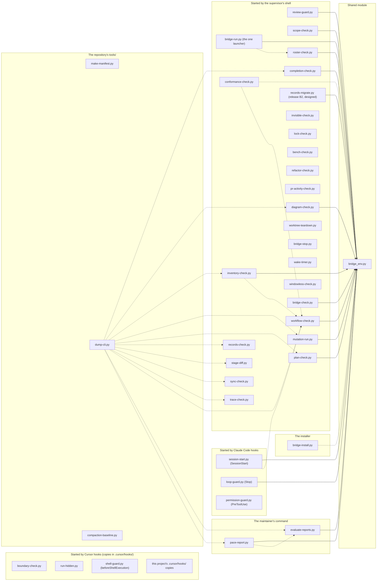

```mermaid
classDiagram
    class HeaderRecord {
        <<abstract>>
        record : enum of project-status, build-plan, brief, inventory, requirements, diagram-index, deviations, run-parameters
        header : integer
    }

    class ProjectStatusHeader {
        <<project-status>>
        phase : enum of intake, design, mockups, interface, planning, configuration, building, done, changing
        workflows : list of WorkflowPart
        awaiting_user_on : string
        bridge_version : string
        stage : string
        open_issues : list of string
    }
    class WorkflowPart {
        type : string
        subtype : string or null
        traits : list of string
    }

    class BuildPlanHeader {
        <<build-plan>>
        stages : list of Stage
    }
    class Stage {
        name : string
        demonstration : boolean
        increments : list of Increment
    }
    class Increment {
        id : string
        title : string
        kind : enum of increment, group or null
        parent : string or null
        depends_on : list of string
        parallel : boolean or null
        diagrams : list of string
        scope : list of string
        satisfies : list of string
        deferred : string or null
        historic : boolean
    }

    class BriefHeader {
        <<brief>>
        id : string
        round : integer
        satisfies : list of string
        scope : list of string
        merge_unit : list of string or null
        blocking_class : enum of behaviour, security, data integrity, safety mechanism, failing test or null
    }

    class InventoryHeader {
        <<inventory>>
        reflected_through : string or null
        development_data : string
        tables : InventoryTables
    }
    class InventoryTables {
        features : TableShape
        resources : TableShape
        decisions : TableShape
        deferred : TableShape
    }
    class TableShape {
        columns : list of string
        key : string
    }

    class RequirementsHeader {
        <<requirements>>
        columns : list of string
        roles : RequirementsRoles
        statuses : list of enum of planned, built, deferred, dropped
    }
    class RequirementsRoles {
        id : string
        status : string
        evidence : string
    }

    class DiagramIndexHeader {
        <<diagram-index>>
        columns : list of string
        roles : DiagramIndexRoles
    }
    class DiagramIndexRoles {
        id : string
        level : string
        kind : string
        status : string
        file : string
        refines : string
        realizes : string
        enforced_by : string
        why : string
    }

    class DeviationsHeader {
        <<deviations>>
        columns : list of string
        roles : DeviationsRoles
    }
    class DeviationsRoles {
        diagram : string
        from : string
        to : string
        as_built : string
        since : string
        resolved_by : string
    }

    class RunParametersHeader {
        <<run-parameters>>
        stage_pause : string
        merge_authority : string
        refactoring_pass : string
        installer_verification : string
        parallel_increments : string
        agent_ceiling : integer or null
        ceiling_above_twice : list of CeilingLift
        design_rounds_above_five : list of DesignLift
        review_rounds_above_ceiling : list of ReviewLift
    }
    class CeilingLift {
        kind : string
        seconds : integer
        words : string
    }
    class DesignLift {
        subject : string
        rounds : integer
        words : string
        date : string
    }
    class ReviewLift {
        id : string
        rounds : integer
        words : string
        date : string
    }

    HeaderRecord <|-- ProjectStatusHeader
    HeaderRecord <|-- BuildPlanHeader
    HeaderRecord <|-- BriefHeader
    HeaderRecord <|-- InventoryHeader
    HeaderRecord <|-- RequirementsHeader
    HeaderRecord <|-- DiagramIndexHeader
    HeaderRecord <|-- DeviationsHeader
    HeaderRecord <|-- RunParametersHeader

    ProjectStatusHeader "1" *-- "0..*" WorkflowPart : workflows
    BuildPlanHeader "1" *-- "0..*" Stage : stages
    Stage "1" *-- "0..*" Increment : increments
    InventoryHeader "1" *-- "1" InventoryTables : tables
    InventoryTables "1" *-- "4" TableShape : features, resources, decisions, deferred
    RequirementsHeader "1" *-- "1" RequirementsRoles : roles
    DiagramIndexHeader "1" *-- "1" DiagramIndexRoles : roles
    DeviationsHeader "1" *-- "1" DeviationsRoles : roles
    RunParametersHeader "1" *-- "0..*" CeilingLift : ceiling_above_twice
    RunParametersHeader "1" *-- "0..*" DesignLift : design_rounds_above_five
    RunParametersHeader "1" *-- "0..*" ReviewLift : review_rounds_above_ceiling
```

*This round is the confirming read: raise a finding only on text changed since your last read, or a Blocking finding anywhere.* It is final: no critique round follows it. Both critics last read the file of round 4 (built from commit 2de857d), so the diff since that commit, below, is each critic's diff (plan-critic and Review B alike).

# Design critique: release B2's design revision (subject `release-b2`), round 5, the confirming read

## What is criticised

The Claude-Cursor Bridge is a Claude Code extension that supervises software projects built by a Cursor builder; its release T finished on 2026-11-04 (Phase: done). Release B2 is the project's second change cycle: a YAML front-matter header on every record both the supervisor (an AI model) and a one-shot bridge program read, holding exactly the fields the programs parse with a stated type each; the programs read the header first and fall back to today's pattern matching for a record without one; a migration program adds the headers at a project's calibration. What is criticised is the change cycle's design revision (~/.claude/cursor-bridge/workflow/phases/change-cycle.md, item 2) together with its plan addendum (item 4), one subject since the addendum stands in this round-1 file: docs/DESIGN.md's section "Change: release B2", the register's rows R-057 to R-064, the inventory's eight new Decisions rows, the diagram index with D-005 (new) and the revised D-001 and D-002, and docs/BUILD_PLAN.md's section "Release B2 — the plan addendum" (four constraints; stage H1, TASK-046 to TASK-050; stage H2, TASK-051 to TASK-054), all quoted below with the plan's standing constraints, the Restructuring Plan's section, the maintainer's request and the intake notes, so that nothing outside this file is needed to judge either. The texts are read by an AI supervisor that will write each brief from its increment's Done when and run the increments through the delegation loop (the programs through the Cursor builder, the texts and the records as supervisor-authored increments), and by spec-packager, which writes each brief.

Judge: whether every field a program reads has a header key with a stated type and whether the intake's map of the programs (in the intake notes) is matched by the design's table, field for field; whether the three kinds' one rule each (values held and compared for line records, briefs and the plan; the shape declared for tables) is sound and consistent across the records and the programs; whether the fallback and the malformed rules (checkers refuse, exit 2; hooks fall back and say so) leave no silent path; whether the agreement check can be gamed or can fail wrongly (the fallback's normalisation of the prose against the header's values); whether the stated YAML subset is enough for the schemas and the pyyaml cross-check proves what the design says it proves; whether the migration program and the calibration's step can migrate a running project's records without reopening a gate, the `historic` mark included; whether the status file's cap rule and the rollback effects are right; whether D-005's load-bearing reason holds and its enforcement would catch drift, whether D-002's revision is consistent with its enforcing test and check, and whether D-001's labels trace every new row; whether anything the plan's "Accepted when" asks for has no row; the security criteria (a parser over files in the owner's checkout, no third-party import at run time, the public repository); and the pitfalls (ISS-013, ISS-021, ISS-023 named in the design; KP-010 the builder's self-report; a duplicate record no check compares). For the addendum: the ordering (TASK-046 before every program increment; the shared files `bridge_env.py`, `inventory-check.py`, `plan-check.py` edited by more than one increment in sequence, never in parallel); increments that are secretly two or should be one; whether every row R-057 to R-064 is carried by the increments that name it under Satisfies and every planned row is satisfied (`completion-check.py --mode plan`); whether each Done when is checkable by a test or a printed line; whether the supervisor's acceptance tests named first can be written before the builder's code exists (what they import, what they fix); the mutants' recorded operator set; whether each stage is demonstrable and its Demonstration names what is shown live; whether the token measure, the status file's trim and the P7 suite are placed at the one increment that changes a record's shape; whether TASK-051's command carries the reference, the allow rule and D-002's edge; whether TASK-054's items match the design's Delivery, Data model and Impact; the plan's pitfalls (KP-009 the constant pointer; KP-019 a reality check at every brief; KP-035 the digest's cap; KP-066 a floor trusted before a run).

## The record so far

## Subject: release-b2 (the change cycle's design revision and its plan addendum as one subject: machine-readable headers on the records both the model and a program read; 2026-11-04)

**What is criticised:** the change cycle's design revision for release B2 (change-cycle.md, item 2), the second change on the finished bridge, and, as one subject with it since its increments stood in the round-1 file (design.md, "The procedure"), its plan addendum (item 4): docs/DESIGN.md's section "Change: release B2" (the seven record kinds and their typed keys; the three kinds of record and their one rule each; header first, fallback, malformed; the subset reader in `bridge_env.py` with `pyyaml` in the tests only; the migration program and the calibration's step; the status file's cap on the body), the register's rows R-057 to R-064, the inventory's eight Decisions rows, D-005 (the header schemas, Level 4, new) and the revised D-001 and D-002 with the index, and docs/BUILD_PLAN.md's "Release B2 — the plan addendum" (its four constraints; stage H1, TASK-046 to TASK-050, the reader and the programs; stage H2, TASK-051 to TASK-054, the migration program, the texts, this repository's records and the stamp). The critics read `run/review/DESIGN-release-b2-<round>.md`, built from the committed records by run/supervisor/b2_design_file.py, with plan-critic's design and build-plan lenses and the trait installable's planning lenses. Four rounds at the most, then a confirming read if the text changed, then one resolution round for what is still open, then the gate (design.md, "The procedure").

**Accepted** (finding, critic, round, the reason):
- (none yet: every finding of rounds 1 to 4 was fixed)

**Rounds** (round, kind, the commit its file was built from, critic, Blocking / Should fix / Consider, what was fixed):
- 1, critique, the records at 595bffc (the file committed as ef06a98; snapshot `DESIGN-release-b2-1`, hash 4d29aeae3f05cc66, `verify` OK), plan-critic (Fable 5.1): 2 / 10 / 6. Fixed: B1 the "one fallback reader" was eight private copies — the design names, field by field, which of two readings is kept and moves every reader into `bridge_env` as one copy, the non-goal reworded, TASK-047 to TASK-050 widened and a test greps for the retired copies; B2 TASK-053 would have run the Workspace copy of `records-migrate.py` over this project's live records against the Development data decision — the stamp is now TASK-053 and this repository's migration TASK-054, by the installed program at this project's calibration after the install, stage H2's demonstration running after the install by plan; S1 `docs/CHANGES.md` and the element maps named among the records left out with reasons, `docs/diagrams/DEVIATIONS.md` added as the eighth kind (D-005, the register, the migration, the templates); S2 the reader's plain scalar is a letter-led word that is none of YAML 1.1's typed words, every other plain scalar refused with the advice to quote it, the migration and the templates quoting dates and typed words; S3 `development_data` is the first cell of the `Development data:` row, the one value a tabular header copies; S4 a brief's `satisfies` has the brief's `Satisfies:` line as its prose, the one new reading, admitted in the non-goals; S5 a record the fallback refuses is listed (`cannot read`) and left header-less, R-063 qualified; S6 the trim committed before the migration, the token measure reading that commit; S7 D-002's `dump_cli` edge the supervisor's commit on TASK-051's branch, outside the brief; S8 `claude --version` re-read at TASK-046 and the viewer check at TASK-054, each on a Done when; S9 the index's D-002 row realizes R-057 to R-062; S10 the rollback effects observed, not asserted: the installed release's checkers run over a migrated scratch copy at the stamp and over the live records at TASK-054, their lines quoted; C1 twelve programs; C2 `--max-lines` counts the body too; C3 each run-parameter value is the token the owner-values test's regex reads; C4 the calibration's migration a records-only commit; C5 a plan `Scope:` line holds no semicolon inside a parenthesis (the addendum's lines rewritten) and stage H2's reflection re-reads every migrated header, the older lines repaired at TASK-054 as `--check` lists them; C6 11,679 characters.
- 1, critique, the same file, Review B (grok-4.7-medium): 5 / 7 / 4. Fixed: B1 every reader has a stated malformed outcome — the launcher and the guard refuse with exit 125 and `bridge-run: refused - header: ` or `review-guard: refused - header: `, a stop named in step 3b's list, and `evaluate-reports.py` falls back and writes `header malformed` into its report; B2 the brief's checker compares every key with its prose or the file's name, not `scope` alone; B3 the canonical reading named for every two-reader field (`Satisfies:`, `Phase:`, `Bridge version:`, `Ceiling above twice:`, a brief's `## Scope`, `Workflows:`, the inventory's sections, the index), the retired readings listed in Impact, and `completion-check.py`'s agreement rule makes a bold `Satisfies` line outside an increment a `HEADER DISAGREES`, never a silent loss; B4 the migration refuses a status file that would exceed the older whole-file cap with its header (`cannot write ...; trim the body first`), on every project, this repository's trimmed in the commit before; B5 a brief's `id` and `round` are read from the file's name by `parse_review_name`, the name their fallback and the agreement rule; S1 the plain-scalar rule (as plan-critic's S2), dates quoted; S2 TASK-047 says five plain imports are designed edges and `conformance_check` keeps its dotted load; S3 the currency test is `tests/test_header_currency.py` on TASK-050's Done when; S4 every program increment's mutants file sweeps the reader, the agreement checks and the moved readers; S5 a stage's `name` and `demonstration` are compared with the heading and the `Demonstration:` line; S6 `historic` exempts only where `squash_merged_ids` finds the ID merged, a mark on an unmerged increment a finding; S7 the write is atomic (a temporary file, read back and checked, `os.replace`), with a crash and a full-disk failure mode and tests; C1 D-005's note says the type is the attribute's (`integer`) and the value rule exactly 1 is `check_header`'s; C2 the supervisor's tests reach new names through `getattr` and are red on the checkpoint, not errors; C3 TASK-054 names the User Manual's install chapter at project end; C4 `statuses` is a list of the enumeration's four words.
- 2, critique, the records at fffdfdd (the file committed as 115828e; snapshot `DESIGN-release-b2-2`, hash ed454183004362f9, `verify` OK), Review B (grok-4.7-medium): 3 / 6 / 1. Fixed: B1 `header_agrees` states the normalisations for `demonstration` (true where a `Demonstration:` line with text follows the heading, the presence `DEMO_RX` reads) and `parallel` (`yes` is true, `no` false), with an absent optional line as null, in the design, R-057, R-059, D-005, TASK-046 and TASK-048; B2 `historic`, which has no prose line, is compared by its derivation (no Scope, no Kind, the ID merged), so TASK-051's read-back passes a historic increment; B3 the guard refuses a malformed brief header as the launcher does (it reads `merge_unit` and `blocking_class`), the design's malformed paragraph saying so; S1 `reflected_through` compared with the `Reflected through:` line (TASK-049, R-060); S2 `conformance-check.py`'s two readings of `Phase:` (the backtick-stopping regex, the grades' `startswith`) named retired in the fallback list, TASK-047, Impact and the currency test; S3 the migration refuses a status file over either older cap, 120 lines as well as 12,000 characters, and the rollback paragraph names both; S4 the `pyyaml` cross-check over this repository's headers is TASK-054's test; S5 the empty string is written `""` (the reader, R-062, TASK-051, D-005); S6 one exit-code rule: `HEADER MALFORMED` exits 2, the cannot-verify exit three checkers have and four gain, `HEADER DISAGREES` exits as a finding (1; `scope-check.py` 2), stated in the design, R-058, R-059, the inventory's row and the stage's demonstration; C1 the Why's eleventh field named, the plan's increment IDs read over one file and over every plan file.
- 2, critique, the same file, plan-critic (Fable 5.1): 1 / 8 / 6. Fixed: B1 an increment's `kind` and `parallel` are `or null` in D-005 and the table, null allowed only where `historic` is true, a value rule `check_header` holds (TASK-046), the historic fixture and the migration writing them null; S1 the `historic` exemption uses `plan-check.py`'s own merged set, `merged_ids(--base)`, and the migration reads the same set over the same default base (`--base origin/main`), `--no-git` accepting the mark with a note; S2 a brief's `round` is an integer, 1 for a plain name; S3 the stamp test asserts R-063 planned or built with Evidence where built, so TASK-054 needs no edit of it; S4 the token measure compares the trim's and the migration's commits by two fixed shas, skipped where either is absent; S5 the one reader refuses a `Scope:` entry with an unbalanced parenthesis, a shape failure for an unmerged increment in `plan-check.py` and `cannot read` in the migration, so `--check` lists the misread lines; S6 TASK-047's Scope gains the command reference and its Done when the help text and `dump-cli.py --check`; S7 `diagram-check.py`'s whole-text `R_RX` over the register named retired (the fallback list, Impact, TASK-049's grep, the currency test); S8 `bridge-run.py` refuses a brief whose header disagrees with its prose before the launch (`header: disagrees <key>`, exit 125), in the design, R-059, TASK-048 and Failure modes; C1 `statuses` is the allowed set, exactly the four words, a list of fewer or other words malformed and a cell's other word the register check's finding; C2 D-005 realizes R-062; C3 a `#` inside a double-quoted string is text, a fixture holding `"PR #135"`; C4 the advice reads "double-quote it", a single-quoted scalar refused too; C5 a path of no record kind is listed `cannot read <path>: not a record kind` and the run goes on; C6 the hook prints `header disagrees: phase` beside its pointers.
- 3, critique, the records at b92d29b (the file committed as 1c0563b; snapshot `DESIGN-release-b2-3`, hash a1646db46b5359dc, `verify` OK), Review B (grok-4.7-medium): 1 / 5 / 2. Fixed: B1 a historic increment's list keys are never null: an absent list line (`Scope:`, `Depends on:`, `Diagrams:`, `Satisfies:`) reads as the empty list, the fallback's reading today, null only for the optional scalars, so `check_header` and the migration's read-back pass a historic increment (the design's normalisations, R-057, R-059, D-005, TASK-046, TASK-048, TASK-051); S1 the cross-check pins a disjunction: every plain form the subset refuses unquoted is one `safe_load` types as other than a string or one the schemas never write unquoted (the design, R-057, TASK-046); S2 `session-start.py`'s equality of `Awaiting user on:` with its four exact values and `conformance-check.py`'s second `Bridge version:` regex named retired, in the one enumerated list; S3 the hook prints `header disagrees: <key>` for each of its four status keys and the loop guard refuses the stop on `phase` or `awaiting_user_on` (the design, R-058, the inventory's row, TASK-047, stage H1's demonstration); S4 the launcher and the guard compare every lift with its line before any governs a launch or a snapshot and refuse a difference (`header: disagrees <key>`), the loop guard refusing the stop on a drifted `agent_ceiling` or `ceiling_above_twice` (the design, R-061, TASK-050); S5 R-057 flips built at TASK-050, the later of its two increments, whose Satisfies names it, and the repository cross-check it cited is R-063's alone (the constraints, R-057, TASK-050); C1 a flow mapping is refused (the reader, R-057, TASK-046); C2 a `scope` entry is the bullet's path as `split_entry` reads it, a folder's `/` kept on both sides and never added or removed (the design, R-057, D-005, TASK-046).
- 3, critique, the same file, plan-critic (Fable 5.1): 1 / 8 / 4. Fixed: B1 `ceiling_above_twice` is a list of `{kind, seconds, words}` mappings, one per `Ceiling above twice: <kind> <seconds> (<words>)` line as `bridge-run.py`'s `owner_cap` reads them, empty where none stands, D-005's `CeilingLift` class (the table, R-061, D-005, TASK-050, TASK-052); S1 one merged-set function, `bridge_env.squash_merged_ids(folder, PLAN_ID_PATTERN, ref=<base>)`, called by `plan-check.py` (its `merged_ids` retired, the eleventh retired reading) and by the migration, both `--base` options defaulting to `origin/main` (the design, R-059, R-062, D-005, the inventory's row, TASK-048, TASK-051); S2 a plan file whose merged set cannot be read is listed `cannot read <path>: merged set unreadable (<reason>)` and left untouched, a malformed record stops the run at that record with exit 2, the records before it written and listed, and a failed read-back stops it with exit 3 (the design, R-062, TASK-051, Failure modes); S3 the program enumerates the eight kinds from a project root by its kind rule, a path of no kind affecting no exit, so `--check`'s "nothing to write" and exit 0 are reachable and one command from the Workspace root serves the calibration, TASK-054 and the demonstration (the design, R-062, TASK-051, TASK-052, TASK-054, stage H2); S4 the token measure is measured once before the push, its bytes quoted in the accept commit and written as constants, the lasting assertion the brief's, the status file's skipped with the squash as its reason (Testing strategy, R-063, TASK-054); S5 as Review B's S5; S6 as Review B's S2, the retired readings one enumerated list of eleven that Impact, R-057, TASK-047 and the currency test cite; S7 a retired reading is matched as a use with docstrings and comments stripped with `ast`, never by its description, and no program quotes one in prose (the constraints, R-057, TASK-047, TASK-048, TASK-050); S8 each table has one owning checker with the finding texts `HEADER DISAGREES: columns` and `roles.<role>`, exit 1 (the inventory `inventory-check.py`, the register `completion-check.py`, the index and the deviations file `diagram-check.py`), the other reader trusting it (the design, R-060, D-005, TASK-049); C1 the loop guard refuses the stop with `header disagrees: <key>` (as Review B's S3); C2 the migration's tests run in a temporary git repository with `--base` given, never against the Workspace's history (TASK-051); C3 a `--base` beginning with `-` is refused, exit 2 (the design, R-059, R-062, TASK-048, TASK-051); C4 `header_agrees(kind, header, fallback)` takes the fallback's whole reading, the plan's reading carrying `historic` from the merged set the plan reader was handed (R-057, TASK-046).
- 4, critique (the ceiling), the records at 1f55db8 (the file committed as 2de857d; snapshot `DESIGN-release-b2-4`, hash 9a06c4bd1c98c4f0, `verify` OK), Review B (grok-4.7-medium): 0 / 6 / 3. Fixed: S1 the two demonstrations' `historic` cases run in a temporary git repository whose history merges the marked IDs, `--base` naming its branch, as the tests do (stage H1, stage H2); S2 reading (7) is TASK-049's, TASK-047's test covering (1) to (4) (as plan-critic's S2); S3 each gate program compares the lifts it reads, the launcher three and the guard `review_rounds_above_ceiling`, the demonstration's guard case a drifted `review_rounds_above_ceiling` (the design, R-061, TASK-050, stage H1); S4 an increment's `title` is compared with its heading's title, `HEADER DISAGREES: <id> title` (the table, the normalisations, R-057, R-059, D-005, TASK-046, TASK-048); S5 the `satisfies` sweep is one function in `bridge_env`, `plan_r_ids_outside_headers`, every R-id in a plan file's body outside the header by the one R-id pattern, the program's own whole-text `Satisfies` regex the retired reading, so the currency test has nothing to exempt (the fallback list, R-059, TASK-048); S6 the templates quote every string the plain form would refuse, paths holding `/` and `n/a` among them, and the text test parses each template's header with `read_header` and `check_header` (R-062, TASK-052); C1 a folder argument is the project root, one at most, a second refused (the design, R-062, TASK-051); C2 the reader bounds nesting at eight levels, a deeper block refused with its line (the reader, R-057, the inventory's row, TASK-046); C3 every list of mappings is written in block form, the flow form only for a list of short scalars (the design's Writing, R-062, the inventory's row, TASK-051, TASK-052).
- 4, critique (the ceiling), the same file, plan-critic (Fable 5.1): 0 / 5 / 7; the round-3 fixes verified in the text and against the programs, none reversed. Fixed: S1 `kind` is never absent as a value (`plan-check.py` defaults it to `increment`): the fallback reads `increment` where the `Kind:` line is absent and `header_agrees` compares against that, a historic increment's null against the absent line, the historic derivation reading the absent `Scope:` and `Kind:` lines, which the plan reader's whole reading carries beside the values, and the Kind shape exemption being the value check (the table, the normalisations, R-057, R-059, D-005, TASK-046, TASK-048); S2 as Review B's S2; S3 a `Parent:`, `Depends on:` or `Diagrams:` line holding the template's filler `none` reads as an absent line, null or the empty list (the table, the normalisations, R-057, R-059, R-062, D-005, TASK-046, TASK-048, TASK-051); S4 the non-goal names the agreement checks as its second exception (a record's checker reads every key of its record to compare), and the table and D-005 list `inventory-check.py` among the readers of the status file and the run parameters (the non-goals, the table, R-061, D-005); S5 the guard refuses a brief whose `merge_unit`, `blocking_class`, `id` or `round` disagrees with its line or its name, the keys it reads, as the launcher refuses every key, carried to R-059, TASK-048 (four refusals and the test case) and stage H1's demonstration; C1 the kind rule's grammar named: a report by `bridge_env.HANDOFF_REPORT_NAME`, a resolution file by `HANDOFF_RESOLUTION` (the design's Migration, R-062, TASK-051); C2 a merged brief the fallback refuses is never repaired, stays header-less and affects no `--check` exit, whose exit 1 is for a record that would be written or cannot be written (the design, R-062, the inventory's row, TASK-051, TASK-054, stage H2); C3 R-062 flips built at TASK-052, the later of its two increments (the constraints); C4 TASK-051's allow rule is a writing command's, run at a calibration and TASK-054 (TASK-051's Scope); C5 TASK-054's Scope entry reads `handoff/` as a folder, no glob (TASK-054); C6 the inventory's reader row names the flow-mapping refusal (the inventory); C7 the schema test strips a trailing ` or null` before it splits an enum's items (D-005, "How the attributes are written").

**Resolution**: (pending)

**Gate**: (pending)

## Subject: release-t-plan (release T's plan addendum: stages T1 and T2, TASK-036 to TASK-045; 2026-11-01)

What is criticised: the two stages change-cycle.md's item 4 appends to docs/BUILD_PLAN.md for release T (the addendum's constraints, stage T1's five text increments, stage T2's weekly workflow, BUG-039 as TASK-043, the retrofit's tests and the stamp), read against the approved design (docs/DESIGN.md, "Change: release T"), the register's rows R-042 as revised and R-045 to R-056, the four diagrams and their deviations file, with the plan-critic's build-plan lenses and the trait installable's `planning.critic-lenses` addition (the packaging stage lens, not applicable to the kind host-installation, and the command-reference lens). The critics: `plan-critic` (Fable 5.1) and Review B (grok-4.7-medium, the native profile) in design mode, each reading `run/review/DESIGN-release-t-plan-<round>.md`. Four rounds at the most, then a confirming read if the text changed, then one resolution round for what is still open, then the gate (design.md, "The procedure").

**Accepted** (finding, critic, round, the reason):

- A test over `spec_from_file_location(` for the seven loads by file (plan-critic, round 1, Consider): the design places those edges under review and the file-load form under a maintainer's program item (Open questions), so a test pinning today's form would pin what that item changes; the plan builds the design as approved.
- The three DEVIATIONS removals have no order (Review B, round 1, Consider): they remove distinct rows of one table and no increment of the release runs in parallel (the constraints), so each merges onto the other's result; a textual conflict at a rebase is resolved as any.
- TASK-037 carries three rows (Review B, round 1, Consider): the rows are sentences in shared homes (the core, design.md, the digest) with one pin file and no program; each increment costs a gate pass (INVENTORY, Decisions).
- TASK-041 grows when its observed launch is prompted or refused (Review B, round 3, Consider): the branch is conditional and expected not to run (the design's host table shows the rules' forms allowing); when it does, the rule work is text and a test re-run, no program, and the design's host assumption binds its three steps to the same release; an increment planned for a condition that may not arise would plan work that never runs.
- Allow rules for `gh workflow run`, `gh run list`, `gh run view`, `gh workflow list` and `gh api` (plan-critic, round 4, Consider): the three the loop runs once at TASK-044 are the supervisor's own attended commands, the permission guard reading the two lists and the view as reads; the Sunday evaluation's are the maintainer's, in a session of their own; none stands in a file `tests/test_allowlist.py` collects, so no test fails; a rule per command would be standing data for a once-a-release and a once-a-week command.

**Rounds** (round, kind, the commit its file was built from, critic, Blocking / Should fix / Consider, what was fixed):

- Round 1, critique, 49f797e, plan-critic: 1 / 8 / 6. Fixed: TASK-044's tests exempted from the red-on-checkpoint proof as characterisation tests and shown strong by a code-side mutants file (the guard's call, `REVIEW_ROUNDS`, `SECRET_LIKE`, dump-cli's selection) beside the two diagram-side hand mutations; `new_tests` by path for a new file and by node id for a rewritten test, the per-test lines read; TASK-038's move verbatim in the increment's first commit, its sha named, the rewording after; the constraint saying which increment flips a row to built and writes its Evidence (the later of two for R-052 and R-055, at TASK-044); the dispatch read moved from TASK-042 to TASK-044's Done when; TASK-043's criterion on TASK-045's entry deleted; the three maintainer halves and **If rolled back**'s content in TASK-045 and its test; an `Alters:` line under each stage; the thirteen `TESTS:` lines of `--mode code` until TASK-044 stated in the constraints and stage T1's demonstration; bytes not characters; the observable "no prompt and no refusal"; the flag-voiding cases split between `test_bug039.py` and the D-003 file, the INDEX cell naming both; step 7 as decide.md's; the narrower `git branch -D stage/*` rule kept. Accepted: 1 (above).
- Round 1, critique, 49f797e, Review B (grok-4.7-medium): 2 / 9 / 6. Fixed: the Evidence per item letter written by the flipping increment and checked by TASK-045's stamp test over the register; TASK-043's criterion deleted; exit 0 alone not the proof, the per-test lines read; the by-id listing for `test_loop_text_pace.py`; `delegation-loop.md`'s step 4 among R-050's homes and the reviewers' definitions among R-051's for P11; D-003's and D-004's files in TASK-043's and TASK-041's Scope, their deviation labels redrawn as built with the rows' removal; R-052 and R-055 planned until TASK-044; stage T2's demonstration walking the three kinds against the run list; the dispatch out of TASK-042; `docs/DESIGN.md` in TASK-041's Scope; the three maintainer halves; `merge.md` under the R-032 bound test; TASK-041 depending on TASK-040; the `Alters:` lines; a negative case per site and the security auditor's read for TASK-043. Accepted: 2 (above).
- Round 2, critique, e83b660, plan-critic: 1 / 8 / 3. Fixed: TASK-042's Scope gains `tests/test_release_b_ci_floor.py`, whose only-workflow pin is rewritten to the two files, listed by node id and red first; the `--mode code` count stated by span (thirteen through TASK-042's checkpoint, twelve from its merge, never rising); a parametrised test listed by its bracketed id for the new parameter alone; R-056's flip and Evidence in TASK-045's accept commit as the one exception, so its stamp test and `--mode done` are green there; the item labels read from the Requirement cell's parentheses, rows without labels needing one test; **If rolled back** stated as the installer does it (the release's rules removed with it); TASK-044's code-side mutant the after-restoring call, killed by its own tests; the dispatch's not-green path (a finding a `DEP-<nnn>` increment first; a scanner failure one rerun, then a floor defect); TASK-036's Scope naming `tests/test_a5_followups.py` in place of the open clause, KP-061's pin the outcome line; a committed file's tests (TASK-043's) by node id; TASK-045's records marked as outside Scope. Accepted: none.
- Round 2, critique, e83b660, Review B (grok-4.7-medium): 1 / 4 / 1. Fixed: the count by span, read at step 4 (Inspect), where the command stands; TASK-043's brief Scope the increment's whole, the manifest and the command reference beside the variant's cause-file rule; the bracketed id; R-042's Evidence (no labels; the convergence tests from TASK-039's records-only commit, `tests/test_bug039.py` from TASK-043's); stage T2's `Alters:` line naming `settings.bridge.json`'s `--strip` forms where written; TASK-041's branch conditioned on the observable, a prompt or a refusal. Accepted: none.
- Round 3, critique, 7099cc6, plan-critic: 1 / 4 / 2. Fixed: TASK-040's D4 commands (`git tag`, `git show` on the stage-review name) admitted by two narrow allow rules its Scope now carries with `tests/test_allowlist.py`, the stage's `Alters:` line and **If rolled back** naming them; TASK-045's `docs/REQUIREMENTS.md` and `project.json` back in Scope since its accept commit is mixed, the RECORDS rule stated as built; the label and Evidence grammar fixed once in the constraints and cited by the stamp test; P7's suite form through `--key-file` so `tests/test_allowlist.py` reads it, TASK-041's observed launch carrying the word; `tests/test_a5_followups.py` in TASK-038's and TASK-040's Scope and the constraint's list, `tests/test_leads_b3.py` checked at TASK-037; the helper's own call site the one exemption of TASK-043's test; TASK-044's tests reading D-004's note from the file. Accepted: none.
- Round 3, critique, 7099cc6, Review B (grok-4.7-medium): 0 / 5 / 1. Fixed: stage T1's demonstration naming its three live runs and the check's own `note:` and `RESULT:` lines; D-004's guard edge carrying no deviation clause, so TASK-043 redraws D-003's labels only; the checkpoint command as the loop gives it at the increment, the stripped form with its scratch folder from TASK-041; the record, the diagrams and the deviations file outside TASK-043's brief; the label shape (`(T18's rule)` is prose). Accepted: 1 (above).
- Round 4, critique (the ceiling), c43cd5f, plan-critic: 0 / 3 / 4. Fixed: P7's two prediction reads admitted by `Bash(gh pr list:*)` and `Bash(gh issue list:*)` in TASK-038, item 5's `git branch -r` by an exact rule in TASK-040, the stage's `Alters:` line and **If rolled back** naming all six; TASK-041's observable without the launcher's non-existent strip lines, the strip shown by the floor test file's own skipping strip test and the program's test; TASK-043's brief Scope the variant's (the reproduction tests in it, forbidden to edit; `docs/BUILDER_NOTES.md`), the negative cases the supervisor's before the brief; the narrowness reason corrected with the read command's change (Review B's finding); the long launch commands in fenced blocks so the allowlist test collects them; P7's `--key-file` slot observed at TASK-036's first launch, TASK-041 observing `--strip` alone. Accepted: 1 (above).
- Round 4, critique (the ceiling), c43cd5f, Review B (grok-4.7-medium): 1 / 3 / 1. Fixed: TASK-041's Scope gaining `delegation-loop/merge.md` (P7's suite command) and `tests/test_release_t_merge.py`, the `--strip` commands in five homes; the stage-review read `git cat-file -p` in place of `git show`, whose `--output` form any wildcard rule would admit, the allowlist test showing that form matches no rule; D-004's `p_dependency_scan` redrawn as in the tree by TASK-042; TASK-044's strength run in the loop's step 7 form as it then stands; `project.json`'s version and bridge field under the stamp test. Accepted: none.
- Round 5, the confirming read (changed text only, or Blocking anywhere), 519d003, plan-critic: 0 / 2 / 3. Fixed: the strip test in its own file `tests/test_release_t_strip.py`, outside `new_tests`, the constraints naming it the second exception; TASK-038's (c) repairing a prompted `--key-file` launch (the test kind's rule widened, the model narrowed and re-run, `tests/permission_rules.py` in Scope); the collector's reach and fence tag stated; `docs/BUILDER_NOTES.md` in TASK-043's Scope line; the negative cases' names copied into the brief as fixed points. Accepted: none.
- Round 5, the confirming read, 519d003, Review B (grok-4.7-medium): 0 / 3 / 0. Fixed: the two homes the allowlist test never reads pinned with the three it does as one text by `tests/test_release_t_floor.py`; TASK-043's negative cases listed by node id where red on the unfixed guard, otherwise invariants under the constraints' exception with a hand mutation; TASK-036's Done when stating the first P7 launch, its observation and the host-table row, TASK-038's (c) the repair. Accepted: none.

**Resolution**: none due — the confirming read left nothing Blocking and nothing non-convergent (the ceiling's and the confirming read's findings each fixed in one pass).

**The gate** (2026-11-01, the owner, in this session's chat): "Approve" — the plan addendum as critiqued (stages T1 and T2, TASK-036 to TASK-045, the three constraints); "Confirm" — the record as it stands (83 findings over five reads, each critic's counted per round as the Rounds entries above give them: 78 fixed, 5 accepted with their reasons, no resolution round due; first written, and put to the owner, as 52 findings with 47 fixed, a miscount Review A of the pull request found and the supervisor corrected the same day, the round entries unchanged). The `run/review/DESIGN-release-t-plan-*` files are removed in the commit that records it.

**After the gate** (2026-11-01, Review B of the pull request carrying the design and the plan, PR #116, round 1, REJECT): a fourth site of BUG-039, `cmd_snapshot`'s re-snapshot dropping a round's `flagged_launch`, reproduced by Review B on a temporary repository and confirmed by reading the code; the same rule (R-042: a flagged round spends nothing), so it is recorded as a third D-003 deviation and added to TASK-043 as its fourth site, the design, the register's R-042 row and the inventory's BUG-039 row saying so; a change within the approved requirement, no new row and no new increment, told to the owner in the next report (rule 58).

**Gate**: passed 2026-11-01 (the paragraph above).

## Grades

- **Blocking**: the design cannot go to its gate with it.
- **Should fix**: the supervisor fixes it or accepts it with a reason.
- **Consider**: worth a thought; no round follows from it.

End with the counts per grade. Four rounds at the most, then a confirming read if the text changed, then one resolution round for what is still open.

## The lenses (from plan-critic.md, the design-document section)

## When reviewing a design document

Attack it along these lines:

- **Unstated assumptions.** What must be true for this design to work that nobody has
  written down?
- **Failure modes.** What happens when the network is down, the disk is full, the
  input is hostile, the dependency is a version behind, two things happen at once?
- **Contradictions.** Does any part of the design conflict with another part, or with
  a stated requirement or constraint?
- **Unjustified choices.** Which technology choices have no reasoning attached, or
  reasoning that does not survive a follow-up question?
- **Scope creep.** What is in this design that no requirement asked for?
- **Scope gaps.** Which stated requirement has nothing in the design serving it? Is every requirement from intake, the owner's requirements document, and the design a row in `docs/REQUIREMENTS.md` with an ID? A requirement that appears in a source but not in the register is **Blocking**.
- **The thing that will hurt in six weeks.** Where is the decision that is cheap now
  and expensive to reverse later?
- **Security criteria.** Does the design address authorization, input validation, and
  secret-handling at each trust boundary? Is the chosen ASVS level recorded, and does it fit
  the data sensitivity? Are the security acceptance criteria it implies actually checkable?
- **Migration policy.** Does the data model state which regime the project is in —
  pre-release (edit the schema definitions, rebuild disposable databases, no migrations) or
  shipped (additive migrations first, destructive only with a data-preserving path) — and
  when it switches? A design that plans destructive migrations on a pre-release, disposable
  database is spending risk for nothing; one that plans schema edits after data exists in
  the field is destroying it. Missing regime: **Should fix**.
- **A worked scenario for money and stored data.** Is every rule about money or stored data read against one worked scenario before it reaches code review: a retry after a lost reply, a dry run, a benchmark, an approved live smoke, two users on one account, each step naming the store it reads and writes? A rule no scenario was walked through is **Should fix**; a step that can charge twice or lose a result is **Blocking**.
- **Performance lens (where budgets exist).** Read `~/.claude/cursor-bridge/Performance-Patterns.md`
  (by that absolute path). For each budget in the design: is a mechanism named that
  plausibly meets it at the stated data size — or does the design walk into a catalogued
  pattern (name the `PP-nnn`): a per-item query or model call in a loop, a full scan where
  an index is implied, recomputation of unchanged values, synchronous IO on a hot path, an
  unbounded collection or cache, work on the interface thread, eager startup, per-item model
  calls where batching or a cheaper model would do? Is the budgeted operation measurable in
  isolation with fixed inputs? A budget with no mechanism behind it is **Blocking**; a
  mechanism that cannot scale to the stated size is **Blocking**.
- **Diagram selection (any project with `docs/diagrams/INDEX.md`).** Read `~/.claude/cursor-bridge/Diagram-Planning-Conventions.md`. Does every omitted catalogue kind have a reason that holds for this design? A kind omitted that the design needs — a lifecycle with no state machine, an external service with no inter-system sequence, stored data with no entity-relationship diagram, secrets or personal data with no data flow diagram and its trust boundaries, more than one module with no component diagram — is **Blocking**.
- **Load-bearing detail.** Does every Level 4-5 diagram's stated reason hold, or is it implementation detail that should stay the builder's (**Should fix**)? Conversely, is a load-bearing mechanism — a concurrency protocol, a reservation scheme, a security flow — described only in prose where a diagram would pin it (**Blocking** when getting it wrong corrupts data or money)?
- **Enforcement.** Would what enforces each normative diagram actually catch drift? `review:` where a deterministic check or tests would work is **Should fix**; a diagram nothing enforces is **Blocking**.
- **Meaning across diagrams.** Contradictions the deterministic check cannot see: a sequence that calls in a direction the component diagram does not allow, a state no transition reaches, an entity no component owns, a data flow that crosses a trust boundary with no validation stated, an operational workflow that reaches a screen the mockup does not have. Each is **Blocking**.

## The lenses for the addendum (from plan-critic.md, the build-plan section)

## When reviewing a build plan

The round's file may carry, beside the lenses below, the lenses the parts' conditional workflows add at `planning.critic-lenses`; apply each as one of your own, at the grade it states.

- **Prior-project lessons.** If the plan's "Prior-project lessons" section lists extracted
  issues, does every one of them land on a named increment's acceptance criteria, an
  ordering choice, a brief constraint, or a Phase-5 configuration item? An extracted issue
  that is only mentioned, not attached, is a **Blocking** finding — the lesson will be
  re-learned. If the section says "none", check that the supervisor actually asked (the
  plan records it) rather than skipped the step.
- **Requirement trace.** Read `docs/REQUIREMENTS.md`. Does every `planned` requirement — every screen and state of the approved mockup included — have at least one increment that names its ID under `Satisfies`? Is any increment's claimed requirement only partly covered by its acceptance criteria? An untraced requirement, or a deferral without the owner's dated answer, is **Blocking**.
- **Ordering.** Is any increment dependent on something built after it?
- **Granularity.** Which increments are secretly two or more? Which are so small they
  are noise?
- **Testability.** For each increment, can its acceptance criteria actually be checked,
  by a specific observable outcome? "Works correctly" is not acceptance criteria.
- **Scope boundaries.** Does each increment name the files and directories it may
  touch? Do any two increments overlap on the same files?
- **First runnable point.** How many increments before something can actually be run?
- **Vertical slices.** Is every stage a vertical slice — crossing the layers its features need so the parts are proven to work together and something can be run? A horizontal stage (one layer across many features: all the storage, then all the interface) is **Blocking**.
- **Placement.** Does every increment state `Depends on`, `Parallel`, `Diagrams`, and `Scope`? Are two `Parallel: yes` increments truly independent beyond their files — no shared schema change, API contract, configuration, or fixture? A false `Parallel: yes` is **Blocking** (`plan-check.py` only sees file scopes). An increment whose `Diagrams` omits a diagram it implements is **Should fix**.
- **Stages.** Is every increment in exactly one named stage, and is each stage a coherent,
  demonstrable chunk (normally three to eight increments) rather than an arbitrary cut? A
  stage close is where the supervisor reflects and patches the human-facing documents, so a
  stage that cannot be demonstrated on its own gives that reflection nothing to report.
  If it is more than a few, the plan is back-loading risk.
- **Missing increments.** What has to happen that no increment covers — error handling,
  configuration, teardown, migration, packaging?
- **Command reference (an approved command design).** Where the interface phase approved a command design (`docs/design/COMMANDS.md`), does the increment that first builds one of its commands carry the command reference's generator and its currency check, and does every later increment that adds or changes one of its commands carry "the reference regenerated and committed" as a criterion, whatever the part's traits (planning.md, "What the interface phase hands to the plan")? Without it the supervisor has nothing to look commands up in (rule 32) — **Blocking**.
- **Change-cycle addendum (a finished project being changed).** Does each new stage state
  which existing behaviour it may alter and that everything else is unchanged? Are the
  tests that pin existing behaviour kept, not rewritten? Is the version bumped in the
  single version source, and is the Packaging & installer stage re-run last so the shipped
  deliverable carries the new version? An addendum that quietly changes existing behaviour
  without saying so is **Blocking**.
- **Already built, already settled (any project with `docs/INVENTORY.md`).** Read the inventory first. An increment that builds what Features already lists, a step that asks the owner for a resource Resources already lists, or a design change that reverses a Decision without quoting its recorded reason and the circumstance that changed is **Blocking**.
- **A trait missing.** A part whose `Delivery kind:` row is `installer` or `install-script` whose plan's critique file carries no packaging lens, a design or intake note naming a service run by others (a third-party API, SDK or provider) whose plan's critique file carries no external-service lens, a design that shows screens whose plan's critique file carries no design-criteria lens, or a design naming a budget whose plan's critique file carries no benchmark-increments lens, is a finding that a trait is missing (**Blocking**: the trait's additions never reach the build).
- **Project end is the last stage close.** Does the plan name its last stage so that its
  close is unambiguous? A plan whose end is "when everything is done" leaves the supervisor
  unable to recognise project end.
- **Security criteria (logic/auth/data increments).** Does each increment with logic, auth,
  input-handling, or data-access surface carry checkable security acceptance criteria ("no
  new Semgrep high findings", "passes OSV/Socket", "authz enforced at the boundary per ASVS
  §x") rather than "is secure"?
- **Unnecessary code (advisory).** Does any increment plan to build what an existing helper,
  the standard library, a native platform feature, or an already-installed dependency
  already provides? Is any increment speculative — building for a requirement nobody stated
  (YAGNI)? Suggest the reuse; never at the expense of a required security, observability, or
  accessibility control.

## The lenses the trait installable adds (workflow/traits/installable.md, `planning.critic-lenses`; the part's delivery kind is host-installation, so the packaging-stage lens does not apply and the command-reference lens does)

## Add at planning.critic-lenses

- **Packaging stage (installable software: desktop application, command-line tool, local
  server).** Is the last stage "Packaging & installer", and does it carry
  `Delivery-Conventions.md` §2 / §3 / §4 as checkable acceptance criteria — one-command
  build or install, committed installer or install script, per-user install registered in
  Apps & features (a CLI on PATH from an isolated environment built from the lock file),
  upgrade in place keeping data, Upgrade / Uninstall / Cancel when already installed,
  uninstall keeping data, the lifecycle verification passing, the manual's install chapter?
  A plan for installable software without it is **Blocking**: the owner cannot install the
  result.
- **Command reference (any command-line surface).** Does the increment that first adds a
  command also add the reference generator (`scripts/dump-cli.py` → `docs/cli-reference.json`)
  and the CI currency check, and does every later command-changing increment carry
  "reference regenerated" as a criterion? Without it the supervisor has nothing to look
  commands up in and will instruct the owner from memory — **Blocking**.

## The design revision: docs/DESIGN.md, "Change: release B2", whole

````markdown
## Change: release B2 (2026-11-04) — machine-readable headers on the records both the model and a program read

**Subject** (the critique's token): `release-b2`, one subject with its plan addendum, whose increments (docs/BUILD_PLAN.md, "Release B2 — the plan addendum", TASK-046 to TASK-054) stood in this subject's round-1 file (design.md, "The procedure").

### Purpose and scope

Release B2 gives every record that both the supervisor and a bridge program read a small machine-readable header: a YAML front-matter block, which Markdown already supports, at the top of the file, holding exactly the fields the programs read, each with a stated type. The prose beneath stays as it is. The programs read the header first and, for a record without one, fall back to today's pattern matching, so an installed release never breaks a running project; a project's records receive their headers at its calibration, from the fields as they stand. The owner decided the release on 2026-10-12 (the Restructuring Plan, "Release B2"; INVENTORY, Decisions, row of 2026-10-12) and its place, first after T, on 2026-11-02; at intake on 2026-11-04 the owner widened the records to `docs/REQUIREMENTS.md` and `docs/diagrams/INDEX.md`, kept `docs/RUN_PARAMETERS.md` with all nine of its program- or test-read lines, and confirmed the read-back (run/supervisor/intake-notes-b2.md).

**Why.** A steady share of the bridge's program defects since release A4 came from parsing Markdown by pattern: a wrapped Scope bullet ended a brief's Scope early; the plan check upper-cased lettered IDs; the TDP's first twenty-five increments, written before the plan fields existed, are shape noise on every run; a builder's report beside a brief was read as a brief (the Restructuring Plan; ISS-013, ISS-021, ISS-023). The intake's map of the programs (the intake notes) found the class still open: eleven fields are read by two programs in two different ways today (`Phase:` by four readers with three grammars; `Awaiting user on:` with two readings of "no wait"; `Bridge version:`, `Workflows:`, the plan's `Satisfies:`, the increment headings, a brief's `## Scope`, the inventory's tables, `Ceiling above twice:`, the diagram index's columns, and the plan's increment IDs, read over one file by one program and over every plan file by another), and no field has a stated type anywhere. The header gives each field one home, one reader and one type.

### Non-goals

- No record changes meaning and no prose is rewritten: the status file's fixed lines, the plan's increments, the briefs' sections, the inventory's and register's tables stay as the owner, the supervisor and the subagents read them; the header is added above them. No wholesale format switch; no XML; the files programs alone read stay JSON (`project.json`, `docs/ROSTER.resolved.json`, `run/launcher/runs.jsonl`, the guard's rounds records, the ledger, the manifest); the Documents set, the core, the modules and every prose record stay Markdown.
- Five records a program reads are left out, each for a reason, and are named here so the omission is visible: `run/supervisor/in-flight.md`'s `Paused:` line and `run/review/SCOPE-<ID>.md`'s `Blocking class:` and `Merge unit:` lines are one-line grammar records the supervisor writes from the modules' templates and no one else reads as prose, each read by one reader in `bridge_env.py` already (the class B2 removes is two readers of one field, or a prose shape guessed at); a builder's report (`handoff/<ID>-report.md`) is read by no program as a record (`pace-report.py` reads file names); `docs/CHANGES.md`, where a project has one (this repository has none), is read by `inventory-check.py` for its entry headings' version and date and by `records-check.py` for the lines naming IDs, two readers of two different things in a heading grammar the core's template fixes, so no field has two readings; a diagram file's element map (`| Element | Paths |`, read by `diagram-check.py`) is a two-column table whose columns the conventions fix for every diagram, one reader. A brief's `## Out of scope` section, which the plan's scope sentence names, is read by no program (`scope-check.py` ends the Scope at any heading, that one included), so it gets no key: the header holds exactly what programs read. `docs/diagrams/DEVIATIONS.md`, read by `diagram-check.py` as a table by column position like the index, is **added** as the eighth record kind (below).
- No program reads a field it does not read today, with two exceptions stated: a brief's `Satisfies:` line (`spec-packager.md`'s template has it; `plan-check.py` today searches the brief's whole text for the increment's R-ids) is read as a field by the brief's fallback, so the header's `satisfies` has a prose source to migrate from and compare with; and a record's checker reads every key of its record to compare it with the prose (`inventory-check.py` every key of the status file and of the run parameters, `scope-check.py` every key of a brief), fields it never read before, since the rule that the record's own checker fails a disagreement needs one checker per record and the run parameters had none. The fallback is today's code, **moved** into `bridge_env.py` as one copy per field and kept unchanged in rule where there is one; where two programs read one field two ways today, the design names below which reading is the one copy, the other retired. No gate of release B or T is reopened and no row R-001 to R-056 is re-presented; no row is revised.
- No change to the run parameters' values, the roster, the classification (Host Extension Development → Claude Code Extension; trait Installable; delivery kind host-installation), the gate or the owner's gates. The owner's lift lines in `docs/RUN_PARAMETERS.md` are still written only on the owner's own words; the header mirrors them, it does not create them.
- The maintainer's files outside `bridge/` are not this release's; the CHANGELOG entry names what the maintainer's templates should carry.

### The records and their headers

Every header opens with two keys: `record:` (the kind, one of the eight below) and `header: 1` (the schema's version, typed integer, its value exactly 1 a rule `check_header` holds; a later release that changes a schema raises it and reads both). Keys are lower-case words joined by underscores. The types: `string`, `integer`, `boolean`, `null`, `list of <type>`, `mapping` (fixed keys, each typed). An enumeration is a string from a stated set. The schemas live once, as data, in `bridge_env.py` (`HEADER_SCHEMAS`), and D-005 draws them (below).

| Record | Kind | Keys and types | Programs that read it today, and so read the header |
|---|---|---|---|
| `docs/PROJECT_STATUS.md` | `project-status` | `phase` (string, one of the `Phase:` values the Glossary's entry lists and the hook's table maps: `intake`, `design`, `mockups`, `interface`, `planning`, `configuration`, `building`, `done`, `changing`); `workflows` (list of mapping `{type: string, subtype: string or null, traits: list of string}`, one per part, in the open list's names; an empty list means not yet classified); `awaiting_user_on` (string; the empty string means no wait: the prose's "nothing", "none" and "n/a" all become `""`); `bridge_version` (string, the release stamp `YYYY.MM.DD` with an optional letter, or `""`); `stage` (string); `open_issues` (list of string, one entry per segment of the `Open issues:` line as `evaluate-reports.py`'s `status_segments` splits it) | `loop-guard.py` (phase, awaiting_user_on), `session-start.py` (phase, awaiting_user_on, bridge_version, workflows), `conformance-check.py` (phase, stage, bridge_version, workflows), `workflow-check.py --status` (workflows, and `phase`'s placement), `inventory-check.py` (every key, for the agreement check; workflows through `workflow-check.py`; the body's length), `evaluate-reports.py` (open_issues) |
| `docs/BUILD_PLAN.md` and every `docs/BUILD_PLAN*.md` addendum file, each its own header | `build-plan` | `stages` (list of mapping `{name: string, demonstration: boolean, increments: list of mapping}`, `demonstration` true where a `Demonstration:` line with text follows the stage heading, the presence `plan-check.py`'s `DEMO_RX` reads today, false where none does), each increment `{id: string (the plan's ID grammar), title: string (the `### <id> — <title>` heading's title, compared with it), kind: "increment" or "group" (`increment` where the `Kind:` line is absent, `plan-check.py`'s default and so the fallback's reading, which the header is compared against), parent: string or null, depends_on: list of string, parallel: boolean (the prose `yes` is true, `no` false), diagrams: list of string, scope: list of string (paths), satisfies: list of string (R-ids), deferred: string or null (the owner and the date), historic: boolean}` — a `Parent:`, `Depends on:` or `Diagrams:` line whose value is the template's filler `none`, as `plan-check.py` reads fillers, is null or the empty list, the same as an absent line; `historic: true` marks an increment merged before the plan's fields existed (the TDP's first twenty-five), written by the migration, exempt from the shape rules (a missing `Scope:` line; the `Kind:` value check) and from nothing else; it has no prose line, so it is compared by its derivation (true exactly where the fallback reads no `Scope:` line and no `Kind:` line — the lines, which the plan reader's whole reading carries beside the values, since `kind` as a value is never absent — and the ID is merged), and `kind` and `parallel` may be null only where it is true, a value rule `check_header` holds, the null compared against the absent line | `plan-check.py` (every field; the stage headings and `Demonstration:`), `completion-check.py` (satisfies), `bridge_env.plan_increment_ids` for `bridge-run.py` (id); the one reader in `bridge_env` reads every `docs/BUILD_PLAN*.md` header, so the two programs' two readings today (all plan files; the one file) become one |
| `handoff/<ID>[-r<N>].md` | `brief` | `id` (string, `bridge_env`'s ID grammar) and `round` (integer; 1 for a plain name, as `parse_review_name` reads it), both read from the file's name by `bridge_env.parse_review_name`, the name being their fallback and the agreement rule that the header's equal the name's; `satisfies` (list of string, its fallback the brief's `Satisfies:` line, the template's); `scope` (list of string: the paths the `## Scope` section allows, one entry per bullet, a folder entry ending in `/`); `merge_unit` (list of string or null, its fallback the `Merge unit:` line); `blocking_class` (string or null, one of `bridge_env.BLOCKING_CLASSES`: `behaviour`, `security`, `data integrity`, `safety mechanism`, `failing test`; its fallback the `Blocking class:` line) | `scope-check.py` (scope; and, as the brief's checker, the agreement of every key with its prose), `plan-check.py` (scope, satisfies), `bridge_env.merge_unit_ids`, `merge_unit_line_present` and `read_blocking_class_line` for `bridge-run.py` and `review-guard.py` (merge_unit, blocking_class) |
| `docs/INVENTORY.md` | `inventory` | `reflected_through` (string or null), `development_data` (string: the first cell of the Decisions row that begins `Development data:`, the text the fallback's first-cell search matches, so the check reads one declared value and not a guessed cell; the one value a tabular header copies from its table), `tables` (mapping of the four sections — `features`, `resources`, `decisions`, `deferred` — each `{columns: list of string, key: string}`, the key naming the column that identifies a row) | `inventory-check.py` (the sections, the header rows, `Reflected through:`, the Resources names), `conformance-check.py` (the Resources rows' spending limits and env-var rows, the development-data decision) |
| `docs/REQUIREMENTS.md` | `requirements` | `columns` (list of string), `roles` (mapping `{id: string, status: string, evidence: string}`, each the name of the column that plays the role), `statuses` (list of an enumeration: the four status words a row's Status cell opens with, `planned`, `built`, `deferred`, `dropped`, as `completion-check.py` reads them; the list is the allowed set, exactly these four in this release, a header listing fewer or other words malformed, and a Status cell opening with a word outside them the register check's finding, as today) | `completion-check.py` (the register), `diagram-check.py` (the R-ids, read from the id column; its whole-text `R_RX` over the file retired) |
| `docs/diagrams/INDEX.md` | `diagram-index` | `columns` (list of string), `roles` (mapping `{id, level, kind, status, file, refines, realizes, enforced_by, why}`, each a column name) | `diagram-check.py` (every column), `plan-check.py` (id, status) |
| `docs/diagrams/DEVIATIONS.md` | `deviations` | `columns` (list of string), `roles` (mapping `{diagram, from, to, as_built, since, resolved_by}`, each a column name) | `diagram-check.py` (`known_deviations`: every column) |
| `docs/RUN_PARAMETERS.md` | `run-parameters` | the five values as the owner gave them, `stage_pause`, `merge_authority`, `refactoring_pass`, `installer_verification`, `parallel_increments` (string each, the token `test_r001_run_parameters_owner_values`'s regex reads from the line, `supervisor` and not the line's parenthesis after it; `n/a` where one does not apply); `agent_ceiling` (integer seconds or null), `ceiling_above_twice` (list of mapping `{kind: string, seconds: integer, words: string}`, one per `Ceiling above twice: <kind> <seconds> (<words>)` line, as `bridge-run.py`'s `owner_cap` and `loop-guard.py` read them, one line per kind, the parenthesis's text whole as `words` since the fallback reads it whole; an empty list where no line stands), `design_rounds_above_five` (list of mapping `{subject: string, rounds: integer, words: string, date: string}`), `review_rounds_above_ceiling` (list of mapping `{id: string, rounds: integer, words: string, date: string}`), each lift as the owner's line gives it, the `date` as written there (`YYYY-MM-DD`); every `roles` value and every column name above is a string; every `date` in a header is `YYYY-MM-DD`; a list may be empty unless its row says otherwise | `loop-guard.py` (agent_ceiling, ceiling_above_twice), `bridge-run.py` (ceiling_above_twice, design_rounds_above_five, review_rounds_above_ceiling through `bridge_env.review_owner_lifts`), `review-guard.py` (review_rounds_above_ceiling), `inventory-check.py` (every key, for the agreement check); the five values are read by this repository's tests (`test_r001_run_parameters_owner_values`) and by no program but that check, included at the owner's word |

**Three kinds of record, one rule each.** (1) **Line records** (the status file, the run parameters) and **the briefs**: the header holds the values; the prose line stays, because the owner, the supervisor and every instruction read it (`Phase: changing`, the `## Scope` section the builder is told to stay inside); a program reads the header; the record's own checker compares the header with the prose and fails a disagreement (`HEADER DISAGREES: <key>`), so the two cannot drift silently. (2) **Structured records** (the plan): the same rule — the header holds every increment's fields, the increment's prose keeps its heading, its `Author:` and its `Done when:` and its field lines; `plan-check.py` compares the header's fields with the prose field lines where the prose has them, under the stated normalisations (`parallel`'s `yes` and `no` against `true` and `false`; a stage's `demonstration` against the presence of its `Demonstration:` line; an increment's `title` against its heading's title; `kind` against `increment` where the `Kind:` line is absent, the fallback's default, a historic increment's null against the absent line; an optional scalar's line absent against `null`, an optional list's line absent — `Scope:`, `Depends on:`, `Diagrams:`, `Satisfies:` — against the empty list, the fallback's reading today, so a historic increment's lists are empty and never null, and a `Parent:`, `Depends on:` or `Diagrams:` line holding the filler `none` as an absent line; `historic`, which has no line, by its derivation; a `scope` entry the bullet's path as `split_entry` reads it, a folder's trailing `/` kept on both sides and never added or removed), so an edit to one without the other fails at the next checkpoint. The plan's header is the one record whose size is worth a sentence: for this repository, forty-five increments, about a tenth of the file; the plan is read whole at planning and by `spec-packager`, and the growth is measured and recorded at the migration (Testing strategy). (3) **Tabular records** (the inventory, the register, the index, the deviations): a header cannot hold rows without copying the table, so it declares the table's shape — the sections, the columns in order, the key or role columns — and the programs split each row by the declared columns, never by position guessed from a header row's first word; the checker compares the declared columns with the table's own header row and fails a difference (`HEADER DISAGREES: columns`, or `HEADER DISAGREES: roles.<role>` where a role's column is absent from the table's header row, a finding, exit 1; a `roles` value naming a column absent from the header's own `columns` is malformed, a value rule `check_header` holds); each table has one owning checker: the inventory `inventory-check.py` (`HEADER DISAGREES: tables.<section>`, `development_data`, `reflected_through` too), the register `completion-check.py`, the index and the deviations file `diagram-check.py`, the other reader of each reading the header and trusting the owner's check; the one value a tabular header copies from a row is the inventory's `development_data`. The comparison in every kind is made by the fallback reader: *agreement* means the fallback's reading of the prose equals the header, so the one piece of code that reads prose is the one that migrated it and the one that checks it.

**The fallback readers, one copy each.** Today the prose readers are private copies in eight programs, and eleven fields have two readings. The release moves each reader into `bridge_env.py` as the one copy, unchanged in rule where there is one, and where there are two it keeps the one named here, the other program's copy retired (a test greps each program for its retired regex): `Phase:` — the lenient `Key: value` regex of `loop-guard.py`'s and `session-start.py`'s `field()` (a bullet, bold, underscores and backticks tolerated), while `workflow-check.py`'s exact `Phase: ` at the line's start stays what it is, a **placement** rule on the prose line, not a reading of the value, and `conformance-check.py`'s two readings of the value are retired (its `status_field` regex, which stops at a backtick, applied to `Phase:`, and its grades' `line.startswith("Phase: ")`; the grades read the one value, the header's or the fallback's); `Awaiting user on:` — `loop-guard.py`'s: a value that, stripped of `<` and `>`, starts with `nothing`, `none` or `n/a` in any case is no wait, normalised to `""`; `Bridge version:` — `session-start.py`'s: the first `YYYY.MM.DD` with an optional letter found in the value, else `""`; `Workflows:` — `workflow-check.py`'s strict grammar (`check_status`), a line it refuses a finding, never a silent none (`session-start.py`'s forgiving parse retired); `Open issues:` — `evaluate-reports.py`'s `status_segments`; `Stage:` — `conformance-check.py`'s `status_field`, the one reader; the plan's increment headings and fields — `plan-check.py`'s `HEAD_RX` and `FIELD_RX` inside an increment, over every `docs/BUILD_PLAN*.md` (so `bridge_env.plan_increment_ids` reads every plan file), a `Scope:` line split on `;` as today, with one refusal added: an entry with an unbalanced parenthesis (a parenthesis holding a semicolon, which the split halves) is reported by the reader, a shape failure in `plan-check.py` for an unmerged increment (a merged increment's Scope is history, read as today and never read for a brief again) and `cannot read <path>: unbalanced parenthesis in <id>'s Scope` in the migration for any increment, since a header would make the misreading permanent; and `Satisfies:` by that same regex inside the increment, `completion-check.py`'s whole-text search retired — with the agreement rule that every R-id the retired search would have found in a plan file stands in some increment's header `satisfies`, so a bold `**Satisfies**:` line outside an increment that counted yesterday is a `HEADER DISAGREES: satisfies` today and not a silent loss; the rule's sweep is one function in `bridge_env` (`plan_r_ids_outside_headers(text)`: every R-id in the plan file's body outside the header, by the one R-id pattern the register reader uses), which `completion-check.py` calls, so the program keeps no whole-text `Satisfies` regex of its own, the retired reading, and the currency test, which greps the programs and not `bridge_env`, has nothing to exempt; a stage's heading and its `Demonstration:` line — `plan-check.py`'s, compared with the header's `name` and `demonstration` like an increment's fields; a brief's `## Scope` — `scope-check.py`'s `parse_scope`, with its refusals (an ellipsis, an empty Scope, an unreadable file), `plan-check.py`'s `brief_scope` retired; a brief's `Satisfies:` line — the one new reading, the template's line read as `FIELD_RX` reads the plan's; `Merge unit:` and `Blocking class:` — `bridge_env`'s readers, as today; the inventory's tables — `inventory-check.py`'s exact section names and first-row header, `conformance-check.py`'s heading-word guess retired; the register — `completion-check.py`'s `parse_register`, the R-ids `diagram-check.py` traces read from the id column of the rows it gives, `diagram-check.py`'s whole-text `R_RX` over the register retired; the index and the deviations — `diagram-check.py`'s header-checked reads, `plan-check.py`'s column-position read of the index retired; `Ceiling above twice:` — `bridge-run.py`'s `owner_cap` regex, one line per kind with a non-empty parenthesis required, `loop-guard.py`'s copy retired; `Agent ceiling:` and `Design rounds above five:` — their one reader each, moved. The one copy is what `records-migrate.py` reads to write a header, what the checker reads to compare, and what a program reads for a record with no header. **The retired readings, enumerated** — the one list that Impact, R-057, TASK-047's grep and the currency test (TASK-050) cite, each a program's use of a pattern, matched as a use (a `re` call's argument or the name bound to it, docstrings and comments stripped with `ast`, so that a comment naming the design never matches, KP-073) and never quoted in a program's prose: (1) `session-start.py`'s forgiving `Workflows:` parse; (2) `session-start.py`'s equality of `Awaiting user on:` with its four exact values (`nothing`, `none`, the empty string, `-`); (3) `conformance-check.py`'s `Bridge version:` regex (`[0-9.]+[a-z]?`); (4) `conformance-check.py`'s `status_field` applied to `Phase:` and its grades' `line.startswith("Phase: ")`; (5) `completion-check.py`'s whole-text `Satisfies` search over the plan; (6) `plan-check.py`'s `brief_scope`; (7) `conformance-check.py`'s heading-word guess of the inventory's sections; (8) `plan-check.py`'s column-position read of the index; (9) `diagram-check.py`'s whole-text `R_RX` over the register; (10) `loop-guard.py`'s `Ceiling above twice:` regex; (11) `plan-check.py`'s own `merged_ids` (below, the one merged set).

**Header first; fallback; malformed.** A record whose first line is `---` has a header, read to the next `---` line. A record whose first line is anything else has none, and the program reads it as today (the fallback, today's code kept whole). A header the reader cannot parse, or that fails its schema (an unknown key, a missing key, a wrong type, a value outside its enumeration, a `record:` kind the program did not expect, a block over its bound) is **malformed**, and every reader has a stated outcome: a **checker** (`plan-check.py`, `scope-check.py`, `inventory-check.py`, `completion-check.py`, `diagram-check.py`, `conformance-check.py`, `workflow-check.py`) prints `HEADER MALFORMED: <path>:<line> <what>` and exits 2, the cannot-verify exit `scope-check.py`, `conformance-check.py` and `workflow-check.py` have today and the four checkers that exit 0 or 1 today (`plan-check.py`, `completion-check.py`, `inventory-check.py`, `diagram-check.py`) gain for this case, never silently falling back, since a typo would otherwise switch a record's parsing without a word, while `HEADER DISAGREES: <key>` is a finding and exits as the checker's findings do (1), but in `scope-check.py`, where it exits 2 as an unreadable Scope does, since the checker then cannot tell which scope to verify; a **hook** (`loop-guard.py`, `session-start.py`) falls back to the prose, as it fails open on every other error today, `session-start.py` printing one plain line `header malformed: <path>:<line>` beside its pointers, and the next checkpoint's `inventory-check.py` fails the record (a **disagreement** the hooks see as well, since both readings are in hand: `session-start.py` prints `header disagrees: <key>` the same way for each status key it reads — `phase`, `awaiting_user_on`, `bridge_version`, `workflows` — where the header's value differs from the fallback's reading of the line, the header's value governing the modules it names, since a resumed session should learn of the drift before the checkpoint; `loop-guard.py` refuses the stop with `header disagrees: <key>` where the status file's `phase` or `awaiting_user_on`, or the run parameters' `agent_ceiling` or `ceiling_above_twice`, differs from its line, as it refuses a stop on other grounds, since an allowed stop on a drifted header is KP-031's class, and the supervisor fixes the record); the **launcher and the guard** (`bridge-run.py` and `review-guard.py`, each on a brief's header and on the run parameters', the guard reading a brief's `merge_unit` and `blocking_class` as the launcher does) refuse with exit 125 and a message beginning `bridge-run: refused - header: ` or `review-guard: refused - header: `, a stop and not a failure (the loop's step 3b, as their other refusals), since a gate program must not guess which of two readings an owner's lift line has, and both refuse the same way a header that disagrees with its prose (`bridge-run: refused - header: disagrees <key>`, `review-guard: refused - header: disagrees <key>`), each comparing the keys it reads: a brief's, every key by the launcher before the launch, as it reads the brief for the round and the merge unit, so a builder is never launched on a brief whose `## Scope` and `scope` differ, and `merge_unit`, `blocking_class`, `id` and `round` by the guard before a snapshot, the keys it reads for the branch rule and the lift; and the run parameters', the lifts each reads (the launcher `ceiling_above_twice`, `design_rounds_above_five` and `review_rounds_above_ceiling`; the guard `review_rounds_above_ceiling`) compared with the lines before a lift governs a launch or a snapshot, so a lift the owner never wrote on a line never lifts a ceiling; the **evaluation** (`evaluate-reports.py`, a report run by the maintainer) falls back to the prose and writes `header malformed: <path>:<line>` into its report beside the project. The header is never read past the first `---`...`---` block, and the body is everything after it; a `---` line later in a file (a Markdown rule) is body.

**The reader.** One reader in `bridge_env.py` (`read_header(text)` → the header as a mapping or `None`, and the body; `check_header(kind, header)` → the schema findings; `HEADER_SCHEMAS`), imported by every program above — `conformance-check.py` and `bridge-install.py` load `bridge_env` by file already and keep doing so. It reads a **stated subset of YAML**, enough for the schemas and no more: `key: value` lines with a scalar — a double-quoted string (with `""` and the two escapes a path or a sentence needs, `\"` and `\\`), a decimal integer, exactly `true`, `false` or `null`, nothing (null), or a **plain** scalar read as a string only where it is a word of letters, digits, `_`, `-` and `.` that starts with a letter and is not, in any case, one of YAML 1.1's typed words (`yes`, `no`, `on`, `off`, `y`, `n`, `true`, `false`, `null`, `~`); every other plain scalar — a date such as `2026-11-04`, a number with a point or a sign, an octal, hex or sexagesimal form, a word with a space or a colon, one of the typed words in another case — is refused with its line and the advice to double-quote it, as is a single-quoted scalar, which the subset does not read, so that a value `pyyaml`'s resolver would type is never read as a string here while another reader reads it as a date or a boolean; or a flow list `[a, b]` of such scalars; block lists (`- ` items, scalars or mappings); nested mappings by two-space indentation, at most eight levels deep (the schemas need three), a deeper block refused with its line, so that a hook meets the malformed fallback and never a recursion error; `#` comments, a comment starting at a `#` outside a quoted string that opens the line or follows whitespace, so that `"PR #135"` is text; a byte-order mark tolerated. It refuses a tab in indentation, an anchor, an alias, a tag, a flow mapping (`{a: b}`, alone or inside a list: the subset writes mappings in block form only), a multi-line or block scalar, a duplicate key and a block above 262,144 bytes, each with its line. The migration quotes every string that the plain form would refuse (every date, every value such as `on`, every path with a space) and the empty string, written `""`, since a blank value reads as null, and the templates show them quoted. It is **not** `pyyaml`: every program is a one-shot script on the owner's interpreter and `bridge_env` is the one module they share (D-002's rule); a third-party import there would be the first in the installed programs and would turn a missing package into a failed hook at every session start. `pyyaml` (6.0.3, in `requirements.lock` for seven tests already) is used **in the tests only**: a test parses every fixture header (TASK-046) and every header of this repository's migrated records (TASK-054, under R-063) with `yaml.safe_load` and asserts the subset reader returns the same value, so a header any YAML reader accepts is read the same here, and every plain form the subset refuses unquoted is one `safe_load` types as other than a string (a date, `on`, a number) or one the schemas never write unquoted (a word with a space, a colon or a slash, which the migration quotes), the test pinning that disjunction and not the first half alone. Alternatives considered: `pyyaml` at run time (rejected above); JSON front matter (rejected: a JSON block is unreadable prose and the plan's words are YAML, which Markdown viewers render as front matter); TOML (rejected: `tomllib` reads it on 3.11 and later only and viewers do not render it).

**Writing.** The supervisor writes a header as it writes the record: a new project's records carry them from their templates (the status template in the core's "Project state", the register's format in `design.md`, the plan's increment format in `planning.md`, the brief's in `spec-packager.md`, the index's and the deviations file's in `Diagram-Planning-Conventions.md` §3, the inventory's in "Project state", the run-parameters fence in `run-parameters.md`), and an edit to a prose field edits its header key in the same change, the checker's agreement rule catching an edit that forgot. **Migration** is a program, `records-migrate.py` (new, `bridge/cursor-bridge/`, with its command-reference entry): given a project root (the current folder by default; a given path that is a folder is the root, one at most, a second refused with exit 2) it enumerates the eight kinds' records by its kind rule (the status file, every `docs/BUILD_PLAN*.md`, every `handoff/*.md` other than a report or a resolution file — a report by `bridge_env.HANDOFF_REPORT_NAME`, which admits `<ID>-report.md` and `<ID>-r<N>-report.md` alike, a resolution file by `HANDOFF_RESOLUTION`, so that a report is never read as a brief, ISS-023's class — the inventory, the register, the index, the deviations file, the run parameters), or given record paths it takes those, and writes the header for each that has none from `bridge_env`'s fallback reading of the prose (so the header agrees with the prose by construction), in the subset's own form (the keys in the schema's order; a list in flow form where every item is a short scalar and in block form otherwise, every list of mappings in block form, since the reader refuses a flow mapping; every string the plain form would refuse quoted), each write atomic — the whole file written to a temporary file beside the record and moved into place with `os.replace`, the record read back and checked (`read_header`, `check_header`, the agreement) before the move, so a crash or a full disk leaves the record as it was and never half-written — marks `historic: true` on a plan increment the fallback reads with no Scope or Kind and whose ID a squash subject merged, read from the one merged set `plan-check.py` reads — the one function `bridge_env.squash_merged_ids(folder, PLAN_ID_PATTERN, ref=<base>)`, which `plan-check.py` calls in place of its own `merged_ids` (retired) and the migration calls with its `--base`, both options defaulting to `origin/main` (the function's own default, `main`, stays for its other callers) — read lazily, only where a plan file holds such an increment, so the two programs agree on one checkout; where that set cannot be read (no such ref, a git failure) the plan file is listed `cannot read <path>: merged set unreadable (<reason>)` and nothing is written for it; leaves a record with a header unchanged, refuses a malformed one (exit 2, the run stopping at that record, the records before it written and listed), exits 3 where a read-back fails (the run stopping the same way, that record untouched), and **lists and leaves header-less** a record the fallback refuses (a brief whose Scope holds an ellipsis or is empty, as `parse_scope` refuses it today; a plan whose `Scope:` line holds an unbalanced parenthesis; a given path under none of the eight kinds, `cannot read <path>: not a record kind`, which affects no exit: `cannot read <path>: <reason>`, nothing written, the run going on to the next record, every program reading that record as it does today; a merged brief among them is never repaired, since a brief's bytes are fixed after its merge and the launcher refuses a revised one: it stays header-less, read as today, its line standing in every `--check`) and a status file whose header and body together would exceed either of the older caps, 12,000 characters or 120 lines (`cannot write <path>: <n> characters with the header, over the older cap; trim the body first`, or `<n> lines`), each listed by `--check` too; with `--check` it writes nothing and lists what it would write, what it cannot, and what has a header (exit 1 where any enumerated record would be written or cannot be written, a `cannot write` being a record awaiting its trim, and 0 otherwise, a `cannot read` line affecting that exit not at all, so that a project with a refused merged brief still reaches "nothing to write" and exit 0, while the migration run's own exit 1 names every cannot case; so that one command, `python ~/.claude/cursor-bridge/records-migrate.py --check` from the Workspace root, is the calibration's, TASK-054's and the demonstration's); a `--base` beginning with `-` is refused (exit 2), as the launcher refuses an option-shaped argument. Calibration runs it over a project's records at the next checkpoint, `--check` first, and commits the result as the calibration's checkpoint, append-only, in a records-only commit of its own so the next increment's review diff stays readable, as `project.json` was added at release A2 (`calibrate-bridge.md`, step 4: a record-keeping addition, no gate reopened); a running project's records are migrated so. **This repository's records are migrated the same way**, by the installed program at this project's calibration to the release, after the stamp and the owner's install (the plan addendum's last increment): a session always runs the installed bridge, never the one being edited (INVENTORY, Decisions, "Development data"), and an increment that ran the Workspace copy over this project's live records would run unreleased code on a running project, the thing that decision forbids. **The status file's cap** (`inventory-check.py --max-chars 12000` and `--max-lines 120`) counts the body, the text after the header, since the header is bounded by its schema (its one list, `open_issues`, mirrors a line the cap already bounds, and its lines number the parts and the segments) and a cap on the whole would make a header cost prose; and because an older `inventory-check.py` counts the whole file (a rollback), the migration refuses a status file that would not fit either older cap with its header, 12,000 characters or 120 lines, as above, and the project's supervisor trims the body first — this repository's `Working files:` line moves to `run/supervisor/working-files.md`, named in one sentence, in the commit before its migration (the file stood at 11,679 characters on 2026-11-04, `inventory-check.py`'s count).

### Architecture — the diagrams the change touches

- **D-002, the component diagram (Level 3), revised:** every program that reads a record gains the solid edge `→ bridge_env` (`completion_check`, `diagram_check`, `inventory_check`, `scope_check`, `workflow_check`, `loop_guard`, `session_start`, `evaluate_reports`; `plan_check`, `bridge_run` and `review_guard` have it; `conformance_check` keeps its load by file), and the new element `records_migrate` (`bridge/cursor-bridge/records-migrate.py`) is drawn with its edge to `bridge_env`; `dump_cli`'s dotted edge to it is **not** drawn by this revision but by the increment that adds the program (TASK-051), since `tests/test_dump_cli.py` asserts the diagram's `dump_cli` edges equal the programs the tool loads from the code as it stands, and the program does not exist yet (the specialist's objection at the draft, decided here: the diagram's note says so). Until that increment merges, `diagram-check.py --mode done` would fail `records_migrate` as drawn but not built; `--mode done` runs at project end, after it. `session_start`'s import revisits the hook's threat-model decision (INVENTORY, Decisions, "The session-start hook's threat model": *revisit only if the hook loads code other than the installed checker*): the hook imports `bridge_env` from its own folder, `~/.claude/cursor-bridge/`, the installed module every program shares, through no link and after the same path checks it makes for `workflow-check.py`, and keeps its one plain line on any failure, so the model's channel (nothing of the checker's reaches the output but an exact `str` matching its pattern) is unchanged and a second installed module is read the same way; the row is revised, not reversed. Every other dependency the release adds is by reading a record, which is not an edge; the fallback readers live in `bridge_env` too, so `records_migrate` reads prose through its one edge. The edge is the supervisor's commit in TASK-051, outside the builder's brief (a diagram is a record, `scope-check.py`'s RECORDS rule).
- **D-005, the header schemas (Level 4, `class`, new; refines D-002):** one class per record kind with its keys as typed attributes, the nested mappings (a stage, an increment, a workflow part, a table's shape, a lift) as classes of their own with their multiplicities; drawn from the table above. **Load-bearing: integrity** — the header is the one persistent structure every program of the release reads, and a key or type that drifts between the text, the code and a record breaks every check at once; the conventions select a Level 4 diagram for every persistent schema. Enforced by **tests**: `tests/test_header_schemas.py` (naming D-005) reads the diagram's classes and attributes from its file and compares them with `bridge_env.HEADER_SCHEMAS`, so a key added to one and not the other fails, as D-004's note test pins the stripped names; and by `plan-critic`'s review of the schema's fit to the programs' reads. The entity-relationship kind stays omitted: the header is a block in a text file the model writes, not a structured store with tables, and `check:schema` compares with a SQL dump; the index's `erd` row says so beside its old reason.
- **D-001, the use cases (Level 1), revised:** no new actor and no new goal; the use cases that read or write the records (the supervisor's checks and the loop, the calibration, the install) gain the new rows' IDs in their labels, since every use case names the `R-` IDs it realizes and `plan-critic` traces them. The owner approves the Level 1 diagram at the gate as changed.
- Omitted kinds keep their reasons; the specialists draw D-005 and the two revisions from this text and the register, `diagram-check.py --mode design` passing before the critique's first round.

### The host — Claude Code

No new host fact: the release relies on the facts the table above records (the `SessionStart` and `Stop` hooks' timing, the allow rules' bare-command match) and adds none; Claude Code's version is read again at TASK-046, the first increment, as its Done when says. One **assumption about viewers, not the host**, checked by the increment that migrates this repository's records (TASK-054) and costing nothing if wrong: GitHub renders a Markdown file's YAML front matter as a table at the top of the page and Typora shows it as a front-matter block, so the owner sees a small table, not a wall of dashes; where a viewer shows it as text, the block is still readable.

### Delivery (the trait's Delivery section, scoped to the kind host-installation)

As release T's, with one difference the critique's round 1 made: the release is stamped by the plan's stamp increment (TASK-053), the last that changes the release's text, and the addendum's last increment (TASK-054) changes this repository's records alone, after the install, so the stage review of the release's text runs before the stamp (the type's rule at `planning.stages`) and TASK-054 goes through its own gate as a records increment (`VERSION` as `2026.11.<dd>a`, the CHANGELOG entry with its `Running projects must` items — the migration at the next checkpoint, the status file's body-cap, the `HEADER` finding class — `MANIFEST.json` regenerated, `bridge-check.py --sources` OK); the owner installs it from a run sheet; the TDP pauses once at a merge boundary, installs, restarts and calibrates, the calibration running `records-migrate.py` over its records as the entry says; reAngle and the video factory stay deferred (R-031, R-037) and migrate when they calibrate; this project calibrates by the no-delta path and, at that calibration, migrates its own records with the installed program, the addendum's last increment (TASK-054), so stage H2's demonstration runs after the install by plan. The User Manual's install chapter is patched for the entry at project end.

### Security and secret handling

ASVS level 2 and the trust boundaries stand (INVENTORY, Decisions; D-004). The reader parses text the supervisor wrote in the owner's checkout; it executes nothing, resolves no anchor and loads no module (no `pyyaml` at run time), and bounds the block it reads, so a hostile or broken header can at most fail a check or make a hook fall back. The records the builder may write are none of these (the briefs, the plan and the records are the supervisor's; `scope-check.py`'s RECORDS rule keeps a record edit out of a builder's diff), and a builder's report file carries no `record: brief` key and is never read as a brief. No header holds a secret: the inventory's header declares columns, never a Resources value, and `inventory-check.py`'s secret scan reads the header's cells as it reads the table's. The repository is public: no computer path or account name enters a header (the path scan before every push reads the whole file). The hooks' threat model is revisited as D-002 says, not widened.

### Data model and development data

The bridge keeps no product data; its records are the files above and the JSON files each program owns. The regime is shipped, so the change keeps every record in the field readable and migrates none by force: a record without a header is read as today, for as long as it has none; the migration adds a header and removes nothing; a header's schema version is `1`, and a later schema change reads both versions or migrates again. **If rolled back:** an older release's programs read the prose and never the header, which they see as a block of text at the top — inert but for the effects the release **observes rather than asserts** (ISS-028): the stamp increment (TASK-053) runs the installed release's checkers, the programs a rollback puts back (`~/.claude/cursor-bridge/`, 2026.11.03a at the time of writing), over a scratch copy of this repository's records migrated by the Workspace program (a copy, so the development-data decision holds) and quotes their lines in the CHANGELOG's **If rolled back**; TASK-054 runs them again over the live records once migrated and quotes the lines in `docs/HARDENING.md`, a difference being a text correction that rides with the next release (the type's rule) unless it changes what a project does; the two effects foreseen are `completion-check.py`'s `Satisfies` search over the whole plan matching the header's `satisfies:` lines too (the same IDs, so the same answer; `plan-check.py`'s case-insensitive `FIELD_RX` and `DEMO_RX` match header lines as well, inert only because the header precedes the first stage heading), and `inventory-check.py` counting the status file whole, in characters and in lines, which the migration's refusal of an over-cap file keeps under both caps. `Development data:` as recorded (INVENTORY, Decisions): the Workspace sources under `bridge/` are the dev build; a session runs the installed bridge; the migration's dry run (`--check`) and its tests run on copies under `tests/` and on the fixtures, never on another project's records.

### Testing strategy

Per program, one test of the header path and one of the fallback on a header-less record (the fixtures under `tests/fixtures/workflows/`, about eighty header-less status files and the four projects' status headers, stay header-less and are the fallback's; the header path runs on copies the migration program writes in the test, so the migration is tested with each program); the reader's own tests, with the `pyyaml` cross-check over every fixture header (TASK-046) and over every header of this repository's migrated records (TASK-054's test, once they exist); the agreement check's tests per record kind (a header key changed and not the line, a line changed and not the key, a declared column renamed); the malformed cases, one per refusal, each with its line number; the `historic` exemption on a fixture shaped like the TDP's first increments and the shape noise gone, and a hand-written `historic: true` on an unmerged increment refused (`plan-check.py` exempts a historic increment only where its own merged set, read from its `--base`, holds the ID; under `--no-git`, or where the log cannot be read, it accepts the mark with a note, never a failure); a currency test, at the last program increment, that every fallback reader in `bridge_env` has a key in `HEADER_SCHEMAS` and every key a stated type, and that no program keeps a retired reading of the enumerated list, matched as a use with docstrings and comments stripped (the plan's first acceptance clause as a test; the row R-057 flips built there, at TASK-050, the later of its increments); `tests/test_header_schemas.py` against D-005; the `dump_cli` test against D-002's edges as revised; the token measure, over this repository's status file and one brief, `handoff/TASK-046.md`: measured once in the supervisor's checkout before the push, each file's bytes at the trim's commit and at the migration's commit and its header's bytes, read by `git show <sha>:<path>`, the numbers quoted in the accept commit and written as constants into the test and into the inventory's growth row; the lasting assertion is the brief's, whose bytes never change after its merge (the launcher refuses a revised brief): the committed brief's bytes minus its header's equal the constant; the status file's assertion over the two commits is skipped where either is absent, the skip reason saying that the branch's commits are squashed away on `main` and the evidence is the accept commit's quoted numbers — the trim of the `Working files:` line committed before the migration, so the measure reads the trimmed body (the plan's fourth acceptance clause) — the plan's growth recorded in the inventory; every check green over the four projects' status fixtures migrated in a test (the plan's third clause for the shape the fixtures hold); the reader and the agreement checks are rule-heavy, so each program increment's mutants file sweeps them with a recorded operator set before the stage review (ISS-007, ISS-019), and the supervisor's acceptance tests are named in each brief from the start (ISS-017), written so that they collect on the checkpoint — they reach the new names through `getattr(bridge_env, "<name>", None)` and fail on `None` with the name — and are red there, not errors; the full suite with the pull-request variables before the first push of every pull request that changes the status file, `project.json` or `VERSION` (ISS-022); `test_r001_status_names_its_own_merge` and every test that parses the status file re-read on the migrated shape before TASK-054's first push, the one increment that changes a record's shape in this repository; and the previous release's checkers run over the migrated records, their lines quoted (the rollback effects observed, ISS-028).

### Failure modes

A header and its prose disagree: the record's checker fails at the next checkpoint, the program having read the header; the supervisor fixes the one that is wrong. A malformed header: a checker refuses with the line, a hook falls back and says so, the launcher and the guard refuse, the evaluation falls back and names it. A record a program expected to have a header has none: the fallback, as today, and `records-migrate.py --check` names it. A record the fallback refuses, or a status file over the older cap: the migration lists it and leaves it header-less, the record read as today until the supervisor fixes the record's prose (a brief's Scope ellipsis, the status file's body) and runs the migration again. A migration crash or a full disk: the atomic write leaves the record as it was. A migration on a record the fallback misreads writes the misreading into the header, where it is visible and checked (the TDP's twenty-five historic increments are the known case, marked; this repository's older plan `Scope:` lines holding a semicolon inside a parenthesis, which the split would read as two paths, are refused by the reader's unbalanced-parenthesis rule and listed by `--check` as `cannot read`, repaired in the prose before the run, the addendum's lines written without one, and stage H2's reflection re-reads every migrated header against its prose); the migration's `--check` shows what it would write before it writes, and the calibration's checkpoint commit shows the diff. A brief whose header disagrees with its prose: `bridge-run.py` refuses the launch (`header: disagrees <key>`), so the supervisor fixes the brief before any builder reads it; a run-parameters header whose lift disagrees with its line: the launcher and the guard refuse the same way, and the loop guard refuses the stop; a status header that disagrees: the session-start hook names the key, the loop guard refuses the stop on `phase` or `awaiting_user_on`, and the checkpoint's checker fails it. A plan file whose merged set the migration cannot read: listed `cannot read`, nothing written, migrated once the checkout has its base. A schema change in a later release: the version key. An older program on a migrated record: the two effects named under Data model. The plan's header growth larger than measured: recorded, and the plan addendum names the cost before it is accepted.

### Impact on existing behaviour

The programs' readings change where a record has a header, and nowhere else: a record without one is read exactly as today. Where a header is present, the eleven fields with two readings have one (the header's), so a prose form one program accepted and another refused no longer matters for the program's answer, while the checker's agreement rule still reads the prose by the fallback; every checker gains the `HEADER MALFORMED` and `HEADER DISAGREES` findings, the launcher and the guard a `header:` refusal covering a malformed or disagreeing brief or run-parameters header, the hooks a `header disagrees: <key>` line (the loop guard's a refused stop); the fallback readers move into `bridge_env` as one copy each, the eleven retired readings enumerated above gone (a bold `Satisfies` line outside an increment, a forgiving `Workflows:` parse, an empty `Ceiling above twice:` parenthesis among their effects) and the kept ones named above; `inventory-check.py`'s caps count the body, its help text saying so and the command reference regenerated; a `historic: true` increment merged on `main` is exempt from the shape rules; `bridge-run.py`'s plan-id read covers every plan file as `plan-check.py`'s does; `records-migrate.py` is a new command; the templates in seven texts gain the header. Running projects: the TDP's records are migrated at its calibration to this release at its next checkpoint, one records-only commit, no gate reopened, its plan's shape noise gone; reAngle and the video factory when they resume; the hooks on a project not yet migrated behave as today. This project's own status file is trimmed before its migration (the `Working files:` line moved out), a change of where a record's detail lives, told to the owner at the gate; its migration runs with the installed program after the release's install, so stage H2's demonstration runs after the install by plan, where release T's ran after it as a departure.

### Open questions

None for the owner. For the maintainer, named in the CHANGELOG entry: the CHANGELOG template and the release procedure should name the migration as a calibration item for every program release that adds a key; a header for `run/supervisor/in-flight.md` and the SCOPE files if a second reader of either ever appears; whether `pyyaml` becomes a run-time dependency once the installed programs have a declared environment.

### Who decided (rule 51)

The owner: release B2 and its scope (2026-10-12), its place first after T (2026-11-02), the two records added, the run parameters' nine lines and the intake confirmation (2026-11-04). The supervisor: the three kinds and their one rule each (values held and compared for line records, briefs and the plan; the shape declared for tables), the fallback readers moved into `bridge_env` with the canonical reading named per two-reader field, the subset reader with `pyyaml` in the tests only and the plain-scalar rule, the malformed rule (checkers refuse, hooks fall back, the launcher and the guard refuse, the evaluation falls back), the `historic` mark bound to a merged ID, the migration as a program run by calibration with its refusals and atomic write, this repository migrated by the installed program after the install, the status cap on the body, the five records left out and the deviations file added, D-005's selection; the critique's round 1 (both critics) changed each of these from the first draft, and its round 2 the agreement's normalisations (`parallel`, `demonstration`, `historic` by its derivation, `kind` and `parallel` null only where historic), the exit-code rule, the launcher's refusal of a disagreeing brief, the migration's refusal of an unbalanced parenthesis and of a file over either older cap, and the merged set both programs read; its round 3 the `ceiling_above_twice` list, the one merged-set function, the migration's enumeration from a project root and its unreadable-set case, the enumerated retired readings matched as uses, the hooks' disagreement lines, the lift comparison before a launch, the empty list for an absent list line, the tabular finding texts with one owning checker per table, and the token measure's lasting half; its round 4, the ceiling, `kind` compared against the absent line's default and the fillers as absent lines, the `title` comparison, the agreement checks named as the non-goal's second exception, each gate program comparing the keys it reads (the guard a disagreeing brief and its one lift), the `satisfies` sweep's home in `bridge_env`, the kind rule's grammar, a folder argument as the root, a refused merged brief left header-less with no effect on `--check`'s exit, the reader's nesting bound and the writer's block form for lists of mappings, as the record says. The design gate: pending.

### Version

Claude Code 2.1.317, read on 2026-11-04 from this session's transcript records (the `version` field of its latest messages; release T recorded 2.1.309 on 2026-11-01, so the desktop app has updated since). The host's version changed, so the facts the release relies on are checked again before the first increment that relies on them (the type's rule); two are re-observed already on 2.1.317: the `SessionStart` hook's output injected after this session's compaction of 2026-11-04 (the digest and the phase pointers shown), and the bare `git switch`, `python` and launcher commands of this session running on their allow rules with no prompt. No fact is added by this release.
````

## The plan addendum: docs/BUILD_PLAN.md, its header paragraph, standing constraints and the release B2 section, whole

````markdown
# Build plan — Claude-Cursor Bridge, Release B

The design is the Restructuring Plan's release B (§16) and the sections it rests on (§6, §15). This plan decomposes that scope into increments. Per §15 condition 3, **governance text is design: the supervisor authors it, gated by the two-critic design review; programs are implementation: the builder writes them, gated by the delegation loop.** Each increment marks its author. Status is derived from `origin/main` by `plan-check.py`, never written here. Revised 2026-10-11 after two-critic rounds 1–3 (converging: Blocking 7→6→1 and 5→1→2). Revised 2026-10-20 at the owner's decision on the window flood of 2026-10-19/20 (ISS-011; R-039 to R-041): TASK-028 to TASK-031 added to stage B5 before TASK-025, the fix made in the bridge and installed by calibration rather than per project, as a planned update and not a hotfix (INVENTORY, Decisions); critiqued as the subject `windowless` (docs/DESIGN_CRITIQUE.md). Revised 2026-10-24 at the owner's placement of the pace update (2026-10-22, "a"; the maintainer's request of 2026-10-20 relaying the owner's three approved solutions; R-042 to R-044): TASK-032 to TASK-035 added to stage B5 beside TASK-028 to TASK-031 (TASK-035 split from TASK-034 at the critique's round 1), TASK-030's mutation text moved to one run per increment, the leads of stage B3's review placed (docs/HARDENING.md, Stage B3, "Placed by the pace plan revision") and the Scopes that review found short widened; critiqued as the subject `pace` (docs/DESIGN_CRITIQUE.md: four rounds and the confirming read) and approved at the owner's gate on 2026-10-24 with the ceiling at three rounds ("I choose three"). Revised 2026-10-24, before stage B4's TASK-017, at the supervisor's reality check of the text as built (the delegation loop's step 2 rule applied to its own text; run/supervisor/task017-reality-check.md, quoted in the critique's file): TASK-017's Scope widened to every file that holds or pins a passage it moves (project-end.md, the plan critic, the registry, seven test files) and narrowed of reflection.md and interface.md, its Done when rewritten passage by passage with the extension point each goes to, two §6.4 refinements of the registry made in the same change as planning.md (`planning.stages` widened to increments, `planning.acceptance-criteria` new), the passages no point places kept in the main workflow, the deployed-layout and bounded-remote-wait checks placed as external services' new text, the `Installer verification` parameter kept among the five, and TASK-018 to TASK-021 re-read for the same class of problem (TASK-018 depends on TASK-017 for the pointer it makes; TASK-019 and TASK-021 name their delivery kinds by key and add the kind's procedure at `project-end.delivery`); kept as one increment, since the registry refinement is made with planning.md, which every trait's planning move edits too, and each increment costs a gate pass (INVENTORY, Decisions); critiqued as the subject `traits` (docs/DESIGN_CRITIQUE.md: four rounds, the confirming read and a resolution round) and approved at the owner's gate on 2026-10-24 ("I approve of the plan"). Revised 2026-10-27 at stage B5's plan revision point (after TASK-031's merge, before TASK-030), at the owner's word of 2026-10-26 to integrate the four text items the maintainer's evaluation of 2026-10-25 gave release B (decision D4: T14, T23, FB-036, FB-040; INVENTORY, Decisions), each into the increment whose Scope already holds the text it amends, no increment added and two requirement rows extended (R-042 with T14's sentences, R-043 with the estimate): T14 (the class is the defect, not the operator that exposed it; below the ceiling a stage round ending with no REJECT but with findings the convergence rule makes blocking puts them into one fix increment through its own gate, no further stage round, and at and above it such a finding outside the five goes to HARDENING and opens no fix increment) into TASK-034's Done when; T23 (the change cycle's item 1 ends with a confirmation inside intake, not a gate) into TASK-035, its Scope widened to change-cycle.md and tests/test_phase_modules_close.py, whose pin on the procedure's bytes it re-takes, and, for FB-036, to bridge/cursor-bridge/Glossary.md and tests/test_workflow_model.py; FB-040 (the process count of a mutation run estimated before the increment's first run and any `--all` run, the duplicates the mutants file shows cut before the launch) into TASK-030's Done when and as a clause of R-043; FB-036 (the core read in parts to its end, the current phase's modules named) satisfied at calibration by TASK-023 (PR #85), the four "read whole" statements (the core's two, rule 28's and the Glossary's) made to say in parts by TASK-035 and TASK-026's "one read" clause reworded, no bound for the core taken; critiqued as the subject `maintainer-text` (docs/DESIGN_CRITIQUE.md): four rounds and a confirming read, nothing Blocking left open, no resolution round due; approved by the owner at the gate on 2026-10-27 ("Approve"). Revised 2026-11-01 for release T, the project's first change cycle (change-cycle.md, item 4; docs/DESIGN.md, "Change: release T", approved at its design gate on 2026-11-01): stages T1 and T2 appended below, TASK-036 to TASK-045, each increment drawn from the register's rows R-045 to R-056 and R-042's revision, the author marked as release B marked it (governance text and tests the supervisor's; the one program fix, BUG-039 as TASK-043, the builder's); critiqued as the subject `release-t-plan` (docs/DESIGN_CRITIQUE.md). Revised 2026-11-04 for release B2, the second change cycle (change-cycle.md, item 4; docs/DESIGN.md, "Change: release B2"): stages H1 and H2 appended below, TASK-046 to TASK-054, each drawn from the register's rows R-057 to R-064, the programs the builder's and the texts, the migration of this repository's records and the stamp the supervisor's; the addendum stood in the design's round-1 file, so it is criticised and gated with the design as one subject, `release-b2` (docs/DESIGN_CRITIQUE.md).

## Standing constraints (every increment)
- **Manifest:** any increment that adds, moves, removes, **or edits** a file under `bridge/` regenerates `bridge/cursor-bridge/MANIFEST.json` (`python tools/make-manifest.py`) in the same commit (a hash change fails `bridge-check --sources` in CI otherwise); `MANIFEST.json` is named in its Scope.
- **Tests name the requirement:** each increment's test contains the literal `R-nnn` of every requirement it satisfies. A governance-text increment's test is structural (the file exists at its §6.11 path, opens with its compaction-survival list where applicable, declares its extension points by the registry's names, is within the R-032 bound, and — **from TASK-006 on** — `workflow-check.py` exits 0 on it).
- **Moves, not copies:** text moved in the split (including a trait's gathered passages, §6.8) *moves* — it leaves its old home; the main workflow shrinks. A passage may move twice (baseline → phase module → trait file); `trace-check` accepts it found verbatim anywhere under `workflow/**`.
- **Trace exceptions:** `bridge/cursor-bridge/workflow/trace-exceptions.md` carries two entry kinds — `reword <TASK> <file> <heading>` and `new <TASK> <file> <heading>` — appended by the supervisor-text increment that rewords or adds; it is named in that increment's Scope so the design review sees it.
- **Open list currency:** an increment that writes a type, sub-type, or trait flips that entry's written flag in `bridge/cursor-bridge/workflow/open-list.md` (named in its Scope).
- **No hard line wraps** in any authored Markdown (rule 30).

## Release B2 — the plan addendum (2026-11-04)

Release B2's increments follow the standing constraints above, release T's three where they apply (**tests first** for every text increment, the register's Evidence **per item label**, and **the trace** for every reworded or added passage of the core and the modules), and four of their own, from R-057 to R-064 and the design's Testing strategy. **The programs are the builder's, their acceptance tests the supervisor's and named from the start** (ISS-017): for each program increment the supervisor writes, before the brief, the tests that pin the design's values — the schema's keys and types against D-005, the `pyyaml` cross-check, the agreement and malformed cases on fixtures the test writes — commits them before the increment's checkpoint, names them in the brief as fixed points the builder may not edit (the fix variant's rule applied to a build brief), and lists each in the mutants file's `new_tests` by node id where it is red on the checkpoint, the rest invariants shown strong by the increment's mutants; the builder's own tests join them. A supervisor's test of a name the builder adds reaches it through `getattr(bridge_env, "<name>", None)` (or the program's module loaded by file) and fails on `None` naming it, so the test collects on the checkpoint and is red there, never an error without a node id. **Every existing test stays green**: the fallback is today's code kept whole in rule, moved into `bridge_env.py` as one copy per field, so no test of a program's reading is rewritten for the header — a test that pins a retired second reading (a bold `Satisfies` line outside an increment, a forgiving `Workflows:` parse) names the design's rule that retires it and is rewritten first, red on the checkpoint; `test_r001_status_names_its_own_merge` and every test that parses the status file are re-read at TASK-054, the one increment that changes a record's shape in this repository. **R-057 flips built at TASK-050**, the later of the two increments that build its clauses (TASK-046 the reader, the schemas and the cross-check; TASK-050 the currency test over the design's enumerated retired readings), so TASK-050's Satisfies names it beside R-061 and TASK-046's merge leaves the row planned, and **R-062 flips built at TASK-052**, the later of its two increments (TASK-051 the program, TASK-052 the text), TASK-051's merge leaving it planned; a program's prose (a docstring, a comment, a help text) never quotes a retired pattern, since the currency test matches a use with docstrings and comments stripped and a pattern quoted in prose would be a hidden copy or a false match (KP-073), each program brief saying so. **The reader and the agreement checks are rule-heavy** (ISS-007, ISS-019): every program increment's mutants file (TASK-046 to TASK-051) sweeps them with a recorded operator set (a key dropped from a schema, a type widened, a refusal removed, a comparison inverted, the fallback taken where a header exists, the bound raised, a retired reading restored), the set written in the mutants file's `operators` comment and quoted in the accept commit, before the stage review reads the stage. **No record of this repository carries a header before TASK-054**, which migrates them with the installed program after the stamp and the install (the Development data decision: a session runs the installed bridge, never the one being edited, so the Workspace copy of `records-migrate.py` runs only on fixtures and scratch copies): the program increments test on fixtures and copies, so every status-file test and every pull request's P7 suite run on the shape the tests know until that increment, whose pull request runs the full suite with the pull-request variables before its first push (ISS-022) on the migrated shape. Every pull request carries `docs/PROJECT_STATUS.md` as it reads at that pull request's merge (ISS-009). No increment runs in parallel (one heavy slot; the program increments share `bridge_env.py` and the tests). **A plan `Scope:` line holds no semicolon inside a parenthesis**, since the fallback splits the line on `;` and the migration would write the parenthesis's halves as two paths; the addendum's lines are written so, the one reader refuses an entry with an unbalanced parenthesis (TASK-048: a shape failure for an unmerged increment; TASK-051: `cannot read <path>: unbalanced parenthesis in <id>'s Scope`, the record left header-less), so the older stages' lines, history the TDP-style `historic` mark does not cover, are listed by `records-migrate.py --check` at TASK-054 and repaired in the prose before the run, and stage H2's reflection re-reads every migrated header against its prose. The trait installable's packaging stage does not apply (the delivery kind is host-installation; the type's delivery is the install TASK-053's run sheet asks for); **the stage review of the release's text runs before the stamp** (the type's rule at `planning.stages`): stage H2's review reads the stage's whole change after TASK-052 merges and before TASK-053, the stamp, and TASK-054, which changes this repository's records alone, is reviewed by its own gate. TASK-051 adds one command, `records-migrate.py`, so it carries the command reference regenerated and committed (`tools/dump-cli.py --check` in CI and the pre-commit gate), and D-002's `dump_cli` edge to it, the edge the supervisor's commit on the increment's branch (a diagram is a record). `diagram-check.py --mode design` passes from the design's commit on; `--mode code` lists one `TESTS:` line for D-005 (its enforcing test absent) until TASK-046's merge closes it, and `check:components` passes throughout since every new import is an edge D-002 draws.

## Stage H1 — Release B2: the reader, the schemas and the programs
Demonstration: on the tree as built at the stage's close, in a scratch copy of this repository's records with headers written by hand from the design's table beside their header-less originals: each of the twelve programs (`loop-guard.py`, `session-start.py`, `conformance-check.py`, `workflow-check.py --status`, `inventory-check.py`, `evaluate-reports.py`, `plan-check.py`, `scope-check.py`, `completion-check.py`, `diagram-check.py`, and `bridge-run.py`'s and `review-guard.py`'s reads through `bridge_env`) run on the record with the header and on the one without and gives the same answer, read from each run's printed lines; one header made malformed (a tab, an unknown key, a wrong type, a bare date) refused by a checker with `HEADER MALFORMED: <path>:<line>` and exit 2, fallen back on by `session-start.py` with its one plain line, and refused by `bridge-run.py` with exit 125 and `bridge-run: refused - header: `; one header key changed against its prose line failed by its checker with `HEADER DISAGREES: <key>` and exit 1 (2 from `scope-check.py`), a brief's `satisfies`, a stage's `name`, an increment's `parallel` written `yes` in the prose and `false` in the header, and the status file's `phase` and `awaiting_user_on` (the hook's `header disagrees: <key>` line shown for each, and the loop guard's refused stop with the same line) among the keys tried, the brief with its `scope` changed refused by `bridge-run.py` with `bridge-run: refused - header: disagrees scope`, a run-parameters header whose `ceiling_above_twice` entry differs from its `Ceiling above twice:` line refused by `bridge-run.py` with `header: disagrees ceiling_above_twice` before any launch, the loop guard refusing the stop on it, one whose `review_rounds_above_ceiling` entry differs from its line refused by `review-guard.py` the same way before any snapshot, and a brief whose `merge_unit` differs from its `Merge unit:` line refused by both; a plan fixture shaped like the TDP's first increments with `historic: true`, in a temporary git repository the demonstration builds whose history holds the squash subjects merging the marked IDs, `--base` naming its branch (as the increments' tests do, since a scratch fixture has no merged set), giving `plan-check.py` no shape finding, and the same mark on an ID that history does not hold a finding; a retired second reading shown gone (a bold `Satisfies` line outside an increment counted by nothing, the agreement rule naming it); `tests/test_header_schemas.py` green against D-005 and the `pyyaml` cross-check green over every fixture header; the currency test green over the design's eleven enumerated retired readings, each matched as a use; the full suite green; `diagram-check.py --mode code` RESULT OK with no `TESTS` line.
Alters: the programs' reading of a record that carries a header (header first; the two readings of eleven fields become one) and, for a record without one, the one fallback reading `bridge_env` keeps, the retired second readings gone (a bold `Satisfies` line outside an increment, a forgiving `Workflows:` parse, an empty `Ceiling above twice:` value, `conformance-check.py`'s two readings of `Phase:`, `plan-check.py`'s column-position read of the index, `diagram-check.py`'s whole-text `R_RX` over the register, `plan-check.py`'s own `merged_ids`: the design's enumerated list of eleven); every checker gains the `HEADER MALFORMED` (exit 2) and `HEADER DISAGREES` (a finding) findings, each table's owning checker the `columns` and `roles.<role>` findings, the launcher and the guard a `header:` refusal covering a malformed or disagreeing brief or run-parameters header (each program comparing the keys and the lifts it reads with their lines before any governs a launch or a snapshot; `ceiling_above_twice` read as a list of lifts by kind), the evaluation a `header malformed` line, the hooks a `header disagrees: <key>` line, the loop guard's a refused stop; `inventory-check.py`'s caps count the body, its help text saying so and the command reference regenerated; `plan-check.py` exempts a `historic: true` increment merged on `main` from its shape rules; `bridge-run.py`'s plan-id read covers every `docs/BUILD_PLAN*.md`; everything else unchanged.

### TASK-046 — The header reader and the schemas in bridge_env (R-057)
Author: builder (the supervisor's acceptance tests first: `tests/test_header_schemas.py`, `tests/test_header_reader.py`'s cross-check and refusal cases).
Parent: none
Depends on: none
Parallel: no
Diagrams: D-002, D-005
Scope: bridge/cursor-bridge/bridge_env.py; bridge/cursor-bridge/MANIFEST.json; tests/test_header_reader.py (the builder adds its own cases here and edits nothing of the supervisor's); tests/test_header_schemas.py (the supervisor's, committed before the checkpoint); tests/fixtures/headers/ (one valid header per kind and the forms the subset admits, written by this increment); docs/BUILDER_NOTES.md; handoff/TASK-046-r<N>-report.md
Satisfies: R-057
Done when: `bridge_env.py` holds `read_header(text)` (the header as a mapping or `None` where the first line is not `---`, and the body after the closing `---`; the stated YAML subset, a plain scalar read as a string only where it is a word of letters, digits, `_`, `-` and `.` starting with a letter and none of YAML 1.1's typed words in any case; each refusal a `HeaderError` naming the line: every other plain scalar — a bare date, a signed or pointed number, an octal, hex or sexagesimal form, a word with a space or a colon, `yes`, `on`, `~` and their kin — and a single-quoted scalar, each with the advice to double-quote it, a tab in indentation, an anchor, an alias, a tag, a flow mapping (`{a: b}`, alone or inside a list), a multi-line or block scalar, a duplicate key, a block above 262,144 bytes, a mapping nested more than eight levels deep, an unterminated block; a `#` inside a double-quoted string is text, a comment starting only at a `#` that opens the line or follows whitespace outside a string), `HEADER_SCHEMAS` (the eight kinds, every key with its type and, for an enumeration, its set, as the design's table and D-005 state them, `record` and `header` on every kind, an increment's `kind` and `parallel` nullable, a brief's `round` an integer), `check_header(kind, header)` (the findings: an unknown key, a missing key, a wrong type, a value outside its set, a `record` the program did not expect, a `header` other than 1, a null `kind` or `parallel` on an increment whose `historic` is not true, a `statuses` list other than exactly the four words, a `roles` value naming a column absent from the header's own `columns`), and `header_agrees(kind, header, fallback)` (the agreement helper: `fallback` the fallback reader's whole reading of the record's prose, the plan's reading carrying `historic` from the merged set the plan reader was handed, equal to the header after the design's normalisation — the prose's "nothing", "none" and "n/a" against `""` for `awaiting_user_on`, the `Workflows:` grammar against the structured list, a `scope` entry the bullet's path as `split_entry` reads it with a folder's `/` kept on both sides and never added or removed, a brief's name against its `id` and `round`, an increment's `Parallel: yes` and `no` against `true` and `false`, its `title` against its heading's title, its `kind` against `increment` where the `Kind:` line is absent (the fallback's default) and a historic increment's null against the absent line, a stage's `demonstration` against the presence of a `Demonstration:` line with text, an absent optional scalar's line against `null` and an absent list's line (`Scope:`, `Depends on:`, `Diagrams:`, `Satisfies:`) against the empty list, a `Parent:`, `Depends on:` or `Diagrams:` line holding the filler `none` as an absent line, `historic` against its derivation — no `Scope:` line, no `Kind:` line, the ID in the merged set the plan reader was handed); the fallback readers this increment does not move yet stay in their programs until TASK-047 to TASK-050 move each; no program imports `pyyaml`; `tests/test_header_reader.py` (names R-057) holds one case per refusal with its line number, one per scalar and list form, the typed-word and bare-date refusals among them, and the cross-check: every header under `tests/fixtures/headers/` parsed by `yaml.safe_load` equals `read_header`'s value (a quoted string holding `#`, `"PR #135"`, and the empty string `""` among the fixtures), and every plain form the subset refuses unquoted is one `safe_load` types as other than a string (a date, `on`, a number) or one the schemas never write unquoted (a word with a space, a colon or a slash, which the migration quotes), the test pinning that disjunction and not its first half alone; `tests/test_header_schemas.py` (names R-057, D-005) reads D-005's classes and attributes from `docs/diagrams/D-005-header-schemas.md` and compares them with `HEADER_SCHEMAS`, key by key and type by type, and fails on either side's extra; the brief records the `claude --version` the session ran on, the host's version re-read as the type's rule asks (the design's host section), and the report names it; the increment's mutants file sweeps the reader with the recorded operator set (the constraints), every mutant killed; `check:components` and `diagram-check.py --mode code` RESULT OK with no `TESTS` line; MANIFEST regenerated; no command added or changed; no new dependency.

### TASK-047 — The status file's header in its six readers (R-058)
Author: builder (the supervisor's acceptance tests first: the agreement and malformed cases, the body cap, the fallback on the four projects' status fixtures).
Parent: none
Depends on: TASK-046
Parallel: no
Diagrams: D-002
Scope: bridge/cursor-bridge/bridge_env.py (the status file's fallback readers, one copy each); bridge/cursor-bridge/loop-guard.py; bridge/cursor-bridge/session-start.py; bridge/cursor-bridge/conformance-check.py; bridge/cursor-bridge/workflow-check.py; bridge/cursor-bridge/inventory-check.py; bridge/cursor-bridge/evaluate-reports.py; bridge/cursor-bridge/MANIFEST.json; docs/cli-reference.json; docs/CLI_REFERENCE.md (inventory-check.py's help text for its caps changes, so the reference is regenerated); tests/test_header_status.py (the supervisor's, committed before the checkpoint); tests/test_loop_guard.py; tests/test_session_start.py; tests/test_session_start_module.py; tests/test_conformance_check.py; tests/test_workflows_line_check.py; tests/test_workflow_check.py; tests/test_evaluate_reports.py (the builder's header-path cases added beside the existing fallback tests, which stay but for one that pins a retired reading, rewritten first); docs/BUILDER_NOTES.md; handoff/TASK-047-r<N>-report.md
Satisfies: R-058
Done when: each of the six programs reads `docs/PROJECT_STATUS.md`'s header first through `bridge_env` (`phase`, `workflows`, `awaiting_user_on`, `bridge_version`, `stage`, `open_issues`, each where the program read the field before and nowhere else) and falls back, where the file has no header, to the one reading `bridge_env` now holds for each field, moved there from the program the design names and unchanged in rule (`Phase:` and `Awaiting user on:` the hooks' `field()` regex with the loop guard's no-wait normalisation, `session-start.py`'s equality of the value with its four exact values retired; `Bridge version:` the hook's stamp regex, `conformance-check.py`'s `[0-9.]+[a-z]?` regex retired; `Workflows:` `workflow-check.py`'s `check_status`, a line it refuses a finding and never a silent none, `session-start.py`'s forgiving parse retired; `Open issues:` `evaluate-reports.py`'s `status_segments`; `Stage:` `conformance-check.py`'s `status_field`, that regex's application to `Phase:` and the grades' `line.startswith("Phase: ")` retired, the grades reading the one value), `workflow-check.py`'s `Phase: ` placement check kept as a check of the prose line, and a test over the six programs for the readings of the design's enumerated list that stand in them ((1) to (4); (7) is TASK-049's, which retires it), each matched as a use (a `re` call's argument or the name bound to it) with docstrings and comments stripped with `ast`, never by its description (KP-073); `loop-guard.py` and `session-start.py` fall back on a malformed header, the hook printing one plain line `header malformed: <path>:<line>` beside its pointers and the guard allowing or refusing the stop as the prose says, and the hook printing `header disagrees: <key>` the same way for each of `phase`, `awaiting_user_on`, `bridge_version` and `workflows` where the header's value differs from the fallback's reading of the line, the header's value governing the modules it names, while the guard refuses the stop with `header disagrees: <key>` where `phase` or `awaiting_user_on` differs from its line; `evaluate-reports.py` falls back on one and writes `header malformed: <path>:<line>` into its report beside the project; `conformance-check.py`, `workflow-check.py --status` and `inventory-check.py` print `HEADER MALFORMED: <path>:<line> <what>` and exit 2 on one; `inventory-check.py` compares every header key with the fallback's reading of its prose line through `header_agrees` and fails `HEADER DISAGREES: <key>` (exit 1, as a shape failure), and its `--max-chars` and `--max-lines` count the body after the header (the cap tests rewritten first, red on the checkpoint, listed by node id), its help text for the two options saying so, the command reference regenerated and `tools/dump-cli.py --check` green; `session-start.py` imports `bridge_env` from its own folder through no link, after the path checks it makes for `workflow-check.py`, its one plain line on any failure kept (`tests/test_session_start.py`'s threat-model tests green and one new test that a `bridge_env` which raises at import gives the plain line and nothing else); `tests/test_header_status.py` (names R-058, D-002) holds, per program, the header path on a copy of each of the four projects' status fixtures (`tests/fixtures/workflows/*.status.md`) with a header written in the test from the design's table and the fallback path on the fixture as it stands, each giving the same reading, the malformed cases, the agreement cases above, the disagreement cases per hook key (the hook's line for each of its four keys, the guard's refused stop for its two) and the retired-reading cases (a `Workflows:` line the strict grammar refuses now a finding in the hook's fallback too; an `Awaiting user on: Nothing` the hook once read by equality now read by the one normalisation); the increment's mutants file sweeps the agreement check and the moved readers with the recorded operator set; `check:components` OK (the five new plain imports are D-002's designed edges; `conformance_check` keeps its load of `bridge_env` by file, D-002's dotted edge); MANIFEST regenerated; no option added or removed; no new dependency.

### TASK-048 — The plan's and the briefs' headers (R-059)
Author: builder (the supervisor's acceptance tests first: the agreement cases, the `historic` exemption, the one plan-id reader over every plan file).
Parent: none
Depends on: TASK-046
Parallel: no
Diagrams: D-002
Scope: bridge/cursor-bridge/plan-check.py; bridge/cursor-bridge/scope-check.py; bridge/cursor-bridge/completion-check.py; bridge/cursor-bridge/bridge-run.py (the header refusal); bridge/cursor-bridge/review-guard.py (the header refusal); bridge/cursor-bridge/bridge_env.py (the plan's and the briefs' fallback readers moved here as one copy each, `plan_increment_ids` over every docs/BUILD_PLAN*.md, the merge-unit and blocking-class readers header first, `squash_merged_ids` the one merged set); bridge/cursor-bridge/MANIFEST.json; tests/test_header_plan.py (the supervisor's, committed before the checkpoint); tests/test_plan_check.py; tests/test_scope_check.py; tests/test_completion_check.py; tests/test_bridge_run_review_ceiling.py; tests/test_review_guard_ceiling.py; tests/test_task032_supervisor_launcher.py (the builder's header-path cases beside the existing fallback tests, which stay but for one that pins a retired reading, rewritten first); docs/BUILDER_NOTES.md; handoff/TASK-048-r<N>-report.md
Satisfies: R-059
Done when: `plan-check.py` reads every `docs/BUILD_PLAN*.md` file's header first (the stages, each increment's fields, `demonstration`), compares each increment's header fields with its prose field lines where the prose has them (`HEADER DISAGREES: <id> <field>`, a shape failure, exit 1) under the normalisations `header_agrees` holds (`Parallel: yes` and `no` as `true` and `false`; an absent optional scalar's line as `null` and an absent list's line as the empty list; the filler `none` on `Parent:`, `Depends on:` or `Diagrams:` as an absent line; `kind` against `increment` where the `Kind:` line is absent; `historic` by its derivation), each increment with its `### <id> — <title>` heading (an increment in the header with no heading, or a heading with no header entry, a shape failure; a `title` that differs from the heading's `HEADER DISAGREES: <id> title`) and each stage's `name` and `demonstration` with the stage heading and the presence of its `Demonstration:` line (`HEADER DISAGREES: <stage> <field>`), exempts a `historic: true` increment from the shape rules (a missing `Scope:` line, the `Kind:` value check, Parallel's value, the `Parent`/`Depends on` readability; its `kind` and `parallel` null there and nowhere else, `check_header`'s rule, each compared against the absent line, its lists empty) and from nothing else, and only where the merged set holds its ID — read by the one function `bridge_env.squash_merged_ids(os.getcwd(), PLAN_ID_PATTERN, ref=<--base>)`, `origin/main` by default, the set that marks an increment merged in the same run, the program's own `merged_ids` retired for it, a `--base` beginning with `-` refused (exit 2) — the mark on an unmerged increment a shape failure naming it, and under `--no-git` or an unreadable log the mark accepted with a note naming the increments not re-checked, never a failure; reports a `Scope:` entry with an unbalanced parenthesis, which the one reader refuses, as a shape failure for an unmerged increment and reads a merged increment's as today; and falls back for a file with no header to the one reading `bridge_env` now holds (`HEAD_RX`, `FIELD_RX` and `DEMO_RX` inside an increment or a stage, moved from this program); `scope-check.py`, the brief's checker, reads the brief's header first and compares every key with its prose or the file's name — `id` and `round` (an integer, 1 for a plain name) with `parse_review_name`'s reading of the name, `satisfies` with the `Satisfies:` line read as `FIELD_RX` reads the plan's (the one new reading, moved into `bridge_env` as `brief_satisfies`), `scope` (each entry a path as `split_entry` reads a bullet today) with the `## Scope` section's bullets as `parse_scope` reads them, with its refusals, `merge_unit` and `blocking_class` with the `Merge unit:` and `Blocking class:` lines through `bridge_env`'s readers — and fails `HEADER DISAGREES: <key>` with exit 2 (as an unreadable Scope exits), falls back for a brief with no header, and refuses a malformed one with exit 2; `completion-check.py` reads `satisfies` from the headers of every plan file and, as its agreement rule, fails `HEADER DISAGREES: satisfies` where an R-id its retired whole-text search would have found in that file stands in no increment's header `satisfies`, the sweep one function in `bridge_env`, `plan_r_ids_outside_headers(text)` (every R-id in the file's body outside the header, by the one R-id pattern the register reader uses), which the program calls, falling back to `bridge_env`'s one reading (the increment-bound regex) for a file with no header, its own whole-text `Satisfies` regex retired (a test matching it as a use, reading (5) of the design's list); `plan-check.py`'s `brief_scope` is retired for `parse_scope` the same way; `bridge_env.plan_increment_ids` reads every `docs/BUILD_PLAN*.md` (header first, the heading regex as fallback), so `bridge-run.py`'s merge-unit check sees an addendum's increments (its test re-taken, red on the checkpoint); `bridge_env.merge_unit_ids`, `merge_unit_line_present` and `read_blocking_class_line` read a brief's `merge_unit` and `blocking_class` from its header where it has one, else the line, the SCOPE files' reading unchanged (they carry no header); `bridge-run.py` and `review-guard.py` refuse a brief whose header is malformed with exit 125 and a message beginning `bridge-run: refused - header: ` or `review-guard: refused - header: ` naming the path and the line, and `bridge-run.py` refuses, before the launch, a brief whose header disagrees with its prose or its name under the same normalisations, every key (`bridge-run: refused - header: disagrees <key>`, exit 125), while `review-guard.py` refuses, before a snapshot, one whose `merge_unit`, `blocking_class`, `id` or `round` disagrees, the keys it reads (`review-guard: refused - header: disagrees <key>`, exit 125), each a stop and not a model's failure (the loop's step 3b names it with their other refusals); `tests/test_header_plan.py` (names R-059, D-002) holds the header path and the fallback on a plan fixture written in the test in release T's shape and on a brief fixture, the agreement cases per key (a stage's and an increment's fields, `parallel` and `demonstration` under their normalisations, each brief key against its line or name), the retired-reading cases (a bold `**Satisfies**:` line outside an increment, counted yesterday, a `HEADER DISAGREES: satisfies` today; `brief_scope` and `merged_ids` gone from `plan-check.py` and the whole-text `Satisfies` regex from `completion-check.py`, each matched as a use: readings (5), (6) and (11)), the `title` disagreement, the `kind` default and the filler cases, the `historic` case on a fixture shaped like the TDP's first increments (merged IDs given by a stubbed `squash_merged_ids`, `kind` and `parallel` null, its lists empty) and the unmerged mark refused and the `--no-git` note, the `-`-prefixed `--base` refusal, the unbalanced-parenthesis case (refused for an unmerged increment, read as today for a merged one), the addendum-file case for `plan_increment_ids`, the four refusals (the launcher's two and the guard's two, a brief whose `merge_unit` header differs from its line among the guard's); the increment's mutants file sweeps the agreement checks and the moved readers with the recorded operator set; `check:components` OK; MANIFEST regenerated; no command changed (`plan-check.py`'s and `scope-check.py`'s options unchanged, `tools/dump-cli.py --check` green); no new dependency.

### TASK-049 — The tabular records' headers (R-060)
Author: builder (the supervisor's acceptance tests first: the declared-columns comparison and the fallback per table).
Parent: none
Depends on: TASK-047, TASK-048
Parallel: no
Diagrams: D-002
Scope: bridge/cursor-bridge/inventory-check.py; bridge/cursor-bridge/conformance-check.py; bridge/cursor-bridge/completion-check.py; bridge/cursor-bridge/diagram-check.py; bridge/cursor-bridge/plan-check.py; bridge/cursor-bridge/bridge_env.py (the tabular records' fallback readers moved here as one copy each); bridge/cursor-bridge/MANIFEST.json; tests/test_header_tables.py (the supervisor's, committed before the checkpoint); tests/test_conformance_check.py; tests/test_completion_check.py; tests/test_diagram_check.py; tests/test_plan_check.py; tests/test_text_consistency.py (the builder's header-path cases beside the existing fallback tests, which stay but for one that pins a retired reading, rewritten first); docs/BUILDER_NOTES.md; handoff/TASK-049-r<N>-report.md
Satisfies: R-060
Done when: `inventory-check.py` and `conformance-check.py` read `docs/INVENTORY.md`'s header first (`reflected_through`, `development_data`, `tables` with each section's `columns` and `key`) and split each row by the declared columns, `inventory-check.py`, the inventory's owning checker, comparing the declared columns with each table's own header row (`HEADER DISAGREES: columns`, a finding, exit 1), the declared sections with the file's `##` headings (`HEADER DISAGREES: tables.<section>`), `development_data` with the first cell of the Decisions row that begins `Development data:` (`HEADER DISAGREES: development_data`) and `reflected_through` with the `Reflected through:` line as it reads it today (`HEADER DISAGREES: reflected_through`), `conformance-check.py` reading the header and trusting that check, both reading the decision and the entry from the header's keys, and fall back for a file with no header to the one reading `bridge_env` now holds (`inventory-check.py`'s exact section names and first-row header, moved; `conformance-check.py`'s heading-word guess retired, reading (7) of the design's list, a test matching it as a use, as it matches readings (8) and (9) below); `completion-check.py` and `diagram-check.py` read `docs/REQUIREMENTS.md`'s header first (`columns`, `roles`, `statuses`, the list exactly the four words or `HEADER MALFORMED`, a Status cell opening with another word the register check's finding as today), the register's rows split by the declared columns and the id, status and evidence read by role, `completion-check.py`, the register's owning checker, comparing the declared columns with the table's header row (`HEADER DISAGREES: columns`) and each role's column with that row (`HEADER DISAGREES: roles.<role>`), each a finding, exit 1, `diagram-check.py` trusting it, the R-ids `diagram-check.py` traces read from the id column of the rows, its whole-text `R_RX` over the register retired (a test grepping for that use), with the fallback kept as `bridge_env`'s one reading (`parse_register`, moved); `diagram-check.py` and `plan-check.py` read `docs/diagrams/INDEX.md`'s header first (`columns`, `roles`), every column by role, `plan-check.py`'s id and status among them, `diagram-check.py` the owning checker of the index and of the deviations file (`HEADER DISAGREES: columns` and `roles.<role>`, each a finding, exit 1, `plan-check.py` trusting it), with the fallback kept as `bridge_env`'s one reading (`diagram-check.py`'s header-checked read, moved; `plan-check.py`'s column-position read retired); `diagram-check.py` reads `docs/diagrams/DEVIATIONS.md`'s header first (`columns`, `roles`: `diagram`, `from`, `to`, `as_built`, `since`, `resolved_by`), every column by role, `known_deviations`'s present read the fallback, moved; each program prints `HEADER MALFORMED` and exits 2 on a malformed header, a `roles` value naming a column absent from the header's own `columns` among the malformed cases (`check_header`'s rule); `tests/test_header_tables.py` (names R-060, D-002) holds, per table and program, the header path on a fixture written in the test in each record's present shape with its header, the fallback on the same fixture without, the same reading from both, a declared column the table lacks (`HEADER DISAGREES: columns` from the owning checker, exit 1, the other reader silent), a section the header lacks, a role's column absent from the table's header row (`roles.<role>`), a `roles` value naming a column absent from the header's own `columns` (malformed, exit 2), a fifth status word, a `development_data` that differs from the row, a `reflected_through` that differs from the line, an R-id in the register's prose outside the id column counted by nothing; the increment's mutants file sweeps the agreement checks and the moved readers with the recorded operator set; `check:components` OK (`diagram_check`'s and `completion_check`'s imports are designed edges); MANIFEST regenerated; the command reference unchanged; no new dependency.

### TASK-050 — The run parameters' header (R-061)
Author: builder (the supervisor's acceptance tests first: the nine keys against the lines, the lifts through the header).
Parent: none
Depends on: TASK-049
Parallel: no
Diagrams: D-002
Scope: bridge/cursor-bridge/bridge_env.py (`review_owner_lifts` header first, the readers of `ceiling_above_twice`, `design_rounds_above_five` and `agent_ceiling` moved here from bridge-run.py and loop-guard.py as one copy each, header first, the line regexes their fallback, and the five values' reader); bridge/cursor-bridge/bridge-run.py; bridge/cursor-bridge/loop-guard.py; bridge/cursor-bridge/review-guard.py; bridge/cursor-bridge/inventory-check.py (the run parameters' agreement check); bridge/cursor-bridge/MANIFEST.json; tests/test_header_run_parameters.py (the supervisor's, committed before the checkpoint); tests/test_header_currency.py (the supervisor's, committed before the checkpoint); tests/test_loop_guard.py; tests/test_bridge_run_design_ceiling.py; tests/test_bridge_run_review_ceiling.py; tests/test_review_guard_ceiling.py; tests/test_release_b_bootstrap.py (the builder's header-path cases beside the existing fallback tests, which stay, and the owner-values test reading the five values from the header where the file has one and from the lines where it has none); docs/BUILDER_NOTES.md; handoff/TASK-050-r<N>-report.md
Satisfies: R-061, R-057
Done when: `loop-guard.py`, `bridge-run.py` and `review-guard.py` read `docs/RUN_PARAMETERS.md`'s header first through `bridge_env` for the four owner lines (`agent_ceiling`, `ceiling_above_twice`, `design_rounds_above_five`, `review_rounds_above_ceiling`), each lift's `subject` or `id`, `rounds`, `words` and `date` as the line's grammar gives them today, and fall back to the lines for a file with no header through the one copy of each reader in `bridge_env.py` (`Ceiling above twice:` by `bridge-run.py`'s `owner_cap` reading, one line per kind with a non-empty parenthesis, the header's `ceiling_above_twice` a list of `{kind, seconds, words}` mappings read by kind by the launcher and the loop guard, empty where no line stands, `loop-guard.py`'s second reading retired; `Agent ceiling:` and `Design rounds above five:` their one reader each, moved), every ceiling and lift test green on both shapes; `loop-guard.py` falls back to the lines on a malformed header and refuses the stop with `header disagrees: <key>` where `agent_ceiling` or `ceiling_above_twice` differs from its line; `bridge-run.py` and `review-guard.py` refuse a malformed one with exit 125 and a message beginning `bridge-run: refused - header: ` or `review-guard: refused - header: ` naming the path and the line, and compare each lift they read (the launcher `ceiling_above_twice`, `design_rounds_above_five` and `review_rounds_above_ceiling`; the guard `review_rounds_above_ceiling`) with its line before any governs a launch or a snapshot, refusing a difference the same way (`header: disagrees <key>`), so a lift absent from the owner's lines never lifts a ceiling, each a stop and not a model's failure; `inventory-check.py` checks the file beside the status file and the inventory: the nine keys against the fallback's reading of the lines (`HEADER DISAGREES: <key>`), each of the five values compared with the token the owner-values test's regex reads from its `<name>: <value>` line (`supervisor`, not the parenthesis after it), a malformed header `HEADER MALFORMED`; the owner's lift lines are still the only place a lift is written on the owner's words (the header mirrors them; `records-migrate.py` writes the mirror, TASK-051); `tests/test_header_run_parameters.py` (names R-061, D-002) holds the header and fallback paths per program on a fixture written in the test, the agreement cases, the malformed case per program, the two malformed refusals, the lift-disagreement refusals of the launcher and the guard and the loop guard's refused stop; `tests/test_header_currency.py` (names R-057) is the currency test at the end of the program readers' increments: every fallback reader `bridge_env` holds has a key in `HEADER_SCHEMAS`, every key a stated type, and no program under `bridge/cursor-bridge/` keeps a reading of the design's enumerated list of eleven, each matched as a use (a `re` call's argument or the name bound to it, a function's name for `brief_scope` and `merged_ids`) with docstrings and comments stripped with `ast`, so a description never matches (KP-073), over the twelve programs; R-057's row flips built in this increment's records commit, its Evidence naming `tests/test_header_reader.py`, `tests/test_header_schemas.py` and this test; the increment's mutants file sweeps the agreement check and the moved readers with the recorded operator set; `check:components` OK; MANIFEST regenerated; no command changed; no new dependency.

## Stage H2 — Release B2: the migration, the templates, the stamp and this repository's records
Demonstration: at the stage's close, after the owner's install and this project's calibration (TASK-054, the stage's last increment, so the demonstration runs after the install by plan): the installed `python ~/.claude/cursor-bridge/records-migrate.py --check`, the one command, run from the Workspace root, lists nothing to write over this repository's records and exits 0 (every record migrated by TASK-054 with the installed program, each repairable `cannot read` record repaired first, a merged brief the fallback refuses staying header-less by rule); the TDP-shaped `historic` fixture migrated in a temporary git repository whose history merges its IDs, `--base` naming its branch, and `plan-check.py` run there with no shape finding; the four projects' status fixtures copied to a scratch folder and migrated by the installed program, then `inventory-check.py`, `conformance-check.py`, `workflow-check.py --status` and `session-start.py` run on each copy with the same findings as on the original (the TDP's shape noise aside, which a plan fixture shaped like its first increments shows gone); the installed release's checkers' lines over the live migrated records equal to those the stamp quoted over the scratch copy (TASK-053), or the difference recorded; the token measure's test green and the plan's growth read from the inventory's row; `completion-check.py --mode done` OK; `diagram-check.py --mode code` and `--mode done` OK; `bridge-check.py` on the installed tree `RESULT: INSTALLED TREE MATCHES bridge <version>` as the owner's install printed it.
Alters: adds the command `records-migrate.py` (the command reference regenerated); the templates of seven texts carry the header for the eight kinds and the core's "Project state" states the rule; `calibrate-bridge.md`'s step 4 gains the migration item; the stamp (TASK-053, after the stage review of the release's text); every dual-read record of this repository gains its header by the installed program at this project's calibration (TASK-054) and the status file's `Working files:` line moves to `run/supervisor/working-files.md` in the commit before; everything else unchanged.

### TASK-051 — records-migrate.py (R-062's program)
Author: builder (the supervisor's acceptance tests first: the migration's output equal to the fallback's reading per kind, `--check`, the `historic` mark, idempotence, the atomic write, the refusals and the records left header-less); the D-002 edge, the index's row and the reference files the supervisor's commit on the increment's branch.
Parent: none
Depends on: TASK-050
Parallel: no
Diagrams: D-002
Scope: bridge/cursor-bridge/records-migrate.py (new); bridge/cursor-bridge/MANIFEST.json; bridge/cursor-bridge/settings.bridge.json (the allow rule for the new program, a writing command the supervisor runs at a calibration and at TASK-054 only, the install merging it); docs/diagrams/D-002-components.md (the edge from dump_cli to records_migrate drawn with the program and the note's twelve made thirteen, the supervisor's commit); docs/cli-reference.json; docs/CLI_REFERENCE.md; tests/test_records_migrate.py (the supervisor's, committed before the checkpoint, the builder's cases added beside); tests/test_dump_cli.py (the thirteenth load); tests/test_allowlist.py (the new rule); docs/BUILDER_NOTES.md; handoff/TASK-051-r<N>-report.md
Satisfies: R-062
Done when: `python ~/.claude/cursor-bridge/records-migrate.py [--check] [--base <ref>] [<project root>|<record>...]` (argparse, `build_parser` at top level, so `dump-cli.py` loads it; a `--base` beginning with `-` refused, exit 2) enumerates, from a project root (the current folder where nothing is given; a given path that is a folder is the root, one at most, a second refused with exit 2) or from given record paths, the eight kinds' records by the kind rule — the kind told from the path's name (`PROJECT_STATUS.md`, `BUILD_PLAN*.md`, `handoff/*.md` other than a report, by `bridge_env.HANDOFF_REPORT_NAME`, which admits `<ID>-report.md` and `<ID>-r<N>-report.md`, or a resolution file, by `HANDOFF_RESOLUTION`, so that a report is never read as a brief, `INVENTORY.md`, `REQUIREMENTS.md`, `diagrams/INDEX.md`, `diagrams/DEVIATIONS.md`, `RUN_PARAMETERS.md`; a given path under no kind listed `cannot read <path>: not a record kind`, affecting no exit, the run going on) — and writes, for each whose first line is not `---`, the header from `bridge_env`'s fallback reading of its prose, a brief's `id` and `round` from its file name by `parse_review_name` (`round` an integer, 1 for a plain name), the header written in the subset the reader reads (keys in the schema's order, a list in flow form where every item is a short scalar and in block form otherwise, every list of mappings in block form since the reader refuses a flow mapping, every string the plain form would refuse double-quoted, dates first, the empty string as `""`, a filler `none` as an absent line), the file's own line endings kept, nothing below the header changed — each write atomic: the whole file written to a temporary file beside the record, read back through `read_header`, `check_header` and `header_agrees` for every key under its normalisation (`historic` by its derivation and its lists empty, so a historic increment passes the read-back), and moved into place with `os.replace` only then, a read-back that fails leaving the record untouched and exiting 3, so a crash or a full disk never leaves a half-written record (a test kills the write after the temporary file is written and before the replace, and one fills the temporary file's write with an `OSError`); marks `historic: true` on a plan increment the fallback reads with no Scope or Kind whose ID is in the merged set read by the one function `plan-check.py` calls, `bridge_env.squash_merged_ids(<the root>, PLAN_ID_PATTERN, ref=<--base>)`, `origin/main` by default (the check's own default), read lazily, only for a plan file holding such an increment, that plan file listed `cannot read <path>: merged set unreadable (<reason>)` and left untouched where the set cannot be read, its `kind` and `parallel` written `null` and its lists `[]`; leaves a record with a header unchanged (`has a header <path>`); refuses a malformed one (`HEADER MALFORMED`, exit 2, the run stopping at that record, the records before it written and listed, as a failed read-back stops it with exit 3); lists and leaves header-less a record the fallback refuses (`cannot read <path>: <reason>`: a brief whose Scope holds an ellipsis or is empty, a plan whose `Scope:` line holds an unbalanced parenthesis, `unbalanced parenthesis in <id>'s Scope`, among them; a merged brief among them is never repaired, its bytes fixed after its merge, and stays header-less) and a status file whose header and body together would exceed either older cap, 12,000 characters or 120 lines (`cannot write <path>: <n> characters with the header, over the older cap; trim the body first`, or `<n> lines`), the run's exit 1 where any such record stands; with `--check` writes nothing and prints one line per record (`would write <path>`, `has a header <path>`, `cannot read <path>: <reason>` or `cannot write <path>: ...`), exit 1 where any enumerated record would be written or cannot be written and 0 otherwise, a `cannot read` line affecting that exit not at all, so that `python ~/.claude/cursor-bridge/records-migrate.py --check` from a project's Workspace root is the one command the calibration, TASK-054 and stage H2's demonstration run; `tests/test_records_migrate.py` (names R-062, D-002) holds, per kind, a fixture written in the test in the record's present shape, its migration, the read-back and the agreement with `yaml.safe_load` reading the written header the same, a second run changing nothing, `--check`'s outcomes and exit codes, the project-root enumeration (every kind found, a report named `<ID>-report.md` or `<ID>-r<N>-report.md` and a resolution file passed over, a stray path given listed as not a record kind with the exit unchanged, a folder given taken as the root and a second folder refused), a refused merged brief listed with `--check`'s exit unchanged, the `historic` case in a temporary git repository the test builds, whose history holds the squash subject that merges the ID, `--base` naming its branch, never the Workspace's own history (the mark written, `kind` and `parallel` null, its lists empty, the read-back passing), the `merged set unreadable` case (a `--base` naming no ref), the `-`-prefixed `--base` refusal, the stop at a malformed record with the records before it written, the `cannot` cases (the ellipsis, the unbalanced parenthesis, a path of no kind, the two caps), the empty-string case (`""` written and read back as the empty string), the atomic-write cases, the refusals; D-002's edge drawn and `tests/test_dump_cli.py` green with thirteen loads; the command reference regenerated and `tools/dump-cli.py --check` green; `tests/test_allowlist.py` pins the new rule; the increment's mutants file sweeps the writer's agreement read-back and the refusals with the recorded operator set; `windowless-check.py` green; MANIFEST regenerated; no new dependency.

### TASK-052 — The texts: the templates, the rule in the core, the calibration's step (R-062's text)
Author: supervisor (text; tests first).
Parent: none
Depends on: TASK-051
Parallel: no
Diagrams: none
Scope: bridge/commands/supervisor.md (the "Project state" status template and inventory format carry the header, and the rule in one paragraph: a program reads the header first, falls back for a record without one, the record's checker fails a disagreement); bridge/cursor-bridge/workflow/phases/design.md (the register's format); bridge/cursor-bridge/workflow/phases/planning.md (the increment format); bridge/agents/spec-packager.md (the brief's header); bridge/cursor-bridge/Diagram-Planning-Conventions.md (the index's and the deviations file's headers in §3); bridge/cursor-bridge/workflow/phases/run-parameters.md (the fence); bridge/commands/calibrate-bridge.md (step 4's migration item, step 2's read unchanged); bridge/cursor-bridge/workflow/phases/delegation-loop.md (step 3b's list of refusals that are stops, the header refusal added); bridge/cursor-bridge/session-start.py (the digest, only where the "Project state" sentence enters it, within 9,500 characters); bridge/cursor-bridge/workflow/trace-exceptions.md; bridge/cursor-bridge/MANIFEST.json; tests/test_release_b2_text.py; tests/test_core_carve.py; tests/test_phase_modules_intake_design.py; tests/test_phase_modules_interface_planning.py; tests/test_phase_modules_build.py; tests/test_calibrate_text.py; tests/test_session_start.py; tests/test_b3_least_confident.py (pins re-taken where a template's bytes they pin change, checked before the edit)
Satisfies: R-062
Done when: each template shows the header for its record in the subset's form with every key of its kind, every string the plain form would refuse quoted (a date, a typed word, a path holding `/`, `n/a`, a value with a space), every list of mappings in block form (the status template's `phase`, `workflows`, `awaiting_user_on`, `bridge_version`, `stage`, `open_issues`; the register's `columns`, `roles`, `statuses`; the plan's `stages` and increments; the brief's six keys, `id` and `round` as the name gives them; the index's and the deviations file's `columns` and `roles`; the inventory's `reflected_through`, `development_data`, `tables`; the run parameters' nine, `ceiling_above_twice` shown as a list of `{kind, seconds, words}` mappings, empty where no line stands), each beside the prose it already shows; the core's "Project state" states the rule in one paragraph and names `records-migrate.py` as the way a record gets its header; `calibrate-bridge.md`'s step 4 carries the migration item as a record-keeping addition — the one command `python ~/.claude/cursor-bridge/records-migrate.py --check` from the Workspace root first, its lines in the calibration's report, each `cannot read` record repaired in its prose and each `cannot write` status file trimmed by the project's supervisor before the run, the result committed as the calibration's checkpoint in a records-only commit of its own, append-only, reopening no gate; `delegation-loop.md`'s step 3b names the launcher's and the guard's `header: ` refusal among the stops that are no model's failure; the digest within its cap with every rule number present; `tests/test_release_b2_text.py` (names R-062) pins each template's header (each parsed by `read_header` and checked by `check_header` for its kind, so that a header copied from a template into a new project's record is never malformed) and the three sentences, written first and red on the checkpoint by the `--checkpoint` run; every reworded passage with its `reword` entry and every new one with its `new` entry, `trace-check` green; the pins re-taken; MANIFEST regenerated; no program's behaviour changed (`session-start.py`'s digest text only).

### TASK-053 — The stamp and the install run sheet (R-064)
Author: supervisor (records) / owner (the install from the run sheet; the TDP's pause, calibration and migration in its own session).
Parent: none
Depends on: TASK-046, TASK-047, TASK-048, TASK-049, TASK-050, TASK-051, TASK-052
Parallel: no
Diagrams: none
Scope: bridge/cursor-bridge/VERSION; bridge/cursor-bridge/CHANGELOG.md; bridge/cursor-bridge/MANIFEST.json; bridge/cursor-bridge/workflow/trace-exceptions.md (the release's entries complete); tests/test_release_b2_stamp.py; docs/REQUIREMENTS.md (R-064's flip and Evidence, in the accept commit); project.json (the version, in the accept commit); the records the increment writes in its records-only commit, outside Scope by the RECORDS rule: docs/PROJECT_STATUS.md, docs/INVENTORY.md, docs/HARDENING.md
Satisfies: R-064
Done when: stage H2's review of the release's text has run on the tree after TASK-052's merge (the type's rule: what is stamped is what both reviewers read; a text correction found after the stamp rides with the next release unless it changes what a project does); `VERSION` reads `2026.11.<dd>a` (the stamp's day), sorting after 2026.11.03a; the CHANGELOG entry names release B2 with **What changed** by row (R-057 to R-064, R-063 as the increment after the stamp), **Running projects must** with its phase-marked items (all phases: the calibration runs `records-migrate.py --check` then the migration over the project's records at the next checkpoint, a `cannot read` record repaired in its prose and a `cannot write` status file trimmed first, and commits the result as the calibration's checkpoint in a records-only commit, the status file's caps counting the body, the `HEADER MALFORMED` and `HEADER DISAGREES` findings and the launcher's and the guard's `header:` refusal and what each means for the supervisor, a `historic: true` increment's meaning, the retired second readings; the text in force from the calibration, reopening no gate), **If rolled back** (KP-037, as `bridge-install.py --rollback` does it: the older programs read the prose and never the header, the effects **observed** by this increment — the installed release's checkers, the programs a rollback puts back, run over a scratch copy of this repository's records migrated by the Workspace program under `tests/` or the system temporary folder, never the live records, their lines quoted in the entry, the two effects foreseen being `completion-check.py`'s `Satisfies` search matching the header's `satisfies:` lines with the same IDs and `inventory-check.py` counting the status file whole, in characters and lines, under both caps by the migration's refusal of an over-cap file; the new allow rule removed with the release, `records-migrate.py` then falling to the classifier until the reinstall), and the items for the maintainer (the CHANGELOG template's and the release procedure's migration sentence; `pyyaml` at run time once the programs have a declared environment; a header for in-flight.md and the SCOPE files if a second reader appears); `MANIFEST.json` regenerated; `bridge-check.py --sources` OK on the stamped tree; `trace-check` green; `tests/test_release_b2_stamp.py` (names R-064) asserts, as `tests/test_release_t_stamp.py` does, that `VERSION`, the entry, the manifest and `project.json`'s `version` and `state.bridge` agree, the version sorts after 2026.11.03a, the entry has its three parts with every running-projects item phase-marked and the items above named, the rolled-back lines quoted, and that every row R-057 to R-062 and R-064 reads built with an Evidence cell in the constraints' grammar, and R-063 reads planned or built, with such an Evidence cell where built (planned at the stamp, built by TASK-054, whose Scope does not hold this test and must not need to); R-064's own flip rides in the accept commit (the one exception, as TASK-045's did); `completion-check.py --mode plan` OK; the full suite with the pull-request variables before the first push (ISS-022); after the merge: the install run sheet to the owner (the TDP paused once at a merge boundary, everything committed; `bridge-install.py`; the check `RESULT: INSTALLED TREE MATCHES bridge <version>`; the restart; `/calibrate-bridge` in the TDP's session, whose step 4 migrates its records), reAngle and the video factory deferred (R-031, R-037); this project's calibration by the no-delta path (its `Bridge version:` line moved with the stamp) is TASK-054's.

### TASK-054 — This repository's records migrated at its calibration to the release (R-063)
Author: supervisor (records; the installed `records-migrate.py` run by the supervisor at this project's calibration, after the owner's install; the token measure's test written first).
Parent: none
Depends on: TASK-053
Parallel: no
Diagrams: none
Scope: docs/PROJECT_STATUS.md; docs/BUILD_PLAN.md; handoff/ (every brief, no report or resolution file touched); docs/INVENTORY.md; docs/REQUIREMENTS.md; docs/diagrams/INDEX.md; docs/diagrams/DEVIATIONS.md; docs/RUN_PARAMETERS.md; docs/HARDENING.md; run/supervisor/working-files.md (gitignored, named by the status file's one sentence); tests/test_release_b2_records.py; tests/test_release_b_bootstrap.py; tests/test_text_consistency.py; tests/test_b2_least_confident.py (every test that parses this repository's status file or its records, re-read on the migrated shape before the first push, re-taken only where it pins a byte the header changes, named in the accept commit)
Satisfies: R-063
Done when: the owner's install of the stamped release is checked (`RESULT: INSTALLED TREE MATCHES bridge <version>`, the run sheet's line) and this project is calibrated to it by the no-delta path; the trim is committed first, on its own: the status file's `Working files:` line reads one sentence naming `run/supervisor/working-files.md`, where the list moved, and `inventory-check.py` on that commit is OK (its count quoted); then the installed `python ~/.claude/cursor-bridge/records-migrate.py --check`, the one command, is run from the Workspace root, enumerating the eight kinds' files of this repository, and its lines quoted, every `cannot read` record repaired in its prose (this repository's plan `Scope:` lines with a semicolon inside a parenthesis, listed as `unbalanced parenthesis in <id>'s Scope`, among them, each named; a merged brief the fallback refuses, none in this repository's 97 today, would stay header-less by rule and be named instead) and the check run again until it lists only `would write`; then the installed program's migration run, named in the accept commit with its printed lines, after which `--check` lists nothing to write and exits 0; every record's header agrees with its prose (`inventory-check.py`, `plan-check.py`, `completion-check.py`, `diagram-check.py --mode design`, `scope-check.py` over a brief, each run and quoted, no `HEADER` finding, no shape or brief finding) and the status file's header and body together are under 12,000 characters and 120 lines (`inventory-check.py`'s note line quoted); the installed release's checkers are the ones that ran (the version line of `bridge-check.py` quoted) and, where the previous release's folder (`cursor-bridge-previous/<version>/`) holds checkers, those are run over the migrated records too and their lines quoted in `docs/HARDENING.md` beside the stamp's scratch-copy lines, a difference a text correction for the next release unless it changes what a project does; the viewer assumption checked (the migrated status file opened on GitHub after the push and in Typora, the rendering recorded in HARDENING, the design's host section); `tests/test_release_b2_records.py` (names R-063) asserts the token measure — measured once in the supervisor's checkout before the push: the status file's and `handoff/TASK-046.md`'s bytes at the trim's commit and at the migration's commit and their headers' bytes, read by `git show <sha>:<path>`, quoted in the accept commit and written as constants into the test and into the inventory's growth row; the lasting assertion the brief's, the committed brief's bytes minus its header's equal to the constant (a brief never changes after its merge, the launcher refusing a revised one); the status file's assertion over the two commits skipped where either is absent (the branch's commits squashed away on `main`; CI's depth-1 checkout), the skip reason saying so and pointing at the accept commit's quoted numbers — that every file of the eight kinds opens with `---` and a `record:` key of its kind, and that every migrated header of this repository parsed by `yaml.safe_load` equals `read_header`'s value (R-057's cross-check over this repository's records); the plan's growth (the header's bytes against the file's) recorded in INVENTORY's Decisions row on the policy; R-063's flip to built with its Evidence in the accept commit, as the stamp's exception allows a records increment; the full suite with the pull-request variables before the first push (ISS-022), every status-file test green on the migrated shape; `completion-check.py --mode done` and `diagram-check.py --mode code` OK; then stage H2's close (its demonstration, the reflection re-reading every migrated header against its prose) and project end again (change-cycle.md, item 7: the User Manual's install chapter patched for the entry, the Issues and Feedback files completed, `Phase: done`, "Project complete — Claude-Cursor Bridge <version>").
````

## The register's new rows (docs/REQUIREMENTS.md: R-057 to R-064)

````markdown
| R-057 | `bridge_env.py` holds the one reader of a record's YAML front-matter header, the schemas and the one copy of every fallback reader: `read_header(text)` returns the header as a mapping, or none where the first line is not `---`, and the body after the closing `---`; it reads the stated subset of YAML (`key: value` with a scalar — a double-quoted string with the escapes `\"` and `\\`, a decimal integer, exactly `true`, `false` or `null`, nothing, or a plain word of letters, digits, `_`, `-` and `.` starting with a letter that is not one of YAML 1.1's typed words in any case — or a flow list of such scalars; block lists of scalars or mappings; nested mappings by two-space indentation; `#` comments, a `#` inside a double-quoted string being text; a byte-order mark) and refuses, naming the line, every other plain scalar (a date, a number with a point or a sign, an octal, hex or sexagesimal form, a word with a space or a colon, a typed word such as `yes`, `on` or `~`) and a single-quoted scalar with the advice to double-quote it, a tab in indentation, an anchor, an alias, a tag, a flow mapping, a multi-line or block scalar, a duplicate key, a block above 262,144 bytes and a mapping nested more than eight levels deep; `HEADER_SCHEMAS` states, for each of the eight record kinds (`project-status`, `build-plan`, `brief`, `inventory`, `requirements`, `diagram-index`, `deviations`, `run-parameters`), every key with its type (string, integer, boolean, null, list of a type, a mapping of typed keys, an enumeration's set) and the two keys every header opens with, `record` and `header`, an integer whose value `check_header` requires to be 1; `check_header(kind, header)` returns the schema findings (an unknown key, a missing key, a wrong type, a value outside its set, a kind the program did not expect, a `header` other than 1, a null `kind` or `parallel` on an increment that is not `historic`, a `statuses` list other than the four words, a `roles` value naming a column absent from the header's `columns`); `header_agrees(kind, header, fallback)` judges a record's header against `fallback`, the fallback's whole reading of its prose (the plan's reading carrying `historic` from the merged set it was handed), under the design's stated normalisations (`awaiting_user_on`'s no-wait words against `""`, the `Workflows:` grammar against the list, a `scope` entry the bullet's path as read with its `/` kept on both sides, a brief's name against `id` and `round`, `parallel`'s `yes` and `no` against `true` and `false`, a stage's `demonstration` against the presence of its `Demonstration:` line, an increment's `title` against its heading's title, `kind` against `increment` where the `Kind:` line is absent (the fallback's default) and a historic increment's null against the absent line, an absent optional scalar's line against `null` and an absent list's line against the empty list, a `Parent:`, `Depends on:` or `Diagrams:` line holding the filler `none` as an absent line, `historic` by its derivation); the fallback readers of every field programs read from the eight records live in `bridge_env` as one copy each, the design naming for every field two programs read two ways today which reading is kept (`Phase:` the hooks' lenient field regex, `Awaiting user on:` the loop guard's no-wait normalisation, `Bridge version:` the hook's stamp regex, `Workflows:` the workflow check's strict grammar, the plan's fields and `Satisfies:` the plan check's increment-bound regexes, a brief's `## Scope` the scope check's `parse_scope`, the inventory's tables the inventory check's exact sections, the index the diagram check's header-checked read, the register's R-ids the id column and not `diagram-check.py`'s whole-text `R_RX`, `Ceiling above twice:` the launcher's `owner_cap` read of one line per kind, the eleven retired readings enumerated in the design) and a test asserting no program keeps a retired reading of that list, matched as a use with docstrings and comments stripped (the currency test, TASK-050, where this row flips built); `pyyaml` is imported by no program, and a test parses every fixture header with `yaml.safe_load` and asserts the subset reader returns the same value and that every plain form the subset refuses unquoted is one `safe_load` types as other than a string or one the schemas never write unquoted (the same cross-check over this repository's migrated records is R-063's); D-005 draws the schemas and `tests/test_header_schemas.py` compares the diagram's classes and attributes with `HEADER_SCHEMAS`. | the Restructuring Plan, Release B2 (owner 2026-10-12); DESIGN.md, Change: release B2, "The records and their headers", "The fallback readers, one copy each", "The reader" | planned | — |
| R-058 | The status file's header (`record: project-status`: `phase`, `workflows`, `awaiting_user_on`, `bridge_version`, `stage`, `open_issues`, typed as the design's table states them) is read first by every program that reads the file — `loop-guard.py` and `session-start.py` (which fall back to the prose on a malformed header, the hook printing one plain line `header malformed: <path>:<line>`, and `header disagrees: <key>` for each of `phase`, `awaiting_user_on`, `bridge_version` and `workflows` where the header's value differs from the prose line's reading, the header governing the modules named, while the loop guard refuses the stop with `header disagrees: <key>` where `phase` or `awaiting_user_on` differs), `conformance-check.py` (its `status_field` read of `Phase:`, its grades' `startswith` and its `Bridge version:` regex retired for the one value each), `workflow-check.py --status`, `inventory-check.py` and `evaluate-reports.py` (which falls back to the prose on a malformed header and writes `header malformed: <path>:<line>` into its report beside the project) — each falling back to the one reading `bridge_env` keeps for a file with no header, that reading tested on a header-less record (the fixtures under `tests/fixtures/workflows/`), the retired second readings gone (`session-start.py`'s forgiving `Workflows:` parse among them); the checkers print `HEADER MALFORMED: <path>:<line> <what>` and exit 2 (the cannot-verify exit the four that exit 0 or 1 today gain) for a header the reader refuses or the schema fails, a `HEADER DISAGREES: <key>` exiting as a finding (1); `inventory-check.py` compares each header key with the fallback's reading of its prose line and fails a difference (`HEADER DISAGREES: <key>`), and its `--max-chars` and `--max-lines` caps count the body after the header, its help text saying so and the command reference regenerated. | DESIGN.md, Change: release B2, "The records and their headers", "The fallback readers, one copy each", "Header first; fallback; malformed" | planned | — |
| R-059 | The plan's and the briefs' headers: every `docs/BUILD_PLAN*.md` file carries `record: build-plan` with its `stages` (name, demonstration, increments with `id`, `title`, `kind`, `parent`, `depends_on`, `parallel`, `diagrams`, `scope`, `satisfies`, `deferred`, `historic`), read first by `plan-check.py` (which compares each increment's header fields with its prose field lines where the prose has them, `parallel`'s `yes` and `no` as `true` and `false`, an absent optional scalar's line as `null` and an absent list's line as the empty list, the filler `none` as an absent line, `kind` against `increment` where the `Kind:` line is absent, an increment's `title` with its heading's title, and each stage's `name` and `demonstration` with its heading and the presence of its `Demonstration:` line, fails a difference, reports a `Scope:` entry with an unbalanced parenthesis as a shape failure for an unmerged increment, and exempts a `historic: true` increment from the shape rules (a missing `Scope:` line; the `Kind:` value check) and from nothing else — `kind` and `parallel` null only there, compared against the absent lines, its lists empty — only where the merged set holds the ID, read by the one function `bridge_env.squash_merged_ids(folder, PLAN_ID_PATTERN, ref=<--base>)`, `origin/main` by default, its own `merged_ids` retired, a mark on an unmerged increment a finding, the mark accepted with a note under `--no-git` or an unreadable log, a `--base` beginning with `-` refused), by `completion-check.py` (`satisfies`, with the agreement rule that every R-id its retired whole-text search would have found in a plan file stands in some increment's header `satisfies`, else `HEADER DISAGREES: satisfies`, the sweep one function in `bridge_env`, every R-id in the file's body outside the header by the one R-id pattern, the program's own whole-text regex gone) and by `bridge_env.plan_increment_ids`, the one reader over every plan file, for `bridge-run.py`; every brief carries `record: brief` with `id` and `round` (an integer, equal to the file's name as `parse_review_name` reads it, 1 for a plain name), `satisfies` (its prose the brief's `Satisfies:` line), `scope`, `merge_unit` and `blocking_class` (their prose the `Merge unit:` and `Blocking class:` lines), read first by `scope-check.py` (which, as the brief's checker, compares every key with its prose or the file's name — `scope` with the `## Scope` section's bullets as `parse_scope` reads them, with its refusals — and fails a difference `HEADER DISAGREES: <key>`), by `plan-check.py` (`scope`, `satisfies`; its own `brief_scope` retired) and by `bridge_env`'s merge-unit and blocking-class readers for `bridge-run.py` and `review-guard.py`, which refuse a malformed brief header with exit 125 and a message beginning `bridge-run: refused - header: ` or `review-guard: refused - header: `, and refuse the same way a brief whose header disagrees with its prose or its name (`bridge-run: refused - header: disagrees <key>`, `review-guard: refused - header: disagrees <key>`), the launcher every key before any builder is launched on it, the guard the keys it reads (`merge_unit`, `blocking_class`, `id`, `round`) before a snapshot; each program's fallback kept in `bridge_env` and tested on a header-less plan and brief; a malformed header refused by the checkers as R-058 says, `scope-check.py`'s `HEADER DISAGREES` exiting 2 as an unreadable Scope does. | DESIGN.md, Change: release B2, "The records and their headers", "The fallback readers, one copy each" | planned | — |
| R-060 | The tabular records' headers declare the table's shape, never its rows: `docs/INVENTORY.md` carries `record: inventory` with `reflected_through`, `development_data` and `tables` (the four sections, each its `columns` and `key`), read first by `inventory-check.py` and `conformance-check.py`; `docs/REQUIREMENTS.md` carries `record: requirements` with `columns`, `roles` (`id`, `status`, `evidence`) and `statuses` (the allowed set, exactly the four words `planned`, `built`, `deferred`, `dropped` in this release, a list of fewer or other words malformed, a Status cell opening with a word outside them the register check's finding as today), read first by `completion-check.py`, its owning checker, and `diagram-check.py` (the R-ids traced read from the id column, its whole-text `R_RX` over the file retired); `docs/diagrams/INDEX.md` carries `record: diagram-index` with `columns` and `roles` (every column), read first by `diagram-check.py`, its owning checker, and `plan-check.py` (its column-position read retired); `docs/diagrams/DEVIATIONS.md` carries `record: deviations` with `columns` and `roles` (`diagram`, `from`, `to`, `as_built`, `since`, `resolved_by`), read first by `diagram-check.py`, its owning checker; `development_data` is the first cell of the Decisions row that begins `Development data:`, the one value a tabular header copies from its table; each program splits a row by the declared columns; each table's owning checker (`inventory-check.py` the inventory's) compares the declared columns with the table's own header row (`HEADER DISAGREES: columns`, a role's column absent from the header row `HEADER DISAGREES: roles.<role>`, each a finding, exit 1; a role naming a column absent from the header's own `columns` malformed) and the declared sections with the file's headings (`HEADER DISAGREES: tables.<section>`), `inventory-check.py` comparing `reflected_through` with the `Reflected through:` line and `development_data` with its row too, and fails a difference, the other reader trusting that check; each keeps the one fallback `bridge_env` holds for a file with no header (`conformance-check.py`'s heading-word guess of the inventory's sections retired), tested on a header-less record, and refuses a malformed header as R-058 says. | DESIGN.md, Change: release B2, "The records and their headers" (the third kind), "The fallback readers, one copy each" | planned | — |
| R-061 | `docs/RUN_PARAMETERS.md` carries `record: run-parameters` with the five values (`stage_pause`, `merge_authority`, `refactoring_pass`, `installer_verification`, `parallel_increments`) and the four owner lines programs read (`agent_ceiling`, an integer or null; `ceiling_above_twice`, a list of `{kind, seconds, words}` mappings, one per `Ceiling above twice: <kind> <seconds> (<words>)` line as `bridge-run.py`'s `owner_cap` reads them, the parenthesis whole as `words`; `design_rounds_above_five` and `review_rounds_above_ceiling`, lists of lifts), read first by `loop-guard.py`, `bridge-run.py` and `review-guard.py` through `bridge_env`, and by `inventory-check.py` for the agreement check, the launcher and the loop guard reading the cap lift by kind from the list, each falling back to the one reading of the lines `bridge_env` keeps for a file with no header (the readers of `agent_ceiling`, `ceiling_above_twice` and `design_rounds_above_five` moved there from the two programs, `loop-guard.py`'s second reading of `Ceiling above twice:` retired); the loop guard falls back to the lines on a malformed header and refuses the stop with `header disagrees: <key>` where `agent_ceiling` or `ceiling_above_twice` differs from its line; the launcher and the guard refuse a malformed header with exit 125 and a message beginning `bridge-run: refused - header: ` or `review-guard: refused - header: `, and compare each lift they read (the launcher the three lists, the guard `review_rounds_above_ceiling`) with its line before it governs a launch or a snapshot, refusing a difference the same way (`header: disagrees <key>`), so a lift absent from the owner's lines never lifts a ceiling; `inventory-check.py` compares the header with the fallback's reading of the lines (each of the five values the token the owner-values test's regex reads from its line) and fails a difference; the owner's lift lines are still written only on the owner's own words, the header mirroring them; the fallback tested on a header-less file. | DESIGN.md, Change: release B2 (the owner's intake answer of 2026-11-04: all nine lines), "The fallback readers, one copy each" | planned | — |
| R-062 | Migration is a program and a text: `records-migrate.py` (`bridge/cursor-bridge/`, with its command-reference entry) enumerates, from a project root (the current folder by default; a given folder is the root, one at most) or from given record paths, the eight kinds' records by the kind rule (the status file, every `docs/BUILD_PLAN*.md`, every `handoff/*.md` other than a report, by `bridge_env.HANDOFF_REPORT_NAME`, or a resolution file, by `HANDOFF_RESOLUTION`, the inventory, the register, the index, the deviations file, the run parameters) and writes, for each that has no header, the header from `bridge_env`'s fallback reading of its prose (a given path under no kind listed `cannot read <path>: not a record kind`, affecting no exit, the run going on; a brief's `id` and `round` from its file name; every string the plain form would refuse, and the empty string as `""`, written double-quoted; every list of mappings in block form; an absent list line, or a filler `none`, the empty list), each write atomic — the whole file to a temporary file beside the record, read back and checked by `read_header`, `check_header` and the agreement for every key under its normalisation, `historic` by its derivation, then moved into place with `os.replace`, so a crash or a full disk leaves the record as it was — marks `historic: true` on a plan increment the fallback reads with no Scope or Kind whose ID the merged set holds, read lazily, only for a plan file holding such an increment, by the one function `plan-check.py` calls, `bridge_env.squash_merged_ids(folder, PLAN_ID_PATTERN, ref=<--base>)`, `origin/main` by default (a `--base` beginning with `-` refused), the plan file listed `cannot read <path>: merged set unreadable (<reason>)` and left untouched where the set cannot be read, leaves a record with a header unchanged, refuses a malformed one (exit 2, the run stopping at that record, the records before it written and listed) and stops at a failed read-back (exit 3, that record untouched), lists and leaves header-less a record the fallback refuses (`cannot read <path>: <reason>`, a plan `Scope:` entry with an unbalanced parenthesis among them; a merged brief among them is never repaired and stays header-less) and a status file whose header and body together would exceed either older cap, 12,000 characters or 120 lines (`cannot write <path>: ...; trim the body first`), and with `--check` writes nothing and lists what it would write, what it cannot and what has a header (exit 1 where an enumerated record would be written or cannot be written, else 0, a `cannot read` line affecting that exit not at all), so that `python ~/.claude/cursor-bridge/records-migrate.py --check` from the Workspace root is the one command the calibration, TASK-054 and the stage's demonstration run; `calibrate-bridge.md`'s step 4 runs that `--check` first, then the migration over a project's records at the next checkpoint, and commits the result as the calibration's checkpoint in a records-only commit, append-only, reopening no gate; the templates of the eight records (the core's "Project state" for the status file and the inventory, `design.md`'s register format, `planning.md`'s increment format, `spec-packager.md`'s brief, `Diagram-Planning-Conventions.md` §3's index and deviations file, `run-parameters.md`'s fence) carry the header with every string the plain form would refuse quoted (a date, a typed word, a path holding `/`, `n/a`, a value with a space), each template's header read by `read_header` and checked by `check_header` in a test, and the core's "Project state" states the rule: a program reads the header first, falls back for a record without one, and the record's checker fails a header that disagrees with its prose. | DESIGN.md, Change: release B2, "Writing" and "Migration" | planned | — |
| R-063 | This repository's own records are migrated by the installed program at this project's calibration to the release, after the stamp and the owner's install (the addendum's last increment, so the development-data decision holds: no unreleased program runs on a running project's live records): every dual-read record of the bridge's repository (the status file, `docs/BUILD_PLAN.md`, every brief under `handoff/`, the inventory, the register, the diagram index, the deviations file, the run parameters) carries its header, written by `records-migrate.py`, but for a record the fallback refuses, which the migration lists (`cannot read`) and the supervisor repairs in its prose before a second run, every such record named in the accept commit; the status file's `Working files:` line moves to `run/supervisor/working-files.md`, named there in one sentence, in the commit before the migration, so that body and header together stay under 12,000 characters and 120 lines; every check of the loop runs green over the migrated records with no `HEADER` finding and no shape or brief noise, and the installed release's checkers (the programs a rollback puts back) are run over them and their lines quoted; the token measure — the status file's and `handoff/TASK-046.md`'s bytes at the trim's commit and at the migration's commit and their headers' bytes, measured once before the push by `git show <sha>:<path>`, quoted in the accept commit and written as constants into the test and the inventory's growth row; the lasting assertion the brief's, whose bytes never change after its merge (the committed brief's bytes minus its header's equal the constant), the status file's over the two commits skipped where either is absent, the skip reason naming the squash — is a test, which also parses every migrated header of this repository with `yaml.safe_load` against the subset reader (R-057's cross-check over this repository's records), and the plan's growth is recorded in the inventory. | the Restructuring Plan, Release B2, "Accepted when"; DESIGN.md, Change: release B2, "Migration", "Testing strategy" | planned | — |
| R-064 | Release B2 ships as one release of the bridge: every behaviour above built through the gate with its tests (each program's header path and fallback; the reader's cross-check; the agreement checks; the malformed cases; the mutants over the reader and the agreement checks), the version stamped (`VERSION` as `2026.11.<dd>a`, the CHANGELOG entry with **What changed** by row, **Running projects must** — the migration run at the next checkpoint by the calibration, `--check` first, in a records-only commit, the status file's cap on the body, the `HEADER` finding class, the launcher's and the guard's `header:` refusal — and **If rolled back** naming the effects of a header on the installed release's programs as observed over a migrated scratch copy of this repository's records, their lines quoted, `MANIFEST.json`, `bridge-check.py --sources` OK) by the plan's stamp increment, the last that changes the release's text, after the stage review of that text; installed by the owner's run sheet with the TDP paused once at a merge boundary, installed, calibrated and its records migrated, reAngle and the video factory deferred (R-031, R-037), this project calibrating by the no-delta path and migrating its records at that calibration (R-063, the addendum's last increment); the User Manual's install chapter patched for the entry at project end. | the Restructuring Plan, Release B2; DESIGN.md, Change: release B2, "Delivery" | planned | — |
````

## The inventory's new rows (docs/INVENTORY.md, Decisions)

````markdown
| Release B2's scope as confirmed at intake (2026-11-04): the dual-read records are the Restructuring Plan's five — the status file, the build plan, the briefs, the inventory, the run parameters — and, at the owner's word, `docs/REQUIREMENTS.md` and `docs/diagrams/INDEX.md`, which programs parse the same way (completion-check.py and diagram-check.py the register, plan-check.py and diagram-check.py the index); `docs/RUN_PARAMETERS.md`'s header carries all nine of its program- or test-read lines (the five values, which only this repository's tests read, and the four owner lines programs read); `docs/diagrams/DEVIATIONS.md`, read by `diagram-check.py` by column position like the index, joined as the eighth kind at the critique's round 1 (plan-critic); five records a program reads are left out with their reasons stated in the design's non-goals (in-flight.md's `Paused:`, the SCOPE files' two lines, the builder's report, `docs/CHANGES.md`'s heading grammar, a diagram's element map), and a brief's `## Out of scope` gets no key since no program reads it | the intake's map of the programs (run/supervisor/intake-notes-b2.md) found the register and the index parsed by column position like the inventory, and the five run-parameter values read by no program; the owner chose the wider list and the whole file; the deviations file is parsed the same way as the index | 2026-11-04, owner ("Add both (Recommended)"; "Header with all nine (Recommended)"; "Confirmed", asked in the supervisor's chat); the omissions and the deviations file the supervisor's (the critique's round 1) | a second reader appears for one of the five records, or a program starts reading `## Out of scope` |
| The header policy, three kinds of record and one rule each (design revision `release-b2`): a line record (the status file, the run parameters), a brief and the plan hold their program-read values in the header and keep the prose that holds them too, the program reading the header and the record's own checker failing a header that disagrees with the fallback's reading of the prose (`HEADER DISAGREES: <key>`); a tabular record (the inventory, the register, the index, the deviations file) declares its sections, columns and key or role columns in the header and keeps its rows, the programs splitting rows by the declared columns, each table's one owning checker (the inventory `inventory-check.py`, the register `completion-check.py`, the index and the deviations file `diagram-check.py`) failing a declared column the table's header row lacks (`HEADER DISAGREES: columns`) or a role's column absent from it (`HEADER DISAGREES: roles.<role>`), each a finding, exit 1, the other reader trusting that check, and a `roles` value naming a column absent from the header's own `columns` malformed; the comparison is always the fallback's reading, so one piece of code reads prose, migrates it and checks it, and that code is one copy per field in `bridge_env.py`: where two programs read one field two ways today, the design names the reading kept and the other is retired (DESIGN.md, "The fallback readers, one copy each"; the critique's round 1, both critics) | the owner, the supervisor and every instruction read the prose lines (`Phase: changing`; the `## Scope` the builder is told to stay inside), so they stay; a header cannot hold rows without copying a table; a duplicate that no check compares drifts silently (ISS-021's class) | 2026-11-04, supervisor (design revision release-b2) | the prose lines of a record are retired by a later release, or a table's rows need machine fields the columns cannot carry |
| The header reader is a stated subset of YAML in `bridge_env.py`, and `pyyaml` stays a test-only dependency: the subset reads scalars (a plain word of letters, digits, `_`, `-` and `.` starting with a letter that is none of YAML 1.1's typed words; a double-quoted string with two escapes; a decimal integer; exactly `true`, `false`, `null`), flow lists, block lists, nested mappings and comments, and refuses every other plain scalar (a date, a signed or pointed number, an octal, hex or sexagesimal form, `yes`, `on`, `~` and their kin in any case, with the advice to quote it, so that no value `pyyaml` would type is read as a string here), tabs, anchors, aliases, tags, flow mappings, multi-line and block scalars, duplicate keys, a block above 262,144 bytes and a mapping nested more than eight levels deep; the migration and the templates quote every such string, dates first, and write every list of mappings in block form; a test cross-checks every fixture header and every header of this repository's records against `yaml.safe_load`. Alternatives: `pyyaml` at run time (the first third-party import in the installed programs; a missing package would fail a hook at every session start, and the programs run on the owner's interpreter with no declared environment); JSON front matter (unreadable prose; viewers render YAML front matter, not JSON); TOML (`tomllib` from 3.11 only; no viewer renders it) | D-002's rule: a program imports only `bridge_env`, the one module every program shares; the hooks' fail-open and fail-closed behaviours must not depend on a package | 2026-11-04, supervisor (design revision release-b2) | the installed programs gain a declared environment (then `pyyaml` at run time is a maintainer's item, named in the CHANGELOG entry) |
| A malformed header (the reader refuses it, or the schema fails it) is never a silent fallback: a checker (`plan-check.py`, `scope-check.py`, `inventory-check.py`, `completion-check.py`, `diagram-check.py`, `conformance-check.py`, `workflow-check.py`) prints `HEADER MALFORMED: <path>:<line> <what>` and exits 2, the cannot-verify exit (the four checkers that exit 0 or 1 today gain it), a `HEADER DISAGREES` being a finding that exits 1 (2 in `scope-check.py`, as an unreadable Scope); a hook (`loop-guard.py`, `session-start.py`) falls back to the prose as it fails open on every other error, `session-start.py` printing one plain line (and `header disagrees: <key>` for each status key whose header value differs from its line's reading; `loop-guard.py` refusing the stop with the same line on `phase`, `awaiting_user_on`, `agent_ceiling` or `ceiling_above_twice`), and the next checkpoint's `inventory-check.py` fails the record; the launcher and the guard (`bridge-run.py`, `review-guard.py`, each on a brief's header and the run parameters') refuse with exit 125 and a message beginning `bridge-run: refused - header: ` or `review-guard: refused - header: `, and refuse the same way a brief or a run-parameters header that disagrees with its prose (`header: disagrees <key>`), each comparing the keys it reads (the launcher every brief key and its three lift lists, the guard a brief's `merge_unit`, `blocking_class`, `id` and `round` and its one lift list) before any governs a launch or a snapshot, a stop and not a model's failure, since a gate program never guesses which of two readings an owner's lift line has; the evaluation (`evaluate-reports.py`) falls back and writes `header malformed: <path>:<line>` into its report; a record whose first line is not `---` has no header and is read as today | a typo would otherwise switch a record's parsing without a word; a hook that refused to run on a typo would stop the session or the digest; a gate program that fell back would read a lift the owner never wrote (the critique's round 1, Review B) | 2026-11-04, supervisor (design revision release-b2) | a hook gains a way to report a finding the supervisor must act on |
| A plan increment marked `historic: true` (written by `records-migrate.py` for an increment the fallback reads with no Scope or Kind and whose ID the merged set holds, read by the one function both programs call, `bridge_env.squash_merged_ids(folder, PLAN_ID_PATTERN, ref=<--base>)`, `origin/main` the default of both `--base` options, `plan-check.py`'s own `merged_ids` retired, the migration listing a plan file `cannot read ... merged set unreadable` where the set cannot be read) is exempt from `plan-check.py`'s shape rules and from nothing else, its `kind` and `parallel` null only there and its lists empty, the mark compared by its derivation since it has no prose line, and only while that merged set holds its ID: a hand-written mark on an unmerged increment is a finding, and under `--no-git` or an unreadable log the mark is accepted with a note | the TDP's first twenty-five increments, written before the plan's fields existed, are shape noise on every run (the Restructuring Plan's reason for B2); a merged increment's missing fields are history, not a defect; a mark no program re-checks would exempt any increment (the critique's round 1, Review B); the migration and the check must read one merged set, or a lagging local `main` would mark what `origin/main` has not merged (round 2, plan-critic) | 2026-11-04, supervisor (design revision release-b2) | a historic increment is reopened (then its fields are written and the mark removed) |
| The status file's caps (`inventory-check.py --max-chars 12000`, `--max-lines 120`) count the body after the header, the program's help text saying so and the command reference regenerated; for a rollback's older check, which counts the whole file, `records-migrate.py` refuses to write a status file whose header and body together would exceed either older cap, 12,000 characters or 120 lines (`cannot write ...; trim the body first`), on every project, and this repository's is trimmed in the commit before its migration, its `Working files:` line moved to `run/supervisor/working-files.md` and named in one sentence | the header is bounded by its schema (its one list mirrors a line the cap bounds already), and a cap on the whole would make a header cost prose; a trim of this repository's file alone would leave a running project's untrimmed file over the older cap at its calibration (the critique's round 1, Review B); the file stood at 11,679 characters on 2026-11-04 (`inventory-check.py`'s count, which the cap reads; 11,743 bytes) | 2026-11-04, supervisor (design revision release-b2; told to the owner at the gate) | the cap is changed, or the header gains a key that is not bounded by a prose line |
| D-005, the header schemas, is selected (Level 4, `class`, refines D-002; integrity: the header is the one persistent structure every program of the release reads), enforced by `tests/test_header_schemas.py` comparing the diagram's classes and attributes with `bridge_env.HEADER_SCHEMAS` and by `plan-critic`'s review; the `erd` kind stays omitted (a header is a block in a text file the model writes, not a store with tables, and `check:schema` compares with a SQL dump); D-002 gains the solid edge to `bridge_env` from every program that reads a record and the element `records_migrate`, its `dump_cli` edge drawn by the increment that adds the program since `tests/test_dump_cli.py` compares the edges with the code; `session-start.py`'s import of `bridge_env` revises the row "The session-start hook's threat model" (its revisit trigger, *the hook loads code other than the installed checker*): the hook imports the installed shared module from its own folder through no link, after the same path checks it makes for `workflow-check.py`, and keeps its one plain line on any failure, so the model's channel is unchanged; D-002's `dump_cli` edge to `records_migrate` and the index's D-002 row realizing R-057 to R-062 are the supervisor's commits (a diagram is a record, outside a builder's brief) | the conventions select a Level 4 diagram for every persistent schema; the hook's model guards its output channel, not the count of installed modules it reads | 2026-11-04, supervisor (design revision release-b2) | a program reads a header through a path other than `bridge_env`, or the hook's import is seen to print anything but its plain line |
| Records are migrated by a program, never by hand, and at a calibration's checkpoint: `records-migrate.py`, run from the Workspace root, enumerates the eight kinds' records by its kind rule and writes a header for each from `bridge_env`'s fallback reading, so header and prose agree by construction, each write atomic (a temporary file beside the record, read back and checked, then `os.replace`), `--check` showing the result first, one command for every project (`python ~/.claude/cursor-bridge/records-migrate.py --check`); a record the fallback refuses is listed (`cannot read <path>: <reason>`) and left header-less, read as today until its prose is repaired and the program run again (a merged brief never: its bytes are fixed after its merge, so it stays header-less and its line affects no `--check` exit); `calibrate-bridge.md`'s step 4 runs it at the next checkpoint and commits the result as the calibration's checkpoint in a records-only commit, a record-keeping addition like `project.json` at release A2, reopening no gate; this repository's records are migrated by the **installed** program at this project's calibration to the release, after the stamp and the owner's install, the addendum's last increment (TASK-054), never by the Workspace copy over the live records, which the Development data decision above forbids (the critique's round 1, plan-critic); reAngle's and the video factory's when they resume (R-031, R-037) | the plan's "Accepted when": the three projects migrate at a calibration without an increment being reopened; a hand-written header could disagree with its prose from the start; a session runs the installed bridge, never the one being edited | 2026-11-04, supervisor (design revision release-b2) | a project's records cannot be read by the fallback (then the migration names them and the supervisor repairs the prose, checked by `--check`), or the stamp's test asks for every row built at the stamp (R-063 is built after it, by TASK-054) |
````

## The diagrams

### docs/diagrams/INDEX.md

````markdown
# Diagram index

Release B drew no diagram (INVENTORY, Decisions, "No diagram index for release B", 2026-10-11; every kind omitted at project end, 2026-10-31). Release T's design revision (2026-11-01, docs/DESIGN.md, "Change: release T") draws the minimum set as built, the retrofit recorded in docs/HARDENING.md at project end: the Level 1 use cases, the component diagram with its element map over bridge/cursor-bridge/, and the review round's state machine, the one failure of state this project's Issues file records (ISS-021); the critique's round 1 selected D-004, the context data-flow diagram, since the bridge handles the owner's keys and the agents' untrusted writes at its boundaries. The other kinds stay omitted with their reasons. Release B2's design revision (2026-11-04, docs/DESIGN.md, "Change: release B2") selects D-005, the header schemas (Level 4, `class`; integrity; eight record kinds since the critique's round 1 added `docs/diagrams/DEVIATIONS.md`), revises D-002's edges for the programs that read a header (its Realizes cell naming the rows those edges build, R-057 to R-062) and D-001's labels for the new rows, and keeps the `erd` kind omitted with a second reason.

| ID | Level | Kind | Status | File | Refines | Realizes | Enforced by | Why |
|---|---|---|---|---|---|---|---|---|
| D-001 | 1 | use-case | selected | docs/diagrams/D-001-use-cases.md | - | R-001, R-002, R-003, R-004, R-005, R-006, R-007, R-008, R-009, R-010, R-011, R-012, R-013, R-014, R-015, R-016, R-017, R-018, R-019, R-020, R-021, R-022, R-023, R-024, R-025, R-026, R-027, R-028, R-029, R-030, R-031, R-032, R-033, R-034, R-035, R-036, R-037, R-038, R-039, R-040, R-041, R-042, R-043, R-044, R-045, R-046, R-047, R-048, R-049, R-050, R-051, R-052, R-053, R-054, R-055, R-056, R-057, R-058, R-059, R-060, R-061, R-062, R-063, R-064 | review: plan-critic — every use case traced to the register by the IDs in its node (completion-check.py traces the register, not the diagram) | - |
| - | 1 | operational-activity | omitted | - | - | - | - | the supervisor's procedure is the phase modules' text, read whole by phase; the bridge has no screens and its one workflow is the use cases' |
| - | 2 | system-architecture | omitted | - | - | - | - | one process at a time on one computer: every program is a one-shot script the supervisor's shell or a hook starts; no layer crosses a network or process boundary of the bridge's own (the hosts, Claude Code and Cursor, are the host extension's verified facts, docs/DESIGN.md) |
| - | 2 | deployment | omitted | - | - | - | - | one install on one computer by bridge-install.py, stated in the Setup guide, the User Manual and the CHANGELOG |
| D-004 | 2 | context-dfd | selected | docs/diagrams/D-004-context-dfd.md | - | R-055 | tests: tests/test_account_keys.py, tests/test_bridge_run.py, tests/test_dependency_scan.py; review: security-auditor — every crossing of a trust boundary (the owner's variables and identity withheld from the agents, the agents' writes to the guarded checkout, CI's step-level secrets), the two stripped-environment tests pinning the withheld and set names as the diagram's note lists them, and the workflow's structural test (the addendum's) pinning the weekly scan's permissions, pins and absence of a secret | - |
| - | 2 | inter-system-sequence | omitted | - | - | - | - | the exchanges with Cursor's agent and GitHub are command lines and their exit codes, recorded as the hosts' verified facts (docs/DESIGN.md, the host section and the weekly scan's section) and replayed by the test suite's stand-ins; the weekly scan's sequence is two steps with no bridge program between them (the schedule runs; the evaluation reads the conclusion) |
| - | 2 | infrastructure-state | omitted | - | - | - | - | one install on one computer; no environment states |
| D-002 | 3 | component | selected | docs/diagrams/D-002-components.md | - | R-055, R-057, R-058, R-059, R-060, R-061, R-062 | check:components (the import edges); tests: tests/test_dump_cli.py; review: diff-reviewer — any other sibling program loaded by file (spec_from_file_location) is a dotted edge of D-002 the diff must draw or raise, and tests/test_dump_cli.py asserts that the programs dump-cli.py loads equal the diagram's dump_cli edges | - |
| - | 3 | inter-component-sequence | omitted | - | - | - | - | no flow crosses three components by call: the programs are one-shot scripts the supervisor runs one after the other, each reading the files the previous one wrote; the loop's order is the delegation loop's text |
| - | 3 | component-dfd | omitted | - | - | - | - | no component transforms sensitive data: D-004's boundary processes pass or withhold it whole |
| D-003 | 3 | component-state | selected | docs/diagrams/D-003-review-round-states.md | D-002 | R-042, R-055 | tests: tests/test_review_guard_ceiling.py, tests/test_bug036.py, tests/test_review_guard.py, tests/test_bug039.py, tests/test_bug041.py, tests/test_d003_review_round_states.py; review: plan-critic — tests/test_d003_review_round_states.py holds one test per state and one per transition the retrofit found unexercised, each naming D-003 | - |
| D-005 | 4 | class | selected | docs/diagrams/D-005-header-schemas.md | D-002 | R-057, R-058, R-059, R-060, R-061, R-062 | tests: tests/test_header_schemas.py; review: plan-critic — the schema's fit to each program's reads, one class per record kind with every key typed as the design's table states | integrity: the header is the one persistent structure every program of release B2 reads, and a key or type drifting between the text, the code and a record breaks every check at once (the programs' few other classes stay the builder's, held by their tests) |
| - | 4 | erd | omitted | - | - | - | - | no persistent structured store: the records are JSON lines and JSON files (the launcher's runs.jsonl, the guard's rounds files, the roster's state); the one read by more than its writer, the guard's rounds record (review-guard.py, bridge_env's branch rule, pace-report.py), is one record of ten fields, with the record's merge_ids, with no relation to another store, whose fields and readers D-003 lists and whose shape the guard's tests pin; release B2's headers are a block in a text file the model writes, not a store with tables, and check:schema compares with a SQL dump, so D-005 draws their schema as a class diagram |
| - | 4 | domain-dfd | omitted | - | - | - | - | no load-bearing transformation of data (no money, units or redaction) |
| - | 5 | object | omitted | - | - | - | - | no object model |
| - | 5 | micro-sequence | omitted | - | - | - | - | no concurrency protocol beyond the heavy slot's one lock, whose order is pinned by tests/test_bridge_run_slot.py |
| - | 5 | algorithmic-activity | omitted | - | - | - | - | the branches that are requirements (the ceiling's counts, the slot's bounds) are pinned by the programs' tests, one test per branch |
| - | 5 | object-state | omitted | - | - | - | - | the states that drive behaviour (the status file's Phase, which the session-start hook reads; the register's statuses, which completion-check.py reads) are pinned by tests, not drawn; the review round's states are D-003 |
````

### docs/diagrams/D-001-use-cases.md

````markdown
# D-001 — use-case: the bridge's actors and the goals it serves

Level 1. Refines nothing. Drawn at release T (docs/DESIGN.md, "Change: release T", "Architecture — the retrofit's diagrams") as the retrofit of release B: the inputs are the requirements register (docs/REQUIREMENTS.md, R-001 to R-056) and the core's division of labour (bridge/commands/supervisor.md, "The roles": the owner, the supervisor, the Cursor builder, the supervisor's specialists, Review B, the maintainer, GitHub), not the code. The system is the bridge's own workflow as a supervised project; the phases are subgraphs inside the system boundary `sys_bridge`, and the actors stand outside it.

Revised 2026-11-04 for release B2 (docs/DESIGN.md, "Change: release B2", "Architecture — the diagrams the change touches"): the IDs R-057 to R-064 are added to the labels of the use cases that read or write the records (the hooks and the core's order, resuming, keeping project state, the design, the plan, the run parameters, the brief, the inspection's checks, Review B's guard, the calibration with its migration, the project end, the install, and the change cycle that migrates this repository's own records); no actor, use case, edge or identifier is added or removed.

Each use case names the requirement IDs it serves; an edge joins an actor to a use case it takes part in. Enforced by `plan-critic`'s review (every use case traced to the register by the IDs in its node); `completion-check.py` traces the register itself, not this diagram. R-031 and R-037 are owner-deferred (2026-10-31) and drawn under the use cases they belong to.

```mermaid
flowchart LR
    actor_owner(["Owner, a product manager"])
    actor_supervisor(["Supervisor session in Claude Code"])
    actor_builder(["Cursor builder, cursor-agent"])
    actor_specialists(["The supervisor's specialists, its subagents: plan-critic, spec-packager, diff-reviewer, the auditors, refactor-scout, test-runner, secret-sentinel, diagram-specialist, cursor-configurator"])
    actor_review_b(["Review B, cross-family through cursor-agent"])
    actor_maintainer(["Maintainer session"])
    actor_github(["GitHub, CI and the merge"])

    subgraph sys_bridge ["Claude-Cursor Bridge: the supervised project's workflow"]
        subgraph ph_every ["In every phase"]
            uc_workflows(["Follow the core, the current phase's module and the conditional workflows that apply, in the stated order R-003, R-006, R-007, R-008, R-009, R-016, R-017, R-018, R-019, R-020, R-021, R-022, R-023, R-024, R-025, R-034, R-057, R-058, R-061"])
            uc_resume(["Resume after a compaction or an interruption from the files the hook names R-004, R-005, R-030, R-032, R-051, R-057, R-058"])
            uc_report(["Report to the owner leading with the decision, keep project state, write run sheets R-048, R-053, R-058, R-062"])
        end
        subgraph ph_intake_design ["Intake and design, with their gates"]
            uc_intake(["Take in a project, classify each part, pause on an unwritten type R-001, R-013, R-014, R-015, R-035"])
            uc_design(["Draw the design text and its normative diagrams R-053, R-055, R-060"])
            uc_interface(["Design the interface by its variants: mockups, command, contract, prototype R-010, R-012, R-026"])
            uc_design_critique(["Critique the design in bounded rounds, one subject with its addendum R-046, R-047"])
            uc_design_gate(["Approve the design, the traits and the Level 1 diagrams at the design gate R-035, R-036"])
        end
        subgraph ph_plan_config ["Plan, run parameters and configuration"]
            uc_plan(["Plan the build in stages and increments, pausing for planning work on the planning model R-047, R-053, R-059, R-060"])
            uc_run_params(["Set the run parameters: the merge authority, the review ceiling of three R-042, R-061"])
            uc_configure(["Configure the project: the security floor, the windowless default, the weekly scan R-002, R-039, R-052"])
        end
        subgraph ph_loop ["The delegation loop, one increment"]
            uc_brief(["Package the brief and delegate it through the launcher, one heavy slot at a time R-039, R-040, R-051, R-059, R-061"])
            uc_build(["Build the increment inside its Scope and report with the Assumed, not verified list R-051"])
            uc_inspect(["Inspect, test and scan the increment, mutation checks once per pass R-039, R-040, R-041, R-043, R-051, R-057, R-058, R-059, R-060, R-061, R-063"])
            uc_review_a(["Decide by defect class with Review A and the auditors R-050"])
            uc_review_b(["Review the snapshot cross-family, rounds counted against the ceiling R-042, R-046, R-050, R-059, R-061"])
            uc_merge(["Merge through the verified gate: CI green, both reviews, no gate-integrity flag R-002, R-045"])
        end
        subgraph ph_stage_close ["Stage close and reflection"]
            uc_stage_close(["Close a stage: the refactoring pass, the stage review by both reviewers, the demonstration, the reflection items R-049"])
        end
        subgraph ph_project_end ["Project end and the release's install"]
            uc_project_end(["Close the project: done against the register, the promotion pass, the release stamped and traced R-029, R-033, R-036, R-056, R-059, R-060, R-064"])
            uc_install(["Install the release into the host from a run sheet and check the installed tree R-037, R-038, R-056, R-064"])
        end
        subgraph ph_calibration ["Calibration"]
            uc_calibrate(["Calibrate a running project to the installed release by phase, reopening no gate R-027, R-031, R-033, R-039, R-048, R-052, R-058, R-062, R-064"])
        end
        subgraph ph_report_cycle ["The Sunday report cycle and the workflow catalogue"]
            uc_report_cycle(["Evaluate the week's reports and pace, accept the text follow-ups and the pitfalls R-044, R-054, R-058"])
            uc_weekly_scan(["Scan every lockfile weekly for newly disclosed flaws R-052"])
            uc_maintain_workflows(["Add or change a product type, sub-type or trait through the open list R-011, R-028"])
        end
        subgraph ph_change ["The change cycle"]
            uc_change_cycle(["Run a change request on a finished project, scaled to the delta R-047, R-052, R-055, R-056, R-063"])
        end
    end

    actor_owner --> uc_intake
    actor_owner --> uc_interface
    actor_owner --> uc_design_gate
    actor_owner --> uc_run_params
    actor_owner --> uc_merge
    actor_owner --> uc_report
    actor_owner --> uc_install
    actor_owner --> uc_calibrate
    actor_owner --> uc_change_cycle
    actor_owner --> uc_report_cycle
    actor_owner --> uc_weekly_scan

    actor_supervisor --> uc_workflows
    actor_supervisor --> uc_resume
    actor_supervisor --> uc_report
    actor_supervisor --> uc_intake
    actor_supervisor --> uc_design
    actor_supervisor --> uc_interface
    actor_supervisor --> uc_design_critique
    actor_supervisor --> uc_design_gate
    actor_supervisor --> uc_plan
    actor_supervisor --> uc_run_params
    actor_supervisor --> uc_configure
    actor_supervisor --> uc_brief
    actor_supervisor --> uc_inspect
    actor_supervisor --> uc_review_a
    actor_supervisor --> uc_review_b
    actor_supervisor --> uc_merge
    actor_supervisor --> uc_stage_close
    actor_supervisor --> uc_project_end
    actor_supervisor --> uc_install
    actor_supervisor --> uc_calibrate
    actor_supervisor --> uc_change_cycle

    actor_builder --> uc_build
    actor_builder --> uc_stage_close

    actor_specialists --> uc_design
    actor_specialists --> uc_design_critique
    actor_specialists --> uc_plan
    actor_specialists --> uc_configure
    actor_specialists --> uc_brief
    actor_specialists --> uc_inspect
    actor_specialists --> uc_review_a
    actor_specialists --> uc_stage_close

    actor_review_b --> uc_design_critique
    actor_review_b --> uc_review_b
    actor_review_b --> uc_stage_close

    actor_maintainer --> uc_intake
    actor_maintainer --> uc_project_end
    actor_maintainer --> uc_report_cycle
    actor_maintainer --> uc_weekly_scan
    actor_maintainer --> uc_maintain_workflows

    actor_github --> uc_configure
    actor_github --> uc_merge
    actor_github --> uc_weekly_scan
```


````

### docs/diagrams/D-002-components.md

````markdown
# D-002 component — the bridge's programs (as built, revised as designed for release B2)

Level 3. Drawn as built (conventions §8) from the code on 2026-11-01; revised as designed on 2026-11-04 for release B2 (`docs/DESIGN.md`, "Change: release B2", "Architecture — the diagrams the change touches"). Every program of `bridge/cursor-bridge/` is a component whose path is its file, grouped by what starts it: the supervisor's shell; Claude Code's hooks (`bridge/cursor-bridge/settings.bridge.json`); the Cursor hooks, which a project's `.cursor/hooks/` holds as verbatim copies; the installer; the maintainer's command (`bridge/commands/evaluate-reports.md`). The repository's `tools/` programs and this project's own installed hook copies are elements too, so every tracked Python file outside `tests/` belongs to one. An edge `a --> b` or `a -.-> b` means `a` may depend on `b` by importing or loading it; every edge joins two components, never a subgraph.

The dependency rule (`docs/DESIGN.md`, "Architecture — the retrofit's diagrams", D-002) allows two kinds of edge. A program may import the shared module `bridge_env`. A program may also load a sibling program by file (`importlib.util.spec_from_file_location`) where it reuses that program's one copy of a rule, the shared judge, or, for the one tool `dump_cli`, to read the sibling's argument parser. Each such load is its own edge. Every other dependency between programs is by running one or reading its record as a file. Those are not edges and are not drawn. `bridge-run.py` is the one launcher.

Notes:

- **Plain imports** (solid edges, `-->`): an `import bridge_env` statement, which `check:components` sees. As built, this covers `bridge_run`, `review_guard`, `plan_check`, `roster_check`, `pace_report` (at module level), `mutation_run` (at module level, inside a `try`) and `bridge_check` (inside `check_agent_home`). **As designed for release B2** (built by release B2's increments, not in the code on 2026-11-04): every program that reads a record imports `bridge_env` for its one header reader (`read_header`, `check_header`, `HEADER_SCHEMAS`), which adds eight edges: `completion_check`, `diagram_check`, `inventory_check`, `scope_check`, `workflow_check`, `loop_guard`, `session_start` and `evaluate_reports` `--> bridge_env`. `plan_check`, `bridge_run` and `review_guard` have the edge already. `conformance_check` keeps its load of `bridge_env` by file (dotted edge below) and gains no solid one; `bridge_install` likewise keeps its load by file. The new program `records_migrate` (`bridge/cursor-bridge/records-migrate.py`, started by the supervisor's shell, release B2's migration) is drawn with its designed edge `records_migrate --> bridge_env`; its file does not exist until the increment that adds it.
- **`session_start`'s import of `bridge_env`** (as designed): the hook imports `bridge_env` from its own installed folder, `~/.claude/cursor-bridge/`, through no link, after the same path checks it makes for `workflow-check.py`, and keeps its one plain line on any failure. This revisits the hook's threat-model decision (INVENTORY, Decisions, "The session-start hook's threat model"); the row is revised, not reversed.
- **Reading a record is not an edge.** Release B2's programs read each record's header first (the header-first reading, with today's pattern matching as the fallback); the records every program reads are listed in `docs/DESIGN.md`, "Change: release B2", "The records and their headers". That reading is by reading a file, as the dependency rule above says, and is not drawn. The only edges the release adds are the imports of `bridge_env` above.
- **Loads by file** (dotted edges, `-.->`): `importlib.util.spec_from_file_location` of a sibling file. `check:components` reads only `import` and `from` lines, so it does not see these. They are enforced by `diff-reviewer`'s named review item: a `spec_from_file_location` of a sibling program is a D-002 edge the diff must draw or raise. As of the code:
  - `conformance_check` loads `bridge_env` (`_load_bridge_env`);
  - `bridge_install` loads the source release's `bridge_env.py` (`prepare_agent_home`);
  - `bridge_run` loads `roster_check` (`roster_program`, the family and built-by rules);
  - `conformance_check` loads `workflow_check` (`escape_field`; `_load_escape_field` and two report writers);
  - `inventory_check` loads `workflow_check` (`escape_field`);
  - `session_start` loads `workflow_check` (`load_checker_module`: `slash`, `is_link`, `read_utf8`, `load_tables`);
  - `pace_report` loads `evaluate_reports` (`_load_evaluate_reports`, the project keys);
  - `dump_cli` loads each program of `bridge/cursor-bridge/` that has a `__main__` block and a top-level `build_parser`, to read its parser. As of the code that is 12: `completion_check`, `diagram_check`, `inventory_check`, `mutation_run`, `plan_check`, `records_check`, `stage_diff`, `sync_check`, `trace_check`, `workflow_check` in `sg_shell`, and `evaluate_reports`, `pace_report` in `sg_maintainer`. It reads every other program's docstring with `ast` and does not load it. The selection is made at run time; each of the twelve is drawn as its own edge. A thirteenth program gaining a `build_parser` changes no `import` and no `spec_from_file_location` call, so the enforcement of these edges is a test: `tests/test_dump_cli.py`, naming D-002, asserts that the programs `dump-cli.py` loads (computed as the tool computes them) equal this diagram's `dump_cli` edges read from this file (the addendum's test increment, R-055).
- **`dump_cli` and `records_migrate`:** `records-migrate.py` will have a `build_parser`, so once it exists `dump_cli` loads it. The edge `dump_cli -.-> records_migrate` is deliberately **not** drawn in this revision: `tests/test_dump_cli.py` compares the `dump_cli` edges with the code as it stands, and the program does not exist yet, so the edge drawn now would fail that test. The increment that adds `records-migrate.py` (TASK-051) adds the edge to this file in the same change, by the supervisor's own commit on that increment's branch, since a diagram is a record and outside the builder's brief (`scope-check.py`'s RECORDS rule). The fallback readers of the records' prose live in `bridge_env` too (docs/DESIGN.md, "The fallback readers, one copy each"), so `records_migrate` reads prose through the one edge drawn here.
- **Not edges:** `mutation_run` contains `import` lines inside the source strings of the pytest plugins it generates (`OUTCOMES_PLUGIN_CODE`, `write_resolution_plugin`). These are text that mutation-run writes to a file, not imports of its own. `make_manifest` and `compaction_baseline` import nothing of the project.
- **Grouping:** `shell_guard` is Cursor's `beforeShellExecution` hook, copied to a project's `.cursor/hooks/shell-guard.py`; `settings.bridge.json` has no entry for it. Only the maintainer's command starts `pace_report` (`evaluate-reports.md`, step 3). `windowless_check` is started by the supervisor's shell (an allow rule in `settings.bridge.json`) and by a project's pre-commit gate from its copy. `records_migrate` is started by the supervisor's shell (the calibration's step 4 and the addendum's migration increment). `project_cursor_hooks` is this project's installed copies of the Cursor hooks (`boundary-check.py`, `run-hidden.py`, `windowless-check.py`). It has no edges. It is marked external in the block because `check:components` does not read `.cursor/`, so no file can mark it built.
- `tests/` is outside `check:components`.

| Element | Paths |
|---|---|
| bridge_env | bridge/cursor-bridge/bridge_env.py |
| bridge_run | bridge/cursor-bridge/bridge-run.py |
| review_guard | bridge/cursor-bridge/review-guard.py |
| scope_check | bridge/cursor-bridge/scope-check.py |
| plan_check | bridge/cursor-bridge/plan-check.py |
| completion_check | bridge/cursor-bridge/completion-check.py |
| diagram_check | bridge/cursor-bridge/diagram-check.py |
| inventory_check | bridge/cursor-bridge/inventory-check.py |
| conformance_check | bridge/cursor-bridge/conformance-check.py |
| workflow_check | bridge/cursor-bridge/workflow-check.py |
| trace_check | bridge/cursor-bridge/trace-check.py |
| records_check | bridge/cursor-bridge/records-check.py |
| records_migrate | bridge/cursor-bridge/records-migrate.py |
| stage_diff | bridge/cursor-bridge/stage-diff.py |
| invisible_check | bridge/cursor-bridge/invisible-check.py |
| lock_check | bridge/cursor-bridge/lock-check.py |
| bench_check | bridge/cursor-bridge/bench-check.py |
| refactor_check | bridge/cursor-bridge/refactor-check.py |
| pr_activity_check | bridge/cursor-bridge/pr-activity-check.py |
| roster_check | bridge/cursor-bridge/roster-check.py |
| sync_check | bridge/cursor-bridge/sync-check.py |
| worktree_teardown | bridge/cursor-bridge/worktree-teardown.py |
| bridge_stop | bridge/cursor-bridge/bridge-stop.py |
| wake_timer | bridge/cursor-bridge/wake-timer.py |
| mutation_run | bridge/cursor-bridge/mutation-run.py |
| windowless_check | bridge/cursor-bridge/windowless-check.py |
| bridge_check | bridge/cursor-bridge/bridge-check.py |
| session_start | bridge/cursor-bridge/session-start.py |
| loop_guard | bridge/cursor-bridge/loop-guard.py |
| permission_guard | bridge/cursor-bridge/permission-guard.py |
| shell_guard | bridge/cursor-bridge/shell-guard.py |
| boundary_check | bridge/cursor-bridge/boundary-check.py |
| run_hidden | bridge/cursor-bridge/run-hidden.py |
| project_cursor_hooks | .cursor/hooks/** |
| bridge_install | bridge/cursor-bridge/bridge-install.py |
| evaluate_reports | bridge/cursor-bridge/evaluate-reports.py |
| pace_report | bridge/cursor-bridge/pace-report.py |
| make_manifest | tools/make-manifest.py |
| dump_cli | tools/dump-cli.py |
| compaction_baseline | tools/compaction-baseline.py |


````

### docs/diagrams/D-003-review-round-states.md

````markdown
# D-003 component-state: the Review B round of an increment

Level 3, refines D-002 (`review_guard` = `bridge/cursor-bridge/review-guard.py`, `bridge_run` = `bridge/cursor-bridge/bridge-run.py`; the ceiling's constant `REVIEW_ROUNDS = 3` and the grammar readers live in `bridge/cursor-bridge/bridge_env.py`). Realizes R-042, R-055. Drawn as built (conventions §8). No deviation stands: the three once listed in `docs/diagrams/DEVIATIONS.md` (the four early GATE-INTEGRITY returns of `verify`, which left the launch unvoided; a flag raised while the run still went on, whose launch `record_flagged_launch` left unvoided since it had no exit yet; a re-snapshot of a flagged round, whose rebuilt entry dropped `flagged_launch`, so the flagged launch's exit 0 counted as the reply) were closed by BUG-039 (TASK-043, 2026-11-02), and the diagram is now drawn from that code.

**Subject.** One Review B round `N` of one increment `ID`, named `nnn` = `ID` or `ID-r1` for round 1 and `ID-rN` after it, as `review_guard` holds it in `<git common dir>/bridge/rounds-ID.json` (each round: `round`, `name`, `branch`, `tree`, `time`, `lift`, `lift_line`, `reply`, `flagged_launch` once a flagged verify voided its launch, and `seeded` for a seeded one — ten fields; the record also holds `merge_ids`, which the branch rule reads; the record's hash copy beside the snapshot hash copies outside the checkout), in the snapshot `review-nnn.json`, in the verified mark `verified-nnn.json` and in the pre-merge record `premerge/<head>`, and as `bridge_run` writes it in `run/review/REVIEW-nnn.err` (first line `bridge-run: started <UTC>Z`, last line `bridge-run: exit <code>`) and in its `run/launcher/runs.jsonl` row (kind `review`, no `brief` and no `round`). A `DESIGN-` name passes the grammar and has no rounds record; it is not drawn.

**The ceiling's count, as built.** `snapshot` reads `current`, the highest round recorded for the ID (replied or not), and admits round `current` or `current + 1` only (round 1 from no record). Whether round `N` has a reply (`reply` not null, or the `.err` holding exit 0 launched at or after the round's first snapshot and not voided as `flagged_launch`) decides only whether round `N` may be taken again on a changed tree. A round above `REVIEW_ROUNDS` opens only with the owner's line (`Review rounds above the ceiling: ID <rounds> (<words>)` in `docs/RUN_PARAMETERS.md`, recorded as lift `owner`), with a lift already recorded on that round, or with a `Blocking class: <class> - <finding>` line in `run/review/SCOPE-ID.md` (or `SCOPE-STAGE-ID.md`) that no other round has recorded (lift `class`). Every refusal exits 125 and writes nothing.

**The seed (ISS-021, as the code now has it).** With no rounds record, the first snapshot seeds an increment in flight: `n` = the larger of the ID's letter snapshots on one branch and the highest `N` of a tracked `handoff/ID-rN-report.md` (a letter after `N` included) **whose round `N` has no launcher builder row carrying `brief` = ID and `round` = N**; rounds 1 to `n` are written `seeded` with reply 0, so round `n` is reviewed and the snapshot opens round `n + 1`, through the ceiling's gate. A builder round the launcher logged is never a Review B round.

**Readers of the rounds record.** `review_guard` (snapshot, verify, the flag's voiding); `bridge_env`'s branch rule (`_branch_events` reads each round's `branch`, `time` and the record's `merge_ids`); `pace-report.py` (the rounds per ID).

| State | What holds | Element | Exercised by (behaviour, before the build adds the ID) |
|---|---|---|---|
| `no_record` | no `rounds-ID.json`; a refused snapshot leaves it so | review_guard | both: `tests/test_review_guard_ceiling.py` (`test_r042_refused_snapshot_writes_no_rounds_file`, the grammar refusal), `tests/test_bug036.py` (every test starts here; the off-the-count refusal); `tests/test_d003_review_round_states.py` (`test_d003_state_no_record_a_refused_snapshot_leaves_it_so`, the off-the-count refusal) |
| `round_open` | round `N` is the highest recorded; the composite of the states below | review_guard | both (every admitted snapshot) |
| `snapshot_taken` | `review-nnn.json` and its hash copy written, round `N` entry with `tree`, `time`, `reply` null; the ID's verified marks cleared | review_guard | both: ceiling (`test_r042_rounds_one_two_three`, `test_r042_class_line_in_scope_allows_fourth`), bug036 (`snap_ok` in every seed test); `tests/test_d003_review_round_states.py` (`test_d003_state_snapshot_taken_opens_the_round`) |
| `review_launched` | `REVIEW-nnn.err` with the started line and no exit line yet; Review B running, no slot | bridge_run | ceiling writes the launcher's two `.err` lines by hand; `tests/test_d003_review_round_states.py` (`test_d003_state_review_launched_in_flight_and_its_log_row`) runs the real launcher with a stand-in agent, reading the `.err` in flight and the `runs.jsonl` row at its end |
| `reply_arrived` | `.err` ends `bridge-run: exit 0`, launched at or after the round's snapshot; the review row logged with exit 0; round `N` counts as replied | bridge_run, review_guard | ceiling (the hand-written exit 0 read by `verify`); the re-snapshot's reading of the `.err`: `tests/test_d003_review_round_states.py` (`test_d003_state_reply_arrived_the_err_counts_before_any_verify`, the launcher's exit 0 with no verify run, a snapshot on a changed tree refused) |
| `no_verdict` | `.err` ends a non-zero exit (124 at the limit); no reply | bridge_run | `tests/test_bug039.py` (`test_bug039_site2_the_void_holds_whatever_the_exit`, its exit 1 case, the launch voided and refused at the next verify; `test_bug039_site7_a_real_windows_exit_code_is_read`, a crash's exit after an earlier exit 0, reply null and `premerge` refusing), each `.err` written by hand; the launcher's own non-zero exit, its limit and its row: `tests/test_d003_review_round_states.py` (`test_d003_state_no_verdict_the_launchers_own_exit`, exit 3 and the limit's exit 124, the mark holding the exit, no reply, `premerge` refusing) |
| `verified_ok` | tree restored, `.err` kept, `verified-nnn.json` written; two arms: with exit 0 launched after the snapshot, `reply` 0 written (round spent) and the mark is one `premerge` accepts; with no launch, no exit yet or a failed exit, `reply` stays null and the mark is one `premerge` refuses | review_guard | the spent arm: `tests/test_review_guard_ceiling.py` (`verify` returns 0 for rounds 1 to 3), `tests/test_d003_review_round_states.py` (`test_d003_state_verified_ok_the_spent_arm`); the failed-exit mark: `tests/test_review_guard.py`; the no-launch and no-exit arms: `tests/test_d003_review_round_states.py` (`test_d003_transition_verified_ok_with_no_launch`; `test_d003_transition_verified_ok_with_no_exit_yet`, on the `.err` alone; `test_d003_state_review_launched_in_flight_and_its_log_row`, while the real launcher runs) |
| `flagged_gate_integrity` | verify exit 1 (exit 2 beside CANNOT VERIFY where a later git step failed after the flag), no mark, no reply written by this verify (a `reply` 0 an earlier verify wrote stays, and that round stays spent); the launch voided as `flagged_launch` by its start time, whether the flag came before or after restoring and whether the run has ended, where the `.err` holds a started line at or after the snapshot's `taken` (at the snapshot-rewritten return, at or after the round's `time`), an older launch or an `.err` with no started line voiding nothing; nothing voided where the rounds record itself is what cannot be read | review_guard | `tests/test_review_guard.py` (a commit, a moved main, a tag, a changed config, a planted or modified hook, an ignored record each flagged; a flagged verify withdrawing the mark); the launch's voiding: `tests/test_bug039.py` (each early return, during the run, whatever the exit, a git failure after a flag, a voided launch verified again, a tampered record, a launch before the snapshot not voided, a `reply` 0 kept); after restoring, a commit and a ref the reviewer left: `tests/test_d003_review_round_states.py` (`test_d003_state_flagged_gate_integrity_after_restoring`) |
| `resnapshotted` | round `N` taken again: `tree` rewritten (the same tree after a failed launch, a new one after a commit before any reply), `time`, `reply` and lifts kept, marks cleared; `flagged_launch` kept too | review_guard | `tests/test_bug039.py` (`test_bug039_site4_a_resnapshot_keeps_the_flag`, `test_bug039_site4_negative_a_resnapshot_counts_no_reply_on_either_tree`, `test_bug039_site4_negative_a_resnapshot_of_an_unflagged_round_gains_no_key`); `tests/test_d003_review_round_states.py` (`test_d003_state_resnapshotted_keeps_the_time_and_clears_the_marks`) |
| `premerged` | the mark read and matched, the head confirmed, `premerge/<head>` written | review_guard | `tests/test_review_guard.py` (premerge accepted; refused without a mark, with a failed run's mark, with a change outside run/review, with a head not descended; the record the permission guard reads); `tests/test_d003_review_round_states.py` (`test_d003_state_premerged_writes_the_record_for_the_head`) |

Transitions the retrofit found unexercised, each now followed by the test of `tests/test_d003_review_round_states.py` that exercises it (the addendum's test increment, R-055): the owner's-line lift, `test_d003_transition_the_owners_line_lifts_rounds_up_to_its_number`; the refusal `round N is reviewed: write ID-r(N+1)` (bug036 asserts only its absence), `test_d003_transition_the_changed_tree_refusal_names_the_next_round`; the changed-tree refusal, `test_d003_transition_the_changed_tree_refusal_names_the_next_round`; a class line already recorded, `test_d003_transition_a_class_line_lifts_one_round_and_is_then_recorded` and `test_d003_transition_a_class_line_recorded_refuses_a_round_below_the_ceiling`; the launch refusals of `bridge_run`, `test_d003_transition_a_review_launch_refused_leaves_no_started_line`; the `verified_ok` arms marked above, `test_d003_transition_verified_ok_with_no_launch` and `test_d003_transition_verified_ok_with_no_exit_yet`; of no verdict, the launcher's own non-zero exit and limit, `test_d003_state_no_verdict_the_launchers_own_exit`, and `no_verdict --> resnapshotted`, `test_d003_transition_no_verdict_to_resnapshotted`; a void write failing at a pre-git or end-of-verify return, `test_d003_transition_a_void_write_failing_at_a_pre_git_or_end_of_verify_return`; a flag while the rounds record is tampered with, `test_d003_transition_a_flag_while_the_rounds_record_is_tampered_with`; the snapshot rewritten voiding an earlier launch at `resnapshotted`, `test_d003_transition_the_snapshot_rewritten_voids_an_earlier_launch_at_resnapshotted`; a flagged round with nothing voided verifying clean, `test_d003_transition_a_flagged_round_with_nothing_voided_verifies_clean`; `premerge` refused on no hash copy, `test_d003_transition_premerge_refused_on_no_hash_copy`, a git failure, `test_d003_transition_premerge_refused_on_a_git_failure`, or the premerge record not written, `test_d003_transition_premerge_refused_when_the_record_cannot_be_written`; `verify` or `premerge` at `no_record` with a hash copy standing, `test_d003_transition_verify_or_premerge_at_no_record_with_a_hash_copy_standing`. `tests/test_review_guard.py` exercises the verify flags, a failed review run and premerge, as the table says, and is in D-003's `Enforced by`. `tests/test_bug039.py` exercises the flag's voiding, the re-snapshot and, of no verdict, the void whatever the exit (`test_bug039_site2_the_void_holds_whatever_the_exit`) and the failed run's mark (`test_bug039_site7_a_real_windows_exit_code_is_read`); D-003's `Enforced by` names it (TASK-044, R-055).

Stated limits, not states. A record tampered with while a flag is raised and later restored byte for byte loses that void, the GATE-INTEGRITY line having been printed and the rules stopping the merge on it. A void that cannot be written leaves the launch admissible at the next verify, the printed line holding it the same way. Two more are deliberate acts on a copy lying outside the checkout. With the record and its hash copy both deleted, `verify` finds no error and writes no reply, and its mark, with the launch's exit 0, is one `premerge` accepts. A record changed with its hash copy deleted is taken as it stands, the copy rewritten from it, so a `flagged_launch` taken out that way no longer stops the launch. The snapshot's own (BUG-041): the guard holds the deletion a reviewer makes in the checkout, not an act outside it. The snapshot and its hash copy both deleted reads as a snapshot never taken, CANNOT VERIFY exit 2, and a reviewer that runs the guard's own `snapshot` rewrites both, each a deliberate reach past KP-032's "in passing". After the flag, the next `snapshot` on the same tree still takes what was left as its baseline, as it does after a rewritten snapshot: the GATE-INTEGRITY line printed is what stops the supervisor, who reads the configuration and the hooks first and opens the flag and an issue, and the launch it flagged stays voided under that snapshot. A hash copy is never cleaned up, so a repository re-created at the same path, or a cleared `.git/bridge`, reads as GATE-INTEGRITY and no longer as CANNOT VERIFY for a name that had a snapshot, until `snapshot` runs again: this fails closed. Where the rounds record went with it, that `snapshot` of an increment's name is itself refused 125 while the record's hash copy stands.

Not drawn (free space or other diagrams): the builder rounds' own ceiling in `bridge_run` (`launcher_effective_round`, the brief rule); the design critique's `DESIGN-` rounds; the content checks of `verify` beyond the outcome each one leads to.

```mermaid
stateDiagram-v2
    direction TB
    [*] --> no_record : an increment ID with no rounds-ID.json
    no_record --> no_record : snapshot refused 125 and nothing written (name off the grammar, main or detached HEAD, ID not on this branch, round off the count, the review ceiling, a review-ID snapshot with a round field beside no record, the record gone behind its hash copy), or exit 2 (dirty tree, empty review input)
    no_record --> no_record : verify or premerge of a name that had a snapshot, the snapshot file gone and its hash copy standing (a repository re-created at the same path, or a cleared .git/bridge), GATE-INTEGRITY exit 1, nothing restored, nothing voided since no rounds record holds the launch, no mark, no premerge record
    no_record --> round_open : snapshot ID or ID-r1 with nothing in flight (seed 0), round 1 opened unseeded
    no_record --> round_open : first snapshot of an increment in flight, seed n from the letter snapshots and the report files of rounds the launcher did not log, rounds 1 to n written seeded with reply 0, snapshot ID-r(n+1) opens round n+1 through the ceiling gate
    state round_open {
        [*] --> snapshot_taken
        snapshot_taken --> snapshot_taken : review launch refused 125 (the roster builder model, a brief named, the family that built the change), no started line, no run log row
        snapshot_taken --> review_launched : bridge-run kind review with stderr to run/review/REVIEW-nnn.err, first line bridge-run started UTC
        resnapshotted --> review_launched : the same launch on the new snapshot
        verified_ok --> review_launched : Review B run again on the same snapshot after a mark premerge refuses
        flagged_gate_integrity --> review_launched : Review B run again on the same snapshot
        review_launched --> reply_arrived : the agent exits 0, last line bridge-run exit 0, runs.jsonl row kind review with exit 0, round N counts as replied
        review_launched --> no_verdict : a non-zero exit or the limit (exit 124, the process tree stopped), the row with that exit, no reply
        reply_arrived --> verified_ok : verify OK, tree restored, the .err kept, the rounds record read and the launch not voided, launched at or after the snapshot so reply 0 written to round N (spent), verified mark written
        no_verdict --> verified_ok : verify OK, mark written with the failed exit, reply stays null, premerge refuses the mark
        snapshot_taken --> verified_ok : verify OK with no .err, mark with no launch time, premerge refuses the mark
        resnapshotted --> verified_ok : verify OK with no launch since the snapshot and no voided launch in the .err, premerge refuses the mark
        review_launched --> verified_ok : verify OK while the run goes on, mark with no exit, premerge refuses the mark
        flagged_gate_integrity --> verified_ok : verify finds nothing left to flag and nothing was voided (no .err, no started line, a launch before the snapshot), mark written, premerge refuses the mark, or the record restored after a tamper with the void lost, the stated limit, an exit 0 then a mark premerge accepts
        reply_arrived --> reply_arrived : verify CANNOT VERIFY 2, no mark (no copy of the snapshot hash, a git failure with no flag found yet, or a flag found before the git failure or at the branch-held or not-put-back return whose void cannot be written, the flag printed and a GATE-INTEGRITY line saying not recorded)
        reply_arrived --> reply_arrived : verify with a flag at a pre-git return or at the end of verify whose void write fails, the flag printed then main's CANNOT VERIFY exit 2, no not-recorded line, no void, no reply, no mark, the launch admissible at the next verify, the same at review_launched and no_verdict
        reply_arrived --> flagged_gate_integrity : verify with a flag already found when a later git step fails, the flag printed, the launch voided as flagged_launch beside the CANNOT VERIFY, exit 2, no reply, no mark, the same at review_launched and no_verdict
        reply_arrived --> flagged_gate_integrity : verify GATE-INTEGRITY after restoring (HEAD, branch, a local ref, the stash list, or an ignored file under docs, handoff, run/review or .env changed), tree restored, refs repaired, the launch voided as flagged_launch, no reply, no mark
        reply_arrived --> flagged_gate_integrity : verify GATE-INTEGRITY before restoring (the snapshot rewritten, any content that is not a JSON object or the snapshot file deleted while its hash copy stands included, .git/config or a hook changed, the branch held in another worktree or not put back), nothing restored, no reply, no mark, the launch voided as flagged_launch, the snapshot rewritten voiding by the round's recorded time and reading nothing of the snapshot
        reply_arrived --> flagged_gate_integrity : verify with a flag while the rounds record is changed outside the guard or unreadable, the flag printed with its own exit, nothing voided and no line saying so, no reply, no mark, the next snapshot refused 125 while the record stays so
        reply_arrived --> flagged_gate_integrity : verify at its end finds the rounds record changed outside the guard or unreadable, tree restored, GATE-INTEGRITY exit 1, no reply, no mark, no void possible since the record is what cannot be read, the next snapshot refused 125 while the record stays so, the same from every other state verify runs in
        review_launched --> flagged_gate_integrity : verify GATE-INTEGRITY while the run goes on, the launch voided as flagged_launch by its start time, no mark
        no_verdict --> flagged_gate_integrity : verify GATE-INTEGRITY, the launch voided as flagged_launch, no mark
        snapshot_taken --> flagged_gate_integrity : verify GATE-INTEGRITY with no launch, no mark
        resnapshotted --> flagged_gate_integrity : verify GATE-INTEGRITY with no launch since the snapshot, no mark, nothing voided, but the snapshot rewritten voids an earlier launch of this round still in the .err, by the round's recorded time
        resnapshotted --> flagged_gate_integrity : verify on a voided launch still in the .err (its start equals the round's flagged_launch, whether or not at or after this snapshot), tree restored, GATE-INTEGRITY exit 1, no reply, no mark, Review B runs again
        verified_ok --> flagged_gate_integrity : a later verify finds a flag, the mark removed and not written again, the void recorded, a reply 0 already written kept so the round stays spent and a snapshot on a changed tree refused 125
        flagged_gate_integrity --> flagged_gate_integrity : verify again on a voided launch (its start equals the round's flagged_launch), tree restored, GATE-INTEGRITY exit 1, no reply, no mark, Review B runs again
        snapshot_taken --> resnapshotted : snapshot nnn again after a commit, before any reply
        resnapshotted --> resnapshotted : snapshot nnn again before any reply
        no_verdict --> resnapshotted : snapshot nnn again, no reply counted
        flagged_gate_integrity --> resnapshotted : snapshot nnn again, no reply counted, round N not spent, unless an earlier verify wrote reply 0, then on the same tree only
        reply_arrived --> resnapshotted : snapshot nnn again on the tree it reviewed
        verified_ok --> resnapshotted : snapshot nnn again on the reviewed tree, or with no reply counted
        reply_arrived --> reply_arrived : snapshot nnn on a changed tree refused 125, round N is reviewed, write ID-r(N+1)
        verified_ok --> verified_ok : snapshot nnn on a changed tree refused 125, round N is reviewed, write ID-r(N+1)
        verified_ok --> verified_ok : premerge refused, CANNOT VERIFY 2 (no snapshot with no hash copy either, no copy of the snapshot hash, a git failure), CANNOT CHECK 2 (no mark, a mark of another snapshot, no launch after the snapshot, exit not 0, dirty tree, gh failure, the premerge record not written) or GATE-INTEGRITY 1 (the snapshot rewritten, any content that is not a JSON object or the snapshot file deleted while its hash copy stands included, the head not descended from the reviewed head, a change outside run/review, the pull request head still different after 90 seconds)
        verified_ok --> premerged : premerge nnn with the pull request OK, mark matched, clean tree, head descends and differs only under run/review, the pull request head equal, premerge record for the head written
        premerged --> premerged : gh pr merge refused (the permission guard finds no premerge record for the head, or gh refuses), nothing written
    premerged --> [*] : merged, gh pr merge squash with match-head-commit, the permission guard reads the premerge record
    }
    round_open --> round_open : snapshot ID-r(N+1) admitted, round N+1 opened at snapshot_taken, the ID's verified marks cleared, when N+1 is at most REVIEW_ROUNDS 3, or above it with the owner's line covering N+1 (lift owner) or a Blocking class line in SCOPE-ID.md no other round recorded (lift class)
    round_open --> round_open : snapshot refused 125 and nothing written, ID-r(N+2) or further off the count, ID-r(N+1) above REVIEW_ROUNDS 3 with no lift (the review ceiling), a Blocking class line already recorded for another round, or the rounds record changed outside the guard or unreadable
```


````

### docs/diagrams/D-004-context-dfd.md

````markdown
# D-004 context-dfd — what crosses the bridge's trust boundaries (as built)

Level 2. Drawn as built (conventions §8) from the code on 2026-11-01. Realizes R-055. Enforced by review: `security-auditor` checks every edge crossing a `tb_` subgraph. A process that is a D-002 component has D-002's name behind `p_`.

Notes:

- `SECRET:` marks a flow carrying a secret or credential; `UNTRUSTED:` one carrying what another vendor's agent wrote or chose. `--x` is withheld by the code; a dotted edge is reachable only by a deliberate act the bridge does not prevent (KP-032: not a sandbox; the agents run as the owner's Windows user).
- **Stripped environment** (`bridge_env.stripped_env`; the shim applies the same test). Withheld: `GH_TOKEN`, `GITHUB_TOKEN`, `GH_ENTERPRISE_TOKEN`, `GITHUB_ENTERPRISE_TOKEN`, `GIT_ASKPASS`, `SSH_ASKPASS`, `GIT_CONFIG_COUNT`, `GIT_CONFIG_KEY_0`, `GIT_CONFIG_VALUE_0`, every name `SECRET_LIKE` matches (whole-word TOKEN or SECRET, PASSWORD, PASSWD, PASSPHRASE, CREDENTIAL, API, ACCESS or PRIVATE KEY, a `_KEY` or `_KEYS` ending) but `CURSOR_*` and `GIT_CONFIG_KEY_*`. Set: `GH_CONFIG_DIR` (the empty folder), `GIT_TERMINAL_PROMPT=0`, `GIT_CONFIG_GLOBAL` (the bridge's gitconfig: includes `~/.gitconfig`, resets the helper list), `GIT_CONFIG_PARAMETERS='credential.helper='` (read after the checkout's `.git/config`), `HOME`, `USERPROFILE`, `HOMEDRIVE`, `HOMEPATH` (the agent home), `HF_HUB_CACHE`, `TORCH_HOME`, `PUPPETEER_CACHE_DIR` (the owner's caches, where present). `APPDATA` and `LOCALAPPDATA` are not set and stay the owner's real folders, so a store a tool reaches through them is found by default, as KP-038 says; their redirect is a program item for the maintainer, probed first (the shim and cursor-agent live under `LOCALAPPDATA`). Passed: the rest. An unusable agent home refuses the run (exit 125).
- `bridge-run.py` strips for `cursor-agent` and with `--strip`; the loop's and the calibration's suite and driver launch commands carry `--strip` (R-052, TASK-041), the increment's own test files with them (BUG-043), the driver with `--scratch` naming its folder under the owner's profile, outside the agent home the strip names as `HOME`. A test, driver or watch run without the flag still gets the owner's environment; of the launcher's runs of builder-written code, the loop's text leaves the flag off by name for a driver whose suite needs a variable beyond `.env`, under a recorded Decision in `docs/INVENTORY.md` naming the variable. Whatever does not go through the launcher runs in a session's own environment, stated limits (`docs/INVENTORY.md`, Decisions; BUG-043), among them: a runner the launcher refuses, and a benchmark or profile; a build, a type check or a linter; a hook a commit runs; a reviewer's or auditor's own run beside its reading; a root-cause reproduction; an installer rehearsal; a live smoke and a stage demonstration's start of the product. A stripped run can still write `.git`, which a later git command of the session runs: step 4's check, not a boundary (KP-032). `--key-file` is refused with `cursor-agent` and a driver; a driver's copy carries the project's `.env`. A watch run (`gh pr checks`) runs no builder-written code and keeps the owner environment by design. `p_test_suite` stays in `tb_supervisor`: it is the owner's user running the project's own interpreter in the Workspace, launched and bounded by the supervisor, its environment stripped by the loop's `--strip` but its process no agent's.
- The guard's records lie in the checkout's `.git`; the sha256 copy outside it finds a rewritten snapshot. Both are in the owner's profile, which the agents' user can reach.

| Element | Paths |
|---|---|
| p_supervisor | bridge/commands/supervisor.md (the session) |
| p_permission_guard | bridge/cursor-bridge/permission-guard.py |
| p_bridge_run | bridge/cursor-bridge/bridge-run.py |
| p_bridge_env | bridge/cursor-bridge/bridge_env.py |
| p_cursor_agent_shim | bridge/cursor-bridge/cursor-agent.shim |
| p_roster_check | bridge/cursor-bridge/roster-check.py |
| p_review_guard | bridge/cursor-bridge/review-guard.py |
| p_pr_activity_check | bridge/cursor-bridge/pr-activity-check.py |
| p_bridge_install | bridge/cursor-bridge/bridge-install.py |
| p_test_suite | a project's suite, an increment's own test files or a mutation run under bridge-run.py, kind test or driver |
| p_builder | cursor-agent, builder run |
| p_review_b | cursor-agent, review run |
| p_shell_guard | bridge/cursor-bridge/shell-guard.py (.cursor/hooks/ copy) |
| p_ci_tests | .github/workflows/tests.yml, job tests |
| p_ci_security_floor | .github/workflows/tests.yml, job security-floor |
| p_dependency_scan | .github/workflows/dependency-scan.yml |
| ds_checkout | the Workspace and Worktrees/ checkouts |
| ds_run_outputs | run/agent/\*.err, run/agent/\*.out, run/review/REVIEW-nnn.err |
| ds_runs_log | run/launcher/runs.jsonl |
| ds_guard_records | git common dir bridge/ |
| ds_review_hashes | ~/.cursor-bridge/review-hashes/ |
| ds_heavy_lock | ~/.cursor-bridge/heavy.lock |
| ds_agent_home | ~/.cursor-bridge/agent-home/ |
| ds_bridge_gitconfig | ~/.cursor-bridge/gitconfig |
| ds_gh_empty | ~/AppData/Local/cursor-bridge/gh-empty/ |
| ds_no_hooks | the system's temporary folder, review-guard-no-hooks-\*/ (outside the repository; made fresh and empty per process by tempfile.mkdtemp, removed at exit while it is empty, nothing checking that it is empty) |
| ds_actions_secrets | Actions secret SOCKET_SECURITY_API_KEY |
| ext_owner | the owner |
| ext_user_env | the Windows user environment |
| ext_credential_store | the system credential store |
| ext_owner_profile | ~/.gitconfig, ~/.ssh, ~/.aws, ~/AppData |
| ext_key_file | a key file outside the Workspace |
| ext_claude_home | ~/.claude |
| ext_cursor_home | ~/.cursor |
| ext_beside_workspace | the files beside the Workspace |
| ext_cursor_service | Cursor's service |
| ext_github | GitHub account, repository, API |
| ext_advisory | OSV, Socket, Semgrep registry |

```mermaid
flowchart LR
ext_owner["Owner"]
ext_user_env["Windows user environment"]
ext_credential_store["Credential store"]
ext_owner_profile["Owner's profile stores"]
ext_key_file["Key file"]
ext_claude_home["~/.claude"]
ext_cursor_home["~/.cursor"]
ext_beside_workspace["Files beside the Workspace"]
ext_cursor_service["Cursor's service"]
ext_github["GitHub"]
ext_advisory["Advisory sources"]

subgraph tb_supervisor["Supervisor's session: the owner's identity"]
p_supervisor("Supervisor session")
p_permission_guard("permission-guard")
p_bridge_run("bridge-run: job, limit, BOUNDARY")
p_bridge_env("stripped_env, agent_home")
p_cursor_agent_shim("cursor-agent shim")
p_roster_check("roster-check probe")
p_review_guard("review-guard")
p_pr_activity_check("pr-activity-check")
p_bridge_install("bridge-install")
p_test_suite("Suite or mutation run")
ds_review_hashes[("review-hashes")]
ds_heavy_lock[("heavy.lock")]
ds_bridge_gitconfig[("bridge gitconfig")]
ds_gh_empty[("gh-empty")]
ds_no_hooks[("review-guard-no-hooks")]
end

subgraph tb_agents["Agent processes: identity withheld"]
p_builder("Builder")
p_review_b("Review B, force")
p_shell_guard("shell-guard, fail-closed")
ds_agent_home[("agent-home: one link .cursor")]
end

subgraph tb_checkout["Checkout: agent-writable, Review B under snapshot and verify"]
ds_checkout[("Checkout")]
ds_run_outputs[("Agent replies")]
ds_runs_log[("runs.jsonl")]
ds_guard_records[("Guard records")]
end

subgraph tb_ci["GitHub's CI: secrets as step-level env only"]
p_ci_tests("CI tests")
p_ci_security_floor("CI security floor")
p_dependency_scan("Weekly scan")
ds_actions_secrets[("Actions secret")]
end

ext_owner -->|"instructions, decisions"| p_supervisor
ext_claude_home -->|"commands, agents, hooks, digest"| p_supervisor
ext_user_env -->|"SECRET: whole environment, tokens and keys included"| p_supervisor
p_supervisor -->|"each Bash or PowerShell command"| p_permission_guard
p_permission_guard -->|"deny: admin or API merge, force-push, worktree remove, chains, no-verify, agent around the shim, merge without premerge record"| p_supervisor
ds_guard_records -->|"premerge record"| p_permission_guard
p_supervisor -->|"SECRET: owner's gh and git login: push, PR, merge with --match-head-commit; the maintainer's Sunday evaluation reads workflow runs and Dependabot alerts (GET)"| ext_github
p_supervisor -->|"briefs, checkpoints, nothing during a review"| ds_checkout
ds_run_outputs -->|"UNTRUSTED: builder note, Review B verdict"| p_supervisor

p_supervisor -->|"SECRET: owner environment, command"| p_bridge_run
p_bridge_run -->|"SECRET: environment to strip"| p_bridge_env
p_bridge_env -->|"stripped environment"| p_bridge_run
p_bridge_env -->|"empty folder"| ds_gh_empty
ext_owner_profile -->|"~/.gitconfig included: identity, safe.directory"| ds_bridge_gitconfig
p_bridge_env -->|"helper list reset"| ds_bridge_gitconfig
p_bridge_env -->|"link checked, skeleton"| ds_agent_home
p_bridge_run -->|"stripped environment, prompt, in the job"| p_builder & p_review_b
p_supervisor -->|"SECRET: owner environment"| p_cursor_agent_shim
p_cursor_agent_shim -->|"stripped environment"| p_builder
p_supervisor --> p_roster_check
p_roster_check -->|"SECRET: environment to strip"| p_bridge_env
p_roster_check -->|"probe run, one word, stripped environment"| p_builder & p_review_b
p_bridge_run -->|"kind, limit, seconds, exit, model, branch, boundary, never the prompt"| ds_runs_log
ds_runs_log -->|"learned limits, last builder model"| p_bridge_run
ds_guard_records -->|"rounds for the ceiling"| p_bridge_run
p_bridge_run <-->|"heavy slot, holder"| ds_heavy_lock
p_bridge_run -->|"listing before and after"| ext_beside_workspace
ext_key_file -->|"SECRET: NAME=value to the child only, not to cursor-agent or a driver"| p_bridge_run
p_bridge_run -->|"SECRET: stripped environment (--strip, R-052) on every suite and increment's own test files the loop launches and on every driver but one under a recorded Decision, a suite's or own-file run's named key values by --key-file, handed to that code, a driver's from the project's .env in its scratch copy, its scratch folder named by --scratch under the owner's profile, outside the agent home"| p_test_suite
ds_checkout -->|"UNTRUSTED: code and tests the builder wrote; SECRET: the .env service passwords a driver copies into its scratch copy"| p_test_suite
ds_checkout -->|"UNTRUSTED: code and tests the builder wrote, run in the session's own environment: stated limits (BUG-043)"| p_supervisor
p_test_suite -.->|"UNTRUSTED: a deliberate write, .git config, hooks, which a later git command of the session runs (BUG-043)"| ds_checkout
p_bridge_run -->|"SECRET: owner's gh login, CI watch"| ext_github

ds_agent_home -->|"link .cursor"| ext_cursor_home
ext_cursor_home -->|"SECRET: Cursor account login"| p_builder & p_review_b
ds_gh_empty -->|"no gh login"| p_builder & p_review_b
ds_bridge_gitconfig -->|"no credential helper"| p_builder & p_review_b
p_builder & p_review_b -->|"prompt, checkout content"| ext_cursor_service
ext_cursor_service -->|"UNTRUSTED: model output"| p_builder & p_review_b
ds_checkout -->|"SECRET: source, .env service passwords"| p_builder & p_review_b
p_builder & p_review_b -->|"UNTRUSTED: edits, commits, refs, .git config, hooks, ignored files"| ds_checkout
p_builder & p_review_b -->|"UNTRUSTED: reply"| ds_run_outputs
p_builder & p_review_b -->|"each shell command"| p_shell_guard
p_shell_guard -->|"deny: irreversible git, protected deletes, download into a shell, exfiltration, hook tampering"| p_builder & p_review_b
ds_checkout -->|"UNTRUSTED: .cursor hook wiring"| p_shell_guard
p_builder & p_review_b --x|"withheld: gh login, token, credential helper, prompt"| ext_github
p_builder & p_review_b --x|"no .claude in the home: hooks not imported"| ext_claude_home
p_builder & p_review_b -.->|"deliberate only"| ext_credential_store
p_test_suite -.->|"deliberate only"| ext_credential_store
p_builder & p_review_b -.->|"deliberate only, not found by default: the profile root's stores (~/.gitconfig, ~/.ssh, ~/.aws)"| ext_owner_profile
p_builder & p_review_b -->|"found by default: ~/AppData through APPDATA and LOCALAPPDATA, which stay the owner's until a probed release redirects them (KP-038)"| ext_owner_profile
p_builder & p_review_b -.->|"UNTRUSTED: write, reported after as BOUNDARY"| ext_beside_workspace
p_review_b -.->|"deliberate only: same user"| ds_review_hashes

p_supervisor -->|"snapshot, verify, premerge nnn"| p_review_guard
ds_checkout -->|"UNTRUSTED: HEAD, refs, stashes, .git config, hooks, ignored files"| p_review_guard
p_review_guard -->|"snapshot, rounds, verified mark, premerge record"| ds_guard_records
ds_guard_records -->|"UNTRUSTED: snapshot, hash-checked"| p_review_guard
p_review_guard <-->|"sha256 copy"| ds_review_hashes
p_review_guard -->|"restore: reset, clean, refs back, hooks off"| ds_checkout
p_review_guard -->|"empty folder"| ds_no_hooks
ds_run_outputs -->|"UNTRUSTED: exit line of REVIEW-nnn.err"| p_review_guard
p_review_guard -->|"OK, GATE-INTEGRITY, LEFT BEHIND, CANNOT VERIFY, hash, merge command"| p_supervisor
ext_github -->|"SECRET: PR head, read with the owner's gh login"| p_review_guard

p_pr_activity_check -->|"SECRET: owner's gh login, GET only"| ext_github
ext_github -->|"PR comments, reviews, owner's events since launch"| p_pr_activity_check
p_pr_activity_check -->|"clean, GATE-INTEGRITY, CANNOT VERIFY"| p_supervisor

ext_owner -->|"run sheet"| p_bridge_install
p_bridge_install -->|"bridge files, settings merged"| ext_claude_home
p_bridge_install -->|"installs"| p_cursor_agent_shim
p_bridge_install -->|"link .cursor, skeleton, rename probe"| ds_agent_home

ext_github -->|"push or PR event, contents read, no persisted credentials"| p_ci_tests & p_ci_security_floor
ext_github -->|"weekly schedule or workflow_dispatch, contents read, no secret"| p_dependency_scan
ds_actions_secrets -->|"SECRET: Socket step env only"| p_ci_security_floor
p_ci_security_floor -->|"SECRET: Socket token, manifest"| ext_advisory
p_ci_security_floor & p_dependency_scan -->|"lockfile packages"| ext_advisory
ext_advisory -->|"advisories, rules, OSV-Scanner pinned by SHA-256"| p_ci_security_floor
ext_advisory -->|"advisories, OSV-Scanner pinned by SHA-256"| p_dependency_scan
p_ci_tests & p_ci_security_floor & p_dependency_scan -->|"results, logs"| ext_github
```


````

### docs/diagrams/D-005-header-schemas.md

````markdown
# D-005 class: the header schemas of the eight record kinds

Level 4, refines D-002 (`bridge_env` = `bridge/cursor-bridge/bridge_env.py`, which holds these schemas once, as data, in `HEADER_SCHEMAS`, beside `read_header` and `check_header`). Realizes R-057, R-058, R-059, R-060, R-061, R-062 (the migration writes every schema below and reads them back). Drawn from docs/DESIGN.md, "Change: release B2", the table "The records and their headers" and the paragraphs after it. Nothing else of `bridge_env` is drawn: the reader, the agreement helper and the fallback readers (one copy per field, moved into `bridge_env` by the release) are the builder's free implementation space, held by their tests. Revised 2026-11-04 at the critique's round 1: the eighth kind, `deviations`; `statuses` as a list of the four status words; the brief's `id` and `round` read from the file's name. Revised at its round 2: an increment's `kind` and `parallel` nullable, null allowed only where `historic` is true; the brief's `round` an integer (1 for a plain name); the value rules and normalisations noted below. Revised at its round 4: `kind` compared against the absent line's default; the template's fillers as absent lines; `title` compared with the heading; `inventory-check.py` among the readers of the status file and the run parameters, for the agreement check.

**Load-bearing: integrity.** The header is the one persistent structure every program of release B2 reads; a key or type drifting between the design's text, `HEADER_SCHEMAS` and a record breaks every check at once.

**Enforced by** `tests/test_header_schemas.py` (naming D-005), which reads the classes and attributes below from this file and compares them with `bridge_env.HEADER_SCHEMAS`: a key in one and not the other, or a type that differs, fails. Review: `plan-critic`, the schema's fit to each program's reads.

## The record kinds, their files and their readers

| Class | `record:` | Record file | Programs that read it (and so read the header) |
|---|---|---|---|
| ProjectStatusHeader | `project-status` | `docs/PROJECT_STATUS.md` | `loop-guard.py` (phase, awaiting_user_on), `session-start.py` (phase, awaiting_user_on, bridge_version, workflows), `conformance-check.py` (phase, stage, bridge_version, workflows), `workflow-check.py --status` (workflows, and phase's placement), `inventory-check.py` (every key, for the agreement check; workflows through `workflow-check.py`; the body's length), `evaluate-reports.py` (open_issues) |
| BuildPlanHeader | `build-plan` | `docs/BUILD_PLAN.md` and every `docs/BUILD_PLAN*.md` addendum, each its own header | `plan-check.py` (every field), `completion-check.py` (satisfies), `bridge_env.plan_increment_ids` for `bridge-run.py` (id) |
| BriefHeader | `brief` | `handoff/<ID>[-r<N>].md` | `scope-check.py` (scope; as the brief's checker, the agreement of every key with its prose or, for id and round, with the file's name), `plan-check.py` (scope, satisfies), `bridge_env.merge_unit_ids`, `merge_unit_line_present` and `read_blocking_class_line` for `bridge-run.py` and `review-guard.py` (merge_unit, blocking_class) |
| InventoryHeader | `inventory` | `docs/INVENTORY.md` | `inventory-check.py` (the sections, the header rows, reflected_through, the Resources names), `conformance-check.py` (the Resources rows' spending limits and env-var rows, development_data) |
| RequirementsHeader | `requirements` | `docs/REQUIREMENTS.md` | `completion-check.py` (the register), `diagram-check.py` (the R-ids, from the id column) |
| DiagramIndexHeader | `diagram-index` | `docs/diagrams/INDEX.md` | `diagram-check.py` (every column), `plan-check.py` (id, status) |
| DeviationsHeader | `deviations` | `docs/diagrams/DEVIATIONS.md` | `diagram-check.py` (`known_deviations`: every column) |
| RunParametersHeader | `run-parameters` | `docs/RUN_PARAMETERS.md` | `loop-guard.py` (agent_ceiling, ceiling_above_twice), `bridge-run.py` (ceiling_above_twice, design_rounds_above_five, review_rounds_above_ceiling through `bridge_env.review_owner_lifts`), `review-guard.py` (review_rounds_above_ceiling), `inventory-check.py` (every key, for the agreement check); the five values by this repository's tests (`test_r001_run_parameters_owner_values`) and no program but that check |

The nested mappings: WorkflowPart (ProjectStatusHeader.workflows), Stage and Increment (BuildPlanHeader.stages), InventoryTables and TableShape (InventoryHeader.tables), RequirementsRoles (RequirementsHeader.roles), DiagramIndexRoles (DiagramIndexHeader.roles), DeviationsRoles (DeviationsHeader.roles), CeilingLift, DesignLift and ReviewLift (RunParametersHeader's three lift lists). Revised at the critique's round 3: `ceiling_above_twice` a list of CeilingLift (one per `Ceiling above twice: <kind> <seconds> (<words>)` line, as the two programs read them); an absent list line the empty list; a `roles` value naming a column absent from `columns` malformed.

## How the attributes are written (machine-readable)

- Every attribute is one line `name : type`, the name exactly the header key (lower-case words joined by underscores).
- A type is one of: `string`, `integer`, `boolean`; `enum of a, b, c` (a string from the stated set, the items separated by `, `, an item itself may hold a space); a class name of this diagram (a mapping with fixed, typed keys); `list of <type>`; and `<type> or null`, where `or null` applies to the whole type before it (`list of string or null` is a list of strings, or null; the test strips a trailing ` or null` first, then splits an enum's items on `, `, so `enum of increment, group or null` is the two-word set, nullable).
- The two keys every header opens with, `record` then `header`, are on HeaderRecord, which the eight kinds inherit; each kind's own `record` value is its class annotation (`<<project-status>>` and so on), and `header` is typed `integer` with the value rule that it is exactly `1`, the schema's version (a `header: 2` is malformed under this release's `check_header`; the type is the attribute's, the value rule the checker's, as every value rule below).
- Relationship labels name the key that holds the nested mapping; multiplicities are the list's length (`0..*`) or one (`1`) for a fixed mapping.

## Notes on values, from the design

- `phase`: one of the `Phase:` values the Glossary lists and the session-start hook's table maps (the set in the attribute). `awaiting_user_on`: the empty string means no wait ("nothing", "none" and "n/a" in the prose all become `""`). `bridge_version`: the release stamp `YYYY.MM.DD` with an optional letter, or `""`. `workflows`: one WorkflowPart per part, in the open list's names; an empty list means not yet classified. `open_issues`: one entry per segment of the `Open issues:` line as `evaluate-reports.py`'s `status_segments` splits it.
- Increment `id`: the plan's ID grammar. `title`: the `### <id> — <title>` heading's title, compared with it. `kind`: `increment` where the `Kind:` line is absent, `plan-check.py`'s default and the fallback's reading, which the header is compared against. `scope`: paths, each entry the bullet's path as `split_entry` reads it, a folder's `/` kept. `satisfies`: R-ids. `deferred`: the owner and the date. `parallel`: the prose `yes` is `true`, `no` is `false`. A list key whose prose line is absent (`scope`, `depends_on`, `diagrams`, `satisfies`) is the empty list, the fallback's reading today, never null; an optional scalar's absent line (`parent`, `deferred`) is null; a `Parent:`, `Depends on:` or `Diagrams:` line holding the template's filler `none` reads as an absent line. `historic: true`: an increment merged before the plan's fields existed, written by the migration where the fallback reads no `Scope:` line and no `Kind:` line (the lines, which the plan reader's whole reading carries beside the values) and the ID is in the merged set, read by the one function both programs call, `bridge_env.squash_merged_ids(folder, PLAN_ID_PATTERN, ref=<--base>)`, `origin/main` the default of both programs' `--base`; it has no prose line and is compared by that derivation; `plan-check.py` exempts it from the shape rules (a missing `Scope:` line; the `Kind:` value check) and from nothing else, and only where that set holds the ID, so a hand-written mark on an unmerged increment is a finding (under `--no-git` the mark is accepted with a note). `kind` and `parallel` are null only on a historic increment, a value rule `check_header` holds (`kind : enum ... or null` and `parallel : boolean or null` below), each null compared against the absent line. Stage `name` is compared with the stage heading; `demonstration` is `true` where a `Demonstration:` line with text follows the heading (the presence `plan-check.py`'s `DEMO_RX` reads), `false` where none does, and is compared with that presence.
- Brief `id` and `round`: read from the file's name by `bridge_env.parse_review_name` (`handoff/<ID>[-r<N>].md`), which is their fallback, the header's values having to equal the name's; `round` is an integer, 1 for a plain name, as that reader gives it. `scope`: the paths the `## Scope` section allows, one entry per bullet, a folder entry ending in `/`. `satisfies`: the brief's `Satisfies:` line. `merge_unit` and `blocking_class`: the brief's `Merge unit:` and `Blocking class:` lines; `blocking_class` one of `bridge_env.BLOCKING_CLASSES` (the set in the attribute). Every key is compared with its prose by the brief's checker, `scope-check.py`. Brief and increment `id`: `bridge_env`'s ID grammar.
- Inventory `development_data`: the first cell of the Decisions row that begins `Development data:`, the one value a tabular header copies from its table. TableShape `key`: the name of the column that identifies a row.
- RequirementsRoles, DiagramIndexRoles and DeviationsRoles: each value the name of the column that plays the role, one of the header's own `columns` (a role naming a column absent from `columns` is malformed, `check_header`'s rule; a role's column absent from the table's header row is the owning checker's `HEADER DISAGREES: roles.<role>`). Requirements `statuses`: the allowed set, exactly the four words `planned`, `built`, `deferred`, `dropped` in this release (a value rule `check_header` holds: a list of fewer or other words is malformed), and a Status cell opening with a word outside them is the register check's finding, as today. Every `date` is `YYYY-MM-DD`, written quoted, since the reader's plain form refuses a date; the empty string (`awaiting_user_on`, `bridge_version`) is written `""`, since a blank reads as null; each kind's `record` value is its class annotation, which `tests/test_header_schemas.py` reads.
- Run parameters: the five values as the owner gave them, `n/a` where one does not apply; `agent_ceiling` in seconds; `ceiling_above_twice` one CeilingLift per `Ceiling above twice: <kind> <seconds> (<words>)` line (`kind` the launch kind the line names, `seconds` the integer, `words` the parenthesis's text whole, as `bridge-run.py`'s `owner_cap` reads it), an empty list where no line stands, the launcher and the loop guard reading the lift by kind. The header mirrors the owner's lines and never creates them.


````

### docs/diagrams/DEVIATIONS.md

````markdown
# Known deviations

The as-built diagrams of release T's retrofit (D-001 to D-004, 2026-11-01) against the design as corrected in docs/DESIGN.md, "Change: release T": the first draft of D-002 read the dependency rule as "nothing but bridge_env" and reported five loads of a sibling program by file; the design text was the one behind the code (the loads were built and accepted through the gate as the shared judge), so the rule was corrected and the loads are edges of D-002, not deviations. D-003's draft found one deviation in the review guard, the critique's round 3 a second and Review B of the pull request a third, D-004's draft two more (one in the stripped environment, one in the review guard) and the critique's round 2 a third of D-004's (the launcher's environment to a suite, which the design changes), none bent into its diagram. The first of D-004's, the stripped environment's, was closed by TASK-036 correcting KP-038 to the code (conventions §8's second case: the design corrected to the code); the other five were listed here as design regressions (conventions §8's first case). The launcher's environment to a suite, D-004's third, was closed by TASK-041 (2026-11-02): the loop's and the calibration's suite and driver launch commands carry `--strip`, the driver with its scratch folder named, and D-004's edge is drawn as they run it. The three D-003 rows and D-004's premerge row were closed by TASK-043 (BUG-039), 2026-11-02, whose fix widened from the four named sites to seven on the reviewers' reproductions; none stands.

| Diagram | From | To | As built | Since | Resolved by |
|---|---|---|---|---|---|
````

## The sources, as written

### The Restructuring Plan's release B2 (Documents; outside git)

````markdown
### Release B2 — machine-readable headers for the records read by both the model and a program

**Decided by the owner on 2026-10-12, as the first release after B.** The maintainer's recommendation, accepted as stated: no wholesale switch of the records to JSON or XML, which cost context for no gain in understanding and would take the Documents set away from the owner; instead, a small machine-readable header, the YAML front-matter block that Markdown already supports, on the few files that both the supervisor and a one-shot program read, holding exactly the fields the programs parse. The prose beneath stays Markdown.

**Why.** A steady share of the bridge's program defects since release A4 came from parsing Markdown with pattern matching: a wrapped Scope bullet ended the Scope early; the plan check upper-cased lettered increment IDs; the TDP's first twenty-five increments, written before the plan fields existed, are reported as shape noise on every run; a builder's report file beside a brief was read as a brief. Each was fixed one at a time; the header removes the class. The count of parser fixes since A4 against the number of fields involved is the evidence the release's review weighs.

**Scope.** The dual-read files and their fields: `docs/PROJECT_STATUS.md` (the fixed lines the loop guard, the inventory check and the calibration read); the build plan's increments (ID, title, Scope, Depends on, Parent, Parallel, Kind, Diagrams, Satisfies, Demonstration on the stage); the briefs' Scope and Out of scope paths and the `Satisfies` IDs; `docs/INVENTORY.md`'s header and the rows the inventory check parses; `docs/RUN_PARAMETERS.md`'s five values. The programs that read them: `plan-check.py`, `scope-check.py`, `inventory-check.py`, `completion-check.py`, `loop-guard.py`, `session-start.py`, `calibrate-bridge`, `evaluate-reports.py` where it reads a status file. Each program reads the header first and falls back to today's pattern matching while a project has not yet migrated, so an installed release never breaks a running project; the calibration adds the headers to a project's records at its next checkpoint, from the fields as they stand. The supervisor's instructions, the Documents set, the Known Pitfalls and every prose record stay as they are; no XML anywhere; the files programs alone read stay JSON.

**Accepted when.** Every parsed field of the files above has a header key with a stated type; each program reads the header and its fallback has a test on a record without one; a migrated project runs every check green with no shape or brief noise; the token count of the migrated status file and of one brief is not larger than before by more than the header itself; the three projects migrate at a calibration without an increment being reopened.

**Risk.** Medium. The migration touches every project's records at once and five checks; the fallback is what keeps the install safe. Built by the bridge's own supervisor through the gate, after release B, before E, F and G, which do not depend on it.

**Status (2026-10-12).** Decided; not started. The bridge's supervisor takes it from this plan at the planning point after B.
````

### The maintainer's request of 2026-10-12 (run/supervisor/maintainer-b2.md; outside git)

````markdown
# Maintainer request — Release B2 (received 2026-10-12, during the #15 re-gate)

From: Administrator Agent (maintainer session; bridge mechanics, no owner authority). The maintainer has added a release to the plan (Documents/Claude-Cursor Bridge Restructuring Plan.md §16) at the owner's decision of 2026-10-12. **This is a scope addition → needs the owner's own word (rule 57 + the escalation list). Do NOT record it as committed scope until the owner confirms in chat.**

## To do once the #15 re-gate is done (checkout writable) and the owner confirms
1. Add a `Maintainer requests:` entry to docs/PROJECT_STATUS.md: "Release B2 added to the plan by the maintainer (owner 2026-10-12) — asked owner to confirm the scope — <date>".
2. Ask the owner in chat for a one-line confirmation of the B2 scope addition (the maintainer says the owner expects it and has decided).
3. On the owner's word: record B2 in docs/REQUIREMENTS.md and/or a Deferred/Next note as a post-B item (it is taken up at the planning point AFTER release B; nothing starts before B is done and accepted).
4. Answer the maintainer request under an FB-nnn entry in the Feedback document when it next exists; state it to the owner in one FYI line (decision D1).

## Release B2 — what it is (for planning, not to reinterpret)
- **Scope:** a YAML front-matter header (Markdown-supported) on the **dual-read** records (files read by BOTH the supervisor and a one-shot program), holding exactly the fields programs parse, prose beneath unchanged. NO wholesale format switch; NO XML anywhere; the supervisor's instructions and all prose records stay Markdown; program-only files stay JSON (project.json, ROSTER.resolved.json, runs.jsonl, the ledger, the manifest).
- **Files + fields:** docs/PROJECT_STATUS.md (the fixed lines loop-guard/inventory-check/calibration read); build-plan increments (ID, title, Scope, Depends on, Parent, Parallel, Kind, Diagrams, Satisfies; Demonstration on the stage); briefs' Scope/Out-of-scope paths + Satisfies IDs; docs/INVENTORY.md header + parsed rows; docs/RUN_PARAMETERS.md's five values.
- **Programs:** plan-check.py, scope-check.py, inventory-check.py, completion-check.py, loop-guard.py, session-start.py, calibrate-bridge, evaluate-reports.py (where it reads a status file). Each reads the header first, falls back to today's pattern matching for a record without one (so an install never breaks a running project); calibration adds headers at the next checkpoint.
- **Accepted when:** every parsed field has a header key with a stated type; each program reads the header and its fallback has a test on a header-less record; a migrated project runs every check green with no shape/brief noise; the migrated status file and one brief grow by no more than the header itself; the three projects migrate at a calibration without reopening an increment.
- **Order:** after B, before E/F/G (independent of them). Built by this supervisor through the gate, like B. Rationale: a steady share of program defects since A4 came from parsing Markdown by pattern (a wrapped Scope bullet, upper-cased lettered IDs, the TDP's pre-fields increments as shape noise, a report file read as a brief); a header removes the class. Models read Markdown as well as JSON and it costs less context for a file re-read whole after each compaction.
````

### The intake notes with the owner's answers (run/supervisor/intake-notes-b2.md; outside git)

````markdown
# Intake notes — release B2 (a change cycle on the finished release T; 2026-11-04)

Written under intake.md ("The intake notes") and change-cycle.md item 1; every question asked and the owner's answer, as each arrives. No key is ever written here.

## The request
The owner, 2026-11-04, after the closing report of release T: "After you pause after your answer, I will switch to Fable 5.1 so you can plan for stage B2." Then, the model set: "I switched to Fable 5.1. Once you are done with planning, notify me and pause, so that I switch back to Opus 5.5." The order of releases is INVENTORY's Decisions row of 2026-11-02: B2 first.

## What was read before the questions (change-cycle.md item 1)
- `completion-check.py --mode done` on main ffdded8 (after PR #135): RESULT OK (54 built, 2 deferred: R-031, R-037, owner 2026-10-31). No gap in the previous delivery.
- `conformance-check.py` on main ffdded8: 25 OK, 0 MISSING, 5 NOTE, CONFORMANT (the project was supervised from its start as a project; T12's first-delegation run is not owed, but the result is recorded).
- docs/INVENTORY.md whole: Features hold nothing of B2; Decisions reversed by it: none. Decisions that bear: row 100 (B2 confirmed as a post-B release, scope in the plan's §16 and run/supervisor/maintainer-b2.md, owner 2026-10-12); the order of releases (2026-11-02); the by-class line (2026-10-27); the strip's limits (2026-11-03); the modules' size bound (R-032); project.json as the fundamentals' one JSON (A2); the development data row.
- The Restructuring Plan, "Release B2 — machine-readable headers for the records read by both the model and a program" (Documents, line 1126): decided by the owner 2026-10-12; scope, why, accepted when, risk as the section states them; and run/supervisor/maintainer-b2.md (the maintainer's request of 2026-10-12, the same scope in the maintainer's words).
- This project's Issues file whole (ISS-001 to ISS-028): the lessons B2 must not repeat — ISS-013 (the plan check's parenthesis rule, the class B2 removes), ISS-009 and ISS-022 (the status file as at the merge; the P7 suite before a status-file change's first push, since B2 changes the status file's shape and test_r001_status_names_its_own_merge parses it), ISS-007 and ISS-019 (a rule-heavy checker: a broad mutation sweep with a recorded operator set before the stage review; the by-class line past the ceiling), ISS-017 (an increment with dozens of test cases names the supervisor's acceptance tests from the start), ISS-021 (a count seeded from files names what writes them: a header's fallback the same), ISS-023 (a scan of shipped code finds its own description), ISS-028 (a claim about a mechanism states its class and limit), ISS-024 (procedure from the text, not from memory).
- docs/DESIGN.md whole (the release T change section is the model of a Change section); docs/REQUIREMENTS.md whole (R-001 to R-056; B2's rows start at R-057); docs/BUILD_PLAN.md's release T addendum (the model of an addendum; B2's increments start at TASK-046); docs/DESIGN_CRITIQUE.md's release-t and release-t-plan blocks (the record's form); docs/diagrams/INDEX.md (D-001 to D-004 selected; the erd omitted for "no persistent structured store", a reason B2's header schema may change).
- The programs' parsers: mapped by a read-only agent (its report in this file's appendix when it arrives).

## Classification (unchanged; confirmed, no question)
Host Extension Development → Claude Code Extension; trait Installable; delivery kind host-installation. B2 adds no interface the owner meets and no trait: a header is a record's form, read by the programs and the model. Software name, layout, kind (private): unchanged.

## What the parser map found (the agent's hand-back, 2026-11-04; checked by hand where it bears on scope)
- No program parses YAML; `pyyaml` is in requirements.lock for seven test files that read CI workflows. No front-matter reader exists anywhere.
- RUN_PARAMETERS.md: no program reads the five values (grep of bridge/cursor-bridge/*.py for the five names: nothing; checked by hand). Programs read four other lines of that file: `Agent ceiling:` and `Ceiling above twice:` (loop-guard.py; bridge-run.py reads the second too), `Design rounds above five:` (bridge-run.py), `Review rounds above the ceiling:` (bridge_env.review_owner_lifts, used by bridge-run.py and review-guard.py). The five are read by tests of this repository (test_release_b_bootstrap's owner-values test among seven files).
- Dual-read records the plan's list does not name: docs/REQUIREMENTS.md (completion-check.py parses the register table by header words and cell position, :84-141; diagram-check.py reads R-ids anywhere), docs/diagrams/INDEX.md (plan-check.py reads columns 1 and 4 with no header check, :393-396; diagram-check.py checks a 9-column header, :751-769), run/supervisor/in-flight.md's `Paused:` (loop-guard.py), run/review/SCOPE-*.md's `Blocking class:` and `Merge unit:` and the briefs' same two lines (bridge_env's one reader each).
- Fields two programs read differently today (the class B2 removes): `Phase:` (lenient regex in loop-guard and session-start; a regex stopping at a backtick in conformance-check; exact `startswith` in workflow-check and conformance's grades); `Awaiting user on:` (loop-guard counts a value starting with nothing/none/n/a as no wait, session-start tests equality with four exact values); `Bridge version:` (two regexes); `Workflows:` (workflow-check strict, session-start forgiving and silent on bad input); the plan's `Satisfies:` (plan-check reads it inside an increment, no bold; completion-check anywhere in all plan files, bold allowed); increment headings (plan-check reads every BUILD_PLAN*.md, bridge_env.plan_increment_ids only BUILD_PLAN.md); a brief's `## Scope` (scope-check refuses an ellipsis and an empty Scope with exit 2, plan-check's brief_scope has neither rule); INVENTORY tables (inventory-check wants exact section names and takes row one as the header; conformance-check takes the heading's first word and drops a header row by its first cell); `Ceiling above twice:` (two regexes); the diagram index (above).
- Fields no program reads (so no header key is owed): the status file's Layout, Deferred increments, Run parameters, In flight, Next, Calibrated, Working files; the plan's Part; a brief's Objective, Out of scope (scope-check ends the Scope at any heading, the `### Out of scope` heading included: the plan's "Out of scope paths" are read by no program), Assumed not verified; INVENTORY's Updated, Delivery kind, Flagged trait.
- Programs and the status-file fields they read: loop-guard.py Phase, Awaiting user on (and in-flight's Paused); session-start.py Phase, Awaiting user on, Bridge version, Workflows; conformance-check.py Phase, Stage, Bridge version, Workflows, every line for absolute paths; inventory-check.py the whole length (the 12,000-character cap) and the Workflows line through workflow-check; evaluate-reports.py `Open issues:` only; workflow-check.py Workflows and Phase placement; permission-guard.py existence only.
- Programs and the plan's fields: plan-check.py stage headings, `### TASK-nnn — title`, Kind, Parent, Depends on, Parallel, Satisfies, Diagrams, Scope, Deferred, `Demonstration:`, the diagram index's ID and Status, the briefs' Scope bullets and R-ids; completion-check.py Satisfies over all plan files; bridge-run.py the `### TASK` headings (through bridge_env) for the Merge unit check.
- INVENTORY: inventory-check.py the four sections' headers, `Reflected through:`, Resources column 1 and every cell for secrets; conformance-check.py Resources rows (the spending limit), the Decisions row whose first cell says development data, Resources rows naming an env var.
- Shared helpers in bridge_env.py today: review_owner_lifts, plan_increment_ids, merge_unit_line_present, merge_unit_ids, read_blocking_class_line, declared_set_for_id; the JSON readers read_runs_jsonl and _read_rounds_files. No shared status-file `field()`: loop-guard, session-start and conformance each keep a copy; inventory-check and conformance load workflow-check by importlib.
- Tests pinning today's parsing, by program: plan-check (test_plan_check, test_plan_demonstration, test_a4_review_fixes, test_a5_followups); scope-check (test_scope_check, test_bug030, test_bug032, test_hotfix25a_guard_scope_invisible); inventory-check (test_workflows_line_check, test_b2_least_confident, test_text_consistency); completion-check (test_completion_check, test_bug038, test_release_t_stamp); loop-guard (test_loop_guard, test_hotfix25a_loopguard_reports, test_bug040); session-start (test_session_start, test_session_start_module, test_phase_modules_* four files, test_reads_only_applicable, test_rollback); evaluate-reports (test_evaluate_reports, test_bug042, test_hotfix25a_loopguard_reports); conformance-check (test_conformance_check, test_conformance_check_a4, test_calibrate_program, test_running_projects_classify, test_workflows_line_check); workflow-check (test_workflow_check, test_workflows_line_check, test_workflows_line_text, test_open_list, test_type_*, test_traits_*). Fixtures: tests/fixtures/workflows/ holds about 80 status files and the four projects' status headers; no plan, inventory, register, run-parameters or brief fixtures (tests write those inline; test_conformance_check.py alone 69 writes).
- Impact found by hand: docs/PROJECT_STATUS.md stands at about 11,546 characters under inventory-check's 12,000 cap, so a header on it needs the file trimmed or the cap read past the header (a design matter, decided in item 2, not the owner's).

## Questions asked (2026-11-04) and answers
Asked as three questions (AskUserQuestion), with the read-back in prose before them: (1) widen the records to docs/REQUIREMENTS.md and docs/diagrams/INDEX.md, which programs parse the same way, or hold to the plan's five; (2) docs/RUN_PARAMETERS.md, whose five values no program reads: keep it with the four owner lines programs do read, or drop it; (3) the read-back's confirmation. Answers below as they arrive.
- (1) Owner, 2026-11-04: "Add both (Recommended)" — docs/REQUIREMENTS.md and docs/diagrams/INDEX.md join the records; completion-check.py, plan-check.py and diagram-check.py read their headers first.
- (2) Owner, 2026-11-04: "Header with all nine (Recommended)" — docs/RUN_PARAMETERS.md's header carries the five run-parameter values and the four owner lines programs read (Agent ceiling, Ceiling above twice, Design rounds above five, Review rounds above the ceiling).
- (3) Owner, 2026-11-04: "Confirmed" — the read-back (what changes, what stays, the impact) confirmed; intake closes. Item 2, the design revision, starts on Fable 5.1 (already set).
````

## The committed diff since the last round's file (2de857d), for both critics

````diff
diff --git a/docs/BUILD_PLAN.md b/docs/BUILD_PLAN.md
index 66e4dbf..0de4ab7 100644
--- a/docs/BUILD_PLAN.md
+++ b/docs/BUILD_PLAN.md
@@ -503,11 +503,11 @@ Done when: `VERSION` reads `2026.11.<dd>a` (the stamp's day), sorting after 2026
 
 ## Release B2 — the plan addendum (2026-11-04)
 
-Release B2's increments follow the standing constraints above, release T's three where they apply (**tests first** for every text increment, the register's Evidence **per item label**, and **the trace** for every reworded or added passage of the core and the modules), and four of their own, from R-057 to R-064 and the design's Testing strategy. **The programs are the builder's, their acceptance tests the supervisor's and named from the start** (ISS-017): for each program increment the supervisor writes, before the brief, the tests that pin the design's values — the schema's keys and types against D-005, the `pyyaml` cross-check, the agreement and malformed cases on fixtures the test writes — commits them before the increment's checkpoint, names them in the brief as fixed points the builder may not edit (the fix variant's rule applied to a build brief), and lists each in the mutants file's `new_tests` by node id where it is red on the checkpoint, the rest invariants shown strong by the increment's mutants; the builder's own tests join them. A supervisor's test of a name the builder adds reaches it through `getattr(bridge_env, "<name>", None)` (or the program's module loaded by file) and fails on `None` naming it, so the test collects on the checkpoint and is red there, never an error without a node id. **Every existing test stays green**: the fallback is today's code kept whole in rule, moved into `bridge_env.py` as one copy per field, so no test of a program's reading is rewritten for the header — a test that pins a retired second reading (a bold `Satisfies` line outside an increment, a forgiving `Workflows:` parse) names the design's rule that retires it and is rewritten first, red on the checkpoint; `test_r001_status_names_its_own_merge` and every test that parses the status file are re-read at TASK-054, the one increment that changes a record's shape in this repository. **R-057 flips built at TASK-050**, the later of the two increments that build its clauses (TASK-046 the reader, the schemas and the cross-check; TASK-050 the currency test over the design's enumerated retired readings), so TASK-050's Satisfies names it beside R-061 and TASK-046's merge leaves the row planned; a program's prose (a docstring, a comment, a help text) never quotes a retired pattern, since the currency test matches a use with docstrings and comments stripped and a pattern quoted in prose would be a hidden copy or a false match (KP-073), each program brief saying so. **The reader and the agreement checks are rule-heavy** (ISS-007, ISS-019): every program increment's mutants file (TASK-046 to TASK-051) sweeps them with a recorded operator set (a key dropped from a schema, a type widened, a refusal removed, a comparison inverted, the fallback taken where a header exists, the bound raised, a retired reading restored), the set written in the mutants file's `operators` comment and quoted in the accept commit, before the stage review reads the stage. **No record of this repository carries a header before TASK-054**, which migrates them with the installed program after the stamp and the install (the Development data decision: a session runs the installed bridge, never the one being edited, so the Workspace copy of `records-migrate.py` runs only on fixtures and scratch copies): the program increments test on fixtures and copies, so every status-file test and every pull request's P7 suite run on the shape the tests know until that increment, whose pull request runs the full suite with the pull-request variables before its first push (ISS-022) on the migrated shape. Every pull request carries `docs/PROJECT_STATUS.md` as it reads at that pull request's merge (ISS-009). No increment runs in parallel (one heavy slot; the program increments share `bridge_env.py` and the tests). **A plan `Scope:` line holds no semicolon inside a parenthesis**, since the fallback splits the line on `;` and the migration would write the parenthesis's halves as two paths; the addendum's lines are written so, the one reader refuses an entry with an unbalanced parenthesis (TASK-048: a shape failure for an unmerged increment; TASK-051: `cannot read <path>: unbalanced parenthesis in <id>'s Scope`, the record left header-less), so the older stages' lines, history the TDP-style `historic` mark does not cover, are listed by `records-migrate.py --check` at TASK-054 and repaired in the prose before the run, and stage H2's reflection re-reads every migrated header against its prose. The trait installable's packaging stage does not apply (the delivery kind is host-installation; the type's delivery is the install TASK-053's run sheet asks for); **the stage review of the release's text runs before the stamp** (the type's rule at `planning.stages`): stage H2's review reads the stage's whole change after TASK-052 merges and before TASK-053, the stamp, and TASK-054, which changes this repository's records alone, is reviewed by its own gate. TASK-051 adds one command, `records-migrate.py`, so it carries the command reference regenerated and committed (`tools/dump-cli.py --check` in CI and the pre-commit gate), and D-002's `dump_cli` edge to it, the edge the supervisor's commit on the increment's branch (a diagram is a record). `diagram-check.py --mode design` passes from the design's commit on; `--mode code` lists one `TESTS:` line for D-005 (its enforcing test absent) until TASK-046's merge closes it, and `check:components` passes throughout since every new import is an edge D-002 draws.
+Release B2's increments follow the standing constraints above, release T's three where they apply (**tests first** for every text increment, the register's Evidence **per item label**, and **the trace** for every reworded or added passage of the core and the modules), and four of their own, from R-057 to R-064 and the design's Testing strategy. **The programs are the builder's, their acceptance tests the supervisor's and named from the start** (ISS-017): for each program increment the supervisor writes, before the brief, the tests that pin the design's values — the schema's keys and types against D-005, the `pyyaml` cross-check, the agreement and malformed cases on fixtures the test writes — commits them before the increment's checkpoint, names them in the brief as fixed points the builder may not edit (the fix variant's rule applied to a build brief), and lists each in the mutants file's `new_tests` by node id where it is red on the checkpoint, the rest invariants shown strong by the increment's mutants; the builder's own tests join them. A supervisor's test of a name the builder adds reaches it through `getattr(bridge_env, "<name>", None)` (or the program's module loaded by file) and fails on `None` naming it, so the test collects on the checkpoint and is red there, never an error without a node id. **Every existing test stays green**: the fallback is today's code kept whole in rule, moved into `bridge_env.py` as one copy per field, so no test of a program's reading is rewritten for the header — a test that pins a retired second reading (a bold `Satisfies` line outside an increment, a forgiving `Workflows:` parse) names the design's rule that retires it and is rewritten first, red on the checkpoint; `test_r001_status_names_its_own_merge` and every test that parses the status file are re-read at TASK-054, the one increment that changes a record's shape in this repository. **R-057 flips built at TASK-050**, the later of the two increments that build its clauses (TASK-046 the reader, the schemas and the cross-check; TASK-050 the currency test over the design's enumerated retired readings), so TASK-050's Satisfies names it beside R-061 and TASK-046's merge leaves the row planned, and **R-062 flips built at TASK-052**, the later of its two increments (TASK-051 the program, TASK-052 the text), TASK-051's merge leaving it planned; a program's prose (a docstring, a comment, a help text) never quotes a retired pattern, since the currency test matches a use with docstrings and comments stripped and a pattern quoted in prose would be a hidden copy or a false match (KP-073), each program brief saying so. **The reader and the agreement checks are rule-heavy** (ISS-007, ISS-019): every program increment's mutants file (TASK-046 to TASK-051) sweeps them with a recorded operator set (a key dropped from a schema, a type widened, a refusal removed, a comparison inverted, the fallback taken where a header exists, the bound raised, a retired reading restored), the set written in the mutants file's `operators` comment and quoted in the accept commit, before the stage review reads the stage. **No record of this repository carries a header before TASK-054**, which migrates them with the installed program after the stamp and the install (the Development data decision: a session runs the installed bridge, never the one being edited, so the Workspace copy of `records-migrate.py` runs only on fixtures and scratch copies): the program increments test on fixtures and copies, so every status-file test and every pull request's P7 suite run on the shape the tests know until that increment, whose pull request runs the full suite with the pull-request variables before its first push (ISS-022) on the migrated shape. Every pull request carries `docs/PROJECT_STATUS.md` as it reads at that pull request's merge (ISS-009). No increment runs in parallel (one heavy slot; the program increments share `bridge_env.py` and the tests). **A plan `Scope:` line holds no semicolon inside a parenthesis**, since the fallback splits the line on `;` and the migration would write the parenthesis's halves as two paths; the addendum's lines are written so, the one reader refuses an entry with an unbalanced parenthesis (TASK-048: a shape failure for an unmerged increment; TASK-051: `cannot read <path>: unbalanced parenthesis in <id>'s Scope`, the record left header-less), so the older stages' lines, history the TDP-style `historic` mark does not cover, are listed by `records-migrate.py --check` at TASK-054 and repaired in the prose before the run, and stage H2's reflection re-reads every migrated header against its prose. The trait installable's packaging stage does not apply (the delivery kind is host-installation; the type's delivery is the install TASK-053's run sheet asks for); **the stage review of the release's text runs before the stamp** (the type's rule at `planning.stages`): stage H2's review reads the stage's whole change after TASK-052 merges and before TASK-053, the stamp, and TASK-054, which changes this repository's records alone, is reviewed by its own gate. TASK-051 adds one command, `records-migrate.py`, so it carries the command reference regenerated and committed (`tools/dump-cli.py --check` in CI and the pre-commit gate), and D-002's `dump_cli` edge to it, the edge the supervisor's commit on the increment's branch (a diagram is a record). `diagram-check.py --mode design` passes from the design's commit on; `--mode code` lists one `TESTS:` line for D-005 (its enforcing test absent) until TASK-046's merge closes it, and `check:components` passes throughout since every new import is an edge D-002 draws.
 
 ## Stage H1 — Release B2: the reader, the schemas and the programs
-Demonstration: on the tree as built at the stage's close, in a scratch copy of this repository's records with headers written by hand from the design's table beside their header-less originals: each of the twelve programs (`loop-guard.py`, `session-start.py`, `conformance-check.py`, `workflow-check.py --status`, `inventory-check.py`, `evaluate-reports.py`, `plan-check.py`, `scope-check.py`, `completion-check.py`, `diagram-check.py`, and `bridge-run.py`'s and `review-guard.py`'s reads through `bridge_env`) run on the record with the header and on the one without and gives the same answer, read from each run's printed lines; one header made malformed (a tab, an unknown key, a wrong type, a bare date) refused by a checker with `HEADER MALFORMED: <path>:<line>` and exit 2, fallen back on by `session-start.py` with its one plain line, and refused by `bridge-run.py` with exit 125 and `bridge-run: refused - header: `; one header key changed against its prose line failed by its checker with `HEADER DISAGREES: <key>` and exit 1 (2 from `scope-check.py`), a brief's `satisfies`, a stage's `name`, an increment's `parallel` written `yes` in the prose and `false` in the header, and the status file's `phase` and `awaiting_user_on` (the hook's `header disagrees: <key>` line shown for each, and the loop guard's refused stop with the same line) among the keys tried, the brief with its `scope` changed refused by `bridge-run.py` with `bridge-run: refused - header: disagrees scope`, and a run-parameters header whose `ceiling_above_twice` entry differs from its `Ceiling above twice:` line refused by `bridge-run.py` and `review-guard.py` with `header: disagrees ceiling_above_twice` before any launch or snapshot, the loop guard refusing the stop on it; a plan fixture shaped like the TDP's first increments with `historic: true` giving `plan-check.py` no shape finding, and the same mark on an unmerged increment a finding; a retired second reading shown gone (a bold `Satisfies` line outside an increment counted by nothing, the agreement rule naming it); `tests/test_header_schemas.py` green against D-005 and the `pyyaml` cross-check green over every fixture header; the currency test green over the design's eleven enumerated retired readings, each matched as a use; the full suite green; `diagram-check.py --mode code` RESULT OK with no `TESTS` line.
-Alters: the programs' reading of a record that carries a header (header first; the two readings of eleven fields become one) and, for a record without one, the one fallback reading `bridge_env` keeps, the retired second readings gone (a bold `Satisfies` line outside an increment, a forgiving `Workflows:` parse, an empty `Ceiling above twice:` value, `conformance-check.py`'s two readings of `Phase:`, `plan-check.py`'s column-position read of the index, `diagram-check.py`'s whole-text `R_RX` over the register, `plan-check.py`'s own `merged_ids`: the design's enumerated list of eleven); every checker gains the `HEADER MALFORMED` (exit 2) and `HEADER DISAGREES` (a finding) findings, each table's owning checker the `columns` and `roles.<role>` findings, the launcher and the guard a `header:` refusal covering a malformed or disagreeing brief or run-parameters header (every lift compared with its line before any governs a launch or a snapshot; `ceiling_above_twice` read as a list of lifts by kind), the evaluation a `header malformed` line, the hooks a `header disagrees: <key>` line, the loop guard's a refused stop; `inventory-check.py`'s caps count the body, its help text saying so and the command reference regenerated; `plan-check.py` exempts a `historic: true` increment merged on `main` from its shape rules; `bridge-run.py`'s plan-id read covers every `docs/BUILD_PLAN*.md`; everything else unchanged.
+Demonstration: on the tree as built at the stage's close, in a scratch copy of this repository's records with headers written by hand from the design's table beside their header-less originals: each of the twelve programs (`loop-guard.py`, `session-start.py`, `conformance-check.py`, `workflow-check.py --status`, `inventory-check.py`, `evaluate-reports.py`, `plan-check.py`, `scope-check.py`, `completion-check.py`, `diagram-check.py`, and `bridge-run.py`'s and `review-guard.py`'s reads through `bridge_env`) run on the record with the header and on the one without and gives the same answer, read from each run's printed lines; one header made malformed (a tab, an unknown key, a wrong type, a bare date) refused by a checker with `HEADER MALFORMED: <path>:<line>` and exit 2, fallen back on by `session-start.py` with its one plain line, and refused by `bridge-run.py` with exit 125 and `bridge-run: refused - header: `; one header key changed against its prose line failed by its checker with `HEADER DISAGREES: <key>` and exit 1 (2 from `scope-check.py`), a brief's `satisfies`, a stage's `name`, an increment's `parallel` written `yes` in the prose and `false` in the header, and the status file's `phase` and `awaiting_user_on` (the hook's `header disagrees: <key>` line shown for each, and the loop guard's refused stop with the same line) among the keys tried, the brief with its `scope` changed refused by `bridge-run.py` with `bridge-run: refused - header: disagrees scope`, a run-parameters header whose `ceiling_above_twice` entry differs from its `Ceiling above twice:` line refused by `bridge-run.py` with `header: disagrees ceiling_above_twice` before any launch, the loop guard refusing the stop on it, one whose `review_rounds_above_ceiling` entry differs from its line refused by `review-guard.py` the same way before any snapshot, and a brief whose `merge_unit` differs from its `Merge unit:` line refused by both; a plan fixture shaped like the TDP's first increments with `historic: true`, in a temporary git repository the demonstration builds whose history holds the squash subjects merging the marked IDs, `--base` naming its branch (as the increments' tests do, since a scratch fixture has no merged set), giving `plan-check.py` no shape finding, and the same mark on an ID that history does not hold a finding; a retired second reading shown gone (a bold `Satisfies` line outside an increment counted by nothing, the agreement rule naming it); `tests/test_header_schemas.py` green against D-005 and the `pyyaml` cross-check green over every fixture header; the currency test green over the design's eleven enumerated retired readings, each matched as a use; the full suite green; `diagram-check.py --mode code` RESULT OK with no `TESTS` line.
+Alters: the programs' reading of a record that carries a header (header first; the two readings of eleven fields become one) and, for a record without one, the one fallback reading `bridge_env` keeps, the retired second readings gone (a bold `Satisfies` line outside an increment, a forgiving `Workflows:` parse, an empty `Ceiling above twice:` value, `conformance-check.py`'s two readings of `Phase:`, `plan-check.py`'s column-position read of the index, `diagram-check.py`'s whole-text `R_RX` over the register, `plan-check.py`'s own `merged_ids`: the design's enumerated list of eleven); every checker gains the `HEADER MALFORMED` (exit 2) and `HEADER DISAGREES` (a finding) findings, each table's owning checker the `columns` and `roles.<role>` findings, the launcher and the guard a `header:` refusal covering a malformed or disagreeing brief or run-parameters header (each program comparing the keys and the lifts it reads with their lines before any governs a launch or a snapshot; `ceiling_above_twice` read as a list of lifts by kind), the evaluation a `header malformed` line, the hooks a `header disagrees: <key>` line, the loop guard's a refused stop; `inventory-check.py`'s caps count the body, its help text saying so and the command reference regenerated; `plan-check.py` exempts a `historic: true` increment merged on `main` from its shape rules; `bridge-run.py`'s plan-id read covers every `docs/BUILD_PLAN*.md`; everything else unchanged.
 
 ### TASK-046 — The header reader and the schemas in bridge_env (R-057)
 Author: builder (the supervisor's acceptance tests first: `tests/test_header_schemas.py`, `tests/test_header_reader.py`'s cross-check and refusal cases).
@@ -517,7 +517,7 @@ Parallel: no
 Diagrams: D-002, D-005
 Scope: bridge/cursor-bridge/bridge_env.py; bridge/cursor-bridge/MANIFEST.json; tests/test_header_reader.py (the builder adds its own cases here and edits nothing of the supervisor's); tests/test_header_schemas.py (the supervisor's, committed before the checkpoint); tests/fixtures/headers/ (one valid header per kind and the forms the subset admits, written by this increment); docs/BUILDER_NOTES.md; handoff/TASK-046-r<N>-report.md
 Satisfies: R-057
-Done when: `bridge_env.py` holds `read_header(text)` (the header as a mapping or `None` where the first line is not `---`, and the body after the closing `---`; the stated YAML subset, a plain scalar read as a string only where it is a word of letters, digits, `_`, `-` and `.` starting with a letter and none of YAML 1.1's typed words in any case; each refusal a `HeaderError` naming the line: every other plain scalar — a bare date, a signed or pointed number, an octal, hex or sexagesimal form, a word with a space or a colon, `yes`, `on`, `~` and their kin — and a single-quoted scalar, each with the advice to double-quote it, a tab in indentation, an anchor, an alias, a tag, a flow mapping (`{a: b}`, alone or inside a list), a multi-line or block scalar, a duplicate key, a block above 262,144 bytes, an unterminated block; a `#` inside a double-quoted string is text, a comment starting only at a `#` that opens the line or follows whitespace outside a string), `HEADER_SCHEMAS` (the eight kinds, every key with its type and, for an enumeration, its set, as the design's table and D-005 state them, `record` and `header` on every kind, an increment's `kind` and `parallel` nullable, a brief's `round` an integer), `check_header(kind, header)` (the findings: an unknown key, a missing key, a wrong type, a value outside its set, a `record` the program did not expect, a `header` other than 1, a null `kind` or `parallel` on an increment whose `historic` is not true, a `statuses` list other than exactly the four words, a `roles` value naming a column absent from the header's own `columns`), and `header_agrees(kind, header, fallback)` (the agreement helper: `fallback` the fallback reader's whole reading of the record's prose, the plan's reading carrying `historic` from the merged set the plan reader was handed, equal to the header after the design's normalisation — the prose's "nothing", "none" and "n/a" against `""` for `awaiting_user_on`, the `Workflows:` grammar against the structured list, a `scope` entry the bullet's path as `split_entry` reads it with a folder's `/` kept on both sides and never added or removed, a brief's name against its `id` and `round`, an increment's `Parallel: yes` and `no` against `true` and `false`, a stage's `demonstration` against the presence of a `Demonstration:` line with text, an absent optional scalar's line against `null` and an absent list's line (`Scope:`, `Depends on:`, `Diagrams:`, `Satisfies:`) against the empty list, `historic` against its derivation — no Scope, no Kind, the ID in the merged set the plan reader was handed); the fallback readers this increment does not move yet stay in their programs until TASK-047 to TASK-050 move each; no program imports `pyyaml`; `tests/test_header_reader.py` (names R-057) holds one case per refusal with its line number, one per scalar and list form, the typed-word and bare-date refusals among them, and the cross-check: every header under `tests/fixtures/headers/` parsed by `yaml.safe_load` equals `read_header`'s value (a quoted string holding `#`, `"PR #135"`, and the empty string `""` among the fixtures), and every plain form the subset refuses unquoted is one `safe_load` types as other than a string (a date, `on`, a number) or one the schemas never write unquoted (a word with a space, a colon or a slash, which the migration quotes), the test pinning that disjunction and not its first half alone; `tests/test_header_schemas.py` (names R-057, D-005) reads D-005's classes and attributes from `docs/diagrams/D-005-header-schemas.md` and compares them with `HEADER_SCHEMAS`, key by key and type by type, and fails on either side's extra; the brief records the `claude --version` the session ran on, the host's version re-read as the type's rule asks (the design's host section), and the report names it; the increment's mutants file sweeps the reader with the recorded operator set (the constraints), every mutant killed; `check:components` and `diagram-check.py --mode code` RESULT OK with no `TESTS` line; MANIFEST regenerated; no command added or changed; no new dependency.
+Done when: `bridge_env.py` holds `read_header(text)` (the header as a mapping or `None` where the first line is not `---`, and the body after the closing `---`; the stated YAML subset, a plain scalar read as a string only where it is a word of letters, digits, `_`, `-` and `.` starting with a letter and none of YAML 1.1's typed words in any case; each refusal a `HeaderError` naming the line: every other plain scalar — a bare date, a signed or pointed number, an octal, hex or sexagesimal form, a word with a space or a colon, `yes`, `on`, `~` and their kin — and a single-quoted scalar, each with the advice to double-quote it, a tab in indentation, an anchor, an alias, a tag, a flow mapping (`{a: b}`, alone or inside a list), a multi-line or block scalar, a duplicate key, a block above 262,144 bytes, a mapping nested more than eight levels deep, an unterminated block; a `#` inside a double-quoted string is text, a comment starting only at a `#` that opens the line or follows whitespace outside a string), `HEADER_SCHEMAS` (the eight kinds, every key with its type and, for an enumeration, its set, as the design's table and D-005 state them, `record` and `header` on every kind, an increment's `kind` and `parallel` nullable, a brief's `round` an integer), `check_header(kind, header)` (the findings: an unknown key, a missing key, a wrong type, a value outside its set, a `record` the program did not expect, a `header` other than 1, a null `kind` or `parallel` on an increment whose `historic` is not true, a `statuses` list other than exactly the four words, a `roles` value naming a column absent from the header's own `columns`), and `header_agrees(kind, header, fallback)` (the agreement helper: `fallback` the fallback reader's whole reading of the record's prose, the plan's reading carrying `historic` from the merged set the plan reader was handed, equal to the header after the design's normalisation — the prose's "nothing", "none" and "n/a" against `""` for `awaiting_user_on`, the `Workflows:` grammar against the structured list, a `scope` entry the bullet's path as `split_entry` reads it with a folder's `/` kept on both sides and never added or removed, a brief's name against its `id` and `round`, an increment's `Parallel: yes` and `no` against `true` and `false`, its `title` against its heading's title, its `kind` against `increment` where the `Kind:` line is absent (the fallback's default) and a historic increment's null against the absent line, a stage's `demonstration` against the presence of a `Demonstration:` line with text, an absent optional scalar's line against `null` and an absent list's line (`Scope:`, `Depends on:`, `Diagrams:`, `Satisfies:`) against the empty list, a `Parent:`, `Depends on:` or `Diagrams:` line holding the filler `none` as an absent line, `historic` against its derivation — no `Scope:` line, no `Kind:` line, the ID in the merged set the plan reader was handed); the fallback readers this increment does not move yet stay in their programs until TASK-047 to TASK-050 move each; no program imports `pyyaml`; `tests/test_header_reader.py` (names R-057) holds one case per refusal with its line number, one per scalar and list form, the typed-word and bare-date refusals among them, and the cross-check: every header under `tests/fixtures/headers/` parsed by `yaml.safe_load` equals `read_header`'s value (a quoted string holding `#`, `"PR #135"`, and the empty string `""` among the fixtures), and every plain form the subset refuses unquoted is one `safe_load` types as other than a string (a date, `on`, a number) or one the schemas never write unquoted (a word with a space, a colon or a slash, which the migration quotes), the test pinning that disjunction and not its first half alone; `tests/test_header_schemas.py` (names R-057, D-005) reads D-005's classes and attributes from `docs/diagrams/D-005-header-schemas.md` and compares them with `HEADER_SCHEMAS`, key by key and type by type, and fails on either side's extra; the brief records the `claude --version` the session ran on, the host's version re-read as the type's rule asks (the design's host section), and the report names it; the increment's mutants file sweeps the reader with the recorded operator set (the constraints), every mutant killed; `check:components` and `diagram-check.py --mode code` RESULT OK with no `TESTS` line; MANIFEST regenerated; no command added or changed; no new dependency.
 
 ### TASK-047 — The status file's header in its six readers (R-058)
 Author: builder (the supervisor's acceptance tests first: the agreement and malformed cases, the body cap, the fallback on the four projects' status fixtures).
@@ -527,7 +527,7 @@ Parallel: no
 Diagrams: D-002
 Scope: bridge/cursor-bridge/bridge_env.py (the status file's fallback readers, one copy each); bridge/cursor-bridge/loop-guard.py; bridge/cursor-bridge/session-start.py; bridge/cursor-bridge/conformance-check.py; bridge/cursor-bridge/workflow-check.py; bridge/cursor-bridge/inventory-check.py; bridge/cursor-bridge/evaluate-reports.py; bridge/cursor-bridge/MANIFEST.json; docs/cli-reference.json; docs/CLI_REFERENCE.md (inventory-check.py's help text for its caps changes, so the reference is regenerated); tests/test_header_status.py (the supervisor's, committed before the checkpoint); tests/test_loop_guard.py; tests/test_session_start.py; tests/test_session_start_module.py; tests/test_conformance_check.py; tests/test_workflows_line_check.py; tests/test_workflow_check.py; tests/test_evaluate_reports.py (the builder's header-path cases added beside the existing fallback tests, which stay but for one that pins a retired reading, rewritten first); docs/BUILDER_NOTES.md; handoff/TASK-047-r<N>-report.md
 Satisfies: R-058
-Done when: each of the six programs reads `docs/PROJECT_STATUS.md`'s header first through `bridge_env` (`phase`, `workflows`, `awaiting_user_on`, `bridge_version`, `stage`, `open_issues`, each where the program read the field before and nowhere else) and falls back, where the file has no header, to the one reading `bridge_env` now holds for each field, moved there from the program the design names and unchanged in rule (`Phase:` and `Awaiting user on:` the hooks' `field()` regex with the loop guard's no-wait normalisation, `session-start.py`'s equality of the value with its four exact values retired; `Bridge version:` the hook's stamp regex, `conformance-check.py`'s `[0-9.]+[a-z]?` regex retired; `Workflows:` `workflow-check.py`'s `check_status`, a line it refuses a finding and never a silent none, `session-start.py`'s forgiving parse retired; `Open issues:` `evaluate-reports.py`'s `status_segments`; `Stage:` `conformance-check.py`'s `status_field`, that regex's application to `Phase:` and the grades' `line.startswith("Phase: ")` retired, the grades reading the one value), `workflow-check.py`'s `Phase: ` placement check kept as a check of the prose line, and a test over the six programs for the readings of the design's enumerated list that stand in them ((1) to (4) and (7)), each matched as a use (a `re` call's argument or the name bound to it) with docstrings and comments stripped with `ast`, never by its description (KP-073); `loop-guard.py` and `session-start.py` fall back on a malformed header, the hook printing one plain line `header malformed: <path>:<line>` beside its pointers and the guard allowing or refusing the stop as the prose says, and the hook printing `header disagrees: <key>` the same way for each of `phase`, `awaiting_user_on`, `bridge_version` and `workflows` where the header's value differs from the fallback's reading of the line, the header's value governing the modules it names, while the guard refuses the stop with `header disagrees: <key>` where `phase` or `awaiting_user_on` differs from its line; `evaluate-reports.py` falls back on one and writes `header malformed: <path>:<line>` into its report beside the project; `conformance-check.py`, `workflow-check.py --status` and `inventory-check.py` print `HEADER MALFORMED: <path>:<line> <what>` and exit 2 on one; `inventory-check.py` compares every header key with the fallback's reading of its prose line through `header_agrees` and fails `HEADER DISAGREES: <key>` (exit 1, as a shape failure), and its `--max-chars` and `--max-lines` count the body after the header (the cap tests rewritten first, red on the checkpoint, listed by node id), its help text for the two options saying so, the command reference regenerated and `tools/dump-cli.py --check` green; `session-start.py` imports `bridge_env` from its own folder through no link, after the path checks it makes for `workflow-check.py`, its one plain line on any failure kept (`tests/test_session_start.py`'s threat-model tests green and one new test that a `bridge_env` which raises at import gives the plain line and nothing else); `tests/test_header_status.py` (names R-058, D-002) holds, per program, the header path on a copy of each of the four projects' status fixtures (`tests/fixtures/workflows/*.status.md`) with a header written in the test from the design's table and the fallback path on the fixture as it stands, each giving the same reading, the malformed cases, the agreement cases above, the disagreement cases per hook key (the hook's line for each of its four keys, the guard's refused stop for its two) and the retired-reading cases (a `Workflows:` line the strict grammar refuses now a finding in the hook's fallback too; an `Awaiting user on: Nothing` the hook once read by equality now read by the one normalisation); the increment's mutants file sweeps the agreement check and the moved readers with the recorded operator set; `check:components` OK (the five new plain imports are D-002's designed edges; `conformance_check` keeps its load of `bridge_env` by file, D-002's dotted edge); MANIFEST regenerated; no option added or removed; no new dependency.
+Done when: each of the six programs reads `docs/PROJECT_STATUS.md`'s header first through `bridge_env` (`phase`, `workflows`, `awaiting_user_on`, `bridge_version`, `stage`, `open_issues`, each where the program read the field before and nowhere else) and falls back, where the file has no header, to the one reading `bridge_env` now holds for each field, moved there from the program the design names and unchanged in rule (`Phase:` and `Awaiting user on:` the hooks' `field()` regex with the loop guard's no-wait normalisation, `session-start.py`'s equality of the value with its four exact values retired; `Bridge version:` the hook's stamp regex, `conformance-check.py`'s `[0-9.]+[a-z]?` regex retired; `Workflows:` `workflow-check.py`'s `check_status`, a line it refuses a finding and never a silent none, `session-start.py`'s forgiving parse retired; `Open issues:` `evaluate-reports.py`'s `status_segments`; `Stage:` `conformance-check.py`'s `status_field`, that regex's application to `Phase:` and the grades' `line.startswith("Phase: ")` retired, the grades reading the one value), `workflow-check.py`'s `Phase: ` placement check kept as a check of the prose line, and a test over the six programs for the readings of the design's enumerated list that stand in them ((1) to (4); (7) is TASK-049's, which retires it), each matched as a use (a `re` call's argument or the name bound to it) with docstrings and comments stripped with `ast`, never by its description (KP-073); `loop-guard.py` and `session-start.py` fall back on a malformed header, the hook printing one plain line `header malformed: <path>:<line>` beside its pointers and the guard allowing or refusing the stop as the prose says, and the hook printing `header disagrees: <key>` the same way for each of `phase`, `awaiting_user_on`, `bridge_version` and `workflows` where the header's value differs from the fallback's reading of the line, the header's value governing the modules it names, while the guard refuses the stop with `header disagrees: <key>` where `phase` or `awaiting_user_on` differs from its line; `evaluate-reports.py` falls back on one and writes `header malformed: <path>:<line>` into its report beside the project; `conformance-check.py`, `workflow-check.py --status` and `inventory-check.py` print `HEADER MALFORMED: <path>:<line> <what>` and exit 2 on one; `inventory-check.py` compares every header key with the fallback's reading of its prose line through `header_agrees` and fails `HEADER DISAGREES: <key>` (exit 1, as a shape failure), and its `--max-chars` and `--max-lines` count the body after the header (the cap tests rewritten first, red on the checkpoint, listed by node id), its help text for the two options saying so, the command reference regenerated and `tools/dump-cli.py --check` green; `session-start.py` imports `bridge_env` from its own folder through no link, after the path checks it makes for `workflow-check.py`, its one plain line on any failure kept (`tests/test_session_start.py`'s threat-model tests green and one new test that a `bridge_env` which raises at import gives the plain line and nothing else); `tests/test_header_status.py` (names R-058, D-002) holds, per program, the header path on a copy of each of the four projects' status fixtures (`tests/fixtures/workflows/*.status.md`) with a header written in the test from the design's table and the fallback path on the fixture as it stands, each giving the same reading, the malformed cases, the agreement cases above, the disagreement cases per hook key (the hook's line for each of its four keys, the guard's refused stop for its two) and the retired-reading cases (a `Workflows:` line the strict grammar refuses now a finding in the hook's fallback too; an `Awaiting user on: Nothing` the hook once read by equality now read by the one normalisation); the increment's mutants file sweeps the agreement check and the moved readers with the recorded operator set; `check:components` OK (the five new plain imports are D-002's designed edges; `conformance_check` keeps its load of `bridge_env` by file, D-002's dotted edge); MANIFEST regenerated; no option added or removed; no new dependency.
 
 ### TASK-048 — The plan's and the briefs' headers (R-059)
 Author: builder (the supervisor's acceptance tests first: the agreement cases, the `historic` exemption, the one plan-id reader over every plan file).
@@ -537,7 +537,7 @@ Parallel: no
 Diagrams: D-002
 Scope: bridge/cursor-bridge/plan-check.py; bridge/cursor-bridge/scope-check.py; bridge/cursor-bridge/completion-check.py; bridge/cursor-bridge/bridge-run.py (the header refusal); bridge/cursor-bridge/review-guard.py (the header refusal); bridge/cursor-bridge/bridge_env.py (the plan's and the briefs' fallback readers moved here as one copy each, `plan_increment_ids` over every docs/BUILD_PLAN*.md, the merge-unit and blocking-class readers header first, `squash_merged_ids` the one merged set); bridge/cursor-bridge/MANIFEST.json; tests/test_header_plan.py (the supervisor's, committed before the checkpoint); tests/test_plan_check.py; tests/test_scope_check.py; tests/test_completion_check.py; tests/test_bridge_run_review_ceiling.py; tests/test_review_guard_ceiling.py; tests/test_task032_supervisor_launcher.py (the builder's header-path cases beside the existing fallback tests, which stay but for one that pins a retired reading, rewritten first); docs/BUILDER_NOTES.md; handoff/TASK-048-r<N>-report.md
 Satisfies: R-059
-Done when: `plan-check.py` reads every `docs/BUILD_PLAN*.md` file's header first (the stages, each increment's fields, `demonstration`), compares each increment's header fields with its prose field lines where the prose has them (`HEADER DISAGREES: <id> <field>`, a shape failure, exit 1) under the normalisations `header_agrees` holds (`Parallel: yes` and `no` as `true` and `false`; an absent optional scalar's line as `null` and an absent list's line as the empty list; `historic` by its derivation), each increment with its `### <id> — <title>` heading (an increment in the header with no heading, or a heading with no header entry, a shape failure) and each stage's `name` and `demonstration` with the stage heading and the presence of its `Demonstration:` line (`HEADER DISAGREES: <stage> <field>`), exempts a `historic: true` increment from the shape rules (Kind, Scope, Parallel's value, the `Parent`/`Depends on` readability; its `kind` and `parallel` null there and nowhere else, `check_header`'s rule, its lists empty) and from nothing else, and only where the merged set holds its ID — read by the one function `bridge_env.squash_merged_ids(os.getcwd(), PLAN_ID_PATTERN, ref=<--base>)`, `origin/main` by default, the set that marks an increment merged in the same run, the program's own `merged_ids` retired for it, a `--base` beginning with `-` refused (exit 2) — the mark on an unmerged increment a shape failure naming it, and under `--no-git` or an unreadable log the mark accepted with a note naming the increments not re-checked, never a failure; reports a `Scope:` entry with an unbalanced parenthesis, which the one reader refuses, as a shape failure for an unmerged increment and reads a merged increment's as today; and falls back for a file with no header to the one reading `bridge_env` now holds (`HEAD_RX`, `FIELD_RX` and `DEMO_RX` inside an increment or a stage, moved from this program); `scope-check.py`, the brief's checker, reads the brief's header first and compares every key with its prose or the file's name — `id` and `round` (an integer, 1 for a plain name) with `parse_review_name`'s reading of the name, `satisfies` with the `Satisfies:` line read as `FIELD_RX` reads the plan's (the one new reading, moved into `bridge_env` as `brief_satisfies`), `scope` (each entry a path as `split_entry` reads a bullet today) with the `## Scope` section's bullets as `parse_scope` reads them, with its refusals, `merge_unit` and `blocking_class` with the `Merge unit:` and `Blocking class:` lines through `bridge_env`'s readers — and fails `HEADER DISAGREES: <key>` with exit 2 (as an unreadable Scope exits), falls back for a brief with no header, and refuses a malformed one with exit 2; `completion-check.py` reads `satisfies` from the headers of every plan file and, as its agreement rule, fails `HEADER DISAGREES: satisfies` where an R-id its retired whole-text search would have found in that file stands in no increment's header `satisfies`, falling back to `bridge_env`'s one reading (the increment-bound regex) for a file with no header, its own whole-text regex retired (a test grepping the program for it); `plan-check.py`'s `brief_scope` is retired for `parse_scope` the same way; `bridge_env.plan_increment_ids` reads every `docs/BUILD_PLAN*.md` (header first, the heading regex as fallback), so `bridge-run.py`'s merge-unit check sees an addendum's increments (its test re-taken, red on the checkpoint); `bridge_env.merge_unit_ids`, `merge_unit_line_present` and `read_blocking_class_line` read a brief's `merge_unit` and `blocking_class` from its header where it has one, else the line, the SCOPE files' reading unchanged (they carry no header); `bridge-run.py` and `review-guard.py` refuse a brief whose header is malformed with exit 125 and a message beginning `bridge-run: refused - header: ` or `review-guard: refused - header: ` naming the path and the line, and `bridge-run.py` refuses, before the launch, a brief whose header disagrees with its prose or its name under the same normalisations (`bridge-run: refused - header: disagrees <key>`, exit 125), each a stop and not a model's failure (the loop's step 3b names it with their other refusals); `tests/test_header_plan.py` (names R-059, D-002) holds the header path and the fallback on a plan fixture written in the test in release T's shape and on a brief fixture, the agreement cases per key (a stage's and an increment's fields, `parallel` and `demonstration` under their normalisations, each brief key against its line or name), the retired-reading cases (a bold `**Satisfies**:` line outside an increment, counted yesterday, a `HEADER DISAGREES: satisfies` today; `brief_scope` and `merged_ids` gone from `plan-check.py`, each matched as a use), the `historic` case on a fixture shaped like the TDP's first increments (merged IDs given by a stubbed `squash_merged_ids`, `kind` and `parallel` null, its lists empty) and the unmerged mark refused and the `--no-git` note, the `-`-prefixed `--base` refusal, the unbalanced-parenthesis case (refused for an unmerged increment, read as today for a merged one), the addendum-file case for `plan_increment_ids`, the three refusals (the launcher's two and the guard's); the increment's mutants file sweeps the agreement checks and the moved readers with the recorded operator set; `check:components` OK; MANIFEST regenerated; no command changed (`plan-check.py`'s and `scope-check.py`'s options unchanged, `tools/dump-cli.py --check` green); no new dependency.
+Done when: `plan-check.py` reads every `docs/BUILD_PLAN*.md` file's header first (the stages, each increment's fields, `demonstration`), compares each increment's header fields with its prose field lines where the prose has them (`HEADER DISAGREES: <id> <field>`, a shape failure, exit 1) under the normalisations `header_agrees` holds (`Parallel: yes` and `no` as `true` and `false`; an absent optional scalar's line as `null` and an absent list's line as the empty list; the filler `none` on `Parent:`, `Depends on:` or `Diagrams:` as an absent line; `kind` against `increment` where the `Kind:` line is absent; `historic` by its derivation), each increment with its `### <id> — <title>` heading (an increment in the header with no heading, or a heading with no header entry, a shape failure; a `title` that differs from the heading's `HEADER DISAGREES: <id> title`) and each stage's `name` and `demonstration` with the stage heading and the presence of its `Demonstration:` line (`HEADER DISAGREES: <stage> <field>`), exempts a `historic: true` increment from the shape rules (a missing `Scope:` line, the `Kind:` value check, Parallel's value, the `Parent`/`Depends on` readability; its `kind` and `parallel` null there and nowhere else, `check_header`'s rule, each compared against the absent line, its lists empty) and from nothing else, and only where the merged set holds its ID — read by the one function `bridge_env.squash_merged_ids(os.getcwd(), PLAN_ID_PATTERN, ref=<--base>)`, `origin/main` by default, the set that marks an increment merged in the same run, the program's own `merged_ids` retired for it, a `--base` beginning with `-` refused (exit 2) — the mark on an unmerged increment a shape failure naming it, and under `--no-git` or an unreadable log the mark accepted with a note naming the increments not re-checked, never a failure; reports a `Scope:` entry with an unbalanced parenthesis, which the one reader refuses, as a shape failure for an unmerged increment and reads a merged increment's as today; and falls back for a file with no header to the one reading `bridge_env` now holds (`HEAD_RX`, `FIELD_RX` and `DEMO_RX` inside an increment or a stage, moved from this program); `scope-check.py`, the brief's checker, reads the brief's header first and compares every key with its prose or the file's name — `id` and `round` (an integer, 1 for a plain name) with `parse_review_name`'s reading of the name, `satisfies` with the `Satisfies:` line read as `FIELD_RX` reads the plan's (the one new reading, moved into `bridge_env` as `brief_satisfies`), `scope` (each entry a path as `split_entry` reads a bullet today) with the `## Scope` section's bullets as `parse_scope` reads them, with its refusals, `merge_unit` and `blocking_class` with the `Merge unit:` and `Blocking class:` lines through `bridge_env`'s readers — and fails `HEADER DISAGREES: <key>` with exit 2 (as an unreadable Scope exits), falls back for a brief with no header, and refuses a malformed one with exit 2; `completion-check.py` reads `satisfies` from the headers of every plan file and, as its agreement rule, fails `HEADER DISAGREES: satisfies` where an R-id its retired whole-text search would have found in that file stands in no increment's header `satisfies`, the sweep one function in `bridge_env`, `plan_r_ids_outside_headers(text)` (every R-id in the file's body outside the header, by the one R-id pattern the register reader uses), which the program calls, falling back to `bridge_env`'s one reading (the increment-bound regex) for a file with no header, its own whole-text `Satisfies` regex retired (a test matching it as a use, reading (5) of the design's list); `plan-check.py`'s `brief_scope` is retired for `parse_scope` the same way; `bridge_env.plan_increment_ids` reads every `docs/BUILD_PLAN*.md` (header first, the heading regex as fallback), so `bridge-run.py`'s merge-unit check sees an addendum's increments (its test re-taken, red on the checkpoint); `bridge_env.merge_unit_ids`, `merge_unit_line_present` and `read_blocking_class_line` read a brief's `merge_unit` and `blocking_class` from its header where it has one, else the line, the SCOPE files' reading unchanged (they carry no header); `bridge-run.py` and `review-guard.py` refuse a brief whose header is malformed with exit 125 and a message beginning `bridge-run: refused - header: ` or `review-guard: refused - header: ` naming the path and the line, and `bridge-run.py` refuses, before the launch, a brief whose header disagrees with its prose or its name under the same normalisations, every key (`bridge-run: refused - header: disagrees <key>`, exit 125), while `review-guard.py` refuses, before a snapshot, one whose `merge_unit`, `blocking_class`, `id` or `round` disagrees, the keys it reads (`review-guard: refused - header: disagrees <key>`, exit 125), each a stop and not a model's failure (the loop's step 3b names it with their other refusals); `tests/test_header_plan.py` (names R-059, D-002) holds the header path and the fallback on a plan fixture written in the test in release T's shape and on a brief fixture, the agreement cases per key (a stage's and an increment's fields, `parallel` and `demonstration` under their normalisations, each brief key against its line or name), the retired-reading cases (a bold `**Satisfies**:` line outside an increment, counted yesterday, a `HEADER DISAGREES: satisfies` today; `brief_scope` and `merged_ids` gone from `plan-check.py` and the whole-text `Satisfies` regex from `completion-check.py`, each matched as a use: readings (5), (6) and (11)), the `title` disagreement, the `kind` default and the filler cases, the `historic` case on a fixture shaped like the TDP's first increments (merged IDs given by a stubbed `squash_merged_ids`, `kind` and `parallel` null, its lists empty) and the unmerged mark refused and the `--no-git` note, the `-`-prefixed `--base` refusal, the unbalanced-parenthesis case (refused for an unmerged increment, read as today for a merged one), the addendum-file case for `plan_increment_ids`, the four refusals (the launcher's two and the guard's two, a brief whose `merge_unit` header differs from its line among the guard's); the increment's mutants file sweeps the agreement checks and the moved readers with the recorded operator set; `check:components` OK; MANIFEST regenerated; no command changed (`plan-check.py`'s and `scope-check.py`'s options unchanged, `tools/dump-cli.py --check` green); no new dependency.
 
 ### TASK-049 — The tabular records' headers (R-060)
 Author: builder (the supervisor's acceptance tests first: the declared-columns comparison and the fallback per table).
@@ -547,7 +547,7 @@ Parallel: no
 Diagrams: D-002
 Scope: bridge/cursor-bridge/inventory-check.py; bridge/cursor-bridge/conformance-check.py; bridge/cursor-bridge/completion-check.py; bridge/cursor-bridge/diagram-check.py; bridge/cursor-bridge/plan-check.py; bridge/cursor-bridge/bridge_env.py (the tabular records' fallback readers moved here as one copy each); bridge/cursor-bridge/MANIFEST.json; tests/test_header_tables.py (the supervisor's, committed before the checkpoint); tests/test_conformance_check.py; tests/test_completion_check.py; tests/test_diagram_check.py; tests/test_plan_check.py; tests/test_text_consistency.py (the builder's header-path cases beside the existing fallback tests, which stay but for one that pins a retired reading, rewritten first); docs/BUILDER_NOTES.md; handoff/TASK-049-r<N>-report.md
 Satisfies: R-060
-Done when: `inventory-check.py` and `conformance-check.py` read `docs/INVENTORY.md`'s header first (`reflected_through`, `development_data`, `tables` with each section's `columns` and `key`) and split each row by the declared columns, `inventory-check.py`, the inventory's owning checker, comparing the declared columns with each table's own header row (`HEADER DISAGREES: columns`, a finding, exit 1), the declared sections with the file's `##` headings (`HEADER DISAGREES: tables.<section>`), `development_data` with the first cell of the Decisions row that begins `Development data:` (`HEADER DISAGREES: development_data`) and `reflected_through` with the `Reflected through:` line as it reads it today (`HEADER DISAGREES: reflected_through`), `conformance-check.py` reading the header and trusting that check, both reading the decision and the entry from the header's keys, and fall back for a file with no header to the one reading `bridge_env` now holds (`inventory-check.py`'s exact section names and first-row header, moved; `conformance-check.py`'s heading-word guess retired, a test grepping for it); `completion-check.py` and `diagram-check.py` read `docs/REQUIREMENTS.md`'s header first (`columns`, `roles`, `statuses`, the list exactly the four words or `HEADER MALFORMED`, a Status cell opening with another word the register check's finding as today), the register's rows split by the declared columns and the id, status and evidence read by role, `completion-check.py`, the register's owning checker, comparing the declared columns with the table's header row (`HEADER DISAGREES: columns`) and each role's column with that row (`HEADER DISAGREES: roles.<role>`), each a finding, exit 1, `diagram-check.py` trusting it, the R-ids `diagram-check.py` traces read from the id column of the rows, its whole-text `R_RX` over the register retired (a test grepping for that use), with the fallback kept as `bridge_env`'s one reading (`parse_register`, moved); `diagram-check.py` and `plan-check.py` read `docs/diagrams/INDEX.md`'s header first (`columns`, `roles`), every column by role, `plan-check.py`'s id and status among them, `diagram-check.py` the owning checker of the index and of the deviations file (`HEADER DISAGREES: columns` and `roles.<role>`, each a finding, exit 1, `plan-check.py` trusting it), with the fallback kept as `bridge_env`'s one reading (`diagram-check.py`'s header-checked read, moved; `plan-check.py`'s column-position read retired); `diagram-check.py` reads `docs/diagrams/DEVIATIONS.md`'s header first (`columns`, `roles`: `diagram`, `from`, `to`, `as_built`, `since`, `resolved_by`), every column by role, `known_deviations`'s present read the fallback, moved; each program prints `HEADER MALFORMED` and exits 2 on a malformed header, a `roles` value naming a column absent from the header's own `columns` among the malformed cases (`check_header`'s rule); `tests/test_header_tables.py` (names R-060, D-002) holds, per table and program, the header path on a fixture written in the test in each record's present shape with its header, the fallback on the same fixture without, the same reading from both, a declared column the table lacks (`HEADER DISAGREES: columns` from the owning checker, exit 1, the other reader silent), a section the header lacks, a role's column absent from the table's header row (`roles.<role>`), a `roles` value naming a column absent from the header's own `columns` (malformed, exit 2), a fifth status word, a `development_data` that differs from the row, a `reflected_through` that differs from the line, an R-id in the register's prose outside the id column counted by nothing; the increment's mutants file sweeps the agreement checks and the moved readers with the recorded operator set; `check:components` OK (`diagram_check`'s and `completion_check`'s imports are designed edges); MANIFEST regenerated; the command reference unchanged; no new dependency.
+Done when: `inventory-check.py` and `conformance-check.py` read `docs/INVENTORY.md`'s header first (`reflected_through`, `development_data`, `tables` with each section's `columns` and `key`) and split each row by the declared columns, `inventory-check.py`, the inventory's owning checker, comparing the declared columns with each table's own header row (`HEADER DISAGREES: columns`, a finding, exit 1), the declared sections with the file's `##` headings (`HEADER DISAGREES: tables.<section>`), `development_data` with the first cell of the Decisions row that begins `Development data:` (`HEADER DISAGREES: development_data`) and `reflected_through` with the `Reflected through:` line as it reads it today (`HEADER DISAGREES: reflected_through`), `conformance-check.py` reading the header and trusting that check, both reading the decision and the entry from the header's keys, and fall back for a file with no header to the one reading `bridge_env` now holds (`inventory-check.py`'s exact section names and first-row header, moved; `conformance-check.py`'s heading-word guess retired, reading (7) of the design's list, a test matching it as a use, as it matches readings (8) and (9) below); `completion-check.py` and `diagram-check.py` read `docs/REQUIREMENTS.md`'s header first (`columns`, `roles`, `statuses`, the list exactly the four words or `HEADER MALFORMED`, a Status cell opening with another word the register check's finding as today), the register's rows split by the declared columns and the id, status and evidence read by role, `completion-check.py`, the register's owning checker, comparing the declared columns with the table's header row (`HEADER DISAGREES: columns`) and each role's column with that row (`HEADER DISAGREES: roles.<role>`), each a finding, exit 1, `diagram-check.py` trusting it, the R-ids `diagram-check.py` traces read from the id column of the rows, its whole-text `R_RX` over the register retired (a test grepping for that use), with the fallback kept as `bridge_env`'s one reading (`parse_register`, moved); `diagram-check.py` and `plan-check.py` read `docs/diagrams/INDEX.md`'s header first (`columns`, `roles`), every column by role, `plan-check.py`'s id and status among them, `diagram-check.py` the owning checker of the index and of the deviations file (`HEADER DISAGREES: columns` and `roles.<role>`, each a finding, exit 1, `plan-check.py` trusting it), with the fallback kept as `bridge_env`'s one reading (`diagram-check.py`'s header-checked read, moved; `plan-check.py`'s column-position read retired); `diagram-check.py` reads `docs/diagrams/DEVIATIONS.md`'s header first (`columns`, `roles`: `diagram`, `from`, `to`, `as_built`, `since`, `resolved_by`), every column by role, `known_deviations`'s present read the fallback, moved; each program prints `HEADER MALFORMED` and exits 2 on a malformed header, a `roles` value naming a column absent from the header's own `columns` among the malformed cases (`check_header`'s rule); `tests/test_header_tables.py` (names R-060, D-002) holds, per table and program, the header path on a fixture written in the test in each record's present shape with its header, the fallback on the same fixture without, the same reading from both, a declared column the table lacks (`HEADER DISAGREES: columns` from the owning checker, exit 1, the other reader silent), a section the header lacks, a role's column absent from the table's header row (`roles.<role>`), a `roles` value naming a column absent from the header's own `columns` (malformed, exit 2), a fifth status word, a `development_data` that differs from the row, a `reflected_through` that differs from the line, an R-id in the register's prose outside the id column counted by nothing; the increment's mutants file sweeps the agreement checks and the moved readers with the recorded operator set; `check:components` OK (`diagram_check`'s and `completion_check`'s imports are designed edges); MANIFEST regenerated; the command reference unchanged; no new dependency.
 
 ### TASK-050 — The run parameters' header (R-061)
 Author: builder (the supervisor's acceptance tests first: the nine keys against the lines, the lifts through the header).
@@ -557,10 +557,10 @@ Parallel: no
 Diagrams: D-002
 Scope: bridge/cursor-bridge/bridge_env.py (`review_owner_lifts` header first, the readers of `ceiling_above_twice`, `design_rounds_above_five` and `agent_ceiling` moved here from bridge-run.py and loop-guard.py as one copy each, header first, the line regexes their fallback, and the five values' reader); bridge/cursor-bridge/bridge-run.py; bridge/cursor-bridge/loop-guard.py; bridge/cursor-bridge/review-guard.py; bridge/cursor-bridge/inventory-check.py (the run parameters' agreement check); bridge/cursor-bridge/MANIFEST.json; tests/test_header_run_parameters.py (the supervisor's, committed before the checkpoint); tests/test_header_currency.py (the supervisor's, committed before the checkpoint); tests/test_loop_guard.py; tests/test_bridge_run_design_ceiling.py; tests/test_bridge_run_review_ceiling.py; tests/test_review_guard_ceiling.py; tests/test_release_b_bootstrap.py (the builder's header-path cases beside the existing fallback tests, which stay, and the owner-values test reading the five values from the header where the file has one and from the lines where it has none); docs/BUILDER_NOTES.md; handoff/TASK-050-r<N>-report.md
 Satisfies: R-061, R-057
-Done when: `loop-guard.py`, `bridge-run.py` and `review-guard.py` read `docs/RUN_PARAMETERS.md`'s header first through `bridge_env` for the four owner lines (`agent_ceiling`, `ceiling_above_twice`, `design_rounds_above_five`, `review_rounds_above_ceiling`), each lift's `subject` or `id`, `rounds`, `words` and `date` as the line's grammar gives them today, and fall back to the lines for a file with no header through the one copy of each reader in `bridge_env.py` (`Ceiling above twice:` by `bridge-run.py`'s `owner_cap` reading, one line per kind with a non-empty parenthesis, the header's `ceiling_above_twice` a list of `{kind, seconds, words}` mappings read by kind by the launcher and the loop guard, empty where no line stands, `loop-guard.py`'s second reading retired; `Agent ceiling:` and `Design rounds above five:` their one reader each, moved), every ceiling and lift test green on both shapes; `loop-guard.py` falls back to the lines on a malformed header and refuses the stop with `header disagrees: <key>` where `agent_ceiling` or `ceiling_above_twice` differs from its line; `bridge-run.py` and `review-guard.py` refuse a malformed one with exit 125 and a message beginning `bridge-run: refused - header: ` or `review-guard: refused - header: ` naming the path and the line, and compare every lift (`ceiling_above_twice`, `design_rounds_above_five`, `review_rounds_above_ceiling`) with its line before any governs a launch or a snapshot, refusing a difference the same way (`header: disagrees <key>`), so a lift absent from the owner's lines never lifts a ceiling, each a stop and not a model's failure; `inventory-check.py` checks the file beside the status file and the inventory: the nine keys against the fallback's reading of the lines (`HEADER DISAGREES: <key>`), each of the five values compared with the token the owner-values test's regex reads from its `<name>: <value>` line (`supervisor`, not the parenthesis after it), a malformed header `HEADER MALFORMED`; the owner's lift lines are still the only place a lift is written on the owner's words (the header mirrors them; `records-migrate.py` writes the mirror, TASK-051); `tests/test_header_run_parameters.py` (names R-061, D-002) holds the header and fallback paths per program on a fixture written in the test, the agreement cases, the malformed case per program, the two malformed refusals, the lift-disagreement refusals of the launcher and the guard and the loop guard's refused stop; `tests/test_header_currency.py` (names R-057) is the currency test at the end of the program readers' increments: every fallback reader `bridge_env` holds has a key in `HEADER_SCHEMAS`, every key a stated type, and no program under `bridge/cursor-bridge/` keeps a reading of the design's enumerated list of eleven, each matched as a use (a `re` call's argument or the name bound to it, a function's name for `brief_scope` and `merged_ids`) with docstrings and comments stripped with `ast`, so a description never matches (KP-073), over the twelve programs; R-057's row flips built in this increment's records commit, its Evidence naming `tests/test_header_reader.py`, `tests/test_header_schemas.py` and this test; the increment's mutants file sweeps the agreement check and the moved readers with the recorded operator set; `check:components` OK; MANIFEST regenerated; no command changed; no new dependency.
+Done when: `loop-guard.py`, `bridge-run.py` and `review-guard.py` read `docs/RUN_PARAMETERS.md`'s header first through `bridge_env` for the four owner lines (`agent_ceiling`, `ceiling_above_twice`, `design_rounds_above_five`, `review_rounds_above_ceiling`), each lift's `subject` or `id`, `rounds`, `words` and `date` as the line's grammar gives them today, and fall back to the lines for a file with no header through the one copy of each reader in `bridge_env.py` (`Ceiling above twice:` by `bridge-run.py`'s `owner_cap` reading, one line per kind with a non-empty parenthesis, the header's `ceiling_above_twice` a list of `{kind, seconds, words}` mappings read by kind by the launcher and the loop guard, empty where no line stands, `loop-guard.py`'s second reading retired; `Agent ceiling:` and `Design rounds above five:` their one reader each, moved), every ceiling and lift test green on both shapes; `loop-guard.py` falls back to the lines on a malformed header and refuses the stop with `header disagrees: <key>` where `agent_ceiling` or `ceiling_above_twice` differs from its line; `bridge-run.py` and `review-guard.py` refuse a malformed one with exit 125 and a message beginning `bridge-run: refused - header: ` or `review-guard: refused - header: ` naming the path and the line, and compare each lift they read (the launcher `ceiling_above_twice`, `design_rounds_above_five` and `review_rounds_above_ceiling`; the guard `review_rounds_above_ceiling`) with its line before any governs a launch or a snapshot, refusing a difference the same way (`header: disagrees <key>`), so a lift absent from the owner's lines never lifts a ceiling, each a stop and not a model's failure; `inventory-check.py` checks the file beside the status file and the inventory: the nine keys against the fallback's reading of the lines (`HEADER DISAGREES: <key>`), each of the five values compared with the token the owner-values test's regex reads from its `<name>: <value>` line (`supervisor`, not the parenthesis after it), a malformed header `HEADER MALFORMED`; the owner's lift lines are still the only place a lift is written on the owner's words (the header mirrors them; `records-migrate.py` writes the mirror, TASK-051); `tests/test_header_run_parameters.py` (names R-061, D-002) holds the header and fallback paths per program on a fixture written in the test, the agreement cases, the malformed case per program, the two malformed refusals, the lift-disagreement refusals of the launcher and the guard and the loop guard's refused stop; `tests/test_header_currency.py` (names R-057) is the currency test at the end of the program readers' increments: every fallback reader `bridge_env` holds has a key in `HEADER_SCHEMAS`, every key a stated type, and no program under `bridge/cursor-bridge/` keeps a reading of the design's enumerated list of eleven, each matched as a use (a `re` call's argument or the name bound to it, a function's name for `brief_scope` and `merged_ids`) with docstrings and comments stripped with `ast`, so a description never matches (KP-073), over the twelve programs; R-057's row flips built in this increment's records commit, its Evidence naming `tests/test_header_reader.py`, `tests/test_header_schemas.py` and this test; the increment's mutants file sweeps the agreement check and the moved readers with the recorded operator set; `check:components` OK; MANIFEST regenerated; no command changed; no new dependency.
 
 ## Stage H2 — Release B2: the migration, the templates, the stamp and this repository's records
-Demonstration: at the stage's close, after the owner's install and this project's calibration (TASK-054, the stage's last increment, so the demonstration runs after the install by plan): the installed `python ~/.claude/cursor-bridge/records-migrate.py --check`, the one command, run from the Workspace root, lists nothing to write over this repository's records and exits 0 (every record migrated by TASK-054 with the installed program, each `cannot read` record repaired first); the four projects' status fixtures copied to a scratch folder and migrated by the installed program, then `inventory-check.py`, `conformance-check.py`, `workflow-check.py --status` and `session-start.py` run on each copy with the same findings as on the original (the TDP's shape noise aside, which a plan fixture shaped like its first increments shows gone); the installed release's checkers' lines over the live migrated records equal to those the stamp quoted over the scratch copy (TASK-053), or the difference recorded; the token measure's test green and the plan's growth read from the inventory's row; `completion-check.py --mode done` OK; `diagram-check.py --mode code` and `--mode done` OK; `bridge-check.py` on the installed tree `RESULT: INSTALLED TREE MATCHES bridge <version>` as the owner's install printed it.
+Demonstration: at the stage's close, after the owner's install and this project's calibration (TASK-054, the stage's last increment, so the demonstration runs after the install by plan): the installed `python ~/.claude/cursor-bridge/records-migrate.py --check`, the one command, run from the Workspace root, lists nothing to write over this repository's records and exits 0 (every record migrated by TASK-054 with the installed program, each repairable `cannot read` record repaired first, a merged brief the fallback refuses staying header-less by rule); the TDP-shaped `historic` fixture migrated in a temporary git repository whose history merges its IDs, `--base` naming its branch, and `plan-check.py` run there with no shape finding; the four projects' status fixtures copied to a scratch folder and migrated by the installed program, then `inventory-check.py`, `conformance-check.py`, `workflow-check.py --status` and `session-start.py` run on each copy with the same findings as on the original (the TDP's shape noise aside, which a plan fixture shaped like its first increments shows gone); the installed release's checkers' lines over the live migrated records equal to those the stamp quoted over the scratch copy (TASK-053), or the difference recorded; the token measure's test green and the plan's growth read from the inventory's row; `completion-check.py --mode done` OK; `diagram-check.py --mode code` and `--mode done` OK; `bridge-check.py` on the installed tree `RESULT: INSTALLED TREE MATCHES bridge <version>` as the owner's install printed it.
 Alters: adds the command `records-migrate.py` (the command reference regenerated); the templates of seven texts carry the header for the eight kinds and the core's "Project state" states the rule; `calibrate-bridge.md`'s step 4 gains the migration item; the stamp (TASK-053, after the stage review of the release's text); every dual-read record of this repository gains its header by the installed program at this project's calibration (TASK-054) and the status file's `Working files:` line moves to `run/supervisor/working-files.md` in the commit before; everything else unchanged.
 
 ### TASK-051 — records-migrate.py (R-062's program)
@@ -569,9 +569,9 @@ Parent: none
 Depends on: TASK-050
 Parallel: no
 Diagrams: D-002
-Scope: bridge/cursor-bridge/records-migrate.py (new); bridge/cursor-bridge/MANIFEST.json; bridge/cursor-bridge/settings.bridge.json (the allow rule for the new program, as the other read-only checkers have, the install merging it); docs/diagrams/D-002-components.md (the edge from dump_cli to records_migrate drawn with the program and the note's twelve made thirteen, the supervisor's commit); docs/cli-reference.json; docs/CLI_REFERENCE.md; tests/test_records_migrate.py (the supervisor's, committed before the checkpoint, the builder's cases added beside); tests/test_dump_cli.py (the thirteenth load); tests/test_allowlist.py (the new rule); docs/BUILDER_NOTES.md; handoff/TASK-051-r<N>-report.md
+Scope: bridge/cursor-bridge/records-migrate.py (new); bridge/cursor-bridge/MANIFEST.json; bridge/cursor-bridge/settings.bridge.json (the allow rule for the new program, a writing command the supervisor runs at a calibration and at TASK-054 only, the install merging it); docs/diagrams/D-002-components.md (the edge from dump_cli to records_migrate drawn with the program and the note's twelve made thirteen, the supervisor's commit); docs/cli-reference.json; docs/CLI_REFERENCE.md; tests/test_records_migrate.py (the supervisor's, committed before the checkpoint, the builder's cases added beside); tests/test_dump_cli.py (the thirteenth load); tests/test_allowlist.py (the new rule); docs/BUILDER_NOTES.md; handoff/TASK-051-r<N>-report.md
 Satisfies: R-062
-Done when: `python ~/.claude/cursor-bridge/records-migrate.py [--check] [--base <ref>] [<project root>|<record>...]` (argparse, `build_parser` at top level, so `dump-cli.py` loads it; a `--base` beginning with `-` refused, exit 2) enumerates, from a project root (the current folder where nothing is given) or from given record paths, the eight kinds' records by the kind rule — the kind told from the path's name (`PROJECT_STATUS.md`, `BUILD_PLAN*.md`, `handoff/*.md` other than a report or a resolution file, `INVENTORY.md`, `REQUIREMENTS.md`, `diagrams/INDEX.md`, `diagrams/DEVIATIONS.md`, `RUN_PARAMETERS.md`; a given path under no kind listed `cannot read <path>: not a record kind`, affecting no exit, the run going on) — and writes, for each whose first line is not `---`, the header from `bridge_env`'s fallback reading of its prose, a brief's `id` and `round` from its file name by `parse_review_name` (`round` an integer, 1 for a plain name), the header written in the subset the reader reads (keys in the schema's order, lists in flow form where every item is short and in block form otherwise, every string the plain form would refuse double-quoted, dates first, the empty string as `""`), the file's own line endings kept, nothing below the header changed — each write atomic: the whole file written to a temporary file beside the record, read back through `read_header`, `check_header` and `header_agrees` for every key under its normalisation (`historic` by its derivation and its lists empty, so a historic increment passes the read-back), and moved into place with `os.replace` only then, a read-back that fails leaving the record untouched and exiting 3, so a crash or a full disk never leaves a half-written record (a test kills the write after the temporary file is written and before the replace, and one fills the temporary file's write with an `OSError`); marks `historic: true` on a plan increment the fallback reads with no Scope or Kind whose ID is in the merged set read by the one function `plan-check.py` calls, `bridge_env.squash_merged_ids(<the root>, PLAN_ID_PATTERN, ref=<--base>)`, `origin/main` by default (the check's own default), read lazily, only for a plan file holding such an increment, that plan file listed `cannot read <path>: merged set unreadable (<reason>)` and left untouched where the set cannot be read, its `kind` and `parallel` written `null` and its lists `[]`; leaves a record with a header unchanged (`has a header <path>`); refuses a malformed one (`HEADER MALFORMED`, exit 2, the run stopping at that record, the records before it written and listed, as a failed read-back stops it with exit 3); lists and leaves header-less a record the fallback refuses (`cannot read <path>: <reason>`: a brief whose Scope holds an ellipsis or is empty, a plan whose `Scope:` line holds an unbalanced parenthesis, `unbalanced parenthesis in <id>'s Scope`, among them) and a status file whose header and body together would exceed either older cap, 12,000 characters or 120 lines (`cannot write <path>: <n> characters with the header, over the older cap; trim the body first`, or `<n> lines`), the run's exit 1 where any such record stands; with `--check` writes nothing and prints one line per record (`would write <path>`, `has a header <path>`, `cannot read <path>: <reason>` or `cannot write <path>: ...`), exit 1 where any enumerated record lacks a header and 0 where none does, so that `python ~/.claude/cursor-bridge/records-migrate.py --check` from a project's Workspace root is the one command the calibration, TASK-054 and stage H2's demonstration run; `tests/test_records_migrate.py` (names R-062, D-002) holds, per kind, a fixture written in the test in the record's present shape, its migration, the read-back and the agreement with `yaml.safe_load` reading the written header the same, a second run changing nothing, `--check`'s outcomes and exit codes, the project-root enumeration (every kind found, a report and a resolution file passed over, a stray path given listed as not a record kind with the exit unchanged), the `historic` case in a temporary git repository the test builds, whose history holds the squash subject that merges the ID, `--base` naming its branch, never the Workspace's own history (the mark written, `kind` and `parallel` null, its lists empty, the read-back passing), the `merged set unreadable` case (a `--base` naming no ref), the `-`-prefixed `--base` refusal, the stop at a malformed record with the records before it written, the `cannot` cases (the ellipsis, the unbalanced parenthesis, a path of no kind, the two caps), the empty-string case (`""` written and read back as the empty string), the atomic-write cases, the refusals; D-002's edge drawn and `tests/test_dump_cli.py` green with thirteen loads; the command reference regenerated and `tools/dump-cli.py --check` green; `tests/test_allowlist.py` pins the new rule; the increment's mutants file sweeps the writer's agreement read-back and the refusals with the recorded operator set; `windowless-check.py` green; MANIFEST regenerated; no new dependency.
+Done when: `python ~/.claude/cursor-bridge/records-migrate.py [--check] [--base <ref>] [<project root>|<record>...]` (argparse, `build_parser` at top level, so `dump-cli.py` loads it; a `--base` beginning with `-` refused, exit 2) enumerates, from a project root (the current folder where nothing is given; a given path that is a folder is the root, one at most, a second refused with exit 2) or from given record paths, the eight kinds' records by the kind rule — the kind told from the path's name (`PROJECT_STATUS.md`, `BUILD_PLAN*.md`, `handoff/*.md` other than a report, by `bridge_env.HANDOFF_REPORT_NAME`, which admits `<ID>-report.md` and `<ID>-r<N>-report.md`, or a resolution file, by `HANDOFF_RESOLUTION`, so that a report is never read as a brief, `INVENTORY.md`, `REQUIREMENTS.md`, `diagrams/INDEX.md`, `diagrams/DEVIATIONS.md`, `RUN_PARAMETERS.md`; a given path under no kind listed `cannot read <path>: not a record kind`, affecting no exit, the run going on) — and writes, for each whose first line is not `---`, the header from `bridge_env`'s fallback reading of its prose, a brief's `id` and `round` from its file name by `parse_review_name` (`round` an integer, 1 for a plain name), the header written in the subset the reader reads (keys in the schema's order, a list in flow form where every item is a short scalar and in block form otherwise, every list of mappings in block form since the reader refuses a flow mapping, every string the plain form would refuse double-quoted, dates first, the empty string as `""`, a filler `none` as an absent line), the file's own line endings kept, nothing below the header changed — each write atomic: the whole file written to a temporary file beside the record, read back through `read_header`, `check_header` and `header_agrees` for every key under its normalisation (`historic` by its derivation and its lists empty, so a historic increment passes the read-back), and moved into place with `os.replace` only then, a read-back that fails leaving the record untouched and exiting 3, so a crash or a full disk never leaves a half-written record (a test kills the write after the temporary file is written and before the replace, and one fills the temporary file's write with an `OSError`); marks `historic: true` on a plan increment the fallback reads with no Scope or Kind whose ID is in the merged set read by the one function `plan-check.py` calls, `bridge_env.squash_merged_ids(<the root>, PLAN_ID_PATTERN, ref=<--base>)`, `origin/main` by default (the check's own default), read lazily, only for a plan file holding such an increment, that plan file listed `cannot read <path>: merged set unreadable (<reason>)` and left untouched where the set cannot be read, its `kind` and `parallel` written `null` and its lists `[]`; leaves a record with a header unchanged (`has a header <path>`); refuses a malformed one (`HEADER MALFORMED`, exit 2, the run stopping at that record, the records before it written and listed, as a failed read-back stops it with exit 3); lists and leaves header-less a record the fallback refuses (`cannot read <path>: <reason>`: a brief whose Scope holds an ellipsis or is empty, a plan whose `Scope:` line holds an unbalanced parenthesis, `unbalanced parenthesis in <id>'s Scope`, among them; a merged brief among them is never repaired, its bytes fixed after its merge, and stays header-less) and a status file whose header and body together would exceed either older cap, 12,000 characters or 120 lines (`cannot write <path>: <n> characters with the header, over the older cap; trim the body first`, or `<n> lines`), the run's exit 1 where any such record stands; with `--check` writes nothing and prints one line per record (`would write <path>`, `has a header <path>`, `cannot read <path>: <reason>` or `cannot write <path>: ...`), exit 1 where any enumerated record would be written or cannot be written and 0 otherwise, a `cannot read` line affecting that exit not at all, so that `python ~/.claude/cursor-bridge/records-migrate.py --check` from a project's Workspace root is the one command the calibration, TASK-054 and stage H2's demonstration run; `tests/test_records_migrate.py` (names R-062, D-002) holds, per kind, a fixture written in the test in the record's present shape, its migration, the read-back and the agreement with `yaml.safe_load` reading the written header the same, a second run changing nothing, `--check`'s outcomes and exit codes, the project-root enumeration (every kind found, a report named `<ID>-report.md` or `<ID>-r<N>-report.md` and a resolution file passed over, a stray path given listed as not a record kind with the exit unchanged, a folder given taken as the root and a second folder refused), a refused merged brief listed with `--check`'s exit unchanged, the `historic` case in a temporary git repository the test builds, whose history holds the squash subject that merges the ID, `--base` naming its branch, never the Workspace's own history (the mark written, `kind` and `parallel` null, its lists empty, the read-back passing), the `merged set unreadable` case (a `--base` naming no ref), the `-`-prefixed `--base` refusal, the stop at a malformed record with the records before it written, the `cannot` cases (the ellipsis, the unbalanced parenthesis, a path of no kind, the two caps), the empty-string case (`""` written and read back as the empty string), the atomic-write cases, the refusals; D-002's edge drawn and `tests/test_dump_cli.py` green with thirteen loads; the command reference regenerated and `tools/dump-cli.py --check` green; `tests/test_allowlist.py` pins the new rule; the increment's mutants file sweeps the writer's agreement read-back and the refusals with the recorded operator set; `windowless-check.py` green; MANIFEST regenerated; no new dependency.
 
 ### TASK-052 — The texts: the templates, the rule in the core, the calibration's step (R-062's text)
 Author: supervisor (text; tests first).
@@ -581,7 +581,7 @@ Parallel: no
 Diagrams: none
 Scope: bridge/commands/supervisor.md (the "Project state" status template and inventory format carry the header, and the rule in one paragraph: a program reads the header first, falls back for a record without one, the record's checker fails a disagreement); bridge/cursor-bridge/workflow/phases/design.md (the register's format); bridge/cursor-bridge/workflow/phases/planning.md (the increment format); bridge/agents/spec-packager.md (the brief's header); bridge/cursor-bridge/Diagram-Planning-Conventions.md (the index's and the deviations file's headers in §3); bridge/cursor-bridge/workflow/phases/run-parameters.md (the fence); bridge/commands/calibrate-bridge.md (step 4's migration item, step 2's read unchanged); bridge/cursor-bridge/workflow/phases/delegation-loop.md (step 3b's list of refusals that are stops, the header refusal added); bridge/cursor-bridge/session-start.py (the digest, only where the "Project state" sentence enters it, within 9,500 characters); bridge/cursor-bridge/workflow/trace-exceptions.md; bridge/cursor-bridge/MANIFEST.json; tests/test_release_b2_text.py; tests/test_core_carve.py; tests/test_phase_modules_intake_design.py; tests/test_phase_modules_interface_planning.py; tests/test_phase_modules_build.py; tests/test_calibrate_text.py; tests/test_session_start.py; tests/test_b3_least_confident.py (pins re-taken where a template's bytes they pin change, checked before the edit)
 Satisfies: R-062
-Done when: each template shows the header for its record in the subset's form with every key of its kind, its dates and typed words quoted (the status template's `phase`, `workflows`, `awaiting_user_on`, `bridge_version`, `stage`, `open_issues`; the register's `columns`, `roles`, `statuses`; the plan's `stages` and increments; the brief's six keys, `id` and `round` as the name gives them; the index's and the deviations file's `columns` and `roles`; the inventory's `reflected_through`, `development_data`, `tables`; the run parameters' nine, `ceiling_above_twice` shown as a list of `{kind, seconds, words}` mappings, empty where no line stands), each beside the prose it already shows; the core's "Project state" states the rule in one paragraph and names `records-migrate.py` as the way a record gets its header; `calibrate-bridge.md`'s step 4 carries the migration item as a record-keeping addition — the one command `python ~/.claude/cursor-bridge/records-migrate.py --check` from the Workspace root first, its lines in the calibration's report, each `cannot read` record repaired in its prose and each `cannot write` status file trimmed by the project's supervisor before the run, the result committed as the calibration's checkpoint in a records-only commit of its own, append-only, reopening no gate; `delegation-loop.md`'s step 3b names the launcher's and the guard's `header: ` refusal among the stops that are no model's failure; the digest within its cap with every rule number present; `tests/test_release_b2_text.py` (names R-062) pins each template's header and the three sentences, written first and red on the checkpoint by the `--checkpoint` run; every reworded passage with its `reword` entry and every new one with its `new` entry, `trace-check` green; the pins re-taken; MANIFEST regenerated; no program's behaviour changed (`session-start.py`'s digest text only).
+Done when: each template shows the header for its record in the subset's form with every key of its kind, every string the plain form would refuse quoted (a date, a typed word, a path holding `/`, `n/a`, a value with a space), every list of mappings in block form (the status template's `phase`, `workflows`, `awaiting_user_on`, `bridge_version`, `stage`, `open_issues`; the register's `columns`, `roles`, `statuses`; the plan's `stages` and increments; the brief's six keys, `id` and `round` as the name gives them; the index's and the deviations file's `columns` and `roles`; the inventory's `reflected_through`, `development_data`, `tables`; the run parameters' nine, `ceiling_above_twice` shown as a list of `{kind, seconds, words}` mappings, empty where no line stands), each beside the prose it already shows; the core's "Project state" states the rule in one paragraph and names `records-migrate.py` as the way a record gets its header; `calibrate-bridge.md`'s step 4 carries the migration item as a record-keeping addition — the one command `python ~/.claude/cursor-bridge/records-migrate.py --check` from the Workspace root first, its lines in the calibration's report, each `cannot read` record repaired in its prose and each `cannot write` status file trimmed by the project's supervisor before the run, the result committed as the calibration's checkpoint in a records-only commit of its own, append-only, reopening no gate; `delegation-loop.md`'s step 3b names the launcher's and the guard's `header: ` refusal among the stops that are no model's failure; the digest within its cap with every rule number present; `tests/test_release_b2_text.py` (names R-062) pins each template's header (each parsed by `read_header` and checked by `check_header` for its kind, so that a header copied from a template into a new project's record is never malformed) and the three sentences, written first and red on the checkpoint by the `--checkpoint` run; every reworded passage with its `reword` entry and every new one with its `new` entry, `trace-check` green; the pins re-taken; MANIFEST regenerated; no program's behaviour changed (`session-start.py`'s digest text only).
 
 ### TASK-053 — The stamp and the install run sheet (R-064)
 Author: supervisor (records) / owner (the install from the run sheet; the TDP's pause, calibration and migration in its own session).
@@ -599,6 +599,6 @@ Parent: none
 Depends on: TASK-053
 Parallel: no
 Diagrams: none
-Scope: docs/PROJECT_STATUS.md; docs/BUILD_PLAN.md; handoff/*.md (every brief, no report or resolution file); docs/INVENTORY.md; docs/REQUIREMENTS.md; docs/diagrams/INDEX.md; docs/diagrams/DEVIATIONS.md; docs/RUN_PARAMETERS.md; docs/HARDENING.md; run/supervisor/working-files.md (gitignored, named by the status file's one sentence); tests/test_release_b2_records.py; tests/test_release_b_bootstrap.py; tests/test_text_consistency.py; tests/test_b2_least_confident.py (every test that parses this repository's status file or its records, re-read on the migrated shape before the first push, re-taken only where it pins a byte the header changes, named in the accept commit)
+Scope: docs/PROJECT_STATUS.md; docs/BUILD_PLAN.md; handoff/ (every brief, no report or resolution file touched); docs/INVENTORY.md; docs/REQUIREMENTS.md; docs/diagrams/INDEX.md; docs/diagrams/DEVIATIONS.md; docs/RUN_PARAMETERS.md; docs/HARDENING.md; run/supervisor/working-files.md (gitignored, named by the status file's one sentence); tests/test_release_b2_records.py; tests/test_release_b_bootstrap.py; tests/test_text_consistency.py; tests/test_b2_least_confident.py (every test that parses this repository's status file or its records, re-read on the migrated shape before the first push, re-taken only where it pins a byte the header changes, named in the accept commit)
 Satisfies: R-063
-Done when: the owner's install of the stamped release is checked (`RESULT: INSTALLED TREE MATCHES bridge <version>`, the run sheet's line) and this project is calibrated to it by the no-delta path; the trim is committed first, on its own: the status file's `Working files:` line reads one sentence naming `run/supervisor/working-files.md`, where the list moved, and `inventory-check.py` on that commit is OK (its count quoted); then the installed `python ~/.claude/cursor-bridge/records-migrate.py --check`, the one command, is run from the Workspace root, enumerating the eight kinds' files of this repository, and its lines quoted, every `cannot read` record repaired in its prose (this repository's plan `Scope:` lines with a semicolon inside a parenthesis, listed as `unbalanced parenthesis in <id>'s Scope`, among them, each named) and the check run again until it lists only `would write`; then the installed program's migration run, named in the accept commit with its printed lines, after which `--check` lists nothing to write and exits 0; every record's header agrees with its prose (`inventory-check.py`, `plan-check.py`, `completion-check.py`, `diagram-check.py --mode design`, `scope-check.py` over a brief, each run and quoted, no `HEADER` finding, no shape or brief finding) and the status file's header and body together are under 12,000 characters and 120 lines (`inventory-check.py`'s note line quoted); the installed release's checkers are the ones that ran (the version line of `bridge-check.py` quoted) and, where the previous release's folder (`cursor-bridge-previous/<version>/`) holds checkers, those are run over the migrated records too and their lines quoted in `docs/HARDENING.md` beside the stamp's scratch-copy lines, a difference a text correction for the next release unless it changes what a project does; the viewer assumption checked (the migrated status file opened on GitHub after the push and in Typora, the rendering recorded in HARDENING, the design's host section); `tests/test_release_b2_records.py` (names R-063) asserts the token measure — measured once in the supervisor's checkout before the push: the status file's and `handoff/TASK-046.md`'s bytes at the trim's commit and at the migration's commit and their headers' bytes, read by `git show <sha>:<path>`, quoted in the accept commit and written as constants into the test and into the inventory's growth row; the lasting assertion the brief's, the committed brief's bytes minus its header's equal to the constant (a brief never changes after its merge, the launcher refusing a revised one); the status file's assertion over the two commits skipped where either is absent (the branch's commits squashed away on `main`; CI's depth-1 checkout), the skip reason saying so and pointing at the accept commit's quoted numbers — that every file of the eight kinds opens with `---` and a `record:` key of its kind, and that every migrated header of this repository parsed by `yaml.safe_load` equals `read_header`'s value (R-057's cross-check over this repository's records); the plan's growth (the header's bytes against the file's) recorded in INVENTORY's Decisions row on the policy; R-063's flip to built with its Evidence in the accept commit, as the stamp's exception allows a records increment; the full suite with the pull-request variables before the first push (ISS-022), every status-file test green on the migrated shape; `completion-check.py --mode done` and `diagram-check.py --mode code` OK; then stage H2's close (its demonstration, the reflection re-reading every migrated header against its prose) and project end again (change-cycle.md, item 7: the User Manual's install chapter patched for the entry, the Issues and Feedback files completed, `Phase: done`, "Project complete — Claude-Cursor Bridge <version>").
+Done when: the owner's install of the stamped release is checked (`RESULT: INSTALLED TREE MATCHES bridge <version>`, the run sheet's line) and this project is calibrated to it by the no-delta path; the trim is committed first, on its own: the status file's `Working files:` line reads one sentence naming `run/supervisor/working-files.md`, where the list moved, and `inventory-check.py` on that commit is OK (its count quoted); then the installed `python ~/.claude/cursor-bridge/records-migrate.py --check`, the one command, is run from the Workspace root, enumerating the eight kinds' files of this repository, and its lines quoted, every `cannot read` record repaired in its prose (this repository's plan `Scope:` lines with a semicolon inside a parenthesis, listed as `unbalanced parenthesis in <id>'s Scope`, among them, each named; a merged brief the fallback refuses, none in this repository's 97 today, would stay header-less by rule and be named instead) and the check run again until it lists only `would write`; then the installed program's migration run, named in the accept commit with its printed lines, after which `--check` lists nothing to write and exits 0; every record's header agrees with its prose (`inventory-check.py`, `plan-check.py`, `completion-check.py`, `diagram-check.py --mode design`, `scope-check.py` over a brief, each run and quoted, no `HEADER` finding, no shape or brief finding) and the status file's header and body together are under 12,000 characters and 120 lines (`inventory-check.py`'s note line quoted); the installed release's checkers are the ones that ran (the version line of `bridge-check.py` quoted) and, where the previous release's folder (`cursor-bridge-previous/<version>/`) holds checkers, those are run over the migrated records too and their lines quoted in `docs/HARDENING.md` beside the stamp's scratch-copy lines, a difference a text correction for the next release unless it changes what a project does; the viewer assumption checked (the migrated status file opened on GitHub after the push and in Typora, the rendering recorded in HARDENING, the design's host section); `tests/test_release_b2_records.py` (names R-063) asserts the token measure — measured once in the supervisor's checkout before the push: the status file's and `handoff/TASK-046.md`'s bytes at the trim's commit and at the migration's commit and their headers' bytes, read by `git show <sha>:<path>`, quoted in the accept commit and written as constants into the test and into the inventory's growth row; the lasting assertion the brief's, the committed brief's bytes minus its header's equal to the constant (a brief never changes after its merge, the launcher refusing a revised one); the status file's assertion over the two commits skipped where either is absent (the branch's commits squashed away on `main`; CI's depth-1 checkout), the skip reason saying so and pointing at the accept commit's quoted numbers — that every file of the eight kinds opens with `---` and a `record:` key of its kind, and that every migrated header of this repository parsed by `yaml.safe_load` equals `read_header`'s value (R-057's cross-check over this repository's records); the plan's growth (the header's bytes against the file's) recorded in INVENTORY's Decisions row on the policy; R-063's flip to built with its Evidence in the accept commit, as the stamp's exception allows a records increment; the full suite with the pull-request variables before the first push (ISS-022), every status-file test green on the migrated shape; `completion-check.py --mode done` and `diagram-check.py --mode code` OK; then stage H2's close (its demonstration, the reflection re-reading every migrated header against its prose) and project end again (change-cycle.md, item 7: the User Manual's install chapter patched for the entry, the Issues and Feedback files completed, `Phase: done`, "Project complete — Claude-Cursor Bridge <version>").
diff --git a/docs/DESIGN.md b/docs/DESIGN.md
index 29925a8..aa0023a 100644
--- a/docs/DESIGN.md
+++ b/docs/DESIGN.md
@@ -127,7 +127,7 @@ Release B2 gives every record that both the supervisor and a bridge program read
 
 - No record changes meaning and no prose is rewritten: the status file's fixed lines, the plan's increments, the briefs' sections, the inventory's and register's tables stay as the owner, the supervisor and the subagents read them; the header is added above them. No wholesale format switch; no XML; the files programs alone read stay JSON (`project.json`, `docs/ROSTER.resolved.json`, `run/launcher/runs.jsonl`, the guard's rounds records, the ledger, the manifest); the Documents set, the core, the modules and every prose record stay Markdown.
 - Five records a program reads are left out, each for a reason, and are named here so the omission is visible: `run/supervisor/in-flight.md`'s `Paused:` line and `run/review/SCOPE-<ID>.md`'s `Blocking class:` and `Merge unit:` lines are one-line grammar records the supervisor writes from the modules' templates and no one else reads as prose, each read by one reader in `bridge_env.py` already (the class B2 removes is two readers of one field, or a prose shape guessed at); a builder's report (`handoff/<ID>-report.md`) is read by no program as a record (`pace-report.py` reads file names); `docs/CHANGES.md`, where a project has one (this repository has none), is read by `inventory-check.py` for its entry headings' version and date and by `records-check.py` for the lines naming IDs, two readers of two different things in a heading grammar the core's template fixes, so no field has two readings; a diagram file's element map (`| Element | Paths |`, read by `diagram-check.py`) is a two-column table whose columns the conventions fix for every diagram, one reader. A brief's `## Out of scope` section, which the plan's scope sentence names, is read by no program (`scope-check.py` ends the Scope at any heading, that one included), so it gets no key: the header holds exactly what programs read. `docs/diagrams/DEVIATIONS.md`, read by `diagram-check.py` as a table by column position like the index, is **added** as the eighth record kind (below).
-- No program reads a field it does not read today, with one exception stated: a brief's `Satisfies:` line (`spec-packager.md`'s template has it; `plan-check.py` today searches the brief's whole text for the increment's R-ids) is read as a field by the brief's fallback, so the header's `satisfies` has a prose source to migrate from and compare with. The fallback is today's code, **moved** into `bridge_env.py` as one copy per field and kept unchanged in rule where there is one; where two programs read one field two ways today, the design names below which reading is the one copy, the other retired. No gate of release B or T is reopened and no row R-001 to R-056 is re-presented; no row is revised.
+- No program reads a field it does not read today, with two exceptions stated: a brief's `Satisfies:` line (`spec-packager.md`'s template has it; `plan-check.py` today searches the brief's whole text for the increment's R-ids) is read as a field by the brief's fallback, so the header's `satisfies` has a prose source to migrate from and compare with; and a record's checker reads every key of its record to compare it with the prose (`inventory-check.py` every key of the status file and of the run parameters, `scope-check.py` every key of a brief), fields it never read before, since the rule that the record's own checker fails a disagreement needs one checker per record and the run parameters had none. The fallback is today's code, **moved** into `bridge_env.py` as one copy per field and kept unchanged in rule where there is one; where two programs read one field two ways today, the design names below which reading is the one copy, the other retired. No gate of release B or T is reopened and no row R-001 to R-056 is re-presented; no row is revised.
 - No change to the run parameters' values, the roster, the classification (Host Extension Development → Claude Code Extension; trait Installable; delivery kind host-installation), the gate or the owner's gates. The owner's lift lines in `docs/RUN_PARAMETERS.md` are still written only on the owner's own words; the header mirrors them, it does not create them.
 - The maintainer's files outside `bridge/` are not this release's; the CHANGELOG entry names what the maintainer's templates should carry.
 
@@ -137,24 +137,24 @@ Every header opens with two keys: `record:` (the kind, one of the eight below) a
 
 | Record | Kind | Keys and types | Programs that read it today, and so read the header |
 |---|---|---|---|
-| `docs/PROJECT_STATUS.md` | `project-status` | `phase` (string, one of the `Phase:` values the Glossary's entry lists and the hook's table maps: `intake`, `design`, `mockups`, `interface`, `planning`, `configuration`, `building`, `done`, `changing`); `workflows` (list of mapping `{type: string, subtype: string or null, traits: list of string}`, one per part, in the open list's names; an empty list means not yet classified); `awaiting_user_on` (string; the empty string means no wait: the prose's "nothing", "none" and "n/a" all become `""`); `bridge_version` (string, the release stamp `YYYY.MM.DD` with an optional letter, or `""`); `stage` (string); `open_issues` (list of string, one entry per segment of the `Open issues:` line as `evaluate-reports.py`'s `status_segments` splits it) | `loop-guard.py` (phase, awaiting_user_on), `session-start.py` (phase, awaiting_user_on, bridge_version, workflows), `conformance-check.py` (phase, stage, bridge_version, workflows), `workflow-check.py --status` (workflows, and `phase`'s placement), `inventory-check.py` (workflows through `workflow-check.py`; the whole file's length), `evaluate-reports.py` (open_issues) |
-| `docs/BUILD_PLAN.md` and every `docs/BUILD_PLAN*.md` addendum file, each its own header | `build-plan` | `stages` (list of mapping `{name: string, demonstration: boolean, increments: list of mapping}`, `demonstration` true where a `Demonstration:` line with text follows the stage heading, the presence `plan-check.py`'s `DEMO_RX` reads today, false where none does), each increment `{id: string (the plan's ID grammar), title: string, kind: "increment" or "group", parent: string or null, depends_on: list of string, parallel: boolean (the prose `yes` is true, `no` false), diagrams: list of string, scope: list of string (paths), satisfies: list of string (R-ids), deferred: string or null (the owner and the date), historic: boolean}` — `historic: true` marks an increment merged before the plan's fields existed (the TDP's first twenty-five), written by the migration, exempt from the shape rules (no Scope, no Kind) and from nothing else; it has no prose line, so it is compared by its derivation (true exactly where the fallback reads no Scope and no Kind and the ID is merged), and `kind` and `parallel` may be null only where it is true, a value rule `check_header` holds | `plan-check.py` (every field; the stage headings and `Demonstration:`), `completion-check.py` (satisfies), `bridge_env.plan_increment_ids` for `bridge-run.py` (id); the one reader in `bridge_env` reads every `docs/BUILD_PLAN*.md` header, so the two programs' two readings today (all plan files; the one file) become one |
+| `docs/PROJECT_STATUS.md` | `project-status` | `phase` (string, one of the `Phase:` values the Glossary's entry lists and the hook's table maps: `intake`, `design`, `mockups`, `interface`, `planning`, `configuration`, `building`, `done`, `changing`); `workflows` (list of mapping `{type: string, subtype: string or null, traits: list of string}`, one per part, in the open list's names; an empty list means not yet classified); `awaiting_user_on` (string; the empty string means no wait: the prose's "nothing", "none" and "n/a" all become `""`); `bridge_version` (string, the release stamp `YYYY.MM.DD` with an optional letter, or `""`); `stage` (string); `open_issues` (list of string, one entry per segment of the `Open issues:` line as `evaluate-reports.py`'s `status_segments` splits it) | `loop-guard.py` (phase, awaiting_user_on), `session-start.py` (phase, awaiting_user_on, bridge_version, workflows), `conformance-check.py` (phase, stage, bridge_version, workflows), `workflow-check.py --status` (workflows, and `phase`'s placement), `inventory-check.py` (every key, for the agreement check; workflows through `workflow-check.py`; the body's length), `evaluate-reports.py` (open_issues) |
+| `docs/BUILD_PLAN.md` and every `docs/BUILD_PLAN*.md` addendum file, each its own header | `build-plan` | `stages` (list of mapping `{name: string, demonstration: boolean, increments: list of mapping}`, `demonstration` true where a `Demonstration:` line with text follows the stage heading, the presence `plan-check.py`'s `DEMO_RX` reads today, false where none does), each increment `{id: string (the plan's ID grammar), title: string (the `### <id> — <title>` heading's title, compared with it), kind: "increment" or "group" (`increment` where the `Kind:` line is absent, `plan-check.py`'s default and so the fallback's reading, which the header is compared against), parent: string or null, depends_on: list of string, parallel: boolean (the prose `yes` is true, `no` false), diagrams: list of string, scope: list of string (paths), satisfies: list of string (R-ids), deferred: string or null (the owner and the date), historic: boolean}` — a `Parent:`, `Depends on:` or `Diagrams:` line whose value is the template's filler `none`, as `plan-check.py` reads fillers, is null or the empty list, the same as an absent line; `historic: true` marks an increment merged before the plan's fields existed (the TDP's first twenty-five), written by the migration, exempt from the shape rules (a missing `Scope:` line; the `Kind:` value check) and from nothing else; it has no prose line, so it is compared by its derivation (true exactly where the fallback reads no `Scope:` line and no `Kind:` line — the lines, which the plan reader's whole reading carries beside the values, since `kind` as a value is never absent — and the ID is merged), and `kind` and `parallel` may be null only where it is true, a value rule `check_header` holds, the null compared against the absent line | `plan-check.py` (every field; the stage headings and `Demonstration:`), `completion-check.py` (satisfies), `bridge_env.plan_increment_ids` for `bridge-run.py` (id); the one reader in `bridge_env` reads every `docs/BUILD_PLAN*.md` header, so the two programs' two readings today (all plan files; the one file) become one |
 | `handoff/<ID>[-r<N>].md` | `brief` | `id` (string, `bridge_env`'s ID grammar) and `round` (integer; 1 for a plain name, as `parse_review_name` reads it), both read from the file's name by `bridge_env.parse_review_name`, the name being their fallback and the agreement rule that the header's equal the name's; `satisfies` (list of string, its fallback the brief's `Satisfies:` line, the template's); `scope` (list of string: the paths the `## Scope` section allows, one entry per bullet, a folder entry ending in `/`); `merge_unit` (list of string or null, its fallback the `Merge unit:` line); `blocking_class` (string or null, one of `bridge_env.BLOCKING_CLASSES`: `behaviour`, `security`, `data integrity`, `safety mechanism`, `failing test`; its fallback the `Blocking class:` line) | `scope-check.py` (scope; and, as the brief's checker, the agreement of every key with its prose), `plan-check.py` (scope, satisfies), `bridge_env.merge_unit_ids`, `merge_unit_line_present` and `read_blocking_class_line` for `bridge-run.py` and `review-guard.py` (merge_unit, blocking_class) |
 | `docs/INVENTORY.md` | `inventory` | `reflected_through` (string or null), `development_data` (string: the first cell of the Decisions row that begins `Development data:`, the text the fallback's first-cell search matches, so the check reads one declared value and not a guessed cell; the one value a tabular header copies from its table), `tables` (mapping of the four sections — `features`, `resources`, `decisions`, `deferred` — each `{columns: list of string, key: string}`, the key naming the column that identifies a row) | `inventory-check.py` (the sections, the header rows, `Reflected through:`, the Resources names), `conformance-check.py` (the Resources rows' spending limits and env-var rows, the development-data decision) |
 | `docs/REQUIREMENTS.md` | `requirements` | `columns` (list of string), `roles` (mapping `{id: string, status: string, evidence: string}`, each the name of the column that plays the role), `statuses` (list of an enumeration: the four status words a row's Status cell opens with, `planned`, `built`, `deferred`, `dropped`, as `completion-check.py` reads them; the list is the allowed set, exactly these four in this release, a header listing fewer or other words malformed, and a Status cell opening with a word outside them the register check's finding, as today) | `completion-check.py` (the register), `diagram-check.py` (the R-ids, read from the id column; its whole-text `R_RX` over the file retired) |
 | `docs/diagrams/INDEX.md` | `diagram-index` | `columns` (list of string), `roles` (mapping `{id, level, kind, status, file, refines, realizes, enforced_by, why}`, each a column name) | `diagram-check.py` (every column), `plan-check.py` (id, status) |
 | `docs/diagrams/DEVIATIONS.md` | `deviations` | `columns` (list of string), `roles` (mapping `{diagram, from, to, as_built, since, resolved_by}`, each a column name) | `diagram-check.py` (`known_deviations`: every column) |
-| `docs/RUN_PARAMETERS.md` | `run-parameters` | the five values as the owner gave them, `stage_pause`, `merge_authority`, `refactoring_pass`, `installer_verification`, `parallel_increments` (string each, the token `test_r001_run_parameters_owner_values`'s regex reads from the line, `supervisor` and not the line's parenthesis after it; `n/a` where one does not apply); `agent_ceiling` (integer seconds or null), `ceiling_above_twice` (list of mapping `{kind: string, seconds: integer, words: string}`, one per `Ceiling above twice: <kind> <seconds> (<words>)` line, as `bridge-run.py`'s `owner_cap` and `loop-guard.py` read them, one line per kind, the parenthesis's text whole as `words` since the fallback reads it whole; an empty list where no line stands), `design_rounds_above_five` (list of mapping `{subject: string, rounds: integer, words: string, date: string}`), `review_rounds_above_ceiling` (list of mapping `{id: string, rounds: integer, words: string, date: string}`), each lift as the owner's line gives it, the `date` as written there (`YYYY-MM-DD`); every `roles` value and every column name above is a string; every `date` in a header is `YYYY-MM-DD`; a list may be empty unless its row says otherwise | `loop-guard.py` (agent_ceiling, ceiling_above_twice), `bridge-run.py` (ceiling_above_twice, design_rounds_above_five, review_rounds_above_ceiling through `bridge_env.review_owner_lifts`), `review-guard.py` (review_rounds_above_ceiling); the five values are read by this repository's tests (`test_r001_run_parameters_owner_values`) and by no program, included at the owner's word |
+| `docs/RUN_PARAMETERS.md` | `run-parameters` | the five values as the owner gave them, `stage_pause`, `merge_authority`, `refactoring_pass`, `installer_verification`, `parallel_increments` (string each, the token `test_r001_run_parameters_owner_values`'s regex reads from the line, `supervisor` and not the line's parenthesis after it; `n/a` where one does not apply); `agent_ceiling` (integer seconds or null), `ceiling_above_twice` (list of mapping `{kind: string, seconds: integer, words: string}`, one per `Ceiling above twice: <kind> <seconds> (<words>)` line, as `bridge-run.py`'s `owner_cap` and `loop-guard.py` read them, one line per kind, the parenthesis's text whole as `words` since the fallback reads it whole; an empty list where no line stands), `design_rounds_above_five` (list of mapping `{subject: string, rounds: integer, words: string, date: string}`), `review_rounds_above_ceiling` (list of mapping `{id: string, rounds: integer, words: string, date: string}`), each lift as the owner's line gives it, the `date` as written there (`YYYY-MM-DD`); every `roles` value and every column name above is a string; every `date` in a header is `YYYY-MM-DD`; a list may be empty unless its row says otherwise | `loop-guard.py` (agent_ceiling, ceiling_above_twice), `bridge-run.py` (ceiling_above_twice, design_rounds_above_five, review_rounds_above_ceiling through `bridge_env.review_owner_lifts`), `review-guard.py` (review_rounds_above_ceiling), `inventory-check.py` (every key, for the agreement check); the five values are read by this repository's tests (`test_r001_run_parameters_owner_values`) and by no program but that check, included at the owner's word |
 
-**Three kinds of record, one rule each.** (1) **Line records** (the status file, the run parameters) and **the briefs**: the header holds the values; the prose line stays, because the owner, the supervisor and every instruction read it (`Phase: changing`, the `## Scope` section the builder is told to stay inside); a program reads the header; the record's own checker compares the header with the prose and fails a disagreement (`HEADER DISAGREES: <key>`), so the two cannot drift silently. (2) **Structured records** (the plan): the same rule — the header holds every increment's fields, the increment's prose keeps its heading, its `Author:` and its `Done when:` and its field lines; `plan-check.py` compares the header's fields with the prose field lines where the prose has them, under the stated normalisations (`parallel`'s `yes` and `no` against `true` and `false`; a stage's `demonstration` against the presence of its `Demonstration:` line; an optional scalar's line absent against `null`, an optional list's line absent — `Scope:`, `Depends on:`, `Diagrams:`, `Satisfies:` — against the empty list, the fallback's reading today, so a historic increment's lists are empty and never null; `historic`, which has no line, by its derivation; a `scope` entry the bullet's path as `split_entry` reads it, a folder's trailing `/` kept on both sides and never added or removed), so an edit to one without the other fails at the next checkpoint. The plan's header is the one record whose size is worth a sentence: for this repository, forty-five increments, about a tenth of the file; the plan is read whole at planning and by `spec-packager`, and the growth is measured and recorded at the migration (Testing strategy). (3) **Tabular records** (the inventory, the register, the index, the deviations): a header cannot hold rows without copying the table, so it declares the table's shape — the sections, the columns in order, the key or role columns — and the programs split each row by the declared columns, never by position guessed from a header row's first word; the checker compares the declared columns with the table's own header row and fails a difference (`HEADER DISAGREES: columns`, or `HEADER DISAGREES: roles.<role>` where a role's column is absent from the table's header row, a finding, exit 1; a `roles` value naming a column absent from the header's own `columns` is malformed, a value rule `check_header` holds); each table has one owning checker: the inventory `inventory-check.py` (`HEADER DISAGREES: tables.<section>`, `development_data`, `reflected_through` too), the register `completion-check.py`, the index and the deviations file `diagram-check.py`, the other reader of each reading the header and trusting the owner's check; the one value a tabular header copies from a row is the inventory's `development_data`. The comparison in every kind is made by the fallback reader: *agreement* means the fallback's reading of the prose equals the header, so the one piece of code that reads prose is the one that migrated it and the one that checks it.
+**Three kinds of record, one rule each.** (1) **Line records** (the status file, the run parameters) and **the briefs**: the header holds the values; the prose line stays, because the owner, the supervisor and every instruction read it (`Phase: changing`, the `## Scope` section the builder is told to stay inside); a program reads the header; the record's own checker compares the header with the prose and fails a disagreement (`HEADER DISAGREES: <key>`), so the two cannot drift silently. (2) **Structured records** (the plan): the same rule — the header holds every increment's fields, the increment's prose keeps its heading, its `Author:` and its `Done when:` and its field lines; `plan-check.py` compares the header's fields with the prose field lines where the prose has them, under the stated normalisations (`parallel`'s `yes` and `no` against `true` and `false`; a stage's `demonstration` against the presence of its `Demonstration:` line; an increment's `title` against its heading's title; `kind` against `increment` where the `Kind:` line is absent, the fallback's default, a historic increment's null against the absent line; an optional scalar's line absent against `null`, an optional list's line absent — `Scope:`, `Depends on:`, `Diagrams:`, `Satisfies:` — against the empty list, the fallback's reading today, so a historic increment's lists are empty and never null, and a `Parent:`, `Depends on:` or `Diagrams:` line holding the filler `none` as an absent line; `historic`, which has no line, by its derivation; a `scope` entry the bullet's path as `split_entry` reads it, a folder's trailing `/` kept on both sides and never added or removed), so an edit to one without the other fails at the next checkpoint. The plan's header is the one record whose size is worth a sentence: for this repository, forty-five increments, about a tenth of the file; the plan is read whole at planning and by `spec-packager`, and the growth is measured and recorded at the migration (Testing strategy). (3) **Tabular records** (the inventory, the register, the index, the deviations): a header cannot hold rows without copying the table, so it declares the table's shape — the sections, the columns in order, the key or role columns — and the programs split each row by the declared columns, never by position guessed from a header row's first word; the checker compares the declared columns with the table's own header row and fails a difference (`HEADER DISAGREES: columns`, or `HEADER DISAGREES: roles.<role>` where a role's column is absent from the table's header row, a finding, exit 1; a `roles` value naming a column absent from the header's own `columns` is malformed, a value rule `check_header` holds); each table has one owning checker: the inventory `inventory-check.py` (`HEADER DISAGREES: tables.<section>`, `development_data`, `reflected_through` too), the register `completion-check.py`, the index and the deviations file `diagram-check.py`, the other reader of each reading the header and trusting the owner's check; the one value a tabular header copies from a row is the inventory's `development_data`. The comparison in every kind is made by the fallback reader: *agreement* means the fallback's reading of the prose equals the header, so the one piece of code that reads prose is the one that migrated it and the one that checks it.
 
-**The fallback readers, one copy each.** Today the prose readers are private copies in eight programs, and eleven fields have two readings. The release moves each reader into `bridge_env.py` as the one copy, unchanged in rule where there is one, and where there are two it keeps the one named here, the other program's copy retired (a test greps each program for its retired regex): `Phase:` — the lenient `Key: value` regex of `loop-guard.py`'s and `session-start.py`'s `field()` (a bullet, bold, underscores and backticks tolerated), while `workflow-check.py`'s exact `Phase: ` at the line's start stays what it is, a **placement** rule on the prose line, not a reading of the value, and `conformance-check.py`'s two readings of the value are retired (its `status_field` regex, which stops at a backtick, applied to `Phase:`, and its grades' `line.startswith("Phase: ")`; the grades read the one value, the header's or the fallback's); `Awaiting user on:` — `loop-guard.py`'s: a value that, stripped of `<` and `>`, starts with `nothing`, `none` or `n/a` in any case is no wait, normalised to `""`; `Bridge version:` — `session-start.py`'s: the first `YYYY.MM.DD` with an optional letter found in the value, else `""`; `Workflows:` — `workflow-check.py`'s strict grammar (`check_status`), a line it refuses a finding, never a silent none (`session-start.py`'s forgiving parse retired); `Open issues:` — `evaluate-reports.py`'s `status_segments`; `Stage:` — `conformance-check.py`'s `status_field`, the one reader; the plan's increment headings and fields — `plan-check.py`'s `HEAD_RX` and `FIELD_RX` inside an increment, over every `docs/BUILD_PLAN*.md` (so `bridge_env.plan_increment_ids` reads every plan file), a `Scope:` line split on `;` as today, with one refusal added: an entry with an unbalanced parenthesis (a parenthesis holding a semicolon, which the split halves) is reported by the reader, a shape failure in `plan-check.py` for an unmerged increment (a merged increment's Scope is history, read as today and never read for a brief again) and `cannot read <path>: unbalanced parenthesis in <id>'s Scope` in the migration for any increment, since a header would make the misreading permanent; and `Satisfies:` by that same regex inside the increment, `completion-check.py`'s whole-text search retired — with the agreement rule that every R-id the retired search would have found in a plan file stands in some increment's header `satisfies`, so a bold `**Satisfies**:` line outside an increment that counted yesterday is a `HEADER DISAGREES: satisfies` today and not a silent loss; a stage's heading and its `Demonstration:` line — `plan-check.py`'s, compared with the header's `name` and `demonstration` like an increment's fields; a brief's `## Scope` — `scope-check.py`'s `parse_scope`, with its refusals (an ellipsis, an empty Scope, an unreadable file), `plan-check.py`'s `brief_scope` retired; a brief's `Satisfies:` line — the one new reading, the template's line read as `FIELD_RX` reads the plan's; `Merge unit:` and `Blocking class:` — `bridge_env`'s readers, as today; the inventory's tables — `inventory-check.py`'s exact section names and first-row header, `conformance-check.py`'s heading-word guess retired; the register — `completion-check.py`'s `parse_register`, the R-ids `diagram-check.py` traces read from the id column of the rows it gives, `diagram-check.py`'s whole-text `R_RX` over the register retired; the index and the deviations — `diagram-check.py`'s header-checked reads, `plan-check.py`'s column-position read of the index retired; `Ceiling above twice:` — `bridge-run.py`'s `owner_cap` regex, one line per kind with a non-empty parenthesis required, `loop-guard.py`'s copy retired; `Agent ceiling:` and `Design rounds above five:` — their one reader each, moved. The one copy is what `records-migrate.py` reads to write a header, what the checker reads to compare, and what a program reads for a record with no header. **The retired readings, enumerated** — the one list that Impact, R-057, TASK-047's grep and the currency test (TASK-050) cite, each a program's use of a pattern, matched as a use (a `re` call's argument or the name bound to it, docstrings and comments stripped with `ast`, so that a comment naming the design never matches, KP-073) and never quoted in a program's prose: (1) `session-start.py`'s forgiving `Workflows:` parse; (2) `session-start.py`'s equality of `Awaiting user on:` with its four exact values (`nothing`, `none`, the empty string, `-`); (3) `conformance-check.py`'s `Bridge version:` regex (`[0-9.]+[a-z]?`); (4) `conformance-check.py`'s `status_field` applied to `Phase:` and its grades' `line.startswith("Phase: ")`; (5) `completion-check.py`'s whole-text `Satisfies` search over the plan; (6) `plan-check.py`'s `brief_scope`; (7) `conformance-check.py`'s heading-word guess of the inventory's sections; (8) `plan-check.py`'s column-position read of the index; (9) `diagram-check.py`'s whole-text `R_RX` over the register; (10) `loop-guard.py`'s `Ceiling above twice:` regex; (11) `plan-check.py`'s own `merged_ids` (below, the one merged set).
+**The fallback readers, one copy each.** Today the prose readers are private copies in eight programs, and eleven fields have two readings. The release moves each reader into `bridge_env.py` as the one copy, unchanged in rule where there is one, and where there are two it keeps the one named here, the other program's copy retired (a test greps each program for its retired regex): `Phase:` — the lenient `Key: value` regex of `loop-guard.py`'s and `session-start.py`'s `field()` (a bullet, bold, underscores and backticks tolerated), while `workflow-check.py`'s exact `Phase: ` at the line's start stays what it is, a **placement** rule on the prose line, not a reading of the value, and `conformance-check.py`'s two readings of the value are retired (its `status_field` regex, which stops at a backtick, applied to `Phase:`, and its grades' `line.startswith("Phase: ")`; the grades read the one value, the header's or the fallback's); `Awaiting user on:` — `loop-guard.py`'s: a value that, stripped of `<` and `>`, starts with `nothing`, `none` or `n/a` in any case is no wait, normalised to `""`; `Bridge version:` — `session-start.py`'s: the first `YYYY.MM.DD` with an optional letter found in the value, else `""`; `Workflows:` — `workflow-check.py`'s strict grammar (`check_status`), a line it refuses a finding, never a silent none (`session-start.py`'s forgiving parse retired); `Open issues:` — `evaluate-reports.py`'s `status_segments`; `Stage:` — `conformance-check.py`'s `status_field`, the one reader; the plan's increment headings and fields — `plan-check.py`'s `HEAD_RX` and `FIELD_RX` inside an increment, over every `docs/BUILD_PLAN*.md` (so `bridge_env.plan_increment_ids` reads every plan file), a `Scope:` line split on `;` as today, with one refusal added: an entry with an unbalanced parenthesis (a parenthesis holding a semicolon, which the split halves) is reported by the reader, a shape failure in `plan-check.py` for an unmerged increment (a merged increment's Scope is history, read as today and never read for a brief again) and `cannot read <path>: unbalanced parenthesis in <id>'s Scope` in the migration for any increment, since a header would make the misreading permanent; and `Satisfies:` by that same regex inside the increment, `completion-check.py`'s whole-text search retired — with the agreement rule that every R-id the retired search would have found in a plan file stands in some increment's header `satisfies`, so a bold `**Satisfies**:` line outside an increment that counted yesterday is a `HEADER DISAGREES: satisfies` today and not a silent loss; the rule's sweep is one function in `bridge_env` (`plan_r_ids_outside_headers(text)`: every R-id in the plan file's body outside the header, by the one R-id pattern the register reader uses), which `completion-check.py` calls, so the program keeps no whole-text `Satisfies` regex of its own, the retired reading, and the currency test, which greps the programs and not `bridge_env`, has nothing to exempt; a stage's heading and its `Demonstration:` line — `plan-check.py`'s, compared with the header's `name` and `demonstration` like an increment's fields; a brief's `## Scope` — `scope-check.py`'s `parse_scope`, with its refusals (an ellipsis, an empty Scope, an unreadable file), `plan-check.py`'s `brief_scope` retired; a brief's `Satisfies:` line — the one new reading, the template's line read as `FIELD_RX` reads the plan's; `Merge unit:` and `Blocking class:` — `bridge_env`'s readers, as today; the inventory's tables — `inventory-check.py`'s exact section names and first-row header, `conformance-check.py`'s heading-word guess retired; the register — `completion-check.py`'s `parse_register`, the R-ids `diagram-check.py` traces read from the id column of the rows it gives, `diagram-check.py`'s whole-text `R_RX` over the register retired; the index and the deviations — `diagram-check.py`'s header-checked reads, `plan-check.py`'s column-position read of the index retired; `Ceiling above twice:` — `bridge-run.py`'s `owner_cap` regex, one line per kind with a non-empty parenthesis required, `loop-guard.py`'s copy retired; `Agent ceiling:` and `Design rounds above five:` — their one reader each, moved. The one copy is what `records-migrate.py` reads to write a header, what the checker reads to compare, and what a program reads for a record with no header. **The retired readings, enumerated** — the one list that Impact, R-057, TASK-047's grep and the currency test (TASK-050) cite, each a program's use of a pattern, matched as a use (a `re` call's argument or the name bound to it, docstrings and comments stripped with `ast`, so that a comment naming the design never matches, KP-073) and never quoted in a program's prose: (1) `session-start.py`'s forgiving `Workflows:` parse; (2) `session-start.py`'s equality of `Awaiting user on:` with its four exact values (`nothing`, `none`, the empty string, `-`); (3) `conformance-check.py`'s `Bridge version:` regex (`[0-9.]+[a-z]?`); (4) `conformance-check.py`'s `status_field` applied to `Phase:` and its grades' `line.startswith("Phase: ")`; (5) `completion-check.py`'s whole-text `Satisfies` search over the plan; (6) `plan-check.py`'s `brief_scope`; (7) `conformance-check.py`'s heading-word guess of the inventory's sections; (8) `plan-check.py`'s column-position read of the index; (9) `diagram-check.py`'s whole-text `R_RX` over the register; (10) `loop-guard.py`'s `Ceiling above twice:` regex; (11) `plan-check.py`'s own `merged_ids` (below, the one merged set).
 
-**Header first; fallback; malformed.** A record whose first line is `---` has a header, read to the next `---` line. A record whose first line is anything else has none, and the program reads it as today (the fallback, today's code kept whole). A header the reader cannot parse, or that fails its schema (an unknown key, a missing key, a wrong type, a value outside its enumeration, a `record:` kind the program did not expect, a block over its bound) is **malformed**, and every reader has a stated outcome: a **checker** (`plan-check.py`, `scope-check.py`, `inventory-check.py`, `completion-check.py`, `diagram-check.py`, `conformance-check.py`, `workflow-check.py`) prints `HEADER MALFORMED: <path>:<line> <what>` and exits 2, the cannot-verify exit `scope-check.py`, `conformance-check.py` and `workflow-check.py` have today and the four checkers that exit 0 or 1 today (`plan-check.py`, `completion-check.py`, `inventory-check.py`, `diagram-check.py`) gain for this case, never silently falling back, since a typo would otherwise switch a record's parsing without a word, while `HEADER DISAGREES: <key>` is a finding and exits as the checker's findings do (1), but in `scope-check.py`, where it exits 2 as an unreadable Scope does, since the checker then cannot tell which scope to verify; a **hook** (`loop-guard.py`, `session-start.py`) falls back to the prose, as it fails open on every other error today, `session-start.py` printing one plain line `header malformed: <path>:<line>` beside its pointers, and the next checkpoint's `inventory-check.py` fails the record (a **disagreement** the hooks see as well, since both readings are in hand: `session-start.py` prints `header disagrees: <key>` the same way for each status key it reads — `phase`, `awaiting_user_on`, `bridge_version`, `workflows` — where the header's value differs from the fallback's reading of the line, the header's value governing the modules it names, since a resumed session should learn of the drift before the checkpoint; `loop-guard.py` refuses the stop with `header disagrees: <key>` where the status file's `phase` or `awaiting_user_on`, or the run parameters' `agent_ceiling` or `ceiling_above_twice`, differs from its line, as it refuses a stop on other grounds, since an allowed stop on a drifted header is KP-031's class, and the supervisor fixes the record); the **launcher and the guard** (`bridge-run.py` and `review-guard.py`, each on a brief's header and on the run parameters', the guard reading a brief's `merge_unit` and `blocking_class` as the launcher does) refuse with exit 125 and a message beginning `bridge-run: refused - header: ` or `review-guard: refused - header: `, a stop and not a failure (the loop's step 3b, as their other refusals), since a gate program must not guess which of two readings an owner's lift line has, and both refuse the same way a header that disagrees with its prose (`bridge-run: refused - header: disagrees <key>`, `review-guard: refused - header: disagrees <key>`): a brief's, which the launcher reads before the launch as it reads it for the round and the merge unit, so a builder is never launched on a brief whose `## Scope` and `scope` differ, and the run parameters', whose lifts they compare with the lines before a lift governs a launch or a snapshot, so a lift the owner never wrote on a line never lifts a ceiling; the **evaluation** (`evaluate-reports.py`, a report run by the maintainer) falls back to the prose and writes `header malformed: <path>:<line>` into its report beside the project. The header is never read past the first `---`...`---` block, and the body is everything after it; a `---` line later in a file (a Markdown rule) is body.
+**Header first; fallback; malformed.** A record whose first line is `---` has a header, read to the next `---` line. A record whose first line is anything else has none, and the program reads it as today (the fallback, today's code kept whole). A header the reader cannot parse, or that fails its schema (an unknown key, a missing key, a wrong type, a value outside its enumeration, a `record:` kind the program did not expect, a block over its bound) is **malformed**, and every reader has a stated outcome: a **checker** (`plan-check.py`, `scope-check.py`, `inventory-check.py`, `completion-check.py`, `diagram-check.py`, `conformance-check.py`, `workflow-check.py`) prints `HEADER MALFORMED: <path>:<line> <what>` and exits 2, the cannot-verify exit `scope-check.py`, `conformance-check.py` and `workflow-check.py` have today and the four checkers that exit 0 or 1 today (`plan-check.py`, `completion-check.py`, `inventory-check.py`, `diagram-check.py`) gain for this case, never silently falling back, since a typo would otherwise switch a record's parsing without a word, while `HEADER DISAGREES: <key>` is a finding and exits as the checker's findings do (1), but in `scope-check.py`, where it exits 2 as an unreadable Scope does, since the checker then cannot tell which scope to verify; a **hook** (`loop-guard.py`, `session-start.py`) falls back to the prose, as it fails open on every other error today, `session-start.py` printing one plain line `header malformed: <path>:<line>` beside its pointers, and the next checkpoint's `inventory-check.py` fails the record (a **disagreement** the hooks see as well, since both readings are in hand: `session-start.py` prints `header disagrees: <key>` the same way for each status key it reads — `phase`, `awaiting_user_on`, `bridge_version`, `workflows` — where the header's value differs from the fallback's reading of the line, the header's value governing the modules it names, since a resumed session should learn of the drift before the checkpoint; `loop-guard.py` refuses the stop with `header disagrees: <key>` where the status file's `phase` or `awaiting_user_on`, or the run parameters' `agent_ceiling` or `ceiling_above_twice`, differs from its line, as it refuses a stop on other grounds, since an allowed stop on a drifted header is KP-031's class, and the supervisor fixes the record); the **launcher and the guard** (`bridge-run.py` and `review-guard.py`, each on a brief's header and on the run parameters', the guard reading a brief's `merge_unit` and `blocking_class` as the launcher does) refuse with exit 125 and a message beginning `bridge-run: refused - header: ` or `review-guard: refused - header: `, a stop and not a failure (the loop's step 3b, as their other refusals), since a gate program must not guess which of two readings an owner's lift line has, and both refuse the same way a header that disagrees with its prose (`bridge-run: refused - header: disagrees <key>`, `review-guard: refused - header: disagrees <key>`), each comparing the keys it reads: a brief's, every key by the launcher before the launch, as it reads the brief for the round and the merge unit, so a builder is never launched on a brief whose `## Scope` and `scope` differ, and `merge_unit`, `blocking_class`, `id` and `round` by the guard before a snapshot, the keys it reads for the branch rule and the lift; and the run parameters', the lifts each reads (the launcher `ceiling_above_twice`, `design_rounds_above_five` and `review_rounds_above_ceiling`; the guard `review_rounds_above_ceiling`) compared with the lines before a lift governs a launch or a snapshot, so a lift the owner never wrote on a line never lifts a ceiling; the **evaluation** (`evaluate-reports.py`, a report run by the maintainer) falls back to the prose and writes `header malformed: <path>:<line>` into its report beside the project. The header is never read past the first `---`...`---` block, and the body is everything after it; a `---` line later in a file (a Markdown rule) is body.
 
-**The reader.** One reader in `bridge_env.py` (`read_header(text)` → the header as a mapping or `None`, and the body; `check_header(kind, header)` → the schema findings; `HEADER_SCHEMAS`), imported by every program above — `conformance-check.py` and `bridge-install.py` load `bridge_env` by file already and keep doing so. It reads a **stated subset of YAML**, enough for the schemas and no more: `key: value` lines with a scalar — a double-quoted string (with `""` and the two escapes a path or a sentence needs, `\"` and `\\`), a decimal integer, exactly `true`, `false` or `null`, nothing (null), or a **plain** scalar read as a string only where it is a word of letters, digits, `_`, `-` and `.` that starts with a letter and is not, in any case, one of YAML 1.1's typed words (`yes`, `no`, `on`, `off`, `y`, `n`, `true`, `false`, `null`, `~`); every other plain scalar — a date such as `2026-11-04`, a number with a point or a sign, an octal, hex or sexagesimal form, a word with a space or a colon, one of the typed words in another case — is refused with its line and the advice to double-quote it, as is a single-quoted scalar, which the subset does not read, so that a value `pyyaml`'s resolver would type is never read as a string here while another reader reads it as a date or a boolean; or a flow list `[a, b]` of such scalars; block lists (`- ` items, scalars or mappings); nested mappings by two-space indentation; `#` comments, a comment starting at a `#` outside a quoted string that opens the line or follows whitespace, so that `"PR #135"` is text; a byte-order mark tolerated. It refuses a tab in indentation, an anchor, an alias, a tag, a flow mapping (`{a: b}`, alone or inside a list: the subset writes mappings in block form only), a multi-line or block scalar, a duplicate key and a block above 262,144 bytes, each with its line. The migration quotes every string that the plain form would refuse (every date, every value such as `on`, every path with a space) and the empty string, written `""`, since a blank value reads as null, and the templates show them quoted. It is **not** `pyyaml`: every program is a one-shot script on the owner's interpreter and `bridge_env` is the one module they share (D-002's rule); a third-party import there would be the first in the installed programs and would turn a missing package into a failed hook at every session start. `pyyaml` (6.0.3, in `requirements.lock` for seven tests already) is used **in the tests only**: a test parses every fixture header (TASK-046) and every header of this repository's migrated records (TASK-054, under R-063) with `yaml.safe_load` and asserts the subset reader returns the same value, so a header any YAML reader accepts is read the same here, and every plain form the subset refuses unquoted is one `safe_load` types as other than a string (a date, `on`, a number) or one the schemas never write unquoted (a word with a space, a colon or a slash, which the migration quotes), the test pinning that disjunction and not the first half alone. Alternatives considered: `pyyaml` at run time (rejected above); JSON front matter (rejected: a JSON block is unreadable prose and the plan's words are YAML, which Markdown viewers render as front matter); TOML (rejected: `tomllib` reads it on 3.11 and later only and viewers do not render it).
+**The reader.** One reader in `bridge_env.py` (`read_header(text)` → the header as a mapping or `None`, and the body; `check_header(kind, header)` → the schema findings; `HEADER_SCHEMAS`), imported by every program above — `conformance-check.py` and `bridge-install.py` load `bridge_env` by file already and keep doing so. It reads a **stated subset of YAML**, enough for the schemas and no more: `key: value` lines with a scalar — a double-quoted string (with `""` and the two escapes a path or a sentence needs, `\"` and `\\`), a decimal integer, exactly `true`, `false` or `null`, nothing (null), or a **plain** scalar read as a string only where it is a word of letters, digits, `_`, `-` and `.` that starts with a letter and is not, in any case, one of YAML 1.1's typed words (`yes`, `no`, `on`, `off`, `y`, `n`, `true`, `false`, `null`, `~`); every other plain scalar — a date such as `2026-11-04`, a number with a point or a sign, an octal, hex or sexagesimal form, a word with a space or a colon, one of the typed words in another case — is refused with its line and the advice to double-quote it, as is a single-quoted scalar, which the subset does not read, so that a value `pyyaml`'s resolver would type is never read as a string here while another reader reads it as a date or a boolean; or a flow list `[a, b]` of such scalars; block lists (`- ` items, scalars or mappings); nested mappings by two-space indentation, at most eight levels deep (the schemas need three), a deeper block refused with its line, so that a hook meets the malformed fallback and never a recursion error; `#` comments, a comment starting at a `#` outside a quoted string that opens the line or follows whitespace, so that `"PR #135"` is text; a byte-order mark tolerated. It refuses a tab in indentation, an anchor, an alias, a tag, a flow mapping (`{a: b}`, alone or inside a list: the subset writes mappings in block form only), a multi-line or block scalar, a duplicate key and a block above 262,144 bytes, each with its line. The migration quotes every string that the plain form would refuse (every date, every value such as `on`, every path with a space) and the empty string, written `""`, since a blank value reads as null, and the templates show them quoted. It is **not** `pyyaml`: every program is a one-shot script on the owner's interpreter and `bridge_env` is the one module they share (D-002's rule); a third-party import there would be the first in the installed programs and would turn a missing package into a failed hook at every session start. `pyyaml` (6.0.3, in `requirements.lock` for seven tests already) is used **in the tests only**: a test parses every fixture header (TASK-046) and every header of this repository's migrated records (TASK-054, under R-063) with `yaml.safe_load` and asserts the subset reader returns the same value, so a header any YAML reader accepts is read the same here, and every plain form the subset refuses unquoted is one `safe_load` types as other than a string (a date, `on`, a number) or one the schemas never write unquoted (a word with a space, a colon or a slash, which the migration quotes), the test pinning that disjunction and not the first half alone. Alternatives considered: `pyyaml` at run time (rejected above); JSON front matter (rejected: a JSON block is unreadable prose and the plan's words are YAML, which Markdown viewers render as front matter); TOML (rejected: `tomllib` reads it on 3.11 and later only and viewers do not render it).
 
-**Writing.** The supervisor writes a header as it writes the record: a new project's records carry them from their templates (the status template in the core's "Project state", the register's format in `design.md`, the plan's increment format in `planning.md`, the brief's in `spec-packager.md`, the index's and the deviations file's in `Diagram-Planning-Conventions.md` §3, the inventory's in "Project state", the run-parameters fence in `run-parameters.md`), and an edit to a prose field edits its header key in the same change, the checker's agreement rule catching an edit that forgot. **Migration** is a program, `records-migrate.py` (new, `bridge/cursor-bridge/`, with its command-reference entry): given a project root (the current folder by default) it enumerates the eight kinds' records by its kind rule (the status file, every `docs/BUILD_PLAN*.md`, every `handoff/*.md` other than a report or a resolution file, the inventory, the register, the index, the deviations file, the run parameters), or given record paths it takes those, and writes the header for each that has none from `bridge_env`'s fallback reading of the prose (so the header agrees with the prose by construction), each write atomic — the whole file written to a temporary file beside the record and moved into place with `os.replace`, the record read back and checked (`read_header`, `check_header`, the agreement) before the move, so a crash or a full disk leaves the record as it was and never half-written — marks `historic: true` on a plan increment the fallback reads with no Scope or Kind and whose ID a squash subject merged, read from the one merged set `plan-check.py` reads — the one function `bridge_env.squash_merged_ids(folder, PLAN_ID_PATTERN, ref=<base>)`, which `plan-check.py` calls in place of its own `merged_ids` (retired) and the migration calls with its `--base`, both options defaulting to `origin/main` (the function's own default, `main`, stays for its other callers) — read lazily, only where a plan file holds such an increment, so the two programs agree on one checkout; where that set cannot be read (no such ref, a git failure) the plan file is listed `cannot read <path>: merged set unreadable (<reason>)` and nothing is written for it; leaves a record with a header unchanged, refuses a malformed one (exit 2, the run stopping at that record, the records before it written and listed), exits 3 where a read-back fails (the run stopping the same way, that record untouched), and **lists and leaves header-less** a record the fallback refuses (a brief whose Scope holds an ellipsis or is empty, as `parse_scope` refuses it today; a plan whose `Scope:` line holds an unbalanced parenthesis; a given path under none of the eight kinds, `cannot read <path>: not a record kind`, which affects no exit: `cannot read <path>: <reason>`, nothing written, the run going on to the next record, every program reading that record as it does today) and a status file whose header and body together would exceed either of the older caps, 12,000 characters or 120 lines (`cannot write <path>: <n> characters with the header, over the older cap; trim the body first`, or `<n> lines`), each listed by `--check` too; with `--check` it writes nothing and lists what it would write, what it cannot, and what has a header (exit 1 where any enumerated record lacks a header, 0 where none does, so that one command, `python ~/.claude/cursor-bridge/records-migrate.py --check` from the Workspace root, is the calibration's, TASK-054's and the demonstration's); a `--base` beginning with `-` is refused (exit 2), as the launcher refuses an option-shaped argument. Calibration runs it over a project's records at the next checkpoint, `--check` first, and commits the result as the calibration's checkpoint, append-only, in a records-only commit of its own so the next increment's review diff stays readable, as `project.json` was added at release A2 (`calibrate-bridge.md`, step 4: a record-keeping addition, no gate reopened); a running project's records are migrated so. **This repository's records are migrated the same way**, by the installed program at this project's calibration to the release, after the stamp and the owner's install (the plan addendum's last increment): a session always runs the installed bridge, never the one being edited (INVENTORY, Decisions, "Development data"), and an increment that ran the Workspace copy over this project's live records would run unreleased code on a running project, the thing that decision forbids. **The status file's cap** (`inventory-check.py --max-chars 12000` and `--max-lines 120`) counts the body, the text after the header, since the header is bounded by its schema (its one list, `open_issues`, mirrors a line the cap already bounds, and its lines number the parts and the segments) and a cap on the whole would make a header cost prose; and because an older `inventory-check.py` counts the whole file (a rollback), the migration refuses a status file that would not fit either older cap with its header, 12,000 characters or 120 lines, as above, and the project's supervisor trims the body first — this repository's `Working files:` line moves to `run/supervisor/working-files.md`, named in one sentence, in the commit before its migration (the file stood at 11,679 characters on 2026-11-04, `inventory-check.py`'s count).
+**Writing.** The supervisor writes a header as it writes the record: a new project's records carry them from their templates (the status template in the core's "Project state", the register's format in `design.md`, the plan's increment format in `planning.md`, the brief's in `spec-packager.md`, the index's and the deviations file's in `Diagram-Planning-Conventions.md` §3, the inventory's in "Project state", the run-parameters fence in `run-parameters.md`), and an edit to a prose field edits its header key in the same change, the checker's agreement rule catching an edit that forgot. **Migration** is a program, `records-migrate.py` (new, `bridge/cursor-bridge/`, with its command-reference entry): given a project root (the current folder by default; a given path that is a folder is the root, one at most, a second refused with exit 2) it enumerates the eight kinds' records by its kind rule (the status file, every `docs/BUILD_PLAN*.md`, every `handoff/*.md` other than a report or a resolution file — a report by `bridge_env.HANDOFF_REPORT_NAME`, which admits `<ID>-report.md` and `<ID>-r<N>-report.md` alike, a resolution file by `HANDOFF_RESOLUTION`, so that a report is never read as a brief, ISS-023's class — the inventory, the register, the index, the deviations file, the run parameters), or given record paths it takes those, and writes the header for each that has none from `bridge_env`'s fallback reading of the prose (so the header agrees with the prose by construction), in the subset's own form (the keys in the schema's order; a list in flow form where every item is a short scalar and in block form otherwise, every list of mappings in block form, since the reader refuses a flow mapping; every string the plain form would refuse quoted), each write atomic — the whole file written to a temporary file beside the record and moved into place with `os.replace`, the record read back and checked (`read_header`, `check_header`, the agreement) before the move, so a crash or a full disk leaves the record as it was and never half-written — marks `historic: true` on a plan increment the fallback reads with no Scope or Kind and whose ID a squash subject merged, read from the one merged set `plan-check.py` reads — the one function `bridge_env.squash_merged_ids(folder, PLAN_ID_PATTERN, ref=<base>)`, which `plan-check.py` calls in place of its own `merged_ids` (retired) and the migration calls with its `--base`, both options defaulting to `origin/main` (the function's own default, `main`, stays for its other callers) — read lazily, only where a plan file holds such an increment, so the two programs agree on one checkout; where that set cannot be read (no such ref, a git failure) the plan file is listed `cannot read <path>: merged set unreadable (<reason>)` and nothing is written for it; leaves a record with a header unchanged, refuses a malformed one (exit 2, the run stopping at that record, the records before it written and listed), exits 3 where a read-back fails (the run stopping the same way, that record untouched), and **lists and leaves header-less** a record the fallback refuses (a brief whose Scope holds an ellipsis or is empty, as `parse_scope` refuses it today; a plan whose `Scope:` line holds an unbalanced parenthesis; a given path under none of the eight kinds, `cannot read <path>: not a record kind`, which affects no exit: `cannot read <path>: <reason>`, nothing written, the run going on to the next record, every program reading that record as it does today; a merged brief among them is never repaired, since a brief's bytes are fixed after its merge and the launcher refuses a revised one: it stays header-less, read as today, its line standing in every `--check`) and a status file whose header and body together would exceed either of the older caps, 12,000 characters or 120 lines (`cannot write <path>: <n> characters with the header, over the older cap; trim the body first`, or `<n> lines`), each listed by `--check` too; with `--check` it writes nothing and lists what it would write, what it cannot, and what has a header (exit 1 where any enumerated record would be written or cannot be written, a `cannot write` being a record awaiting its trim, and 0 otherwise, a `cannot read` line affecting that exit not at all, so that a project with a refused merged brief still reaches "nothing to write" and exit 0, while the migration run's own exit 1 names every cannot case; so that one command, `python ~/.claude/cursor-bridge/records-migrate.py --check` from the Workspace root, is the calibration's, TASK-054's and the demonstration's); a `--base` beginning with `-` is refused (exit 2), as the launcher refuses an option-shaped argument. Calibration runs it over a project's records at the next checkpoint, `--check` first, and commits the result as the calibration's checkpoint, append-only, in a records-only commit of its own so the next increment's review diff stays readable, as `project.json` was added at release A2 (`calibrate-bridge.md`, step 4: a record-keeping addition, no gate reopened); a running project's records are migrated so. **This repository's records are migrated the same way**, by the installed program at this project's calibration to the release, after the stamp and the owner's install (the plan addendum's last increment): a session always runs the installed bridge, never the one being edited (INVENTORY, Decisions, "Development data"), and an increment that ran the Workspace copy over this project's live records would run unreleased code on a running project, the thing that decision forbids. **The status file's cap** (`inventory-check.py --max-chars 12000` and `--max-lines 120`) counts the body, the text after the header, since the header is bounded by its schema (its one list, `open_issues`, mirrors a line the cap already bounds, and its lines number the parts and the segments) and a cap on the whole would make a header cost prose; and because an older `inventory-check.py` counts the whole file (a rollback), the migration refuses a status file that would not fit either older cap with its header, 12,000 characters or 120 lines, as above, and the project's supervisor trims the body first — this repository's `Working files:` line moves to `run/supervisor/working-files.md`, named in one sentence, in the commit before its migration (the file stood at 11,679 characters on 2026-11-04, `inventory-check.py`'s count).
 
 ### Architecture — the diagrams the change touches
 
@@ -197,7 +197,7 @@ None for the owner. For the maintainer, named in the CHANGELOG entry: the CHANGE
 
 ### Who decided (rule 51)
 
-The owner: release B2 and its scope (2026-10-12), its place first after T (2026-11-02), the two records added, the run parameters' nine lines and the intake confirmation (2026-11-04). The supervisor: the three kinds and their one rule each (values held and compared for line records, briefs and the plan; the shape declared for tables), the fallback readers moved into `bridge_env` with the canonical reading named per two-reader field, the subset reader with `pyyaml` in the tests only and the plain-scalar rule, the malformed rule (checkers refuse, hooks fall back, the launcher and the guard refuse, the evaluation falls back), the `historic` mark bound to a merged ID, the migration as a program run by calibration with its refusals and atomic write, this repository migrated by the installed program after the install, the status cap on the body, the five records left out and the deviations file added, D-005's selection; the critique's round 1 (both critics) changed each of these from the first draft, and its round 2 the agreement's normalisations (`parallel`, `demonstration`, `historic` by its derivation, `kind` and `parallel` null only where historic), the exit-code rule, the launcher's refusal of a disagreeing brief, the migration's refusal of an unbalanced parenthesis and of a file over either older cap, and the merged set both programs read; its round 3 the `ceiling_above_twice` list, the one merged-set function, the migration's enumeration from a project root and its unreadable-set case, the enumerated retired readings matched as uses, the hooks' disagreement lines, the lift comparison before a launch, the empty list for an absent list line, the tabular finding texts with one owning checker per table, and the token measure's lasting half, as the record says. The design gate: pending.
+The owner: release B2 and its scope (2026-10-12), its place first after T (2026-11-02), the two records added, the run parameters' nine lines and the intake confirmation (2026-11-04). The supervisor: the three kinds and their one rule each (values held and compared for line records, briefs and the plan; the shape declared for tables), the fallback readers moved into `bridge_env` with the canonical reading named per two-reader field, the subset reader with `pyyaml` in the tests only and the plain-scalar rule, the malformed rule (checkers refuse, hooks fall back, the launcher and the guard refuse, the evaluation falls back), the `historic` mark bound to a merged ID, the migration as a program run by calibration with its refusals and atomic write, this repository migrated by the installed program after the install, the status cap on the body, the five records left out and the deviations file added, D-005's selection; the critique's round 1 (both critics) changed each of these from the first draft, and its round 2 the agreement's normalisations (`parallel`, `demonstration`, `historic` by its derivation, `kind` and `parallel` null only where historic), the exit-code rule, the launcher's refusal of a disagreeing brief, the migration's refusal of an unbalanced parenthesis and of a file over either older cap, and the merged set both programs read; its round 3 the `ceiling_above_twice` list, the one merged-set function, the migration's enumeration from a project root and its unreadable-set case, the enumerated retired readings matched as uses, the hooks' disagreement lines, the lift comparison before a launch, the empty list for an absent list line, the tabular finding texts with one owning checker per table, and the token measure's lasting half; its round 4, the ceiling, `kind` compared against the absent line's default and the fillers as absent lines, the `title` comparison, the agreement checks named as the non-goal's second exception, each gate program comparing the keys it reads (the guard a disagreeing brief and its one lift), the `satisfies` sweep's home in `bridge_env`, the kind rule's grammar, a folder argument as the root, a refused merged brief left header-less with no effect on `--check`'s exit, the reader's nesting bound and the writer's block form for lists of mappings, as the record says. The design gate: pending.
 
 ### Version
 
diff --git a/docs/DESIGN_CRITIQUE.md b/docs/DESIGN_CRITIQUE.md
index aaf2907..f9fb501 100644
--- a/docs/DESIGN_CRITIQUE.md
+++ b/docs/DESIGN_CRITIQUE.md
@@ -710,7 +710,7 @@ The fixes from stage B2's review, round 2: the builder made workflow-check.py pr
 **What is criticised:** the change cycle's design revision for release B2 (change-cycle.md, item 2), the second change on the finished bridge, and, as one subject with it since its increments stood in the round-1 file (design.md, "The procedure"), its plan addendum (item 4): docs/DESIGN.md's section "Change: release B2" (the seven record kinds and their typed keys; the three kinds of record and their one rule each; header first, fallback, malformed; the subset reader in `bridge_env.py` with `pyyaml` in the tests only; the migration program and the calibration's step; the status file's cap on the body), the register's rows R-057 to R-064, the inventory's eight Decisions rows, D-005 (the header schemas, Level 4, new) and the revised D-001 and D-002 with the index, and docs/BUILD_PLAN.md's "Release B2 — the plan addendum" (its four constraints; stage H1, TASK-046 to TASK-050, the reader and the programs; stage H2, TASK-051 to TASK-054, the migration program, the texts, this repository's records and the stamp). The critics read `run/review/DESIGN-release-b2-<round>.md`, built from the committed records by run/supervisor/b2_design_file.py, with plan-critic's design and build-plan lenses and the trait installable's planning lenses. Four rounds at the most, then a confirming read if the text changed, then one resolution round for what is still open, then the gate (design.md, "The procedure").
 
 **Accepted** (finding, critic, round, the reason):
-- (none yet: every finding of rounds 1 to 3 was fixed)
+- (none yet: every finding of rounds 1 to 4 was fixed)
 
 **Rounds** (round, kind, the commit its file was built from, critic, Blocking / Should fix / Consider, what was fixed):
 - 1, critique, the records at 595bffc (the file committed as ef06a98; snapshot `DESIGN-release-b2-1`, hash 4d29aeae3f05cc66, `verify` OK), plan-critic (Fable 5.1): 2 / 10 / 6. Fixed: B1 the "one fallback reader" was eight private copies — the design names, field by field, which of two readings is kept and moves every reader into `bridge_env` as one copy, the non-goal reworded, TASK-047 to TASK-050 widened and a test greps for the retired copies; B2 TASK-053 would have run the Workspace copy of `records-migrate.py` over this project's live records against the Development data decision — the stamp is now TASK-053 and this repository's migration TASK-054, by the installed program at this project's calibration after the install, stage H2's demonstration running after the install by plan; S1 `docs/CHANGES.md` and the element maps named among the records left out with reasons, `docs/diagrams/DEVIATIONS.md` added as the eighth kind (D-005, the register, the migration, the templates); S2 the reader's plain scalar is a letter-led word that is none of YAML 1.1's typed words, every other plain scalar refused with the advice to quote it, the migration and the templates quoting dates and typed words; S3 `development_data` is the first cell of the `Development data:` row, the one value a tabular header copies; S4 a brief's `satisfies` has the brief's `Satisfies:` line as its prose, the one new reading, admitted in the non-goals; S5 a record the fallback refuses is listed (`cannot read`) and left header-less, R-063 qualified; S6 the trim committed before the migration, the token measure reading that commit; S7 D-002's `dump_cli` edge the supervisor's commit on TASK-051's branch, outside the brief; S8 `claude --version` re-read at TASK-046 and the viewer check at TASK-054, each on a Done when; S9 the index's D-002 row realizes R-057 to R-062; S10 the rollback effects observed, not asserted: the installed release's checkers run over a migrated scratch copy at the stamp and over the live records at TASK-054, their lines quoted; C1 twelve programs; C2 `--max-lines` counts the body too; C3 each run-parameter value is the token the owner-values test's regex reads; C4 the calibration's migration a records-only commit; C5 a plan `Scope:` line holds no semicolon inside a parenthesis (the addendum's lines rewritten) and stage H2's reflection re-reads every migrated header, the older lines repaired at TASK-054 as `--check` lists them; C6 11,679 characters.
@@ -719,6 +719,8 @@ The fixes from stage B2's review, round 2: the builder made workflow-check.py pr
 - 2, critique, the same file, plan-critic (Fable 5.1): 1 / 8 / 6. Fixed: B1 an increment's `kind` and `parallel` are `or null` in D-005 and the table, null allowed only where `historic` is true, a value rule `check_header` holds (TASK-046), the historic fixture and the migration writing them null; S1 the `historic` exemption uses `plan-check.py`'s own merged set, `merged_ids(--base)`, and the migration reads the same set over the same default base (`--base origin/main`), `--no-git` accepting the mark with a note; S2 a brief's `round` is an integer, 1 for a plain name; S3 the stamp test asserts R-063 planned or built with Evidence where built, so TASK-054 needs no edit of it; S4 the token measure compares the trim's and the migration's commits by two fixed shas, skipped where either is absent; S5 the one reader refuses a `Scope:` entry with an unbalanced parenthesis, a shape failure for an unmerged increment in `plan-check.py` and `cannot read` in the migration, so `--check` lists the misread lines; S6 TASK-047's Scope gains the command reference and its Done when the help text and `dump-cli.py --check`; S7 `diagram-check.py`'s whole-text `R_RX` over the register named retired (the fallback list, Impact, TASK-049's grep, the currency test); S8 `bridge-run.py` refuses a brief whose header disagrees with its prose before the launch (`header: disagrees <key>`, exit 125), in the design, R-059, TASK-048 and Failure modes; C1 `statuses` is the allowed set, exactly the four words, a list of fewer or other words malformed and a cell's other word the register check's finding; C2 D-005 realizes R-062; C3 a `#` inside a double-quoted string is text, a fixture holding `"PR #135"`; C4 the advice reads "double-quote it", a single-quoted scalar refused too; C5 a path of no record kind is listed `cannot read <path>: not a record kind` and the run goes on; C6 the hook prints `header disagrees: phase` beside its pointers.
 - 3, critique, the records at b92d29b (the file committed as 1c0563b; snapshot `DESIGN-release-b2-3`, hash a1646db46b5359dc, `verify` OK), Review B (grok-4.7-medium): 1 / 5 / 2. Fixed: B1 a historic increment's list keys are never null: an absent list line (`Scope:`, `Depends on:`, `Diagrams:`, `Satisfies:`) reads as the empty list, the fallback's reading today, null only for the optional scalars, so `check_header` and the migration's read-back pass a historic increment (the design's normalisations, R-057, R-059, D-005, TASK-046, TASK-048, TASK-051); S1 the cross-check pins a disjunction: every plain form the subset refuses unquoted is one `safe_load` types as other than a string or one the schemas never write unquoted (the design, R-057, TASK-046); S2 `session-start.py`'s equality of `Awaiting user on:` with its four exact values and `conformance-check.py`'s second `Bridge version:` regex named retired, in the one enumerated list; S3 the hook prints `header disagrees: <key>` for each of its four status keys and the loop guard refuses the stop on `phase` or `awaiting_user_on` (the design, R-058, the inventory's row, TASK-047, stage H1's demonstration); S4 the launcher and the guard compare every lift with its line before any governs a launch or a snapshot and refuse a difference (`header: disagrees <key>`), the loop guard refusing the stop on a drifted `agent_ceiling` or `ceiling_above_twice` (the design, R-061, TASK-050); S5 R-057 flips built at TASK-050, the later of its two increments, whose Satisfies names it, and the repository cross-check it cited is R-063's alone (the constraints, R-057, TASK-050); C1 a flow mapping is refused (the reader, R-057, TASK-046); C2 a `scope` entry is the bullet's path as `split_entry` reads it, a folder's `/` kept on both sides and never added or removed (the design, R-057, D-005, TASK-046).
 - 3, critique, the same file, plan-critic (Fable 5.1): 1 / 8 / 4. Fixed: B1 `ceiling_above_twice` is a list of `{kind, seconds, words}` mappings, one per `Ceiling above twice: <kind> <seconds> (<words>)` line as `bridge-run.py`'s `owner_cap` reads them, empty where none stands, D-005's `CeilingLift` class (the table, R-061, D-005, TASK-050, TASK-052); S1 one merged-set function, `bridge_env.squash_merged_ids(folder, PLAN_ID_PATTERN, ref=<base>)`, called by `plan-check.py` (its `merged_ids` retired, the eleventh retired reading) and by the migration, both `--base` options defaulting to `origin/main` (the design, R-059, R-062, D-005, the inventory's row, TASK-048, TASK-051); S2 a plan file whose merged set cannot be read is listed `cannot read <path>: merged set unreadable (<reason>)` and left untouched, a malformed record stops the run at that record with exit 2, the records before it written and listed, and a failed read-back stops it with exit 3 (the design, R-062, TASK-051, Failure modes); S3 the program enumerates the eight kinds from a project root by its kind rule, a path of no kind affecting no exit, so `--check`'s "nothing to write" and exit 0 are reachable and one command from the Workspace root serves the calibration, TASK-054 and the demonstration (the design, R-062, TASK-051, TASK-052, TASK-054, stage H2); S4 the token measure is measured once before the push, its bytes quoted in the accept commit and written as constants, the lasting assertion the brief's, the status file's skipped with the squash as its reason (Testing strategy, R-063, TASK-054); S5 as Review B's S5; S6 as Review B's S2, the retired readings one enumerated list of eleven that Impact, R-057, TASK-047 and the currency test cite; S7 a retired reading is matched as a use with docstrings and comments stripped with `ast`, never by its description, and no program quotes one in prose (the constraints, R-057, TASK-047, TASK-048, TASK-050); S8 each table has one owning checker with the finding texts `HEADER DISAGREES: columns` and `roles.<role>`, exit 1 (the inventory `inventory-check.py`, the register `completion-check.py`, the index and the deviations file `diagram-check.py`), the other reader trusting it (the design, R-060, D-005, TASK-049); C1 the loop guard refuses the stop with `header disagrees: <key>` (as Review B's S3); C2 the migration's tests run in a temporary git repository with `--base` given, never against the Workspace's history (TASK-051); C3 a `--base` beginning with `-` is refused, exit 2 (the design, R-059, R-062, TASK-048, TASK-051); C4 `header_agrees(kind, header, fallback)` takes the fallback's whole reading, the plan's reading carrying `historic` from the merged set the plan reader was handed (R-057, TASK-046).
+- 4, critique (the ceiling), the records at 1f55db8 (the file committed as 2de857d; snapshot `DESIGN-release-b2-4`, hash 9a06c4bd1c98c4f0, `verify` OK), Review B (grok-4.7-medium): 0 / 6 / 3. Fixed: S1 the two demonstrations' `historic` cases run in a temporary git repository whose history merges the marked IDs, `--base` naming its branch, as the tests do (stage H1, stage H2); S2 reading (7) is TASK-049's, TASK-047's test covering (1) to (4) (as plan-critic's S2); S3 each gate program compares the lifts it reads, the launcher three and the guard `review_rounds_above_ceiling`, the demonstration's guard case a drifted `review_rounds_above_ceiling` (the design, R-061, TASK-050, stage H1); S4 an increment's `title` is compared with its heading's title, `HEADER DISAGREES: <id> title` (the table, the normalisations, R-057, R-059, D-005, TASK-046, TASK-048); S5 the `satisfies` sweep is one function in `bridge_env`, `plan_r_ids_outside_headers`, every R-id in a plan file's body outside the header by the one R-id pattern, the program's own whole-text `Satisfies` regex the retired reading, so the currency test has nothing to exempt (the fallback list, R-059, TASK-048); S6 the templates quote every string the plain form would refuse, paths holding `/` and `n/a` among them, and the text test parses each template's header with `read_header` and `check_header` (R-062, TASK-052); C1 a folder argument is the project root, one at most, a second refused (the design, R-062, TASK-051); C2 the reader bounds nesting at eight levels, a deeper block refused with its line (the reader, R-057, the inventory's row, TASK-046); C3 every list of mappings is written in block form, the flow form only for a list of short scalars (the design's Writing, R-062, the inventory's row, TASK-051, TASK-052).
+- 4, critique (the ceiling), the same file, plan-critic (Fable 5.1): 0 / 5 / 7; the round-3 fixes verified in the text and against the programs, none reversed. Fixed: S1 `kind` is never absent as a value (`plan-check.py` defaults it to `increment`): the fallback reads `increment` where the `Kind:` line is absent and `header_agrees` compares against that, a historic increment's null against the absent line, the historic derivation reading the absent `Scope:` and `Kind:` lines, which the plan reader's whole reading carries beside the values, and the Kind shape exemption being the value check (the table, the normalisations, R-057, R-059, D-005, TASK-046, TASK-048); S2 as Review B's S2; S3 a `Parent:`, `Depends on:` or `Diagrams:` line holding the template's filler `none` reads as an absent line, null or the empty list (the table, the normalisations, R-057, R-059, R-062, D-005, TASK-046, TASK-048, TASK-051); S4 the non-goal names the agreement checks as its second exception (a record's checker reads every key of its record to compare), and the table and D-005 list `inventory-check.py` among the readers of the status file and the run parameters (the non-goals, the table, R-061, D-005); S5 the guard refuses a brief whose `merge_unit`, `blocking_class`, `id` or `round` disagrees with its line or its name, the keys it reads, as the launcher refuses every key, carried to R-059, TASK-048 (four refusals and the test case) and stage H1's demonstration; C1 the kind rule's grammar named: a report by `bridge_env.HANDOFF_REPORT_NAME`, a resolution file by `HANDOFF_RESOLUTION` (the design's Migration, R-062, TASK-051); C2 a merged brief the fallback refuses is never repaired, stays header-less and affects no `--check` exit, whose exit 1 is for a record that would be written or cannot be written (the design, R-062, the inventory's row, TASK-051, TASK-054, stage H2); C3 R-062 flips built at TASK-052, the later of its two increments (the constraints); C4 TASK-051's allow rule is a writing command's, run at a calibration and TASK-054 (TASK-051's Scope); C5 TASK-054's Scope entry reads `handoff/` as a folder, no glob (TASK-054); C6 the inventory's reader row names the flow-mapping refusal (the inventory); C7 the schema test strips a trailing ` or null` before it splits an enum's items (D-005, "How the attributes are written").
 
 **Resolution**: (pending)
 
diff --git a/docs/INVENTORY.md b/docs/INVENTORY.md
index 416b500..598daf1 100644
--- a/docs/INVENTORY.md
+++ b/docs/INVENTORY.md
@@ -173,12 +173,12 @@ No paid API key is needed to build the bridge itself; the roster uses the owner'
 | The strip reaches only what goes through the launcher, and no program holds the flag: the suite, the increment's own test files (BUG-043), the checkpoint, mutation and P7 runs are instructed stripped, a driver under a recorded Decision keeping the environment, as the row on the stripped launches says; whatever else runs what a builder wrote on this computer runs in a session's own environment, stated limits, among them: a runner the launcher refuses, and a benchmark or profile; a build, a type check or a linter; a hook a commit runs; a reviewer's or auditor's own run beside its reading; a root-cause reproduction; an installer rehearsal; a live smoke and a stage demonstration's start of the product. The strip withholds what a run is handed, never what it can reach on purpose. That neither the strip nor the loop's text can stop a run writing the checkout's `.git`, so that a later git command runs its program, or asking the credential store, is a stated limit, KP-032's, no blocking finding by itself (R-050), the launcher's comparison a program item; the act is not the limit: code in a diff that writes the checkout's `.git` (as the guard's row says for a reviewer) or asks the credential store for the owner's login, or a line step 4's check finds, is a gate-integrity flag and a security finding. After a run of what a builder wrote the loop's step 4 reads `.git/config` and lists the hooks folders as files, a check, not a boundary, since a git command of the session or the app may run first. A key file hands the code it reaches what it names, so it holds only what the brief or the inventory names for this increment, or the loop's own step names. A reviewer's order, the diff before the run, is held by no program; a builder's or Review B's own runs are stripped already as `cursor-agent`'s children | the increment's own test files ran code no reviewer had read, on every increment, so they go through the launcher, the supervisor's launch in the background, since a queued foreground launch can neither end in ten minutes nor be stopped; a reviewer works beside Review B and its hand mutation or reproduction is a command no launcher can name, and its plain single-file run would wait for the slot and write under the checkout; a refused runner, a benchmark, a build, a linter and a hook are the project's own commands, which the launcher does not name, and a builder can write what they run; a demonstration or a smoke starts the product as the owner runs it (stage T2's review, round 2, Review A's bridge part, Review B silent; a security finding judged by whether untrusted input can reach it; BUG-043's first text, a count of three, disproved by its next sentence, Review A and the audit both). KP-032 stands: the agents run as the owner's Windows user, not a sandbox | 2026-11-03, supervisor (BUG-043; told to the owner, rule 58) | a run is handed the login by the launcher or the text, a step 4 flag or a diff's test is found in real work, or a program release gives these runs a stripped form or the launcher the comparison |
 | Release B2's scope as confirmed at intake (2026-11-04): the dual-read records are the Restructuring Plan's five — the status file, the build plan, the briefs, the inventory, the run parameters — and, at the owner's word, `docs/REQUIREMENTS.md` and `docs/diagrams/INDEX.md`, which programs parse the same way (completion-check.py and diagram-check.py the register, plan-check.py and diagram-check.py the index); `docs/RUN_PARAMETERS.md`'s header carries all nine of its program- or test-read lines (the five values, which only this repository's tests read, and the four owner lines programs read); `docs/diagrams/DEVIATIONS.md`, read by `diagram-check.py` by column position like the index, joined as the eighth kind at the critique's round 1 (plan-critic); five records a program reads are left out with their reasons stated in the design's non-goals (in-flight.md's `Paused:`, the SCOPE files' two lines, the builder's report, `docs/CHANGES.md`'s heading grammar, a diagram's element map), and a brief's `## Out of scope` gets no key since no program reads it | the intake's map of the programs (run/supervisor/intake-notes-b2.md) found the register and the index parsed by column position like the inventory, and the five run-parameter values read by no program; the owner chose the wider list and the whole file; the deviations file is parsed the same way as the index | 2026-11-04, owner ("Add both (Recommended)"; "Header with all nine (Recommended)"; "Confirmed", asked in the supervisor's chat); the omissions and the deviations file the supervisor's (the critique's round 1) | a second reader appears for one of the five records, or a program starts reading `## Out of scope` |
 | The header policy, three kinds of record and one rule each (design revision `release-b2`): a line record (the status file, the run parameters), a brief and the plan hold their program-read values in the header and keep the prose that holds them too, the program reading the header and the record's own checker failing a header that disagrees with the fallback's reading of the prose (`HEADER DISAGREES: <key>`); a tabular record (the inventory, the register, the index, the deviations file) declares its sections, columns and key or role columns in the header and keeps its rows, the programs splitting rows by the declared columns, each table's one owning checker (the inventory `inventory-check.py`, the register `completion-check.py`, the index and the deviations file `diagram-check.py`) failing a declared column the table's header row lacks (`HEADER DISAGREES: columns`) or a role's column absent from it (`HEADER DISAGREES: roles.<role>`), each a finding, exit 1, the other reader trusting that check, and a `roles` value naming a column absent from the header's own `columns` malformed; the comparison is always the fallback's reading, so one piece of code reads prose, migrates it and checks it, and that code is one copy per field in `bridge_env.py`: where two programs read one field two ways today, the design names the reading kept and the other is retired (DESIGN.md, "The fallback readers, one copy each"; the critique's round 1, both critics) | the owner, the supervisor and every instruction read the prose lines (`Phase: changing`; the `## Scope` the builder is told to stay inside), so they stay; a header cannot hold rows without copying a table; a duplicate that no check compares drifts silently (ISS-021's class) | 2026-11-04, supervisor (design revision release-b2) | the prose lines of a record are retired by a later release, or a table's rows need machine fields the columns cannot carry |
-| The header reader is a stated subset of YAML in `bridge_env.py`, and `pyyaml` stays a test-only dependency: the subset reads scalars (a plain word of letters, digits, `_`, `-` and `.` starting with a letter that is none of YAML 1.1's typed words; a double-quoted string with two escapes; a decimal integer; exactly `true`, `false`, `null`), flow lists, block lists, nested mappings and comments, and refuses every other plain scalar (a date, a signed or pointed number, an octal, hex or sexagesimal form, `yes`, `on`, `~` and their kin in any case, with the advice to quote it, so that no value `pyyaml` would type is read as a string here), tabs, anchors, aliases, tags, multi-line and block scalars, duplicate keys and a block above 262,144 bytes; the migration and the templates quote every such string, dates first; a test cross-checks every fixture header and every header of this repository's records against `yaml.safe_load`. Alternatives: `pyyaml` at run time (the first third-party import in the installed programs; a missing package would fail a hook at every session start, and the programs run on the owner's interpreter with no declared environment); JSON front matter (unreadable prose; viewers render YAML front matter, not JSON); TOML (`tomllib` from 3.11 only; no viewer renders it) | D-002's rule: a program imports only `bridge_env`, the one module every program shares; the hooks' fail-open and fail-closed behaviours must not depend on a package | 2026-11-04, supervisor (design revision release-b2) | the installed programs gain a declared environment (then `pyyaml` at run time is a maintainer's item, named in the CHANGELOG entry) |
-| A malformed header (the reader refuses it, or the schema fails it) is never a silent fallback: a checker (`plan-check.py`, `scope-check.py`, `inventory-check.py`, `completion-check.py`, `diagram-check.py`, `conformance-check.py`, `workflow-check.py`) prints `HEADER MALFORMED: <path>:<line> <what>` and exits 2, the cannot-verify exit (the four checkers that exit 0 or 1 today gain it), a `HEADER DISAGREES` being a finding that exits 1 (2 in `scope-check.py`, as an unreadable Scope); a hook (`loop-guard.py`, `session-start.py`) falls back to the prose as it fails open on every other error, `session-start.py` printing one plain line (and `header disagrees: <key>` for each status key whose header value differs from its line's reading; `loop-guard.py` refusing the stop with the same line on `phase`, `awaiting_user_on`, `agent_ceiling` or `ceiling_above_twice`), and the next checkpoint's `inventory-check.py` fails the record; the launcher and the guard (`bridge-run.py`, `review-guard.py`, each on a brief's header and the run parameters') refuse with exit 125 and a message beginning `bridge-run: refused - header: ` or `review-guard: refused - header: `, and refuse the same way a brief or a run-parameters header that disagrees with its prose (`header: disagrees <key>`, the lifts compared with their lines before any governs a launch or a snapshot), a stop and not a model's failure, since a gate program never guesses which of two readings an owner's lift line has; the evaluation (`evaluate-reports.py`) falls back and writes `header malformed: <path>:<line>` into its report; a record whose first line is not `---` has no header and is read as today | a typo would otherwise switch a record's parsing without a word; a hook that refused to run on a typo would stop the session or the digest; a gate program that fell back would read a lift the owner never wrote (the critique's round 1, Review B) | 2026-11-04, supervisor (design revision release-b2) | a hook gains a way to report a finding the supervisor must act on |
+| The header reader is a stated subset of YAML in `bridge_env.py`, and `pyyaml` stays a test-only dependency: the subset reads scalars (a plain word of letters, digits, `_`, `-` and `.` starting with a letter that is none of YAML 1.1's typed words; a double-quoted string with two escapes; a decimal integer; exactly `true`, `false`, `null`), flow lists, block lists, nested mappings and comments, and refuses every other plain scalar (a date, a signed or pointed number, an octal, hex or sexagesimal form, `yes`, `on`, `~` and their kin in any case, with the advice to quote it, so that no value `pyyaml` would type is read as a string here), tabs, anchors, aliases, tags, flow mappings, multi-line and block scalars, duplicate keys, a block above 262,144 bytes and a mapping nested more than eight levels deep; the migration and the templates quote every such string, dates first, and write every list of mappings in block form; a test cross-checks every fixture header and every header of this repository's records against `yaml.safe_load`. Alternatives: `pyyaml` at run time (the first third-party import in the installed programs; a missing package would fail a hook at every session start, and the programs run on the owner's interpreter with no declared environment); JSON front matter (unreadable prose; viewers render YAML front matter, not JSON); TOML (`tomllib` from 3.11 only; no viewer renders it) | D-002's rule: a program imports only `bridge_env`, the one module every program shares; the hooks' fail-open and fail-closed behaviours must not depend on a package | 2026-11-04, supervisor (design revision release-b2) | the installed programs gain a declared environment (then `pyyaml` at run time is a maintainer's item, named in the CHANGELOG entry) |
+| A malformed header (the reader refuses it, or the schema fails it) is never a silent fallback: a checker (`plan-check.py`, `scope-check.py`, `inventory-check.py`, `completion-check.py`, `diagram-check.py`, `conformance-check.py`, `workflow-check.py`) prints `HEADER MALFORMED: <path>:<line> <what>` and exits 2, the cannot-verify exit (the four checkers that exit 0 or 1 today gain it), a `HEADER DISAGREES` being a finding that exits 1 (2 in `scope-check.py`, as an unreadable Scope); a hook (`loop-guard.py`, `session-start.py`) falls back to the prose as it fails open on every other error, `session-start.py` printing one plain line (and `header disagrees: <key>` for each status key whose header value differs from its line's reading; `loop-guard.py` refusing the stop with the same line on `phase`, `awaiting_user_on`, `agent_ceiling` or `ceiling_above_twice`), and the next checkpoint's `inventory-check.py` fails the record; the launcher and the guard (`bridge-run.py`, `review-guard.py`, each on a brief's header and the run parameters') refuse with exit 125 and a message beginning `bridge-run: refused - header: ` or `review-guard: refused - header: `, and refuse the same way a brief or a run-parameters header that disagrees with its prose (`header: disagrees <key>`), each comparing the keys it reads (the launcher every brief key and its three lift lists, the guard a brief's `merge_unit`, `blocking_class`, `id` and `round` and its one lift list) before any governs a launch or a snapshot, a stop and not a model's failure, since a gate program never guesses which of two readings an owner's lift line has; the evaluation (`evaluate-reports.py`) falls back and writes `header malformed: <path>:<line>` into its report; a record whose first line is not `---` has no header and is read as today | a typo would otherwise switch a record's parsing without a word; a hook that refused to run on a typo would stop the session or the digest; a gate program that fell back would read a lift the owner never wrote (the critique's round 1, Review B) | 2026-11-04, supervisor (design revision release-b2) | a hook gains a way to report a finding the supervisor must act on |
 | A plan increment marked `historic: true` (written by `records-migrate.py` for an increment the fallback reads with no Scope or Kind and whose ID the merged set holds, read by the one function both programs call, `bridge_env.squash_merged_ids(folder, PLAN_ID_PATTERN, ref=<--base>)`, `origin/main` the default of both `--base` options, `plan-check.py`'s own `merged_ids` retired, the migration listing a plan file `cannot read ... merged set unreadable` where the set cannot be read) is exempt from `plan-check.py`'s shape rules and from nothing else, its `kind` and `parallel` null only there and its lists empty, the mark compared by its derivation since it has no prose line, and only while that merged set holds its ID: a hand-written mark on an unmerged increment is a finding, and under `--no-git` or an unreadable log the mark is accepted with a note | the TDP's first twenty-five increments, written before the plan's fields existed, are shape noise on every run (the Restructuring Plan's reason for B2); a merged increment's missing fields are history, not a defect; a mark no program re-checks would exempt any increment (the critique's round 1, Review B); the migration and the check must read one merged set, or a lagging local `main` would mark what `origin/main` has not merged (round 2, plan-critic) | 2026-11-04, supervisor (design revision release-b2) | a historic increment is reopened (then its fields are written and the mark removed) |
 | The status file's caps (`inventory-check.py --max-chars 12000`, `--max-lines 120`) count the body after the header, the program's help text saying so and the command reference regenerated; for a rollback's older check, which counts the whole file, `records-migrate.py` refuses to write a status file whose header and body together would exceed either older cap, 12,000 characters or 120 lines (`cannot write ...; trim the body first`), on every project, and this repository's is trimmed in the commit before its migration, its `Working files:` line moved to `run/supervisor/working-files.md` and named in one sentence | the header is bounded by its schema (its one list mirrors a line the cap bounds already), and a cap on the whole would make a header cost prose; a trim of this repository's file alone would leave a running project's untrimmed file over the older cap at its calibration (the critique's round 1, Review B); the file stood at 11,679 characters on 2026-11-04 (`inventory-check.py`'s count, which the cap reads; 11,743 bytes) | 2026-11-04, supervisor (design revision release-b2; told to the owner at the gate) | the cap is changed, or the header gains a key that is not bounded by a prose line |
 | D-005, the header schemas, is selected (Level 4, `class`, refines D-002; integrity: the header is the one persistent structure every program of the release reads), enforced by `tests/test_header_schemas.py` comparing the diagram's classes and attributes with `bridge_env.HEADER_SCHEMAS` and by `plan-critic`'s review; the `erd` kind stays omitted (a header is a block in a text file the model writes, not a store with tables, and `check:schema` compares with a SQL dump); D-002 gains the solid edge to `bridge_env` from every program that reads a record and the element `records_migrate`, its `dump_cli` edge drawn by the increment that adds the program since `tests/test_dump_cli.py` compares the edges with the code; `session-start.py`'s import of `bridge_env` revises the row "The session-start hook's threat model" (its revisit trigger, *the hook loads code other than the installed checker*): the hook imports the installed shared module from its own folder through no link, after the same path checks it makes for `workflow-check.py`, and keeps its one plain line on any failure, so the model's channel is unchanged; D-002's `dump_cli` edge to `records_migrate` and the index's D-002 row realizing R-057 to R-062 are the supervisor's commits (a diagram is a record, outside a builder's brief) | the conventions select a Level 4 diagram for every persistent schema; the hook's model guards its output channel, not the count of installed modules it reads | 2026-11-04, supervisor (design revision release-b2) | a program reads a header through a path other than `bridge_env`, or the hook's import is seen to print anything but its plain line |
-| Records are migrated by a program, never by hand, and at a calibration's checkpoint: `records-migrate.py`, run from the Workspace root, enumerates the eight kinds' records by its kind rule and writes a header for each from `bridge_env`'s fallback reading, so header and prose agree by construction, each write atomic (a temporary file beside the record, read back and checked, then `os.replace`), `--check` showing the result first, one command for every project (`python ~/.claude/cursor-bridge/records-migrate.py --check`); a record the fallback refuses is listed (`cannot read <path>: <reason>`) and left header-less, read as today until its prose is repaired and the program run again; `calibrate-bridge.md`'s step 4 runs it at the next checkpoint and commits the result as the calibration's checkpoint in a records-only commit, a record-keeping addition like `project.json` at release A2, reopening no gate; this repository's records are migrated by the **installed** program at this project's calibration to the release, after the stamp and the owner's install, the addendum's last increment (TASK-054), never by the Workspace copy over the live records, which the Development data decision above forbids (the critique's round 1, plan-critic); reAngle's and the video factory's when they resume (R-031, R-037) | the plan's "Accepted when": the three projects migrate at a calibration without an increment being reopened; a hand-written header could disagree with its prose from the start; a session runs the installed bridge, never the one being edited | 2026-11-04, supervisor (design revision release-b2) | a project's records cannot be read by the fallback (then the migration names them and the supervisor repairs the prose, checked by `--check`), or the stamp's test asks for every row built at the stamp (R-063 is built after it, by TASK-054) |
+| Records are migrated by a program, never by hand, and at a calibration's checkpoint: `records-migrate.py`, run from the Workspace root, enumerates the eight kinds' records by its kind rule and writes a header for each from `bridge_env`'s fallback reading, so header and prose agree by construction, each write atomic (a temporary file beside the record, read back and checked, then `os.replace`), `--check` showing the result first, one command for every project (`python ~/.claude/cursor-bridge/records-migrate.py --check`); a record the fallback refuses is listed (`cannot read <path>: <reason>`) and left header-less, read as today until its prose is repaired and the program run again (a merged brief never: its bytes are fixed after its merge, so it stays header-less and its line affects no `--check` exit); `calibrate-bridge.md`'s step 4 runs it at the next checkpoint and commits the result as the calibration's checkpoint in a records-only commit, a record-keeping addition like `project.json` at release A2, reopening no gate; this repository's records are migrated by the **installed** program at this project's calibration to the release, after the stamp and the owner's install, the addendum's last increment (TASK-054), never by the Workspace copy over the live records, which the Development data decision above forbids (the critique's round 1, plan-critic); reAngle's and the video factory's when they resume (R-031, R-037) | the plan's "Accepted when": the three projects migrate at a calibration without an increment being reopened; a hand-written header could disagree with its prose from the start; a session runs the installed bridge, never the one being edited | 2026-11-04, supervisor (design revision release-b2) | a project's records cannot be read by the fallback (then the migration names them and the supervisor repairs the prose, checked by `--check`), or the stamp's test asks for every row built at the stamp (R-063 is built after it, by TASK-054) |
 
 ## Deferred
 | Item | Why deferred | Since | Owner decision needed |
diff --git a/docs/REQUIREMENTS.md b/docs/REQUIREMENTS.md
index cce420b..ddc9778 100644
--- a/docs/REQUIREMENTS.md
+++ b/docs/REQUIREMENTS.md
@@ -64,11 +64,11 @@ Revised 2026-11-04 (release B2, the second change cycle; docs/DESIGN.md, "Change
 | R-054 | The Known Pitfalls catalogue holds the cycle's lessons: KP-061's outcome line corrected (the app moved the suite's command to the background and the result was waited for; the rule stands) (D5); KP-063 to KP-065 (a provider's bill in its own unit, failed attempts included; a harness below the product's entry point; a driver anchored on a moved line) (D13); KP-066 to KP-070 (a security floor trusted before it ran; `git show --output` creates the file empty, the KP-067 `review-guard.py` already cites; a vendor banner's partial key in a public log; a squash-merged pre-gate status file; a naive local-time schedule walk) and the KP-058 addendum (working-folder defaults read the live folder) (T27); KP-052 corrected (no tool is safe for a typed backslash-u escape: `chr()` in a test, the code point in a document, a byte search after a write that quotes one) (T13); KP-071 to KP-074 from release B's Issues (a test that patches a standard-library function records the library's own calls; a count seeded from files another mechanism also writes; a check that scans shipped code found its own description; status-file tests gated on CI variables skip locally) (P21); KP-038 narrowed to what the code does (the stores under the profile root are not found by default; a store reached through `APPDATA` or `LOCALAPPDATA` is, until a probed release redirects them; D-004's first deviation). | the evaluations of 2026-10-18 (§2 D) and 2026-10-25 (§2 D); Feedback, Proposed bridge changes; DESIGN.md, Change: release T | built | D5: tests/test_release_t_pitfalls.py::test_r054_d5_kp061_outcome_line_corrected; D13: tests/test_release_t_pitfalls.py::test_r054_d13_kp063_to_kp065; T27: tests/test_release_t_pitfalls.py::test_r054_t27_kp066_to_kp070_and_the_kp058_addendum; T13: tests/test_release_t_pitfalls.py::test_r054_t13_kp052_corrected; P21: tests/test_release_t_pitfalls.py::test_r054_p21_kp071_to_kp074; tests/test_release_t_pitfalls.py::test_r054_kp038_narrowed_and_d004_first_deviation_closed |
 | R-055 | The minimum set of diagrams is drawn as built and enforced: D-001 the use cases (Level 1), D-002 the component diagram with its element map over `bridge/cursor-bridge/` (`check:components` for the imports; `tests/test_dump_cli.py` naming D-002 for the twelve parser loads, equal to the diagram's `dump_cli` edges; the review item for the other loads by file), D-003 the review round's state machine (tests naming its ID, one per state and one per transition the diagram lists as unexercised), D-004 the context data-flow diagram (Level 2; `security-auditor` reads every crossing; `tests/test_account_keys.py` and `tests/test_bridge_run.py`, naming D-004, pin the stripped environment's withheld and set names as its note lists them); `diagram-check.py --mode design` and `--mode code` pass, every crossing the design forbids is listed in `docs/diagrams/DEVIATIONS.md` and the diagram never bent to the code (D-003's three deviations and D-004's second fixed by BUG-039, D-004's first narrowed in KP-038 and carried as a probed program item, D-004's third, the launcher's environment to a suite, resolved by R-052's text), and the index's omitted kinds carry reasons that hold for this code (the one record read by three programs described in D-003 in place of an entity diagram; no process boundary of the bridge's own; the inter-system exchanges recorded as the hosts' facts, the weekly scan's two steps among them). | the evaluations of 2026-10-18 (§2 D) and 2026-10-25 (§2 D); Feedback, Proposed bridge changes; DESIGN.md, Change: release T | built | tests/test_d003_review_round_states.py; tests/test_dump_cli.py::test_r055_d002_the_programs_dump_cli_loads_equal_the_diagrams_edges; tests/test_account_keys.py::test_r055_d004_the_withheld_names_are_the_notes; tests/test_account_keys.py::test_r055_d004_the_set_names_are_the_notes; tests/test_bridge_run.py::test_r055_d004_a_stripped_run_gets_the_notes_names |
 | R-056 | Release T ships as one release of the bridge, text but for the program fixes the design's non-goals name: every changed or added sentence pinned by a test the supervisor writes before the text, red on the installed text (T18's rule), each item letter of a bundled row naming its test in the row's Evidence; every reworded or added passage of the core and the modules recorded in `trace-exceptions.md` and the trace check green; the version stamped (`VERSION`, the CHANGELOG entry with its `Running projects must` items (the weekly scan as a configuration item, BUG-039's in-flight remedy, BUG-041's stale hash copy, and the check of a project's suite and driver environment needs before its first stripped launch), `MANIFEST.json`, `bridge-check.py --sources` OK) by the plan's last increment; installed by the owner's run sheet with the TDP paused once at a merge boundary and calibrated, this project calibrating by the no-delta path, reAngle and the video factory deferred (R-031, R-037); the User Manual patched for the entry at project end. | the evaluations of 2026-10-18 (§2 D) and 2026-10-25 (§2 D); Feedback, Proposed bridge changes; DESIGN.md, Change: release T | built | tests/test_release_t_stamp.py |
-| R-057 | `bridge_env.py` holds the one reader of a record's YAML front-matter header, the schemas and the one copy of every fallback reader: `read_header(text)` returns the header as a mapping, or none where the first line is not `---`, and the body after the closing `---`; it reads the stated subset of YAML (`key: value` with a scalar — a double-quoted string with the escapes `\"` and `\\`, a decimal integer, exactly `true`, `false` or `null`, nothing, or a plain word of letters, digits, `_`, `-` and `.` starting with a letter that is not one of YAML 1.1's typed words in any case — or a flow list of such scalars; block lists of scalars or mappings; nested mappings by two-space indentation; `#` comments, a `#` inside a double-quoted string being text; a byte-order mark) and refuses, naming the line, every other plain scalar (a date, a number with a point or a sign, an octal, hex or sexagesimal form, a word with a space or a colon, a typed word such as `yes`, `on` or `~`) and a single-quoted scalar with the advice to double-quote it, a tab in indentation, an anchor, an alias, a tag, a flow mapping, a multi-line or block scalar, a duplicate key and a block above 262,144 bytes; `HEADER_SCHEMAS` states, for each of the eight record kinds (`project-status`, `build-plan`, `brief`, `inventory`, `requirements`, `diagram-index`, `deviations`, `run-parameters`), every key with its type (string, integer, boolean, null, list of a type, a mapping of typed keys, an enumeration's set) and the two keys every header opens with, `record` and `header`, an integer whose value `check_header` requires to be 1; `check_header(kind, header)` returns the schema findings (an unknown key, a missing key, a wrong type, a value outside its set, a kind the program did not expect, a `header` other than 1, a null `kind` or `parallel` on an increment that is not `historic`, a `statuses` list other than the four words, a `roles` value naming a column absent from the header's `columns`); `header_agrees(kind, header, fallback)` judges a record's header against `fallback`, the fallback's whole reading of its prose (the plan's reading carrying `historic` from the merged set it was handed), under the design's stated normalisations (`awaiting_user_on`'s no-wait words against `""`, the `Workflows:` grammar against the list, a `scope` entry the bullet's path as read with its `/` kept on both sides, a brief's name against `id` and `round`, `parallel`'s `yes` and `no` against `true` and `false`, a stage's `demonstration` against the presence of its `Demonstration:` line, an absent optional scalar's line against `null` and an absent list's line against the empty list, `historic` by its derivation); the fallback readers of every field programs read from the eight records live in `bridge_env` as one copy each, the design naming for every field two programs read two ways today which reading is kept (`Phase:` the hooks' lenient field regex, `Awaiting user on:` the loop guard's no-wait normalisation, `Bridge version:` the hook's stamp regex, `Workflows:` the workflow check's strict grammar, the plan's fields and `Satisfies:` the plan check's increment-bound regexes, a brief's `## Scope` the scope check's `parse_scope`, the inventory's tables the inventory check's exact sections, the index the diagram check's header-checked read, the register's R-ids the id column and not `diagram-check.py`'s whole-text `R_RX`, `Ceiling above twice:` the launcher's `owner_cap` read of one line per kind, the eleven retired readings enumerated in the design) and a test asserting no program keeps a retired reading of that list, matched as a use with docstrings and comments stripped (the currency test, TASK-050, where this row flips built); `pyyaml` is imported by no program, and a test parses every fixture header with `yaml.safe_load` and asserts the subset reader returns the same value and that every plain form the subset refuses unquoted is one `safe_load` types as other than a string or one the schemas never write unquoted (the same cross-check over this repository's migrated records is R-063's); D-005 draws the schemas and `tests/test_header_schemas.py` compares the diagram's classes and attributes with `HEADER_SCHEMAS`. | the Restructuring Plan, Release B2 (owner 2026-10-12); DESIGN.md, Change: release B2, "The records and their headers", "The fallback readers, one copy each", "The reader" | planned | — |
+| R-057 | `bridge_env.py` holds the one reader of a record's YAML front-matter header, the schemas and the one copy of every fallback reader: `read_header(text)` returns the header as a mapping, or none where the first line is not `---`, and the body after the closing `---`; it reads the stated subset of YAML (`key: value` with a scalar — a double-quoted string with the escapes `\"` and `\\`, a decimal integer, exactly `true`, `false` or `null`, nothing, or a plain word of letters, digits, `_`, `-` and `.` starting with a letter that is not one of YAML 1.1's typed words in any case — or a flow list of such scalars; block lists of scalars or mappings; nested mappings by two-space indentation; `#` comments, a `#` inside a double-quoted string being text; a byte-order mark) and refuses, naming the line, every other plain scalar (a date, a number with a point or a sign, an octal, hex or sexagesimal form, a word with a space or a colon, a typed word such as `yes`, `on` or `~`) and a single-quoted scalar with the advice to double-quote it, a tab in indentation, an anchor, an alias, a tag, a flow mapping, a multi-line or block scalar, a duplicate key, a block above 262,144 bytes and a mapping nested more than eight levels deep; `HEADER_SCHEMAS` states, for each of the eight record kinds (`project-status`, `build-plan`, `brief`, `inventory`, `requirements`, `diagram-index`, `deviations`, `run-parameters`), every key with its type (string, integer, boolean, null, list of a type, a mapping of typed keys, an enumeration's set) and the two keys every header opens with, `record` and `header`, an integer whose value `check_header` requires to be 1; `check_header(kind, header)` returns the schema findings (an unknown key, a missing key, a wrong type, a value outside its set, a kind the program did not expect, a `header` other than 1, a null `kind` or `parallel` on an increment that is not `historic`, a `statuses` list other than the four words, a `roles` value naming a column absent from the header's `columns`); `header_agrees(kind, header, fallback)` judges a record's header against `fallback`, the fallback's whole reading of its prose (the plan's reading carrying `historic` from the merged set it was handed), under the design's stated normalisations (`awaiting_user_on`'s no-wait words against `""`, the `Workflows:` grammar against the list, a `scope` entry the bullet's path as read with its `/` kept on both sides, a brief's name against `id` and `round`, `parallel`'s `yes` and `no` against `true` and `false`, a stage's `demonstration` against the presence of its `Demonstration:` line, an increment's `title` against its heading's title, `kind` against `increment` where the `Kind:` line is absent (the fallback's default) and a historic increment's null against the absent line, an absent optional scalar's line against `null` and an absent list's line against the empty list, a `Parent:`, `Depends on:` or `Diagrams:` line holding the filler `none` as an absent line, `historic` by its derivation); the fallback readers of every field programs read from the eight records live in `bridge_env` as one copy each, the design naming for every field two programs read two ways today which reading is kept (`Phase:` the hooks' lenient field regex, `Awaiting user on:` the loop guard's no-wait normalisation, `Bridge version:` the hook's stamp regex, `Workflows:` the workflow check's strict grammar, the plan's fields and `Satisfies:` the plan check's increment-bound regexes, a brief's `## Scope` the scope check's `parse_scope`, the inventory's tables the inventory check's exact sections, the index the diagram check's header-checked read, the register's R-ids the id column and not `diagram-check.py`'s whole-text `R_RX`, `Ceiling above twice:` the launcher's `owner_cap` read of one line per kind, the eleven retired readings enumerated in the design) and a test asserting no program keeps a retired reading of that list, matched as a use with docstrings and comments stripped (the currency test, TASK-050, where this row flips built); `pyyaml` is imported by no program, and a test parses every fixture header with `yaml.safe_load` and asserts the subset reader returns the same value and that every plain form the subset refuses unquoted is one `safe_load` types as other than a string or one the schemas never write unquoted (the same cross-check over this repository's migrated records is R-063's); D-005 draws the schemas and `tests/test_header_schemas.py` compares the diagram's classes and attributes with `HEADER_SCHEMAS`. | the Restructuring Plan, Release B2 (owner 2026-10-12); DESIGN.md, Change: release B2, "The records and their headers", "The fallback readers, one copy each", "The reader" | planned | — |
 | R-058 | The status file's header (`record: project-status`: `phase`, `workflows`, `awaiting_user_on`, `bridge_version`, `stage`, `open_issues`, typed as the design's table states them) is read first by every program that reads the file — `loop-guard.py` and `session-start.py` (which fall back to the prose on a malformed header, the hook printing one plain line `header malformed: <path>:<line>`, and `header disagrees: <key>` for each of `phase`, `awaiting_user_on`, `bridge_version` and `workflows` where the header's value differs from the prose line's reading, the header governing the modules named, while the loop guard refuses the stop with `header disagrees: <key>` where `phase` or `awaiting_user_on` differs), `conformance-check.py` (its `status_field` read of `Phase:`, its grades' `startswith` and its `Bridge version:` regex retired for the one value each), `workflow-check.py --status`, `inventory-check.py` and `evaluate-reports.py` (which falls back to the prose on a malformed header and writes `header malformed: <path>:<line>` into its report beside the project) — each falling back to the one reading `bridge_env` keeps for a file with no header, that reading tested on a header-less record (the fixtures under `tests/fixtures/workflows/`), the retired second readings gone (`session-start.py`'s forgiving `Workflows:` parse among them); the checkers print `HEADER MALFORMED: <path>:<line> <what>` and exit 2 (the cannot-verify exit the four that exit 0 or 1 today gain) for a header the reader refuses or the schema fails, a `HEADER DISAGREES: <key>` exiting as a finding (1); `inventory-check.py` compares each header key with the fallback's reading of its prose line and fails a difference (`HEADER DISAGREES: <key>`), and its `--max-chars` and `--max-lines` caps count the body after the header, its help text saying so and the command reference regenerated. | DESIGN.md, Change: release B2, "The records and their headers", "The fallback readers, one copy each", "Header first; fallback; malformed" | planned | — |
-| R-059 | The plan's and the briefs' headers: every `docs/BUILD_PLAN*.md` file carries `record: build-plan` with its `stages` (name, demonstration, increments with `id`, `title`, `kind`, `parent`, `depends_on`, `parallel`, `diagrams`, `scope`, `satisfies`, `deferred`, `historic`), read first by `plan-check.py` (which compares each increment's header fields with its prose field lines where the prose has them, `parallel`'s `yes` and `no` as `true` and `false`, an absent optional scalar's line as `null` and an absent list's line as the empty list, and each stage's `name` and `demonstration` with its heading and the presence of its `Demonstration:` line, fails a difference, reports a `Scope:` entry with an unbalanced parenthesis as a shape failure for an unmerged increment, and exempts a `historic: true` increment from the shape rules and from nothing else — `kind` and `parallel` null only there, its lists empty — only where the merged set holds the ID, read by the one function `bridge_env.squash_merged_ids(folder, PLAN_ID_PATTERN, ref=<--base>)`, `origin/main` by default, its own `merged_ids` retired, a mark on an unmerged increment a finding, the mark accepted with a note under `--no-git` or an unreadable log, a `--base` beginning with `-` refused), by `completion-check.py` (`satisfies`, with the agreement rule that every R-id its retired whole-text search would have found in a plan file stands in some increment's header `satisfies`, else `HEADER DISAGREES: satisfies`) and by `bridge_env.plan_increment_ids`, the one reader over every plan file, for `bridge-run.py`; every brief carries `record: brief` with `id` and `round` (an integer, equal to the file's name as `parse_review_name` reads it, 1 for a plain name), `satisfies` (its prose the brief's `Satisfies:` line), `scope`, `merge_unit` and `blocking_class` (their prose the `Merge unit:` and `Blocking class:` lines), read first by `scope-check.py` (which, as the brief's checker, compares every key with its prose or the file's name — `scope` with the `## Scope` section's bullets as `parse_scope` reads them, with its refusals — and fails a difference `HEADER DISAGREES: <key>`), by `plan-check.py` (`scope`, `satisfies`; its own `brief_scope` retired) and by `bridge_env`'s merge-unit and blocking-class readers for `bridge-run.py` and `review-guard.py`, which refuse a malformed brief header with exit 125 and a message beginning `bridge-run: refused - header: ` or `review-guard: refused - header: `, the launcher refusing the same way a brief whose header disagrees with its prose (`bridge-run: refused - header: disagrees <key>`) before any builder is launched on it; each program's fallback kept in `bridge_env` and tested on a header-less plan and brief; a malformed header refused by the checkers as R-058 says, `scope-check.py`'s `HEADER DISAGREES` exiting 2 as an unreadable Scope does. | DESIGN.md, Change: release B2, "The records and their headers", "The fallback readers, one copy each" | planned | — |
+| R-059 | The plan's and the briefs' headers: every `docs/BUILD_PLAN*.md` file carries `record: build-plan` with its `stages` (name, demonstration, increments with `id`, `title`, `kind`, `parent`, `depends_on`, `parallel`, `diagrams`, `scope`, `satisfies`, `deferred`, `historic`), read first by `plan-check.py` (which compares each increment's header fields with its prose field lines where the prose has them, `parallel`'s `yes` and `no` as `true` and `false`, an absent optional scalar's line as `null` and an absent list's line as the empty list, the filler `none` as an absent line, `kind` against `increment` where the `Kind:` line is absent, an increment's `title` with its heading's title, and each stage's `name` and `demonstration` with its heading and the presence of its `Demonstration:` line, fails a difference, reports a `Scope:` entry with an unbalanced parenthesis as a shape failure for an unmerged increment, and exempts a `historic: true` increment from the shape rules (a missing `Scope:` line; the `Kind:` value check) and from nothing else — `kind` and `parallel` null only there, compared against the absent lines, its lists empty — only where the merged set holds the ID, read by the one function `bridge_env.squash_merged_ids(folder, PLAN_ID_PATTERN, ref=<--base>)`, `origin/main` by default, its own `merged_ids` retired, a mark on an unmerged increment a finding, the mark accepted with a note under `--no-git` or an unreadable log, a `--base` beginning with `-` refused), by `completion-check.py` (`satisfies`, with the agreement rule that every R-id its retired whole-text search would have found in a plan file stands in some increment's header `satisfies`, else `HEADER DISAGREES: satisfies`, the sweep one function in `bridge_env`, every R-id in the file's body outside the header by the one R-id pattern, the program's own whole-text regex gone) and by `bridge_env.plan_increment_ids`, the one reader over every plan file, for `bridge-run.py`; every brief carries `record: brief` with `id` and `round` (an integer, equal to the file's name as `parse_review_name` reads it, 1 for a plain name), `satisfies` (its prose the brief's `Satisfies:` line), `scope`, `merge_unit` and `blocking_class` (their prose the `Merge unit:` and `Blocking class:` lines), read first by `scope-check.py` (which, as the brief's checker, compares every key with its prose or the file's name — `scope` with the `## Scope` section's bullets as `parse_scope` reads them, with its refusals — and fails a difference `HEADER DISAGREES: <key>`), by `plan-check.py` (`scope`, `satisfies`; its own `brief_scope` retired) and by `bridge_env`'s merge-unit and blocking-class readers for `bridge-run.py` and `review-guard.py`, which refuse a malformed brief header with exit 125 and a message beginning `bridge-run: refused - header: ` or `review-guard: refused - header: `, and refuse the same way a brief whose header disagrees with its prose or its name (`bridge-run: refused - header: disagrees <key>`, `review-guard: refused - header: disagrees <key>`), the launcher every key before any builder is launched on it, the guard the keys it reads (`merge_unit`, `blocking_class`, `id`, `round`) before a snapshot; each program's fallback kept in `bridge_env` and tested on a header-less plan and brief; a malformed header refused by the checkers as R-058 says, `scope-check.py`'s `HEADER DISAGREES` exiting 2 as an unreadable Scope does. | DESIGN.md, Change: release B2, "The records and their headers", "The fallback readers, one copy each" | planned | — |
 | R-060 | The tabular records' headers declare the table's shape, never its rows: `docs/INVENTORY.md` carries `record: inventory` with `reflected_through`, `development_data` and `tables` (the four sections, each its `columns` and `key`), read first by `inventory-check.py` and `conformance-check.py`; `docs/REQUIREMENTS.md` carries `record: requirements` with `columns`, `roles` (`id`, `status`, `evidence`) and `statuses` (the allowed set, exactly the four words `planned`, `built`, `deferred`, `dropped` in this release, a list of fewer or other words malformed, a Status cell opening with a word outside them the register check's finding as today), read first by `completion-check.py`, its owning checker, and `diagram-check.py` (the R-ids traced read from the id column, its whole-text `R_RX` over the file retired); `docs/diagrams/INDEX.md` carries `record: diagram-index` with `columns` and `roles` (every column), read first by `diagram-check.py`, its owning checker, and `plan-check.py` (its column-position read retired); `docs/diagrams/DEVIATIONS.md` carries `record: deviations` with `columns` and `roles` (`diagram`, `from`, `to`, `as_built`, `since`, `resolved_by`), read first by `diagram-check.py`, its owning checker; `development_data` is the first cell of the Decisions row that begins `Development data:`, the one value a tabular header copies from its table; each program splits a row by the declared columns; each table's owning checker (`inventory-check.py` the inventory's) compares the declared columns with the table's own header row (`HEADER DISAGREES: columns`, a role's column absent from the header row `HEADER DISAGREES: roles.<role>`, each a finding, exit 1; a role naming a column absent from the header's own `columns` malformed) and the declared sections with the file's headings (`HEADER DISAGREES: tables.<section>`), `inventory-check.py` comparing `reflected_through` with the `Reflected through:` line and `development_data` with its row too, and fails a difference, the other reader trusting that check; each keeps the one fallback `bridge_env` holds for a file with no header (`conformance-check.py`'s heading-word guess of the inventory's sections retired), tested on a header-less record, and refuses a malformed header as R-058 says. | DESIGN.md, Change: release B2, "The records and their headers" (the third kind), "The fallback readers, one copy each" | planned | — |
-| R-061 | `docs/RUN_PARAMETERS.md` carries `record: run-parameters` with the five values (`stage_pause`, `merge_authority`, `refactoring_pass`, `installer_verification`, `parallel_increments`) and the four owner lines programs read (`agent_ceiling`, an integer or null; `ceiling_above_twice`, a list of `{kind, seconds, words}` mappings, one per `Ceiling above twice: <kind> <seconds> (<words>)` line as `bridge-run.py`'s `owner_cap` reads them, the parenthesis whole as `words`; `design_rounds_above_five` and `review_rounds_above_ceiling`, lists of lifts), read first by `loop-guard.py`, `bridge-run.py` and `review-guard.py` through `bridge_env`, the launcher and the loop guard reading the cap lift by kind from the list, each falling back to the one reading of the lines `bridge_env` keeps for a file with no header (the readers of `agent_ceiling`, `ceiling_above_twice` and `design_rounds_above_five` moved there from the two programs, `loop-guard.py`'s second reading of `Ceiling above twice:` retired); the loop guard falls back to the lines on a malformed header and refuses the stop with `header disagrees: <key>` where `agent_ceiling` or `ceiling_above_twice` differs from its line; the launcher and the guard refuse a malformed header with exit 125 and a message beginning `bridge-run: refused - header: ` or `review-guard: refused - header: `, and compare every lift with its line before it governs a launch or a snapshot, refusing a difference the same way (`header: disagrees <key>`), so a lift absent from the owner's lines never lifts a ceiling; `inventory-check.py` compares the header with the fallback's reading of the lines (each of the five values the token the owner-values test's regex reads from its line) and fails a difference; the owner's lift lines are still written only on the owner's own words, the header mirroring them; the fallback tested on a header-less file. | DESIGN.md, Change: release B2 (the owner's intake answer of 2026-11-04: all nine lines), "The fallback readers, one copy each" | planned | — |
-| R-062 | Migration is a program and a text: `records-migrate.py` (`bridge/cursor-bridge/`, with its command-reference entry) enumerates, from a project root (the current folder by default) or from given record paths, the eight kinds' records by the kind rule (the status file, every `docs/BUILD_PLAN*.md`, every `handoff/*.md` other than a report or a resolution file, the inventory, the register, the index, the deviations file, the run parameters) and writes, for each that has no header, the header from `bridge_env`'s fallback reading of its prose (a given path under no kind listed `cannot read <path>: not a record kind`, affecting no exit, the run going on; a brief's `id` and `round` from its file name; every string the plain form would refuse, and the empty string as `""`, written double-quoted; an absent list line the empty list), each write atomic — the whole file to a temporary file beside the record, read back and checked by `read_header`, `check_header` and the agreement for every key under its normalisation, `historic` by its derivation, then moved into place with `os.replace`, so a crash or a full disk leaves the record as it was — marks `historic: true` on a plan increment the fallback reads with no Scope or Kind whose ID the merged set holds, read lazily, only for a plan file holding such an increment, by the one function `plan-check.py` calls, `bridge_env.squash_merged_ids(folder, PLAN_ID_PATTERN, ref=<--base>)`, `origin/main` by default (a `--base` beginning with `-` refused), the plan file listed `cannot read <path>: merged set unreadable (<reason>)` and left untouched where the set cannot be read, leaves a record with a header unchanged, refuses a malformed one (exit 2, the run stopping at that record, the records before it written and listed) and stops at a failed read-back (exit 3, that record untouched), lists and leaves header-less a record the fallback refuses (`cannot read <path>: <reason>`, a plan `Scope:` entry with an unbalanced parenthesis among them) and a status file whose header and body together would exceed either older cap, 12,000 characters or 120 lines (`cannot write <path>: ...; trim the body first`), and with `--check` writes nothing and lists what it would write, what it cannot and what has a header (exit 1 where an enumerated record lacks a header, else 0), so that `python ~/.claude/cursor-bridge/records-migrate.py --check` from the Workspace root is the one command the calibration, TASK-054 and the stage's demonstration run; `calibrate-bridge.md`'s step 4 runs that `--check` first, then the migration over a project's records at the next checkpoint, and commits the result as the calibration's checkpoint in a records-only commit, append-only, reopening no gate; the templates of the eight records (the core's "Project state" for the status file and the inventory, `design.md`'s register format, `planning.md`'s increment format, `spec-packager.md`'s brief, `Diagram-Planning-Conventions.md` §3's index and deviations file, `run-parameters.md`'s fence) carry the header with its dates and typed words quoted, and the core's "Project state" states the rule: a program reads the header first, falls back for a record without one, and the record's checker fails a header that disagrees with its prose. | DESIGN.md, Change: release B2, "Writing" and "Migration" | planned | — |
+| R-061 | `docs/RUN_PARAMETERS.md` carries `record: run-parameters` with the five values (`stage_pause`, `merge_authority`, `refactoring_pass`, `installer_verification`, `parallel_increments`) and the four owner lines programs read (`agent_ceiling`, an integer or null; `ceiling_above_twice`, a list of `{kind, seconds, words}` mappings, one per `Ceiling above twice: <kind> <seconds> (<words>)` line as `bridge-run.py`'s `owner_cap` reads them, the parenthesis whole as `words`; `design_rounds_above_five` and `review_rounds_above_ceiling`, lists of lifts), read first by `loop-guard.py`, `bridge-run.py` and `review-guard.py` through `bridge_env`, and by `inventory-check.py` for the agreement check, the launcher and the loop guard reading the cap lift by kind from the list, each falling back to the one reading of the lines `bridge_env` keeps for a file with no header (the readers of `agent_ceiling`, `ceiling_above_twice` and `design_rounds_above_five` moved there from the two programs, `loop-guard.py`'s second reading of `Ceiling above twice:` retired); the loop guard falls back to the lines on a malformed header and refuses the stop with `header disagrees: <key>` where `agent_ceiling` or `ceiling_above_twice` differs from its line; the launcher and the guard refuse a malformed header with exit 125 and a message beginning `bridge-run: refused - header: ` or `review-guard: refused - header: `, and compare each lift they read (the launcher the three lists, the guard `review_rounds_above_ceiling`) with its line before it governs a launch or a snapshot, refusing a difference the same way (`header: disagrees <key>`), so a lift absent from the owner's lines never lifts a ceiling; `inventory-check.py` compares the header with the fallback's reading of the lines (each of the five values the token the owner-values test's regex reads from its line) and fails a difference; the owner's lift lines are still written only on the owner's own words, the header mirroring them; the fallback tested on a header-less file. | DESIGN.md, Change: release B2 (the owner's intake answer of 2026-11-04: all nine lines), "The fallback readers, one copy each" | planned | — |
+| R-062 | Migration is a program and a text: `records-migrate.py` (`bridge/cursor-bridge/`, with its command-reference entry) enumerates, from a project root (the current folder by default; a given folder is the root, one at most) or from given record paths, the eight kinds' records by the kind rule (the status file, every `docs/BUILD_PLAN*.md`, every `handoff/*.md` other than a report, by `bridge_env.HANDOFF_REPORT_NAME`, or a resolution file, by `HANDOFF_RESOLUTION`, the inventory, the register, the index, the deviations file, the run parameters) and writes, for each that has no header, the header from `bridge_env`'s fallback reading of its prose (a given path under no kind listed `cannot read <path>: not a record kind`, affecting no exit, the run going on; a brief's `id` and `round` from its file name; every string the plain form would refuse, and the empty string as `""`, written double-quoted; every list of mappings in block form; an absent list line, or a filler `none`, the empty list), each write atomic — the whole file to a temporary file beside the record, read back and checked by `read_header`, `check_header` and the agreement for every key under its normalisation, `historic` by its derivation, then moved into place with `os.replace`, so a crash or a full disk leaves the record as it was — marks `historic: true` on a plan increment the fallback reads with no Scope or Kind whose ID the merged set holds, read lazily, only for a plan file holding such an increment, by the one function `plan-check.py` calls, `bridge_env.squash_merged_ids(folder, PLAN_ID_PATTERN, ref=<--base>)`, `origin/main` by default (a `--base` beginning with `-` refused), the plan file listed `cannot read <path>: merged set unreadable (<reason>)` and left untouched where the set cannot be read, leaves a record with a header unchanged, refuses a malformed one (exit 2, the run stopping at that record, the records before it written and listed) and stops at a failed read-back (exit 3, that record untouched), lists and leaves header-less a record the fallback refuses (`cannot read <path>: <reason>`, a plan `Scope:` entry with an unbalanced parenthesis among them; a merged brief among them is never repaired and stays header-less) and a status file whose header and body together would exceed either older cap, 12,000 characters or 120 lines (`cannot write <path>: ...; trim the body first`), and with `--check` writes nothing and lists what it would write, what it cannot and what has a header (exit 1 where an enumerated record would be written or cannot be written, else 0, a `cannot read` line affecting that exit not at all), so that `python ~/.claude/cursor-bridge/records-migrate.py --check` from the Workspace root is the one command the calibration, TASK-054 and the stage's demonstration run; `calibrate-bridge.md`'s step 4 runs that `--check` first, then the migration over a project's records at the next checkpoint, and commits the result as the calibration's checkpoint in a records-only commit, append-only, reopening no gate; the templates of the eight records (the core's "Project state" for the status file and the inventory, `design.md`'s register format, `planning.md`'s increment format, `spec-packager.md`'s brief, `Diagram-Planning-Conventions.md` §3's index and deviations file, `run-parameters.md`'s fence) carry the header with every string the plain form would refuse quoted (a date, a typed word, a path holding `/`, `n/a`, a value with a space), each template's header read by `read_header` and checked by `check_header` in a test, and the core's "Project state" states the rule: a program reads the header first, falls back for a record without one, and the record's checker fails a header that disagrees with its prose. | DESIGN.md, Change: release B2, "Writing" and "Migration" | planned | — |
 | R-063 | This repository's own records are migrated by the installed program at this project's calibration to the release, after the stamp and the owner's install (the addendum's last increment, so the development-data decision holds: no unreleased program runs on a running project's live records): every dual-read record of the bridge's repository (the status file, `docs/BUILD_PLAN.md`, every brief under `handoff/`, the inventory, the register, the diagram index, the deviations file, the run parameters) carries its header, written by `records-migrate.py`, but for a record the fallback refuses, which the migration lists (`cannot read`) and the supervisor repairs in its prose before a second run, every such record named in the accept commit; the status file's `Working files:` line moves to `run/supervisor/working-files.md`, named there in one sentence, in the commit before the migration, so that body and header together stay under 12,000 characters and 120 lines; every check of the loop runs green over the migrated records with no `HEADER` finding and no shape or brief noise, and the installed release's checkers (the programs a rollback puts back) are run over them and their lines quoted; the token measure — the status file's and `handoff/TASK-046.md`'s bytes at the trim's commit and at the migration's commit and their headers' bytes, measured once before the push by `git show <sha>:<path>`, quoted in the accept commit and written as constants into the test and the inventory's growth row; the lasting assertion the brief's, whose bytes never change after its merge (the committed brief's bytes minus its header's equal the constant), the status file's over the two commits skipped where either is absent, the skip reason naming the squash — is a test, which also parses every migrated header of this repository with `yaml.safe_load` against the subset reader (R-057's cross-check over this repository's records), and the plan's growth is recorded in the inventory. | the Restructuring Plan, Release B2, "Accepted when"; DESIGN.md, Change: release B2, "Migration", "Testing strategy" | planned | — |
 | R-064 | Release B2 ships as one release of the bridge: every behaviour above built through the gate with its tests (each program's header path and fallback; the reader's cross-check; the agreement checks; the malformed cases; the mutants over the reader and the agreement checks), the version stamped (`VERSION` as `2026.11.<dd>a`, the CHANGELOG entry with **What changed** by row, **Running projects must** — the migration run at the next checkpoint by the calibration, `--check` first, in a records-only commit, the status file's cap on the body, the `HEADER` finding class, the launcher's and the guard's `header:` refusal — and **If rolled back** naming the effects of a header on the installed release's programs as observed over a migrated scratch copy of this repository's records, their lines quoted, `MANIFEST.json`, `bridge-check.py --sources` OK) by the plan's stamp increment, the last that changes the release's text, after the stage review of that text; installed by the owner's run sheet with the TDP paused once at a merge boundary, installed, calibrated and its records migrated, reAngle and the video factory deferred (R-031, R-037), this project calibrating by the no-delta path and migrating its records at that calibration (R-063, the addendum's last increment); the User Manual's install chapter patched for the entry at project end. | the Restructuring Plan, Release B2; DESIGN.md, Change: release B2, "Delivery" | planned | — |
diff --git a/docs/diagrams/D-005-header-schemas.md b/docs/diagrams/D-005-header-schemas.md
index 3b01161..daa6505 100644
--- a/docs/diagrams/D-005-header-schemas.md
+++ b/docs/diagrams/D-005-header-schemas.md
@@ -1,6 +1,6 @@
 # D-005 class: the header schemas of the eight record kinds
 
-Level 4, refines D-002 (`bridge_env` = `bridge/cursor-bridge/bridge_env.py`, which holds these schemas once, as data, in `HEADER_SCHEMAS`, beside `read_header` and `check_header`). Realizes R-057, R-058, R-059, R-060, R-061, R-062 (the migration writes every schema below and reads them back). Drawn from docs/DESIGN.md, "Change: release B2", the table "The records and their headers" and the paragraphs after it. Nothing else of `bridge_env` is drawn: the reader, the agreement helper and the fallback readers (one copy per field, moved into `bridge_env` by the release) are the builder's free implementation space, held by their tests. Revised 2026-11-04 at the critique's round 1: the eighth kind, `deviations`; `statuses` as a list of the four status words; the brief's `id` and `round` read from the file's name. Revised at its round 2: an increment's `kind` and `parallel` nullable, null allowed only where `historic` is true; the brief's `round` an integer (1 for a plain name); the value rules and normalisations noted below.
+Level 4, refines D-002 (`bridge_env` = `bridge/cursor-bridge/bridge_env.py`, which holds these schemas once, as data, in `HEADER_SCHEMAS`, beside `read_header` and `check_header`). Realizes R-057, R-058, R-059, R-060, R-061, R-062 (the migration writes every schema below and reads them back). Drawn from docs/DESIGN.md, "Change: release B2", the table "The records and their headers" and the paragraphs after it. Nothing else of `bridge_env` is drawn: the reader, the agreement helper and the fallback readers (one copy per field, moved into `bridge_env` by the release) are the builder's free implementation space, held by their tests. Revised 2026-11-04 at the critique's round 1: the eighth kind, `deviations`; `statuses` as a list of the four status words; the brief's `id` and `round` read from the file's name. Revised at its round 2: an increment's `kind` and `parallel` nullable, null allowed only where `historic` is true; the brief's `round` an integer (1 for a plain name); the value rules and normalisations noted below. Revised at its round 4: `kind` compared against the absent line's default; the template's fillers as absent lines; `title` compared with the heading; `inventory-check.py` among the readers of the status file and the run parameters, for the agreement check.
 
 **Load-bearing: integrity.** The header is the one persistent structure every program of release B2 reads; a key or type drifting between the design's text, `HEADER_SCHEMAS` and a record breaks every check at once.
 
@@ -10,28 +10,28 @@ Level 4, refines D-002 (`bridge_env` = `bridge/cursor-bridge/bridge_env.py`, whi
 
 | Class | `record:` | Record file | Programs that read it (and so read the header) |
 |---|---|---|---|
-| ProjectStatusHeader | `project-status` | `docs/PROJECT_STATUS.md` | `loop-guard.py` (phase, awaiting_user_on), `session-start.py` (phase, awaiting_user_on, bridge_version, workflows), `conformance-check.py` (phase, stage, bridge_version, workflows), `workflow-check.py --status` (workflows, and phase's placement), `inventory-check.py` (workflows through `workflow-check.py`; the file's length), `evaluate-reports.py` (open_issues) |
+| ProjectStatusHeader | `project-status` | `docs/PROJECT_STATUS.md` | `loop-guard.py` (phase, awaiting_user_on), `session-start.py` (phase, awaiting_user_on, bridge_version, workflows), `conformance-check.py` (phase, stage, bridge_version, workflows), `workflow-check.py --status` (workflows, and phase's placement), `inventory-check.py` (every key, for the agreement check; workflows through `workflow-check.py`; the body's length), `evaluate-reports.py` (open_issues) |
 | BuildPlanHeader | `build-plan` | `docs/BUILD_PLAN.md` and every `docs/BUILD_PLAN*.md` addendum, each its own header | `plan-check.py` (every field), `completion-check.py` (satisfies), `bridge_env.plan_increment_ids` for `bridge-run.py` (id) |
 | BriefHeader | `brief` | `handoff/<ID>[-r<N>].md` | `scope-check.py` (scope; as the brief's checker, the agreement of every key with its prose or, for id and round, with the file's name), `plan-check.py` (scope, satisfies), `bridge_env.merge_unit_ids`, `merge_unit_line_present` and `read_blocking_class_line` for `bridge-run.py` and `review-guard.py` (merge_unit, blocking_class) |
 | InventoryHeader | `inventory` | `docs/INVENTORY.md` | `inventory-check.py` (the sections, the header rows, reflected_through, the Resources names), `conformance-check.py` (the Resources rows' spending limits and env-var rows, development_data) |
 | RequirementsHeader | `requirements` | `docs/REQUIREMENTS.md` | `completion-check.py` (the register), `diagram-check.py` (the R-ids, from the id column) |
 | DiagramIndexHeader | `diagram-index` | `docs/diagrams/INDEX.md` | `diagram-check.py` (every column), `plan-check.py` (id, status) |
 | DeviationsHeader | `deviations` | `docs/diagrams/DEVIATIONS.md` | `diagram-check.py` (`known_deviations`: every column) |
-| RunParametersHeader | `run-parameters` | `docs/RUN_PARAMETERS.md` | `loop-guard.py` (agent_ceiling, ceiling_above_twice), `bridge-run.py` (ceiling_above_twice, design_rounds_above_five, review_rounds_above_ceiling through `bridge_env.review_owner_lifts`), `review-guard.py` (review_rounds_above_ceiling); the five values by this repository's tests (`test_r001_run_parameters_owner_values`) and no program |
+| RunParametersHeader | `run-parameters` | `docs/RUN_PARAMETERS.md` | `loop-guard.py` (agent_ceiling, ceiling_above_twice), `bridge-run.py` (ceiling_above_twice, design_rounds_above_five, review_rounds_above_ceiling through `bridge_env.review_owner_lifts`), `review-guard.py` (review_rounds_above_ceiling), `inventory-check.py` (every key, for the agreement check); the five values by this repository's tests (`test_r001_run_parameters_owner_values`) and no program but that check |
 
 The nested mappings: WorkflowPart (ProjectStatusHeader.workflows), Stage and Increment (BuildPlanHeader.stages), InventoryTables and TableShape (InventoryHeader.tables), RequirementsRoles (RequirementsHeader.roles), DiagramIndexRoles (DiagramIndexHeader.roles), DeviationsRoles (DeviationsHeader.roles), CeilingLift, DesignLift and ReviewLift (RunParametersHeader's three lift lists). Revised at the critique's round 3: `ceiling_above_twice` a list of CeilingLift (one per `Ceiling above twice: <kind> <seconds> (<words>)` line, as the two programs read them); an absent list line the empty list; a `roles` value naming a column absent from `columns` malformed.
 
 ## How the attributes are written (machine-readable)
 
 - Every attribute is one line `name : type`, the name exactly the header key (lower-case words joined by underscores).
-- A type is one of: `string`, `integer`, `boolean`; `enum of a, b, c` (a string from the stated set, the items separated by `, `, an item itself may hold a space); a class name of this diagram (a mapping with fixed, typed keys); `list of <type>`; and `<type> or null`, where `or null` applies to the whole type before it (`list of string or null` is a list of strings, or null).
+- A type is one of: `string`, `integer`, `boolean`; `enum of a, b, c` (a string from the stated set, the items separated by `, `, an item itself may hold a space); a class name of this diagram (a mapping with fixed, typed keys); `list of <type>`; and `<type> or null`, where `or null` applies to the whole type before it (`list of string or null` is a list of strings, or null; the test strips a trailing ` or null` first, then splits an enum's items on `, `, so `enum of increment, group or null` is the two-word set, nullable).
 - The two keys every header opens with, `record` then `header`, are on HeaderRecord, which the eight kinds inherit; each kind's own `record` value is its class annotation (`<<project-status>>` and so on), and `header` is typed `integer` with the value rule that it is exactly `1`, the schema's version (a `header: 2` is malformed under this release's `check_header`; the type is the attribute's, the value rule the checker's, as every value rule below).
 - Relationship labels name the key that holds the nested mapping; multiplicities are the list's length (`0..*`) or one (`1`) for a fixed mapping.
 
 ## Notes on values, from the design
 
 - `phase`: one of the `Phase:` values the Glossary lists and the session-start hook's table maps (the set in the attribute). `awaiting_user_on`: the empty string means no wait ("nothing", "none" and "n/a" in the prose all become `""`). `bridge_version`: the release stamp `YYYY.MM.DD` with an optional letter, or `""`. `workflows`: one WorkflowPart per part, in the open list's names; an empty list means not yet classified. `open_issues`: one entry per segment of the `Open issues:` line as `evaluate-reports.py`'s `status_segments` splits it.
-- Increment `id`: the plan's ID grammar. `scope`: paths, each entry the bullet's path as `split_entry` reads it, a folder's `/` kept. `satisfies`: R-ids. `deferred`: the owner and the date. `parallel`: the prose `yes` is `true`, `no` is `false`. A list key whose prose line is absent (`scope`, `depends_on`, `diagrams`, `satisfies`) is the empty list, the fallback's reading today, never null; an optional scalar's absent line (`parent`, `deferred`) is null. `historic: true`: an increment merged before the plan's fields existed, written by the migration where the fallback reads no Scope or Kind and the ID is in the merged set, read by the one function both programs call, `bridge_env.squash_merged_ids(folder, PLAN_ID_PATTERN, ref=<--base>)`, `origin/main` the default of both programs' `--base`; it has no prose line and is compared by that derivation; `plan-check.py` exempts it from the shape rules (no Scope, no Kind) and from nothing else, and only where that set holds the ID, so a hand-written mark on an unmerged increment is a finding (under `--no-git` the mark is accepted with a note). `kind` and `parallel` are null only on a historic increment, a value rule `check_header` holds (`kind : enum ... or null` and `parallel : boolean or null` below). Stage `name` is compared with the stage heading; `demonstration` is `true` where a `Demonstration:` line with text follows the heading (the presence `plan-check.py`'s `DEMO_RX` reads), `false` where none does, and is compared with that presence.
+- Increment `id`: the plan's ID grammar. `title`: the `### <id> — <title>` heading's title, compared with it. `kind`: `increment` where the `Kind:` line is absent, `plan-check.py`'s default and the fallback's reading, which the header is compared against. `scope`: paths, each entry the bullet's path as `split_entry` reads it, a folder's `/` kept. `satisfies`: R-ids. `deferred`: the owner and the date. `parallel`: the prose `yes` is `true`, `no` is `false`. A list key whose prose line is absent (`scope`, `depends_on`, `diagrams`, `satisfies`) is the empty list, the fallback's reading today, never null; an optional scalar's absent line (`parent`, `deferred`) is null; a `Parent:`, `Depends on:` or `Diagrams:` line holding the template's filler `none` reads as an absent line. `historic: true`: an increment merged before the plan's fields existed, written by the migration where the fallback reads no `Scope:` line and no `Kind:` line (the lines, which the plan reader's whole reading carries beside the values) and the ID is in the merged set, read by the one function both programs call, `bridge_env.squash_merged_ids(folder, PLAN_ID_PATTERN, ref=<--base>)`, `origin/main` the default of both programs' `--base`; it has no prose line and is compared by that derivation; `plan-check.py` exempts it from the shape rules (a missing `Scope:` line; the `Kind:` value check) and from nothing else, and only where that set holds the ID, so a hand-written mark on an unmerged increment is a finding (under `--no-git` the mark is accepted with a note). `kind` and `parallel` are null only on a historic increment, a value rule `check_header` holds (`kind : enum ... or null` and `parallel : boolean or null` below), each null compared against the absent line. Stage `name` is compared with the stage heading; `demonstration` is `true` where a `Demonstration:` line with text follows the heading (the presence `plan-check.py`'s `DEMO_RX` reads), `false` where none does, and is compared with that presence.
 - Brief `id` and `round`: read from the file's name by `bridge_env.parse_review_name` (`handoff/<ID>[-r<N>].md`), which is their fallback, the header's values having to equal the name's; `round` is an integer, 1 for a plain name, as that reader gives it. `scope`: the paths the `## Scope` section allows, one entry per bullet, a folder entry ending in `/`. `satisfies`: the brief's `Satisfies:` line. `merge_unit` and `blocking_class`: the brief's `Merge unit:` and `Blocking class:` lines; `blocking_class` one of `bridge_env.BLOCKING_CLASSES` (the set in the attribute). Every key is compared with its prose by the brief's checker, `scope-check.py`. Brief and increment `id`: `bridge_env`'s ID grammar.
 - Inventory `development_data`: the first cell of the Decisions row that begins `Development data:`, the one value a tabular header copies from its table. TableShape `key`: the name of the column that identifies a row.
 - RequirementsRoles, DiagramIndexRoles and DeviationsRoles: each value the name of the column that plays the role, one of the header's own `columns` (a role naming a column absent from `columns` is malformed, `check_header`'s rule; a role's column absent from the table's header row is the owning checker's `HEADER DISAGREES: roles.<role>`). Requirements `statuses`: the allowed set, exactly the four words `planned`, `built`, `deferred`, `dropped` in this release (a value rule `check_header` holds: a list of fewer or other words is malformed), and a Status cell opening with a word outside them is the register check's finding, as today. Every `date` is `YYYY-MM-DD`, written quoted, since the reader's plain form refuses a date; the empty string (`awaiting_user_on`, `bridge_version`) is written `""`, since a blank reads as null; each kind's `record` value is its class annotation, which `tests/test_header_schemas.py` reads.
````
