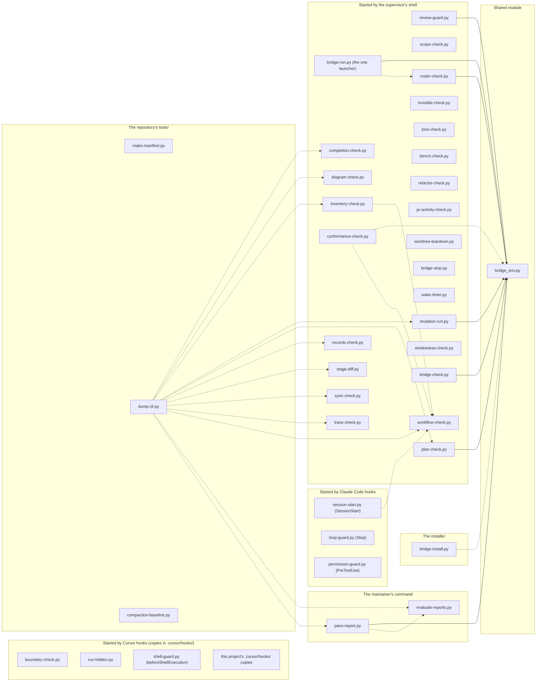

# Design critique: release T's design revision (subject `release-t`), round 3

## What is criticised

The Claude-Cursor Bridge is a Claude Code extension that supervises software projects built by a Cursor builder; its release B finished on 2026-10-31 (Phase: done). Release T is the project's first change cycle: a text release that writes the maintainer's accepted report-cycle items onto release B's instruction files, adds a weekly dependency scan and draws the minimum set of diagrams as built. What is criticised is the change cycle's design revision (~/.claude/cursor-bridge/workflow/phases/change-cycle.md, item 2): docs/DESIGN.md's section "Change: release T", the register's rows R-045 to R-056 (and R-042, the one built row the change revises), the inventory's Decisions and Resources rows, the diagram index with the as-built diagrams and their deviations file, all quoted below with the maintainer's item lists and the promotion pass's proposals, so that nothing outside this file is needed to judge the revision. The texts are read by an AI supervisor that will write the plan addendum (subject release-t-plan, next) and then the text increments from the rows, each sentence pinned by a test; and by the critics of that addendum.

Judge: whether every item in scope has a home and a row (an item of the maintainer's lists or of the owner's Option A that no row covers is a scope gap); whether the settled and moot classifications hold against the installed text as quoted in the design (bridge/ equals the installed 2026.10.30d); whether any row contradicts an installed rule or another row (the convergence rewording P1 against TASK-034's convergence sentences; P2 and P3 against decide.md's ceiling text; T17 against the status template; the weekly scan against the security floor's conventions and KP-066); whether the weekly workflow's shape is sound (permissions, pins, no secret, the evaluation reading it); whether the host section's facts are facts (checked, versioned) and whether anything release T relies on is missing from it; whether the retrofit's selection meets the conventions' minimum set for this code and the omitted kinds' reasons hold, whether each as-built diagram is enforced by something that would catch drift, whether D-003's states are the guard's states and its tests can cover them, and whether the deviations file is right; whether the delivery as host-installation is complete (the stamp, the install, the TDP's one pause, the deferred projects); the security criteria (ASVS L2, the trust boundaries, the public repository, no computer path); and the pitfalls (KP-062 a ceiling the text alone holds; KP-010 the builder's self-report; KP-066 a floor trusted before a real run; KP-069 the pre-gate status file).

## The record so far

## Subject: release-t (the change cycle's design revision: the report cycle's text follow-ups, the weekly dependency scan, the diagram retrofit; 2026-11-01)

**What is criticised:** the change cycle's design revision for release T (change-cycle.md, item 2), the first change on the finished release B: docs/DESIGN.md's section "Change: release T" (the items classified settled / to write / moot against the installed 2026.10.30d, grouped by home into the register's rows R-045 to R-056; the weekly OSV-Scanner workflow's shape; the host section's verified Claude Code facts; the delivery as host-installation), the retrofit's three as-built diagrams (D-001 use cases, D-002 components with the element map, D-003 the review round's state machine) with the revised index and docs/diagrams/DEVIATIONS.md, and the INVENTORY Decisions rows. The critics read `run/review/DESIGN-release-t-<round>.md`, built from the committed records.

**Accepted** (finding, critic, round, the reason):
- An entity diagram for the guard's rounds record, which three programs read (Review B, round 1, Blocking 7, on the index's `erd` reason). The reason is corrected, not the omission: the record is one JSON record of ten fields (round 2 added `flagged_launch`, and `merge_ids` on the record) with no relation to another store; D-003 lists its fields and its three readers (`review_guard`, `bridge_env`'s branch rule, `pace-report.py`) and the guard's tests pin its shape, so an entity diagram would repeat D-003's table. Recorded in the index's `erd` row and INVENTORY's retrofit decision.
- An inter-system sequence for the weekly scan (Review B, round 1, Blocking 8). The reason is corrected, not the omission: the scan's sequence is two steps with no bridge program between them (GitHub's schedule runs the workflow; the Sunday evaluation reads its conclusion), and GitHub's facts the design relies on (the 60-day disabling, the late schedule) are recorded in the weekly scan's section as the host section records Claude Code's.
- P4 taken whole as text (Review B, round 1, Blocking 3, read with plan-critic's S2). Not taken whole: the owner's Option A read-back named P4's auto-merge net among the proposals that wait, so the non-goals now state the waiting list by proposal and half (P4's program half, a read of the repository's auto-merge setting before the arm, waits; its text half, the remote delete, the skip and reflection item 5's listing, is written, R-045 and R-049), the same decision stated exactly.

**Rounds** (round, kind, the commit its file was built from, critic, Blocking / Should fix / Consider, what was fixed):
- 1, critique, file at f067a51 (committed as 1a7ef0d; snapshot DESIGN-release-t-1, hash db6abf2b11ca3ede, verify OK), plan-critic: 3 / 10 / 3. Fixed: R-042 is revised, not contradicted — its row names the revision (P1, T20, P2, BUG-039), R-050 carries it, the non-goal reworded, the pinned tests named (B1); the weekly scan's three outcome kinds, the 60-day disabling read from GitHub's documentation on 2026-11-01, a missing run a finding with its enabling run sheet (B2); D-004, the context DFD, selected and drawn as built (37 nodes, four trust boundaries, 15 secret flows), `security-auditor` its review, the component DFD's reason restated; its draft found two deviations (`APPDATA` and `LOCALAPPDATA` left the owner's, KP-038 narrowed and the redirect a probed maintainer item; `premerge`'s one git call without the file-monitor flag, BUG-039's second site) and raised one objection, decided for the stricter reading: the loop's suite and driver launches run stripped, R-052 (B3); D-002's rule names the parser read and draws the twelve edges, no edge to a subgraph (S1); the waiting proposals listed by proposal and half (S2); `evaluate-reports.md` a home of R-052 with how the runs and the alerts are read (S3); BUG-039 in Impact and the `Running projects must` item (S4); D-003's stale sentence (S5); the host facts versioned per row, the placeholder removed (S6); one `workflow_dispatch` run before trust and the exit-code handling in the frozen block (S7); the pin stated twice asserted equal (S8); the Dependabot claim reduced to the owner's words, the evaluation reading each repository (S9); the specialists actor as the core names it, joined to design, plan, configure, brief and inspect (S10); Evidence per item letter (C1); "event", not "diff" (C2); KP-035 cited for the cut (C3).
- 1, critique, file at f067a51 (as above), Review B (grok-4.7-medium): 8 / 15 / 2. Fixed: R-042's revision as plan-critic's B1, P2's membership rule included (B1); T4's trailer form stated with this repository's squash setting read on 2026-11-01 (B2); P4 by half, reflection item 5 in R-049 (B3; its whole-text reading accepted above); BUG-039 restores R-042's flagged-round rule, named in that row, its test joining the Evidence (B4); P12's order: the suite after the last edit, the report after the suite quoting its lines (B5); the workflow proved by a dispatch run, the missing-run kind described (B6); the `erd` and inter-system reasons corrected (B7, B8, accepted above); P3 names the round's snapshot and builder commit (S1); `secret-sentinel.md` among P5's homes (S2); `evaluate-reports.md` among R-052's (S3); the zone and the late schedule, KP-070's class (S4); a scanner failure or outage read as no run (S5); DEVIATIONS holds none for D-002 (S6); the twelve edges (S7); D-001 enforced by plan-critic alone (S8); D-002's INDEX row names the import edges for the check and the dotted edges for the review (S9); DEVIATIONS' row names the design's transition and the as-built stay (S10); `verified_ok`'s two arms and the transition tests in R-055 (S11); the merge leaves `premerged` alone (S12); the data model's regime and BUG-039's one in-flight case (S13); the push-notification host fact (S14); the status file of a pull request another merge overtook is rewritten and re-reviewed (S15); the host versions per row (C1); `project.json` in the testing strategy (C2).
- 2, critique, file at dd29d4c (committed as fe63a1b; snapshot DESIGN-release-t-2, hash 6005877ab179503e, verify OK), plan-critic: 0 / 8 / 4. Fixed: the `workflow_dispatch` proof runs after the file reaches the default branch, GitHub's fact recorded (S1); the owner's clock, UTC+1 or UTC+2, and 06:17 UTC off the hour (S2); the driver's `.env` in the copy, `--key-file` refused for it, a driver needing more unstripped by a Decision, a driver key file a program item (S3); `--scratch` named in the driver command so the copy stays out of the agent home (S4); the launch texts among R-052's homes (S5); the in-flight case restated: the round stays spent, the remedy a `verify` under the new release before the next snapshot (S6); `flagged_launch` the tenth field, `merge_ids` on the record (S7); D-004's edge into the suite drawn as designed and listed as a deviation (S8); the host paragraph narrowed to the rows (C1); P7's half with the files outside `bridge/` (C2); R-042's paragraph carries P2's security clause (C3); the probe edge to the agents, not a subgraph (C4).
- 2, critique, file at dd29d4c (as above), Review B (grok-4.7-medium): 2 / 10 / 4. Fixed: the evaluation reads a failed run's step log for the `dependency-scan: OSV-Scanner exit <code>` line the frozen block prints, so the kinds are told apart, a scanner failure reported with the rerun command and a list the login cannot read as no run (B1); the twelve parser loads enforced by a test in `tests/test_dump_cli.py` naming D-002, since a thirteenth `build_parser` changes no import and no load call (B2); D-004's suite edge as designed with its deviation (S1); the AppData edge drawn as found by default, the profile-root stores deliberate only (S2); the evaluation's GitHub reads on the owner's edge (S3); the zone (S4); Dependabot read in two calls, enabled or not then the open alerts, a 403 the scope (S5); the inventory's scope row lists the waiting work by proposal and half (S6); T20's threat model read as the bound before the five, within it the classes block, a security finding judged by reachability, in R-042 and R-050 alike (S7); R-051's P11 and P12 marked right (S8); D-003's table credits `tests/test_review_guard.py` for the flags and premerge, the unexercised lists agree, the early GATE-INTEGRITY arrow names the voiding as the design's (S9); KP-067 one lesson, P21's note answered by T27 (S10); the structural test's "no secret" defined beside the automatic token (C1); the counts after D-004 (C2); the `--strip` commands named among the behaviour changes (C3); a refused merge stays at `premerged` (C4).

**Resolution**: (not yet due)

**Gate**: (pending)

## Grades

- **Blocking**: the design cannot go to its gate with it.
- **Should fix**: the supervisor fixes it or accepts it with a reason.
- **Consider**: worth a thought; no round follows from it.

End with the counts per grade. Four rounds at the most, then a confirming read if the text changed, then one resolution round for what is still open.

## The lenses (from plan-critic.md, the design-document section)

## When reviewing a design document

Attack it along these lines:

- **Unstated assumptions.** What must be true for this design to work that nobody has
  written down?
- **Failure modes.** What happens when the network is down, the disk is full, the
  input is hostile, the dependency is a version behind, two things happen at once?
- **Contradictions.** Does any part of the design conflict with another part, or with
  a stated requirement or constraint?
- **Unjustified choices.** Which technology choices have no reasoning attached, or
  reasoning that does not survive a follow-up question?
- **Scope creep.** What is in this design that no requirement asked for?
- **Scope gaps.** Which stated requirement has nothing in the design serving it? Is every requirement from intake, the owner's requirements document, and the design a row in `docs/REQUIREMENTS.md` with an ID? A requirement that appears in a source but not in the register is **Blocking**.
- **The thing that will hurt in six weeks.** Where is the decision that is cheap now
  and expensive to reverse later?
- **Security criteria.** Does the design address authorization, input validation, and
  secret-handling at each trust boundary? Is the chosen ASVS level recorded, and does it fit
  the data sensitivity? Are the security acceptance criteria it implies actually checkable?
- **Migration policy.** Does the data model state which regime the project is in —
  pre-release (edit the schema definitions, rebuild disposable databases, no migrations) or
  shipped (additive migrations first, destructive only with a data-preserving path) — and
  when it switches? A design that plans destructive migrations on a pre-release, disposable
  database is spending risk for nothing; one that plans schema edits after data exists in
  the field is destroying it. Missing regime: **Should fix**.
- **Performance lens (where budgets exist).** Read `~/.claude/cursor-bridge/Performance-Patterns.md`
  (by that absolute path). For each budget in the design: is a mechanism named that
  plausibly meets it at the stated data size — or does the design walk into a catalogued
  pattern (name the `PP-nnn`): a per-item query or model call in a loop, a full scan where
  an index is implied, recomputation of unchanged values, synchronous IO on a hot path, an
  unbounded collection or cache, work on the interface thread, eager startup, per-item model
  calls where batching or a cheaper model would do? Is the budgeted operation measurable in
  isolation with fixed inputs? A budget with no mechanism behind it is **Blocking**; a
  mechanism that cannot scale to the stated size is **Blocking**.
- **Diagram selection (any project with `docs/diagrams/INDEX.md`).** Read `~/.claude/cursor-bridge/Diagram-Planning-Conventions.md`. Does every omitted catalogue kind have a reason that holds for this design? A kind omitted that the design needs — a lifecycle with no state machine, an external service with no inter-system sequence, stored data with no entity-relationship diagram, secrets or personal data with no data flow diagram and its trust boundaries, more than one module with no component diagram — is **Blocking**.
- **Load-bearing detail.** Does every Level 4-5 diagram's stated reason hold, or is it implementation detail that should stay the builder's (**Should fix**)? Conversely, is a load-bearing mechanism — a concurrency protocol, a reservation scheme, a security flow — described only in prose where a diagram would pin it (**Blocking** when getting it wrong corrupts data or money)?
- **Enforcement.** Would what enforces each normative diagram actually catch drift? `review:` where a deterministic check or tests would work is **Should fix**; a diagram nothing enforces is **Blocking**.
- **Meaning across diagrams.** Contradictions the deterministic check cannot see: a sequence that calls in a direction the component diagram does not allow, a state no transition reaches, an entity no component owns, a data flow that crosses a trust boundary with no validation stated, an operational workflow that reaches a screen the mockup does not have. Each is **Blocking**.

## The design revision: docs/DESIGN.md, "Change: release T", whole

````markdown
## Change: release T (2026-11-01) — the report cycle's text follow-ups, the weekly dependency scan, the diagram retrofit

**Subject** (the critique's token): `release-t`; its plan addendum `release-t-plan`.

### Purpose and scope

Release T is a text release of the bridge. It writes onto release B's instruction files — the core (`bridge/commands/supervisor.md` and its digest in `session-start.py`), the phase modules under `bridge/cursor-bridge/workflow/phases/`, the reference texts (`Merge-Verification-Policy.md`, `Cursor-Project-Configuration.md`, `Known-Pitfalls.md`, `Diagram-Planning-Conventions.md`), the agent definitions under `bridge/agents/` and the skill `explain-for-decision` — the text follow-ups the maintainer's report cycle accepted on 2026-10-18 (D1 to D13) and 2026-10-25 (T1 to T27), the owner's addition of 2026-10-28 (a weekly scheduled OSV-Scanner run over every lockfile, Dependabot alerts on), and, by the owner's decision of 2026-11-01 (Option A), the 14 text-only proposals of this project's own promotion pass (Feedback, "Proposed bridge changes": P1 to P3, P5 to P7, P9 to P13, P17, P20, P21). Its one program change is the bridge's own repository gaining the weekly workflow; its one design addition is the retrofit of the minimum set of diagrams, drawn as built. The Restructuring Plan's "Release T" states when (right after release B, before B2) and why after B (the files these items change were rewritten by B).

The owner confirmed the change at intake on 2026-11-01 (run/supervisor/intake-notes.md): what changes, what stays, what alters for them.

### Non-goals

- No program's behaviour changes but for the new scheduled workflow in this repository's CI and BUG-039, the fix of the review guard's deviations the retrofit found (D-003's one and D-004's second, below), both in `review-guard.py`, each its own cause; the loop's and the calibration's suite and driver launch commands gain `--strip` (R-052), a change to the commands the text states, the launcher unchanged. The promotion pass's proposals that wait for a program release, by proposal and half (the intake's read-back counted them as seven proposals; this is the same decision, Option A, text joins and programs wait, stated by half): P4's program half (a read of the repository's auto-merge setting before the armed form is tried, so that the skip is detected rather than met by a failing command; its text half — the remote delete after every merge, the skip where the repository refuses the armed form, reflection item 5's listing of merged branches still published — is written, R-045 and R-049); P5's program form (a scan program under `bridge/cursor-bridge/` with its command-reference entry; its text, the scan of every pushed commit, is written, R-045); P8; P14; P15; P16; P18; P19; P20's program parts (`diagram-check.py`'s and `conformance-check.py`'s reading of the all-omitted index; its conventions text is written, R-053).
- No gate of release B is reopened and no register row of R-001 to R-044 is re-presented (R-031 and R-037 owner-deferred); one built row, R-042, is **revised** by this change, as the revisions of 2026-10-24 and 2026-10-27 revised it while planned: its convergence sentence takes P1's defect-and-class gate and T20's threat-model exception, its membership rule takes P2 (the by-class line of 2026-10-27, INVENTORY, Decisions, written into text), and its "a flagged round spends nothing" is restored by BUG-039. The row's text names the revision, R-050 carries the change, and the increment that writes it rewrites the tests that pin the old sentence (`tests/test_loop_text_pace.py`, the `test_bug033_` and `test_r042_` convergence tests), each red on the installed text first. A row revised through this gate is a design change, not a reopened gate.
- No change to the run parameters, the roster, the classification (Host Extension Development → Claude Code Extension; trait Installable; delivery kind host-installation), the gate or the owner's gates.
- The maintainer's own files outside `bridge/` (the CHANGELOG template's text, the release procedure, `Reports/`) are not this release's; where an item names them (P10's Running-projects sentence, P17's release procedure, P7's stamp-procedure half) the release writes the part that lives in `bridge/` and names the rest for the maintainer.
- No Documents file is rewritten; the User Manual is patched at project end for the CHANGELOG entry (change-cycle.md, item 7).

### What changes — the items by home

Every item was read against the installed text of 2026.10.30d (`bridge/` equals it, bridge-check 147 OK) with `run/supervisor/rt_scan.py`: an item the text already holds is **settled** and not rewritten; one whose premise is gone is **moot**. The rest are written, grouped into the requirement rows R-045 to R-056 of `docs/REQUIREMENTS.md`, each row one home or one concern:

| Row | Items | Homes (all under `bridge/`) | What changes |
|---|---|---|---|
| R-045 the loop's merge mechanics | T4, T8, T17 (with T11), P4 (text), P5 (text), P7 | `workflow/phases/delegation-loop.md` step 8; `commands/supervisor.md` rule 43 and the status template; `cursor-bridge/session-start.py`'s hook text; `Merge-Verification-Policy.md`; `agents/secret-sentinel.md` (P5) | the title form; push and merge bare; the suite with the pull-request variables before the first push of a status-file change; the scan over every pushed commit; the merged branch deleted on the remote, the auto-merge net skipped where the repository refuses it; the status file as at the merge, `in-flight.md` between merges |
| R-046 where reviewers write, what a clean reply holds | T5, T16, T25, T2 | `delegation-loop.md` step 8 (the directive's clauses); `Merge-Verification-Policy.md` ("Invocation"); `workflow/phases/design.md` (the constant prompt and the receipt check); `workflow/phases/reflection.md` steps 4 and 6; `agents/diff-reviewer.md` | the clauses say where a reviewer may write and that it edits nothing; single test files beside Review B; the turn budget in each part's prompt; three verified statements in a clean reply |
| R-047 the design critique's record and mechanics | T1, T3, T7, T26 | `design.md`; `workflow/phases/change-cycle.md` item 2; `commands/supervisor.md` rule 48 | one subject for a design with its addendum; the record's definitions; the snapshot id and the `.err` name together; the pause before planning work, with a push notification |
| R-048 reports and run sheets | D11, D10, D7 (rule 12), D6 | `commands/supervisor.md` rule 43; `skills/explain-for-decision/SKILL.md` (the run sheet); `session-start.py` (the digest, within 9,500 characters); `commands/calibrate-bridge.md` step 5 and the status template | the run's limit named; the vendor console from fetched documentation; rule 12's question form; the `Calibrated:` line rewritten |
| R-049 the stage close and the stage review | D1, D2, D3, D4, T11, P17 | `reflection.md` steps 2, 4, 9 and the demonstration; `workflow/phases/delegation-loop/refactoring-pass.md` where step 9 is; `workflow/types/host-extension.md` (a `planning.stages` addition for the kind host-installation) | drivers re-checked at HEAD; parts bounded alike; the live stack at the first increment, the rebuild run sheet, the harness at the entry points; the stage tag; the union of squash commits; the last stage's review before the stamp and the field acceptance's stand-in |
| R-050 rule 6, convergence and the ceiling's text | P1, P2, P3, T20, T18 | `commands/supervisor.md` rule 6; `Merge-Verification-Policy.md` (the convergence paragraph, the invocation's fifth clause); `delegation-loop.md` step 8 and step 4; `delegation-loop/decide.md` ("When to stop re-delegating", "The review ceiling"); `reflection.md` step 7; `agents/diff-reviewer.md`, `security-auditor.md`, `design-auditor.md` | one defect, class-gated; membership by reproduction on an ordinary layout; the class line against the round it lifted; the recorded threat model; the test-strength rule for supervisor-authored increments |
| R-051 briefs, reports and the accept step | T21, P11, P12, T10, T15, P13, T24, P6, T13 | `agents/spec-packager.md`; `agents/secret-sentinel.md`; `decide.md` (the Accept bullet); `delegation-loop.md` steps 3b, 5 and 7 and its survival list | printed lines verbatim; counts quoted from output; the suite once after the last edit; the records-only commit; the rebuild at a profile switch; the resume after an interruption; `invisible-check.py` with a base and `--staged`; escapes as text, non-ASCII listed |
| R-052 the configuration guide, the security floor and the weekly scan | T9, T22, the weekly scan, T12, T19 | `Cursor-Project-Configuration.md`; `agents/cursor-configurator.md`; `commands/evaluate-reports.md` (the Sunday step reading the runs and the alerts); `change-cycle.md` item 1; `commands/supervisor.md` (the status template's `Layout:` line); this repository's `.github/workflows/` | the floor's conventions; the ignore line; the scheduled OSV-Scanner workflow as a configuration item and in this repository, the evaluation reading its three outcome kinds; the conformance check first for a project supervised after it was built; `Layout:` relative |
| R-053 project state and the design's lenses | P10, P9, P20 | `commands/supervisor.md` ("Project state", the Decisions row); `design.md` (the critics' lenses) and `agents/plan-critic.md`; `Diagram-Planning-Conventions.md` §8 | a decided rule's by-hand application stated; the worked-scenario lens; the all-omitted index and the minimum set's binding |
| R-054 the pitfalls | D5, D13, T27, T13, P21 | `Known-Pitfalls.md` | KP-061 corrected; KP-063 to KP-065; KP-066 to KP-070 and the KP-058 addendum; KP-052 corrected; KP-071 to KP-074 |
| R-055 the retrofit | the calibration item (HARDENING, Project end) | `docs/diagrams/` (D-001, D-002, D-003, DEVIATIONS.md), the tests that name D-003 | the minimum set drawn as built and enforced |
| R-056 the release | the plan's "Release T"; the delivery | `bridge/cursor-bridge/VERSION`, `CHANGELOG.md`, `MANIFEST.json`; the tests that pin each sentence; `trace-exceptions.md` | one text release: tests first, the trace entries, the stamp, the install run sheet, the TDP's one pause and calibration |

**Settled by the installed text** (nothing written): D9 (the review inputs and the `.err` file take the snapshot's name, TASK-034); D12 (design.md's four-round ceiling, confirming read and resolution round, 2026.10.18a); D7's rule 48 ("told a stage close ahead") and the critique's line in the digest (TASK-034). **Moot**: D8 (replaced by T6); T6 (TASK-033's one squash-subject reader is installed, so a plan ID in a non-increment title merges nothing; ISS-013's records habit stays this project's). **Already in release B**: T14, T23, FB-036's re-read in parts, FB-040's estimate (the plan revision `maintainer-text`, PR #92). **Written in though handed to the projects early**: T5 and T9 (the CHANGELOG's 2026.10.30a by-hand items (1) and (3)); the by-hand item (2) is T6.

### The weekly dependency scan

The floor's OSV-Scanner runs only on a pull request's or a push's event, over the whole lockfile as it stands then, so a flaw disclosed later in an unchanged dependency, or in a paused or finished project with no event, was never flagged (the owner, 2026-10-28). The design: a second workflow file, `.github/workflows/dependency-scan.yml`, run on a weekly `schedule` (Sunday 06:17 UTC — off the hour, since GitHub delays the `schedule` event at high-load times, "the start of every hour" among them — which precedes the Sunday evaluation's 14:00 on the owner's clock, UTC+1 or UTC+2, `evaluate-reports.md`; a run that ends after the evaluation's hour is read the next Sunday) and on `workflow_dispatch`; `permissions: contents: read` and nothing else; a checkout without persisted credentials; OSV-Scanner at the floor's version and SHA-256 — one pin stated twice, so the workflow's structural test asserts the two equal and T9's deprecation check names both — run over every lockfile the repository holds (`osv-scanner scan source --config=osv-scanner.toml --lockfile=...` per lockfile, as the floor's step does) with the floor's exit-code handling (0 clean; 128, no lockfile read, fails as KP-005 says; every other code fails as it is) and one line more than the floor's, `dependency-scan: OSV-Scanner exit <code>` printed on every non-zero exit, which the evaluation reads; no token and no secret anywhere in it: no `secrets.` reference and no token handed to a step (the automatic `GITHUB_TOKEN` exists in every job, here with `contents: read` alone, used by nothing, the checkout persisting no credentials), which is what the structural test's "no secret" asserts. **What the Sunday evaluation reads** (`bridge/commands/evaluate-reports.md`, a step the maintainer's command gains, R-052): each project's last completed run of the workflow since the previous evaluation — `gh run list --workflow dependency-scan.yml` gives the run and its conclusion, and for a failed conclusion `gh run view <run id> --log-failed` gives the step's `dependency-scan: OSV-Scanner exit <code>` line, which tells the kinds apart — in three kinds: a finding (exit 1: a flaw fixed by a `DEP-<nnn>` increment, the merge policy's procedure, never by an unreviewed change), a scanner failure (exit 127 or 128, or the advisory database unreachable: a run that proved nothing, reported as such with the rerun's one command, `gh workflow run dependency-scan.yml`), and **no completed run since the last evaluation** — no run listed, or a list the login cannot read — a finding of its own, never green (KP-005: silence is not green). The host fact that makes the third kind certain, read from GitHub's documentation on 2026-11-01 ("Disabling and enabling a workflow"): *in a public repository, scheduled workflows are automatically disabled when no repository activity has occurred in 60 days*; a schedule may also start late. So every paused or finished public project reaches the third kind within two months, the evaluation names it, and the remedy is a run sheet for that project's owner — `gh workflow enable dependency-scan.yml`, then `gh workflow run dependency-scan.yml` (or the Actions tab's *Enable workflow*) — the enabled run read at the next evaluation; the documentation names public repositories, and a private one is read the same way, its missing run the same finding. Two more of GitHub's facts, read from the same documentation ("Events that trigger workflows"): *this event will only trigger a workflow run if the workflow file exists on the default branch* (`workflow_dispatch`), and *scheduled workflows will only run on the default branch*; so the workflow's first proof, one `workflow_dispatch` run read green, comes after the file reaches the default branch — after the configuration increment's merge for a project, after this repository's increment merges here — read by the supervisor then and by the evaluation at the latest, never a Done criterion before the merge. Dependabot alerts: the owner switched them on (2026-11-01, "Yes, I switched Dependabot on"); whether GitHub's separate option that enables them for new repositories was taken is not verified, so the evaluation reads each project in two calls that tell the three results apart: `gh api repos/<owner>/<repo>/vulnerability-alerts` answers 204 where the alerts are enabled and 404 where they are not (GitHub's REST documentation, read 2026-11-01; the owner's login has the admin read it needs on their own repositories), a 404 the finding "alerts off"; then `gh api repos/<owner>/<repo>/dependabot/alerts?state=open`, an empty list being alerts on with nothing open; a 403 on either call is the login's scope, named in a run sheet, never a token in text, the project's Security tab the fallback; the bridge writes nothing for them. The convention text (`Cursor-Project-Configuration.md`, the security-floor section) says every project has the workflow; `cursor-configurator` writes it verbatim from a frozen block that carries the exit-code handling; the increment that adds it to a project is proved by one `workflow_dispatch` run the supervisor reads green after its merge, beside the structural test before it (T9's rule: a floor is trusted only after it ran; the dispatch fact above); `conformance-check.py` is not changed by this release (a floor for it is a program item for the maintainer's next program release, named in the CHANGELOG entry); the calibration's `Running projects must` item adds the workflow to each running project as configuration.

### Architecture — the retrofit's diagrams

The bridge's code is `bridge/cursor-bridge/*.py`: one-shot programs the supervisor's shell or a Claude Code hook starts, sharing one module, `bridge_env.py` (the stripped environment, the ceiling's constants, the grammar readers), and reading each other's records as files. The design of 2026-10-11 drew nothing (INVENTORY, Decisions); project end recorded the retrofit as the next design phase's (HARDENING, "Project end", least confident 1). The minimum set (conventions §8) applied to this code:

- **D-001, the use cases (Level 1):** the actors (the owner, the supervisor session in Claude Code, the Cursor builder, the supervisor's specialists — the subagents the core's "The roles" lists, the reviewers and auditors among them — Review B, the maintainer session, GitHub's CI) and the goals the bridge serves them, each use case naming its `R-` IDs; enforced by `plan-critic`'s review alone (every use case traced to the register by the IDs in its node; `completion-check.py` traces the register, not the diagram). Drawn from `docs/REQUIREMENTS.md` and the core's "The roles".
- **D-002, the component diagram (Level 3):** every program of `bridge/cursor-bridge/` as an element with its path, grouped by what starts it (the supervisor's shell; a Claude Code hook; a Cursor hook copied into a project's `.cursor/hooks/`; the installer; the maintainer's command), with the repository's `tools/` programs and this project's own hook copies as elements too, so that no tracked Python matches no element. **The dependency rule, as built and as the gate accepted it:** a program may import `bridge_env`, the one module every program may share; and a program may load a sibling program by file (`importlib.util.spec_from_file_location`, the only way a hyphenated program can be loaded) where it reuses that program's one copy of a rule rather than keeping a second copy — the shared judge — or, for the one tool `dump-cli.py`, to read the sibling's argument parser (`inventory-check.py` and `conformance-check.py` load `workflow-check.py`'s `escape_field`; `session-start.py` loads `workflow-check.py`'s tables and link checks, INVENTORY, Decisions, "The session-start hook's threat model"; `bridge-run.py` loads `roster-check.py`'s family rules; `pace-report.py` loads `evaluate-reports.py`'s project keys; `tools/dump-cli.py` loads every program that has a `__main__` block and a top-level `build_parser`, to read its parser — twelve today, each drawn as its own dotted edge, never an edge to a group; a thirteenth program gaining a parser changes no `import` and no `spec_from_file_location` call, so neither `check:components` nor the review item would see it, and the enforcement is a test, `tests/test_dump_cli.py` naming D-002, asserting that the programs `dump-cli.py` loads, computed as it computes them, equal the diagram's `dump_cli` edges read from its file — the addendum's test increment, R-055). Each such load is an edge of D-002, a plain `import` drawn solid and a load by file dotted; every other dependency is by running a program or reading its record and is not an edge. The first draft read the rule as "nothing but `bridge_env`" and reported the five loads as deviations: the design text was the one behind the code (conventions §8's second case), corrected here; no deviation of D-002 stands and `docs/diagrams/DEVIATIONS.md` holds none for it (its one row is D-003's). Enforced by `check:components` for `import` and `from` lines (`diagram-check.py --mode code` over the tracked Python, `tests/` excluded), by the `dump-cli` test above for the parser loads, and, for the other loads by file, which the check cannot see, by a named review item: `diff-reviewer` reads a `spec_from_file_location` of a sibling program as a D-002 edge the diff must draw or raise. That the check should learn the file-load form is a program item for the maintainer's next program release (named in the CHANGELOG entry and in HARDENING).
- **D-003, the review round's state machine (Level 3, refines D-002):** the states a round passes through in `review-guard.py` and `bridge-run.py`: no record, snapshot taken, the launch logged, the reply arrived (the round spent), verified, flagged (GATE-INTEGRITY, no round spent), re-snapshotted, premerged; the triggers between them; the ceiling's count is the guard's **opened** rounds (the highest round recorded, replied or not; `snapshot_review_refusal` admits only the current round or the next), as the pace design settled it (INVENTORY, Decisions, 2026-10-24: "the count the gate reads is the guard's opened rounds"), a reply deciding only whether round N may be snapshotted again on a changed tree (no reply, or a reply voided by a flag: the same round; a reply: the next), and a flagged round (GATE-INTEGRITY) spends nothing because `verify` voids its launch. A ninth state, no verdict (the launcher exited non-zero or at its limit; `verify` writes a mark `premerge` refuses), is the code's and is drawn. ISS-021 is this project's one recorded failure of state (builder rounds counted as replied Review B rounds), which the conventions' minimum set answers with a state machine; the seed's transition is drawn as the code has it since 2026.10.30b. **One deviation, found by the draft:** four early GATE-INTEGRITY returns in `cmd_verify` (the snapshot rewritten; `.git/config` or a hook changed; the branch held in another worktree; the branch not put back) never void the launch, so its exit 0 counts as the round's reply at the next snapshot and the round is spent, against the design and `record_flagged_launch`'s own docstring; it is listed in `docs/diagrams/DEVIATIONS.md` as a design regression (conventions §8's first case: nothing recorded anywhere) and fixed by a normal fix increment, **BUG-039**, the one program fix of this release, planned in the addendum: it restores R-042's rule that a flagged round spends nothing (INVENTORY, Decisions, TASK-032's settled points), whichever of `verify`'s checks flagged it; R-042's row names the restoration and the fix's reproduction test joins that row's Evidence; the TDP, the one running project, receives it at its calibration ("Impact" and "Data model", below). Enforced by tests naming the diagram ID and covering every state: `tests/test_review_guard_ceiling.py`, `tests/test_bug036.py` and `tests/test_review_guard.py` (which already drives the verify flags, a failed run and premerge) gain the ID in their module docstrings, and the addendum's test increment adds one test per state and one per transition the diagram lists as unexercised (the in-run launch and its log row; the re-snapshot reading the `.err` as a reply; no verdict; the flag voiding the launch; the re-snapshot; the refused-mark arms of `verified_ok`; the owner's-line lift; the changed-tree refusal; a class line already recorded; the launch refusals; `premerge` and the flags of `verify` are `tests/test_review_guard.py`'s already, which gains the ID).
- **Selected at the critique's round 1 — D-004, the context data-flow diagram (Level 2):** the index's first reason, "holds no secret of its own", answered the wrong trigger. The conventions select the kind for anything *handling* secrets or untrusted input, and the bridge decides which of the owner's variables cross to another vendor's agent (`bridge_env.stripped_env`), withholds the owner's GitHub identity from the agents (KP-032, KP-038), treats the reviewer's writes to the checkout as untrusted (`review-guard.py`) and reaches GitHub as the owner from the supervisor's session alone — the trust boundary the index itself called the one that matters. D-004 draws those boundaries, flows and stores as built (the specialist's as-built variant, after round 1: 37 nodes in four trust boundaries, 15 flows marked `SECRET:`, the agents' writes and replies marked `UNTRUSTED:`), the one edge the design changes, the launcher's environment to a suite or driver, drawn as designed and listed as a deviation until the text increment lands; enforced by `security-auditor`'s review of every crossing. **Three deviations, found by the draft and by round 2** (`docs/diagrams/DEVIATIONS.md`): (1) `stripped_env` and the shim redirect `HOME`, `USERPROFILE`, `HOMEDRIVE` and `HOMEPATH` to the agent home but leave `APPDATA` and `LOCALAPPDATA` as the owner's real folders, so a store a tool finds through those two variables is found by default, where KP-038 says the owner's stores "are no longer found by default"; the sentence is narrowed in this release (R-054: the stores under the profile root; a store reached through `APPDATA` or `LOCALAPPDATA` is reached until those are redirected) and the redirect is a program item for the maintainer's next program release, probed first (KP-008: the shim and `cursor-agent` itself live under `LOCALAPPDATA`, and the agent home's `AppData` skeleton exists for the known-folder resolution), a lead in HARDENING; `gh` is hidden from the agents by `GH_CONFIG_DIR` whatever the variables say. (2) `premerge`'s `git merge-base --is-ancestor` runs with the hooks folder emptied but without `core.fsmonitor=false`, where the guard's docstring and KP-032 say every git command of the guard runs with both off; its consequence is small (the command reads no worktree, and `verify` has already flagged a changed `.git/config`), and it is the second site BUG-039 fixes, each site its own cause (the first: the four early returns), one brief since every finding in it is its own cause. **One objection, decided here:** a test suite or a driver run through `bridge-run.py` runs code the builder wrote with the owner's whole environment unless `--strip` is given, while every `cursor-agent` run is stripped; the design takes the stricter reading (R-052): the loop's suite launches carry `--strip` (`bridge-run.py --limit auto --strip --kind test`, a variable a suite needs reaching it by `--key-file`, which the test kind accepts) and its driver launches carry `--strip` with the scratch folder named (`--kind driver -- python ~/.claude/cursor-bridge/mutation-run.py <mutants file> --scratch ~/.cursor-bridge/scratch/<the project root's folder name>`), since `mutation-run.py`'s default scratch folder is built from the home the environment names and a stripped driver would otherwise copy the Workspace, `.env` included, into the agent home; the copy carries the project's `.env` (KP-032's home for local service passwords) and `--key-file` is refused for a driver, so a suite that needs a variable beyond `.env` runs its driver unstripped by a recorded Decision until the launcher gains a driver key file (a program item for the maintainer); `--strip` stands between `--limit` and `--kind`, where the allow rules admit it; Review B's stripped runs of this project's suite show a stripped suite works; the change is to the commands the text states, not to the launcher, and D-004's edge into the suite is drawn as designed, the as-built default its third deviation. The component-level data-flow diagram stays omitted: no component transforms sensitive data, the boundary processes pass or withhold it whole.
- **Omitted, with reasons that hold** (the index): no entity diagram — the records are JSON files, and the one read by more than its writer, the guard's rounds record (read by `review_guard`, by `bridge_env`'s branch rule inside the guard's and the launcher's processes, and by `pace-report.py`), is one record of ten fields (and the record's `merge_ids`) with no relation to another store, whose fields and readers D-003 lists and whose shape the guard's tests pin, so a diagram of it would repeat D-003's table; no process or network boundary of the bridge's own, so no system or deployment diagram beyond the install's one computer; no inter-system sequence — the exchanges with Cursor's agent and GitHub are command lines and exit codes, the hosts' facts recorded in the host section (Claude Code) and the weekly scan's section (GitHub), and the scan's own sequence is two steps with no bridge program between them (the schedule runs; the evaluation reads the conclusion).

The specialists drew D-001 and D-002, then D-003, as built, and D-004 after the critique's round 1; `diagram-check.py --mode design` passed (3 selected, 15 omitted) before round 1 and (4 selected, 14 omitted, OK) with D-004 before round 2, and is run again before each later round, and `--mode code` passes `check:components` over the tracked Python today, its eleven `TESTS` lines for D-003 (no enforcing test names the ID or its states yet) being what the addendum's test increment closes (R-055).

### The host — Claude Code (the type's and sub-type's `design.sections` additions)

The bridge is a Claude Code extension: its extension points are Claude Code's commands (`~/.claude/commands/`), agents (`~/.claude/agents/`), skills (`~/.claude/skills/`), hooks and permission rules (`~/.claude/settings.json`). The host decides how they behave and changes them with its updates; each behaviour the bridge relies on is a fact checked in Claude Code itself, on this computer, at the version below. The version is the one Claude Code reports: `claude --version` is not on this session's PATH (the Code tab of the desktop app runs it), so the version is read from the session's own transcript records, which carry it on every message. A fact holds for the version it names; when the host reports another version, the facts are checked again before the next increment that relies on them.

| Fact the bridge relies on | How it was checked | Version |
|---|---|---|
| A `SessionStart` hook's standard output is injected into the session's context after a compaction and a resume (the digest, `session-start.py`) | observed in operation on every compaction of this project since release 0; this session's compactions of 2026-10-31 and 2026-11-01 show the digest and the hook's phase pointers | every version this project ran on (the earlier ones unrecorded); last 2.1.309, 2026-11-01 |
| A `Stop` hook may refuse the stop with a JSON decision and a reason, and the session continues (`loop-guard.py`, rule 43) | observed: refused stops with the guard's reason text (KP-039's shape, ISS-014's symptom text) | 2.1.299 to 2.1.309 (the versions this session's transcript records); last 2.1.309 |
| A `PreToolUse` hook on `Bash` may deny a command before it runs, with its reason shown (`permission-guard.py`: the override merge, force-push, `git worktree remove`, a chain carrying a stage-destroying command) | observed: refusals of chained commands and of `git worktree remove` in this project (2026-10-12 to 2026-10-31) | the version of 2026-10-12 unrecorded; 2.1.299 to 2.1.309 from this session's records |
| A permission allow rule matches a bare command; a piped, chained or interpreter-wrapped form falls to the auto-mode classifier | observed 2026-10-12 (ISS-003): four classifier refusals of piped `git push`, none of the bare form; re-observed 2026-11-01: the bare `git commit`, `review-guard.py snapshot` and `bridge-run.py` launches of this session ran on their allow rules | the version of 2026-10-12 unrecorded; 2.1.309, 2026-11-01 |
| `settings.json` is read whole at start; the installer's merge of the bridge's hooks, allow and deny rules keeps the owner's own keys and takes effect after the app restarts | `bridge-check.py` compares the bridge-owned entries after every install (147 OK on 2026-10-31); the restart is the run sheet's step | 2.1.309 (the install and restart of 2026-10-31) |
| Commands under `~/.claude/commands/` are slash commands reading their file whole; agents under `~/.claude/agents/` are loaded fresh at each spawn; skills under `~/.claude/skills/` are listed by their frontmatter | the `/supervisor`, `/calibrate-bridge` and `/evaluate-reports` runs of this project; the subagents' definitions edited by release B and taking effect at the next spawn (TASK-034's reviewers) | 2.1.299 to 2.1.309; last 2.1.309 (the `/calibrate-bridge` of 2026-10-31, the spawns of 2026-11-01) |
| A hook's output above 10,000 characters is cut, the host swapping it for a file path: the digest is held within 9,500 characters by a test and the hook is registered twice, pointers and digest apart | the cut measured in the 0b review on all three projects (KP-035); `tests/test_session_start.py`'s cap test; the digest shown whole after every compaction | the cut: the versions of 2026-10-04 (KP-035, unrecorded); the digest whole: 2.1.309, 2026-11-01 |
| The desktop app's Code tab exposes no `claude` on the Bash tool's PATH; a brief records the version it tests on or that none is on PATH | `claude --version` in this session: command not found (2026-11-01) | 2.1.309, 2026-11-01 |
| The Code tab's `PushNotification` tool reaches the owner's phone while Remote Control is connected (rule 48's pause before planning work, T26) | used in this project on 2026-10-30 and 2026-10-31 at the owner's instruction, the notifications received | 2.1.308 and 2.1.309 |

**Assumptions, checked by the first increment that relies on them:** that a `Stop` hook's refusal is honoured identically after a compaction (relied on by rule 43; observed, not probed); that the `SessionStart` hook's `compact` and `resume` sources both fire (the hook names both; `compact` observed, `resume` observed at the app restarts of 2026-10-30). Neither is new to release T; release T's text relies on one host behaviour release B's text did not name, the push notification, recorded in the table's last row. Probes run in a Claude Code kept apart from the owner's own (the type's rule) and draw no paid usage of the owner's beyond the session's plan.

### Delivery (the trait's Delivery section, scoped to the kind host-installation)

The kind is host-installation (INVENTORY, Decisions, "Delivery kind"); installable's toolchain and installer behaviour are for `installer` and `install-script` and do not apply. The type's delivery holds: the release is stamped (`bridge/cursor-bridge/VERSION` as `2026.11.<dd><a>`, the CHANGELOG entry with its `Running projects must` items, `MANIFEST.json` regenerated by `tools/make-manifest.py`, `bridge-check.py --sources` OK) by the plan's last increment, as TASK-027 stamped release B; the owner installs it from a run sheet (`bridge-install.py`), which merges the bridge's settings entries without changing the owner's, keeps the previous release as the way back and ends with `RESULT: INSTALLED TREE MATCHES`; the TDP pauses once at a merge boundary, installs, restarts and calibrates (the owner's `/calibrate-bridge` in its session), reAngle and the video factory staying deferred (R-031, R-037); this project calibrates by the no-delta path. The single version source is `VERSION`. The User Manual's install chapter is patched for the entry at project end.

### Security and secret handling

ASVS level 2 and the trust boundaries of release B stand (INVENTORY, Decisions). D-004 draws the trust boundaries as built: the agents' withheld identity, the stripped environment, the guarded checkout, CI's step-level secrets. Two edges it found are tightened by text in this release: the suite and driver launches run stripped (`--strip`, R-052, the driver with its scratch folder named so the copy stays out of the agent home), so builder-written code never runs in the loop with the owner's environment, the one deviation D-004 lists for it resolved by the text increment; and KP-038's sentence on the profile stores is narrowed to what the code does (`APPDATA` and `LOCALAPPDATA` still the owner's), the redirect a probed program item for the maintainer. What D-004 draws as reachable by a deliberate act only (the credential store, the profile's stores, the guard's records inside `.git`, `run/launcher/runs.jsonl`, which `verify` lists as left behind) stays KP-032's "not a sandbox": leads in HARDENING, not this release's. Release T adds one surface: the scheduled workflow, which holds no secret, runs with `contents: read` only, pins its action and its scanner by SHA, and persists no credentials. Its text items tighten the gate's edges (where reviewers write; every pushed commit scanned for computer paths and names; the first CI log of a step holding a secret read). The repository is public: no computer path or account name enters a commit (rule 54; the path scan before every push).

### Data model and development data

Unchanged: the bridge keeps no product data; its records are JSON files each program owns, the guard's rounds record read by three programs (the index's `erd` row, D-003). The regime: release B is shipped, so a change to how a record is read keeps every record in the field readable and migrates none. BUG-039 is the one such change: the guard counts no reply for a round whose `verify` flagged it by one of the four early returns; a round flagged so before the install and not re-snapshotted since stays spent under the old reading (nothing writes its void after the install, so its next snapshot on a changed tree is refused as reviewed); the remedy the CHANGELOG's `Running projects must` item carries for the TDP's calibration: before that increment's next snapshot, run `review-guard.py verify <nnn>` once more under the new release, which records the void where the flag still holds, and where it no longer flags (the cause gone, a worktree torn down) the reply counts and the round is spent as replied. `Development data:` as recorded (INVENTORY, Decisions): the Workspace sources under `bridge/` are the dev build, a session always runs the installed bridge.

### Testing strategy

Every changed or added sentence is pinned by a test the supervisor writes before the text (T18's rule applied to this release's own increments: tests first, each red on the installed text and green on the new, a hand mutation driver where a sentence has a number or a name in it); the digest's cap test; the trace check over every reworded or added passage of the core and the modules (`reword` and `new` entries in `trace-exceptions.md`, as release B's increments wrote them); the structural test of the new workflow (the pins equal to the floor's, the permissions, the schedule, the exit-code handling, no secret) in the style of `tests/test_release_b_ci_floor.py`, and one `workflow_dispatch` run read green before the floor is trusted (T9); the full suite with the pull-request variables before the first push of every pull request that changes the status file, `project.json` or `VERSION` (ISS-022); `diagram-check.py --mode code` for D-002, the tests naming D-003 for its states and its listed unexercised transitions, and `security-auditor`'s read of D-004's crossings; the register's Evidence naming, per item letter of a bundled row, the test that pins it; the dump-cli currency check (no command changes).

### Failure modes

A text item that contradicts installed text is found by the critique or by the test that pins the installed sentence (both read before the item is written); a digest trim that drops a rule number fails the cap test's rule-number assertion; the weekly run failing on a finding is read by the Sunday evaluation and fixed by a `DEP-<nnn>` increment, never by an unreviewed change; a scanner failure or an unreachable database is a run that proved nothing, read as no run; no completed run since the last evaluation (a public repository's schedule disabled after 60 idle days, a late schedule) is a finding the evaluation reports with the enabling run sheet; a pull request whose status file no longer reads as at its own merge because another merged first (T11) rewrites it and merges `main`, a new head the reviews read again (step 8's rule for a branch updated from `main`), never a records edit after `verify`; an install that fails leaves the previous release as the way back (`bridge-install.py --rollback`); the TDP's pause outlasting the install costs the TDP nothing but the pause.

### Impact on existing behaviour

Text and conventions, with two exceptions: the added scheduled job in this repository's CI, and BUG-039, a change to `review-guard.py`'s reading of a round whose `verify` flagged it early (no round spent, as designed), which the TDP receives at its calibration to the release, the CHANGELOG's `Running projects must` item naming it and the one in-flight case ("Data model"). Running projects receive the text at their calibration after the install, the weekly workflow as a configuration item, and nothing reopens a gate; R-042's row is revised as the non-goals say.

### Open questions

None for the owner. For the maintainer, named in the CHANGELOG entry: a conformance floor for the weekly workflow (a program item); the catalogue's KP-067 is one lesson, T27's `git show --output` entry (the file created empty), which `review-guard.py` already cites by that number for its refusal of an empty review input, so P21's note that the catalogue lacks the entry the guard cites is answered by T27 and no second lesson takes the number; a driver key file in the launcher (a program item: until then a driver that needs a variable beyond the project's `.env` runs unstripped by a recorded Decision); the redirect of `APPDATA` and `LOCALAPPDATA` into the agent home, probed first (D-004's first deviation); the guard's records under `<git common dir>/bridge/` and `run/launcher/runs.jsonl` outside `verify`'s protected prefixes (D-004's open points, HARDENING); P10's sentence for the CHANGELOG template and P17's for the release procedure live outside `bridge/`; a program that reads the weekly runs and the Dependabot alerts for the evaluation (today a step of the command's text). For the owner, not asked: GitHub's option that enables Dependabot alerts for new repositories, which the evaluation does not depend on.

### Who decided (rule 51)

The owner: release T's timing (2026-10-25, D4), the weekly scan and Dependabot (2026-10-28), the scope's Option A and the intake confirmation (2026-11-01). The maintainer: the items of 2026-10-18 and 2026-10-25 under the escalation rule. The supervisor: the classification settled / to write / moot, the rows R-045 to R-056, the retrofit's selection, the workflow's shape.

### Version

Claude Code 2.1.309, read on 2026-11-01 from this session's transcript records (the `version` field of its latest messages; the session's earlier messages ran on 2.1.299 and 2.1.308, the desktop app having updated during release B). Each row of the table above names the versions its fact was observed on; where a version is unrecorded the observation predates this session's records, and the row says what was re-observed on 2.1.309, where anything was.
````

## The register's rows (docs/REQUIREMENTS.md: R-042 as revised, then the new rows R-045 to R-056)

````markdown
| R-042 | The code gate has a round ceiling held by programs, as the design critique has (KP-062). A round is one version of the increment the gate's reviewers read: each builder run of a brief (`handoff/<ID>.md`, then `<ID>-r<N>.md` — every re-delegation a new numbered brief, never a revision in place) and each Review B read that `review-guard.py snapshot <ID>-r<N>` opens, a round spent when its reply arrived; a fix the supervisor makes and Review A re-reads before step 8's snapshot is no round. Above three rounds — the guard's count of rounds opened for the increment, which the supervisor's report names, the launcher's count holding the briefs to it — the work is sent back only for a defect of a **blocking class** — behaviour against the brief or the register, security, data integrity, a defeated safety mechanism the increment relies on, or a failing test — and every other finding (wording, a docstring, test strength beyond the brief's criteria, style, a surviving mutant outside those classes) is recorded in `docs/HARDENING.md` with the increment named and merges with it. The launcher refuses a builder launch of a brief above the ceiling, and the guard a snapshot above it, unless the brief (which the launcher reads, written before the builder launch) and the increment's `run/review/SCOPE-<ID>.md` (which the guard reads, written before the snapshot) name the class and the finding on a `Blocking class:` line — a line lifting the one round it was written for — or `docs/RUN_PARAMETERS.md` carries the owner's own words on a `Review rounds above the ceiling: <ID> <rounds> (<their words>, <date>)` line, `<rounds>` at least the larger of the guard's and the launcher's next counts for the increment, the lift recorded by the program that read it; both programs count a branch's rounds by one rule, read from both their records, whatever a later brief's or snapshot's name — a branch carries the ID its first brief names, or the IDs that brief's `Merge unit: <ID> <ID> ...` line names (the loop's merge units), each with its own budget; a brief or a snapshot under another ID is refused by either unless the owner's line names that ID (a class line, which no reviewer confirms below the ceiling, lifts rounds and never the branch rule), the claim lapsing when the counted IDs merge on `main` — the launcher also refuses a brief whose bytes changed after a completed run under the same name, the guard a new round under a name whose round already has its reply, and the permission guard a `cursor-agent` started around the launcher with a brief or a review file in its arguments, so that neither count is evaded by a revision in place, a renamed snapshot, a fix brief under a new ID (within an increment's gate the fix brief is `handoff/<ID>-r<N>.md`; `BUG-<nnn>` is the brief of a defect found after a merge) or a launch outside the launcher; an increment in flight when the release installs is counted from its snapshots and its builder reports; every reviewer and auditor grades a finding above the ceiling by the five classes first and confirms a named class or records a breach, which voids the round's result and withholds the merge as GATE-INTEGRITY does. A stage review is bounded the same way (`STAGE-<name>-r<N>`): below the ceiling a REJECT starts a fix brief and a new stage round, and a round ending with no REJECT but with findings the convergence rule makes blocking puts them into one fix increment through its own gate, the stage closing at its merge with no further stage round; at and above it only a blocking-class finding starts a fix brief and a new stage round, a convergent finding outside the five going to `docs/HARDENING.md` under the stage and opening no fix increment. The convergence rule grades a finding's certainty, never its class: below the ceiling, two reviewers' agreement makes a finding blocking whatever its grade, with one exception, a class already recorded in `docs/HARDENING.md` under the by-class line for that increment or that stage — the class is the defect, not the operator that exposed it, so a further mutant, input or operator family that shows it is that class, which stays recorded and starts no round, whether one reviewer names it or two — while a defect of one of the five blocks whatever was recorded before, and no class of the five is ever on that line. The quality floor stays whole: a blocking-class defect blocks at any round; the ceiling's number, three, is the owner's (2026-10-24, "I choose three", at this plan's gate). **Revised by release T** (2026-11-01, R-050, through the design gate of the change `release-t`): the convergence sentence gains P1's gate — two reviewers independently naming the same defect (two findings on one line are one defect only where they name the same fault in it) makes it blocking where its content is of one of the five classes, a convergent finding of another class being fixed by the next increment that edits its file or recorded in `docs/HARDENING.md` with no gate pass of its own — and T20's bound before it (a threat model recorded in the inventory's Decisions, with its reason and what would reopen it, bounds what a defect of the five is for the project: a finding outside it is recorded, not blocking, whatever its label and however many reviewers name it, the reviewers given the threat model with the diff; within it a defect of the five blocks whatever was recorded before); membership of a class is by reproduction on an ordinary, realistic layout, a label alone never deciding, a security finding within the threat model judged instead by whether untrusted input can reach it, never by the layout's ordinariness (P2, the by-class line of 2026-10-27); and a flagged round (GATE-INTEGRITY) spends nothing whichever of `verify`'s checks flagged it (BUG-039 restores it, its reproduction test joining this row's Evidence). The increment that writes the revision rewrites the tests that pin the old sentence (`tests/test_loop_text_pace.py`, `test_bug033_` and the `test_r042_` convergence tests), each red on the installed text first; the row stays built, the revision's status being R-050's. | the owner's decision of 2026-10-20 (the maintainer's message: "I do agree with your prior three recommendations"; solution 1, "for example three rounds"); KP-062; standing rule 6 | built | the launcher's and the guard's counts, lifts, branch rule and refusals and the permission guard's: tests/test_bridge_run_review_ceiling.py, tests/test_review_guard_ceiling.py (test_r042_), tests/test_task032_supervisor_launcher.py, tests/test_task032_supervisor_guard.py, tests/test_task032_supervisor_r4.py (TASK-032); the loop's, the policy's and the reviewers' text, the stage review's and rule 6: tests/test_loop_text_pace.py (the test_r042_ tests; TASK-034), the names' pins re-taken in tests/test_core_carve.py, tests/test_phase_modules_build.py, tests/test_phase_modules_close.py, tests/test_allowlist.py, tests/test_session_start.py and tests/test_b3_least_confident.py; a report is no brief and the guard's inputs match an ID at its boundaries: tests/test_bug030.py (BUG-030); a refactoring branch's REFAC briefs and its REFAC-<stage> snapshot: tests/test_bug032.py (BUG-032); the late-finding sentence and the convergence rule: tests/test_loop_text_pace.py (test_bug033_; BUG-033); the seed counts no builder round release B's launcher logged as a Review B round: tests/test_bug036.py (BUG-036) |
| R-045 | The loop's merge mechanics are stated once, in the delegation loop's step 8 and the texts it names: a records, design or fix pull request's title starts with its kind and ends with bare IDs in parentheses, an increment's with its ID, and the `Merges:` trailer form holds only where the repository's squash message is the pull request's description, which this repository's is not (its squash message is the commit messages, read from GitHub on 2026-11-01), so the title form is the rule here and the text states both (T4); push and merge commands run bare, never piped, chained or wrapped (T8); before the first push of a pull request that changes the status file, `project.json` or a `VERSION`, the full suite runs once with the pull-request variables set (P7); before every push every commit the push publishes is scanned for computer paths and account names, a leak in an unpushed commit removed from that commit, never covered (P5: step 8 and `secret-sentinel`); after every merge the branch is deleted locally and on the remote, and where the repository refuses auto-merge the armed form is skipped and the direct merge after the green watch is the merge (P4's text half; its program half, a read of the setting before the arm, waits, the non-goals); the status file a pull request carries reads as at its merge, the live position between merges living in `run/supervisor/in-flight.md`, which a resume reads first, and a pull request whose status file no longer reads as at its own merge because another merged first (T11) rewrites it and merges `main`, a new head the reviews read again under step 8's rule for a branch updated from `main` (T17: rule 43, the status template, the session-start hook's text, KP-069). | the evaluations of 2026-10-18 (§2 D) and 2026-10-25 (§2 D); Feedback, Proposed bridge changes; DESIGN.md, Change: release T | planned | — |
| R-046 | Every reviewer and critic is told where it may write and what a clean reply holds: the directive's clauses, the policy's invocation and the design critique's constant prompt say that it writes no file under the checkout and points no cache there, that scratch files and test caches go to the system temporary folder, and that it edits nothing (T5); a part reviewed while Review B runs runs single test files at most, its mutation runs on a copy outside the checkout (T16); each stage-review part's prompt names its turn budget and reserves the last turns for the verdict (T25); a design critic's reply with no finding names three statements it verified, each with a short quotation, which the receipt check reads (T2). | the evaluations of 2026-10-18 (§2 D) and 2026-10-25 (§2 D); Feedback, Proposed bridge changes; DESIGN.md, Change: release T | planned | — |
| R-047 | The design critique's record and mechanics: a plan addendum whose increments stood in the design's review file from round 1 is criticised and gated with the design as one subject, the record naming both (T1); "the commit its file was built from" is the subject's head when the file was assembled, and a round in which one critic delivered is a critique round, the other recorded "not run (reason)" (T3); the design round's snapshot id is `DESIGN-<subject>-<round>` and the `.err` name follows from it (T7; ISS-001); a plan revision mid-build and a change's design are planning work: the supervisor pauses before them, names the model to set, and sends a push notification where Remote Control is on (T26, rule 48). | the evaluations of 2026-10-18 (§2 D) and 2026-10-25 (§2 D); Feedback, Proposed bridge changes; DESIGN.md, Change: release T | planned | — |
| R-048 | Reports and run sheets give the owner what they need to act: a turn that ends on a builder or reviewer run names the run's limit ("the builder runs until 19:16 at the latest") (D11, rule 43); an instruction that sends the owner into a vendor's console is written from the vendor's documentation fetched at the time, with the exact path (D10, the run-sheet template); the digest's rule 12 reads "Reports lead with the owner's decision, asked in the question form", paid for by a trim within 9,500 characters that keeps every rule number (D7); the `Calibrated:` line is rewritten at each calibration, holding the latest calibration and its pending items, the earlier text living in git (D6). | the evaluations of 2026-10-18 (§2 D) and 2026-10-25 (§2 D); Feedback, Proposed bridge changes; DESIGN.md, Change: release T | planned | — |
| R-049 | The stage close's step 9 and the stage review: before a stage review every mutation driver is re-checked at HEAD (every live mutant applies exactly once), a fix that moves product code re-anchors or re-runs every driver anchored on the moved file in the same pull request, and a ruling that names surfaces gets one test per surface in the fix that introduces it (D1); every stage-review part is bounded alike (a test part at most 25 files, a product part per package, a drivers-and-records part per driver family) and a part that ends without a verdict is re-run on what it had not reached (D2); a stage that adds tables starts its live stack with the schema check at its first increment, the development database's rebuild run sheet is prepared before the demonstration, and a harness drives the product's own entry points (D3); before `git branch -D stage/<name>` a local tag `stage-review/<name>-<n>` is made, never pushed, and records cite a stage review's inputs as `<tag>:<path>` (D4); when stages interleave a stage's change is the union of its own squash commits, written by `stage-diff.py`, and a later stage's ready increments may merge before an earlier one closes, the still-open pull request's status file rewritten for its own merge and re-reviewed (T11, R-045); reflection item 5 lists the remote branches with no open pull request and deletes those whose pull request merged (P4's text half); where the plan's last stage is the release's own install, the stage review of the release's text runs before the stamp, a text-only correction found after it rides with the next release unless it changes what a project does, and a release's field acceptance names what may stand in for it while the trial project has no increment at the gate (P17). | the evaluations of 2026-10-18 (§2 D) and 2026-10-25 (§2 D); Feedback, Proposed bridge changes; DESIGN.md, Change: release T | planned | — |
| R-050 | Rule 6, the convergence paragraphs and the ceiling's text grade a finding by what it is: two reviewers independently naming the same defect (two findings on one line are one defect only where they name the same fault in it) makes it blocking only where its content is of one of the five blocking classes, a convergent finding of another class being fixed by the next increment that edits its file or recorded in `docs/HARDENING.md`, with no gate pass of its own (P1); a finding is a member of a blocking class when it reproduces as a regression or a false result on an ordinary, realistic project layout, a reviewer's label alone never deciding, one that needs a contrived setup going to `docs/HARDENING.md`, a security finding judged instead by whether untrusted input can reach it (P2); a `Blocking class:` line is confirmed or denied against the code of the round it lifted — the tree the guard's snapshot of that round recorded, where that round's builder commit stands — as that round's builder found it, never against the fixed code under review (P3); a threat model recorded in the inventory, with its reason and what would reopen it, bounds what a defect of the five is for the project: a finding outside it is recorded, not blocking, whatever its label and even when two reviewers name it, and the reviewers get the threat model with the diff (T20, read before P1's class gate and P2's membership rule, which judge the findings within it); the test-strength rule (tests first, a supervisor-side driver, each kill judged by the test it names) applies to a supervisor-authored increment before its gate (T18). P1, P2 and T20 revise R-042's convergence and membership sentences, as that row records; the tests that pin the old sentence are rewritten first. | the evaluations of 2026-10-18 (§2 D) and 2026-10-25 (§2 D); Feedback, Proposed bridge changes; DESIGN.md, Change: release T | planned | — |
| R-051 | Briefs, reports and the accept step: the brief template quotes printed lines verbatim in a fenced block, each mutant by the brief's own label and text, "not run" where a command was not run (T21); every count and every claim of a check in a builder's report and in the accept commit's message quotes the output line that shows it, and a reviewer compares each count with the line it cites (P11); a brief's Done runs the suite once, after the last edit, the report written after that run and naming the commit its counts belong to, and a Done that runs the whole suite names the failures already known outside its Scope (P12), the report's counts quoting that run's lines as P11 asks; the records go in a records-only commit after the accept commit, the `CHANGES.md` entry with them (T10); the change in flight at a profile switch is rebuilt by the new profile's builder (T15, step 3b); after an interruption the resume reads the background task's output and its `.err` file first and, with a snapshot open, runs `review-guard.py verify` before anything else (P13); `secret-sentinel` runs `invisible-check.py` against a base (`origin/main`) and `invisible-check.py --staged` runs before every commit, a brief's and a records commit included (T24, P6); `spec-packager` writes an escape as text, never through a tool or shell that reads escapes, and lists a brief's non-ASCII characters before the checkpoint commit (P6, T13). | the evaluations of 2026-10-18 (§2 D) and 2026-10-25 (§2 D); Feedback, Proposed bridge changes; DESIGN.md, Change: release T | planned | — |
| R-052 | The configuration guide and the configurator carry the security floor's conventions and the weekly scan: the floor's first increment proves teeth with a planted finding on a real CI run before a review is trusted, every pin is checked for deprecation, a vendor token enables no paid engine, the floor's test is the supervisor's, vendor CLIs run with banner, spinner and telemetry off, the CLI is installed in a step without the key and with `--ignore-scripts`, and the first CI log of a step holding a secret is read for any part of it (T9); the boundary-check configuration item adds `docs/BOUNDARY_VIOLATIONS.md` to `.gitignore` (T22); every project has a weekly scheduled OSV-Scanner workflow over every lockfile, at the floor's pin (stated once more there, the structural test asserting the two equal) with the floor's exit-code handling and an exit line on every non-zero exit, `contents: read` and no secret (no `secrets.` reference, no token handed to a step), failing on a finding, proved by one `workflow_dispatch` run read green after the file reaches the default branch, where alone GitHub runs it (T9; its documentation read 2026-11-01), written verbatim by `cursor-configurator`, added to a running project at its calibration, and this repository has it (`.github/workflows/dependency-scan.yml`, Sunday 06:17 UTC); the Sunday evaluation (`bridge/commands/evaluate-reports.md`) reads each project's last completed run and, for a failed one, the step's exit line from its log, in three kinds — a finding (exit 1), a scanner failure (another exit or an unreachable database, reported with the rerun command), and no completed run since the last evaluation (none listed, or a list the login cannot read; a public repository's schedule is disabled after 60 idle days), the third a finding reported with its enabling run sheet — and each project's Dependabot alerts in two calls, whether they are enabled (204 or 404 on `vulnerability-alerts`) and which are open, a 403 the login's scope, the owner having switched the alerts on (2026-11-01; the owner's decision of 2026-10-28), a repository with them off a finding; the change cycle's intake of a project that becomes supervised after it was built runs the conformance check before the first delegation, its MISSING floors a configuration increment of the plan (T12); the status template's `Layout:` line names `Workspace/` and `Documents/` relative to the project root (T19); the loop's suite launches carry `--strip` (`bridge-run.py --limit auto --strip --kind test`, a variable a suite needs reaching it by `--key-file`, which the test kind accepts) and its driver launches carry `--strip` with the scratch folder named (`--kind driver -- python ~/.claude/cursor-bridge/mutation-run.py <mutants file> --scratch ~/.cursor-bridge/scratch/<the project root's folder name>`), since `mutation-run.py`'s default scratch folder is built from the home the environment names and a stripped driver would otherwise copy the Workspace, `.env` included, into the agent home; the copy carries the project's `.env` (KP-032's home for local service passwords) and `--key-file` is refused for a driver, so a suite that needs a variable beyond `.env` runs its driver unstripped by a recorded Decision until the launcher gains a driver key file (a program item for the maintainer), in the delegation loop's step 4 (`delegation-loop.md`) and step 7 (`delegation-loop/decide.md`, the mutation run), the calibration's suite commands (`calibrate-bridge.md` step 1b) and KP-061's command (D-004's objection, decided in the design; D-004's third deviation until written). | the evaluations of 2026-10-18 (§2 D) and 2026-10-25 (§2 D); Feedback, Proposed bridge changes; DESIGN.md, Change: release T | planned | — |
| R-053 | Project state and the design's lenses: a Decisions row whose rule a later increment or release builds says whether it applies from the decision and how it is held until built, the next report names every decided-but-unbuilt rule with how it is applied meanwhile, and a release that adds a safety mechanism names in its `Running projects must` items how the loop holds it by hand until the release installs (P10); a rule about money or stored data is read against one worked scenario before it reaches code review (a retry after a lost reply, a dry run, a benchmark, an approved live smoke, two users on one account; each step naming the store it reads and writes), a lens of the design critique and of `plan-critic` (P9); the diagram conventions say that a project whose design draws no architecture records it as an index with every kind omitted, each with its reason, that the minimum set binds every project whose code has components (more than one module a builder edits), a project that omits it recording why in the index and its Decisions, and that the calibration's retrofit reads the same rows (P20). | the evaluations of 2026-10-18 (§2 D) and 2026-10-25 (§2 D); Feedback, Proposed bridge changes; DESIGN.md, Change: release T | planned | — |
| R-054 | The Known Pitfalls catalogue holds the cycle's lessons: KP-061's outcome line corrected (the app moved the suite's command to the background and the result was waited for; the rule stands) (D5); KP-063 to KP-065 (a provider's bill in its own unit, failed attempts included; a harness below the product's entry point; a driver anchored on a moved line) (D13); KP-066 to KP-070 (a security floor trusted before it ran; `git show --output` creates the file empty, the KP-067 `review-guard.py` already cites; a vendor banner's partial key in a public log; a squash-merged pre-gate status file; a naive local-time schedule walk) and the KP-058 addendum (working-folder defaults read the live folder) (T27); KP-052 corrected (no tool is safe for a typed backslash-u escape: `chr()` in a test, the code point in a document, a byte search after a write that quotes one) (T13); KP-071 to KP-074 from release B's Issues (a test that patches a standard-library function records the library's own calls; a count seeded from files another mechanism also writes; a check that scans shipped code found its own description; status-file tests gated on CI variables skip locally) (P21); KP-038 narrowed to what the code does (the stores under the profile root are not found by default; a store reached through `APPDATA` or `LOCALAPPDATA` is, until a probed release redirects them; D-004's first deviation). | the evaluations of 2026-10-18 (§2 D) and 2026-10-25 (§2 D); Feedback, Proposed bridge changes; DESIGN.md, Change: release T | planned | — |
| R-055 | The minimum set of diagrams is drawn as built and enforced: D-001 the use cases (Level 1), D-002 the component diagram with its element map over `bridge/cursor-bridge/` (`check:components` for the imports; `tests/test_dump_cli.py` naming D-002 for the twelve parser loads, equal to the diagram's `dump_cli` edges; the review item for the other loads by file), D-003 the review round's state machine (tests naming its ID, one per state and one per transition the diagram lists as unexercised), D-004 the context data-flow diagram (Level 2; `security-auditor` reads every crossing); `diagram-check.py --mode design` and `--mode code` pass, every crossing the design forbids is listed in `docs/diagrams/DEVIATIONS.md` and the diagram never bent to the code (D-003's one deviation and D-004's second fixed by BUG-039, D-004's first narrowed in KP-038 and carried as a probed program item, D-004's third, the launcher's environment to a suite, resolved by R-052's text), and the index's omitted kinds carry reasons that hold for this code (the one record read by three programs described in D-003 in place of an entity diagram; no process boundary of the bridge's own; the inter-system exchanges recorded as the hosts' facts, the weekly scan's two steps among them). | the evaluations of 2026-10-18 (§2 D) and 2026-10-25 (§2 D); Feedback, Proposed bridge changes; DESIGN.md, Change: release T | planned | — |
| R-056 | Release T ships as one text release of the bridge: every changed or added sentence pinned by a test the supervisor writes before the text, red on the installed text (T18's rule), each item letter of a bundled row naming its test in the row's Evidence; every reworded or added passage of the core and the modules recorded in `trace-exceptions.md` and the trace check green; the version stamped (`VERSION`, the CHANGELOG entry with its `Running projects must` items, the weekly scan among them as a configuration item, `MANIFEST.json`, `bridge-check.py --sources` OK) by the plan's last increment; installed by the owner's run sheet with the TDP paused once at a merge boundary and calibrated, this project calibrating by the no-delta path, reAngle and the video factory deferred (R-031, R-037); the User Manual patched for the entry at project end. | the evaluations of 2026-10-18 (§2 D) and 2026-10-25 (§2 D); Feedback, Proposed bridge changes; DESIGN.md, Change: release T | planned | — |
````

## The inventory's new rows (docs/INVENTORY.md)

````markdown
| Dependabot alerts | account setting (GitHub) | the owner's GitHub account; whether GitHub's separate option for new repositories was taken is not verified, so the evaluation reads each repository's alerts and treats one with them off as a finding | the Sunday evaluation reads each project's open alerts beside its weekly OSV run (release T) | the owner, decided 2026-10-28, switched on by 2026-11-01 ("Yes, I switched Dependabot on") |
| Release T's scope (the first change cycle, 2026-11-01): the Restructuring Plan's text items (the evaluations of 2026-10-18, D1 to D13 less D8, and 2026-10-25, T1 to T27, less T14, T23, FB-036 and FB-040, which release B took), the owner's weekly OSV-Scanner run with Dependabot alerts (2026-10-28), and the 14 text-only proposals of this project's promotion pass (Feedback, Proposed bridge changes: P1 to P3, P5 to P7, P9 to P13, P17, P20, P21; P4's text half with them), the program proposals and halves waiting for a program release listed by proposal and half in the design's non-goals (P4's program half, P5's program form, P8, P14 to P16, P18, P19, P20's program parts; P7's, P10's and P17's maintainer halves outside bridge/); T5 and T9, handed to the projects early, are written in; T6 is moot (TASK-033 installed); D9, D12 and D7's rule-48 and ceiling parts are settled by the installed text (docs/DESIGN.md, Change: release T, "What changes") | the owner's "1. Option A" (2026-11-01: the same kind of work on the same files, one install and one calibration per project instead of two); the classification read against the installed text with run/supervisor/rt_scan.py | 2026-11-01, owner (the scope); supervisor (the classification) | the maintainer's next evaluation reopens an item, or a program proposal is wanted before a program release |
| The retrofit's selection (R-055): D-001 the use cases, D-002 the component diagram with its element map over bridge/cursor-bridge/, D-003 the review round's state machine, each drawn as built by diagram-specialist's as-built variant, every forbidden crossing to docs/diagrams/DEVIATIONS.md; and, selected at the critique's round 1 (both critics), D-004 the context data-flow diagram, since the bridge handles the owner's keys and the agents' untrusted writes at its boundaries (stripped_env, the withheld identity, the guarded checkout), the index's "holds no secret of its own" having answered the wrong trigger; the entity diagram stays omitted (the records are JSON files; the one read by three programs, the guard's rounds record, is one record of ten fields D-003 lists), as do the system, deployment and inter-system kinds (no process or network boundary of the bridge's own; the exchanges with the hosts recorded as facts, the weekly scan's two steps among them) and the component-level data flow (no component transforms sensitive data) | the conventions' §8 minimum set applied to this code: the Level 1 workflows, the component diagram, the entity diagram where data is stored, a state machine wherever the Issues file records a failure of state (ISS-021 is one: builder rounds counted as replied Review B rounds); its selection rule for the context DFD (anything handling secrets or untrusted input); HARDENING, Project end, least confident 1 | 2026-11-01, supervisor (the design revision release-t; D-004 and the entity reason at its round 1) | a later release adds a persistent store, a second process, or a new failure of state |
| The weekly dependency scan's shape: a second workflow, .github/workflows/dependency-scan.yml, on a weekly `schedule` (Sunday 06:17 UTC, before the Sunday evaluation) and `workflow_dispatch`; `permissions: contents: read`; a checkout without persisted credentials; OSV-Scanner at the floor's pinned version and SHA-256 (the structural test asserts the two pins equal) over every lockfile with the floor's exit-code handling; no token, no secret; the run fails on a finding; the Sunday evaluation (evaluate-reports.md) reads each project's last completed run and, for a failed one, the step's exit line from its log, in three kinds, a finding, a scanner failure and no completed run since the last evaluation, the third a finding with its enabling run sheet, since GitHub disables a public repository's scheduled workflows after 60 days without activity and runs a schedule or a dispatch only for a file on the default branch (its documentation, read 2026-11-01), delaying schedules at the start of every hour (so 06:17 UTC); Dependabot read in two calls, enabled or not, then the open alerts; proved by one workflow_dispatch run after the file reaches the default branch (T9); written verbatim into every project by cursor-configurator and added to running projects at calibration; no conformance floor in this release (a program item named for the maintainer) | the owner's decision of 2026-10-28 (an event-only scan never flags a flaw disclosed later in an unchanged dependency); OSV-Scanner needs no token, so the workflow holds no secret; the evaluation already runs on Sundays; silence is not green (KP-005) | 2026-11-01, supervisor (the design revision release-t) | GitHub code-scanning upload is wanted (then `security-events: write`), or the maintainer's program release adds the floor |
````

## The diagrams

### docs/diagrams/INDEX.md

````markdown
# Diagram index

Release B drew no diagram (INVENTORY, Decisions, "No diagram index for release B", 2026-10-11; every kind omitted at project end, 2026-10-31). Release T's design revision (2026-11-01, docs/DESIGN.md, "Change: release T") draws the minimum set as built, the retrofit recorded in docs/HARDENING.md at project end: the Level 1 use cases, the component diagram with its element map over bridge/cursor-bridge/, and the review round's state machine, the one failure of state this project's Issues file records (ISS-021); the critique's round 1 selected D-004, the context data-flow diagram, since the bridge handles the owner's keys and the agents' untrusted writes at its boundaries. The other kinds stay omitted with their reasons.

| ID | Level | Kind | Status | File | Refines | Realizes | Enforced by | Why |
|---|---|---|---|---|---|---|---|---|
| D-001 | 1 | use-case | selected | docs/diagrams/D-001-use-cases.md | - | R-001, R-002, R-003, R-004, R-005, R-006, R-007, R-008, R-009, R-010, R-011, R-012, R-013, R-014, R-015, R-016, R-017, R-018, R-019, R-020, R-021, R-022, R-023, R-024, R-025, R-026, R-027, R-028, R-029, R-030, R-031, R-032, R-033, R-034, R-035, R-036, R-037, R-038, R-039, R-040, R-041, R-042, R-043, R-044, R-045, R-046, R-047, R-048, R-049, R-050, R-051, R-052, R-053, R-054, R-055, R-056 | review: plan-critic — every use case traced to the register by the IDs in its node (completion-check.py traces the register, not the diagram) | - |
| - | 1 | operational-activity | omitted | - | - | - | - | the supervisor's procedure is the phase modules' text, read whole by phase; the bridge has no screens and its one workflow is the use cases' |
| - | 2 | system-architecture | omitted | - | - | - | - | one process at a time on one computer: every program is a one-shot script the supervisor's shell or a hook starts; no layer crosses a network or process boundary of the bridge's own (the hosts, Claude Code and Cursor, are the host extension's verified facts, docs/DESIGN.md) |
| - | 2 | deployment | omitted | - | - | - | - | one install on one computer by bridge-install.py, stated in the Setup guide, the User Manual and the CHANGELOG |
| D-004 | 2 | context-dfd | selected | docs/diagrams/D-004-context-dfd.md | - | R-055 | review: security-auditor — every crossing of a trust boundary (the owner's variables and identity withheld from the agents, the agents' writes to the guarded checkout, CI's step-level secrets) | - |
| - | 2 | inter-system-sequence | omitted | - | - | - | - | the exchanges with Cursor's agent and GitHub are command lines and their exit codes, recorded as the hosts' verified facts (docs/DESIGN.md, the host section and the weekly scan's section) and replayed by the test suite's stand-ins; the weekly scan's sequence is two steps with no bridge program between them (the schedule runs; the evaluation reads the conclusion) |
| - | 2 | infrastructure-state | omitted | - | - | - | - | one install on one computer; no environment states |
| D-002 | 3 | component | selected | docs/diagrams/D-002-components.md | - | R-055 | check:components (the import edges); tests: tests/test_dump_cli.py — the programs dump-cli.py loads equal the diagram's dump_cli edges; review: diff-reviewer — any other sibling program loaded by file (spec_from_file_location) is a dotted edge of D-002 the diff must draw or raise | - |
| - | 3 | inter-component-sequence | omitted | - | - | - | - | no flow crosses three components by call: the programs are one-shot scripts the supervisor runs one after the other, each reading the files the previous one wrote; the loop's order is the delegation loop's text |
| - | 3 | component-dfd | omitted | - | - | - | - | no component transforms sensitive data: D-004's boundary processes pass or withhold it whole |
| D-003 | 3 | component-state | selected | docs/diagrams/D-003-review-round-states.md | D-002 | R-042, R-055 | tests: tests/test_review_guard_ceiling.py, tests/test_bug036.py, tests/test_review_guard.py — one per state and one per transition the diagram lists as unexercised | - |
| - | 4 | class | omitted | - | - | - | - | no class model is designed: the programs are one-shot scripts whose few classes (a launcher's job, exceptions, argument parsers) are held by their tests, and release B's design is governance text (INVENTORY, Decisions, 2026-10-11) |
| - | 4 | erd | omitted | - | - | - | - | no persistent structured store: the records are JSON lines and JSON files (the launcher's runs.jsonl, the guard's rounds files, the roster's state); the one read by more than its writer, the guard's rounds record (review-guard.py, bridge_env's branch rule, pace-report.py), is one record of ten fields, with the record's merge_ids, with no relation to another store, whose fields and readers D-003 lists and whose shape the guard's tests pin |
| - | 4 | domain-dfd | omitted | - | - | - | - | no load-bearing transformation of data (no money, units or redaction) |
| - | 5 | object | omitted | - | - | - | - | no object model |
| - | 5 | micro-sequence | omitted | - | - | - | - | no concurrency protocol beyond the heavy slot's one lock, whose order is pinned by tests/test_bridge_run_slot.py |
| - | 5 | algorithmic-activity | omitted | - | - | - | - | the branches that are requirements (the ceiling's counts, the slot's bounds) are pinned by the programs' tests, one test per branch |
| - | 5 | object-state | omitted | - | - | - | - | the states that drive behaviour (the status file's Phase, which the session-start hook reads; the register's statuses, which completion-check.py reads) are pinned by tests, not drawn; the review round's states are D-003 |
````

### docs/diagrams/D-001-use-cases.md

````markdown
# D-001 — use-case: the bridge's actors and the goals it serves

Level 1. Refines nothing. Drawn at release T (docs/DESIGN.md, "Change: release T", "Architecture — the retrofit's diagrams") as the retrofit of release B: the inputs are the requirements register (docs/REQUIREMENTS.md, R-001 to R-056) and the core's division of labour (bridge/commands/supervisor.md, "The roles": the owner, the supervisor, the Cursor builder, the supervisor's specialists, Review B, the maintainer, GitHub), not the code. The system is the bridge's own workflow as a supervised project; the phases are subgraphs inside the system boundary `sys_bridge`, and the actors stand outside it.

Each use case names the requirement IDs it serves; an edge joins an actor to a use case it takes part in. Enforced by `plan-critic`'s review (every use case traced to the register by the IDs in its node); `completion-check.py` traces the register itself, not this diagram. R-031 and R-037 are owner-deferred (2026-10-31) and drawn under the use cases they belong to.

```mermaid
flowchart LR
    actor_owner(["Owner, a product manager"])
    actor_supervisor(["Supervisor session in Claude Code"])
    actor_builder(["Cursor builder, cursor-agent"])
    actor_specialists(["The supervisor's specialists, its subagents: plan-critic, spec-packager, diff-reviewer, the auditors, refactor-scout, test-runner, secret-sentinel, diagram-specialist, cursor-configurator"])
    actor_review_b(["Review B, cross-family through cursor-agent"])
    actor_maintainer(["Maintainer session"])
    actor_github(["GitHub, CI and the merge"])

    subgraph sys_bridge ["Claude-Cursor Bridge: the supervised project's workflow"]
        subgraph ph_every ["In every phase"]
            uc_workflows(["Follow the core, the current phase's module and the conditional workflows that apply, in the stated order R-003, R-006, R-007, R-008, R-009, R-016, R-017, R-018, R-019, R-020, R-021, R-022, R-023, R-024, R-025, R-034"])
            uc_resume(["Resume after a compaction or an interruption from the files the hook names R-004, R-005, R-030, R-032, R-051"])
            uc_report(["Report to the owner leading with the decision, keep project state, write run sheets R-048, R-053"])
        end
        subgraph ph_intake_design ["Intake and design, with their gates"]
            uc_intake(["Take in a project, classify each part, pause on an unwritten type R-001, R-013, R-014, R-015, R-035"])
            uc_design(["Draw the design text and its normative diagrams R-053, R-055"])
            uc_interface(["Design the interface by its variants: mockups, command, contract, prototype R-010, R-012, R-026"])
            uc_design_critique(["Critique the design in bounded rounds, one subject with its addendum R-046, R-047"])
            uc_design_gate(["Approve the design, the traits and the Level 1 diagrams at the design gate R-035, R-036"])
        end
        subgraph ph_plan_config ["Plan, run parameters and configuration"]
            uc_plan(["Plan the build in stages and increments, pausing for planning work on the planning model R-047, R-053"])
            uc_run_params(["Set the run parameters: the merge authority, the review ceiling of three R-042"])
            uc_configure(["Configure the project: the security floor, the windowless default, the weekly scan R-002, R-039, R-052"])
        end
        subgraph ph_loop ["The delegation loop, one increment"]
            uc_brief(["Package the brief and delegate it through the launcher, one heavy slot at a time R-039, R-040, R-051"])
            uc_build(["Build the increment inside its Scope and report with the Assumed, not verified list R-051"])
            uc_inspect(["Inspect, test and scan the increment, mutation checks once per pass R-039, R-040, R-041, R-043, R-051"])
            uc_review_a(["Decide by defect class with Review A and the auditors R-050"])
            uc_review_b(["Review the snapshot cross-family, rounds counted against the ceiling R-042, R-046, R-050"])
            uc_merge(["Merge through the verified gate: CI green, both reviews, no gate-integrity flag R-002, R-045"])
        end
        subgraph ph_stage_close ["Stage close and reflection"]
            uc_stage_close(["Close a stage: the refactoring pass, the stage review by both reviewers, the demonstration, the reflection items R-049"])
        end
        subgraph ph_project_end ["Project end and the release's install"]
            uc_project_end(["Close the project: done against the register, the promotion pass, the release stamped and traced R-029, R-033, R-036, R-056"])
            uc_install(["Install the release into the host from a run sheet and check the installed tree R-037, R-038, R-056"])
        end
        subgraph ph_calibration ["Calibration"]
            uc_calibrate(["Calibrate a running project to the installed release by phase, reopening no gate R-027, R-031, R-033, R-039, R-048, R-052"])
        end
        subgraph ph_report_cycle ["The Sunday report cycle and the workflow catalogue"]
            uc_report_cycle(["Evaluate the week's reports and pace, accept the text follow-ups and the pitfalls R-044, R-054"])
            uc_weekly_scan(["Scan every lockfile weekly for newly disclosed flaws R-052"])
            uc_maintain_workflows(["Add or change a product type, sub-type or trait through the open list R-011, R-028"])
        end
        subgraph ph_change ["The change cycle"]
            uc_change_cycle(["Run a change request on a finished project, scaled to the delta R-047, R-052, R-055, R-056"])
        end
    end

    actor_owner --> uc_intake
    actor_owner --> uc_interface
    actor_owner --> uc_design_gate
    actor_owner --> uc_run_params
    actor_owner --> uc_merge
    actor_owner --> uc_report
    actor_owner --> uc_install
    actor_owner --> uc_calibrate
    actor_owner --> uc_change_cycle
    actor_owner --> uc_report_cycle

    actor_supervisor --> uc_workflows
    actor_supervisor --> uc_resume
    actor_supervisor --> uc_report
    actor_supervisor --> uc_intake
    actor_supervisor --> uc_design
    actor_supervisor --> uc_interface
    actor_supervisor --> uc_design_critique
    actor_supervisor --> uc_design_gate
    actor_supervisor --> uc_plan
    actor_supervisor --> uc_run_params
    actor_supervisor --> uc_configure
    actor_supervisor --> uc_brief
    actor_supervisor --> uc_inspect
    actor_supervisor --> uc_review_a
    actor_supervisor --> uc_review_b
    actor_supervisor --> uc_merge
    actor_supervisor --> uc_stage_close
    actor_supervisor --> uc_project_end
    actor_supervisor --> uc_install
    actor_supervisor --> uc_calibrate
    actor_supervisor --> uc_change_cycle

    actor_builder --> uc_build
    actor_builder --> uc_stage_close

    actor_specialists --> uc_design
    actor_specialists --> uc_design_critique
    actor_specialists --> uc_plan
    actor_specialists --> uc_configure
    actor_specialists --> uc_brief
    actor_specialists --> uc_inspect
    actor_specialists --> uc_review_a
    actor_specialists --> uc_stage_close

    actor_review_b --> uc_design_critique
    actor_review_b --> uc_review_b
    actor_review_b --> uc_stage_close

    actor_maintainer --> uc_intake
    actor_maintainer --> uc_project_end
    actor_maintainer --> uc_report_cycle
    actor_maintainer --> uc_weekly_scan
    actor_maintainer --> uc_maintain_workflows

    actor_github --> uc_configure
    actor_github --> uc_merge
    actor_github --> uc_weekly_scan
```


````

### docs/diagrams/D-002-components.md

````markdown
# D-002 component — the bridge's programs (as built)

Level 3. Drawn as built (conventions §8) from the code on 2026-11-01. Every program of `bridge/cursor-bridge/` is a component whose path is its file, grouped by what starts it: the supervisor's shell; Claude Code's hooks (`bridge/cursor-bridge/settings.bridge.json`); the Cursor hooks, which a project's `.cursor/hooks/` holds as verbatim copies; the installer; the maintainer's command (`bridge/commands/evaluate-reports.md`). The repository's `tools/` programs and this project's own installed hook copies are elements too, so every tracked Python file outside `tests/` belongs to one. An edge `a --> b` or `a -.-> b` means `a` may depend on `b` by importing or loading it; every edge joins two components, never a subgraph.

The dependency rule (`docs/DESIGN.md`, "Architecture — the retrofit's diagrams", D-002) allows two kinds of edge. A program may import the shared module `bridge_env`. A program may also load a sibling program by file (`importlib.util.spec_from_file_location`) where it reuses that program's one copy of a rule, the shared judge, or, for the one tool `dump_cli`, to read the sibling's argument parser. Each such load is its own edge. Every other dependency between programs is by running one or reading its record as a file. Those are not edges and are not drawn. `bridge-run.py` is the one launcher.

Notes:

- **Plain imports** (solid edges, `-->`): an `import bridge_env` statement, which `check:components` sees. This covers `bridge_run`, `review_guard`, `plan_check`, `roster_check`, `pace_report` (at module level), `mutation_run` (at module level, inside a `try`) and `bridge_check` (inside `check_agent_home`).
- **Loads by file** (dotted edges, `-.->`): `importlib.util.spec_from_file_location` of a sibling file. `check:components` reads only `import` and `from` lines, so it does not see these. They are enforced by `diff-reviewer`'s named review item: a `spec_from_file_location` of a sibling program is a D-002 edge the diff must draw or raise. As of the code:
  - `conformance_check` loads `bridge_env` (`_load_bridge_env`);
  - `bridge_install` loads the source release's `bridge_env.py` (`prepare_agent_home`);
  - `bridge_run` loads `roster_check` (`roster_program`, the family and built-by rules);
  - `conformance_check` loads `workflow_check` (`escape_field`; `_load_escape_field` and two report writers);
  - `inventory_check` loads `workflow_check` (`escape_field`);
  - `session_start` loads `workflow_check` (`load_checker_module`: `slash`, `is_link`, `read_utf8`, `load_tables`);
  - `pace_report` loads `evaluate_reports` (`_load_evaluate_reports`, the project keys);
  - `dump_cli` loads each program of `bridge/cursor-bridge/` that has a `__main__` block and a top-level `build_parser`, to read its parser. As of the code that is 12: `completion_check`, `diagram_check`, `inventory_check`, `mutation_run`, `plan_check`, `records_check`, `stage_diff`, `sync_check`, `trace_check`, `workflow_check` in `sg_shell`, and `evaluate_reports`, `pace_report` in `sg_maintainer`. It reads every other program's docstring with `ast` and does not load it. The selection is made at run time; each of the twelve is drawn as its own edge. A thirteenth program gaining a `build_parser` changes no `import` and no `spec_from_file_location` call, so the enforcement of these edges is a test: `tests/test_dump_cli.py`, naming D-002, asserts that the programs `dump-cli.py` loads (computed as the tool computes them) equal this diagram's `dump_cli` edges read from this file (the addendum's test increment, R-055).
- **Not edges:** `mutation_run` contains `import` lines inside the source strings of the pytest plugins it generates (`OUTCOMES_PLUGIN_CODE`, `write_resolution_plugin`). These are text that mutation-run writes to a file, not imports of its own. `make_manifest` and `compaction_baseline` import nothing of the project.
- **Grouping:** `shell_guard` is Cursor's `beforeShellExecution` hook, copied to a project's `.cursor/hooks/shell-guard.py`; `settings.bridge.json` has no entry for it. Only the maintainer's command starts `pace_report` (`evaluate-reports.md`, step 3). `windowless_check` is started by the supervisor's shell (an allow rule in `settings.bridge.json`) and by a project's pre-commit gate from its copy. `project_cursor_hooks` is this project's installed copies of the Cursor hooks (`boundary-check.py`, `run-hidden.py`, `windowless-check.py`). It has no edges.
- `tests/` is outside `check:components`.

| Element | Paths |
|---|---|
| bridge_env | bridge/cursor-bridge/bridge_env.py |
| bridge_run | bridge/cursor-bridge/bridge-run.py |
| review_guard | bridge/cursor-bridge/review-guard.py |
| scope_check | bridge/cursor-bridge/scope-check.py |
| plan_check | bridge/cursor-bridge/plan-check.py |
| completion_check | bridge/cursor-bridge/completion-check.py |
| diagram_check | bridge/cursor-bridge/diagram-check.py |
| inventory_check | bridge/cursor-bridge/inventory-check.py |
| conformance_check | bridge/cursor-bridge/conformance-check.py |
| workflow_check | bridge/cursor-bridge/workflow-check.py |
| trace_check | bridge/cursor-bridge/trace-check.py |
| records_check | bridge/cursor-bridge/records-check.py |
| stage_diff | bridge/cursor-bridge/stage-diff.py |
| invisible_check | bridge/cursor-bridge/invisible-check.py |
| lock_check | bridge/cursor-bridge/lock-check.py |
| bench_check | bridge/cursor-bridge/bench-check.py |
| refactor_check | bridge/cursor-bridge/refactor-check.py |
| pr_activity_check | bridge/cursor-bridge/pr-activity-check.py |
| roster_check | bridge/cursor-bridge/roster-check.py |
| sync_check | bridge/cursor-bridge/sync-check.py |
| worktree_teardown | bridge/cursor-bridge/worktree-teardown.py |
| bridge_stop | bridge/cursor-bridge/bridge-stop.py |
| wake_timer | bridge/cursor-bridge/wake-timer.py |
| mutation_run | bridge/cursor-bridge/mutation-run.py |
| windowless_check | bridge/cursor-bridge/windowless-check.py |
| bridge_check | bridge/cursor-bridge/bridge-check.py |
| session_start | bridge/cursor-bridge/session-start.py |
| loop_guard | bridge/cursor-bridge/loop-guard.py |
| permission_guard | bridge/cursor-bridge/permission-guard.py |
| shell_guard | bridge/cursor-bridge/shell-guard.py |
| boundary_check | bridge/cursor-bridge/boundary-check.py |
| run_hidden | bridge/cursor-bridge/run-hidden.py |
| project_cursor_hooks | .cursor/hooks/** |
| bridge_install | bridge/cursor-bridge/bridge-install.py |
| evaluate_reports | bridge/cursor-bridge/evaluate-reports.py |
| pace_report | bridge/cursor-bridge/pace-report.py |
| make_manifest | tools/make-manifest.py |
| dump_cli | tools/dump-cli.py |
| compaction_baseline | tools/compaction-baseline.py |


````

### docs/diagrams/D-003-review-round-states.md

````markdown
# D-003 component-state: the Review B round of an increment

Level 3, refines D-002 (`review_guard` = `bridge/cursor-bridge/review-guard.py`, `bridge_run` = `bridge/cursor-bridge/bridge-run.py`; the ceiling's constant `REVIEW_ROUNDS = 3` and the grammar readers live in `bridge/cursor-bridge/bridge_env.py`). Realizes R-042, R-055. Drawn from the code of 2026.10.30d (conventions §8), the design's transition kept where the code deviates: one deviation, listed in `docs/diagrams/DEVIATIONS.md` (the four early GATE-INTEGRITY returns of `verify`, which leave the launch unvoided; BUG-039).

**Subject.** One Review B round `N` of one increment `ID`, named `nnn` = `ID` or `ID-r1` for round 1 and `ID-rN` after it, as `review_guard` holds it in `<git common dir>/bridge/rounds-ID.json` (each round: `round`, `name`, `branch`, `tree`, `time`, `lift`, `lift_line`, `reply`, `flagged_launch` once a flagged verify voided its launch, and `seeded` for a seeded one — ten fields; the record also holds `merge_ids`, which the branch rule reads; the record's hash copy beside the snapshot hash copies outside the checkout), in the snapshot `review-nnn.json`, in the verified mark `verified-nnn.json` and in the pre-merge record `premerge/<head>`, and as `bridge_run` writes it in `run/review/REVIEW-nnn.err` (first line `bridge-run: started <UTC>Z`, last line `bridge-run: exit <code>`) and in its `run/launcher/runs.jsonl` row (kind `review`, no `brief` and no `round`). A `DESIGN-` name passes the grammar and has no rounds record; it is not drawn.

**The ceiling's count, as built.** `snapshot` reads `current`, the highest round recorded for the ID (replied or not), and admits round `current` or `current + 1` only (round 1 from no record). Whether round `N` has a reply (`reply` not null, or the `.err` holding exit 0 launched at or after the round's first snapshot and not voided as `flagged_launch`) decides only whether round `N` may be taken again on a changed tree. A round above `REVIEW_ROUNDS` opens only with the owner's line (`Review rounds above the ceiling: ID <rounds> (<words>)` in `docs/RUN_PARAMETERS.md`, recorded as lift `owner`), with a lift already recorded on that round, or with a `Blocking class: <class> - <finding>` line in `run/review/SCOPE-ID.md` (or `SCOPE-STAGE-ID.md`) that no other round has recorded (lift `class`). Every refusal exits 125 and writes nothing.

**The seed (ISS-021, as the code now has it).** With no rounds record, the first snapshot seeds an increment in flight: `n` = the larger of the ID's letter snapshots on one branch and the highest `N` of a tracked `handoff/ID-rN-report.md` (a letter after `N` included) **whose round `N` has no launcher builder row carrying `brief` = ID and `round` = N**; rounds 1 to `n` are written `seeded` with reply 0, so round `n` is reviewed and the snapshot opens round `n + 1`, through the ceiling's gate. A builder round the launcher logged is never a Review B round.

**Readers of the rounds record.** `review_guard` (snapshot, verify, the flag's voiding); `bridge_env`'s branch rule (`_branch_events` reads each round's `branch`, `time` and the record's `merge_ids`); `pace-report.py` (the rounds per ID).

| State | What holds | Element | Exercised by (behaviour, before the build adds the ID) |
|---|---|---|---|
| `no_record` | no `rounds-ID.json`; a refused snapshot leaves it so | review_guard | both: `tests/test_review_guard_ceiling.py` (`test_r042_refused_snapshot_writes_no_rounds_file`, the grammar refusal), `tests/test_bug036.py` (every test starts here; the off-the-count refusal) |
| `round_open` | round `N` is the highest recorded; the composite of the states below | review_guard | both (every admitted snapshot) |
| `snapshot_taken` | `review-nnn.json` and its hash copy written, round `N` entry with `tree`, `time`, `reply` null; the ID's verified marks cleared | review_guard | both: ceiling (`test_r042_rounds_one_two_three`, `test_r042_class_line_in_scope_allows_fourth`), bug036 (`snap_ok` in every seed test) |
| `review_launched` | `REVIEW-nnn.err` with the started line and no exit line yet; Review B running, no slot | bridge_run | partly: ceiling writes the launcher's two `.err` lines by hand; no test runs the launch or its `runs.jsonl` row (OPEN POINT) |
| `reply_arrived` | `.err` ends `bridge-run: exit 0`, launched at or after the round's snapshot; the review row logged with exit 0; round `N` counts as replied | bridge_run, review_guard | partly: ceiling (the hand-written exit 0 read by `verify`); the re-snapshot's reading of the `.err` by neither (OPEN POINT) |
| `no_verdict` | `.err` ends a non-zero exit (124 at the limit); no reply | bridge_run | neither (OPEN POINT) |
| `verified_ok` | tree restored, `.err` kept, `verified-nnn.json` written; two arms: with exit 0 launched after the snapshot, `reply` 0 written (round spent) and the mark is one `premerge` accepts; with no launch, no exit yet or a failed exit, `reply` stays null and the mark is one `premerge` refuses | review_guard | the spent arm: `tests/test_review_guard_ceiling.py` (`verify` returns 0 for rounds 1 to 3); the failed-exit mark: `tests/test_review_guard.py`; the no-launch and no-exit arms by neither (OPEN POINT) |
| `flagged_gate_integrity` | verify exit 1, no mark, no reply; after restoring, the launch voided as `flagged_launch` | review_guard | `tests/test_review_guard.py` (a commit, a moved main, a tag, a changed config, a planted or modified hook, an ignored record each flagged; a flagged verify withdrawing the mark); the launch's voiding by neither (OPEN POINT) |
| `resnapshotted` | round `N` taken again: `tree` new, `time`, `reply` and lifts kept, marks cleared | review_guard | neither (OPEN POINT) |
| `premerged` | the mark read and matched, the head confirmed, `premerge/<head>` written | review_guard | `tests/test_review_guard.py` (premerge accepted; refused without a mark, with a failed run's mark, with a change outside run/review, with a head not descended; the record the permission guard reads) |

Transitions no enforcing test exercises yet, each one test of the addendum's test increment (R-055): the owner's-line lift; the refusal `round N is reviewed: write ID-r(N+1)` (bug036 asserts only its absence); the changed-tree refusal; a class line already recorded; the launch refusals of `bridge_run`; the `verified_ok` arms marked above; the flag's voiding of the launch; the re-snapshot; no verdict. `tests/test_review_guard.py` exercises the verify flags, a failed review run and premerge, as the table says, and is in D-003's `Enforced by`.

Not drawn (free space or other diagrams): the builder rounds' own ceiling in `bridge_run` (`launcher_effective_round`, the brief rule); the design critique's `DESIGN-` rounds; the content checks of `verify` beyond the outcome each one leads to.

```mermaid
stateDiagram-v2
    direction TB
    [*] --> no_record : an increment ID with no rounds-ID.json
    no_record --> no_record : snapshot refused 125 and nothing written (name off the grammar, main or detached HEAD, ID not on this branch, round off the count, the review ceiling, a review-ID snapshot with a round field beside no record, the record gone behind its hash copy), or exit 2 (dirty tree, empty review input)
    no_record --> round_open : snapshot ID or ID-r1 with nothing in flight (seed 0), round 1 opened unseeded
    no_record --> round_open : first snapshot of an increment in flight, seed n from the letter snapshots and the report files of rounds the launcher did not log, rounds 1 to n written seeded with reply 0, snapshot ID-r(n+1) opens round n+1 through the ceiling gate
    state round_open {
        [*] --> snapshot_taken
        snapshot_taken --> snapshot_taken : review launch refused 125 (the roster builder model, a brief named, the family that built the change), no started line, no run log row
        snapshot_taken --> review_launched : bridge-run kind review with stderr to run/review/REVIEW-nnn.err, first line bridge-run started UTC
        resnapshotted --> review_launched : the same launch on the new snapshot
        verified_ok --> review_launched : Review B run again on the same snapshot after a mark premerge refuses
        flagged_gate_integrity --> review_launched : Review B run again on the same snapshot
        review_launched --> reply_arrived : the agent exits 0, last line bridge-run exit 0, runs.jsonl row kind review with exit 0, round N counts as replied
        review_launched --> no_verdict : a non-zero exit or the limit (exit 124, the process tree stopped), the row with that exit, no reply
        reply_arrived --> verified_ok : verify OK, tree restored, the .err kept, launched at or after the snapshot so reply 0 written to round N (spent), verified mark written
        no_verdict --> verified_ok : verify OK, mark written with the failed exit, reply stays null, premerge refuses the mark
        snapshot_taken --> verified_ok : verify OK with no .err, mark with no launch time, premerge refuses the mark
        resnapshotted --> verified_ok : verify OK with no launch since the snapshot, premerge refuses the mark
        review_launched --> verified_ok : verify OK while the run goes on, mark with no exit, premerge refuses the mark
        reply_arrived --> reply_arrived : verify CANNOT VERIFY 2 (no copy of the snapshot hash, a git failure), no mark
        reply_arrived --> flagged_gate_integrity : verify GATE-INTEGRITY after restoring (HEAD, branch, a local ref, the stash list, or an ignored file under docs, handoff, run/review or .env changed), tree restored, refs repaired, the launch voided as flagged_launch, no reply, no mark
        reply_arrived --> flagged_gate_integrity : verify GATE-INTEGRITY before restoring (the snapshot rewritten, .git/config or a hook changed, the branch held in another worktree or not put back), nothing restored, no reply, no mark, the launch voided as flagged_launch (the design; as built not, DEVIATIONS.md, BUG-039)
        no_verdict --> flagged_gate_integrity : verify GATE-INTEGRITY, no launch to void, no mark
        snapshot_taken --> flagged_gate_integrity : verify GATE-INTEGRITY with no launch, no mark
        resnapshotted --> flagged_gate_integrity : verify GATE-INTEGRITY with no launch, no mark
        snapshot_taken --> resnapshotted : snapshot nnn again after a commit, before any reply
        resnapshotted --> resnapshotted : snapshot nnn again before any reply
        no_verdict --> resnapshotted : snapshot nnn again, no reply counted
        flagged_gate_integrity --> resnapshotted : snapshot nnn again, no reply counted, round N not spent
        reply_arrived --> resnapshotted : snapshot nnn again on the tree it reviewed
        verified_ok --> resnapshotted : snapshot nnn again on the reviewed tree, or with no reply counted
        reply_arrived --> reply_arrived : snapshot nnn on a changed tree refused 125, round N is reviewed, write ID-r(N+1)
        verified_ok --> verified_ok : snapshot nnn on a changed tree refused 125, round N is reviewed, write ID-r(N+1)
        verified_ok --> verified_ok : premerge refused, CANNOT CHECK 2 (no mark, a mark of another snapshot, no launch after the snapshot, exit not 0, dirty tree, gh failure) or GATE-INTEGRITY 1 (the head not descended from the reviewed head, a change outside run/review, the pull request head still different after 90 seconds)
        verified_ok --> premerged : premerge nnn with the pull request OK, mark matched, clean tree, head descends and differs only under run/review, the pull request head equal, premerge record for the head written
        premerged --> premerged : gh pr merge refused (the permission guard finds no premerge record for the head, or gh refuses), nothing written
    premerged --> [*] : merged, gh pr merge squash with match-head-commit, the permission guard reads the premerge record
    }
    round_open --> round_open : snapshot ID-r(N+1) admitted, round N+1 opened at snapshot_taken, the ID's verified marks cleared, when N+1 is at most REVIEW_ROUNDS 3, or above it with the owner's line covering N+1 (lift owner) or a Blocking class line in SCOPE-ID.md no other round recorded (lift class)
    round_open --> round_open : snapshot refused 125 and nothing written, ID-r(N+2) or further off the count, ID-r(N+1) above REVIEW_ROUNDS 3 with no lift (the review ceiling), or a Blocking class line already recorded for another round
```
````

### docs/diagrams/D-004-context-dfd.md

````markdown
# D-004 context-dfd — what crosses the bridge's trust boundaries (as built)

Level 2. Drawn as built (conventions §8) from the code on 2026-11-01. Realizes R-055. Enforced by review: `security-auditor` checks every edge crossing a `tb_` subgraph. A process that is a D-002 component has D-002's name behind `p_`.

Notes:

- `SECRET:` marks a flow carrying a secret or credential; `UNTRUSTED:` one carrying what another vendor's agent wrote or chose. `--x` is withheld by the code; a dotted edge is reachable only by a deliberate act the bridge does not prevent (KP-032: not a sandbox; the agents run as the owner's Windows user).
- **Stripped environment** (`bridge_env.stripped_env`; the shim applies the same test). Withheld: `GH_TOKEN`, `GITHUB_TOKEN`, `GH_ENTERPRISE_TOKEN`, `GITHUB_ENTERPRISE_TOKEN`, `GIT_ASKPASS`, `SSH_ASKPASS`, `GIT_CONFIG_COUNT`, `GIT_CONFIG_KEY_0`, `GIT_CONFIG_VALUE_0`, every name `SECRET_LIKE` matches (whole-word TOKEN or SECRET, PASSWORD, PASSWD, PASSPHRASE, CREDENTIAL, API, ACCESS or PRIVATE KEY, a `_KEY` or `_KEYS` ending) but `CURSOR_*` and `GIT_CONFIG_KEY_*`. Set: `GH_CONFIG_DIR` (the empty folder), `GIT_TERMINAL_PROMPT=0`, `GIT_CONFIG_GLOBAL` (the bridge's gitconfig: includes `~/.gitconfig`, resets the helper list), `GIT_CONFIG_PARAMETERS='credential.helper='` (read after the checkout's `.git/config`), `HOME`, `USERPROFILE`, `HOMEDRIVE`, `HOMEPATH` (the agent home), `HF_HUB_CACHE`, `TORCH_HOME`, `PUPPETEER_CACHE_DIR` (the owner's caches, where present). Passed: the rest. An unusable agent home refuses the run (exit 125).
- `bridge-run.py` strips for `cursor-agent` and with `--strip`; as built, a test, driver or watch run without the flag gets the owner's environment. The design has the loop's suite and driver launches carry `--strip`, the driver with its scratch folder named (R-052); the edge into the suite is drawn so, the as-built default a deviation (`docs/diagrams/DEVIATIONS.md`). `--key-file` is refused with `cursor-agent` and a driver.
- The guard's records lie in the checkout's `.git`; the sha256 copy outside it finds a rewritten snapshot. Both are in the owner's profile, which the agents' user can reach.
- `p_dependency_scan` is designed (docs/DESIGN.md, "The weekly dependency scan", R-052), not yet in the tree.

| Element | Paths |
|---|---|
| p_supervisor | bridge/commands/supervisor.md (the session) |
| p_permission_guard | bridge/cursor-bridge/permission-guard.py |
| p_bridge_run | bridge/cursor-bridge/bridge-run.py |
| p_bridge_env | bridge/cursor-bridge/bridge_env.py |
| p_cursor_agent_shim | bridge/cursor-bridge/cursor-agent.shim |
| p_roster_check | bridge/cursor-bridge/roster-check.py |
| p_review_guard | bridge/cursor-bridge/review-guard.py |
| p_pr_activity_check | bridge/cursor-bridge/pr-activity-check.py |
| p_bridge_install | bridge/cursor-bridge/bridge-install.py |
| p_test_suite | a project's tests under bridge-run.py, kind test |
| p_builder | cursor-agent, builder run |
| p_review_b | cursor-agent, review run |
| p_shell_guard | bridge/cursor-bridge/shell-guard.py (.cursor/hooks/ copy) |
| p_ci_tests | .github/workflows/tests.yml, job tests |
| p_ci_security_floor | .github/workflows/tests.yml, job security-floor |
| p_dependency_scan | .github/workflows/dependency-scan.yml (designed) |
| ds_checkout | the Workspace and Worktrees/ checkouts |
| ds_run_outputs | run/agent/\*.err, run/review/REVIEW-nnn.err |
| ds_runs_log | run/launcher/runs.jsonl |
| ds_guard_records | git common dir bridge/ |
| ds_review_hashes | ~/.cursor-bridge/review-hashes/ |
| ds_heavy_lock | ~/.cursor-bridge/heavy.lock |
| ds_agent_home | ~/.cursor-bridge/agent-home/ |
| ds_bridge_gitconfig | ~/.cursor-bridge/gitconfig |
| ds_gh_empty | ~/AppData/Local/cursor-bridge/gh-empty/ |
| ds_actions_secrets | Actions secret SOCKET_SECURITY_API_KEY |
| ext_owner | the owner |
| ext_user_env | the Windows user environment |
| ext_credential_store | the system credential store |
| ext_owner_profile | ~/.gitconfig, ~/.ssh, ~/.aws, ~/AppData |
| ext_key_file | a key file outside the Workspace |
| ext_claude_home | ~/.claude |
| ext_cursor_home | ~/.cursor |
| ext_beside_workspace | the files beside the Workspace |
| ext_cursor_service | Cursor's service |
| ext_github | GitHub account, repository, API |
| ext_advisory | OSV, Socket, Semgrep registry |

```mermaid
flowchart LR
ext_owner["Owner"]
ext_user_env["Windows user environment"]
ext_credential_store["Credential store"]
ext_owner_profile["Owner's profile stores"]
ext_key_file["Key file"]
ext_claude_home["~/.claude"]
ext_cursor_home["~/.cursor"]
ext_beside_workspace["Files beside the Workspace"]
ext_cursor_service["Cursor's service"]
ext_github["GitHub"]
ext_advisory["Advisory sources"]

subgraph tb_supervisor["Supervisor's session: the owner's identity"]
p_supervisor("Supervisor session")
p_permission_guard("permission-guard")
p_bridge_run("bridge-run: job, limit, BOUNDARY")
p_bridge_env("stripped_env, agent_home")
p_cursor_agent_shim("cursor-agent shim")
p_roster_check("roster-check probe")
p_review_guard("review-guard")
p_pr_activity_check("pr-activity-check")
p_bridge_install("bridge-install")
p_test_suite("Test suite run")
ds_review_hashes[("review-hashes")]
ds_heavy_lock[("heavy.lock")]
ds_bridge_gitconfig[("bridge gitconfig")]
ds_gh_empty[("gh-empty")]
end

subgraph tb_agents["Agent processes: identity withheld"]
p_builder("Builder")
p_review_b("Review B, force")
p_shell_guard("shell-guard, fail-closed")
ds_agent_home[("agent-home: one link .cursor")]
end

subgraph tb_checkout["Checkout: agent-writable, Review B under snapshot and verify"]
ds_checkout[("Checkout")]
ds_run_outputs[("Agent replies")]
ds_runs_log[("runs.jsonl")]
ds_guard_records[("Guard records")]
end

subgraph tb_ci["GitHub's CI: secrets as step-level env only"]
p_ci_tests("CI tests")
p_ci_security_floor("CI security floor")
p_dependency_scan("Weekly scan, designed")
ds_actions_secrets[("Actions secret")]
end

ext_owner -->|"instructions, decisions"| p_supervisor
ext_claude_home -->|"commands, agents, hooks, digest"| p_supervisor
ext_user_env -->|"SECRET: whole environment, tokens and keys included"| p_supervisor
p_supervisor -->|"each Bash or PowerShell command"| p_permission_guard
p_permission_guard -->|"deny: admin or API merge, force-push, worktree remove, chains, no-verify, agent around the shim, merge without premerge record"| p_supervisor
ds_guard_records -->|"premerge record"| p_permission_guard
p_supervisor -->|"SECRET: owner's gh and git login: push, PR, merge with --match-head-commit; the maintainer's Sunday evaluation reads workflow runs and Dependabot alerts (GET)"| ext_github
p_supervisor -->|"briefs, checkpoints, nothing during a review"| ds_checkout
ds_run_outputs -->|"UNTRUSTED: builder note, Review B verdict"| p_supervisor

p_supervisor -->|"SECRET: owner environment, command"| p_bridge_run
p_bridge_run -->|"SECRET: environment to strip"| p_bridge_env
p_bridge_env -->|"stripped environment"| p_bridge_run
p_bridge_env -->|"empty folder"| ds_gh_empty
ext_owner_profile -->|"~/.gitconfig included: identity, safe.directory"| ds_bridge_gitconfig
p_bridge_env -->|"helper list reset"| ds_bridge_gitconfig
p_bridge_env -->|"link checked, skeleton"| ds_agent_home
p_bridge_run -->|"stripped environment, prompt, in the job"| p_builder & p_review_b
p_supervisor -->|"SECRET: owner environment"| p_cursor_agent_shim
p_cursor_agent_shim -->|"stripped environment"| p_builder
p_supervisor --> p_roster_check
p_roster_check -->|"SECRET: environment to strip"| p_bridge_env
p_roster_check -->|"probe run, one word, stripped environment"| p_builder & p_review_b
p_bridge_run -->|"kind, limit, seconds, exit, model, branch, boundary, never the prompt"| ds_runs_log
ds_runs_log -->|"learned limits, last builder model"| p_bridge_run
ds_guard_records -->|"rounds for the ceiling"| p_bridge_run
p_bridge_run <-->|"heavy slot, holder"| ds_heavy_lock
p_bridge_run -->|"listing before and after"| ext_beside_workspace
ext_key_file -->|"SECRET: NAME=value to the child only, not to cursor-agent or a driver"| p_bridge_run
p_bridge_run -->|"stripped environment with --strip (R-052), key values by --key-file; as built the default is the owner environment, DEVIATIONS"| p_test_suite
ds_checkout -->|"UNTRUSTED: code and tests the builder wrote"| p_test_suite
p_bridge_run -->|"SECRET: owner's gh login, CI watch"| ext_github

ds_agent_home -->|"link .cursor"| ext_cursor_home
ext_cursor_home -->|"SECRET: Cursor account login"| p_builder & p_review_b
ds_gh_empty -->|"no gh login"| p_builder & p_review_b
ds_bridge_gitconfig -->|"no credential helper"| p_builder & p_review_b
p_builder & p_review_b -->|"prompt, checkout content"| ext_cursor_service
ext_cursor_service -->|"UNTRUSTED: model output"| p_builder & p_review_b
ds_checkout -->|"SECRET: source, .env service passwords"| p_builder & p_review_b
p_builder & p_review_b -->|"UNTRUSTED: edits, commits, refs, .git config, hooks, ignored files"| ds_checkout
p_builder & p_review_b -->|"UNTRUSTED: reply"| ds_run_outputs
p_builder & p_review_b -->|"each shell command"| p_shell_guard
p_shell_guard -->|"deny: irreversible git, protected deletes, download into a shell, exfiltration, hook tampering"| p_builder & p_review_b
ds_checkout -->|"UNTRUSTED: .cursor hook wiring"| p_shell_guard
p_builder & p_review_b --x|"withheld: gh login, token, credential helper, prompt"| ext_github
p_builder & p_review_b --x|"no .claude in the home: hooks not imported"| ext_claude_home
p_builder & p_review_b -.->|"deliberate only"| ext_credential_store
p_builder & p_review_b -.->|"deliberate only, not found by default: the profile root's stores (~/.gitconfig, ~/.ssh, ~/.aws)"| ext_owner_profile
p_builder & p_review_b -->|"found by default: ~/AppData through APPDATA and LOCALAPPDATA, left the owner's (DEVIATIONS; KP-038 narrowed)"| ext_owner_profile
p_builder & p_review_b -.->|"UNTRUSTED: write, reported after as BOUNDARY"| ext_beside_workspace
p_review_b -.->|"deliberate only: same user"| ds_review_hashes

p_supervisor -->|"snapshot, verify, premerge nnn"| p_review_guard
ds_checkout -->|"UNTRUSTED: HEAD, refs, stashes, .git config, hooks, ignored files"| p_review_guard
p_review_guard -->|"snapshot, rounds, verified mark, premerge record"| ds_guard_records
ds_guard_records -->|"UNTRUSTED: snapshot, hash-checked"| p_review_guard
p_review_guard <-->|"sha256 copy"| ds_review_hashes
p_review_guard -->|"restore: reset, clean, refs back, hooks off"| ds_checkout
ds_run_outputs -->|"UNTRUSTED: exit line of REVIEW-nnn.err"| p_review_guard
p_review_guard -->|"OK, GATE-INTEGRITY, LEFT BEHIND, CANNOT VERIFY, hash, merge command"| p_supervisor
ext_github -->|"SECRET: PR head, read with the owner's gh login"| p_review_guard

p_pr_activity_check -->|"SECRET: owner's gh login, GET only"| ext_github
ext_github -->|"PR comments, reviews, owner's events since launch"| p_pr_activity_check
p_pr_activity_check -->|"clean, GATE-INTEGRITY, CANNOT VERIFY"| p_supervisor

ext_owner -->|"run sheet"| p_bridge_install
p_bridge_install -->|"bridge files, settings merged"| ext_claude_home
p_bridge_install -->|"installs"| p_cursor_agent_shim
p_bridge_install -->|"link .cursor, skeleton, rename probe"| ds_agent_home

ext_github -->|"push or PR event, contents read, no persisted credentials"| p_ci_tests & p_ci_security_floor
ext_github -->|"weekly schedule, contents read, no secret"| p_dependency_scan
ds_actions_secrets -->|"SECRET: Socket step env only"| p_ci_security_floor
p_ci_security_floor -->|"SECRET: Socket token, manifest"| ext_advisory
p_ci_security_floor & p_dependency_scan -->|"lockfile packages"| ext_advisory
ext_advisory -->|"advisories, rules, OSV-Scanner pinned by SHA-256"| p_ci_security_floor & p_dependency_scan
p_ci_tests & p_ci_security_floor & p_dependency_scan -->|"results, logs"| ext_github
```


````

### docs/diagrams/DEVIATIONS.md

````markdown
# Known deviations

The as-built diagrams of release T's retrofit (D-001 to D-003, 2026-11-01) against the design as corrected in docs/DESIGN.md, "Change: release T": the first draft of D-002 read the dependency rule as "nothing but bridge_env" and reported five loads of a sibling program by file; the design text was the one behind the code (the loads were built and accepted through the gate as the shared judge), so the rule was corrected and the loads are edges of D-002, not deviations. D-003's draft found one deviation in the review guard, D-004's draft two more (one in the stripped environment, one in the review guard) and the critique's round 2 a third of D-004's (the launcher's environment to a suite, which the design changes), each listed below as a design regression (conventions §8's first case), none bent into its diagram.

| Diagram | From | To | As built | Since | Resolved by |
|---|---|---|---|---|---|
| D-003 | reply_arrived | flagged_gate_integrity | the diagram draws the design: verify's GATE-INTEGRITY before restoring voids the launch (flagged_launch), no reply, round N not spent. As built, cmd_verify's four early GATE-INTEGRITY returns (the snapshot rewritten; .git/config or a hook changed; the branch held in another worktree; the branch not put back) never call record_flagged_launch, so the round stays at reply_arrived with its launch unvoided: the exit 0 in REVIEW-<ID>-r<N>.err counts as the round's reply at the next snapshot of round N and the round is spent, against the design (INVENTORY, Decisions, TASK-032's settled points) and record_flagged_launch's own docstring | 2026-11-01 | BUG-039 (release T's addendum): the four returns call record_flagged_launch, a reproduction test joining R-042's Evidence |
| D-004 | p_bridge_env | p_builder, p_review_b (the agents' environment) | the diagram draws the owner's profile stores as reachable by a deliberate act only, as KP-038 states ("no longer found by default"); as built, stripped_env and the shim redirect HOME, USERPROFILE, HOMEDRIVE and HOMEPATH to the agent home and leave APPDATA and LOCALAPPDATA as the owner's real folders, so a store a tool reads through those two variables is found by default (gh is hidden by GH_CONFIG_DIR regardless) | 2026-11-01 | release T narrows KP-038's sentence to the stores under the profile root (R-054); the redirect into the agent home's AppData skeleton is a program item for the maintainer's next program release, probed first (KP-008; the shim and cursor-agent live under LOCALAPPDATA), a lead in docs/HARDENING.md |
| D-004 | p_review_guard | ds_checkout (premerge's git call) | the diagram draws the guard's restore and reads with "hooks off", as the guard's docstring and KP-032 state: every git command of the guard with core.hooksPath emptied and core.fsmonitor=false; as built, cmd_premerge's `git merge-base --is-ancestor` passes the hooks flag and not the file-monitor flag (review-guard.py, the one direct subprocess.run beside the guard's git helper) | 2026-11-01 | BUG-039 (release T's addendum), its second site: the call goes through the guard's helper, a test pinning that no git call of the guard bypasses it |
| D-004 | p_bridge_run | p_test_suite | the diagram draws the design (R-052): a suite or driver launched through the launcher runs stripped (`--strip`, key values by `--key-file`, the driver's scratch folder named); as built, the launcher strips only `cursor-agent` and a command given `--strip`, and the loop's and the calibration's launch commands as the installed text states them carry no flag, so a suite or a mutation run gets the owner's whole environment | 2026-11-01 | release T's text increment for R-052: the commands in delegation-loop.md step 4, decide.md step 7, calibrate-bridge.md step 1b and KP-061 carry `--strip` (the driver with `--scratch`); the launcher is unchanged |
````

## The sources, as written

### The evaluation of 2026-10-18, section 2 D (D1 to D13)

````markdown
**D. The next text release** (the maintainer's):

1. Step 9: before a stage review, every mutation driver is re-checked at HEAD (every live mutant applies exactly once; the project's check, reAngle's `strict_anchor_check.py`, is the pattern); a fix that moves product code re-anchors or re-runs every driver anchored on the moved file in the same pull request; a ruling that names surfaces gets one test per surface in the fix that introduces it (entries 2, 7).
2. Step 9: every stage-review part is bounded alike: a test part at most 25 files, a product part per package, a drivers-and-records part per driver family; a part that ends without a verdict is re-run on what it had not reached (entries 3, 8).
3. Step 9: a stage that adds tables starts its live stack with the schema check at its first increment, not at the close; the run sheet for a development database rebuild is prepared before the demonstration, since the session cannot run it; a harness drives the product's own entry points, never a function the product wraps (entries 4, 10).
4. Step 9: before `git branch -D stage/<name>`, `git tag stage-review/<name>-<n> stage/<name>` (a local tag, never pushed); records cite a stage review's inputs as `<tag>:<path>` (entries 5, 9).
5. KP-061's outcome line corrected: the app moved the suite's command to the background and the result was waited for; the rule stands (entry 12).
6. `/calibrate-bridge` step 5 and the status template: the `Calibrated:` line is rewritten, holding the latest calibration and its pending items; the earlier text lives in git (entry 13).
7. The digest: rule 12 reads "Reports lead with the owner's decision, asked in the question form"; rule 48 reads "told at the gate before"; the design critique's ceiling gets its line ("the critique ends after four rounds; what is still Blocking goes to a resolution round"); each paid for by a trim within the 9,500 characters (entries 20, 21, 31).
8. Step 8: a design, records or fix pull request is titled with its kind first and the increment ids after the colon, so that `plan-check.py` reads only a built increment as merged (entry 24).
9. Step 8: the Review B `.err` file's name carries the snapshot id, round suffix included (entry 25).
10. The run-sheet template: an instruction that sends the owner into a vendor's console is written from the vendor's current documentation, fetched at the time, with the exact path; the owner is never sent to look for a figure the instruction has not located (entry 29).
11. Rule 43's report line: a turn that ends on a builder or reviewer run names the run's limit in the report ("the builder runs until 19:16 at the latest"), so the owner knows when a running delegation is late (entry 30).
12. The critique loop: "after the fourth round no further critique round starts; what is still Blocking goes to the resolution round; a Should-fix found at the fourth round is fixed or accepted with a reason and gets the confirming read only" (entry 31).
13. Known Pitfalls: KP-062 (a provider's bill is in its own unit, failed attempts included; a cap on the caller's estimate does not bound it; reconcile one small paid probe with the cost view before a run of size; a metric is not the bill: the TDP, 2026-10-12 to 17), KP-063 (a harness that calls below the product's entry point creates a state the product cannot: reAngle ISS-024), KP-064 (a mutation driver anchored on a line a fix moved matches nothing while its results file claims a kill: reAngle ISS-022), KP-065 (a design critique with no enforced round stop ran 33 rounds and used up the Other Models pool for a month: the TDP, 2026-10-18).
````

### The evaluation of 2026-10-25, section 2 D (T1 to T27)

````markdown
**D. The next text release's items** (T1 to T27; where they ship is decision D4 below; added to the text items of 2026-10-18, which stand, except that D8 of that run is replaced by T6 and KP-062 to KP-065 of its D13 are renumbered KP-063 to KP-065, the critique one being the installed KP-062):

1. Phase 2: a plan addendum whose increments stood in the design's review file from round 1 is criticised and gated with the design as one subject, the record naming both (row 2).
2. The constant design prompt and the receipt check: a reply with no finding names three statements it verified, each with a short quotation (row 3).
3. The critique record: "the commit its file was built from" is the subject's head when the file was assembled; a round in which one critic delivered is a critique round, the other critic recorded "not run (reason)" (row 4).
4. 2026.10.11a's calibration advice and step 8: a records-only pull request's title ends with the bare IDs in parentheses; the `Merges:` trailer form holds only where the repository's squash message is the description (row 6).
5. Step 8's directive clauses, the policy's invocation and Phase 2's constant prompt: "write no file under the checkout and point no cache there; scratch files and test caches go to the system temporary folder; edit nothing" (rows 16, 31, 74).
6. Step 8 (replacing D8 of 2026-10-18): until TASK-033 installs, no plan ID anywhere in a pull-request title that is not an increment's, the closing parenthesis included; an increment's title starts with its ID (rows 13, 32).
7. Phase 2: the design round's snapshot id is `DESIGN-<subject>-<round>` and the `.err` name follows from it (row 20).
8. Step 8: push and merge commands run bare, never piped, chained or wrapped (row 22).
9. The security-floor conventions (`Cursor-Project-Configuration.md`, `cursor-configurator`): the floor's first increment proves teeth with a planted finding on a real CI run before a review is trusted; every pin is checked for deprecation; a vendor token enables no paid engine; the floor's test is the supervisor's; vendor CLIs run with banner, spinner and telemetry off; the CLI is installed in a step without the key, with `--ignore-scripts`; the first CI log of a step holding a secret is read for any part of it (rows 21, 24, 40).
10. Step 7: the records go in a records-only commit after the accept commit, the `CHANGES.md` entry with them (row 37).
11. The stage close's step 2: when stages interleave, a stage's change is the union of its own squash commits, written by `stage-diff.py`; a later stage's ready increments may merge before an earlier one closes (row 38).
12. The change cycle's intake for a project that becomes supervised after it was built: the conformance check runs before the first delegation and its MISSING floors are a configuration increment of the plan (row 39).
13. KP-052's correction: no tool is safe for a typed backslash-u escape; `chr()` in a test, the code point in a document, a byte search after a write that quotes one; the brief packager lists a brief's non-ASCII characters before the checkpoint commit (rows 44, 62).
14. Rule 6 and the merge policy's convergence paragraph: the class is the defect, not the operator that exposed it; the stage close's step 7: convergent advisory items with no REJECT go into one increment through its own gate, no further stage round (row 45).
15. Step 3b: the change in flight at a profile switch is rebuilt by the new profile's builder (row 46).
16. The stage close's step 4 and `diff-reviewer`: a part reviewed while Review B runs runs single test files at most, its mutation runs on a copy outside the checkout (row 51).
17. Step 7, rule 43, the status template and the session-start hook: the status file a pull request carries is written as it reads at that pull request's merge; the live position between merges lives in `run/supervisor/in-flight.md`, which a resume reads first (rows 28, 55); KP-069.
18. Step 4: the test-strength rule (tests first, a supervisor-side driver, each kill judged by the test it names) applies to a supervisor-authored increment before its gate (row 56).
19. The status template's `Layout:` line names `Workspace/` and `Documents/` relative to the project root (row 59).
20. The merge policy: a finding outside a threat model recorded in the inventory, with its reason and what would reopen it, is recorded, not blocking, even when two reviewers name it; the reviewers get the threat model with the diff (row 61).
21. The brief template: printed lines verbatim in a fenced block, each mutant by the brief's own label and text, "not run" where a command was not run (row 63).
22. The boundary-check configuration item adds `docs/BOUNDARY_VIOLATIONS.md` to `.gitignore` (row 64).
23. The change cycle's item 1: a confirmation inside intake, not a gate (row 65).
24. `secret-sentinel`: `invisible-check.py origin/main` (row 66).
25. The stage review's parts: each part's prompt names its turn budget and reserves the last turns for the verdict (row 71; with D2 of 2026-10-18).
26. Rule 48: a plan revision mid-build and a change's design are planning work; the supervisor pauses before them and names the model to set, with a push notification when the owner has Remote Control on (row 75).
27. Known Pitfalls: KP-066 (a security floor trusted before it ran against the real service: a `semgrep ci` with an empty policy passes with no rules, a token enables no paid engine, a deprecated pin; the bridge, TASK-002), KP-067 (`git show <rev>:<path> --output=<file>` creates the file empty and prints the blob; the bridge, ISS-004), KP-068 (a vendor CLI's banner printed part of a key into a public repository's CI logs; GitHub masks whole secrets only; the bridge, ISS-005), KP-069 (a squash-merged status file describes the pre-gate state on `main`; the bridge, ISS-009), KP-070 (a wall-clock schedule walked in naive local time never revisits the hour that repeats when summer time ends; the bridge, ISS-014), and an addendum to KP-058 (a test that runs a program with working-folder defaults reads the live state of the folder it runs from; the bridge, ISS-006).
````

### The Restructuring Plan's release T (Documents; outside git)

````markdown
See docs/DESIGN.md, Purpose and scope: the plan's paragraph is quoted there in substance; the owner's decisions of 2026-10-25 (D4), 2026-10-28 and 2026-11-01 (Option A) are its scope.
````

### This project's promotion pass, Proposed bridge changes P1 to P21 (Documents; outside git)

````markdown
## Proposed bridge changes

Written at project end (2026-10-31, release B, bridge 2026.10.30d) by the promotion pass (project-end.md). These are proposals for the maintainer to accept or reject; the supervisor changed nothing in the bridge for them. The report cycle's ledger had evaluated FB-001 to FB-041 and ISS-001 to ISS-014 by 2026-10-25, so the proposals below come from the entries after them, FB-042 to FB-070 and ISS-015 to ISS-023, each checked against the installed text of 2026.10.30d: an entry the installed text already settles is named as settled and proposes nothing. The inventory holds no `Flagged trait:` row, so no trait is proposed. No optimization commit of release B carried before-and-after numbers, so no Performance-Patterns entry is proposed. Paths are those of the bridge's repository (`bridge/...`), installed under `~/.claude/`.

**Settled by the installed text, nothing proposed:** FB-042 and ISS-015 (the ceiling is held by the launcher and the guard since release B); FB-047 (premerge retries GitHub's lagging head, hotfix 2026.10.25a); FB-055 (decide.md gives the line's form, `Blocking class: <class> - <the finding>`); FB-059 (run-parameters.md says the slot builds parallel increments one after the other); FB-044 (its lesson is P9 below).

### P1 — Convergence counts one defect, never one line (FB-043, FB-063)
- **Files:** `bridge/cursor-bridge/workflow/phases/delegation-loop.md` (step 8, "Convergence is a signal"), `bridge/cursor-bridge/Merge-Verification-Policy.md` (the same paragraph), `bridge/cursor-bridge/workflow/phases/reflection.md` (step 7).
- **Wording:** replace "independently name the same line or the same defect" with "independently name the same defect (two findings on one line are one defect only where they name the same fault in it)", and add after "makes a finding blocking whatever its grade": "where its content is of one of the five blocking classes; a convergent finding of another class is fixed by the next increment that edits its file, or recorded in `docs/HARDENING.md`, and opens no gate pass of its own."
- **Why:** stage B4's rounds 1 to 5 were each a full gate pass for one wording or pointer slip that two reviewers named (FB-043); stage B6's convergence was two different faults on one line, and it cost a stamp and an install (FB-063).

### P2 — A finding is judged a member of a blocking class by reproduction, never by its label (FB-051, ISS-019)
- **File:** `bridge/cursor-bridge/workflow/phases/delegation-loop/decide.md` ("When to stop re-delegating", the by-class bullet, and "The review ceiling").
- **Wording:** add: "A finding is a member of one of the five classes when it reproduces as a regression or a false result on an ordinary, realistic project layout; a reviewer's label alone never decides. A finding that needs a contrived setup (a project module named like a standard-library one, a configuration shape no project ships) goes to `docs/HARDENING.md`. A security finding is judged instead by whether untrusted input can reach it (a file a builder or a reviewer writes, a cloned repository), however unusual the layout, since an attacker builds the unusual layout on purpose."
- **Why:** TASK-031 ran fourteen builder rounds, rounds 8 to 14 on layouts no real project has, each sent back by a label (ISS-019); the bridge's INVENTORY holds the rule as a decision of the supervisor's (Decisions, "The by-class line past the ceiling").

### P3 — A class line is judged against the round it lifted (FB-069)
- **Files:** `decide.md` ("The review ceiling", the class-line bullet); `delegation-loop.md` step 8, the directive's fifth clause; the Review B directive in `Merge-Verification-Policy.md` ("Invocation").
- **Wording:** after "The reviewers are told of the line and confirm or deny it" add "against the code of the round the line lifted, as that round's builder found it, never against the code under review, where the defect it names is fixed"; the directive's fifth clause reads "confirm or deny the SCOPE file's `Blocking class:` line against the round it names".
- **Why:** the TDP's Review B approved TASK-158 but denied its class line by judging it against the fixed code; the round was voided and run again.

### P4 — Merged branches are deleted on the remote, and the auto-merge net is skipped where the repository refuses it (FB-052, FB-056, ISS-018)
- **File:** `delegation-loop.md`, step 8.
- **Wording:** in "After every merge", after `git switch main` and `sync-check.py --apply`, add "then `git branch -D <branch>` and `git push origin --delete <branch>`: a merged branch left on the remote keeps every commit it held published, including one a later commit only covered over"; in the merge paragraph, after "arm `gh pr merge <n> --squash --auto --match-head-commit <sha>`", add "(where the repository does not allow auto-merge the command fails; skip it, and the direct merge after the green watch is the merge)". `reflection.md` item 5 adds: "list the remote branches with no open pull request, and delete those whose pull request merged".
- **Why:** about a hundred merged branches stayed published on the bridge's repository, one of them holding a commit with the owner's account name (ISS-018); the bridge's repository refuses auto-merge, so the armed form failed on every pull request (FB-056).

### P5 — Before a push, the scan reads every commit the push publishes (ISS-018)
- **Files:** `bridge/agents/secret-sentinel.md`; `delegation-loop.md`, step 8 ("push").
- **Wording:** "Before every push, scan every commit the push publishes (`git log -p origin/main..HEAD`, messages and added lines) for computer paths and the owner's account names, never only the net diff; a leak found in an unpushed commit is removed from that commit (amend, or rebuild the branch from the commit before it), never covered by a commit on top."
- **Why:** the scan that missed TASK-031's round-8 report read the net diff, in which the path no longer showed. The supervisor's local `run/supervisor/path_scan.py` did this for stages B5 and B6; the bridge ships nothing for it, so a program in `bridge/cursor-bridge/` (with its command reference entry) is the stronger form.

### P6 — `invisible-check.py --staged` before every commit (FB-058, KP-052)
- **Files:** `delegation-loop.md` step 5; `bridge/agents/secret-sentinel.md`; `bridge/agents/spec-packager.md`.
- **Wording:** step 5: "`invisible-check.py --staged` runs before every commit, a brief's and a records commit included"; spec-packager: "an escape (a backslash-u sequence, a backtick) is written as text; never pass a string holding one through a tool or a shell that reads escapes".
- **Why:** spec-packager wrote the real right-to-left override into a brief three times; the check read only working changes.

### P7 — The suite with the pull-request variables before the first push of a status-file change (ISS-022)
- **File:** `delegation-loop.md` step 8 (before the push), and the CHANGELOG's stamp procedure in the maintainer's notes.
- **Wording:** "Before the first push of a pull request that changes `docs/PROJECT_STATUS.md`, `project.json` or a release's `VERSION`, run the full suite once with `GITHUB_REF=refs/pull/<n>/merge`, `GITHUB_BASE_REF=main` and `GITHUB_EVENT_NAME=pull_request` set for the launcher's run: tests gated on those variables skip in a plain local run." The bridge's `tests/test_release_b_bootstrap.py` test gated on them names the gate in its skip reason.
- **Why:** two status-file tests escaped every local run of TASK-027 and failed on CI (ISS-022); the rule then caught BUG-037's and BUG-038's before the push.

### P8 — The demonstration script runs through the driver kind, with UTF-8 output (FB-050, FB-065)
- **Files:** `reflection.md` (the demonstration paragraph); `bridge/cursor-bridge/bridge-run.py` (driver kind).
- **Wording:** "A demonstration script under `run/supervisor/` runs through `bridge-run.py --limit auto --kind driver -- python run/supervisor/<script>.py`, in the background, so the suites it starts take the computer's one slot; a script that prints the bridge's records (the `Workflows:` line's arrow) runs with `PYTHONUTF8=1` set for that launch." Or: the driver kind accepts `python -X utf8 <program>`.
- **Why:** the launcher refused `--kind test` for the script and `-X utf8` for the driver kind; the first run went outside the slot.

### P9 — Money and data rules read against a worked scenario at design time (FB-044)
- **File:** `bridge/cursor-bridge/workflow/phases/design.md` ("The procedure", the critics' lenses) and `bridge/agents/plan-critic.md`.
- **Wording:** a lens: "A rule about money or stored data is read against one worked scenario before it reaches code review: a retry after a lost reply, a dry run, a benchmark, an approved live smoke, two users on one account; each step names the store it reads and writes."
- **Why:** spends-money.md's store rule was rewritten through six fix increments (BUG-022 to BUG-027), each closing one edge and showing the next.

### P10 — A decided rule not yet built applies by hand (FB-042, FB-060, ISS-015)
- **Files:** `bridge/commands/supervisor.md` ("Project state", the Decisions row's template note) and the CHANGELOG template's "Running projects must".
- **Wording:** "A Decisions row whose rule a later increment or release builds says whether it applies from the decision and how it is held until built; the next report names every decided-but-unbuilt rule with how it is applied meanwhile. A release that adds a safety mechanism names, in its Running projects items, how the loop holds it by hand until the release installs."
- **Why:** stage B4's review ran seven rounds under a ceiling the owner had chosen but no program held (ISS-015); before the slot was installed nothing stopped two runs beside a suite (FB-060).

### P11 — Counts quoted from the run's output (FB-053, ISS-017)
- **Files:** `bridge/agents/spec-packager.md` (the report template in every brief's Done); `decide.md` (the Accept bullet).
- **Wording:** "Every count and every claim of a check in the builder's report and in the accept commit's message quotes the line of the run's output that shows it; a reviewer compares each count with the line it cites."
- **Why:** builder reports claimed checks and kills the runs did not show (TASK-032, TASK-033), and a supervisor commit kept a count the run had not reached.

### P12 — A brief's Done list runs the suite once, after the last edit, and names known outside failures (FB-049, FB-061)
- **File:** `bridge/agents/spec-packager.md`.
- **Wording:** "Done runs the suite once, after the last edit and the report are written; the report names the commit its counts belong to; a brief whose Done list runs the whole suite names the failures already known outside its Scope."
- **Why:** BUG-020's builder logged counts that mixed the code before and after its edit; TASK-031 round 5 could not pass a step that failed outside its Scope.

### P13 — The resume after an interruption reads the background task's output first (FB-054)
- **File:** `delegation-loop.md`, "What must survive a compaction".
- **Wording:** add an item: "after an interruption (a halted subscription, a sign-out), a background run that finished while the session was away left its reply in its task's output file and its `.err` file; with a snapshot open, run `review-guard.py verify <ID>-r<N>` before anything else."
- **Why:** twice in stage B5 a Review B finished during an interruption, and the gate went on only from the output file.

### P14 — `verify` names a reviewer's writes to the launcher's records (FB-057)
- **File:** `bridge/cursor-bridge/review-guard.py` (`verify`); `bridge/cursor-bridge/bridge-run.py` (the learned ceiling).
- **Wording:** `verify` lists by name a change to `run/launcher/runs.jsonl` and `run/launcher/pids/` since the snapshot, as it lists a change under `docs/`; the launcher's learned ceiling ignores rows whose run started while a Review B ran (the row's start inside a snapshot's window).
- **Why:** a Review B left six test rows in the run log, which the launcher then read as this project's runs.

### P15 — The permission guard reads quoted text as text (FB-046)
- **File:** `bridge/cursor-bridge/permission-guard.py`.
- **Wording:** the chain split ignores `&`, `;` and `|` inside a quoted argument; flags are matched among a command's own words, never inside quoted text a command only prints.
- **Why:** a `gh api` URL with `&` in its query, and a `printf` line quoting a force flag, were refused as chains; the supervisor worked around each.

### P16 — The allowlist test reads commands from fenced blocks (FB-045)
- **File:** `tests/test_allowlist.py` (the bridge's own suite).
- **Wording:** take as commands the settings must allow only the lines of fenced shell blocks, or text under a marker for a command meant to be run, so an instruction may quote a command as an example.
- **Why:** an example of a permission rule's miss, written as two backticked commands, failed the suite.

### P17 — The last stage's review before the stamp (FB-064, FB-066)
- **Files:** `bridge/cursor-bridge/workflow/traits/installable.md` and `workflow/types/host-extension.md` (`planning.stages`), and the maintainer's release procedure.
- **Wording:** "Where the plan's last stage is the release's own install, the stage review of the release's text runs before the stamp, and a text-only correction found after it rides with the next release's install unless it changes what a project does. A release's field acceptance names what may stand in for it while the trial project has no increment at the gate (a probe on recorded conditions), and the close records it as such."
- **Why:** BUG-037's text fix after the install cost 2026.10.30c and an install; 2026.10.30b's field acceptance rested on a probe until the TDP's TASK-158 (FB-066).

### P18 — The installer keeps the way back the paused projects need (FB-067)
- **File:** `bridge/cursor-bridge/bridge-install.py` (`save_previous`), or the CHANGELOG template.
- **Wording:** either keep, beside the one previous release, the copy of the oldest release a paused project is calibrated to (named by an option the run sheet passes), or have every fix release's CHANGELOG entry say which way back its install removes.
- **Why:** installing 2026.10.30b removed 2026.10.25a's kept copy, the release reAngle and the video factory are calibrated to.

### P19 — The roster check tells a sign-in failure from a model's (ISS-020)
- **File:** `bridge/cursor-bridge/roster-check.py`; `bridge/commands/calibrate-bridge.md` (the install run sheet).
- **Wording:** a probe whose output holds `Authentication required` prints `SIGN-IN  the Cursor command-line tool is signed out: run cursor-agent login` and never the usage advice; the install run sheet ends with `cursor-agent status`.
- **Why:** after 2026.10.30b's install the check advised buying usage for a lapsed sign-in.

### P20 — The diagram conventions say how a project with no drawn architecture records it (FB-070)
- **Files:** `bridge/cursor-bridge/Diagram-Planning-Conventions.md` (§8, the minimum set); `diagram-check.py`; `conformance-check.py`.
- **Wording:** "A project whose design draws no architecture records it as a diagram index with every kind omitted, each with its reason; the minimum set binds every project whose code has components (more than one module a builder edits), and a project that omits it records why in the index's Why column and in its inventory's Decisions; the calibration's retrofit reads the same rows."
- **Why:** the bridge's own decision of 2026-10-11 (no diagram index) failed project end's diagram check, and the minimum set and the decision disagree.

### P21 — Known-Pitfalls entries from release B's Issues (generalizable: yes)
Each drafted in the catalogue's shape, for `bridge/cursor-bridge/Known-Pitfalls.md`, numbered by the maintainer (the catalogue ends at KP-062, while delegation-loop.md, reflection.md and the CHANGELOG cite a KP-067 the catalogue does not hold: an entry for the guard's refusal of an empty review input, which the maintainer adds or the citations drop):
- **KP-new (a) — A test that patches a standard-library function records the library's own calls** (ISS-016). Misconception: `monkeypatch.setattr(mod.time, "sleep", ...)` patches the module under test. Surfaced: a review-guard test failed at random on Linux, recording subprocess's 1 ms poll. Correction: replace the module's own binding (`monkeypatch.setattr(mod, "time", stand_in)`); a test that fails only on Linux is checked first for a POSIX-only standard-library path. Applies: every test that records calls by patching.
- **KP-new (b) — A count seeded from files another mechanism also writes** (ISS-021). Misconception: report files stand for Review B rounds. Surfaced: release B's guard counted builder rounds as replied Review B rounds and refused the TDP's first Review B. Correction: a seed names what writes its files before and after the release, and a test drives it under the release's own writers. Applies: any program that infers a count from files.
- **KP-new (c) — A check that scans shipped code found its own description** (ISS-023). Misconception: a program's docstring is not shipped code. Surfaced: the completion check flagged its own docstring at the bridge's project end. Correction: a check that scans shipped code runs once on its own repository before its release, and its description is tested against its scan. Applies: every scanner a project ships as tracked code.
- **KP-new (d) — Status-file tests gated on CI variables skip locally** (ISS-022). Correction: P7. Applies: every pull request that changes the status file, project.json or VERSION.
- ISS-017, ISS-018 and ISS-019 need no entry of their own: P11, P5 and P2 carry them.
````

### The intake notes (run/supervisor/intake-notes.md; outside git)

````markdown
# Intake notes — release T (a change cycle on the finished release B; 2026-11-01)

Written under intake.md ("The intake notes") and change-cycle.md item 1; every question asked and the owner's answer, as each arrives. No key is ever written here.

## The request
The owner, 2026-11-01, on Fable 5.1: "Continue with Release T. Pause to tell me when to switch to Opus 5.5 again. The TDP has been calibrated and will continue."

## What was read before the questions (change-cycle.md item 1)
- `completion-check.py --mode done` on main f912821: RESULT OK (42 built, 2 deferred: R-031, R-037, owner 2026-10-31). No gap in the previous delivery.
- docs/INVENTORY.md whole: Features hold nothing of release T; Decisions reversed by it: none (the "No diagram index" decision is extended, not reversed: the retrofit draws the minimum set as the calibration item says). Decisions that bear: the text items' placement (2026-10-25, D4; 2026-10-26; 2026-10-27), the bridge's classification (installable alone), the delivery kind host-installation.
- The Restructuring Plan, "Release T — the report cycle's text follow-ups" (Documents, line 1116): scope = the text items of the evaluations of 2026-10-18 (D1 to D13, D8 replaced by T6) and 2026-10-25 (T1 to T27), less the four taken into release B (T14, T23, FB-036's re-read, FB-040's estimate) and the three handed to the projects as calibration items (T5, T6, T9), written onto release B's core and phase modules; the items of any later Sunday run the maintainer adds before it starts (none exists: Reports/Evaluations ends at 2026-10-25); added 2026-10-28: a weekly scheduled OSV-Scanner run over every lockfile and Dependabot alerts on (the owner switches the alerts on once for the account), release T writing the workflow into Cursor-Project-Configuration.md and cursor-configurator, its calibration adding it to the running projects. Built by the bridge's supervisor through the design critique (governance text, §15 condition 3).
- Reports/Evaluations/2026-10-18.md §2 D (D1 to D13) and 2026-10-25.md §2 D (T1 to T27): the item texts.
- This project's Issues file whole (ISS-001 to ISS-023): the lessons release T must not repeat — ISS-001 (the design round's id and .err name together), ISS-004 (never git show --output), ISS-007/ISS-015/ISS-019 (the ceiling and the by-class line), ISS-009 (the at-merge status file), ISS-012 (reviewers write nowhere in the checkout), ISS-018 (the path scan over every pushed commit), ISS-022 (the suite with the pull-request variables before the first push of a status-file change).
- docs/HARDENING.md's leads that name release T: the roster check's sign-in advice (ISS-020, P19); the hook reading a bare `nothing`; the sentinel names the base; the packager's template forbids a computer path; the fifth-clause count conflict (decide.md vs step 8); the Layout template's absolute form; four test-lead triggers moved to "release T at the latest" (tests/test_calibrate_text.py, conformance-check.py, tests/test_calibrate_program.py x2); the diagram retrofit of the minimum set at the next design phase.
- Calibration pending (status file): at release T, host extension's and Claude Code extension's `design.sections` additions (the host section: Claude Code facts verified, `claude --version`) and installable's intake/design/planning additions; the diagram retrofit.
- The Feedback document's "Proposed bridge changes" P1 to P21 (project end, 2026-10-31): the project's own proposals for the maintainer, not in the plan's release T scope.

## Classification (unchanged; confirmed, no question)
Host Extension Development → Claude Code Extension; trait Installable; delivery kind host-installation (set by the type at intake.delivery-kind). Release T adds no interface and no trait. Installable's intake questions are for the kinds installer and install-script: not asked. Software name, layout, kind (private): unchanged.

## Platform context
`claude --version`: no `claude` on this session's PATH (Git Bash); the host's version is read another way at the design step (the desktop app's own version), or recorded as not readable, as the status file's Next line already allows for briefs.

## Questions asked (2026-11-01) and answers
- Q1 (scope): whether release T also takes the text-only items of the project's own Proposed bridge changes (P1 to P3, P5 to P7, P9 to P13, P17, P20, P21's four pitfalls) beside the plan's evaluation items. Recommended: yes. Answer (owner, 2026-11-01): "1. Option A." — the 14 text proposals join release T; the 7 program proposals (P4's auto-merge net, P8, P14, P15, P16, P18, P19) wait for a program release.
- Q2 (fact, the owner's action of 2026-10-28): whether Dependabot alerts are already switched on for the GitHub account. Answer (owner, 2026-11-01): "2. Yes, I switched Dependabot on." — no run sheet at delivery for it.
- Confirmation of the read-back (what changes, what stays, what alters). Answer (owner, 2026-11-01): "3. I confirm." Intake's confirmation taken (change-cycle.md item 1, not a gate).

## Decided regardless (the supervisor's, stated in the report)
- T5 and T9 are written into the bridge's text (they were handed to the projects early, not dropped); T6 is moot (TASK-033's reader is installed; ISS-013's rule stays a records habit).
- Items the installed 2026.10.30d already settles (release B wrote several: the .err name by the snapshot id, the critique's ceiling line, parts of the digest) are classed at the design step against the installed text and recorded as settled, not rewritten.
- The bridge's own repository gets the weekly OSV workflow as a configuration item (cursor-configurator, append-only), beside the convention text.
- The version source: VERSION and the CHANGELOG entry, stamped at the plan's last increment as release B's was (2026.11.xxa).
- The TDP pauses once for release T's install and calibrates (R-038's pause and switch); reAngle and the video factory stay deferred (R-031, R-037).
- The design revision runs the two-critic loop (plan-critic and the cross-family critic on the native profile's Review B, grok-4.7-medium), ceiling four rounds, and draws the minimum set as built (the retrofit).
````

## The committed diff since the last round's file (fe63a1b)

````diff
diff --git a/docs/DESIGN.md b/docs/DESIGN.md
index fbe8b31..5731487 100644
--- a/docs/DESIGN.md
+++ b/docs/DESIGN.md
@@ -14,10 +14,10 @@ The owner confirmed the change at intake on 2026-11-01 (run/supervisor/intake-no
 
 ### Non-goals
 
-- No program's behaviour changes but for the new scheduled workflow in this repository's CI and BUG-039, the fix of the review guard's deviations the retrofit found (D-003's one and D-004's second, below), both in `review-guard.py`, each its own cause. The promotion pass's proposals that wait for a program release, by proposal and half (the intake's read-back counted them as seven proposals; this is the same decision, Option A, text joins and programs wait, stated by half): P4's program half (a read of the repository's auto-merge setting before the armed form is tried, so that the skip is detected rather than met by a failing command; its text half — the remote delete after every merge, the skip where the repository refuses the armed form, reflection item 5's listing of merged branches still published — is written, R-045 and R-049); P5's program form (a scan program under `bridge/cursor-bridge/` with its command-reference entry; its text, the scan of every pushed commit, is written, R-045); P7's maintainer-notes half (the stamp procedure, outside `bridge/`); P8; P14; P15; P16; P18; P19; P20's program parts (`diagram-check.py`'s and `conformance-check.py`'s reading of the all-omitted index; its conventions text is written, R-053).
+- No program's behaviour changes but for the new scheduled workflow in this repository's CI and BUG-039, the fix of the review guard's deviations the retrofit found (D-003's one and D-004's second, below), both in `review-guard.py`, each its own cause; the loop's and the calibration's suite and driver launch commands gain `--strip` (R-052), a change to the commands the text states, the launcher unchanged. The promotion pass's proposals that wait for a program release, by proposal and half (the intake's read-back counted them as seven proposals; this is the same decision, Option A, text joins and programs wait, stated by half): P4's program half (a read of the repository's auto-merge setting before the armed form is tried, so that the skip is detected rather than met by a failing command; its text half — the remote delete after every merge, the skip where the repository refuses the armed form, reflection item 5's listing of merged branches still published — is written, R-045 and R-049); P5's program form (a scan program under `bridge/cursor-bridge/` with its command-reference entry; its text, the scan of every pushed commit, is written, R-045); P8; P14; P15; P16; P18; P19; P20's program parts (`diagram-check.py`'s and `conformance-check.py`'s reading of the all-omitted index; its conventions text is written, R-053).
 - No gate of release B is reopened and no register row of R-001 to R-044 is re-presented (R-031 and R-037 owner-deferred); one built row, R-042, is **revised** by this change, as the revisions of 2026-10-24 and 2026-10-27 revised it while planned: its convergence sentence takes P1's defect-and-class gate and T20's threat-model exception, its membership rule takes P2 (the by-class line of 2026-10-27, INVENTORY, Decisions, written into text), and its "a flagged round spends nothing" is restored by BUG-039. The row's text names the revision, R-050 carries the change, and the increment that writes it rewrites the tests that pin the old sentence (`tests/test_loop_text_pace.py`, the `test_bug033_` and `test_r042_` convergence tests), each red on the installed text first. A row revised through this gate is a design change, not a reopened gate.
 - No change to the run parameters, the roster, the classification (Host Extension Development → Claude Code Extension; trait Installable; delivery kind host-installation), the gate or the owner's gates.
-- The maintainer's own files outside `bridge/` (the CHANGELOG template's text, the release procedure, `Reports/`) are not this release's; where an item names them (P10's Running-projects sentence, P17's release procedure) the release writes the part that lives in `bridge/` and names the rest for the maintainer.
+- The maintainer's own files outside `bridge/` (the CHANGELOG template's text, the release procedure, `Reports/`) are not this release's; where an item names them (P10's Running-projects sentence, P17's release procedure, P7's stamp-procedure half) the release writes the part that lives in `bridge/` and names the rest for the maintainer.
 - No Documents file is rewritten; the User Manual is patched at project end for the CHANGELOG entry (change-cycle.md, item 7).
 
 ### What changes — the items by home
@@ -43,19 +43,19 @@ Every item was read against the installed text of 2026.10.30d (`bridge/` equals
 
 ### The weekly dependency scan
 
-The floor's OSV-Scanner runs only on a pull request's or a push's event, over the whole lockfile as it stands then, so a flaw disclosed later in an unchanged dependency, or in a paused or finished project with no event, was never flagged (the owner, 2026-10-28). The design: a second workflow file, `.github/workflows/dependency-scan.yml`, run on a weekly `schedule` (Sunday 06:00 UTC, which precedes the Sunday evaluation's 14:00 on the owner's clock, `evaluate-reports.md`, in every zone from UTC-8 eastwards) and on `workflow_dispatch`; `permissions: contents: read` and nothing else; a checkout without persisted credentials; OSV-Scanner at the floor's version and SHA-256 — one pin stated twice, so the workflow's structural test asserts the two equal and T9's deprecation check names both — run over every lockfile the repository holds (`osv-scanner scan source --config=osv-scanner.toml --lockfile=...` per lockfile, as the floor's step does) with the floor's exit-code handling (0 clean; 128, no lockfile read, fails as KP-005 says; every other code fails as it is); no token and no secret anywhere in it. **What the Sunday evaluation reads** (`bridge/commands/evaluate-reports.md`, a step the maintainer's command gains, R-052): each project's last completed run of the workflow since the previous evaluation, by `gh run list --workflow dependency-scan.yml`, in three kinds — a finding (exit 1: a flaw fixed by a `DEP-<nnn>` increment, the merge policy's procedure, never by an unreviewed change), a scanner failure (exit 127 or 128, or the advisory database unreachable: a run that proved nothing, read as no run), and **no completed run since the last evaluation**, a finding of its own, never green (KP-005: silence is not green). The host fact that makes the third kind certain, read from GitHub's documentation on 2026-11-01 ("Disabling and enabling a workflow"): *in a public repository, scheduled workflows are automatically disabled when no repository activity has occurred in 60 days*; a schedule may also start late. So every paused or finished public project reaches the third kind within two months, the evaluation names it, and the remedy is a run sheet for that project's owner — `gh workflow enable dependency-scan.yml`, then `gh workflow run dependency-scan.yml` (or the Actions tab's *Enable workflow*) — the enabled run read at the next evaluation; the documentation names public repositories, and a private one is read the same way, its missing run the same finding. Dependabot alerts: the owner switched them on (2026-11-01, "Yes, I switched Dependabot on"); whether GitHub's separate option that enables them for new repositories was taken is not verified, so the evaluation reads each project's open alerts (`gh api repos/<owner>/<repo>/dependabot/alerts?state=open`; a 403 names the token's scope in a run sheet, never a token in text, the project's Security tab the fallback) and treats a repository with the alerts off as a finding; the bridge writes nothing for them. The convention text (`Cursor-Project-Configuration.md`, the security-floor section) says every project has the workflow; `cursor-configurator` writes it verbatim from a frozen block that carries the exit-code handling; the increment that adds it to a project proves it by one `workflow_dispatch` run the supervisor reads green beside the structural test (T9's rule: a floor is trusted only after it ran); `conformance-check.py` is not changed by this release (a floor for it is a program item for the maintainer's next program release, named in the CHANGELOG entry); the calibration's `Running projects must` item adds the workflow to each running project as configuration.
+The floor's OSV-Scanner runs only on a pull request's or a push's event, over the whole lockfile as it stands then, so a flaw disclosed later in an unchanged dependency, or in a paused or finished project with no event, was never flagged (the owner, 2026-10-28). The design: a second workflow file, `.github/workflows/dependency-scan.yml`, run on a weekly `schedule` (Sunday 06:17 UTC — off the hour, since GitHub delays the `schedule` event at high-load times, "the start of every hour" among them — which precedes the Sunday evaluation's 14:00 on the owner's clock, UTC+1 or UTC+2, `evaluate-reports.md`; a run that ends after the evaluation's hour is read the next Sunday) and on `workflow_dispatch`; `permissions: contents: read` and nothing else; a checkout without persisted credentials; OSV-Scanner at the floor's version and SHA-256 — one pin stated twice, so the workflow's structural test asserts the two equal and T9's deprecation check names both — run over every lockfile the repository holds (`osv-scanner scan source --config=osv-scanner.toml --lockfile=...` per lockfile, as the floor's step does) with the floor's exit-code handling (0 clean; 128, no lockfile read, fails as KP-005 says; every other code fails as it is) and one line more than the floor's, `dependency-scan: OSV-Scanner exit <code>` printed on every non-zero exit, which the evaluation reads; no token and no secret anywhere in it: no `secrets.` reference and no token handed to a step (the automatic `GITHUB_TOKEN` exists in every job, here with `contents: read` alone, used by nothing, the checkout persisting no credentials), which is what the structural test's "no secret" asserts. **What the Sunday evaluation reads** (`bridge/commands/evaluate-reports.md`, a step the maintainer's command gains, R-052): each project's last completed run of the workflow since the previous evaluation — `gh run list --workflow dependency-scan.yml` gives the run and its conclusion, and for a failed conclusion `gh run view <run id> --log-failed` gives the step's `dependency-scan: OSV-Scanner exit <code>` line, which tells the kinds apart — in three kinds: a finding (exit 1: a flaw fixed by a `DEP-<nnn>` increment, the merge policy's procedure, never by an unreviewed change), a scanner failure (exit 127 or 128, or the advisory database unreachable: a run that proved nothing, reported as such with the rerun's one command, `gh workflow run dependency-scan.yml`), and **no completed run since the last evaluation** — no run listed, or a list the login cannot read — a finding of its own, never green (KP-005: silence is not green). The host fact that makes the third kind certain, read from GitHub's documentation on 2026-11-01 ("Disabling and enabling a workflow"): *in a public repository, scheduled workflows are automatically disabled when no repository activity has occurred in 60 days*; a schedule may also start late. So every paused or finished public project reaches the third kind within two months, the evaluation names it, and the remedy is a run sheet for that project's owner — `gh workflow enable dependency-scan.yml`, then `gh workflow run dependency-scan.yml` (or the Actions tab's *Enable workflow*) — the enabled run read at the next evaluation; the documentation names public repositories, and a private one is read the same way, its missing run the same finding. Two more of GitHub's facts, read from the same documentation ("Events that trigger workflows"): *this event will only trigger a workflow run if the workflow file exists on the default branch* (`workflow_dispatch`), and *scheduled workflows will only run on the default branch*; so the workflow's first proof, one `workflow_dispatch` run read green, comes after the file reaches the default branch — after the configuration increment's merge for a project, after this repository's increment merges here — read by the supervisor then and by the evaluation at the latest, never a Done criterion before the merge. Dependabot alerts: the owner switched them on (2026-11-01, "Yes, I switched Dependabot on"); whether GitHub's separate option that enables them for new repositories was taken is not verified, so the evaluation reads each project in two calls that tell the three results apart: `gh api repos/<owner>/<repo>/vulnerability-alerts` answers 204 where the alerts are enabled and 404 where they are not (GitHub's REST documentation, read 2026-11-01; the owner's login has the admin read it needs on their own repositories), a 404 the finding "alerts off"; then `gh api repos/<owner>/<repo>/dependabot/alerts?state=open`, an empty list being alerts on with nothing open; a 403 on either call is the login's scope, named in a run sheet, never a token in text, the project's Security tab the fallback; the bridge writes nothing for them. The convention text (`Cursor-Project-Configuration.md`, the security-floor section) says every project has the workflow; `cursor-configurator` writes it verbatim from a frozen block that carries the exit-code handling; the increment that adds it to a project is proved by one `workflow_dispatch` run the supervisor reads green after its merge, beside the structural test before it (T9's rule: a floor is trusted only after it ran; the dispatch fact above); `conformance-check.py` is not changed by this release (a floor for it is a program item for the maintainer's next program release, named in the CHANGELOG entry); the calibration's `Running projects must` item adds the workflow to each running project as configuration.
 
 ### Architecture — the retrofit's diagrams
 
 The bridge's code is `bridge/cursor-bridge/*.py`: one-shot programs the supervisor's shell or a Claude Code hook starts, sharing one module, `bridge_env.py` (the stripped environment, the ceiling's constants, the grammar readers), and reading each other's records as files. The design of 2026-10-11 drew nothing (INVENTORY, Decisions); project end recorded the retrofit as the next design phase's (HARDENING, "Project end", least confident 1). The minimum set (conventions §8) applied to this code:
 
 - **D-001, the use cases (Level 1):** the actors (the owner, the supervisor session in Claude Code, the Cursor builder, the supervisor's specialists — the subagents the core's "The roles" lists, the reviewers and auditors among them — Review B, the maintainer session, GitHub's CI) and the goals the bridge serves them, each use case naming its `R-` IDs; enforced by `plan-critic`'s review alone (every use case traced to the register by the IDs in its node; `completion-check.py` traces the register, not the diagram). Drawn from `docs/REQUIREMENTS.md` and the core's "The roles".
-- **D-002, the component diagram (Level 3):** every program of `bridge/cursor-bridge/` as an element with its path, grouped by what starts it (the supervisor's shell; a Claude Code hook; a Cursor hook copied into a project's `.cursor/hooks/`; the installer; the maintainer's command), with the repository's `tools/` programs and this project's own hook copies as elements too, so that no tracked Python matches no element. **The dependency rule, as built and as the gate accepted it:** a program may import `bridge_env`, the one module every program may share; and a program may load a sibling program by file (`importlib.util.spec_from_file_location`, the only way a hyphenated program can be loaded) where it reuses that program's one copy of a rule rather than keeping a second copy — the shared judge — or, for the one tool `dump-cli.py`, to read the sibling's argument parser (`inventory-check.py` and `conformance-check.py` load `workflow-check.py`'s `escape_field`; `session-start.py` loads `workflow-check.py`'s tables and link checks, INVENTORY, Decisions, "The session-start hook's threat model"; `bridge-run.py` loads `roster-check.py`'s family rules; `pace-report.py` loads `evaluate-reports.py`'s project keys; `tools/dump-cli.py` loads every program that has a `__main__` block and a top-level `build_parser`, to read its parser — twelve today, each drawn as its own dotted edge, never an edge to a group, so a thirteenth program gaining a parser is an undrawn load the review item raises). Each such load is an edge of D-002, a plain `import` drawn solid and a load by file dotted; every other dependency is by running a program or reading its record and is not an edge. The first draft read the rule as "nothing but `bridge_env`" and reported the five loads as deviations: the design text was the one behind the code (conventions §8's second case), corrected here; no deviation of D-002 stands and `docs/diagrams/DEVIATIONS.md` holds none for it (its one row is D-003's). Enforced by `check:components` for `import` and `from` lines (`diagram-check.py --mode code` over the tracked Python, `tests/` excluded) and, for a load by file, which the check cannot see, by a named review item: `diff-reviewer` reads a `spec_from_file_location` of a sibling program as a D-002 edge the diff must draw or raise. That the check should learn the file-load form is a program item for the maintainer's next program release (named in the CHANGELOG entry and in HARDENING).
-- **D-003, the review round's state machine (Level 3, refines D-002):** the states a round passes through in `review-guard.py` and `bridge-run.py`: no record, snapshot taken, the launch logged, the reply arrived (the round spent), verified, flagged (GATE-INTEGRITY, no round spent), re-snapshotted, premerged; the triggers between them; the ceiling's count is the guard's **opened** rounds (the highest round recorded, replied or not; `snapshot_review_refusal` admits only the current round or the next), as the pace design settled it (INVENTORY, Decisions, 2026-10-24: "the count the gate reads is the guard's opened rounds"), a reply deciding only whether round N may be snapshotted again on a changed tree (no reply, or a reply voided by a flag: the same round; a reply: the next), and a flagged round (GATE-INTEGRITY) spends nothing because `verify` voids its launch. A ninth state, no verdict (the launcher exited non-zero or at its limit; `verify` writes a mark `premerge` refuses), is the code's and is drawn. ISS-021 is this project's one recorded failure of state (builder rounds counted as replied Review B rounds), which the conventions' minimum set answers with a state machine; the seed's transition is drawn as the code has it since 2026.10.30b. **One deviation, found by the draft:** four early GATE-INTEGRITY returns in `cmd_verify` (the snapshot rewritten; `.git/config` or a hook changed; the branch held in another worktree; the branch not put back) never void the launch, so its exit 0 counts as the round's reply at the next snapshot and the round is spent, against the design and `record_flagged_launch`'s own docstring; it is listed in `docs/diagrams/DEVIATIONS.md` as a design regression (conventions §8's first case: nothing recorded anywhere) and fixed by a normal fix increment, **BUG-039**, the one program fix of this release, planned in the addendum: it restores R-042's rule that a flagged round spends nothing (INVENTORY, Decisions, TASK-032's settled points), whichever of `verify`'s checks flagged it; R-042's row names the restoration and the fix's reproduction test joins that row's Evidence; the TDP, the one running project, receives it at its calibration ("Impact" and "Data model", below). Enforced by tests naming the diagram ID and covering every state: `tests/test_review_guard_ceiling.py`, `tests/test_bug036.py` and `tests/test_review_guard.py` (which already drives the verify flags, a failed run and premerge) gain the ID in their module docstrings, and the addendum's test increment adds one test per state and one per transition the diagram lists as unexercised (the in-run launch and its log row; the re-snapshot reading the `.err` as a reply; no verdict; the flag voiding the launch; the re-snapshot; the refused-mark arms of `verified_ok`; premerge; the owner's-line lift; the changed-tree refusal; a class line already recorded; the launch refusals).
-- **Selected at the critique's round 1 — D-004, the context data-flow diagram (Level 2):** the index's first reason, "holds no secret of its own", answered the wrong trigger. The conventions select the kind for anything *handling* secrets or untrusted input, and the bridge decides which of the owner's variables cross to another vendor's agent (`bridge_env.stripped_env`), withholds the owner's GitHub identity from the agents (KP-032, KP-038), treats the reviewer's writes to the checkout as untrusted (`review-guard.py`) and reaches GitHub as the owner from the supervisor's session alone — the trust boundary the index itself called the one that matters. D-004 draws those boundaries, flows and stores as built (the specialist's as-built variant, after round 1: 37 nodes in four trust boundaries, 15 flows marked `SECRET:`, the agents' writes and replies marked `UNTRUSTED:`); enforced by `security-auditor`'s review of every crossing. **Two deviations, found by the draft** (`docs/diagrams/DEVIATIONS.md`): (1) `stripped_env` and the shim redirect `HOME`, `USERPROFILE`, `HOMEDRIVE` and `HOMEPATH` to the agent home but leave `APPDATA` and `LOCALAPPDATA` as the owner's real folders, so a store a tool finds through those two variables is found by default, where KP-038 says the owner's stores "are no longer found by default"; the sentence is narrowed in this release (R-054: the stores under the profile root; a store reached through `APPDATA` or `LOCALAPPDATA` is reached until those are redirected) and the redirect is a program item for the maintainer's next program release, probed first (KP-008: the shim and `cursor-agent` itself live under `LOCALAPPDATA`, and the agent home's `AppData` skeleton exists for the known-folder resolution), a lead in HARDENING; `gh` is hidden from the agents by `GH_CONFIG_DIR` whatever the variables say. (2) `premerge`'s `git merge-base --is-ancestor` runs with the hooks folder emptied but without `core.fsmonitor=false`, where the guard's docstring and KP-032 say every git command of the guard runs with both off; its consequence is small (the command reads no worktree, and `verify` has already flagged a changed `.git/config`), and it is the second site BUG-039 fixes, each site its own cause (the first: the four early returns), one brief since every finding in it is its own cause. **One objection, decided here:** a test suite or a driver run through `bridge-run.py` runs code the builder wrote with the owner's whole environment unless `--strip` is given, while every `cursor-agent` run is stripped; the design takes the stricter reading (R-052): the loop's suite and driver launches carry `--strip` (between `--limit` and `--kind`, where the allow rules admit it), a variable a suite needs reaching it by `--key-file` (the test kind accepts it; names only in any text), Review B's stripped runs of this project's suite showing a stripped suite works; the change is to the commands the text states, not to the launcher. The component-level data-flow diagram stays omitted: no component transforms sensitive data, the boundary processes pass or withhold it whole.
-- **Omitted, with reasons that hold** (the index): no entity diagram — the records are JSON files, and the one read by more than its writer, the guard's rounds record (read by `review_guard`, by `bridge_env`'s branch rule inside the guard's and the launcher's processes, and by `pace-report.py`), is one record of nine fields with no relation to another store, whose fields and readers D-003 lists and whose shape the guard's tests pin, so a diagram of it would repeat D-003's table; no process or network boundary of the bridge's own, so no system or deployment diagram beyond the install's one computer; no inter-system sequence — the exchanges with Cursor's agent and GitHub are command lines and exit codes, the hosts' facts recorded in the host section (Claude Code) and the weekly scan's section (GitHub), and the scan's own sequence is two steps with no bridge program between them (the schedule runs; the evaluation reads the conclusion).
+- **D-002, the component diagram (Level 3):** every program of `bridge/cursor-bridge/` as an element with its path, grouped by what starts it (the supervisor's shell; a Claude Code hook; a Cursor hook copied into a project's `.cursor/hooks/`; the installer; the maintainer's command), with the repository's `tools/` programs and this project's own hook copies as elements too, so that no tracked Python matches no element. **The dependency rule, as built and as the gate accepted it:** a program may import `bridge_env`, the one module every program may share; and a program may load a sibling program by file (`importlib.util.spec_from_file_location`, the only way a hyphenated program can be loaded) where it reuses that program's one copy of a rule rather than keeping a second copy — the shared judge — or, for the one tool `dump-cli.py`, to read the sibling's argument parser (`inventory-check.py` and `conformance-check.py` load `workflow-check.py`'s `escape_field`; `session-start.py` loads `workflow-check.py`'s tables and link checks, INVENTORY, Decisions, "The session-start hook's threat model"; `bridge-run.py` loads `roster-check.py`'s family rules; `pace-report.py` loads `evaluate-reports.py`'s project keys; `tools/dump-cli.py` loads every program that has a `__main__` block and a top-level `build_parser`, to read its parser — twelve today, each drawn as its own dotted edge, never an edge to a group; a thirteenth program gaining a parser changes no `import` and no `spec_from_file_location` call, so neither `check:components` nor the review item would see it, and the enforcement is a test, `tests/test_dump_cli.py` naming D-002, asserting that the programs `dump-cli.py` loads, computed as it computes them, equal the diagram's `dump_cli` edges read from its file — the addendum's test increment, R-055). Each such load is an edge of D-002, a plain `import` drawn solid and a load by file dotted; every other dependency is by running a program or reading its record and is not an edge. The first draft read the rule as "nothing but `bridge_env`" and reported the five loads as deviations: the design text was the one behind the code (conventions §8's second case), corrected here; no deviation of D-002 stands and `docs/diagrams/DEVIATIONS.md` holds none for it (its one row is D-003's). Enforced by `check:components` for `import` and `from` lines (`diagram-check.py --mode code` over the tracked Python, `tests/` excluded), by the `dump-cli` test above for the parser loads, and, for the other loads by file, which the check cannot see, by a named review item: `diff-reviewer` reads a `spec_from_file_location` of a sibling program as a D-002 edge the diff must draw or raise. That the check should learn the file-load form is a program item for the maintainer's next program release (named in the CHANGELOG entry and in HARDENING).
+- **D-003, the review round's state machine (Level 3, refines D-002):** the states a round passes through in `review-guard.py` and `bridge-run.py`: no record, snapshot taken, the launch logged, the reply arrived (the round spent), verified, flagged (GATE-INTEGRITY, no round spent), re-snapshotted, premerged; the triggers between them; the ceiling's count is the guard's **opened** rounds (the highest round recorded, replied or not; `snapshot_review_refusal` admits only the current round or the next), as the pace design settled it (INVENTORY, Decisions, 2026-10-24: "the count the gate reads is the guard's opened rounds"), a reply deciding only whether round N may be snapshotted again on a changed tree (no reply, or a reply voided by a flag: the same round; a reply: the next), and a flagged round (GATE-INTEGRITY) spends nothing because `verify` voids its launch. A ninth state, no verdict (the launcher exited non-zero or at its limit; `verify` writes a mark `premerge` refuses), is the code's and is drawn. ISS-021 is this project's one recorded failure of state (builder rounds counted as replied Review B rounds), which the conventions' minimum set answers with a state machine; the seed's transition is drawn as the code has it since 2026.10.30b. **One deviation, found by the draft:** four early GATE-INTEGRITY returns in `cmd_verify` (the snapshot rewritten; `.git/config` or a hook changed; the branch held in another worktree; the branch not put back) never void the launch, so its exit 0 counts as the round's reply at the next snapshot and the round is spent, against the design and `record_flagged_launch`'s own docstring; it is listed in `docs/diagrams/DEVIATIONS.md` as a design regression (conventions §8's first case: nothing recorded anywhere) and fixed by a normal fix increment, **BUG-039**, the one program fix of this release, planned in the addendum: it restores R-042's rule that a flagged round spends nothing (INVENTORY, Decisions, TASK-032's settled points), whichever of `verify`'s checks flagged it; R-042's row names the restoration and the fix's reproduction test joins that row's Evidence; the TDP, the one running project, receives it at its calibration ("Impact" and "Data model", below). Enforced by tests naming the diagram ID and covering every state: `tests/test_review_guard_ceiling.py`, `tests/test_bug036.py` and `tests/test_review_guard.py` (which already drives the verify flags, a failed run and premerge) gain the ID in their module docstrings, and the addendum's test increment adds one test per state and one per transition the diagram lists as unexercised (the in-run launch and its log row; the re-snapshot reading the `.err` as a reply; no verdict; the flag voiding the launch; the re-snapshot; the refused-mark arms of `verified_ok`; the owner's-line lift; the changed-tree refusal; a class line already recorded; the launch refusals; `premerge` and the flags of `verify` are `tests/test_review_guard.py`'s already, which gains the ID).
+- **Selected at the critique's round 1 — D-004, the context data-flow diagram (Level 2):** the index's first reason, "holds no secret of its own", answered the wrong trigger. The conventions select the kind for anything *handling* secrets or untrusted input, and the bridge decides which of the owner's variables cross to another vendor's agent (`bridge_env.stripped_env`), withholds the owner's GitHub identity from the agents (KP-032, KP-038), treats the reviewer's writes to the checkout as untrusted (`review-guard.py`) and reaches GitHub as the owner from the supervisor's session alone — the trust boundary the index itself called the one that matters. D-004 draws those boundaries, flows and stores as built (the specialist's as-built variant, after round 1: 37 nodes in four trust boundaries, 15 flows marked `SECRET:`, the agents' writes and replies marked `UNTRUSTED:`), the one edge the design changes, the launcher's environment to a suite or driver, drawn as designed and listed as a deviation until the text increment lands; enforced by `security-auditor`'s review of every crossing. **Three deviations, found by the draft and by round 2** (`docs/diagrams/DEVIATIONS.md`): (1) `stripped_env` and the shim redirect `HOME`, `USERPROFILE`, `HOMEDRIVE` and `HOMEPATH` to the agent home but leave `APPDATA` and `LOCALAPPDATA` as the owner's real folders, so a store a tool finds through those two variables is found by default, where KP-038 says the owner's stores "are no longer found by default"; the sentence is narrowed in this release (R-054: the stores under the profile root; a store reached through `APPDATA` or `LOCALAPPDATA` is reached until those are redirected) and the redirect is a program item for the maintainer's next program release, probed first (KP-008: the shim and `cursor-agent` itself live under `LOCALAPPDATA`, and the agent home's `AppData` skeleton exists for the known-folder resolution), a lead in HARDENING; `gh` is hidden from the agents by `GH_CONFIG_DIR` whatever the variables say. (2) `premerge`'s `git merge-base --is-ancestor` runs with the hooks folder emptied but without `core.fsmonitor=false`, where the guard's docstring and KP-032 say every git command of the guard runs with both off; its consequence is small (the command reads no worktree, and `verify` has already flagged a changed `.git/config`), and it is the second site BUG-039 fixes, each site its own cause (the first: the four early returns), one brief since every finding in it is its own cause. **One objection, decided here:** a test suite or a driver run through `bridge-run.py` runs code the builder wrote with the owner's whole environment unless `--strip` is given, while every `cursor-agent` run is stripped; the design takes the stricter reading (R-052): the loop's suite launches carry `--strip` (`bridge-run.py --limit auto --strip --kind test`, a variable a suite needs reaching it by `--key-file`, which the test kind accepts) and its driver launches carry `--strip` with the scratch folder named (`--kind driver -- python ~/.claude/cursor-bridge/mutation-run.py <mutants file> --scratch ~/.cursor-bridge/scratch/<the project root's folder name>`), since `mutation-run.py`'s default scratch folder is built from the home the environment names and a stripped driver would otherwise copy the Workspace, `.env` included, into the agent home; the copy carries the project's `.env` (KP-032's home for local service passwords) and `--key-file` is refused for a driver, so a suite that needs a variable beyond `.env` runs its driver unstripped by a recorded Decision until the launcher gains a driver key file (a program item for the maintainer); `--strip` stands between `--limit` and `--kind`, where the allow rules admit it; Review B's stripped runs of this project's suite show a stripped suite works; the change is to the commands the text states, not to the launcher, and D-004's edge into the suite is drawn as designed, the as-built default its third deviation. The component-level data-flow diagram stays omitted: no component transforms sensitive data, the boundary processes pass or withhold it whole.
+- **Omitted, with reasons that hold** (the index): no entity diagram — the records are JSON files, and the one read by more than its writer, the guard's rounds record (read by `review_guard`, by `bridge_env`'s branch rule inside the guard's and the launcher's processes, and by `pace-report.py`), is one record of ten fields (and the record's `merge_ids`) with no relation to another store, whose fields and readers D-003 lists and whose shape the guard's tests pin, so a diagram of it would repeat D-003's table; no process or network boundary of the bridge's own, so no system or deployment diagram beyond the install's one computer; no inter-system sequence — the exchanges with Cursor's agent and GitHub are command lines and exit codes, the hosts' facts recorded in the host section (Claude Code) and the weekly scan's section (GitHub), and the scan's own sequence is two steps with no bridge program between them (the schedule runs; the evaluation reads the conclusion).
 
-The specialists drew D-001 and D-002, then D-003, as built, and D-004 after the critique's round 1; `diagram-check.py --mode design` passed (3 selected, 15 omitted) before round 1 and is run again with D-004 before each later round, and `--mode code` passes `check:components` over the tracked Python today, its eleven `TESTS` lines for D-003 (no enforcing test names the ID or its states yet) being what the addendum's test increment closes (R-055).
+The specialists drew D-001 and D-002, then D-003, as built, and D-004 after the critique's round 1; `diagram-check.py --mode design` passed (3 selected, 15 omitted) before round 1 and (4 selected, 14 omitted, OK) with D-004 before round 2, and is run again before each later round, and `--mode code` passes `check:components` over the tracked Python today, its eleven `TESTS` lines for D-003 (no enforcing test names the ID or its states yet) being what the addendum's test increment closes (R-055).
 
 ### The host — Claude Code (the type's and sub-type's `design.sections` additions)
 
@@ -81,11 +81,11 @@ The kind is host-installation (INVENTORY, Decisions, "Delivery kind"); installab
 
 ### Security and secret handling
 
-ASVS level 2 and the trust boundaries of release B stand (INVENTORY, Decisions). D-004 draws the trust boundaries as built: the agents' withheld identity, the stripped environment, the guarded checkout, CI's step-level secrets. Two edges it found are tightened by text in this release: the suite and driver launches run stripped (`--strip`, R-052), so builder-written code never runs in the loop with the owner's environment; and KP-038's sentence on the profile stores is narrowed to what the code does (`APPDATA` and `LOCALAPPDATA` still the owner's), the redirect a probed program item for the maintainer. What D-004 draws as reachable by a deliberate act only (the credential store, the profile's stores, the guard's records inside `.git`, `run/launcher/runs.jsonl`, which `verify` lists as left behind) stays KP-032's "not a sandbox": leads in HARDENING, not this release's. Release T adds one surface: the scheduled workflow, which holds no secret, runs with `contents: read` only, pins its action and its scanner by SHA, and persists no credentials. Its text items tighten the gate's edges (where reviewers write; every pushed commit scanned for computer paths and names; the first CI log of a step holding a secret read). The repository is public: no computer path or account name enters a commit (rule 54; the path scan before every push).
+ASVS level 2 and the trust boundaries of release B stand (INVENTORY, Decisions). D-004 draws the trust boundaries as built: the agents' withheld identity, the stripped environment, the guarded checkout, CI's step-level secrets. Two edges it found are tightened by text in this release: the suite and driver launches run stripped (`--strip`, R-052, the driver with its scratch folder named so the copy stays out of the agent home), so builder-written code never runs in the loop with the owner's environment, the one deviation D-004 lists for it resolved by the text increment; and KP-038's sentence on the profile stores is narrowed to what the code does (`APPDATA` and `LOCALAPPDATA` still the owner's), the redirect a probed program item for the maintainer. What D-004 draws as reachable by a deliberate act only (the credential store, the profile's stores, the guard's records inside `.git`, `run/launcher/runs.jsonl`, which `verify` lists as left behind) stays KP-032's "not a sandbox": leads in HARDENING, not this release's. Release T adds one surface: the scheduled workflow, which holds no secret, runs with `contents: read` only, pins its action and its scanner by SHA, and persists no credentials. Its text items tighten the gate's edges (where reviewers write; every pushed commit scanned for computer paths and names; the first CI log of a step holding a secret read). The repository is public: no computer path or account name enters a commit (rule 54; the path scan before every push).
 
 ### Data model and development data
 
-Unchanged: the bridge keeps no product data; its records are JSON files each program owns, the guard's rounds record read by three programs (the index's `erd` row, D-003). The regime: release B is shipped, so a change to how a record is read keeps every record in the field readable and migrates none. BUG-039 is the one such change: the guard counts no reply for a round whose `verify` flagged it by one of the four early returns; a round flagged so before the install and not re-snapshotted since counts as replied under the old reading until its next snapshot, the one in-flight case, which the CHANGELOG's `Running projects must` item names for the TDP's calibration. `Development data:` as recorded (INVENTORY, Decisions): the Workspace sources under `bridge/` are the dev build, a session always runs the installed bridge.
+Unchanged: the bridge keeps no product data; its records are JSON files each program owns, the guard's rounds record read by three programs (the index's `erd` row, D-003). The regime: release B is shipped, so a change to how a record is read keeps every record in the field readable and migrates none. BUG-039 is the one such change: the guard counts no reply for a round whose `verify` flagged it by one of the four early returns; a round flagged so before the install and not re-snapshotted since stays spent under the old reading (nothing writes its void after the install, so its next snapshot on a changed tree is refused as reviewed); the remedy the CHANGELOG's `Running projects must` item carries for the TDP's calibration: before that increment's next snapshot, run `review-guard.py verify <nnn>` once more under the new release, which records the void where the flag still holds, and where it no longer flags (the cause gone, a worktree torn down) the reply counts and the round is spent as replied. `Development data:` as recorded (INVENTORY, Decisions): the Workspace sources under `bridge/` are the dev build, a session always runs the installed bridge.
 
 ### Testing strategy
 
@@ -101,7 +101,7 @@ Text and conventions, with two exceptions: the added scheduled job in this repos
 
 ### Open questions
 
-None for the owner. For the maintainer, named in the CHANGELOG entry: a conformance floor for the weekly workflow (a program item); the catalogue's KP-067 is T27's `git show --output` entry, which `review-guard.py` already cites by that number; the redirect of `APPDATA` and `LOCALAPPDATA` into the agent home, probed first (D-004's first deviation); the guard's records under `<git common dir>/bridge/` and `run/launcher/runs.jsonl` outside `verify`'s protected prefixes (D-004's open points, HARDENING); P10's sentence for the CHANGELOG template and P17's for the release procedure live outside `bridge/`; a program that reads the weekly runs and the Dependabot alerts for the evaluation (today a step of the command's text). For the owner, not asked: GitHub's option that enables Dependabot alerts for new repositories, which the evaluation does not depend on.
+None for the owner. For the maintainer, named in the CHANGELOG entry: a conformance floor for the weekly workflow (a program item); the catalogue's KP-067 is one lesson, T27's `git show --output` entry (the file created empty), which `review-guard.py` already cites by that number for its refusal of an empty review input, so P21's note that the catalogue lacks the entry the guard cites is answered by T27 and no second lesson takes the number; a driver key file in the launcher (a program item: until then a driver that needs a variable beyond the project's `.env` runs unstripped by a recorded Decision); the redirect of `APPDATA` and `LOCALAPPDATA` into the agent home, probed first (D-004's first deviation); the guard's records under `<git common dir>/bridge/` and `run/launcher/runs.jsonl` outside `verify`'s protected prefixes (D-004's open points, HARDENING); P10's sentence for the CHANGELOG template and P17's for the release procedure live outside `bridge/`; a program that reads the weekly runs and the Dependabot alerts for the evaluation (today a step of the command's text). For the owner, not asked: GitHub's option that enables Dependabot alerts for new repositories, which the evaluation does not depend on.
 
 ### Who decided (rule 51)
 
@@ -109,4 +109,4 @@ The owner: release T's timing (2026-10-25, D4), the weekly scan and Dependabot (
 
 ### Version
 
-Claude Code 2.1.309, read on 2026-11-01 from this session's transcript records (the `version` field of its latest messages; the session's earlier messages ran on 2.1.299 and 2.1.308, the desktop app having updated during release B). Each row of the table above names the versions its fact was observed on; where a version is unrecorded the observation predates this session's records and the fact was re-observed on 2.1.309.
+Claude Code 2.1.309, read on 2026-11-01 from this session's transcript records (the `version` field of its latest messages; the session's earlier messages ran on 2.1.299 and 2.1.308, the desktop app having updated during release B). Each row of the table above names the versions its fact was observed on; where a version is unrecorded the observation predates this session's records, and the row says what was re-observed on 2.1.309, where anything was.
diff --git a/docs/DESIGN_CRITIQUE.md b/docs/DESIGN_CRITIQUE.md
index 60d4eac..b19a5f4 100644
--- a/docs/DESIGN_CRITIQUE.md
+++ b/docs/DESIGN_CRITIQUE.md
@@ -681,13 +681,15 @@ The fixes from stage B2's review, round 2: the builder made workflow-check.py pr
 **What is criticised:** the change cycle's design revision for release T (change-cycle.md, item 2), the first change on the finished release B: docs/DESIGN.md's section "Change: release T" (the items classified settled / to write / moot against the installed 2026.10.30d, grouped by home into the register's rows R-045 to R-056; the weekly OSV-Scanner workflow's shape; the host section's verified Claude Code facts; the delivery as host-installation), the retrofit's three as-built diagrams (D-001 use cases, D-002 components with the element map, D-003 the review round's state machine) with the revised index and docs/diagrams/DEVIATIONS.md, and the INVENTORY Decisions rows. The critics read `run/review/DESIGN-release-t-<round>.md`, built from the committed records.
 
 **Accepted** (finding, critic, round, the reason):
-- An entity diagram for the guard's rounds record, which three programs read (Review B, round 1, Blocking 7, on the index's `erd` reason). The reason is corrected, not the omission: the record is one JSON record of nine fields with no relation to another store; D-003 lists its fields and its three readers (`review_guard`, `bridge_env`'s branch rule, `pace-report.py`) and the guard's tests pin its shape, so an entity diagram would repeat D-003's table. Recorded in the index's `erd` row and INVENTORY's retrofit decision.
+- An entity diagram for the guard's rounds record, which three programs read (Review B, round 1, Blocking 7, on the index's `erd` reason). The reason is corrected, not the omission: the record is one JSON record of ten fields (round 2 added `flagged_launch`, and `merge_ids` on the record) with no relation to another store; D-003 lists its fields and its three readers (`review_guard`, `bridge_env`'s branch rule, `pace-report.py`) and the guard's tests pin its shape, so an entity diagram would repeat D-003's table. Recorded in the index's `erd` row and INVENTORY's retrofit decision.
 - An inter-system sequence for the weekly scan (Review B, round 1, Blocking 8). The reason is corrected, not the omission: the scan's sequence is two steps with no bridge program between them (GitHub's schedule runs the workflow; the Sunday evaluation reads its conclusion), and GitHub's facts the design relies on (the 60-day disabling, the late schedule) are recorded in the weekly scan's section as the host section records Claude Code's.
 - P4 taken whole as text (Review B, round 1, Blocking 3, read with plan-critic's S2). Not taken whole: the owner's Option A read-back named P4's auto-merge net among the proposals that wait, so the non-goals now state the waiting list by proposal and half (P4's program half, a read of the repository's auto-merge setting before the arm, waits; its text half, the remote delete, the skip and reflection item 5's listing, is written, R-045 and R-049), the same decision stated exactly.
 
 **Rounds** (round, kind, the commit its file was built from, critic, Blocking / Should fix / Consider, what was fixed):
 - 1, critique, file at f067a51 (committed as 1a7ef0d; snapshot DESIGN-release-t-1, hash db6abf2b11ca3ede, verify OK), plan-critic: 3 / 10 / 3. Fixed: R-042 is revised, not contradicted — its row names the revision (P1, T20, P2, BUG-039), R-050 carries it, the non-goal reworded, the pinned tests named (B1); the weekly scan's three outcome kinds, the 60-day disabling read from GitHub's documentation on 2026-11-01, a missing run a finding with its enabling run sheet (B2); D-004, the context DFD, selected and drawn as built (37 nodes, four trust boundaries, 15 secret flows), `security-auditor` its review, the component DFD's reason restated; its draft found two deviations (`APPDATA` and `LOCALAPPDATA` left the owner's, KP-038 narrowed and the redirect a probed maintainer item; `premerge`'s one git call without the file-monitor flag, BUG-039's second site) and raised one objection, decided for the stricter reading: the loop's suite and driver launches run stripped, R-052 (B3); D-002's rule names the parser read and draws the twelve edges, no edge to a subgraph (S1); the waiting proposals listed by proposal and half (S2); `evaluate-reports.md` a home of R-052 with how the runs and the alerts are read (S3); BUG-039 in Impact and the `Running projects must` item (S4); D-003's stale sentence (S5); the host facts versioned per row, the placeholder removed (S6); one `workflow_dispatch` run before trust and the exit-code handling in the frozen block (S7); the pin stated twice asserted equal (S8); the Dependabot claim reduced to the owner's words, the evaluation reading each repository (S9); the specialists actor as the core names it, joined to design, plan, configure, brief and inspect (S10); Evidence per item letter (C1); "event", not "diff" (C2); KP-035 cited for the cut (C3).
 - 1, critique, file at f067a51 (as above), Review B (grok-4.7-medium): 8 / 15 / 2. Fixed: R-042's revision as plan-critic's B1, P2's membership rule included (B1); T4's trailer form stated with this repository's squash setting read on 2026-11-01 (B2); P4 by half, reflection item 5 in R-049 (B3; its whole-text reading accepted above); BUG-039 restores R-042's flagged-round rule, named in that row, its test joining the Evidence (B4); P12's order: the suite after the last edit, the report after the suite quoting its lines (B5); the workflow proved by a dispatch run, the missing-run kind described (B6); the `erd` and inter-system reasons corrected (B7, B8, accepted above); P3 names the round's snapshot and builder commit (S1); `secret-sentinel.md` among P5's homes (S2); `evaluate-reports.md` among R-052's (S3); the zone and the late schedule, KP-070's class (S4); a scanner failure or outage read as no run (S5); DEVIATIONS holds none for D-002 (S6); the twelve edges (S7); D-001 enforced by plan-critic alone (S8); D-002's INDEX row names the import edges for the check and the dotted edges for the review (S9); DEVIATIONS' row names the design's transition and the as-built stay (S10); `verified_ok`'s two arms and the transition tests in R-055 (S11); the merge leaves `premerged` alone (S12); the data model's regime and BUG-039's one in-flight case (S13); the push-notification host fact (S14); the status file of a pull request another merge overtook is rewritten and re-reviewed (S15); the host versions per row (C1); `project.json` in the testing strategy (C2).
+- 2, critique, file at dd29d4c (committed as fe63a1b; snapshot DESIGN-release-t-2, hash 6005877ab179503e, verify OK), plan-critic: 0 / 8 / 4. Fixed: the `workflow_dispatch` proof runs after the file reaches the default branch, GitHub's fact recorded (S1); the owner's clock, UTC+1 or UTC+2, and 06:17 UTC off the hour (S2); the driver's `.env` in the copy, `--key-file` refused for it, a driver needing more unstripped by a Decision, a driver key file a program item (S3); `--scratch` named in the driver command so the copy stays out of the agent home (S4); the launch texts among R-052's homes (S5); the in-flight case restated: the round stays spent, the remedy a `verify` under the new release before the next snapshot (S6); `flagged_launch` the tenth field, `merge_ids` on the record (S7); D-004's edge into the suite drawn as designed and listed as a deviation (S8); the host paragraph narrowed to the rows (C1); P7's half with the files outside `bridge/` (C2); R-042's paragraph carries P2's security clause (C3); the probe edge to the agents, not a subgraph (C4).
+- 2, critique, file at dd29d4c (as above), Review B (grok-4.7-medium): 2 / 10 / 4. Fixed: the evaluation reads a failed run's step log for the `dependency-scan: OSV-Scanner exit <code>` line the frozen block prints, so the kinds are told apart, a scanner failure reported with the rerun command and a list the login cannot read as no run (B1); the twelve parser loads enforced by a test in `tests/test_dump_cli.py` naming D-002, since a thirteenth `build_parser` changes no import and no load call (B2); D-004's suite edge as designed with its deviation (S1); the AppData edge drawn as found by default, the profile-root stores deliberate only (S2); the evaluation's GitHub reads on the owner's edge (S3); the zone (S4); Dependabot read in two calls, enabled or not then the open alerts, a 403 the scope (S5); the inventory's scope row lists the waiting work by proposal and half (S6); T20's threat model read as the bound before the five, within it the classes block, a security finding judged by reachability, in R-042 and R-050 alike (S7); R-051's P11 and P12 marked right (S8); D-003's table credits `tests/test_review_guard.py` for the flags and premerge, the unexercised lists agree, the early GATE-INTEGRITY arrow names the voiding as the design's (S9); KP-067 one lesson, P21's note answered by T27 (S10); the structural test's "no secret" defined beside the automatic token (C1); the counts after D-004 (C2); the `--strip` commands named among the behaviour changes (C3); a refused merge stays at `premerged` (C4).
 
 **Resolution**: (not yet due)
 
diff --git a/docs/INVENTORY.md b/docs/INVENTORY.md
index 746b9bc..a635cad 100644
--- a/docs/INVENTORY.md
+++ b/docs/INVENTORY.md
@@ -150,10 +150,10 @@ No paid API key is needed to build the bridge itself; the roster uses the owner'
 | Release B's trial project is the TDP, in place of reAngle: it calibrated to 2026.10.30a and resumed on 2026-10-30 and pauses at the merge boundary where the field acceptance stands on record; reAngle and the video factory stay paused until the bridge has been fully updated (the owner's words), each calibrating when it resumes (an owner-dated deferral at stage B6) | the owner continues the TDP alone for now and resumes the other two once the bridge is updated; the TDP was resuming anyway, so its calibration is the trial's | 2026-10-30, owner (this chat: "use the TDP as a trial"; "I will only continue the reAngle and SFVF builds when the bridge has been fully updated") | the owner resumes reAngle or the video factory first |
 | Stage B6's close begins on the TDP's probe of 2026.10.30b's fix, not on its first increment's Review B: the TDP's supervisor ran the installed guard in a scratch copy on BUG-004's exact conditions (three builder rounds logged, three report files, no rounds record) and it took round 1 unseeded; the formal field check, the TDP's TASK-158 first Review B, is recorded when it comes and gates nothing of the close | the probe drives the fixed code on the conditions that failed; waiting for the TDP's next increment would hold the close on work outside this project | 2026-10-30, owner (this chat: "Yes, begin now") | the TDP's first Review B under 2026.10.30b is seeded above round 1 |
 | No diagram index for release B | the design is the plan's prose and its §6.2 layering / §6.11 file layout tables; this is governance text, not a code architecture with components to draw | 2026-10-11, supervisor | a later release adds code whose architecture is load-bearing |
-| Release T's scope (the first change cycle, 2026-11-01): the Restructuring Plan's text items (the evaluations of 2026-10-18, D1 to D13 less D8, and 2026-10-25, T1 to T27, less T14, T23, FB-036 and FB-040, which release B took), the owner's weekly OSV-Scanner run with Dependabot alerts (2026-10-28), and the 14 text-only proposals of this project's promotion pass (Feedback, Proposed bridge changes: P1 to P3, P5 to P7, P9 to P13, P17, P20, P21), the 7 program proposals (P4's auto-merge net, P8, P14, P15, P16, P18, P19) waiting for a program release; T5 and T9, handed to the projects early, are written in; T6 is moot (TASK-033 installed); D9, D12 and D7's rule-48 and ceiling parts are settled by the installed text (docs/DESIGN.md, Change: release T, "What changes") | the owner's "1. Option A" (2026-11-01: the same kind of work on the same files, one install and one calibration per project instead of two); the classification read against the installed text with run/supervisor/rt_scan.py | 2026-11-01, owner (the scope); supervisor (the classification) | the maintainer's next evaluation reopens an item, or a program proposal is wanted before a program release |
-| The retrofit's selection (R-055): D-001 the use cases, D-002 the component diagram with its element map over bridge/cursor-bridge/, D-003 the review round's state machine, each drawn as built by diagram-specialist's as-built variant, every forbidden crossing to docs/diagrams/DEVIATIONS.md; and, selected at the critique's round 1 (both critics), D-004 the context data-flow diagram, since the bridge handles the owner's keys and the agents' untrusted writes at its boundaries (stripped_env, the withheld identity, the guarded checkout), the index's "holds no secret of its own" having answered the wrong trigger; the entity diagram stays omitted (the records are JSON files; the one read by three programs, the guard's rounds record, is one record of nine fields D-003 lists), as do the system, deployment and inter-system kinds (no process or network boundary of the bridge's own; the exchanges with the hosts recorded as facts, the weekly scan's two steps among them) and the component-level data flow (no component transforms sensitive data) | the conventions' §8 minimum set applied to this code: the Level 1 workflows, the component diagram, the entity diagram where data is stored, a state machine wherever the Issues file records a failure of state (ISS-021 is one: builder rounds counted as replied Review B rounds); its selection rule for the context DFD (anything handling secrets or untrusted input); HARDENING, Project end, least confident 1 | 2026-11-01, supervisor (the design revision release-t; D-004 and the entity reason at its round 1) | a later release adds a persistent store, a second process, or a new failure of state |
-| The weekly dependency scan's shape: a second workflow, .github/workflows/dependency-scan.yml, on a weekly `schedule` (Sunday 06:00 UTC, before the Sunday evaluation) and `workflow_dispatch`; `permissions: contents: read`; a checkout without persisted credentials; OSV-Scanner at the floor's pinned version and SHA-256 (the structural test asserts the two pins equal) over every lockfile with the floor's exit-code handling; no token, no secret; the run fails on a finding; the Sunday evaluation (evaluate-reports.md) reads each project's last completed run in three kinds, a finding, a scanner failure and no completed run since the last evaluation, the third a finding with its enabling run sheet, since GitHub disables a public repository's scheduled workflows after 60 days without activity (its documentation, read 2026-11-01) and a schedule may start late; proved by one workflow_dispatch run before it is trusted (T9); written verbatim into every project by cursor-configurator and added to running projects at calibration; no conformance floor in this release (a program item named for the maintainer) | the owner's decision of 2026-10-28 (an event-only scan never flags a flaw disclosed later in an unchanged dependency); OSV-Scanner needs no token, so the workflow holds no secret; the evaluation already runs on Sundays; silence is not green (KP-005) | 2026-11-01, supervisor (the design revision release-t) | GitHub code-scanning upload is wanted (then `security-events: write`), or the maintainer's program release adds the floor |
-| The loop's suite and driver launches run stripped (`bridge-run.py --limit auto --strip --kind test`, and the driver kind alike): code the builder wrote never runs in the loop with the owner's environment, a variable a suite needs reaching it by `--key-file`; `APPDATA` and `LOCALAPPDATA` stay the owner's until a probed program release redirects them (D-004's deviation), KP-038 narrowed meanwhile | D-004 (release T's context DFD) drew the one unstripped crossing into builder-written code, the specialist's objection; every cursor-agent run is stripped already and Review B's stripped runs of this project's suite pass, so the flag costs nothing here; the allow rules admit the flag between `--limit` and `--kind`; the redirect needs a probe first, since the shim and cursor-agent live under `LOCALAPPDATA` (KP-008) | 2026-11-01, supervisor (the design revision release-t, round 1) | a project's suite needs the owner's environment beyond a key file, or the probe shows the redirect safe |
+| Release T's scope (the first change cycle, 2026-11-01): the Restructuring Plan's text items (the evaluations of 2026-10-18, D1 to D13 less D8, and 2026-10-25, T1 to T27, less T14, T23, FB-036 and FB-040, which release B took), the owner's weekly OSV-Scanner run with Dependabot alerts (2026-10-28), and the 14 text-only proposals of this project's promotion pass (Feedback, Proposed bridge changes: P1 to P3, P5 to P7, P9 to P13, P17, P20, P21; P4's text half with them), the program proposals and halves waiting for a program release listed by proposal and half in the design's non-goals (P4's program half, P5's program form, P8, P14 to P16, P18, P19, P20's program parts; P7's, P10's and P17's maintainer halves outside bridge/); T5 and T9, handed to the projects early, are written in; T6 is moot (TASK-033 installed); D9, D12 and D7's rule-48 and ceiling parts are settled by the installed text (docs/DESIGN.md, Change: release T, "What changes") | the owner's "1. Option A" (2026-11-01: the same kind of work on the same files, one install and one calibration per project instead of two); the classification read against the installed text with run/supervisor/rt_scan.py | 2026-11-01, owner (the scope); supervisor (the classification) | the maintainer's next evaluation reopens an item, or a program proposal is wanted before a program release |
+| The retrofit's selection (R-055): D-001 the use cases, D-002 the component diagram with its element map over bridge/cursor-bridge/, D-003 the review round's state machine, each drawn as built by diagram-specialist's as-built variant, every forbidden crossing to docs/diagrams/DEVIATIONS.md; and, selected at the critique's round 1 (both critics), D-004 the context data-flow diagram, since the bridge handles the owner's keys and the agents' untrusted writes at its boundaries (stripped_env, the withheld identity, the guarded checkout), the index's "holds no secret of its own" having answered the wrong trigger; the entity diagram stays omitted (the records are JSON files; the one read by three programs, the guard's rounds record, is one record of ten fields D-003 lists), as do the system, deployment and inter-system kinds (no process or network boundary of the bridge's own; the exchanges with the hosts recorded as facts, the weekly scan's two steps among them) and the component-level data flow (no component transforms sensitive data) | the conventions' §8 minimum set applied to this code: the Level 1 workflows, the component diagram, the entity diagram where data is stored, a state machine wherever the Issues file records a failure of state (ISS-021 is one: builder rounds counted as replied Review B rounds); its selection rule for the context DFD (anything handling secrets or untrusted input); HARDENING, Project end, least confident 1 | 2026-11-01, supervisor (the design revision release-t; D-004 and the entity reason at its round 1) | a later release adds a persistent store, a second process, or a new failure of state |
+| The weekly dependency scan's shape: a second workflow, .github/workflows/dependency-scan.yml, on a weekly `schedule` (Sunday 06:17 UTC, before the Sunday evaluation) and `workflow_dispatch`; `permissions: contents: read`; a checkout without persisted credentials; OSV-Scanner at the floor's pinned version and SHA-256 (the structural test asserts the two pins equal) over every lockfile with the floor's exit-code handling; no token, no secret; the run fails on a finding; the Sunday evaluation (evaluate-reports.md) reads each project's last completed run and, for a failed one, the step's exit line from its log, in three kinds, a finding, a scanner failure and no completed run since the last evaluation, the third a finding with its enabling run sheet, since GitHub disables a public repository's scheduled workflows after 60 days without activity and runs a schedule or a dispatch only for a file on the default branch (its documentation, read 2026-11-01), delaying schedules at the start of every hour (so 06:17 UTC); Dependabot read in two calls, enabled or not, then the open alerts; proved by one workflow_dispatch run after the file reaches the default branch (T9); written verbatim into every project by cursor-configurator and added to running projects at calibration; no conformance floor in this release (a program item named for the maintainer) | the owner's decision of 2026-10-28 (an event-only scan never flags a flaw disclosed later in an unchanged dependency); OSV-Scanner needs no token, so the workflow holds no secret; the evaluation already runs on Sundays; silence is not green (KP-005) | 2026-11-01, supervisor (the design revision release-t) | GitHub code-scanning upload is wanted (then `security-events: write`), or the maintainer's program release adds the floor |
+| The loop's suite and driver launches run stripped (`bridge-run.py --limit auto --strip --kind test`; the driver kind with `--scratch ~/.cursor-bridge/scratch/<the project root's folder name>` named, since mutation-run.py's default scratch folder follows the home the environment names and would land in the agent home): code the builder wrote never runs in the loop with the owner's environment, a variable a suite needs reaching it by `--key-file` (the test kind) or the project's `.env` in the copy (the driver kind, for which `--key-file` is refused; a driver needing more runs unstripped by a Decision until the launcher gains a driver key file); `APPDATA` and `LOCALAPPDATA` stay the owner's until a probed program release redirects them (D-004's deviation), KP-038 narrowed meanwhile | D-004 (release T's context DFD) drew the one unstripped crossing into builder-written code, the specialist's objection; every cursor-agent run is stripped already and Review B's stripped runs of this project's suite pass, so the flag costs nothing here; the allow rules admit the flag between `--limit` and `--kind`; the redirect needs a probe first, since the shim and cursor-agent live under `LOCALAPPDATA` (KP-008) | 2026-11-01, supervisor (the design revision release-t, round 1) | a project's suite needs the owner's environment beyond a key file, or the probe shows the redirect safe |
 | The decision above in diagram-check.py's form: docs/diagrams/INDEX.md lists all 18 kinds omitted, each with its reason, so project end's `diagram-check.py --mode done` reads it (0 selected, 18 omitted, RESULT OK) | project end requires the check to pass, and an index of omitted kinds is the conventions' way to record an omission; no diagram is drawn, so nothing of the design changed | 2026-10-31, supervisor (project end; Feedback FB-070) | the next design phase draws the minimum set's retrofit (docs/HARDENING.md, project end) |
 
 ## Deferred
diff --git a/docs/REQUIREMENTS.md b/docs/REQUIREMENTS.md
index 57fd366..98b77f5 100644
--- a/docs/REQUIREMENTS.md
+++ b/docs/REQUIREMENTS.md
@@ -47,7 +47,7 @@ Revised 2026-11-01 (release T, the project's first change cycle; docs/DESIGN.md,
 | R-039 | Windowless launches are enforced by the bridge for every project, never by a per-project fix: every heavy run of the loop — a builder, a project's test suite, a mutation run — starts through the launcher (`bridge-run.py`) in the background, which starts it with no window so that every process it creates inherits that unless it detaches itself (KP-059's browser helper, which is why the Node default is deferred) (a suite is never run in the foreground: the launcher's completion wakes the supervisor and `test-runner` reads the output file); and every project's test suite whose runner the bridge ships a default for carries the bridge's frozen windowless default (FIX-001's `tests/conftest.py` default, shipped as a snapshot like the secure-coding rule; pytest in release B, the Node runners' default deferred: INVENTORY, Deferred), written at configuration, reported by the conformance check as a floor at every calibration and reflection point, and written into a running project by the calibration itself, before the project resumes. | the owner's decision of 2026-10-20 (ISS-011): "I'd rather have the solution implemented in the bridge … and afterwards installed and calibrated, than fixing it in each session"; rule 24; KP-014 | built | the bridge's half: tests/test_bridge_run_driver.py (the launcher's driver kind, its refusals, ceiling and health, and a driver's grandchild with a console and no window) and tests/test_conformance_windowless.py (the snapshot equal to tests/conftest.py's block, the floor `Windowless test suite` OK, MISSING and its NOTEs; TASK-028); the loop's text (every suite and mutation run through the launcher), the configuration item and the calibration's write between two suite runs: tests/test_loop_text_windowless.py (test_r039_; TASK-030) |
 | R-040 | One heavy job at a time on the computer: a builder run, a test suite and a mutation run each hold one machine-wide slot in the launcher while they run — an exclusive lock on a file under the bridge's state folder in the owner's home (`~/.cursor-bridge/`, where the agent home already lives), which every session and the owner's own programs see alike, released by the operating system the instant the holder ends — a second heavy run waiting for it, saying what it waits for, as long as the holder's own ceiling allows and never counting the wait against its own; a review and a CI watch take none (Review B's test runs during its review, which the owner chose to keep executing, are the one heavy run outside the slot, by this decision). | the owner's decision of 2026-10-20 (ISS-011): "There definitely needs to be a rate limit on the tests that necessitate evoking a terminal" | built | tests/test_bridge_run_slot.py (test_r040_; TASK-029); tests/test_loop_guard.py (test_r040_heavy_launch_count_includes_slot_wait, test_r040_pending_from_hook_heavy_edges); tests/test_a4_followups.py (the stop test's heavy.lock under the tests' home); the loop's text, the heavy launch's duration stated once and the slot's exits in step 3b: tests/test_loop_text_windowless.py (test_r040_; TASK-030); a launch refused the slot is no builder run, and a builder window counts the wait: tests/test_hotfix25a_roster_launcher.py, tests/test_hotfix25a_guard_scope_invisible.py (BUG-030's window and slot tests), tests/test_task032_supervisor_launcher.py (test_bug030_; BUG-030), tests/test_bug032.py (BUG-032) |
 | R-041 | Mutation reruns skip only what is unchanged: every mutation run is a run of the bridge's `mutation-run.py` on a mutant list the supervisor writes, which reruns a mutant only when the folder of the code it mutates, the test folders it runs, the suite's configuration or the mutant's own expectations (its expected tests and whether it is expected to survive) changed since the mutant's last killed result (a kill is a named expected test failing in the report, for whatever reason; the run crashing, failing to collect, or an unexpected test failing is an error, never a kill), reruns every survived, unapplied or errored mutant, and gives every mutant a result against the version the gate reads — run there, or kept from an earlier run whose keyed inputs (the mutated file's folder, the test folders it runs, the suite's configuration, the mutant's expectations) are byte-identical, a kept kill holding for those inputs, `--all` being the full run the supervisor chooses where a round changed files outside every key — the redundancy cut, the coverage and its certainty kept. | the owner's decision of 2026-10-20 (ISS-011): "what we decide here must not cut down on quality or certainty of proper test coverage. Redundancy should be cut" | built | the program: tests/test_mutation_run.py (test_r041_) and tests/test_mutation_run_supervisor.py (test_task031_; TASK-031); every mutation run a run of it through the launcher's driver kind, the checkpoint run among them: tests/test_loop_text_windowless.py (test_r041_; TASK-030); a copied conftest.py that cannot load judged per file, a clear file beside it still run: tests/test_bug032.py (BUG-032) |
-| R-042 | The code gate has a round ceiling held by programs, as the design critique has (KP-062). A round is one version of the increment the gate's reviewers read: each builder run of a brief (`handoff/<ID>.md`, then `<ID>-r<N>.md` — every re-delegation a new numbered brief, never a revision in place) and each Review B read that `review-guard.py snapshot <ID>-r<N>` opens, a round spent when its reply arrived; a fix the supervisor makes and Review A re-reads before step 8's snapshot is no round. Above three rounds — the guard's count of rounds opened for the increment, which the supervisor's report names, the launcher's count holding the briefs to it — the work is sent back only for a defect of a **blocking class** — behaviour against the brief or the register, security, data integrity, a defeated safety mechanism the increment relies on, or a failing test — and every other finding (wording, a docstring, test strength beyond the brief's criteria, style, a surviving mutant outside those classes) is recorded in `docs/HARDENING.md` with the increment named and merges with it. The launcher refuses a builder launch of a brief above the ceiling, and the guard a snapshot above it, unless the brief (which the launcher reads, written before the builder launch) and the increment's `run/review/SCOPE-<ID>.md` (which the guard reads, written before the snapshot) name the class and the finding on a `Blocking class:` line — a line lifting the one round it was written for — or `docs/RUN_PARAMETERS.md` carries the owner's own words on a `Review rounds above the ceiling: <ID> <rounds> (<their words>, <date>)` line, `<rounds>` at least the larger of the guard's and the launcher's next counts for the increment, the lift recorded by the program that read it; both programs count a branch's rounds by one rule, read from both their records, whatever a later brief's or snapshot's name — a branch carries the ID its first brief names, or the IDs that brief's `Merge unit: <ID> <ID> ...` line names (the loop's merge units), each with its own budget; a brief or a snapshot under another ID is refused by either unless the owner's line names that ID (a class line, which no reviewer confirms below the ceiling, lifts rounds and never the branch rule), the claim lapsing when the counted IDs merge on `main` — the launcher also refuses a brief whose bytes changed after a completed run under the same name, the guard a new round under a name whose round already has its reply, and the permission guard a `cursor-agent` started around the launcher with a brief or a review file in its arguments, so that neither count is evaded by a revision in place, a renamed snapshot, a fix brief under a new ID (within an increment's gate the fix brief is `handoff/<ID>-r<N>.md`; `BUG-<nnn>` is the brief of a defect found after a merge) or a launch outside the launcher; an increment in flight when the release installs is counted from its snapshots and its builder reports; every reviewer and auditor grades a finding above the ceiling by the five classes first and confirms a named class or records a breach, which voids the round's result and withholds the merge as GATE-INTEGRITY does. A stage review is bounded the same way (`STAGE-<name>-r<N>`): below the ceiling a REJECT starts a fix brief and a new stage round, and a round ending with no REJECT but with findings the convergence rule makes blocking puts them into one fix increment through its own gate, the stage closing at its merge with no further stage round; at and above it only a blocking-class finding starts a fix brief and a new stage round, a convergent finding outside the five going to `docs/HARDENING.md` under the stage and opening no fix increment. The convergence rule grades a finding's certainty, never its class: below the ceiling, two reviewers' agreement makes a finding blocking whatever its grade, with one exception, a class already recorded in `docs/HARDENING.md` under the by-class line for that increment or that stage — the class is the defect, not the operator that exposed it, so a further mutant, input or operator family that shows it is that class, which stays recorded and starts no round, whether one reviewer names it or two — while a defect of one of the five blocks whatever was recorded before, and no class of the five is ever on that line. The quality floor stays whole: a blocking-class defect blocks at any round; the ceiling's number, three, is the owner's (2026-10-24, "I choose three", at this plan's gate). **Revised by release T** (2026-11-01, R-050, through the design gate of the change `release-t`): the convergence sentence gains P1's gate — two reviewers independently naming the same defect (two findings on one line are one defect only where they name the same fault in it) makes it blocking where its content is of one of the five classes, a convergent finding of another class being fixed by the next increment that edits its file or recorded in `docs/HARDENING.md` with no gate pass of its own — and T20's exception (a finding outside a threat model recorded in the inventory is recorded, not blocking, the reviewers given the threat model); membership of a class is by reproduction on an ordinary, realistic layout, a label alone never deciding (P2, the by-class line of 2026-10-27); and a flagged round (GATE-INTEGRITY) spends nothing whichever of `verify`'s checks flagged it (BUG-039 restores it, its reproduction test joining this row's Evidence). The increment that writes the revision rewrites the tests that pin the old sentence (`tests/test_loop_text_pace.py`, `test_bug033_` and the `test_r042_` convergence tests), each red on the installed text first; the row stays built, the revision's status being R-050's. | the owner's decision of 2026-10-20 (the maintainer's message: "I do agree with your prior three recommendations"; solution 1, "for example three rounds"); KP-062; standing rule 6 | built | the launcher's and the guard's counts, lifts, branch rule and refusals and the permission guard's: tests/test_bridge_run_review_ceiling.py, tests/test_review_guard_ceiling.py (test_r042_), tests/test_task032_supervisor_launcher.py, tests/test_task032_supervisor_guard.py, tests/test_task032_supervisor_r4.py (TASK-032); the loop's, the policy's and the reviewers' text, the stage review's and rule 6: tests/test_loop_text_pace.py (the test_r042_ tests; TASK-034), the names' pins re-taken in tests/test_core_carve.py, tests/test_phase_modules_build.py, tests/test_phase_modules_close.py, tests/test_allowlist.py, tests/test_session_start.py and tests/test_b3_least_confident.py; a report is no brief and the guard's inputs match an ID at its boundaries: tests/test_bug030.py (BUG-030); a refactoring branch's REFAC briefs and its REFAC-<stage> snapshot: tests/test_bug032.py (BUG-032); the late-finding sentence and the convergence rule: tests/test_loop_text_pace.py (test_bug033_; BUG-033); the seed counts no builder round release B's launcher logged as a Review B round: tests/test_bug036.py (BUG-036) |
+| R-042 | The code gate has a round ceiling held by programs, as the design critique has (KP-062). A round is one version of the increment the gate's reviewers read: each builder run of a brief (`handoff/<ID>.md`, then `<ID>-r<N>.md` — every re-delegation a new numbered brief, never a revision in place) and each Review B read that `review-guard.py snapshot <ID>-r<N>` opens, a round spent when its reply arrived; a fix the supervisor makes and Review A re-reads before step 8's snapshot is no round. Above three rounds — the guard's count of rounds opened for the increment, which the supervisor's report names, the launcher's count holding the briefs to it — the work is sent back only for a defect of a **blocking class** — behaviour against the brief or the register, security, data integrity, a defeated safety mechanism the increment relies on, or a failing test — and every other finding (wording, a docstring, test strength beyond the brief's criteria, style, a surviving mutant outside those classes) is recorded in `docs/HARDENING.md` with the increment named and merges with it. The launcher refuses a builder launch of a brief above the ceiling, and the guard a snapshot above it, unless the brief (which the launcher reads, written before the builder launch) and the increment's `run/review/SCOPE-<ID>.md` (which the guard reads, written before the snapshot) name the class and the finding on a `Blocking class:` line — a line lifting the one round it was written for — or `docs/RUN_PARAMETERS.md` carries the owner's own words on a `Review rounds above the ceiling: <ID> <rounds> (<their words>, <date>)` line, `<rounds>` at least the larger of the guard's and the launcher's next counts for the increment, the lift recorded by the program that read it; both programs count a branch's rounds by one rule, read from both their records, whatever a later brief's or snapshot's name — a branch carries the ID its first brief names, or the IDs that brief's `Merge unit: <ID> <ID> ...` line names (the loop's merge units), each with its own budget; a brief or a snapshot under another ID is refused by either unless the owner's line names that ID (a class line, which no reviewer confirms below the ceiling, lifts rounds and never the branch rule), the claim lapsing when the counted IDs merge on `main` — the launcher also refuses a brief whose bytes changed after a completed run under the same name, the guard a new round under a name whose round already has its reply, and the permission guard a `cursor-agent` started around the launcher with a brief or a review file in its arguments, so that neither count is evaded by a revision in place, a renamed snapshot, a fix brief under a new ID (within an increment's gate the fix brief is `handoff/<ID>-r<N>.md`; `BUG-<nnn>` is the brief of a defect found after a merge) or a launch outside the launcher; an increment in flight when the release installs is counted from its snapshots and its builder reports; every reviewer and auditor grades a finding above the ceiling by the five classes first and confirms a named class or records a breach, which voids the round's result and withholds the merge as GATE-INTEGRITY does. A stage review is bounded the same way (`STAGE-<name>-r<N>`): below the ceiling a REJECT starts a fix brief and a new stage round, and a round ending with no REJECT but with findings the convergence rule makes blocking puts them into one fix increment through its own gate, the stage closing at its merge with no further stage round; at and above it only a blocking-class finding starts a fix brief and a new stage round, a convergent finding outside the five going to `docs/HARDENING.md` under the stage and opening no fix increment. The convergence rule grades a finding's certainty, never its class: below the ceiling, two reviewers' agreement makes a finding blocking whatever its grade, with one exception, a class already recorded in `docs/HARDENING.md` under the by-class line for that increment or that stage — the class is the defect, not the operator that exposed it, so a further mutant, input or operator family that shows it is that class, which stays recorded and starts no round, whether one reviewer names it or two — while a defect of one of the five blocks whatever was recorded before, and no class of the five is ever on that line. The quality floor stays whole: a blocking-class defect blocks at any round; the ceiling's number, three, is the owner's (2026-10-24, "I choose three", at this plan's gate). **Revised by release T** (2026-11-01, R-050, through the design gate of the change `release-t`): the convergence sentence gains P1's gate — two reviewers independently naming the same defect (two findings on one line are one defect only where they name the same fault in it) makes it blocking where its content is of one of the five classes, a convergent finding of another class being fixed by the next increment that edits its file or recorded in `docs/HARDENING.md` with no gate pass of its own — and T20's bound before it (a threat model recorded in the inventory's Decisions, with its reason and what would reopen it, bounds what a defect of the five is for the project: a finding outside it is recorded, not blocking, whatever its label and however many reviewers name it, the reviewers given the threat model with the diff; within it a defect of the five blocks whatever was recorded before); membership of a class is by reproduction on an ordinary, realistic layout, a label alone never deciding, a security finding within the threat model judged instead by whether untrusted input can reach it, never by the layout's ordinariness (P2, the by-class line of 2026-10-27); and a flagged round (GATE-INTEGRITY) spends nothing whichever of `verify`'s checks flagged it (BUG-039 restores it, its reproduction test joining this row's Evidence). The increment that writes the revision rewrites the tests that pin the old sentence (`tests/test_loop_text_pace.py`, `test_bug033_` and the `test_r042_` convergence tests), each red on the installed text first; the row stays built, the revision's status being R-050's. | the owner's decision of 2026-10-20 (the maintainer's message: "I do agree with your prior three recommendations"; solution 1, "for example three rounds"); KP-062; standing rule 6 | built | the launcher's and the guard's counts, lifts, branch rule and refusals and the permission guard's: tests/test_bridge_run_review_ceiling.py, tests/test_review_guard_ceiling.py (test_r042_), tests/test_task032_supervisor_launcher.py, tests/test_task032_supervisor_guard.py, tests/test_task032_supervisor_r4.py (TASK-032); the loop's, the policy's and the reviewers' text, the stage review's and rule 6: tests/test_loop_text_pace.py (the test_r042_ tests; TASK-034), the names' pins re-taken in tests/test_core_carve.py, tests/test_phase_modules_build.py, tests/test_phase_modules_close.py, tests/test_allowlist.py, tests/test_session_start.py and tests/test_b3_least_confident.py; a report is no brief and the guard's inputs match an ID at its boundaries: tests/test_bug030.py (BUG-030); a refactoring branch's REFAC briefs and its REFAC-<stage> snapshot: tests/test_bug032.py (BUG-032); the late-finding sentence and the convergence rule: tests/test_loop_text_pace.py (test_bug033_; BUG-033); the seed counts no builder round release B's launcher logged as a Review B round: tests/test_bug036.py (BUG-036) |
 | R-043 | Mutation checks run once per pass of the gate, on the version the gate reads: the mutation run (`mutation-run.py`, R-041) is launched at step 7 on every pass through it — once Review A and the auditors have accepted the increment's behaviour and before step 8's snapshot — never at every round's step 4, the cache filtering what is unchanged between passes; before the increment's first run, before any `--all` run and whenever the mutants file has changed since its last estimate the supervisor cuts the redundancy the mutants file itself shows (a duplicate mutant, its `file`, `pairs` and expectations equal to another's, removed from the file before the launch; never a criterion test, and nothing on the strength of a kept kill), then estimates the run's process count to its order of magnitude from the file as it stands (for each distinct `tests` list among the mutants it will apply, the processes one completed run of that list starts, every launch counted once per pass and the programs the launched programs start counted with them, reused for every mutant that lists it; the sum plus the collection check) and writes the cuts and the estimate on `run/supervisor/in-flight.md` with the mutants file's name; the increment's new tests' run against the checkpoint (`--checkpoint`) stays at step 4, before any reviewer. Where the larger of the two next counts — the guard's rounds opened for the increment plus one, and the launcher's round of the brief that would carry a code fix (R-042) — is at or below the ceiling, a surviving mutant is fixed — a criterion test's fix is the supervisor's and no round, a code fix a re-delegation and a round; above it a survived, not-applied or killed `expect: survive` mutant is a `docs/HARDENING.md` item, never a re-delegation, unless the untested code is a safety mechanism the increment relies on or the result shows a blocking-class defect. | the owner's decision of 2026-10-20 (solution 2: "The driver runs when the increment is otherwise accepted, not every round"); ISS-011 (about twelve whole-set runs of one driver in a night) | built | the program half's text, the run at step 7 with its cut, its estimate and exit 1's handling: tests/test_loop_text_windowless.py (test_r043_; TASK-030); the run on every pass once accepted, before step 8's snapshot, with the survivor rules read against the ceiling: tests/test_loop_text_pace.py (test_r043_; TASK-034), the later of the two |
 | R-044 | The report cycle (`/evaluate-reports`) has a pace section for every project, computed by `pace-report.py`, read-only, from git and from the launcher's and the guard's own records on the computer: per ISO week, increments started (the increment's first builder launch or first snapshot on record, else unknown — a squash leaves no earlier commit on `main`) and merged (a squash subject read as `plan-check.py` reads one, for every brief's ID), rounds per increment (mean, maximum, the increments over the ceiling by ID with the lift each round above it used: a class line, the owner's line or none), days from start to merge, `docs/HARDENING.md` lines added, and the project's tokens that week with the week's tokens per merged increment, subagents' records counted where they lie under the project's session folder; the pace report and the plan check read a squash subject by one rule, one copy in `bridge_env.py`, under which a closing parenthesis merges an increment only when each of its comma-separated items is a bare ID (ISS-013). | the owner's decision of 2026-10-20 (solution 3: "Creeping slowdowns then show the week they start, not a month later"); ISS-013 | built | the program: tests/test_pace_report.py, tests/test_plan_check.py (test_r044_), tests/test_task033_supervisor.py, tests/test_task033_supervisor_r2.py, tests/test_task033_supervisor_r3.py, tests/test_task033_supervisor_r4.py (TASK-033); the report cycle's pace step and Pace section: tests/test_loop_text_pace.py (test_r044_; TASK-034), the later of the two; an ID with a tracked brief, a report being none: tests/test_bug030.py (BUG-030); a launch refused the slot gives no start and no lift: tests/test_bug032.py (BUG-032) |
 | R-045 | The loop's merge mechanics are stated once, in the delegation loop's step 8 and the texts it names: a records, design or fix pull request's title starts with its kind and ends with bare IDs in parentheses, an increment's with its ID, and the `Merges:` trailer form holds only where the repository's squash message is the pull request's description, which this repository's is not (its squash message is the commit messages, read from GitHub on 2026-11-01), so the title form is the rule here and the text states both (T4); push and merge commands run bare, never piped, chained or wrapped (T8); before the first push of a pull request that changes the status file, `project.json` or a `VERSION`, the full suite runs once with the pull-request variables set (P7); before every push every commit the push publishes is scanned for computer paths and account names, a leak in an unpushed commit removed from that commit, never covered (P5: step 8 and `secret-sentinel`); after every merge the branch is deleted locally and on the remote, and where the repository refuses auto-merge the armed form is skipped and the direct merge after the green watch is the merge (P4's text half; its program half, a read of the setting before the arm, waits, the non-goals); the status file a pull request carries reads as at its merge, the live position between merges living in `run/supervisor/in-flight.md`, which a resume reads first, and a pull request whose status file no longer reads as at its own merge because another merged first (T11) rewrites it and merges `main`, a new head the reviews read again under step 8's rule for a branch updated from `main` (T17: rule 43, the status template, the session-start hook's text, KP-069). | the evaluations of 2026-10-18 (§2 D) and 2026-10-25 (§2 D); Feedback, Proposed bridge changes; DESIGN.md, Change: release T | planned | — |
@@ -55,10 +55,10 @@ Revised 2026-11-01 (release T, the project's first change cycle; docs/DESIGN.md,
 | R-047 | The design critique's record and mechanics: a plan addendum whose increments stood in the design's review file from round 1 is criticised and gated with the design as one subject, the record naming both (T1); "the commit its file was built from" is the subject's head when the file was assembled, and a round in which one critic delivered is a critique round, the other recorded "not run (reason)" (T3); the design round's snapshot id is `DESIGN-<subject>-<round>` and the `.err` name follows from it (T7; ISS-001); a plan revision mid-build and a change's design are planning work: the supervisor pauses before them, names the model to set, and sends a push notification where Remote Control is on (T26, rule 48). | the evaluations of 2026-10-18 (§2 D) and 2026-10-25 (§2 D); Feedback, Proposed bridge changes; DESIGN.md, Change: release T | planned | — |
 | R-048 | Reports and run sheets give the owner what they need to act: a turn that ends on a builder or reviewer run names the run's limit ("the builder runs until 19:16 at the latest") (D11, rule 43); an instruction that sends the owner into a vendor's console is written from the vendor's documentation fetched at the time, with the exact path (D10, the run-sheet template); the digest's rule 12 reads "Reports lead with the owner's decision, asked in the question form", paid for by a trim within 9,500 characters that keeps every rule number (D7); the `Calibrated:` line is rewritten at each calibration, holding the latest calibration and its pending items, the earlier text living in git (D6). | the evaluations of 2026-10-18 (§2 D) and 2026-10-25 (§2 D); Feedback, Proposed bridge changes; DESIGN.md, Change: release T | planned | — |
 | R-049 | The stage close's step 9 and the stage review: before a stage review every mutation driver is re-checked at HEAD (every live mutant applies exactly once), a fix that moves product code re-anchors or re-runs every driver anchored on the moved file in the same pull request, and a ruling that names surfaces gets one test per surface in the fix that introduces it (D1); every stage-review part is bounded alike (a test part at most 25 files, a product part per package, a drivers-and-records part per driver family) and a part that ends without a verdict is re-run on what it had not reached (D2); a stage that adds tables starts its live stack with the schema check at its first increment, the development database's rebuild run sheet is prepared before the demonstration, and a harness drives the product's own entry points (D3); before `git branch -D stage/<name>` a local tag `stage-review/<name>-<n>` is made, never pushed, and records cite a stage review's inputs as `<tag>:<path>` (D4); when stages interleave a stage's change is the union of its own squash commits, written by `stage-diff.py`, and a later stage's ready increments may merge before an earlier one closes, the still-open pull request's status file rewritten for its own merge and re-reviewed (T11, R-045); reflection item 5 lists the remote branches with no open pull request and deletes those whose pull request merged (P4's text half); where the plan's last stage is the release's own install, the stage review of the release's text runs before the stamp, a text-only correction found after it rides with the next release unless it changes what a project does, and a release's field acceptance names what may stand in for it while the trial project has no increment at the gate (P17). | the evaluations of 2026-10-18 (§2 D) and 2026-10-25 (§2 D); Feedback, Proposed bridge changes; DESIGN.md, Change: release T | planned | — |
-| R-050 | Rule 6, the convergence paragraphs and the ceiling's text grade a finding by what it is: two reviewers independently naming the same defect (two findings on one line are one defect only where they name the same fault in it) makes it blocking only where its content is of one of the five blocking classes, a convergent finding of another class being fixed by the next increment that edits its file or recorded in `docs/HARDENING.md`, with no gate pass of its own (P1); a finding is a member of a blocking class when it reproduces as a regression or a false result on an ordinary, realistic project layout, a reviewer's label alone never deciding, one that needs a contrived setup going to `docs/HARDENING.md`, a security finding judged instead by whether untrusted input can reach it (P2); a `Blocking class:` line is confirmed or denied against the code of the round it lifted — the tree the guard's snapshot of that round recorded, where that round's builder commit stands — as that round's builder found it, never against the fixed code under review (P3); a finding outside a threat model recorded in the inventory, with its reason and what would reopen it, is recorded, not blocking, even when two reviewers name it, and the reviewers get the threat model with the diff (T20); the test-strength rule (tests first, a supervisor-side driver, each kill judged by the test it names) applies to a supervisor-authored increment before its gate (T18). P1, P2 and T20 revise R-042's convergence and membership sentences, as that row records; the tests that pin the old sentence are rewritten first. | the evaluations of 2026-10-18 (§2 D) and 2026-10-25 (§2 D); Feedback, Proposed bridge changes; DESIGN.md, Change: release T | planned | — |
-| R-051 | Briefs, reports and the accept step: the brief template quotes printed lines verbatim in a fenced block, each mutant by the brief's own label and text, "not run" where a command was not run (T21); every count and every claim of a check in a builder's report and in the accept commit's message quotes the output line that shows it, and a reviewer compares each count with the line it cites (P11); a brief's Done runs the suite once, after the last edit, the report written after that run and quoting its lines (P11), naming the commit its counts belong to, and a Done that runs the whole suite names the failures already known outside its Scope (P12); the records go in a records-only commit after the accept commit, the `CHANGES.md` entry with them (T10); the change in flight at a profile switch is rebuilt by the new profile's builder (T15, step 3b); after an interruption the resume reads the background task's output and its `.err` file first and, with a snapshot open, runs `review-guard.py verify` before anything else (P13); `secret-sentinel` runs `invisible-check.py` against a base (`origin/main`) and `invisible-check.py --staged` runs before every commit, a brief's and a records commit included (T24, P6); `spec-packager` writes an escape as text, never through a tool or shell that reads escapes, and lists a brief's non-ASCII characters before the checkpoint commit (P6, T13). | the evaluations of 2026-10-18 (§2 D) and 2026-10-25 (§2 D); Feedback, Proposed bridge changes; DESIGN.md, Change: release T | planned | — |
-| R-052 | The configuration guide and the configurator carry the security floor's conventions and the weekly scan: the floor's first increment proves teeth with a planted finding on a real CI run before a review is trusted, every pin is checked for deprecation, a vendor token enables no paid engine, the floor's test is the supervisor's, vendor CLIs run with banner, spinner and telemetry off, the CLI is installed in a step without the key and with `--ignore-scripts`, and the first CI log of a step holding a secret is read for any part of it (T9); the boundary-check configuration item adds `docs/BOUNDARY_VIOLATIONS.md` to `.gitignore` (T22); every project has a weekly scheduled OSV-Scanner workflow over every lockfile, at the floor's pin (stated once more there, the structural test asserting the two equal) with the floor's exit-code handling, `contents: read` and no secret, failing on a finding, proved by one `workflow_dispatch` run read green before it is trusted (T9), written verbatim by `cursor-configurator`, added to a running project at its calibration, and this repository has it (`.github/workflows/dependency-scan.yml`); the Sunday evaluation (`bridge/commands/evaluate-reports.md`) reads each project's last completed run in three kinds — a finding, a scanner failure, and no completed run since the last evaluation (a public repository's schedule is disabled after 60 idle days, GitHub's documentation read 2026-11-01), the third a finding reported with its enabling run sheet — and each project's open Dependabot alerts, the owner having switched the alerts on (2026-11-01; the owner's decision of 2026-10-28), a repository with them off a finding; the change cycle's intake of a project that becomes supervised after it was built runs the conformance check before the first delegation, its MISSING floors a configuration increment of the plan (T12); the status template's `Layout:` line names `Workspace/` and `Documents/` relative to the project root (T19); the loop's suite and driver launches carry `--strip`, so code the builder wrote never runs in the loop with the owner's environment, a variable a suite needs reaching it by `--key-file`, in the delegation loop's steps 4 and 7 and the calibration's suite commands (D-004's objection, decided in the design). | the evaluations of 2026-10-18 (§2 D) and 2026-10-25 (§2 D); Feedback, Proposed bridge changes; DESIGN.md, Change: release T | planned | — |
+| R-050 | Rule 6, the convergence paragraphs and the ceiling's text grade a finding by what it is: two reviewers independently naming the same defect (two findings on one line are one defect only where they name the same fault in it) makes it blocking only where its content is of one of the five blocking classes, a convergent finding of another class being fixed by the next increment that edits its file or recorded in `docs/HARDENING.md`, with no gate pass of its own (P1); a finding is a member of a blocking class when it reproduces as a regression or a false result on an ordinary, realistic project layout, a reviewer's label alone never deciding, one that needs a contrived setup going to `docs/HARDENING.md`, a security finding judged instead by whether untrusted input can reach it (P2); a `Blocking class:` line is confirmed or denied against the code of the round it lifted — the tree the guard's snapshot of that round recorded, where that round's builder commit stands — as that round's builder found it, never against the fixed code under review (P3); a threat model recorded in the inventory, with its reason and what would reopen it, bounds what a defect of the five is for the project: a finding outside it is recorded, not blocking, whatever its label and even when two reviewers name it, and the reviewers get the threat model with the diff (T20, read before P1's class gate and P2's membership rule, which judge the findings within it); the test-strength rule (tests first, a supervisor-side driver, each kill judged by the test it names) applies to a supervisor-authored increment before its gate (T18). P1, P2 and T20 revise R-042's convergence and membership sentences, as that row records; the tests that pin the old sentence are rewritten first. | the evaluations of 2026-10-18 (§2 D) and 2026-10-25 (§2 D); Feedback, Proposed bridge changes; DESIGN.md, Change: release T | planned | — |
+| R-051 | Briefs, reports and the accept step: the brief template quotes printed lines verbatim in a fenced block, each mutant by the brief's own label and text, "not run" where a command was not run (T21); every count and every claim of a check in a builder's report and in the accept commit's message quotes the output line that shows it, and a reviewer compares each count with the line it cites (P11); a brief's Done runs the suite once, after the last edit, the report written after that run and naming the commit its counts belong to, and a Done that runs the whole suite names the failures already known outside its Scope (P12), the report's counts quoting that run's lines as P11 asks; the records go in a records-only commit after the accept commit, the `CHANGES.md` entry with them (T10); the change in flight at a profile switch is rebuilt by the new profile's builder (T15, step 3b); after an interruption the resume reads the background task's output and its `.err` file first and, with a snapshot open, runs `review-guard.py verify` before anything else (P13); `secret-sentinel` runs `invisible-check.py` against a base (`origin/main`) and `invisible-check.py --staged` runs before every commit, a brief's and a records commit included (T24, P6); `spec-packager` writes an escape as text, never through a tool or shell that reads escapes, and lists a brief's non-ASCII characters before the checkpoint commit (P6, T13). | the evaluations of 2026-10-18 (§2 D) and 2026-10-25 (§2 D); Feedback, Proposed bridge changes; DESIGN.md, Change: release T | planned | — |
+| R-052 | The configuration guide and the configurator carry the security floor's conventions and the weekly scan: the floor's first increment proves teeth with a planted finding on a real CI run before a review is trusted, every pin is checked for deprecation, a vendor token enables no paid engine, the floor's test is the supervisor's, vendor CLIs run with banner, spinner and telemetry off, the CLI is installed in a step without the key and with `--ignore-scripts`, and the first CI log of a step holding a secret is read for any part of it (T9); the boundary-check configuration item adds `docs/BOUNDARY_VIOLATIONS.md` to `.gitignore` (T22); every project has a weekly scheduled OSV-Scanner workflow over every lockfile, at the floor's pin (stated once more there, the structural test asserting the two equal) with the floor's exit-code handling and an exit line on every non-zero exit, `contents: read` and no secret (no `secrets.` reference, no token handed to a step), failing on a finding, proved by one `workflow_dispatch` run read green after the file reaches the default branch, where alone GitHub runs it (T9; its documentation read 2026-11-01), written verbatim by `cursor-configurator`, added to a running project at its calibration, and this repository has it (`.github/workflows/dependency-scan.yml`, Sunday 06:17 UTC); the Sunday evaluation (`bridge/commands/evaluate-reports.md`) reads each project's last completed run and, for a failed one, the step's exit line from its log, in three kinds — a finding (exit 1), a scanner failure (another exit or an unreachable database, reported with the rerun command), and no completed run since the last evaluation (none listed, or a list the login cannot read; a public repository's schedule is disabled after 60 idle days), the third a finding reported with its enabling run sheet — and each project's Dependabot alerts in two calls, whether they are enabled (204 or 404 on `vulnerability-alerts`) and which are open, a 403 the login's scope, the owner having switched the alerts on (2026-11-01; the owner's decision of 2026-10-28), a repository with them off a finding; the change cycle's intake of a project that becomes supervised after it was built runs the conformance check before the first delegation, its MISSING floors a configuration increment of the plan (T12); the status template's `Layout:` line names `Workspace/` and `Documents/` relative to the project root (T19); the loop's suite launches carry `--strip` (`bridge-run.py --limit auto --strip --kind test`, a variable a suite needs reaching it by `--key-file`, which the test kind accepts) and its driver launches carry `--strip` with the scratch folder named (`--kind driver -- python ~/.claude/cursor-bridge/mutation-run.py <mutants file> --scratch ~/.cursor-bridge/scratch/<the project root's folder name>`), since `mutation-run.py`'s default scratch folder is built from the home the environment names and a stripped driver would otherwise copy the Workspace, `.env` included, into the agent home; the copy carries the project's `.env` (KP-032's home for local service passwords) and `--key-file` is refused for a driver, so a suite that needs a variable beyond `.env` runs its driver unstripped by a recorded Decision until the launcher gains a driver key file (a program item for the maintainer), in the delegation loop's step 4 (`delegation-loop.md`) and step 7 (`delegation-loop/decide.md`, the mutation run), the calibration's suite commands (`calibrate-bridge.md` step 1b) and KP-061's command (D-004's objection, decided in the design; D-004's third deviation until written). | the evaluations of 2026-10-18 (§2 D) and 2026-10-25 (§2 D); Feedback, Proposed bridge changes; DESIGN.md, Change: release T | planned | — |
 | R-053 | Project state and the design's lenses: a Decisions row whose rule a later increment or release builds says whether it applies from the decision and how it is held until built, the next report names every decided-but-unbuilt rule with how it is applied meanwhile, and a release that adds a safety mechanism names in its `Running projects must` items how the loop holds it by hand until the release installs (P10); a rule about money or stored data is read against one worked scenario before it reaches code review (a retry after a lost reply, a dry run, a benchmark, an approved live smoke, two users on one account; each step naming the store it reads and writes), a lens of the design critique and of `plan-critic` (P9); the diagram conventions say that a project whose design draws no architecture records it as an index with every kind omitted, each with its reason, that the minimum set binds every project whose code has components (more than one module a builder edits), a project that omits it recording why in the index and its Decisions, and that the calibration's retrofit reads the same rows (P20). | the evaluations of 2026-10-18 (§2 D) and 2026-10-25 (§2 D); Feedback, Proposed bridge changes; DESIGN.md, Change: release T | planned | — |
 | R-054 | The Known Pitfalls catalogue holds the cycle's lessons: KP-061's outcome line corrected (the app moved the suite's command to the background and the result was waited for; the rule stands) (D5); KP-063 to KP-065 (a provider's bill in its own unit, failed attempts included; a harness below the product's entry point; a driver anchored on a moved line) (D13); KP-066 to KP-070 (a security floor trusted before it ran; `git show --output` creates the file empty, the KP-067 `review-guard.py` already cites; a vendor banner's partial key in a public log; a squash-merged pre-gate status file; a naive local-time schedule walk) and the KP-058 addendum (working-folder defaults read the live folder) (T27); KP-052 corrected (no tool is safe for a typed backslash-u escape: `chr()` in a test, the code point in a document, a byte search after a write that quotes one) (T13); KP-071 to KP-074 from release B's Issues (a test that patches a standard-library function records the library's own calls; a count seeded from files another mechanism also writes; a check that scans shipped code found its own description; status-file tests gated on CI variables skip locally) (P21); KP-038 narrowed to what the code does (the stores under the profile root are not found by default; a store reached through `APPDATA` or `LOCALAPPDATA` is, until a probed release redirects them; D-004's first deviation). | the evaluations of 2026-10-18 (§2 D) and 2026-10-25 (§2 D); Feedback, Proposed bridge changes; DESIGN.md, Change: release T | planned | — |
-| R-055 | The minimum set of diagrams is drawn as built and enforced: D-001 the use cases (Level 1), D-002 the component diagram with its element map over `bridge/cursor-bridge/` (`check:components`), D-003 the review round's state machine (tests naming its ID, one per state and one per transition the diagram lists as unexercised), D-004 the context data-flow diagram (Level 2; `security-auditor` reads every crossing); `diagram-check.py --mode design` and `--mode code` pass, every crossing the design forbids is listed in `docs/diagrams/DEVIATIONS.md` and the diagram never bent to the code (D-003's one deviation and D-004's second fixed by BUG-039, D-004's first narrowed in KP-038 and carried as a probed program item), and the index's omitted kinds carry reasons that hold for this code (the one record read by three programs described in D-003 in place of an entity diagram; no process boundary of the bridge's own; the inter-system exchanges recorded as the hosts' facts, the weekly scan's two steps among them). | the evaluations of 2026-10-18 (§2 D) and 2026-10-25 (§2 D); Feedback, Proposed bridge changes; DESIGN.md, Change: release T | planned | — |
+| R-055 | The minimum set of diagrams is drawn as built and enforced: D-001 the use cases (Level 1), D-002 the component diagram with its element map over `bridge/cursor-bridge/` (`check:components` for the imports; `tests/test_dump_cli.py` naming D-002 for the twelve parser loads, equal to the diagram's `dump_cli` edges; the review item for the other loads by file), D-003 the review round's state machine (tests naming its ID, one per state and one per transition the diagram lists as unexercised), D-004 the context data-flow diagram (Level 2; `security-auditor` reads every crossing); `diagram-check.py --mode design` and `--mode code` pass, every crossing the design forbids is listed in `docs/diagrams/DEVIATIONS.md` and the diagram never bent to the code (D-003's one deviation and D-004's second fixed by BUG-039, D-004's first narrowed in KP-038 and carried as a probed program item, D-004's third, the launcher's environment to a suite, resolved by R-052's text), and the index's omitted kinds carry reasons that hold for this code (the one record read by three programs described in D-003 in place of an entity diagram; no process boundary of the bridge's own; the inter-system exchanges recorded as the hosts' facts, the weekly scan's two steps among them). | the evaluations of 2026-10-18 (§2 D) and 2026-10-25 (§2 D); Feedback, Proposed bridge changes; DESIGN.md, Change: release T | planned | — |
 | R-056 | Release T ships as one text release of the bridge: every changed or added sentence pinned by a test the supervisor writes before the text, red on the installed text (T18's rule), each item letter of a bundled row naming its test in the row's Evidence; every reworded or added passage of the core and the modules recorded in `trace-exceptions.md` and the trace check green; the version stamped (`VERSION`, the CHANGELOG entry with its `Running projects must` items, the weekly scan among them as a configuration item, `MANIFEST.json`, `bridge-check.py --sources` OK) by the plan's last increment; installed by the owner's run sheet with the TDP paused once at a merge boundary and calibrated, this project calibrating by the no-delta path, reAngle and the video factory deferred (R-031, R-037); the User Manual patched for the entry at project end. | the evaluations of 2026-10-18 (§2 D) and 2026-10-25 (§2 D); Feedback, Proposed bridge changes; DESIGN.md, Change: release T | planned | — |
diff --git a/docs/diagrams/D-002-components.md b/docs/diagrams/D-002-components.md
index 4f00419..34061b2 100644
--- a/docs/diagrams/D-002-components.md
+++ b/docs/diagrams/D-002-components.md
@@ -15,7 +15,7 @@ Notes:
   - `inventory_check` loads `workflow_check` (`escape_field`);
   - `session_start` loads `workflow_check` (`load_checker_module`: `slash`, `is_link`, `read_utf8`, `load_tables`);
   - `pace_report` loads `evaluate_reports` (`_load_evaluate_reports`, the project keys);
-  - `dump_cli` loads each program of `bridge/cursor-bridge/` that has a `__main__` block and a top-level `build_parser`, to read its parser. As of the code that is 12: `completion_check`, `diagram_check`, `inventory_check`, `mutation_run`, `plan_check`, `records_check`, `stage_diff`, `sync_check`, `trace_check`, `workflow_check` in `sg_shell`, and `evaluate_reports`, `pace_report` in `sg_maintainer`. It reads every other program's docstring with `ast` and does not load it. The selection is made at run time; each of the twelve is drawn as its own edge, so a thirteenth program gaining a `build_parser` is an undrawn load the review item raises.
+  - `dump_cli` loads each program of `bridge/cursor-bridge/` that has a `__main__` block and a top-level `build_parser`, to read its parser. As of the code that is 12: `completion_check`, `diagram_check`, `inventory_check`, `mutation_run`, `plan_check`, `records_check`, `stage_diff`, `sync_check`, `trace_check`, `workflow_check` in `sg_shell`, and `evaluate_reports`, `pace_report` in `sg_maintainer`. It reads every other program's docstring with `ast` and does not load it. The selection is made at run time; each of the twelve is drawn as its own edge. A thirteenth program gaining a `build_parser` changes no `import` and no `spec_from_file_location` call, so the enforcement of these edges is a test: `tests/test_dump_cli.py`, naming D-002, asserts that the programs `dump-cli.py` loads (computed as the tool computes them) equal this diagram's `dump_cli` edges read from this file (the addendum's test increment, R-055).
 - **Not edges:** `mutation_run` contains `import` lines inside the source strings of the pytest plugins it generates (`OUTCOMES_PLUGIN_CODE`, `write_resolution_plugin`). These are text that mutation-run writes to a file, not imports of its own. `make_manifest` and `compaction_baseline` import nothing of the project.
 - **Grouping:** `shell_guard` is Cursor's `beforeShellExecution` hook, copied to a project's `.cursor/hooks/shell-guard.py`; `settings.bridge.json` has no entry for it. Only the maintainer's command starts `pace_report` (`evaluate-reports.md`, step 3). `windowless_check` is started by the supervisor's shell (an allow rule in `settings.bridge.json`) and by a project's pre-commit gate from its copy. `project_cursor_hooks` is this project's installed copies of the Cursor hooks (`boundary-check.py`, `run-hidden.py`, `windowless-check.py`). It has no edges.
 - `tests/` is outside `check:components`.
diff --git a/docs/diagrams/D-003-review-round-states.md b/docs/diagrams/D-003-review-round-states.md
index 7ae0010..4f3ec93 100644
--- a/docs/diagrams/D-003-review-round-states.md
+++ b/docs/diagrams/D-003-review-round-states.md
@@ -2,7 +2,7 @@
 
 Level 3, refines D-002 (`review_guard` = `bridge/cursor-bridge/review-guard.py`, `bridge_run` = `bridge/cursor-bridge/bridge-run.py`; the ceiling's constant `REVIEW_ROUNDS = 3` and the grammar readers live in `bridge/cursor-bridge/bridge_env.py`). Realizes R-042, R-055. Drawn from the code of 2026.10.30d (conventions §8), the design's transition kept where the code deviates: one deviation, listed in `docs/diagrams/DEVIATIONS.md` (the four early GATE-INTEGRITY returns of `verify`, which leave the launch unvoided; BUG-039).
 
-**Subject.** One Review B round `N` of one increment `ID`, named `nnn` = `ID` or `ID-r1` for round 1 and `ID-rN` after it, as `review_guard` holds it in `<git common dir>/bridge/rounds-ID.json` (each round: `round`, `name`, `branch`, `tree`, `time`, `lift`, `lift_line`, `reply`, and `seeded` for a seeded one; the record's hash copy beside the snapshot hash copies outside the checkout), in the snapshot `review-nnn.json`, in the verified mark `verified-nnn.json` and in the pre-merge record `premerge/<head>`, and as `bridge_run` writes it in `run/review/REVIEW-nnn.err` (first line `bridge-run: started <UTC>Z`, last line `bridge-run: exit <code>`) and in its `run/launcher/runs.jsonl` row (kind `review`, no `brief` and no `round`). A `DESIGN-` name passes the grammar and has no rounds record; it is not drawn.
+**Subject.** One Review B round `N` of one increment `ID`, named `nnn` = `ID` or `ID-r1` for round 1 and `ID-rN` after it, as `review_guard` holds it in `<git common dir>/bridge/rounds-ID.json` (each round: `round`, `name`, `branch`, `tree`, `time`, `lift`, `lift_line`, `reply`, `flagged_launch` once a flagged verify voided its launch, and `seeded` for a seeded one — ten fields; the record also holds `merge_ids`, which the branch rule reads; the record's hash copy beside the snapshot hash copies outside the checkout), in the snapshot `review-nnn.json`, in the verified mark `verified-nnn.json` and in the pre-merge record `premerge/<head>`, and as `bridge_run` writes it in `run/review/REVIEW-nnn.err` (first line `bridge-run: started <UTC>Z`, last line `bridge-run: exit <code>`) and in its `run/launcher/runs.jsonl` row (kind `review`, no `brief` and no `round`). A `DESIGN-` name passes the grammar and has no rounds record; it is not drawn.
 
 **The ceiling's count, as built.** `snapshot` reads `current`, the highest round recorded for the ID (replied or not), and admits round `current` or `current + 1` only (round 1 from no record). Whether round `N` has a reply (`reply` not null, or the `.err` holding exit 0 launched at or after the round's first snapshot and not voided as `flagged_launch`) decides only whether round `N` may be taken again on a changed tree. A round above `REVIEW_ROUNDS` opens only with the owner's line (`Review rounds above the ceiling: ID <rounds> (<words>)` in `docs/RUN_PARAMETERS.md`, recorded as lift `owner`), with a lift already recorded on that round, or with a `Blocking class: <class> - <finding>` line in `run/review/SCOPE-ID.md` (or `SCOPE-STAGE-ID.md`) that no other round has recorded (lift `class`). Every refusal exits 125 and writes nothing.
 
@@ -19,11 +19,11 @@ Level 3, refines D-002 (`review_guard` = `bridge/cursor-bridge/review-guard.py`,
 | `reply_arrived` | `.err` ends `bridge-run: exit 0`, launched at or after the round's snapshot; the review row logged with exit 0; round `N` counts as replied | bridge_run, review_guard | partly: ceiling (the hand-written exit 0 read by `verify`); the re-snapshot's reading of the `.err` by neither (OPEN POINT) |
 | `no_verdict` | `.err` ends a non-zero exit (124 at the limit); no reply | bridge_run | neither (OPEN POINT) |
 | `verified_ok` | tree restored, `.err` kept, `verified-nnn.json` written; two arms: with exit 0 launched after the snapshot, `reply` 0 written (round spent) and the mark is one `premerge` accepts; with no launch, no exit yet or a failed exit, `reply` stays null and the mark is one `premerge` refuses | review_guard | the spent arm: `tests/test_review_guard_ceiling.py` (`verify` returns 0 for rounds 1 to 3); the failed-exit mark: `tests/test_review_guard.py`; the no-launch and no-exit arms by neither (OPEN POINT) |
-| `flagged_gate_integrity` | verify exit 1, no mark, no reply; after restoring, the launch voided as `flagged_launch` | review_guard | neither (OPEN POINT) |
+| `flagged_gate_integrity` | verify exit 1, no mark, no reply; after restoring, the launch voided as `flagged_launch` | review_guard | `tests/test_review_guard.py` (a commit, a moved main, a tag, a changed config, a planted or modified hook, an ignored record each flagged; a flagged verify withdrawing the mark); the launch's voiding by neither (OPEN POINT) |
 | `resnapshotted` | round `N` taken again: `tree` new, `time`, `reply` and lifts kept, marks cleared | review_guard | neither (OPEN POINT) |
-| `premerged` | the mark read and matched, the head confirmed, `premerge/<head>` written | review_guard | neither (OPEN POINT) |
+| `premerged` | the mark read and matched, the head confirmed, `premerge/<head>` written | review_guard | `tests/test_review_guard.py` (premerge accepted; refused without a mark, with a failed run's mark, with a change outside run/review, with a head not descended; the record the permission guard reads) |
 
-Transitions no enforcing test exercises yet, each one test of the addendum's test increment (R-055): the owner's-line lift; the refusal `round N is reviewed: write ID-r(N+1)` (bug036 asserts only its absence); the changed-tree refusal; a class line already recorded; the launch refusals of `bridge_run`; the `verified_ok` arms marked above. `tests/test_review_guard.py` exercises the verify flags, a failed review run and premerge and is in D-003's `Enforced by`.
+Transitions no enforcing test exercises yet, each one test of the addendum's test increment (R-055): the owner's-line lift; the refusal `round N is reviewed: write ID-r(N+1)` (bug036 asserts only its absence); the changed-tree refusal; a class line already recorded; the launch refusals of `bridge_run`; the `verified_ok` arms marked above; the flag's voiding of the launch; the re-snapshot; no verdict. `tests/test_review_guard.py` exercises the verify flags, a failed review run and premerge, as the table says, and is in D-003's `Enforced by`.
 
 Not drawn (free space or other diagrams): the builder rounds' own ceiling in `bridge_run` (`launcher_effective_round`, the brief rule); the design critique's `DESIGN-` rounds; the content checks of `verify` beyond the outcome each one leads to.
 
@@ -50,7 +50,7 @@ stateDiagram-v2
         review_launched --> verified_ok : verify OK while the run goes on, mark with no exit, premerge refuses the mark
         reply_arrived --> reply_arrived : verify CANNOT VERIFY 2 (no copy of the snapshot hash, a git failure), no mark
         reply_arrived --> flagged_gate_integrity : verify GATE-INTEGRITY after restoring (HEAD, branch, a local ref, the stash list, or an ignored file under docs, handoff, run/review or .env changed), tree restored, refs repaired, the launch voided as flagged_launch, no reply, no mark
-        reply_arrived --> flagged_gate_integrity : verify GATE-INTEGRITY before restoring (the snapshot rewritten, .git/config or a hook changed, the branch held in another worktree or not put back), nothing restored, no reply, no mark
+        reply_arrived --> flagged_gate_integrity : verify GATE-INTEGRITY before restoring (the snapshot rewritten, .git/config or a hook changed, the branch held in another worktree or not put back), nothing restored, no reply, no mark, the launch voided as flagged_launch (the design; as built not, DEVIATIONS.md, BUG-039)
         no_verdict --> flagged_gate_integrity : verify GATE-INTEGRITY, no launch to void, no mark
         snapshot_taken --> flagged_gate_integrity : verify GATE-INTEGRITY with no launch, no mark
         resnapshotted --> flagged_gate_integrity : verify GATE-INTEGRITY with no launch, no mark
@@ -64,7 +64,8 @@ stateDiagram-v2
         verified_ok --> verified_ok : snapshot nnn on a changed tree refused 125, round N is reviewed, write ID-r(N+1)
         verified_ok --> verified_ok : premerge refused, CANNOT CHECK 2 (no mark, a mark of another snapshot, no launch after the snapshot, exit not 0, dirty tree, gh failure) or GATE-INTEGRITY 1 (the head not descended from the reviewed head, a change outside run/review, the pull request head still different after 90 seconds)
         verified_ok --> premerged : premerge nnn with the pull request OK, mark matched, clean tree, head descends and differs only under run/review, the pull request head equal, premerge record for the head written
-        premerged --> [*] : merged, gh pr merge squash with match-head-commit, the permission guard reads the premerge record
+        premerged --> premerged : gh pr merge refused (the permission guard finds no premerge record for the head, or gh refuses), nothing written
+    premerged --> [*] : merged, gh pr merge squash with match-head-commit, the permission guard reads the premerge record
     }
     round_open --> round_open : snapshot ID-r(N+1) admitted, round N+1 opened at snapshot_taken, the ID's verified marks cleared, when N+1 is at most REVIEW_ROUNDS 3, or above it with the owner's line covering N+1 (lift owner) or a Blocking class line in SCOPE-ID.md no other round recorded (lift class)
     round_open --> round_open : snapshot refused 125 and nothing written, ID-r(N+2) or further off the count, ID-r(N+1) above REVIEW_ROUNDS 3 with no lift (the review ceiling), or a Blocking class line already recorded for another round
diff --git a/docs/diagrams/D-004-context-dfd.md b/docs/diagrams/D-004-context-dfd.md
index 21234f9..7c07953 100644
--- a/docs/diagrams/D-004-context-dfd.md
+++ b/docs/diagrams/D-004-context-dfd.md
@@ -6,7 +6,7 @@ Notes:
 
 - `SECRET:` marks a flow carrying a secret or credential; `UNTRUSTED:` one carrying what another vendor's agent wrote or chose. `--x` is withheld by the code; a dotted edge is reachable only by a deliberate act the bridge does not prevent (KP-032: not a sandbox; the agents run as the owner's Windows user).
 - **Stripped environment** (`bridge_env.stripped_env`; the shim applies the same test). Withheld: `GH_TOKEN`, `GITHUB_TOKEN`, `GH_ENTERPRISE_TOKEN`, `GITHUB_ENTERPRISE_TOKEN`, `GIT_ASKPASS`, `SSH_ASKPASS`, `GIT_CONFIG_COUNT`, `GIT_CONFIG_KEY_0`, `GIT_CONFIG_VALUE_0`, every name `SECRET_LIKE` matches (whole-word TOKEN or SECRET, PASSWORD, PASSWD, PASSPHRASE, CREDENTIAL, API, ACCESS or PRIVATE KEY, a `_KEY` or `_KEYS` ending) but `CURSOR_*` and `GIT_CONFIG_KEY_*`. Set: `GH_CONFIG_DIR` (the empty folder), `GIT_TERMINAL_PROMPT=0`, `GIT_CONFIG_GLOBAL` (the bridge's gitconfig: includes `~/.gitconfig`, resets the helper list), `GIT_CONFIG_PARAMETERS='credential.helper='` (read after the checkout's `.git/config`), `HOME`, `USERPROFILE`, `HOMEDRIVE`, `HOMEPATH` (the agent home), `HF_HUB_CACHE`, `TORCH_HOME`, `PUPPETEER_CACHE_DIR` (the owner's caches, where present). Passed: the rest. An unusable agent home refuses the run (exit 125).
-- `bridge-run.py` strips for `cursor-agent` and with `--strip`; a test, driver or watch run gets the owner's environment. `--key-file` is refused with `cursor-agent` and a driver.
+- `bridge-run.py` strips for `cursor-agent` and with `--strip`; as built, a test, driver or watch run without the flag gets the owner's environment. The design has the loop's suite and driver launches carry `--strip`, the driver with its scratch folder named (R-052); the edge into the suite is drawn so, the as-built default a deviation (`docs/diagrams/DEVIATIONS.md`). `--key-file` is refused with `cursor-agent` and a driver.
 - The guard's records lie in the checkout's `.git`; the sha256 copy outside it finds a rewritten snapshot. Both are in the owner's profile, which the agents' user can reach.
 - `p_dependency_scan` is designed (docs/DESIGN.md, "The weekly dependency scan", R-052), not yet in the tree.
 
@@ -108,7 +108,7 @@ ext_user_env -->|"SECRET: whole environment, tokens and keys included"| p_superv
 p_supervisor -->|"each Bash or PowerShell command"| p_permission_guard
 p_permission_guard -->|"deny: admin or API merge, force-push, worktree remove, chains, no-verify, agent around the shim, merge without premerge record"| p_supervisor
 ds_guard_records -->|"premerge record"| p_permission_guard
-p_supervisor -->|"SECRET: owner's gh and git login: push, PR, merge with --match-head-commit"| ext_github
+p_supervisor -->|"SECRET: owner's gh and git login: push, PR, merge with --match-head-commit; the maintainer's Sunday evaluation reads workflow runs and Dependabot alerts (GET)"| ext_github
 p_supervisor -->|"briefs, checkpoints, nothing during a review"| ds_checkout
 ds_run_outputs -->|"UNTRUSTED: builder note, Review B verdict"| p_supervisor
 
@@ -124,14 +124,14 @@ p_supervisor -->|"SECRET: owner environment"| p_cursor_agent_shim
 p_cursor_agent_shim -->|"stripped environment"| p_builder
 p_supervisor --> p_roster_check
 p_roster_check -->|"SECRET: environment to strip"| p_bridge_env
-p_roster_check -->|"probe run, stripped environment"| tb_agents
+p_roster_check -->|"probe run, one word, stripped environment"| p_builder & p_review_b
 p_bridge_run -->|"kind, limit, seconds, exit, model, branch, boundary, never the prompt"| ds_runs_log
 ds_runs_log -->|"learned limits, last builder model"| p_bridge_run
 ds_guard_records -->|"rounds for the ceiling"| p_bridge_run
 p_bridge_run <-->|"heavy slot, holder"| ds_heavy_lock
 p_bridge_run -->|"listing before and after"| ext_beside_workspace
 ext_key_file -->|"SECRET: NAME=value to the child only, not to cursor-agent or a driver"| p_bridge_run
-p_bridge_run -->|"SECRET: owner environment and key values, not stripped"| p_test_suite
+p_bridge_run -->|"stripped environment with --strip (R-052), key values by --key-file; as built the default is the owner environment, DEVIATIONS"| p_test_suite
 ds_checkout -->|"UNTRUSTED: code and tests the builder wrote"| p_test_suite
 p_bridge_run -->|"SECRET: owner's gh login, CI watch"| ext_github
 
@@ -150,7 +150,8 @@ ds_checkout -->|"UNTRUSTED: .cursor hook wiring"| p_shell_guard
 p_builder & p_review_b --x|"withheld: gh login, token, credential helper, prompt"| ext_github
 p_builder & p_review_b --x|"no .claude in the home: hooks not imported"| ext_claude_home
 p_builder & p_review_b -.->|"deliberate only"| ext_credential_store
-p_builder & p_review_b -.->|"deliberate only, not found by default"| ext_owner_profile
+p_builder & p_review_b -.->|"deliberate only, not found by default: the profile root's stores (~/.gitconfig, ~/.ssh, ~/.aws)"| ext_owner_profile
+p_builder & p_review_b -->|"found by default: ~/AppData through APPDATA and LOCALAPPDATA, left the owner's (DEVIATIONS; KP-038 narrowed)"| ext_owner_profile
 p_builder & p_review_b -.->|"UNTRUSTED: write, reported after as BOUNDARY"| ext_beside_workspace
 p_review_b -.->|"deliberate only: same user"| ds_review_hashes
 
diff --git a/docs/diagrams/DEVIATIONS.md b/docs/diagrams/DEVIATIONS.md
index 33a9470..f2afcd5 100644
--- a/docs/diagrams/DEVIATIONS.md
+++ b/docs/diagrams/DEVIATIONS.md
@@ -1,9 +1,10 @@
 # Known deviations
 
-The as-built diagrams of release T's retrofit (D-001 to D-003, 2026-11-01) against the design as corrected in docs/DESIGN.md, "Change: release T": the first draft of D-002 read the dependency rule as "nothing but bridge_env" and reported five loads of a sibling program by file; the design text was the one behind the code (the loads were built and accepted through the gate as the shared judge), so the rule was corrected and the loads are edges of D-002, not deviations. D-003's draft found one deviation in the review guard and D-004's draft two more (one in the stripped environment, one in the review guard), each listed below as a design regression (conventions §8's first case), none bent into its diagram.
+The as-built diagrams of release T's retrofit (D-001 to D-003, 2026-11-01) against the design as corrected in docs/DESIGN.md, "Change: release T": the first draft of D-002 read the dependency rule as "nothing but bridge_env" and reported five loads of a sibling program by file; the design text was the one behind the code (the loads were built and accepted through the gate as the shared judge), so the rule was corrected and the loads are edges of D-002, not deviations. D-003's draft found one deviation in the review guard, D-004's draft two more (one in the stripped environment, one in the review guard) and the critique's round 2 a third of D-004's (the launcher's environment to a suite, which the design changes), each listed below as a design regression (conventions §8's first case), none bent into its diagram.
 
 | Diagram | From | To | As built | Since | Resolved by |
 |---|---|---|---|---|---|
 | D-003 | reply_arrived | flagged_gate_integrity | the diagram draws the design: verify's GATE-INTEGRITY before restoring voids the launch (flagged_launch), no reply, round N not spent. As built, cmd_verify's four early GATE-INTEGRITY returns (the snapshot rewritten; .git/config or a hook changed; the branch held in another worktree; the branch not put back) never call record_flagged_launch, so the round stays at reply_arrived with its launch unvoided: the exit 0 in REVIEW-<ID>-r<N>.err counts as the round's reply at the next snapshot of round N and the round is spent, against the design (INVENTORY, Decisions, TASK-032's settled points) and record_flagged_launch's own docstring | 2026-11-01 | BUG-039 (release T's addendum): the four returns call record_flagged_launch, a reproduction test joining R-042's Evidence |
 | D-004 | p_bridge_env | p_builder, p_review_b (the agents' environment) | the diagram draws the owner's profile stores as reachable by a deliberate act only, as KP-038 states ("no longer found by default"); as built, stripped_env and the shim redirect HOME, USERPROFILE, HOMEDRIVE and HOMEPATH to the agent home and leave APPDATA and LOCALAPPDATA as the owner's real folders, so a store a tool reads through those two variables is found by default (gh is hidden by GH_CONFIG_DIR regardless) | 2026-11-01 | release T narrows KP-038's sentence to the stores under the profile root (R-054); the redirect into the agent home's AppData skeleton is a program item for the maintainer's next program release, probed first (KP-008; the shim and cursor-agent live under LOCALAPPDATA), a lead in docs/HARDENING.md |
 | D-004 | p_review_guard | ds_checkout (premerge's git call) | the diagram draws the guard's restore and reads with "hooks off", as the guard's docstring and KP-032 state: every git command of the guard with core.hooksPath emptied and core.fsmonitor=false; as built, cmd_premerge's `git merge-base --is-ancestor` passes the hooks flag and not the file-monitor flag (review-guard.py, the one direct subprocess.run beside the guard's git helper) | 2026-11-01 | BUG-039 (release T's addendum), its second site: the call goes through the guard's helper, a test pinning that no git call of the guard bypasses it |
+| D-004 | p_bridge_run | p_test_suite | the diagram draws the design (R-052): a suite or driver launched through the launcher runs stripped (`--strip`, key values by `--key-file`, the driver's scratch folder named); as built, the launcher strips only `cursor-agent` and a command given `--strip`, and the loop's and the calibration's launch commands as the installed text states them carry no flag, so a suite or a mutation run gets the owner's whole environment | 2026-11-01 | release T's text increment for R-052: the commands in delegation-loop.md step 4, decide.md step 7, calibrate-bridge.md step 1b and KP-061 carry `--strip` (the driver with `--scratch`); the launcher is unchanged |
diff --git a/docs/diagrams/INDEX.md b/docs/diagrams/INDEX.md
index 23a6e5f..a02db91 100644
--- a/docs/diagrams/INDEX.md
+++ b/docs/diagrams/INDEX.md
@@ -11,12 +11,12 @@ Release B drew no diagram (INVENTORY, Decisions, "No diagram index for release B
 | D-004 | 2 | context-dfd | selected | docs/diagrams/D-004-context-dfd.md | - | R-055 | review: security-auditor — every crossing of a trust boundary (the owner's variables and identity withheld from the agents, the agents' writes to the guarded checkout, CI's step-level secrets) | - |
 | - | 2 | inter-system-sequence | omitted | - | - | - | - | the exchanges with Cursor's agent and GitHub are command lines and their exit codes, recorded as the hosts' verified facts (docs/DESIGN.md, the host section and the weekly scan's section) and replayed by the test suite's stand-ins; the weekly scan's sequence is two steps with no bridge program between them (the schedule runs; the evaluation reads the conclusion) |
 | - | 2 | infrastructure-state | omitted | - | - | - | - | one install on one computer; no environment states |
-| D-002 | 3 | component | selected | docs/diagrams/D-002-components.md | - | R-055 | check:components (the import edges); review: diff-reviewer — a sibling program loaded by file (spec_from_file_location) is a dotted edge of D-002 the diff must draw or raise | - |
+| D-002 | 3 | component | selected | docs/diagrams/D-002-components.md | - | R-055 | check:components (the import edges); tests: tests/test_dump_cli.py — the programs dump-cli.py loads equal the diagram's dump_cli edges; review: diff-reviewer — any other sibling program loaded by file (spec_from_file_location) is a dotted edge of D-002 the diff must draw or raise | - |
 | - | 3 | inter-component-sequence | omitted | - | - | - | - | no flow crosses three components by call: the programs are one-shot scripts the supervisor runs one after the other, each reading the files the previous one wrote; the loop's order is the delegation loop's text |
 | - | 3 | component-dfd | omitted | - | - | - | - | no component transforms sensitive data: D-004's boundary processes pass or withhold it whole |
 | D-003 | 3 | component-state | selected | docs/diagrams/D-003-review-round-states.md | D-002 | R-042, R-055 | tests: tests/test_review_guard_ceiling.py, tests/test_bug036.py, tests/test_review_guard.py — one per state and one per transition the diagram lists as unexercised | - |
 | - | 4 | class | omitted | - | - | - | - | no class model is designed: the programs are one-shot scripts whose few classes (a launcher's job, exceptions, argument parsers) are held by their tests, and release B's design is governance text (INVENTORY, Decisions, 2026-10-11) |
-| - | 4 | erd | omitted | - | - | - | - | no persistent structured store: the records are JSON lines and JSON files (the launcher's runs.jsonl, the guard's rounds files, the roster's state); the one read by more than its writer, the guard's rounds record (review-guard.py, bridge_env's branch rule, pace-report.py), is one record of nine fields with no relation to another store, whose fields and readers D-003 lists and whose shape the guard's tests pin |
+| - | 4 | erd | omitted | - | - | - | - | no persistent structured store: the records are JSON lines and JSON files (the launcher's runs.jsonl, the guard's rounds files, the roster's state); the one read by more than its writer, the guard's rounds record (review-guard.py, bridge_env's branch rule, pace-report.py), is one record of ten fields, with the record's merge_ids, with no relation to another store, whose fields and readers D-003 lists and whose shape the guard's tests pin |
 | - | 4 | domain-dfd | omitted | - | - | - | - | no load-bearing transformation of data (no money, units or redaction) |
 | - | 5 | object | omitted | - | - | - | - | no object model |
 | - | 5 | micro-sequence | omitted | - | - | - | - | no concurrency protocol beyond the heavy slot's one lock, whose order is pinned by tests/test_bridge_run_slot.py |
````
