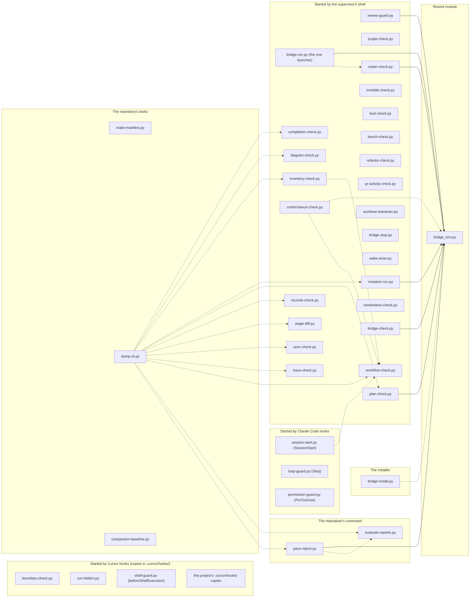

# Plan critique: release T's plan addendum (subject `release-t-plan`), round 4

## What is criticised

The Claude-Cursor Bridge is a Claude Code extension that supervises software projects built by a Cursor builder; its release B finished on 2026-10-31 (Phase: done). Release T is the project's first change cycle, a text release; its design revision passed the owner's gate on 2026-11-01 (docs/DESIGN.md, "Change: release T", quoted below as context and not under critique). What is criticised is the **plan addendum** (~/.claude/cursor-bridge/workflow/phases/change-cycle.md, item 4; planning.md, "The plan"): the section "Release T — the plan addendum" of docs/BUILD_PLAN.md — its three constraints, stage T1 (five supervisor-text increments, TASK-036 to TASK-040) and stage T2 (the weekly workflow's text and file, the one program fix BUG-039 as TASK-043, the retrofit's tests, the stamp; TASK-041 to TASK-045), each with its fields, Scope, Satisfies and Done when — and the header paragraph's revision note. The addendum is read by an AI supervisor that will run its increments through the delegation loop (the text ones as supervisor-authored increments, as release B's TASK-030, TASK-034 and TASK-035 were; TASK-043 through the builder), and by spec-packager, which writes each brief from its Done when.

Judge: the ordering (dependencies before dependents; delegation-loop.md at 96.5% of its R-032 bound before any addition, so TASK-038's move of step 8 into a sub-file must precede every increment that adds to that module — does it?); increments that are secretly two (or two that should be one); acceptance criteria that cannot be checked (a Done when the supervisor or a test cannot verify); whether every item of the register's rows R-045 to R-056 and R-042's revision is carried by exactly one increment's Done when, and every planned row satisfied (`completion-check.py --mode plan`); whether each stage is demonstrable on its own and its Demonstration line names what is shown live; the tests-first rule's mechanics (`mutation-run.py --checkpoint` as the red-on-the-old-text proof: does it hold for a test that pins a sentence of a file under bridge/, given the copy is the checkpoint's tracked tree?); whether TASK-043 (BUG-039) is rightly a TASK heading with a fix-variant brief (the plan check reads `### TASK-nnn` headings only; the launcher's branch rule reads the plan's headings for a merge unit's IDs) and whether its three sites are one brief; whether the weekly workflow's increments (the frozen block in TASK-041, the file in TASK-042) and their proof (the dispatch after the merge) are ordered and checkable; whether TASK-044's enforcement makes `diagram-check.py --mode code` and `--mode done` pass (every DEVIATIONS row resolved by TASK-036, TASK-041 or TASK-043); whether the stamp increment's Running-projects items match the design's Impact, Data model and Delivery; the register's statuses (R-052 built by the later of TASK-041 and TASK-042; R-042's row stays built, its Evidence gaining tests); the pitfalls (KP-009 the constant pointer; KP-010 the builder's self-report; KP-019 "approved in the plan" is not "fits the data" — a reality check at every brief; KP-035 the digest's cap; KP-062 a ceiling the text alone holds; KP-066 a floor trusted before a real run; KP-067 `git show --output`); and the lenses below. Do not re-criticise the design: a finding against docs/DESIGN.md is in scope only where the plan cannot be built from it as written.

## The record so far

## Subject: release-t-plan (release T's plan addendum: stages T1 and T2, TASK-036 to TASK-045; 2026-11-01)

What is criticised: the two stages change-cycle.md's item 4 appends to docs/BUILD_PLAN.md for release T (the addendum's constraints, stage T1's five text increments, stage T2's weekly workflow, BUG-039 as TASK-043, the retrofit's tests and the stamp), read against the approved design (docs/DESIGN.md, "Change: release T"), the register's rows R-042 as revised and R-045 to R-056, the four diagrams and their deviations file, with the plan-critic's build-plan lenses and the trait installable's `planning.critic-lenses` addition (the packaging stage lens, not applicable to the kind host-installation, and the command-reference lens). The critics: `plan-critic` (Fable 5.1) and Review B (grok-4.7-medium, the native profile) in design mode, each reading `run/review/DESIGN-release-t-plan-<round>.md`. Four rounds at the most, then a confirming read if the text changed, then one resolution round for what is still open, then the gate (design.md, "The procedure").

**Accepted** (finding, critic, round, the reason):

- A test over `spec_from_file_location(` for the seven loads by file (plan-critic, round 1, Consider): the design places those edges under review and the file-load form under a maintainer's program item (Open questions), so a test pinning today's form would pin what that item changes; the plan builds the design as approved.
- The three DEVIATIONS removals have no order (Review B, round 1, Consider): they remove distinct rows of one table and no increment of the release runs in parallel (the constraints), so each merges onto the other's result; a textual conflict at a rebase is resolved as any.
- TASK-037 carries three rows (Review B, round 1, Consider): the rows are sentences in shared homes (the core, design.md, the digest) with one pin file and no program; each increment costs a gate pass (INVENTORY, Decisions).
- TASK-041 grows when its observed launch is prompted or refused (Review B, round 3, Consider): the branch is conditional and expected not to run (the design's host table shows the rules' forms allowing); when it does, the rule work is text and a test re-run, no program, and the design's host assumption binds its three steps to the same release; an increment planned for a condition that may not arise would plan work that never runs.

**Rounds** (round, kind, the commit its file was built from, critic, Blocking / Should fix / Consider, what was fixed):

- Round 1, critique, 49f797e, plan-critic: 1 / 8 / 6. Fixed: TASK-044's tests exempted from the red-on-checkpoint proof as characterisation tests and shown strong by a code-side mutants file (the guard's call, `REVIEW_ROUNDS`, `SECRET_LIKE`, dump-cli's selection) beside the two diagram-side hand mutations; `new_tests` by path for a new file and by node id for a rewritten test, the per-test lines read; TASK-038's move verbatim in the increment's first commit, its sha named, the rewording after; the constraint saying which increment flips a row to built and writes its Evidence (the later of two for R-052 and R-055, at TASK-044); the dispatch read moved from TASK-042 to TASK-044's Done when; TASK-043's criterion on TASK-045's entry deleted; the three maintainer halves and **If rolled back**'s content in TASK-045 and its test; an `Alters:` line under each stage; the thirteen `TESTS:` lines of `--mode code` until TASK-044 stated in the constraints and stage T1's demonstration; bytes not characters; the observable "no prompt and no refusal"; the flag-voiding cases split between `test_bug039.py` and the D-003 file, the INDEX cell naming both; step 7 as decide.md's; the narrower `git branch -D stage/*` rule kept. Accepted: 1 (above).
- Round 1, critique, 49f797e, Review B (grok-4.7-medium): 2 / 9 / 6. Fixed: the Evidence per item letter written by the flipping increment and checked by TASK-045's stamp test over the register; TASK-043's criterion deleted; exit 0 alone not the proof, the per-test lines read; the by-id listing for `test_loop_text_pace.py`; `delegation-loop.md`'s step 4 among R-050's homes and the reviewers' definitions among R-051's for P11; D-003's and D-004's files in TASK-043's and TASK-041's Scope, their deviation labels redrawn as built with the rows' removal; R-052 and R-055 planned until TASK-044; stage T2's demonstration walking the three kinds against the run list; the dispatch out of TASK-042; `docs/DESIGN.md` in TASK-041's Scope; the three maintainer halves; `merge.md` under the R-032 bound test; TASK-041 depending on TASK-040; the `Alters:` lines; a negative case per site and the security auditor's read for TASK-043. Accepted: 2 (above).
- Round 2, critique, e83b660, plan-critic: 1 / 8 / 3. Fixed: TASK-042's Scope gains `tests/test_release_b_ci_floor.py`, whose only-workflow pin is rewritten to the two files, listed by node id and red first; the `--mode code` count stated by span (thirteen through TASK-042's checkpoint, twelve from its merge, never rising); a parametrised test listed by its bracketed id for the new parameter alone; R-056's flip and Evidence in TASK-045's accept commit as the one exception, so its stamp test and `--mode done` are green there; the item labels read from the Requirement cell's parentheses, rows without labels needing one test; **If rolled back** stated as the installer does it (the release's rules removed with it); TASK-044's code-side mutant the after-restoring call, killed by its own tests; the dispatch's not-green path (a finding a `DEP-<nnn>` increment first; a scanner failure one rerun, then a floor defect); TASK-036's Scope naming `tests/test_a5_followups.py` in place of the open clause, KP-061's pin the outcome line; a committed file's tests (TASK-043's) by node id; TASK-045's records marked as outside Scope. Accepted: none.
- Round 2, critique, e83b660, Review B (grok-4.7-medium): 1 / 4 / 1. Fixed: the count by span, read at step 4 (Inspect), where the command stands; TASK-043's brief Scope the increment's whole, the manifest and the command reference beside the variant's cause-file rule; the bracketed id; R-042's Evidence (no labels; the convergence tests from TASK-039's records-only commit, `tests/test_bug039.py` from TASK-043's); stage T2's `Alters:` line naming `settings.bridge.json`'s `--strip` forms where written; TASK-041's branch conditioned on the observable, a prompt or a refusal. Accepted: none.
- Round 3, critique, 7099cc6, plan-critic: 1 / 4 / 2. Fixed: TASK-040's D4 commands (`git tag`, `git show` on the stage-review name) admitted by two narrow allow rules its Scope now carries with `tests/test_allowlist.py`, the stage's `Alters:` line and **If rolled back** naming them; TASK-045's `docs/REQUIREMENTS.md` and `project.json` back in Scope since its accept commit is mixed, the RECORDS rule stated as built; the label and Evidence grammar fixed once in the constraints and cited by the stamp test; P7's suite form through `--key-file` so `tests/test_allowlist.py` reads it, TASK-041's observed launch carrying the word; `tests/test_a5_followups.py` in TASK-038's and TASK-040's Scope and the constraint's list, `tests/test_leads_b3.py` checked at TASK-037; the helper's own call site the one exemption of TASK-043's test; TASK-044's tests reading D-004's note from the file. Accepted: none.
- Round 3, critique, 7099cc6, Review B (grok-4.7-medium): 0 / 5 / 1. Fixed: stage T1's demonstration naming its three live runs and the check's own `note:` and `RESULT:` lines; D-004's guard edge carrying no deviation clause, so TASK-043 redraws D-003's labels only; the checkpoint command as the loop gives it at the increment, the stripped form with its scratch folder from TASK-041; the record, the diagrams and the deviations file outside TASK-043's brief; the label shape (`(T18's rule)` is prose). Accepted: 1 (above).

**Resolution**: (not yet due)

**Gate**: (pending)

## Grades

- **Blocking**: the plan cannot go to its gate with it.
- **Should fix**: the supervisor fixes it or accepts it with a reason.
- **Consider**: worth a thought; no round follows from it.

End with the counts per grade. Four rounds at the most, then a confirming read if the text changed, then one resolution round for what is still open.

## The lenses (from plan-critic.md, the build-plan section)

## When reviewing a build plan

The round's file may carry, beside the lenses below, the lenses the parts' conditional workflows add at `planning.critic-lenses`; apply each as one of your own, at the grade it states.

- **Prior-project lessons.** If the plan's "Prior-project lessons" section lists extracted
  issues, does every one of them land on a named increment's acceptance criteria, an
  ordering choice, a brief constraint, or a Phase-5 configuration item? An extracted issue
  that is only mentioned, not attached, is a **Blocking** finding — the lesson will be
  re-learned. If the section says "none", check that the supervisor actually asked (the
  plan records it) rather than skipped the step.
- **Requirement trace.** Read `docs/REQUIREMENTS.md`. Does every `planned` requirement — every screen and state of the approved mockup included — have at least one increment that names its ID under `Satisfies`? Is any increment's claimed requirement only partly covered by its acceptance criteria? An untraced requirement, or a deferral without the owner's dated answer, is **Blocking**.
- **Ordering.** Is any increment dependent on something built after it?
- **Granularity.** Which increments are secretly two or more? Which are so small they
  are noise?
- **Testability.** For each increment, can its acceptance criteria actually be checked,
  by a specific observable outcome? "Works correctly" is not acceptance criteria.
- **Scope boundaries.** Does each increment name the files and directories it may
  touch? Do any two increments overlap on the same files?
- **First runnable point.** How many increments before something can actually be run?
- **Vertical slices.** Is every stage a vertical slice — crossing the layers its features need so the parts are proven to work together and something can be run? A horizontal stage (one layer across many features: all the storage, then all the interface) is **Blocking**.
- **Placement.** Does every increment state `Depends on`, `Parallel`, `Diagrams`, and `Scope`? Are two `Parallel: yes` increments truly independent beyond their files — no shared schema change, API contract, configuration, or fixture? A false `Parallel: yes` is **Blocking** (`plan-check.py` only sees file scopes). An increment whose `Diagrams` omits a diagram it implements is **Should fix**.
- **Stages.** Is every increment in exactly one named stage, and is each stage a coherent,
  demonstrable chunk (normally three to eight increments) rather than an arbitrary cut? A
  stage close is where the supervisor reflects and patches the human-facing documents, so a
  stage that cannot be demonstrated on its own gives that reflection nothing to report.
  If it is more than a few, the plan is back-loading risk.
- **Missing increments.** What has to happen that no increment covers — error handling,
  configuration, teardown, migration, packaging?
- **Command reference (an approved command design).** Where the interface phase approved a command design (`docs/design/COMMANDS.md`), does the increment that first builds one of its commands carry the command reference's generator and its currency check, and does every later increment that adds or changes one of its commands carry "the reference regenerated and committed" as a criterion, whatever the part's traits (planning.md, "What the interface phase hands to the plan")? Without it the supervisor has nothing to look commands up in (rule 32) — **Blocking**.
- **Change-cycle addendum (a finished project being changed).** Does each new stage state
  which existing behaviour it may alter and that everything else is unchanged? Are the
  tests that pin existing behaviour kept, not rewritten? Is the version bumped in the
  single version source, and is the Packaging & installer stage re-run last so the shipped
  deliverable carries the new version? An addendum that quietly changes existing behaviour
  without saying so is **Blocking**.
- **Already built, already settled (any project with `docs/INVENTORY.md`).** Read the inventory first. An increment that builds what Features already lists, a step that asks the owner for a resource Resources already lists, or a design change that reverses a Decision without quoting its recorded reason and the circumstance that changed is **Blocking**.
- **A trait missing.** A part whose `Delivery kind:` row is `installer` or `install-script` whose plan's critique file carries no packaging lens, a design or intake note naming a service run by others (a third-party API, SDK or provider) whose plan's critique file carries no external-service lens, a design that shows screens whose plan's critique file carries no design-criteria lens, or a design naming a budget whose plan's critique file carries no benchmark-increments lens, is a finding that a trait is missing (**Blocking**: the trait's additions never reach the build).
- **Project end is the last stage close.** Does the plan name its last stage so that its
  close is unambiguous? A plan whose end is "when everything is done" leaves the supervisor
  unable to recognise project end.
- **Security criteria (logic/auth/data increments).** Does each increment with logic, auth,
  input-handling, or data-access surface carry checkable security acceptance criteria ("no
  new Semgrep high findings", "passes OSV/Socket", "authz enforced at the boundary per ASVS
  §x") rather than "is secure"?
- **Unnecessary code (advisory).** Does any increment plan to build what an existing helper,
  the standard library, a native platform feature, or an already-installed dependency
  already provides? Is any increment speculative — building for a requirement nobody stated
  (YAGNI)? Suggest the reuse; never at the expense of a required security, observability, or
  accessibility control.

## The lenses the trait installable adds (workflow/traits/installable.md, `planning.critic-lenses`; the part's delivery kind is host-installation, so the packaging-stage lens does not apply and the command-reference lens does)

## Add at planning.critic-lenses

- **Packaging stage (installable software: desktop application, command-line tool, local
  server).** Is the last stage "Packaging & installer", and does it carry
  `Delivery-Conventions.md` §2 / §3 / §4 as checkable acceptance criteria — one-command
  build or install, committed installer or install script, per-user install registered in
  Apps & features (a CLI on PATH from an isolated environment built from the lock file),
  upgrade in place keeping data, Upgrade / Uninstall / Cancel when already installed,
  uninstall keeping data, the lifecycle verification passing, the manual's install chapter?
  A plan for installable software without it is **Blocking**: the owner cannot install the
  result.
- **Command reference (any command-line surface).** Does the increment that first adds a
  command also add the reference generator (`scripts/dump-cli.py` → `docs/cli-reference.json`)
  and the CI currency check, and does every later command-changing increment carry
  "reference regenerated" as a criterion? Without it the supervisor has nothing to look
  commands up in and will instruct the owner from memory — **Blocking**.

## The plan addendum: docs/BUILD_PLAN.md, its header paragraph, standing constraints and the release T section, whole

````markdown
# Build plan — Claude-Cursor Bridge, Release B

The design is the Restructuring Plan's release B (§16) and the sections it rests on (§6, §15). This plan decomposes that scope into increments. Per §15 condition 3, **governance text is design: the supervisor authors it, gated by the two-critic design review; programs are implementation: the builder writes them, gated by the delegation loop.** Each increment marks its author. Status is derived from `origin/main` by `plan-check.py`, never written here. Revised 2026-10-11 after two-critic rounds 1–3 (converging: Blocking 7→6→1 and 5→1→2). Revised 2026-10-20 at the owner's decision on the window flood of 2026-10-19/20 (ISS-011; R-039 to R-041): TASK-028 to TASK-031 added to stage B5 before TASK-025, the fix made in the bridge and installed by calibration rather than per project, as a planned update and not a hotfix (INVENTORY, Decisions); critiqued as the subject `windowless` (docs/DESIGN_CRITIQUE.md). Revised 2026-10-24 at the owner's placement of the pace update (2026-10-22, "a"; the maintainer's request of 2026-10-20 relaying the owner's three approved solutions; R-042 to R-044): TASK-032 to TASK-035 added to stage B5 beside TASK-028 to TASK-031 (TASK-035 split from TASK-034 at the critique's round 1), TASK-030's mutation text moved to one run per increment, the leads of stage B3's review placed (docs/HARDENING.md, Stage B3, "Placed by the pace plan revision") and the Scopes that review found short widened; critiqued as the subject `pace` (docs/DESIGN_CRITIQUE.md: four rounds and the confirming read) and approved at the owner's gate on 2026-10-24 with the ceiling at three rounds ("I choose three"). Revised 2026-10-24, before stage B4's TASK-017, at the supervisor's reality check of the text as built (the delegation loop's step 2 rule applied to its own text; run/supervisor/task017-reality-check.md, quoted in the critique's file): TASK-017's Scope widened to every file that holds or pins a passage it moves (project-end.md, the plan critic, the registry, seven test files) and narrowed of reflection.md and interface.md, its Done when rewritten passage by passage with the extension point each goes to, two §6.4 refinements of the registry made in the same change as planning.md (`planning.stages` widened to increments, `planning.acceptance-criteria` new), the passages no point places kept in the main workflow, the deployed-layout and bounded-remote-wait checks placed as external services' new text, the `Installer verification` parameter kept among the five, and TASK-018 to TASK-021 re-read for the same class of problem (TASK-018 depends on TASK-017 for the pointer it makes; TASK-019 and TASK-021 name their delivery kinds by key and add the kind's procedure at `project-end.delivery`); kept as one increment, since the registry refinement is made with planning.md, which every trait's planning move edits too, and each increment costs a gate pass (INVENTORY, Decisions); critiqued as the subject `traits` (docs/DESIGN_CRITIQUE.md: four rounds, the confirming read and a resolution round) and approved at the owner's gate on 2026-10-24 ("I approve of the plan"). Revised 2026-10-27 at stage B5's plan revision point (after TASK-031's merge, before TASK-030), at the owner's word of 2026-10-26 to integrate the four text items the maintainer's evaluation of 2026-10-25 gave release B (decision D4: T14, T23, FB-036, FB-040; INVENTORY, Decisions), each into the increment whose Scope already holds the text it amends, no increment added and two requirement rows extended (R-042 with T14's sentences, R-043 with the estimate): T14 (the class is the defect, not the operator that exposed it; below the ceiling a stage round ending with no REJECT but with findings the convergence rule makes blocking puts them into one fix increment through its own gate, no further stage round, and at and above it such a finding outside the five goes to HARDENING and opens no fix increment) into TASK-034's Done when; T23 (the change cycle's item 1 ends with a confirmation inside intake, not a gate) into TASK-035, its Scope widened to change-cycle.md and tests/test_phase_modules_close.py, whose pin on the procedure's bytes it re-takes, and, for FB-036, to bridge/cursor-bridge/Glossary.md and tests/test_workflow_model.py; FB-040 (the process count of a mutation run estimated before the increment's first run and any `--all` run, the duplicates the mutants file shows cut before the launch) into TASK-030's Done when and as a clause of R-043; FB-036 (the core read in parts to its end, the current phase's modules named) satisfied at calibration by TASK-023 (PR #85), the four "read whole" statements (the core's two, rule 28's and the Glossary's) made to say in parts by TASK-035 and TASK-026's "one read" clause reworded, no bound for the core taken; critiqued as the subject `maintainer-text` (docs/DESIGN_CRITIQUE.md): four rounds and a confirming read, nothing Blocking left open, no resolution round due; approved by the owner at the gate on 2026-10-27 ("Approve"). Revised 2026-11-01 for release T, the project's first change cycle (change-cycle.md, item 4; docs/DESIGN.md, "Change: release T", approved at its design gate on 2026-11-01): stages T1 and T2 appended below, TASK-036 to TASK-045, each increment drawn from the register's rows R-045 to R-056 and R-042's revision, the author marked as release B marked it (governance text and tests the supervisor's; the one program fix, BUG-039 as TASK-043, the builder's); critiqued as the subject `release-t-plan` (docs/DESIGN_CRITIQUE.md).

## Standing constraints (every increment)
- **Manifest:** any increment that adds, moves, removes, **or edits** a file under `bridge/` regenerates `bridge/cursor-bridge/MANIFEST.json` (`python tools/make-manifest.py`) in the same commit (a hash change fails `bridge-check --sources` in CI otherwise); `MANIFEST.json` is named in its Scope.
- **Tests name the requirement:** each increment's test contains the literal `R-nnn` of every requirement it satisfies. A governance-text increment's test is structural (the file exists at its §6.11 path, opens with its compaction-survival list where applicable, declares its extension points by the registry's names, is within the R-032 bound, and — **from TASK-006 on** — `workflow-check.py` exits 0 on it).
- **Moves, not copies:** text moved in the split (including a trait's gathered passages, §6.8) *moves* — it leaves its old home; the main workflow shrinks. A passage may move twice (baseline → phase module → trait file); `trace-check` accepts it found verbatim anywhere under `workflow/**`.
- **Trace exceptions:** `bridge/cursor-bridge/workflow/trace-exceptions.md` carries two entry kinds — `reword <TASK> <file> <heading>` and `new <TASK> <file> <heading>` — appended by the supervisor-text increment that rewords or adds; it is named in that increment's Scope so the design review sees it.
- **Open list currency:** an increment that writes a type, sub-type, or trait flips that entry's written flag in `bridge/cursor-bridge/workflow/open-list.md` (named in its Scope).
- **No hard line wraps** in any authored Markdown (rule 30).

## Release T — the plan addendum (2026-11-01)

Release T's increments follow the standing constraints above and three of their own, from R-056 and the design's Testing strategy: **tests first** — every changed or added sentence is pinned by a test the supervisor writes before the text, each new test shown red on the increment's checkpoint by the loop's step 4 command as it stands at the increment — `python ~/.claude/cursor-bridge/bridge-run.py --limit auto --kind driver -- python ~/.claude/cursor-bridge/mutation-run.py run/supervisor/<id>-mutants.json --checkpoint <the increment's checkpoint commit>` through TASK-041's merge, and from it the stripped form TASK-041 writes, `--limit auto --strip --kind driver` with `--scratch ~/.cursor-bridge/scratch/<the project root's folder name>` among `mutation-run.py`'s options, since a stripped driver's home is the agent home and the default scratch folder would land there, the Workspace's `.env` copied with it — (the mutants file's `new_tests` listing a test file the checkpoint does not hold by its path, and a test in a file the checkpoint holds — rewritten, or new in a file committed before the checkpoint, as TASK-043's reproduction tests are — by its node id, `tests/<file>.py::<test>`, since the program refuses a listed file the checkpoint holds, a parametrised test by its full bracketed id, `::<test>[<parameter>]`, for the new parameter alone, since the bare function id matches every parameter and the old ones pass; the run's per-test lines read, every listed test shown failed on the old text and none `not run` or skipped, exit 0 alone saying only that none passed) and the run named in the accept commit, its per-test lines quoted — TASK-044's tests excepted, which characterise behaviour release B built and are shown strong by a mutants file over the code instead, as its Done when says; **the register's Evidence names the test per item label** of a bundled row, in one grammar: a label is the leading token of a parenthesis in the row's Requirement cell when it is a letter D, T or P with digits followed by `)`, `,`, `:` or `;`, with every further such token the parenthesis lists after commas before any prose — `(P5: step 8 and ...)` gives P5, `(T24, P6)` both, `(P2, the by-class line of 2026-10-27)` P2, and `(T18's rule)` none — and an Evidence cell lists `<label>: <tests/file.py or node id>` entries separated by `;`, a row with no label naming at least one test; the increment whose accept satisfies a row's last item flips the row to built and writes its Evidence in its records-only commit (T10; `docs/REQUIREMENTS.md` and `docs/PROJECT_STATUS.md` are outside every Scope by `scope-check.py`'s RECORDS rule, which exempts a record changed in records-only commits alone — a commit mixing a record with code is the builder's and its record edit drift — so a record an accept commit must carry is named in Scope, as TASK-045's are), a row two increments satisfy staying planned until the later one (R-052 and R-055 both flipped at TASK-044's accept, R-052 once its dispatch is read), `completion-check.py` reading the Status column as written, TASK-045 the one exception (R-056's flip rides in its accept commit, as its Done when says); and **the trace** — every reworded or added passage of the core and the modules has its `reword` or `new` entry in `trace-exceptions.md` and `trace-check` is green at every text increment's accept. A text increment's pins on sentences it rewords are re-taken in the same change (the files release B's pins live in: `tests/test_core_carve.py`, `tests/test_phase_modules_*.py`, `tests/test_b3_least_confident.py`, `tests/test_session_start.py`, `tests/test_loop_text_*.py`, `tests/test_allowlist.py`; and the older `tests/test_a5_followups.py`, which pins the stage review's part sentence and KP-061's heading, and `tests/test_leads_b3.py`, which pins design.md's snapshot-hash bullet), each named in the accept commit, the Scope naming the ones the design already shows. Every increment's pull request carries `docs/PROJECT_STATUS.md` as it reads at that pull request's merge (ISS-009), so the full suite runs with the pull-request variables before its first push (ISS-022; R-045's P7, the predicted `<n>`). No increment runs in parallel (one heavy slot; the text increments edit shared files). The trait installable's packaging stage does not apply (the delivery kind is host-installation; the type's delivery is TASK-045's install); no increment adds or changes a command, so the command reference's currency check runs unchanged (`tools/dump-cli.py --check` in CI and the pre-commit gate). Until TASK-044 merges, `python ~/.claude/cursor-bridge/diagram-check.py --mode code` lists `TESTS:` problem lines only, beside its own `note:` lines and its `RESULT: <n> problem(s)` line — thirteen through TASK-042's checkpoint (the `Enforced by` cells of D-002, D-003 and D-004 naming no test that names the diagram's ID; D-003's ten states no test names), twelve from TASK-042's merge, whose `tests/test_dependency_scan.py` names D-004 and closes that line, the count falling as the named tests land and never rising: the loop's step 4 (Inspect, where the command stands) reads it so at every increment before TASK-044, and any `IMPORT` or `SCHEMA` line, or a count that rises, is a regression.

## Stage T1 — Release T: the text, pinned
Demonstration: on the tree as built at the stage's close: the full suite green, every test the stage's increments wrote first shown red on its increment's checkpoint by the `--checkpoint` run the accept commit names (three re-run live, their per-test lines read: TASK-036's pitfalls test, TASK-038's by-id run for the bound test's `merge.md` parameter, TASK-039's two convergence tests); `trace-check.py` green with release T's `reword` and `new` entries (nothing dropped); `tests/test_session_start.py` green (the digest within 9,500 characters, every rule number present); `python ~/.claude/cursor-bridge/diagram-check.py --mode design` OK and `--mode code` ending `RESULT: 13 problem(s)`, its problem lines the thirteen `TESTS:` lines and no other kind; `bridge-check.py --sources` naming no stale file; and `session-start.py` run over `tests/fixtures/workflows/pass/` naming the delegation loop's new sub-file `delegation-loop/merge.md` after the module, as its `Sub-files:` line gives it.
Alters: governance text only — no program's behaviour (`session-start.py`'s digest text within its cap; `settings.bridge.json`, the installer's data, gains three allow rules: TASK-038's `git branch -D` and TASK-040's two for the stage-review tag); everything else unchanged.

### TASK-036 — The pitfalls (R-054), and D-004's first deviation closed by the corrected text
Author: supervisor (text; `diagram-specialist`, as-built variant, for D-004's note).
Parent: none
Depends on: none
Parallel: no
Diagrams: D-004
Scope: bridge/cursor-bridge/Known-Pitfalls.md; bridge/cursor-bridge/MANIFEST.json; docs/diagrams/D-004-context-dfd.md; docs/diagrams/DEVIATIONS.md; tests/test_release_t_pitfalls.py; tests/test_a5_followups.py (re-taken only if KP-061's heading changes: it pins the heading and its uniqueness, not the outcome line D5 corrects; no other test pins a sentence of KP-052, KP-061 or KP-038 — a pin the reality check finds is a plan revision)
Satisfies: R-054
Done when: `Known-Pitfalls.md` holds, each in the catalogue's four-part shape (misconception or mistake, how it surfaced, the correction, where it applies): KP-061's outcome line corrected (D5: the app moved the suite's command to the background and the result was waited for; the rule stands); KP-063 to KP-065 (D13: a provider's bill in its own unit, failed attempts included; a harness below the product's entry point; a driver anchored on a moved line); KP-066 to KP-070 in R-054's order (T27: a security floor trusted before it ran; `git show --output` creates the file empty, KP-067 being the number `review-guard.py` already cites for its refusal of an empty review input; a vendor banner's partial key in a public log; a squash-merged pre-gate status file; a naive local-time schedule walk) and the KP-058 addendum (working-folder defaults read the live folder); KP-052 corrected (T13: no tool is safe for a typed backslash-u escape: `chr()` in a test, the code point in a document, a byte search after a write that quotes one); KP-071 to KP-074 from release B's Issues (P21: a test that patches a standard-library function records the library's own calls; a count seeded from files another mechanism also writes; a check that scans shipped code found its own description; status-file tests gated on CI variables skip locally); and KP-038 narrowed to what the code does (the stores under the profile root are not found by default; a store reached through `APPDATA` or `LOCALAPPDATA` is, until a probed release redirects them, the redirect a program item for the maintainer named in TASK-045's entry; D-004's first deviation). D-004's note on the edge `p_bridge_env` → the agents' environment says the same, drawn as built, and DEVIATIONS.md's row for it is removed (the design corrected to the code, conventions §8's second case). `tests/test_release_t_pitfalls.py` (names R-054, D-004) pins each entry's number and title, one sentence of each (KP-061's the corrected outcome line, not its command line, which TASK-041 rewrites) and KP-038's narrowed sentence, written first and red on the checkpoint; `diagram-check.py --mode design` OK; MANIFEST regenerated; no program changed.

### TASK-037 — Reports, run sheets, the critique's record and project state (R-047, R-048, R-053)
Author: supervisor.
Parent: none
Depends on: TASK-036
Parallel: no
Diagrams: none
Scope: bridge/commands/supervisor.md (rules 12, 43 and 48; "Project state": the Decisions row's sentence and the status template); bridge/cursor-bridge/session-start.py (the digest's rule 12 in the question form, the digest within 9,500 characters with every rule number kept, trimmed elsewhere as TASK-034 trimmed it, the trims named in the trace entry); bridge/skills/explain-for-decision/SKILL.md (the run sheet: a vendor console from documentation fetched at the time, with the exact path); bridge/commands/calibrate-bridge.md (step 5: the `Calibrated:` line rewritten at each calibration, the earlier text living in git); bridge/cursor-bridge/workflow/phases/design.md (T1 one subject for a design with its addendum; T3 the record's definitions; T7 the snapshot id `DESIGN-<subject>-<round>` and the `.err` name from it; P9 the worked-scenario lens); bridge/cursor-bridge/workflow/phases/change-cycle.md (item 2: the pause before planning work, the model named, a push notification where Remote Control is on, T26); bridge/agents/plan-critic.md (P9's lens); bridge/cursor-bridge/Diagram-Planning-Conventions.md (§8: the all-omitted index, the minimum set binding every project whose code has components, the calibration's retrofit reading the same rows, P20); bridge/cursor-bridge/workflow/trace-exceptions.md; bridge/cursor-bridge/MANIFEST.json; tests/test_release_t_records.py; tests/test_session_start.py; tests/test_core_carve.py; tests/test_phase_modules_intake_design.py; tests/test_phase_modules_close.py; tests/test_b3_least_confident.py; tests/test_calibrate_text.py; tests/test_leads_b3.py (pins re-taken, the last where T7's rewrite of the snapshot id touches design.md's snapshot-hash bullet it pins, checked before the brief)
Satisfies: R-047, R-048, R-053
Done when: each item's sentence stands in the home the design's table names (R-047: T1, T3, T7, T26; R-048: D11 in rule 43, D10 in the run sheet, D7 in the digest's rule 12 and the core's, D6 in step 5 and the template; R-053: P10's Decisions-row sentence, the next report naming every decided-but-unbuilt rule, and the `Running projects must` sentence for a release that adds a safety mechanism, in "Project state"; P9's lens in design.md's critics' lenses and in plan-critic.md; P20 in the conventions' §8), the digest within its cap and its rule numbers all present (`tests/test_session_start.py`), every reworded passage with its `reword` entry and every new section with its `new` entry, `trace-check` green; `tests/test_release_t_records.py` (names R-047, R-048, R-053) pins each sentence, written first and red on the checkpoint; the pins on the reworded sentences re-taken; MANIFEST regenerated; no program's behaviour changed (`session-start.py`'s digest text only).

### TASK-038 — The merge step in its own sub-file; the merge mechanics and where reviewers write (R-045, R-046)
Author: supervisor.
Parent: none
Depends on: TASK-037
Parallel: no
Diagrams: none
Scope: bridge/cursor-bridge/workflow/phases/delegation-loop.md; bridge/cursor-bridge/workflow/phases/delegation-loop/merge.md (new); bridge/commands/supervisor.md (rule 43 and the status template: the status file as at the merge, `in-flight.md` between merges, T11 and T17); bridge/cursor-bridge/session-start.py (the hook's text on `in-flight.md`, T17; its module table unchanged, the sub-file read from the pointer line); bridge/cursor-bridge/Merge-Verification-Policy.md ("Invocation": T5's clauses, T8's bare commands, T4's title form; its convergence paragraph untouched here); bridge/cursor-bridge/workflow/phases/design.md (the constant prompt and the receipt check: T5, T2); bridge/cursor-bridge/workflow/phases/reflection.md (steps 4 and 6: T16, T25); bridge/agents/diff-reviewer.md (T5, T2); bridge/agents/secret-sentinel.md (P5: every pushed commit scanned for computer paths and account names); bridge/cursor-bridge/settings.bridge.json (the allow rule `Bash(git branch -D:*)`); bridge/cursor-bridge/workflow/trace-exceptions.md; bridge/cursor-bridge/MANIFEST.json; tests/test_release_t_merge.py; tests/test_allowlist.py; tests/test_phase_modules_build.py; tests/test_session_start_module.py; tests/test_session_start.py; tests/test_core_carve.py; tests/test_b3_least_confident.py; tests/test_loop_text_pace.py; tests/test_phase_modules_close.py; tests/test_a5_followups.py (pins re-taken: the sub-file pointers, step 8's names and sentences, the stage review's part sentence T25 edits)
Satisfies: R-045, R-046
Done when: (a) step 8 (the verified gate) is moved verbatim into `delegation-loop/merge.md` in the increment's first commit, whose sha the accept commit names and whose diff shows the passage leaving `delegation-loop.md` and arriving unchanged (TASK-030's shape for step 7), the rewording of (b) in later commits so a reviewer tells the move from the change; the module's `Sub-files:` line naming it third, `delegation-loop.md` holding a one-paragraph pointer where step 8 stood and standing within R-032's bound with room for this release's additions (today 57,894 bytes, fewer characters since the module holds non-ASCII, the bound's test measuring characters; the new size recorded in INVENTORY's Decisions row on the modules' sizes), `merge.md` added to the R-032 bound test's parametrised list in `tests/test_phase_modules_build.py` (rewritten first; listed by its bracketed id for the new parameter alone and red on the checkpoint, where the file is absent), `trace-check` finding every moved passage under `workflow/**`, and `session-start.py` naming the sub-file after the module (a run over `tests/fixtures/workflows/pass/`; `tests/test_session_start_module.py`'s and `tests/test_phase_modules_build.py`'s sub-file pins re-taken); (b) R-045's sentences as the row gives them: T4 (the title form, with the squash-message fact that this repository's squash message is the commit messages, so the `Merges:` trailer form holds only where the squash message is the description), T8 (push and merge bare), P7 (the suite before the first push of a pull request changing the status file, `project.json` or a `VERSION`, in the documented form `python ~/.claude/cursor-bridge/bridge-run.py --limit auto --key-file <a file outside the Workspace> --kind test -- python -m pytest -q tests`, the key file holding the three lines `GITHUB_REF=refs/pull/<n>/merge`, `GITHUB_BASE_REF=main` and `GITHUB_EVENT_NAME=pull_request` — the launcher's `--key-file` applies a file of `NAME=value` lines whatever `--strip` says, and the form sits in the heavy-launch rule's slot, where an environment prefix before `python` would match no rule and `tests/test_allowlist.py` would never collect it (KP-019); TASK-041 adds `--strip` to it — `<n>` predicted as the design says, the run repeated with the real number where GitHub issues another), P5 (every pushed commit scanned, a leak removed from the commit, in step 8 and `secret-sentinel.md`), P4's text (the merged branch deleted locally and on the remote with the two bare commands, the armed form skipped where the repository refuses auto-merge), T11 and T17 (the status file as at the merge, the live position in `in-flight.md`, a pull request overtaken by another's merge rewritten and re-reviewed; rule 43, the template, the hook's text, KP-069 cited); R-046's: T5 (where a reviewer or critic may write and that it edits nothing: the directive's clauses, the policy's invocation, design.md's constant prompt), T16 (single test files beside Review B, mutation runs on a copy outside the checkout), T25 (each stage-review part's turn budget in its prompt), T2 (a clean reply's three verified statements, the receipt check reading them); (c) `settings.bridge.json` gains `Bash(git branch -D:*)` beside the narrower `Bash(git branch -D stage/*)` it subsumes, which stays (the rule list is append-only; `tests/test_allowlist.py` pins both), the test pinning the new rule and the two documented delete commands (the remote delete on the existing `Bash(git push:*)`), the install merging the rule (no program change); (d) `tests/test_release_t_merge.py` (names R-045, R-046) pins each sentence, P7's command among them so `tests/test_allowlist.py` reads it, written first and red on the checkpoint; the trace entries (the move adds none; each reword its entry); MANIFEST regenerated.

### TASK-039 — Rule 6, convergence and the ceiling's text; briefs, reports and the accept step (R-050, R-051; R-042 revised)
Author: supervisor.
Parent: none
Depends on: TASK-038
Parallel: no
Diagrams: none
Scope: bridge/commands/supervisor.md (rule 6); bridge/cursor-bridge/Merge-Verification-Policy.md (the re-delegation paragraph's threat model, the convergence paragraph, the invocation's fifth clause); bridge/cursor-bridge/workflow/phases/delegation-loop/merge.md (step 8's convergence paragraph, the directive's clauses); bridge/cursor-bridge/workflow/phases/delegation-loop.md (steps 3b, 4 and 5 and the survival list: T15, T24, P6, P13); bridge/cursor-bridge/workflow/phases/delegation-loop/decide.md ("When to stop re-delegating", "The review ceiling", the Accept bullet: P1, P2, P3, T20, T18, T10); bridge/cursor-bridge/workflow/phases/reflection.md (step 7); bridge/agents/diff-reviewer.md; bridge/agents/security-auditor.md; bridge/agents/design-auditor.md (the five first, the threat model with the diff, P11's count check); bridge/agents/spec-packager.md (T21, P12, T13, P6); bridge/agents/secret-sentinel.md (T24, P6); bridge/cursor-bridge/workflow/trace-exceptions.md; bridge/cursor-bridge/MANIFEST.json; tests/test_release_t_ceiling.py; tests/test_loop_text_pace.py (the `test_bug033_` and `test_r042_` convergence tests rewritten first, each red on the increment's checkpoint by the by-id run); tests/test_phase_modules_build.py; tests/test_phase_modules_close.py; tests/test_core_carve.py; tests/test_session_start.py; tests/test_b3_least_confident.py (pins re-taken)
Satisfies: R-050, R-051, R-042
Done when: R-050's sentences in every home the design's table names — P1's defect-and-class gate (two reviewers naming the same defect, one defect per fault, blocking where its content is of the five; a convergent finding of another class fixed by the next increment that edits its file or recorded, no gate pass of its own), T20's threat model bound (recorded in the inventory's Decisions, given to the reviewers with the diff, read before P1 and P2), P2's membership by reproduction on an ordinary layout (a label alone never deciding; a security finding judged by reach of untrusted input), P3's class line confirmed against the round it lifted, T18's test-strength rule for a supervisor-authored increment — in rule 6, the policy's two paragraphs, step 8's convergence paragraph and the fifth clause, `delegation-loop.md`'s step 4 (T18's test-strength rule, where the new tests are run), decide.md's brake and ceiling text, reflection.md's step 7 and the three reviewers' definitions; R-051's — T21 (printed lines verbatim in a fenced block; mutants by the brief's label), P11 (every count quoting its output line; the reviewer comparing), P12 (the suite once after the last edit; the report naming its commit; known failures outside Scope named), T10 (the records-only commit after the accept commit), T15 (the rebuild at a profile switch, step 3b), P13 (the resume: the output and `.err` first; `verify` only once the run has ended, a run still going waited for or ended with `bridge-stop.py`), T24 and P6 (`invisible-check.py` against `origin/main` in the sentinel and `--staged` before every commit; escapes written as text, non-ASCII listed), T13 — in spec-packager.md, secret-sentinel.md, decide.md's Accept bullet and step 7, delegation-loop.md's steps 3b and 5 and survival list, and the three reviewers' definitions for P11's comparing of each count with its quoted output line; R-042's row reads as revised (its revision sentence written at the design), its status built, its Evidence gaining the rewritten convergence tests; `tests/test_loop_text_pace.py`'s `test_bug033_` and `test_r042_` convergence tests rewritten to the new sentences before the text, each listed in `new_tests` by its node id (the file exists at the checkpoint) and red on the checkpoint by that run, green after; `tests/test_release_t_ceiling.py` (names R-050, R-051, R-042) pins every other sentence, written first and red on the checkpoint; the digest within its cap where rule 6's digest line changes; the trace entries; the pins re-taken; MANIFEST regenerated.

### TASK-040 — The stage close and the stage review (R-049)
Author: supervisor.
Parent: none
Depends on: TASK-039
Parallel: no
Diagrams: none
Scope: bridge/cursor-bridge/workflow/phases/reflection.md (steps 2, 4 and the demonstration: D1, D2, D3; step 8's tag: D4; item 5: P4's text, the remote branches with no open pull request listed and the merged ones deleted; the stage's change as the union of its squash commits by `stage-diff.py`: T11); bridge/cursor-bridge/workflow/phases/delegation-loop/refactoring-pass.md (where step 9 names the stage's change); bridge/cursor-bridge/workflow/types/host-extension.md and bridge/cursor-bridge/workflow/traits/installable.md (P17's `planning.stages` sentence, in each the type's kind host-installation and the trait's kinds `installer` and `install-script`: the last stage's review before the stamp, a text-only correction riding with the next release unless it changes what a project does, the field acceptance's stand-in named); bridge/cursor-bridge/settings.bridge.json (the allow rules `Bash(git tag stage-review/*)` and `Bash(git show stage-review/*)`); bridge/cursor-bridge/workflow/trace-exceptions.md; bridge/cursor-bridge/MANIFEST.json; tests/test_release_t_stage_close.py; tests/test_allowlist.py; tests/test_phase_modules_close.py; tests/test_phase_modules_build.py; tests/test_traits_existing.py; tests/test_type_host_extension.py; tests/test_b3_least_confident.py; tests/test_a5_followups.py (pins re-taken, the last for the stage review's part sentence D2 rewrites)
Satisfies: R-049
Done when: each sentence as R-049 gives it — D1 (every driver re-checked at HEAD before a stage review; a fix that moves product code re-anchors or re-runs every driver anchored on the moved file in the same pull request; a ruling naming surfaces gets one test per surface), D2 (every stage-review part bounded alike: a test part at most 25 files, a product part per package, a drivers-and-records part per driver family; a part without a verdict re-run on what it had not reached), D3 (the live stack with the schema check at the first increment of a stage that adds tables; the development database's rebuild run sheet before the demonstration; a harness driving the product's own entry points), D4 (the local tag `stage-review/<name>-<n>` before `git branch -D stage/<name>`, never pushed; records citing `<tag>:<path>`), T11 (the union of squash commits by `stage-diff.py` where stages interleave; a later stage's ready increments merging before an earlier closes), P4's text (item 5), P17 (both files, each for its kinds) — in the homes named; D4's two commands, `git tag stage-review/<name>-<n>` and `git show stage-review/<name>-<n>:<path>`, admitted by two allow rules `settings.bridge.json` gains, `Bash(git tag stage-review/*)` and `Bash(git show stage-review/*)`, narrow (a wide `git show:*` would admit the `--output` form KP-067 warns of), append-only, the install merging them (R-045's precedent for `git branch -D`: `tests/test_allowlist.py` fails a backticked command no rule allows), `tests/test_allowlist.py` pinning both rules and the two documented commands and its guard test showing the permission guard treats the bare `git tag` of that name as it treats the loop's other state commands (`tag` is in its `STATE_GIT` list beside `commit` and `push`); `workflow-check.py` exit 0 over the two conditional files; `tests/test_release_t_stage_close.py` (names R-049) pins each sentence, written first and red on the checkpoint; the trace entries (the conditional files' new sentences under `new` entries, as TASK-017's were); the pins re-taken; MANIFEST regenerated.

## Stage T2 — Release T: the scan, the fix, the retrofit's teeth and the stamp
Demonstration: on the tree as built at the stage's close, before the install: this repository's weekly workflow's one `workflow_dispatch` run on the default branch read green (`gh run list --workflow dependency-scan.yml`, its conclusion `success`, its log holding no `dependency-scan: OSV-Scanner exit` line), and the evaluation's three kinds walked by hand against that list as `evaluate-reports.md` now says — the run read falls in none, and the reading says what a listed `failure`, any other conclusion or missing exit line, and a disabled state under `gh workflow list --all` would each be and do; `review-guard.py verify` on a temporary repository flagging a snapshot while its Review B `.err` file holds no exit line, then the same round admitted again (the second site, run live from `tests/test_bug039.py`'s fixture), and the four early returns each recording the void; `diagram-check.py --mode code` RESULT OK with no `TESTS` line and `--mode done` OK with no deviation listed; one `--limit auto --strip --kind test` launch of a single test file observed running on its allow rule, its `.err` showing the launcher's stripped environment; the stamped tree: `bridge-check.py --sources` OK and `tests/test_release_t_stamp.py` green, with the install run sheet ready for the owner.
Alters: `review-guard.py` at BUG-039's three sites (the early flags void the launch; the void during the run; premerge's git call through the helper); adds `.github/workflows/dependency-scan.yml` to this repository; the loop's and the calibration's suite and driver launch commands gain `--strip`, and `settings.bridge.json` gains the two heavy-launch rules' `--strip` forms where TASK-041's observed launch is prompted or refused; the stamp; everything else unchanged.

### TASK-041 — The configuration guide, the security floor's conventions, the stripped launches and the weekly scan's text (R-052's text)
Author: supervisor.
Parent: none
Depends on: TASK-040
Parallel: no
Diagrams: D-004
Scope: bridge/cursor-bridge/Cursor-Project-Configuration.md (the security-floor section: T9's conventions, T22's ignore line, the weekly scan as every project's workflow); bridge/agents/cursor-configurator.md (the weekly workflow as a configuration item written from the frozen block, its one fill-in); bridge/commands/evaluate-reports.md (the Sunday step: the workflow state and the window's runs in the three kinds, the Dependabot two calls); bridge/cursor-bridge/workflow/phases/change-cycle.md (item 1: the conformance check before the first delegation of a project supervised after it was built, T12); bridge/commands/supervisor.md (the status template's `Layout:` line relative to the project root, T19); bridge/cursor-bridge/workflow/phases/delegation-loop.md (step 4), bridge/cursor-bridge/workflow/phases/delegation-loop/decide.md (step 7), bridge/commands/calibrate-bridge.md (step 1b) and bridge/cursor-bridge/Known-Pitfalls.md (KP-061) — the `--strip` launch commands, the driver's with `--scratch ~/.cursor-bridge/scratch/<the project root's folder name>`; bridge/cursor-bridge/settings.bridge.json (only where the observed launch does not run on the heavy-launch rules: the two rules' `--strip` forms); tests/permission_rules.py and tests/test_allowlist.py (in that case: the model narrowed, every documented command re-run under it, the rule of any failing command widened, then the observed case recorded; otherwise the documented `--strip` commands pinned as matching); docs/diagrams/DEVIATIONS.md (the row `p_bridge_run` → `p_test_suite` removed); docs/diagrams/D-004-context-dfd.md (that edge's label and the note on it redrawn as built, `diagram-specialist`'s as-built variant); docs/DESIGN.md (the host table's row for the observed launch); bridge/cursor-bridge/workflow/trace-exceptions.md; bridge/cursor-bridge/MANIFEST.json; tests/test_release_t_floor.py; tests/test_loop_text_windowless.py; tests/test_calibrate_text.py; tests/test_core_carve.py; tests/test_phase_modules_build.py; tests/test_phase_modules_close.py; tests/test_b3_least_confident.py (pins re-taken)
Satisfies: R-052
Done when: (a) before the commands are written, one launch is observed from this session running with no classifier prompt and no refusal — the absence of a prompt is the observable, since a command the classifier allowed looks the same as one the rule allowed: `python ~/.claude/cursor-bridge/bridge-run.py --limit auto --strip --key-file <a file outside the Workspace holding one harmless line> --kind test -- python -m pytest -q tests/test_allowlist.py` (one test file, within a foreground command's ten minutes; the `.err` file's launch and strip lines read; the `--key-file` word in the slot so P7's form is observed with the stripped one), the observation recorded in the accept commit and in the design's host table (`docs/DESIGN.md`, in Scope) as a row with its version; where a prompt or a refusal appears instead (the launch fell to the classifier or was denied), the two heavy-launch rules gain the `--strip` forms and the suite's rule model is narrowed as the design's host assumption says, in this increment; (b) the frozen block in `cursor-configurator.md` is the workflow's text whole — `on: schedule` with `cron: '17 6 * * 0'` and `workflow_dispatch`, `permissions: contents: read` and nothing else, the checkout action at the floor's pin with `persist-credentials: false`, OSV-Scanner at the floor's version and SHA-256 (stated twice, the structural test asserting the two equal), `osv-scanner scan source --config=osv-scanner.toml --lockfile=<fill-in>` with the floor's exit-code handling (0 clean; 128 fails; every other code fails as it is) and the line `dependency-scan: OSV-Scanner exit <code>` on every non-zero exit, no `secrets.` reference and no token handed to a step — with one fill-in, the `--lockfile=` list copied from the project's floor step; the guide's security-floor section carries T9's conventions (teeth proved by a planted finding on a real CI run before a review is trusted; every pin checked for deprecation; a vendor token enabling no paid engine; the floor's test the supervisor's; vendor CLIs with banner, spinner and telemetry off; the CLI installed in a step without the key and with `--ignore-scripts`; the first CI log of a step holding a secret read for any part of it), T22's `docs/BOUNDARY_VIOLATIONS.md` ignore line and the weekly workflow as every project's, added to a running project at its calibration; `evaluate-reports.md`'s Sunday step reads each project as the design's weekly section says (`gh workflow list --all` first, any disabled state the third kind; `gh run list --workflow dependency-scan.yml --created ">=<the ledger's _meta.last_extract>"`, read before this run overwrites it; `gh run view <id> --log-failed` for the exit line; the three kinds with their remedies; the Dependabot two calls, a 403 the login's scope); change-cycle.md's item 1 runs the conformance check before the first delegation of a project supervised after it was built, its MISSING floors a configuration increment (T12); the template's `Layout:` line (T19); the `--strip` commands in the four homes, the core's rule 43 unchanged; (c) `tests/test_release_t_floor.py` (names R-052, D-004) pins each sentence and the frozen block's text, written first and red on the checkpoint; the DEVIATIONS row removed and D-004's edge `p_bridge_run` → `p_test_suite` with the note on it redrawn to what the launch commands then do (its `(DEVIATIONS)` clause gone); `diagram-check.py --mode design` OK; the trace entries; the pins re-taken; MANIFEST regenerated; no program changed (`settings.bridge.json` is the installer's data).

### TASK-042 — The weekly dependency scan in this repository (R-052's workflow)
Author: supervisor (`cursor-configurator` writes the file from TASK-041's frozen block; the structural test is the supervisor's, written first).
Parent: none
Depends on: TASK-041
Parallel: no
Diagrams: D-004
Scope: .github/workflows/dependency-scan.yml; tests/test_dependency_scan.py; tests/test_release_b_ci_floor.py (`test_r002_workflow_is_the_only_one` widened to the two files; the pin, one-secret and trigger tests still read `tests.yml` alone, the new file's secret-freedom being `tests/test_dependency_scan.py`'s)
Satisfies: R-052
Done when: `.github/workflows/dependency-scan.yml` equals TASK-041's frozen block but for its fill-in, `--lockfile=requirements.txt:requirements.lock` (the floor's form in `.github/workflows/tests.yml`, since OSV-Scanner finds a lockfile by its standard name alone); `tests/test_dependency_scan.py` (names R-052, D-004) asserts, in the style of `tests/test_release_b_ci_floor.py`, the frozen part equal to the block in `cursor-configurator.md`, the `--lockfile=` list equal to the floor step's, the OSV-Scanner version and SHA-256 equal to the floor's two pins (the two statements of each pin equal), `permissions:` holding `contents: read` and nothing else, the schedule `17 6 * * 0` and `workflow_dispatch`, `persist-credentials: false` on the checkout, the exit-code handling with the `dependency-scan: OSV-Scanner exit` line on every non-zero exit, and no secret (no `secrets.` reference, no `GITHUB_TOKEN` or token handed to a step), the test red on the checkpoint (the file absent) and green after, and `tests/test_release_b_ci_floor.py`'s `test_r002_workflow_is_the_only_one` rewritten to the two files, listed in `new_tests` by its node id and red on the checkpoint beside it, both named in the accept commit; the pull request's own CI green (the new workflow runs on no pull-request event); the stage's refactoring scout reads nothing of it (configuration, no code). The workflow's proof is a `workflow_dispatch` run, which GitHub runs only for a file on the default branch (the design's weekly section), so it is TASK-044's criterion and stage T2's demonstration, not this increment's, and R-052 stays planned until TASK-044's accept.

### TASK-043 — BUG-039: the review guard's three sites (the early flags void the launch; the void during the run; premerge's git call through the helper)
Author: builder (the fix brief, spec-packager's fix variant, `handoff/TASK-043.md`, its Scope this increment's program file, test file, manifest, command reference and report — the variant's cause-file rule widened by `MANIFEST.json`, which the standing manifest rule puts in the same commit as the program edit, and by the regenerated command reference, since `scope-check.py` reads the brief; the defect's record `docs/debug/BUG-039.md`, the reproduction tests, the diagram file and the deviations file the supervisor's, written before the brief and outside its Scope, so the builder cannot change the confirmed cause the brief copies).
Parent: none
Depends on: none
Parallel: no
Diagrams: D-003, D-004
Scope: bridge/cursor-bridge/review-guard.py; bridge/cursor-bridge/MANIFEST.json; tests/test_bug039.py; docs/debug/BUG-039.md; docs/diagrams/DEVIATIONS.md (the two D-003 rows and D-004's `p_review_guard` → `ds_checkout` row removed); docs/diagrams/D-003-review-round-states.md (the labels that say the behaviour is a deviation redrawn as built, `diagram-specialist`'s as-built variant; D-004's file is unchanged, its `p_review_guard` → `ds_checkout` edge carrying no deviation clause); docs/cli-reference.json; docs/CLI_REFERENCE.md (regenerated; no command changes); handoff/TASK-043-r<N>-report.md
Satisfies: R-042, R-055
Done when: (1) `cmd_verify`'s four early GATE-INTEGRITY returns (the snapshot rewritten; `.git/config` or a hook changed; the branch held in another worktree; the branch not put back) each call `record_flagged_launch` before returning, so the round's launch is voided and the round spends nothing; (2) `record_flagged_launch` records the void by the launch's start time whatever the `.err` file's exit so far (an `.err` with no exit line included), so a flag raised while the Review B run still goes on voids the launch that later exits 0, and the next snapshot of the same round on a changed tree is admitted; (3) `cmd_premerge`'s `git merge-base --is-ancestor` runs through the guard's git helper, with the hooks folder emptied and `core.fsmonitor=false` like every other git command of the guard, and a test pins that no `subprocess.run` of git in `review-guard.py` bypasses the helper, the helper's own call site (`_git_proc`) the one exemption and nothing else; `tests/test_bug039.py` (names R-042, R-055, D-003, D-004) holds the three reproduction tests on temporary repositories, each listed by its node id (the file is committed before the brief's checkpoint) and red on the checkpoint (`mutation-run.py --checkpoint`), green after, and joins R-042's Evidence in this increment's records-only commit; every existing guard test green (`tests/test_review_guard.py`, `tests/test_review_guard_a4.py`, `tests/test_review_guard_ceiling.py`, `tests/test_bug036.py`, `tests/test_hotfix25a_guard_scope_invisible.py`); the three DEVIATIONS rows removed and D-003's labels that said so redrawn as built (its `flagged_gate_integrity` row and its two transitions' `as built not` clauses; D-004's `p_review_guard` → `ds_checkout` edge already reads as the design and needs no redraw, the row's removal closing it); `docs/debug/BUG-039.md` holds the confirmed cause at each site with its evidence (the code as read at the retrofit's draft and the critique's rounds 2 and 3, each site its own cause, so the brief is one fix brief naming three causes and no instrumentation round is needed); the change is to the gate's own program, so `security-auditor` reads the diff with the recorded threat model and `tests/test_bug039.py` holds one negative case per site (a flag once recorded is cleared by no path of the fix; a flagged round's launch is admitted by no path; premerge's call runs with a planted hook that is shown not to have run); the command reference regenerated; `windowless-check.py` green; no new dependency.

### TASK-044 — The retrofit's enforcement: the tests that name D-002, D-003 and D-004 (R-055)
Author: supervisor (tests).
Parent: none
Depends on: TASK-043, TASK-042
Parallel: no
Diagrams: D-002, D-003, D-004
Scope: tests/test_dump_cli.py; tests/test_review_guard_ceiling.py; tests/test_bug036.py; tests/test_review_guard.py; tests/test_account_keys.py; tests/test_bridge_run.py; tests/test_d003_review_round_states.py (new); docs/diagrams/INDEX.md (the Enforced-by cells naming the new file, D-003's naming `tests/test_bug039.py` beside it)
Satisfies: R-055
Done when: `tests/test_dump_cli.py` names D-002 and asserts that the programs `tools/dump-cli.py` loads, computed as it computes them, equal the diagram's `dump_cli` edges read from `docs/diagrams/D-002-components.md`; `tests/test_review_guard_ceiling.py`, `tests/test_bug036.py` and `tests/test_review_guard.py` name D-003 in their module docstrings; `tests/test_d003_review_round_states.py` (names R-055, D-003) holds one test per state of D-003 and one per transition the diagram lists as unexercised, each naming the state or transition it drives (the in-run launch and its log row; the re-snapshot reading the `.err` as a reply; no verdict; the flag voiding the launch after restoring (its early and in-run cases are `tests/test_bug039.py`'s, which the INDEX's D-003 cell names beside the new file); the re-snapshot; the refused-mark arms of `verified_ok`; the owner's-line lift; the changed-tree refusal; a class line already recorded; the launch refusals); `tests/test_account_keys.py` and `tests/test_bridge_run.py` name D-004 and pin the stripped environment's withheld and set names read from `docs/diagrams/D-004-context-dfd.md`'s note and compared with `bridge_env`'s, so the hand mutation of the note is caught; `python ~/.claude/cursor-bridge/diagram-check.py --mode code` RESULT OK with no `TESTS` line, and `--mode done` OK with no deviation listed (the rows removed by TASK-036, TASK-041 and TASK-043); the increment's tests characterise behaviour release B built, so the red-on-checkpoint proof does not apply to them (the constraints' exception); their strength is shown on both sides they read: on the code by a mutants file `run/supervisor/TASK-044-mutants.json` run by `mutation-run.py` through the launcher's driver kind without `--checkpoint`, every mutant killed by a test of this increment's own files — at the least the after-restoring `record_flagged_launch` call in `cmd_verify` removed (the early-return calls are TASK-043's tests' mutants), `REVIEW_ROUNDS` changed, one name dropped from `SECRET_LIKE` in `bridge_env.py`, one program removed from the selection `tools/dump-cli.py` computes — and on the diagrams by two hand mutations (the `dump_cli` edge removed from D-002's file; a withheld name removed from D-004's note), the run and each hand mutation with its result named in the accept commit; before this increment's checkpoint, TASK-042's workflow has been dispatched once by the supervisor on the default branch (`gh workflow run dependency-scan.yml`) and read green (`gh run list --workflow dependency-scan.yml`: its id and conclusion `success`; `gh run view <id> --log` holding no `dependency-scan: OSV-Scanner exit` line and, as T9 asks of a floor's first run, no part of a secret — none expected, the workflow holds none), the id quoted in the accept commit and held in INVENTORY's Resources row — where that run is not green: a `failure` whose log holds `dependency-scan: OSV-Scanner exit 1` is a finding in `requirements.lock`, fixed first by a `DEP-<nnn>` increment through the gate (KP-050), the dispatch then run and read again; any other conclusion or a missing exit line is a scanner failure, the dispatch run once more, a second such failure a defect of the floor diagnosed (`root-cause-first`) before this increment's checkpoint; the INDEX's cells name the new file; the rows R-052 and R-055 flipped to built with their Evidence in this increment's records-only commit.

### TASK-045 — The stamp, the install run sheet and the trial's calibration (R-056)
Author: supervisor (records) / owner (the install from the run sheet; the TDP's pause and calibration in its own session).
Parent: none
Depends on: TASK-036, TASK-037, TASK-038, TASK-039, TASK-040, TASK-041, TASK-042, TASK-043, TASK-044
Parallel: no
Diagrams: none
Scope: bridge/cursor-bridge/VERSION; bridge/cursor-bridge/CHANGELOG.md; bridge/cursor-bridge/MANIFEST.json; bridge/cursor-bridge/workflow/trace-exceptions.md (the release's entries complete); bridge/commands/calibrate-bridge.md (the install run sheet's sentence, where one changes); tests/test_release_t_stamp.py; docs/REQUIREMENTS.md (R-056's flip and Evidence, in the accept commit); project.json (the version, in the accept commit); the records the increment writes in its records-only commit, outside Scope by the RECORDS rule: docs/PROJECT_STATUS.md, docs/INVENTORY.md
Satisfies: R-056
Done when: `VERSION` reads `2026.11.<dd>a` (the stamp's day), sorting after 2026.10.30d; the CHANGELOG entry names release T with **What changed** by row (R-045 to R-056, R-042's revision, BUG-039 as TASK-043), **Running projects must** with its phase-marked items (the weekly workflow written into each running project by `cursor-configurator` from the frozen block at its calibration, a configuration item; BUG-039's in-flight remedy, the re-verify under the new release before an in-flight increment's next snapshot and the second site's known limitation, the owner's line the lift; the check of a project's suite's and drivers' environment needs before its first stripped launch, `--key-file` for a suite, a recorded Decision for a driver; the text in force from the calibration, reopening no gate), **If rolled back** (KP-037, stated as `bridge-install.py --rollback` does it: the release's own allow rules, `Bash(git branch -D:*)`, the stage-review tag's `Bash(git tag stage-review/*)` and `Bash(git show stage-review/*)`, and the `--strip` forms where TASK-041 wrote them, are removed with it, so the older text's launches run on the older rules and a by-hand `--strip` or a `git branch -D` outside `stage/` falls to the classifier until the reinstall; each project's `.github/workflows/dependency-scan.yml` keeps running, read by no older evaluation; the guard's new voids are `flagged_launch` records an older guard already reads; the text items fall back to the older release's text), the program items named for the maintainer (a conformance floor for the weekly workflow; a driver key file in the launcher; the `APPDATA` and `LOCALAPPDATA` redirect, probed first; `diagram-check.py`'s file-load form; the guard's records and the launcher's log under `verify`; a program reading the weekly runs and the Dependabot alerts; `conformance-check.py` and `diagram-check.py` reading the all-omitted index), and the three halves the design's Open questions places outside `bridge/` (P10's sentence for the CHANGELOG template, P17's for the release procedure, P7's stamp-procedure half); `MANIFEST.json` regenerated; `bridge-check.py --sources` OK on the stamped tree; `trace-check` green; `tests/test_release_t_stamp.py` (names R-056) asserts, as `tests/test_release_b_stamp.py` does, that `VERSION`, the entry and the manifest agree, the version sorts after 2026.10.30d, the entry has its three parts with every running-projects item phase-marked and the three items above named, the program items and the three maintainer halves listed, and that every row R-045 to R-056 and R-042 reads built with an Evidence cell in the constraints' grammar — the labels read from the Requirement cell's parentheses as the grammar says (the register's five columns parsed as `completion-check.py` parses them), a `<label>: <test>` entry for each, and at least one test where the cell carries none (R-056 among them; R-042's `(P2, the by-class line of 2026-10-27)` gives P2, named by the rewritten convergence tests from TASK-039's records-only commit, `tests/test_bug039.py` joining from TASK-043's) — the check's own NO EVIDENCE rule the floor; R-056's own flip to built with its Evidence rides in this increment's accept commit (`docs/REQUIREMENTS.md` in Scope for it, the commit being mixed), the one exception to the constraint's records-only commit, since the stamp increment is records by nature and the stamp test reads the register, so the stamp test and `completion-check.py --mode done` are green at the accept commit, where P12's suite run reads them; `completion-check.py --mode done` OK; the full suite with the pull-request variables before the first push (ISS-022); the status file's `Change cycle:` line at step 7 as at the merge; after the merge: the install run sheet to the owner (the TDP paused once at a merge boundary, everything committed; `bridge-install.py`; the check `RESULT: INSTALLED TREE MATCHES bridge <version>`; the restart; `/calibrate-bridge` in the TDP's session), this project calibrating by the no-delta path (its `Bridge version:` line moved with the stamp), reAngle and the video factory deferred (R-031, R-037, owner 2026-10-31); then stage T2's close and project end again (change-cycle.md, item 7: the User Manual's install chapter patched for the entry, the Issues and Feedback files completed, `Phase: done`, "Project complete — Claude-Cursor Bridge <version>").
````

## The module sizes today (bytes; R-032's bound is 60,000 characters and 1,500 lines per module)

````
 57894 bridge/cursor-bridge/workflow/phases/delegation-loop.md
 18210 bridge/cursor-bridge/workflow/phases/delegation-loop/decide.md
 17590 bridge/cursor-bridge/workflow/phases/reflection.md
 25342 bridge/cursor-bridge/workflow/phases/design.md
 51284 bridge/cursor-bridge/Merge-Verification-Policy.md
 86123 bridge/cursor-bridge/Known-Pitfalls.md
256443 total
````

## The delegation loop's step 8 as it stands (the passage TASK-038 moves verbatim into `delegation-loop/merge.md`)

````markdown
### 8. Merge (the verified gate)

Do not decide merge-worthiness by reading the diff for the user, and never ask the user
whether the code is correct — they cannot judge it, and a check they cannot perform is
not a check. Apply the gate in `~/.claude/cursor-bridge/Merge-Verification-Policy.md`
instead. In short, a branch merges to `main` only when **all** hold:

1. the required CI check is green (the real test suite ran and passed);
2. **Review A** — the `diff-reviewer` subagent (pinned to a strong model) returns
   APPROVE on the cumulative diff;
3. **Review B** — a **cross-family**, non-Anthropic verifier returns APPROVE on the same
   diff, invoked with execution per the policy, on a committed checkpoint that
   `review-guard.py` snapshots before the launch and verifies and restores after it. **Write the diff to a committed file inside the
   workspace and have Review B read it from that file — never pass it inline through the
   shell** (inline heredocs mangle or drop the diff, and a reviewer that received no diff can
   still emit an APPROVE-shaped reply). Two rules make that file whole and reachable:
   (a) **generate it only from committed state** — `git status --porcelain` must print
   nothing first, then `git diff <merge-base>...HEAD > run/review/REVIEW-<ID>-r<N>.diff`, named as the round's
   snapshot below is, the earlier round's diff and assumptions file removed with `git rm` and committed
   first, so that no round's diff carries another's; a diff
   taken from the working tree silently omits every untracked new file (KP-017);
   (b) **the file lives inside `Workspace/`** at `run/review/`, committed on the increment's
   branch and removed with `git rm` before the merge — never in a temp folder outside the
   project, which the Workspace boundary rightly blocks (KP-016); (c) **the branch's assumption lists travel with it** — write `run/review/ASSUMPTIONS-<ID>-r<N>.md` from the `Assumptions:` sections of the branch's commit messages (`git log <merge-base>..HEAD --format=%B`), commit it beside the diff, remove it with the diff before the merge, and name both files in the prompt: the list as extra places to look, never as the review's scope. Launch it exactly as the policy shows. **First** write `run/review/SCOPE-<ID>.md` (below) and commit it beside the diff: the guard reads it at the snapshot, its `Blocking class:` line included (step 7, "The review ceiling"). **Then** `python ~/.claude/cursor-bridge/review-guard.py snapshot <ID>-r<N>`, `<ID>` the increment's ID (`TASK-<nnn>`) and `<N>` the round it opens: one more than the rounds the guard has counted for the increment, or the same `<N>` again to re-run a failed launch on the same tree; the round's diff and assumptions file carry the snapshot's name, since the guard lists as the review's inputs, and refuses empty, the files under `run/review/` whose names hold it (KP-067); the SCOPE file, which it reads by `<ID>`, is not among them, so confirm yourself that it is not empty. It refuses a tree that is not clean (commit everything of yours first), a round off its count and a round above the ceiling with no lift, and records HEAD, the branch, every ref, the stash list, the repository's configuration and the ignored entries. **Then** the launcher, **in the background** (`run_in_background`; its completion is what wakes you, rule 43):
   `python ~/.claude/cursor-bridge/bridge-run.py --limit auto --kind review -- cursor-agent -p --force --model <review_b from docs/ROSTER.resolved.json> "<directive prompt>" 2> run/review/REVIEW-<ID>-r<N>.err`
   (`--force` lets the reviewer **run the tests and build its own reproductions**, which is
   where its strongest findings have come from — the owner's decision of 2026-10-04 after
   a read-only mode was tried and found weaker; the launcher withholds the owner's
   identity and ends the run at the limit; a review that runs a large suite can take most
   of the hour). **While it runs, nothing of yours writes to the checkout**: no builder, no
   `test-runner` (it would share the checkout, the databases, the ports and the caches with
   the reviewer's own run), no commit, and no writing subagent either — no `spec-packager`
   (the next brief waits for `verify`; one once wrote `handoff/` during a Review B run and
   the guard flagged GATE-INTEGRITY, reAngle ISS-014), no `diagram-specialist`, no
   `cursor-configurator`, nothing that writes under the checkout, your own status-file edits
   included (`run/supervisor/in-flight.md` exists for those, rule 43); besides that file, the launcher's own `run/review/REVIEW-<ID>-r<N>.err` is
   the one file written meanwhile, and the guard keeps it; read-only subagents
   (`security-auditor`, a Review A on another branch's committed diff) may run.
   **Afterwards** `python ~/.claude/cursor-bridge/review-guard.py verify <ID>-r<N>` must print `OK`: it reads `.git/config`, the active hooks folder (`core.hooksPath`, `.githooks` on every project today) and `.git/hooks` first, as files, without git — a `core.fsmonitor` line or a hook left there would run the reviewer's program with your identity on your next git command, and a change there stops the guard before it runs any git command of its own; every git command it then runs has the repository's hooks and file monitor switched off. It checks HEAD, the branch, the local refs and the stashes, puts the branch and every moved or added local ref back, restores the tree with `git reset --hard` and `git clean -fd` (keeping the `.err` file, whose first line — the launch time — it prints), lists what it removed, and compares every ignored file (cache folders apart): a change under `docs/`, `handoff/` or `run/review/`, or to `.env*`, is a flag even where the project gitignores those files; any other is listed as left behind. `GATE-INTEGRITY` — a commit, a moved HEAD, a new or moved ref or stash, a changed configuration, hook, record or `.env` — opens the flag (condition 4) and an issue; the tree is back at the checkpoint, the merge is not. It prints the snapshot file's hash, which must equal the one `snapshot` printed (a reviewer could rewrite the snapshot). What the guard cannot see is said in its header and KP-032: the contents of cache folders, anything outside the checkout, a reviewer that reaches for the credential store on purpose. **Note the
   launch time in UTC** — the
   launcher prints `bridge-run: started <time>Z` as its first stderr line, so it is the
   first line of the `.err` file. The launch carries the Bash tool's `timeout` at the review
   cap (`7200000`, step 3). The SCOPE file, `run/review/SCOPE-<ID>.md`, written and committed
   before the snapshot (above) and removed with `git rm` with the diff, holds the brief's Scope
   and Out of scope sections quoted, the tests, the mutants file (`run/supervisor/<ID>-mutants.json`) and any mutation driver you wrote, each test with the paragraph it enforces, and the
   bookkeeping and record files in the diff that are expected (`docs/BUILDER_NOTES.md`, the
   builder's report `handoff/TASK-<nnn>-r<N>-report.md`, the records you committed,
   `run/review/`), and, at a round above the ceiling, that round's `Blocking class:` line. Nothing of this goes inline through the shell,
   which mangles quoted text (KP-009). Give a **directive** prompt ("the diff is already at
   `<path>`; read it; do not ask for it") with four short clauses (release A5): where the
   increment ends and which tests the supervisor wrote are in `run/review/SCOPE-<ID>.md`,
   read it (at a round at or above the ceiling, the guard's count at three or more, a fifth clause: grade every
   finding by the five blocking classes first, and confirm or deny the SCOPE file's `Blocking class:` line where
   it has one); design for later increments is not this diff's defect (a reviewer once reviewed
   design for later increments for nine rounds on one of them); verify a claim about a build
   by building it, never by reasoning; reply with APPROVE, REJECT or ESCALATE-INTENT and the
   reasons. A reply that does not name something specific from the diff — or that asks for
   the diff, errors on trust, or carries none of the three verdicts — is a failed launch,
   not a verdict: re-run once, then the roster's failure path (step 3b). Confirm receipt before trusting the verdict; with the guard's `OK`
   in hand, **`python ~/.claude/cursor-bridge/pr-activity-check.py <n> --since <that launch time>` printing `OK`**: it lists what was written to the pull request since the launch and flags anything written as the owner (KP-032). `GATE-INTEGRITY` opens a gate-integrity flag (condition 4) and an issue; `CANNOT VERIFY` is not `OK`;
4. no gate-integrity flag is open — the diff does not weaken tests, assertions, or CI, and
   the builder's model family differs from both reviewers'.

**Convergence is a signal.** When two or more reviewers or auditors independently name the
same line or the same defect, treat it as blocking even if each alone marked it advisory:
decorrelated reviewers agreeing is the strongest evidence the loop produces. This is the code
gate's rule; a design critique's two critics are bounded by its ceiling instead (Phase 2). The
rule grades a finding's certainty, never its class. Below the ceiling, two reviewers' agreement
makes a finding blocking whatever its grade, with one exception: a class already recorded under
the by-class line for that increment or that stage — two reviewers naming a further mutant,
input or operator family of it name that class, which stays recorded and starts no round, and no
class of the five is ever on that line. Past the ceiling — the guard's count of rounds opened
for the increment or the stage at three or more — a convergent finding outside the five goes to
`docs/HARDENING.md`, marked convergent (step 7, "The review ceiling").

A `REJECT` from either reviewer goes back through re-delegation (step 7), not to the user
— continue while concerns converge and get fixed, stopping only on non-convergence per
step 7's brake, and at and above the ceiling only for a finding of one of the five blocking classes. A **split** verdict (one reviewer blocks, the other approves) you resolve
yourself, favouring the project's established invariants; escalate it only if it turns on
intent. An `ESCALATE-INTENT` verdict, and only that, surfaces to the user — as a plain
intent question, never a correctness one.

**PR titles start with every increment ID the branch carries** (`TASK-012 TASK-013: settings key store`): the squash commit takes the title, and that subject on `origin/main` is how `plan-check.py` knows an increment is merged.

When all four hold the merge is authorised. A pull request that changes only records (`docs/`, the inventory, a design text) takes the same round: snapshot, Review B, `verify`, then `premerge`; `premerge` refuses a head whose snapshot has no verified mark, so there is no shorter way (release A1b). **Check `docs/RUN_PARAMETERS.md` first:** under
`Merge authority: owner`, stop here with **READY TO MERGE** — the PR link, the four
conditions with their evidence, and a one-line run sheet to merge — and wait; never arm
auto-merge. Under either authority, remove the review files with `git rm`, commit (that commit removes the review files and nothing else: a records edit in it is a change outside `run/review/`, which `premerge` refuses as GATE-INTEGRITY; the records move after the merge), push, and run `python ~/.claude/cursor-bridge/review-guard.py premerge <ID>-r<N> <n>`, the name the round's snapshot took: `OK` means the head about to merge descends from the head the reviews approved, differs from it only under `run/review/`, and is the pull request's head on GitHub; it prints the merge command, `gh pr merge <n> --squash --match-head-commit <sha>`, which refuses to merge any other head. A head that does not descend from the reviewed one, or a change outside `run/review/`, is a gate-integrity flag. A branch updated from `main` on GitHub ("Update branch") is a new head: the reviews run again on it — a re-review, not a flag. Under `supervisor` (the default), arm `gh pr merge <n> --squash --auto --match-head-commit <sha>` (the sha `premerge` printed and recorded) and watch the
required `gate` check — **with one background command, never by ending your turn**: run `python ~/.claude/cursor-bridge/bridge-run.py --limit 3600 -- gh pr checks <n> --watch --required --fail-fast` in the background with the tool's `timeout` at the watch cap (`7200000`, step 3; `run_in_background`). Its completion notification is what wakes you; nothing else will. The launcher ends a watch that outlives an hour (exit 124: look at the pull request's checks yourself, then start a new watch); never prefix the command with anything else (`sleep`, `cd`, `timeout`): the rules match the command as written, and a wrapped command matches nothing. If it returns at once reporting no checks, CI has not registered the push yet: wait for the first check to appear (`gh pr checks <n>` once, a minute after the push), then start the same watch again; and when any watch ends green, confirm that the green run's head is the pushed head (`gh pr view <n> --json statusCheckRollup,headRefOid`) before `premerge` — a watch started right after a push once reported the previous commit's run (KP-051). The desktop app's CI monitor ("Auto-fix pull requests", `<ci-monitor-event>`) reports only problems — a failed check, a review comment — and **never a green gate**, so waiting for it after a green run waits forever (KP-028). Registering the PR with it is fine and its autofix of a failure is welcome, but it is never your wake-up. The owner authorises and requires this watch: it is one blocking command per PR, not a polling loop — never `sleep` loops, repeated status checks, or scheduled wake-ups for this. **While it runs, keep building:** if the next increment's Scope does not overlap the pending PR's files, start it now from `origin/main`; if it does overlap, prepare what does not depend on the merge (the next brief, reviews, docs), and only then end your turn — the watch will wake you. When the watch completes green (and the PR is mergeable), **complete the squash
directly with `gh pr merge <n> --squash --match-head-commit <sha>`** (the sha `premerge` printed) rather than waiting on GitHub's auto-merge queue,
which routinely lags by minutes. This is safe — branch protection enforces the required
check regardless of who triggers the merge, so a direct merge cannot bypass CI; the armed
`--auto` is only a safety net if the session ends first. Never complete a merge before the
required check is green or before both reviews APPROVE. No human correctness click is
involved; the merge is reversible, so a rare behavioural miss is caught retrospectively via
the change log, not by a gate the user cannot operate. If the watch completes red, the failure is a defect like any other: diagnose, re-delegate, re-run the gate — never merge around it.

**After every merge, mark the increment's runs healthy and bring local `main` along.** `python ~/.claude/cursor-bridge/bridge-run.py --healthy <run id>` for the builder run and for Review B, the id being the launch time on the first line of each `.err` file, given whole (a test run that passed is marked by the launcher itself): a healthy run is what the launcher learns a ceiling from, and a run never marked never raises one (release A2). Then `git switch main`, then `python ~/.claude/cursor-bridge/sync-check.py --apply`; it must end IN SYNC or FAST-FORWARDED before anything else happens, and the next branch starts from there. Under `Merge authority: owner`, do the same at the first resume after the owner has merged. A worktree the merged branch had is torn down now (rule 39).
````

## Context, not under critique: the approved design, docs/DESIGN.md, "Change: release T", whole

````markdown
## Change: release T (2026-11-01) — the report cycle's text follow-ups, the weekly dependency scan, the diagram retrofit

**Subject** (the critique's token): `release-t`; its plan addendum `release-t-plan`.

### Purpose and scope

Release T is a text release of the bridge. It writes onto release B's instruction files — the core (`bridge/commands/supervisor.md` and its digest in `session-start.py`), the phase modules under `bridge/cursor-bridge/workflow/phases/`, the reference texts (`Merge-Verification-Policy.md`, `Cursor-Project-Configuration.md`, `Known-Pitfalls.md`, `Diagram-Planning-Conventions.md`), the agent definitions under `bridge/agents/` and the skill `explain-for-decision` — the text follow-ups the maintainer's report cycle accepted on 2026-10-18 (D1 to D13) and 2026-10-25 (T1 to T27), the owner's addition of 2026-10-28 (a weekly scheduled OSV-Scanner run over every lockfile, Dependabot alerts on), and, by the owner's decision of 2026-11-01 (Option A), the 14 text-only proposals of this project's own promotion pass (Feedback, "Proposed bridge changes": P1 to P3, P5 to P7, P9 to P13, P17, P20, P21). Its program changes are two: the bridge's own repository gains the weekly workflow, and BUG-039 fixes `review-guard.py` at three sites (the non-goals); its one design addition is the retrofit of the minimum set of diagrams, drawn as built. The Restructuring Plan's "Release T" states when (right after release B, before B2) and why after B (the files these items change were rewritten by B).

The owner confirmed the change at intake on 2026-11-01 (run/supervisor/intake-notes.md): what changes, what stays, what alters for them.

### Non-goals

- No program's behaviour changes but for the new scheduled workflow in this repository's CI and BUG-039, the fix of the review guard's deviations the retrofit found (D-003's two and D-004's second, below), all in `review-guard.py`, each its own cause; the loop's and the calibration's suite and driver launch commands gain `--strip` (R-052), a change to the commands the text states, the launcher unchanged (`settings.bridge.json` gains the local delete's allow rule, and the heavy-launch rules' widened forms only where the host assumption fails: rules the install merges, no program). The promotion pass's proposals that wait for a program release, by proposal and half (the intake's read-back counted them as seven proposals; this is the same decision, Option A, text joins and programs wait, stated by half): P4's program half (a read of the repository's auto-merge setting before the armed form is tried, so that the skip is detected rather than met by a failing command; its text half — the remote delete after every merge, the skip where the repository refuses the armed form, reflection item 5's listing of merged branches still published — is written, R-045 and R-049); P5's program form (a scan program under `bridge/cursor-bridge/` with its command-reference entry; its text, the scan of every pushed commit, is written, R-045); P8; P14; P15; P16; P18; P19; P20's program parts (`diagram-check.py`'s and `conformance-check.py`'s reading of the all-omitted index; its conventions text is written, R-053).
- No gate of release B is reopened and no register row of R-001 to R-044 is re-presented (R-031 and R-037 owner-deferred); one built row, R-042, is **revised** by this change, as the revisions of 2026-10-24 and 2026-10-27 revised it while planned: its convergence sentence takes P1's defect-and-class gate and T20's threat-model exception, its membership rule takes P2 (the by-class line of 2026-10-27, INVENTORY, Decisions, written into text), and its "a flagged round spends nothing" is restored by BUG-039. The row's text names the revision, R-050 carries the change, and the increment that writes it rewrites the tests that pin the old sentence (`tests/test_loop_text_pace.py`, the `test_bug033_` and `test_r042_` convergence tests), each red on the installed text first. A row revised through this gate is a design change, not a reopened gate.
- No change to the run parameters, the roster, the classification (Host Extension Development → Claude Code Extension; trait Installable; delivery kind host-installation), the gate or the owner's gates.
- The maintainer's own files outside `bridge/` (the CHANGELOG template's text, the release procedure, `Reports/`) are not this release's; where an item names them (P10's Running-projects sentence, P17's release procedure, P7's stamp-procedure half) the release writes the part that lives in `bridge/` and names the rest for the maintainer.
- No Documents file is rewritten; the User Manual is patched at project end for the CHANGELOG entry (change-cycle.md, item 7).

### What changes — the items by home

Every item was read against the installed text of 2026.10.30d (`bridge/` equals it, bridge-check 147 OK) with `run/supervisor/rt_scan.py`: an item the text already holds is **settled** and not rewritten; one whose premise is gone is **moot**. The rest are written, grouped into the requirement rows R-045 to R-056 of `docs/REQUIREMENTS.md`, each row one home or one concern:

| Row | Items | Homes (all under `bridge/`) | What changes |
|---|---|---|---|
| R-045 the loop's merge mechanics | T4, T8, T17 (with T11), P4 (text), P5 (text), P7 | `workflow/phases/delegation-loop.md` step 8; `commands/supervisor.md` rule 43 and the status template; `cursor-bridge/session-start.py`'s hook text; `Merge-Verification-Policy.md`; `agents/secret-sentinel.md` (P5); `cursor-bridge/settings.bridge.json` (the allow rule `Bash(git branch -D:*)` for the local delete, installed with the release; the remote delete runs on the existing `Bash(git push:*)`) | the title form; push and merge bare; the suite with the pull-request variables before the first push of a status-file change; the scan over every pushed commit; the merged branch deleted on the remote, the auto-merge net skipped where the repository refuses it; the status file as at the merge, `in-flight.md` between merges |
| R-046 where reviewers write, what a clean reply holds | T5, T16, T25, T2 | `delegation-loop.md` step 8 (the directive's clauses); `Merge-Verification-Policy.md` ("Invocation"); `workflow/phases/design.md` (the constant prompt and the receipt check); `workflow/phases/reflection.md` steps 4 and 6; `agents/diff-reviewer.md` | the clauses say where a reviewer may write and that it edits nothing; single test files beside Review B; the turn budget in each part's prompt; three verified statements in a clean reply |
| R-047 the design critique's record and mechanics | T1, T3, T7, T26 | `design.md`; `workflow/phases/change-cycle.md` item 2; `commands/supervisor.md` rule 48 | one subject for a design with its addendum; the record's definitions; the snapshot id and the `.err` name together; the pause before planning work, with a push notification |
| R-048 reports and run sheets | D11, D10, D7 (rule 12), D6 | `commands/supervisor.md` rule 43; `skills/explain-for-decision/SKILL.md` (the run sheet); `session-start.py` (the digest, within 9,500 characters); `commands/calibrate-bridge.md` step 5 and the status template | the run's limit named; the vendor console from fetched documentation; rule 12's question form; the `Calibrated:` line rewritten |
| R-049 the stage close and the stage review | D1, D2, D3, D4, T11, P17 | `reflection.md` steps 2, 4, 9 and the demonstration; `workflow/phases/delegation-loop/refactoring-pass.md` where step 9 is; `workflow/types/host-extension.md` and `workflow/traits/installable.md` (P17's `planning.stages` sentence in both files it names: the type's addition for the kind host-installation, the trait's for `installer` and `install-script`) | drivers re-checked at HEAD; parts bounded alike; the live stack at the first increment, the rebuild run sheet, the harness at the entry points; the stage tag; the union of squash commits; the last stage's review before the stamp and the field acceptance's stand-in |
| R-050 rule 6, convergence and the ceiling's text | P1, P2, P3, T20, T18 | `commands/supervisor.md` rule 6; `Merge-Verification-Policy.md` (the convergence paragraph, the invocation's fifth clause); `delegation-loop.md` step 8 and step 4; `delegation-loop/decide.md` ("When to stop re-delegating", "The review ceiling"); `reflection.md` step 7; `agents/diff-reviewer.md`, `security-auditor.md`, `design-auditor.md` | one defect, class-gated; membership by reproduction on an ordinary layout; the class line against the round it lifted; the recorded threat model; the test-strength rule for supervisor-authored increments |
| R-051 briefs, reports and the accept step | T21, P11, P12, T10, T15, P13, T24, P6, T13 | `agents/spec-packager.md`; `agents/secret-sentinel.md`; `decide.md` (the Accept bullet); `delegation-loop.md` steps 3b, 5 and 7 and its survival list | printed lines verbatim; counts quoted from output; the suite once after the last edit; the records-only commit; the rebuild at a profile switch; the resume after an interruption; `invisible-check.py` with a base and `--staged`; escapes as text, non-ASCII listed |
| R-052 the configuration guide, the security floor and the weekly scan | T9, T22, the weekly scan, T12, T19 | `Cursor-Project-Configuration.md`; `agents/cursor-configurator.md`; `commands/evaluate-reports.md` (the Sunday step reading the runs and the alerts); `change-cycle.md` item 1; `commands/supervisor.md` (the status template's `Layout:` line); `delegation-loop.md` step 4, `delegation-loop/decide.md` step 7, `commands/calibrate-bridge.md` step 1b and `Known-Pitfalls.md` KP-061 (the `--strip` launch commands; the core's rule 43 names the kinds and no command, and is unchanged); `cursor-bridge/settings.bridge.json` only where the observed launch does not run on the heavy-launch rules (their widened forms; the host section's assumption); this repository's `.github/workflows/` | the floor's conventions; the ignore line; the scheduled OSV-Scanner workflow as a configuration item and in this repository, the evaluation reading its three outcome kinds; the conformance check first for a project supervised after it was built; `Layout:` relative; the suite and driver launches stripped |
| R-053 project state and the design's lenses | P10, P9, P20 | `commands/supervisor.md` ("Project state", the Decisions row); `design.md` (the critics' lenses) and `agents/plan-critic.md`; `Diagram-Planning-Conventions.md` §8 | a decided rule's by-hand application stated; the worked-scenario lens; the all-omitted index and the minimum set's binding |
| R-054 the pitfalls | D5, D13, T27, T13, P21 | `Known-Pitfalls.md` | KP-061 corrected; KP-063 to KP-065; KP-066 to KP-070 and the KP-058 addendum; KP-052 corrected; KP-071 to KP-074 |
| R-055 the retrofit | the calibration item (HARDENING, Project end) | `docs/diagrams/` (D-001 to D-004, INDEX.md, DEVIATIONS.md); the tests that name D-003 (`tests/test_review_guard_ceiling.py`, `tests/test_bug036.py`, `tests/test_review_guard.py`), D-002 (`tests/test_dump_cli.py`) and D-004 (`tests/test_account_keys.py`, `tests/test_bridge_run.py`) | the minimum set drawn as built and enforced |
| R-056 the release | the plan's "Release T"; the delivery | `bridge/cursor-bridge/VERSION`, `CHANGELOG.md`, `MANIFEST.json`; the tests that pin each sentence; `trace-exceptions.md` | one text release: tests first, the trace entries, the stamp, the install run sheet, the TDP's one pause and calibration |

**Settled by the installed text** (nothing written): D9 (the review inputs and the `.err` file take the snapshot's name, TASK-034); D12 (design.md's four-round ceiling, confirming read and resolution round, 2026.10.18a); D7's rule 48 ("told a stage close ahead") and the critique's line in the digest (TASK-034). **Moot**: D8 (replaced by T6); T6 (TASK-033's one squash-subject reader is installed, so a plan ID in a non-increment title merges nothing; ISS-013's records habit stays this project's). **Already in release B**: T14, T23, FB-036's re-read in parts, FB-040's estimate (the plan revision `maintainer-text`, PR #92). **Written in though handed to the projects early**: T5 and T9 (the CHANGELOG's 2026.10.30a by-hand items (1) and (3)); the by-hand item (2) is T6.

### The weekly dependency scan

The floor's OSV-Scanner runs only on a pull request's or a push's event, over the whole lockfile as it stands then, so a flaw disclosed later in an unchanged dependency, or in a paused or finished project with no event, was never flagged (the owner, 2026-10-28). The design: a second workflow file, `.github/workflows/dependency-scan.yml`, run on a weekly `schedule` (Sunday 06:17 UTC — off the hour, since GitHub delays the `schedule` event at high-load times, "the start of every hour" among them — which precedes the Sunday evaluation's 14:00 on the owner's clock, UTC+1 or UTC+2, `evaluate-reports.md`; a run still queued or running at the evaluation's hour is not read this Sunday — where nothing else completed since the previous evaluation, that is the third kind below, with no rerun — and is read the next) and on `workflow_dispatch`; `permissions: contents: read` and nothing else; a checkout without persisted credentials; OSV-Scanner at the floor's version and SHA-256 — one pin stated twice, so the workflow's structural test asserts the two equal and T9's deprecation check names both — run over every lockfile the repository holds (`osv-scanner scan source --config=osv-scanner.toml --lockfile=...` per lockfile, as the floor's step does) with the floor's exit-code handling (0 clean; 128, no lockfile read, fails as KP-005 says; every other code fails as it is) and one line more than the floor's, `dependency-scan: OSV-Scanner exit <code>` printed on every non-zero exit, which the evaluation reads; no token and no secret anywhere in it: no `secrets.` reference and no token handed to a step (the automatic `GITHUB_TOKEN` exists in every job, here with `contents: read` alone, used by nothing, the checkout persisting no credentials), which is what the structural test's "no secret" asserts. **What the Sunday evaluation reads** (`bridge/commands/evaluate-reports.md`, a step the maintainer's command gains, R-052): each project's workflow state and its runs since the previous evaluation — first `gh workflow list --all`, where any disabled state (`disabled_inactivity`, or `disabled_manually`, hidden the same way and started by no `gh workflow run`) is the third kind below whatever the runs show, since `gh run list --workflow dependency-scan.yml` lists no run of a disabled workflow without `-a` (gh's own reference, read 2026-11-01 on gh 2.97.0: `gh workflow list` "hiding disabled workflows by default", and both commands' `-a, --all  Include disabled workflows`) and an old success would otherwise read green; then `gh run list --workflow dependency-scan.yml --created ">=<the previous evaluation's date>"`, the date the ledger (`Reports/ledger.json`) keeps as its `_meta.last_extract` stamp for the previous run, read before this run's extract overwrites it (a nothing-new week leaves no run folder, so the folder is not the record), which gives each run of the window its status and conclusion, and for a `failure` `gh run view <run id> --log-failed` gives the step's `dependency-scan: OSV-Scanner exit <code>` line, which tells the first two kinds apart — in **three kinds, defined here once** (R-052, Failure modes and the inventory's row say the same): (1) **a finding**: a completed run of the window whose conclusion is `failure` and whose exit line reads `exit 1` — a flaw, fixed by a `DEP-<nnn>` increment, the merge policy's procedure, never by an unreviewed change; a finding stands until a later run of the window ends `success`, a later run of the second kind superseding nothing, both then reported; (2) **a scanner failure**: no finding stands and the window's last completed run proved nothing — a `failure` with any other exit code (127, 128 or another) or with no exit line at all (the step never reached the scanner: the checkout or the download failed), or any conclusion other than `success` and `failure` (`cancelled`, `timed_out`, `startup_failure`, `skipped`, `action_required`, `neutral`, `stale`) — reported as such with the rerun's one command, `gh workflow run dependency-scan.yml`, the rerun read at the next evaluation; (3) **no completed run since the previous evaluation**: the workflow disabled, no run of the window listed, a list the login cannot read, or only runs still queued or in progress at the reading (a late schedule) — a finding of its own, never green (KP-005: silence is not green), reported with its remedy: the enabling run sheet below where the workflow is disabled, the rerun command where no run is listed, and none where a run is in progress, which the next Sunday reads. A window whose last completed run ended `success` with no finding standing is green. The host fact that makes the third kind certain, read from GitHub's documentation on 2026-11-01 ("Disabling and enabling a workflow"): *in a public repository, scheduled workflows are automatically disabled when no repository activity has occurred in 60 days*; a schedule may also start late. So every paused or finished public project reaches the third kind within two months, the evaluation names it, and the remedy is a run sheet for that project's owner — `gh workflow enable dependency-scan.yml`, then `gh workflow run dependency-scan.yml` (or the Actions tab's *Enable workflow*) — the enabled run read at the next evaluation; the documentation names public repositories, and a private one is read the same way, its missing run the same finding. Two more of GitHub's facts, read from the same documentation ("Events that trigger workflows"): *this event will only trigger a workflow run if the workflow file exists on the default branch* (`workflow_dispatch`), and *scheduled workflows will only run on the default branch*; so the workflow's first proof, one `workflow_dispatch` run read green, comes after the file reaches the default branch — after the configuration increment's merge for a project, after this repository's increment merges here — read by the supervisor then and by the evaluation at the latest, never a Done criterion before the merge. Dependabot alerts: the owner switched them on (2026-11-01, "Yes, I switched Dependabot on"); whether GitHub's separate option that enables them for new repositories was taken is not verified, so the evaluation reads each project in two calls that tell the three results apart: `gh api repos/<owner>/<repo>/vulnerability-alerts` answers 204 where the alerts are enabled and 404 where they are not (GitHub's REST documentation, read 2026-11-01; the owner's login has the admin read it needs on their own repositories), a 404 the finding "alerts off"; then `gh api repos/<owner>/<repo>/dependabot/alerts?state=open`, an empty list being alerts on with nothing open; a 403 on either call is the login's scope, named in a run sheet, never a token in text, the project's Security tab the fallback; the bridge writes nothing for them. The convention text (`Cursor-Project-Configuration.md`, the security-floor section) says every project has the workflow; `cursor-configurator` writes it from a frozen block that carries the exit-code handling, with one fill-in, the `--lockfile=` list copied from the floor's OSV-Scanner step in the project's `tests.yml` (OSV-Scanner finds a lockfile by its standard name alone, so this repository's `requirements.lock` needs the floor's `requirements.txt:requirements.lock` form and a recursive scan would miss it), the structural test asserting the frozen part equal to the block and the list equal to the floor's; the increment that adds it to a project is proved by one `workflow_dispatch` run the supervisor reads green after its merge, beside the structural test before it (T9's rule: a floor is trusted only after it ran; the dispatch fact above); `conformance-check.py` is not changed by this release (a floor for it is a program item for the maintainer's next program release, named in the CHANGELOG entry); the calibration's `Running projects must` item adds the workflow to each running project as configuration.

### Architecture — the retrofit's diagrams

The bridge's code is `bridge/cursor-bridge/*.py`: one-shot programs the supervisor's shell or a Claude Code hook starts, sharing one module, `bridge_env.py` (the stripped environment, the ceiling's constants, the grammar readers), and reading each other's records as files. The design of 2026-10-11 drew nothing (INVENTORY, Decisions); project end recorded the retrofit as the next design phase's (HARDENING, "Project end", least confident 1). The minimum set (conventions §8) applied to this code:

- **D-001, the use cases (Level 1):** the actors (the owner, the supervisor session in Claude Code, the Cursor builder, the supervisor's specialists — the subagents the core's "The roles" lists, the reviewers and auditors among them — Review B, the maintainer session, GitHub's CI) and the goals the bridge serves them, each use case naming its `R-` IDs; enforced by `plan-critic`'s review alone (every use case traced to the register by the IDs in its node; `completion-check.py` traces the register, not the diagram). Drawn from `docs/REQUIREMENTS.md` and the core's "The roles".
- **D-002, the component diagram (Level 3):** every program of `bridge/cursor-bridge/` as an element with its path, grouped by what starts it (the supervisor's shell; a Claude Code hook; a Cursor hook copied into a project's `.cursor/hooks/`; the installer; the maintainer's command), with the repository's `tools/` programs and this project's own hook copies as elements too, so that no tracked Python matches no element. **The dependency rule, as built and as the gate accepted it:** a program may import `bridge_env`, the one module every program may share; and a program may load a sibling program by file (`importlib.util.spec_from_file_location`, the only way a hyphenated program can be loaded) where it reuses that program's one copy of a rule rather than keeping a second copy — the shared judge — or, for the one tool `dump-cli.py`, to read the sibling's argument parser (`inventory-check.py` and `conformance-check.py` load `workflow-check.py`'s `escape_field`; `session-start.py` loads `workflow-check.py`'s tables and link checks, INVENTORY, Decisions, "The session-start hook's threat model"; `bridge-run.py` loads `roster-check.py`'s family rules; `pace-report.py` loads `evaluate-reports.py`'s project keys; `tools/dump-cli.py` loads every program that has a `__main__` block and a top-level `build_parser`, to read its parser — twelve today, each drawn as its own dotted edge, never an edge to a group; a thirteenth program gaining a parser changes no `import` and no `spec_from_file_location` call, so neither `check:components` nor the review item would see it, and the enforcement is a test, `tests/test_dump_cli.py` naming D-002, asserting that the programs `dump-cli.py` loads, computed as it computes them, equal the diagram's `dump_cli` edges read from its file — the addendum's test increment, R-055). Each such load is an edge of D-002, a plain `import` drawn solid and a load by file dotted; every other dependency is by running a program or reading its record and is not an edge. The first draft read the rule as "nothing but `bridge_env`" and reported the five loads as deviations: the design text was the one behind the code (conventions §8's second case), corrected here; no deviation of D-002 stands and `docs/diagrams/DEVIATIONS.md` holds none for it (its rows are D-003's two and D-004's three). Enforced by `check:components` for `import` and `from` lines (`diagram-check.py --mode code` over the tracked Python, `tests/` excluded), by the `dump-cli` test above for the parser loads, and, for the other loads by file, which the check cannot see, by a named review item: `diff-reviewer` reads a `spec_from_file_location` of a sibling program as a D-002 edge the diff must draw or raise. That the check should learn the file-load form is a program item for the maintainer's next program release (named in the CHANGELOG entry and in HARDENING).
- **D-003, the review round's state machine (Level 3, refines D-002):** the states a round passes through in `review-guard.py` and `bridge-run.py`: no record, snapshot taken, the launch logged, the reply arrived (the round spent), verified, flagged (GATE-INTEGRITY, no round spent), re-snapshotted, premerged; the triggers between them; the ceiling's count is the guard's **opened** rounds (the highest round recorded, replied or not; `snapshot_review_refusal` admits only the current round or the next), as the pace design settled it (INVENTORY, Decisions, 2026-10-24: "the count the gate reads is the guard's opened rounds"), a reply deciding only whether round N may be snapshotted again on a changed tree (no reply, or a reply voided by a flag: the same round; a reply: the next), and a flagged round (GATE-INTEGRITY) spends nothing because `verify` voids its launch. A ninth state, no verdict (the launcher exited non-zero or at its limit; `verify` writes a mark `premerge` refuses), is the code's and is drawn. ISS-021 is this project's one recorded failure of state (builder rounds counted as replied Review B rounds), which the conventions' minimum set answers with a state machine; the seed's transition is drawn as the code has it since 2026.10.30b. **Two deviations, found by the draft and by round 3:** four early GATE-INTEGRITY returns in `cmd_verify` (the snapshot rewritten; `.git/config` or a hook changed; the branch held in another worktree; the branch not put back) never void the launch, so its exit 0 counts as the round's reply at the next snapshot and the round is spent, against the design and `record_flagged_launch`'s own docstring; and `record_flagged_launch` voids a launch only once its `.err` holds exit 0, so a flag raised while the run still goes on (`verify` during the run, which the code admits) leaves a launch that later exits 0 counting as the reply; both listed in `docs/diagrams/DEVIATIONS.md` as design regressions (conventions §8's first case: nothing recorded anywhere) and fixed by a normal fix increment, **BUG-039**, the one program fix of this release, planned in the addendum: it restores R-042's rule that a flagged round spends nothing (INVENTORY, Decisions, TASK-032's settled points), whichever of `verify`'s checks flagged it and whenever (the void recorded by the launch's start time, whatever its exit so far); R-042's row names the restoration and the fix's reproduction test joins that row's Evidence; the TDP, the one running project, receives it at its calibration ("Impact" and "Data model", below). Enforced by tests naming the diagram ID and covering every state: `tests/test_review_guard_ceiling.py`, `tests/test_bug036.py` and `tests/test_review_guard.py` (which already drives the verify flags, a failed run and premerge) gain the ID in their module docstrings, and the addendum's test increment adds one test per state and one per transition the diagram lists as unexercised (the in-run launch and its log row; the re-snapshot reading the `.err` as a reply; no verdict; the flag voiding the launch; the re-snapshot; the refused-mark arms of `verified_ok`; the owner's-line lift; the changed-tree refusal; a class line already recorded; the launch refusals; `premerge` and the flags of `verify` are `tests/test_review_guard.py`'s already, which gains the ID).
- **Selected at the critique's round 1 — D-004, the context data-flow diagram (Level 2):** the index's first reason, "holds no secret of its own", answered the wrong trigger. The conventions select the kind for anything *handling* secrets or untrusted input, and the bridge decides which of the owner's variables cross to another vendor's agent (`bridge_env.stripped_env`), withholds the owner's GitHub identity from the agents (KP-032, KP-038), treats the reviewer's writes to the checkout as untrusted (`review-guard.py`) and reaches GitHub as the owner from the supervisor's session alone — the trust boundary the index itself called the one that matters. D-004 draws those boundaries, flows and stores as built (the specialist's as-built variant, after round 1: 37 nodes in four trust boundaries, 16 flows marked `SECRET:`, the agents' writes and replies marked `UNTRUSTED:`), the one edge the design changes, the launcher's environment to a suite or driver, drawn as designed and listed as a deviation until the text increment lands; enforced by `security-auditor`'s review of every crossing. **Three deviations, found by the draft and by round 2** (`docs/diagrams/DEVIATIONS.md`): (1) `stripped_env` and the shim redirect `HOME`, `USERPROFILE`, `HOMEDRIVE` and `HOMEPATH` to the agent home but leave `APPDATA` and `LOCALAPPDATA` as the owner's real folders, so a store a tool finds through those two variables is found by default, where KP-038 says the owner's stores "are no longer found by default"; the sentence is narrowed in this release (R-054: the stores under the profile root; a store reached through `APPDATA` or `LOCALAPPDATA` is reached until those are redirected) and the redirect is a program item for the maintainer's next program release, probed first (KP-008: the shim and `cursor-agent` itself live under `LOCALAPPDATA`, and the agent home's `AppData` skeleton exists for the known-folder resolution), a lead in HARDENING; `gh` is hidden from the agents by `GH_CONFIG_DIR` whatever the variables say. (2) `premerge`'s `git merge-base --is-ancestor` runs with the hooks folder emptied but without `core.fsmonitor=false`, where the guard's docstring and KP-032 say every git command of the guard runs with both off; its consequence is small (the command reads no worktree, and `verify` has already flagged a changed `.git/config`), and it is the third site BUG-039 fixes, each site its own cause (the first two: the four early returns, the void of a launch still running), one brief since every finding in it is its own cause. **One objection, decided here:** a test suite or a driver run through `bridge-run.py` runs code the builder wrote with the owner's whole environment unless `--strip` is given, while every `cursor-agent` run is stripped; the design takes the stricter reading (R-052): the loop's suite launches carry `--strip` (`bridge-run.py --limit auto --strip --kind test`, a variable a suite needs reaching it by `--key-file`, which the test kind accepts) and its driver launches carry `--strip` with the scratch folder named (`bridge-run.py --limit auto --strip --kind driver -- python ~/.claude/cursor-bridge/mutation-run.py <mutants file> --scratch ~/.cursor-bridge/scratch/<the project root's folder name>`), since `mutation-run.py`'s default scratch folder is built from the home the environment names and a stripped driver would otherwise copy the Workspace, `.env` included, into the agent home; the copy carries the project's `.env` (KP-032's home for local service passwords) and `--key-file` is refused for a driver, so a suite that needs a variable beyond `.env` runs its driver unstripped by a recorded Decision until the launcher gains a driver key file (a program item for the maintainer); `--strip` stands between `--limit` and `--kind`, where the allow rules admit it; Review B's stripped runs of this project's suite show a stripped suite works; the change is to the commands the text states, not to the launcher, and D-004's edge into the suite is drawn as designed, the as-built default its third deviation. The component-level data-flow diagram stays omitted: no component transforms sensitive data, the boundary processes pass or withhold it whole.
- **Omitted, with reasons that hold** (the index): no entity diagram — the records are JSON files, and the one read by more than its writer, the guard's rounds record (read by `review_guard`, by `bridge_env`'s branch rule inside the guard's and the launcher's processes, and by `pace-report.py`), is one record of ten fields (and the record's `merge_ids`) with no relation to another store, whose fields and readers D-003 lists and whose shape the guard's tests pin, so a diagram of it would repeat D-003's table; no process or network boundary of the bridge's own, so no system or deployment diagram beyond the install's one computer; no inter-system sequence — the exchanges with Cursor's agent and GitHub are command lines and exit codes, the hosts' facts recorded in the host section (Claude Code) and the weekly scan's section (GitHub), and the scan's own sequence is two steps with no bridge program between them (the schedule runs; the evaluation reads the conclusion).

The specialists drew D-001 and D-002, then D-003, as built, and D-004 after the critique's round 1; `diagram-check.py --mode design` passed (3 selected, 15 omitted) before round 1 and (4 selected, 14 omitted, OK) with D-004 before round 2, and is run again before each later round, and `--mode code` passes `check:components` over the tracked Python today, its thirteen `TESTS` lines — eleven for D-003 (no enforcing test names the ID or its states yet), one for D-002 (`tests/test_dump_cli.py` does not name the diagram yet) and one for D-004 (its two tests of the stripped environment name no ID yet) — being what the addendum's test increment closes (R-055).

### The host — Claude Code (the type's and sub-type's `design.sections` additions)

The bridge is a Claude Code extension: its extension points are Claude Code's commands (`~/.claude/commands/`), agents (`~/.claude/agents/`), skills (`~/.claude/skills/`), hooks and permission rules (`~/.claude/settings.json`). The host decides how they behave and changes them with its updates; each behaviour the bridge relies on is a fact checked in Claude Code itself, on this computer, at the version below. The version is the one Claude Code reports: `claude --version` is not on this session's PATH (the Code tab of the desktop app runs it), so the version is read from the session's own transcript records, which carry it on every message. A fact holds for the version it names; when the host reports another version, the facts are checked again before the next increment that relies on them.

| Fact the bridge relies on | How it was checked | Version |
|---|---|---|
| A `SessionStart` hook's standard output is injected into the session's context after a compaction and a resume (the digest, `session-start.py`) | observed in operation on every compaction of this project since release 0; this session's compactions of 2026-10-31 and 2026-11-01 show the digest and the hook's phase pointers | every version this project ran on (the earlier ones unrecorded); last 2.1.309, 2026-11-01 |
| A `Stop` hook may refuse the stop with a JSON decision and a reason, and the session continues (`loop-guard.py`, rule 43) | observed: refused stops with the guard's reason text (KP-039's shape, ISS-014's symptom text) | 2.1.299 to 2.1.309 (the versions this session's transcript records); last 2.1.309 |
| A `PreToolUse` hook on `Bash` may deny a command before it runs, with its reason shown (`permission-guard.py`: the override merge, force-push, `git worktree remove`, a chain carrying a stage-destroying command) | observed: refusals of chained commands and of `git worktree remove` in this project (2026-10-12 to 2026-10-31) | the version of 2026-10-12 unrecorded; 2.1.299 to 2.1.309 from this session's records |
| A permission allow rule matches a bare command; a piped, chained or interpreter-wrapped form falls to the auto-mode classifier | observed 2026-10-12 (ISS-003): four classifier refusals of piped `git push`, none of the bare form; re-observed 2026-11-01: the bare `git commit`, `review-guard.py snapshot` and `bridge-run.py` launches of this session ran on their allow rules | the version of 2026-10-12 unrecorded; 2.1.309, 2026-11-01 |
| `settings.json` is read whole at start; the installer's merge of the bridge's hooks, allow and deny rules keeps the owner's own keys and takes effect after the app restarts | `bridge-check.py` compares the bridge-owned entries after every install (147 OK on 2026-10-31); the restart is the run sheet's step | 2.1.309 (the install and restart of 2026-10-31) |
| Commands under `~/.claude/commands/` are slash commands reading their file whole; agents under `~/.claude/agents/` are loaded fresh at each spawn; skills under `~/.claude/skills/` are listed by their frontmatter | the `/supervisor`, `/calibrate-bridge` and `/evaluate-reports` runs of this project; the subagents' definitions edited by release B and taking effect at the next spawn (TASK-034's reviewers) | 2.1.299 to 2.1.309; last 2.1.309 (the `/calibrate-bridge` of 2026-10-31, the spawns of 2026-11-01) |
| A hook's output above 10,000 characters is cut, the host swapping it for a file path: the digest is held within 9,500 characters by a test and the hook is registered twice, pointers and digest apart | the cut measured in the 0b review on all three projects (KP-035); `tests/test_session_start.py`'s cap test; the digest shown whole after every compaction | the cut: the versions of 2026-10-04 (KP-035, unrecorded); the digest whole: 2.1.309, 2026-11-01 |
| The desktop app's Code tab exposes no `claude` on the Bash tool's PATH; a brief records the version it tests on or that none is on PATH | `claude --version` in this session: command not found (2026-11-01) | 2.1.309, 2026-11-01 |
| The Code tab's `PushNotification` tool reaches the owner's phone while Remote Control is connected (rule 48's pause before planning work, T26) | used in this project on 2026-10-30 and 2026-10-31 at the owner's instruction, the notifications received | 2.1.308 and 2.1.309 |

**Assumptions, checked by the first increment that relies on them:** that a `Stop` hook's refusal is honoured identically after a compaction (relied on by rule 43; observed, not probed); that the `SessionStart` hook's `compact` and `resume` sources both fire (the hook names both; `compact` observed, `resume` observed at the app restarts of 2026-10-30). Neither is new to release T; release T's text relies on one host behaviour release B's text did not name, the push notification, recorded in the table's last row. One more assumption is R-052's: that a permission allow rule's `*` between fixed words matches more than one word, so `--limit * --kind test -- *` admits `--limit auto --strip --kind test -- ...` (`settings.bridge.json`'s two heavy-launch rules; every launch observed so far had one word there, so the table's row proves nothing about two); the text increment for R-052 observes one `--limit auto --strip --kind test` launch running on its rule before it writes the commands, and where it does not, the two rules gain the form with `--strip` beside the old one (`--limit * --strip --kind test -- *`, the driver's alike) in the same release, installed with it, since the rules are the installer's file and no program. The suite's own model of a rule (`tests/permission_rules.py`, `*` read as `.*`) passes the two-word form whatever the host does, so an observed launch that falls to the classifier does three things in the same release: narrows the model (a `*` between fixed words matches within one word, a trailing `:*` or ` *` stays wide), re-runs `tests/test_allowlist.py` over every documented command under the narrowed model and widens the rule of any command that then fails, and only then records the observed case in `test_documented_matching_examples`. Probes run in a Claude Code kept apart from the owner's own (the type's rule) and draw no paid usage of the owner's beyond the session's plan.

### Delivery (the trait's Delivery section, scoped to the kind host-installation)

The kind is host-installation (INVENTORY, Decisions, "Delivery kind"); installable's toolchain and installer behaviour are for `installer` and `install-script` and do not apply. The type's delivery holds: the release is stamped (`bridge/cursor-bridge/VERSION` as `2026.11.<dd><a>`, the CHANGELOG entry with its `Running projects must` items, `MANIFEST.json` regenerated by `tools/make-manifest.py`, `bridge-check.py --sources` OK) by the plan's last increment, as TASK-027 stamped release B; the owner installs it from a run sheet (`bridge-install.py`), which merges the bridge's settings entries without changing the owner's, keeps the previous release as the way back and ends with `RESULT: INSTALLED TREE MATCHES`; the TDP pauses once at a merge boundary, installs, restarts and calibrates (the owner's `/calibrate-bridge` in its session), reAngle and the video factory staying deferred (R-031, R-037); this project calibrates by the no-delta path. The single version source is `VERSION`. The User Manual's install chapter is patched for the entry at project end.

### Security and secret handling

ASVS level 2 and the trust boundaries of release B stand (INVENTORY, Decisions). D-004 draws the trust boundaries as built: the agents' withheld identity, the stripped environment, the guarded checkout, CI's step-level secrets. Two edges it found are tightened by text in this release: the suite and driver launches run stripped (`--strip`, R-052, the driver with its scratch folder named so the copy stays out of the agent home), so builder-written code never runs in the loop with the owner's secret-like variables and login — what `stripped_env` withholds and redirects, D-004's note listing it; every other variable passes, and `APPDATA` and `LOCALAPPDATA` stay the owner's until the probed redirect (D-004's first deviation); a driver a recorded Decision runs unstripped where its suite needs a variable beyond `.env` (the one deviation D-004 lists for it resolved by the text increment; a CI watch, `gh pr checks`, runs no builder-written code and keeps the environment, as D-004's note says); and KP-038's sentence on the profile stores is narrowed to what the code does (`APPDATA` and `LOCALAPPDATA` still the owner's), the redirect a probed program item for the maintainer. What D-004 draws as reachable by a deliberate act only (the credential store, the profile's stores, the guard's records inside `.git`, `run/launcher/runs.jsonl`, which `verify` lists as left behind) stays KP-032's "not a sandbox": leads in HARDENING, not this release's. Release T adds one surface: the scheduled workflow, which holds no secret, runs with `contents: read` only, pins its action and its scanner by SHA, and persists no credentials. Its text items tighten the gate's edges (where reviewers write; every pushed commit scanned for computer paths and names; the first CI log of a step holding a secret read). The repository is public: no computer path or account name enters a commit (rule 54; the path scan before every push).

### Data model and development data

Unchanged: the bridge keeps no product data; its records are JSON files each program owns, the guard's rounds record read by three programs (the index's `erd` row, D-003). The regime: release B is shipped, so a change to how a record is read keeps every record in the field readable and migrates none. BUG-039 is the one such change: the guard counts no reply for a round whose `verify` flagged it by one of the four early returns or while its run still went on; a round flagged so before the install and not re-snapshotted since stays spent under the old reading (nothing writes its void after the install, so its next snapshot on a changed tree is refused as reviewed); the remedy the CHANGELOG's `Running projects must` item carries for the TDP's calibration: before that increment's next snapshot, run `review-guard.py verify <nnn>` once more under the new release, which records the void where the flag still holds (the first site: the four early returns, whose cause persists), and where it no longer flags (the cause gone, a worktree torn down) the reply counts and the round is spent as replied; for a round flagged while its run still went on (the second site) the old `verify` restored the tree and repaired the refs, so a re-verify finds nothing to flag and cannot recover the void: the round counts as spent, a known limitation of the regime, named at the TDP's calibration from its transcript's GATE-INTEGRITY output, and where the lost round matters the owner's line is the lift, on their words. Until the install, BUG-039's rule is held by hand as P10 asks (INVENTORY, Decisions) by the supervisors that have read the decision — this project's; the TDP's runs the installed 2026.10.30d and reads the decision only at its calibration, after the install, and no channel of the bridge's carries it there earlier (the CHANGELOG's `Running projects must` item is read at that same calibration; the owner may relay this report's line, and the Sunday evaluation names a flagged round it finds), so before its calibration nothing holds the rule there: a round flagged early counts as spent, and the owner's line is the lift after the fact, as the second-site limitation above is stated. `Development data:` as recorded (INVENTORY, Decisions): the Workspace sources under `bridge/` are the dev build, a session always runs the installed bridge.

### Testing strategy

Every changed or added sentence is pinned by a test the supervisor writes before the text (T18's rule applied to this release's own increments: tests first, each red on the installed text and green on the new, a hand mutation driver where a sentence has a number or a name in it); the digest's cap test; the trace check over every reworded or added passage of the core and the modules (`reword` and `new` entries in `trace-exceptions.md`, as release B's increments wrote them); the structural test of the new workflow (the pins equal to the floor's, the permissions, the schedule, the exit-code handling, no secret) in the style of `tests/test_release_b_ci_floor.py`, named `tests/test_dependency_scan.py` as D-004's index row carries it, the name an acceptance criterion of the addendum's increment since `diagram-check.py` drops a missing path silently beside one that exists, and one `workflow_dispatch` run read green before the floor is trusted (T9); the full suite with the pull-request variables before the first push of every pull request that changes the status file, `project.json` or `VERSION` (ISS-022); `diagram-check.py --mode code` for D-002, the tests naming D-003 for its states and its listed unexercised transitions, and `security-auditor`'s read of D-004's crossings; the register's Evidence naming, per item letter of a bundled row, the test that pins it; the dump-cli currency check (no command changes).

### Failure modes

A text item that contradicts installed text is found by the critique or by the test that pins the installed sentence (both read before the item is written); a digest trim that drops a rule number fails the cap test's rule-number assertion; the weekly run failing on a finding is read by the Sunday evaluation and fixed by a `DEP-<nnn>` increment, never by an unreviewed change; the weekly run's other outcomes are the three kinds the weekly section defines once: a scanner failure (another exit, no exit line, or any conclusion other than `success` and `failure`) is a run that proved nothing, reported with the rerun command, and supersedes no finding of the window; no completed run since the previous evaluation (the workflow disabled, as a public repository's schedule is after 60 idle days or by hand; none listed; a run still queued or running at the reading, a late schedule) is a finding reported with the enabling run sheet where the workflow is disabled, the rerun command where no run is listed, and no rerun where one is in progress; a pull request whose status file no longer reads as at its own merge because another merged first (T11) rewrites it and merges `main`, a new head the reviews read again (step 8's rule for a branch updated from `main`), never a records edit after `verify`; an install that fails leaves the previous release as the way back (`bridge-install.py --rollback`); the TDP's pause outlasting the install costs the TDP nothing but the pause.

### Impact on existing behaviour

Text and conventions, with three exceptions: the added scheduled job in this repository's CI; BUG-039, a change to `review-guard.py`'s reading of a round whose `verify` flagged it early or during the run (no round spent, as designed), which the TDP receives at its calibration to the release, the CHANGELOG's `Running projects must` item naming it and the one in-flight case ("Data model"); and the loop's and the calibration's suite and driver launch commands carrying `--strip` (R-052), so that on a running project the suite and the mutation run no longer see the owner's secret-like variables and login after the calibration (the names `stripped_env` withholds and redirects; the rest of the environment passes) (the rule applies from the install, not from its decision, since the allow rule's two-word match is unobserved: P10's clause on the inventory's row) — a suite that needs a variable beyond the project's `.env` gets it by `--key-file`, a driver that needs one runs unstripped by a recorded Decision, and the `Running projects must` item (P10's rule, R-053: a release that adds a safety mechanism says how a running project holds it) has the TDP's supervisor check its suite's and drivers' environment needs before its first stripped run. Running projects receive the text at their calibration after the install, the weekly workflow as a configuration item, and nothing reopens a gate; R-042's row is revised as the non-goals say.

### Open questions

None for the owner. For the maintainer, named in the CHANGELOG entry: a conformance floor for the weekly workflow (a program item); the catalogue's KP-067 is one lesson, T27's `git show --output` entry (the file created empty), which `review-guard.py` already cites by that number for its refusal of an empty review input, so P21's note that the catalogue lacks the entry the guard cites is answered by T27 and no second lesson takes the number; a driver key file in the launcher (a program item: until then a driver that needs a variable beyond the project's `.env` runs unstripped by a recorded Decision); the redirect of `APPDATA` and `LOCALAPPDATA` into the agent home, probed first (D-004's first deviation); the guard's records under `<git common dir>/bridge/` and `run/launcher/runs.jsonl` outside `verify`'s protected prefixes (D-004's open points, HARDENING); P10's sentence for the CHANGELOG template, P17's for the release procedure and P7's stamp-procedure half live outside `bridge/`; a program that reads the weekly runs and the Dependabot alerts for the evaluation (today a step of the command's text). For the owner, not asked: GitHub's option that enables Dependabot alerts for new repositories, which the evaluation does not depend on.

### Who decided (rule 51)

The owner: release T's timing (2026-10-25, D4), the weekly scan and Dependabot (2026-10-28), the scope's Option A and the intake confirmation (2026-11-01). The maintainer: the items of 2026-10-18 and 2026-10-25 under the escalation rule. The supervisor: the classification settled / to write / moot, the rows R-045 to R-056, the retrofit's selection, the workflow's shape, the stripped suite and driver launches (D-004's objection, round 1), the frozen block's lockfile fill-in and the local delete's allow rule (round 4). The design gate: approved by the owner on 2026-11-01 ("Approve"; the traits confirmed as they stand), the critique's five round files removed in the commit that records it.

### Version

Claude Code 2.1.309, read on 2026-11-01 from this session's transcript records (the `version` field of its latest messages; the session's earlier messages ran on 2.1.299 and 2.1.308, the desktop app having updated during release B). Each row of the table above names the versions its fact was observed on; where a version is unrecorded the observation predates this session's records, and the row says what was re-observed on 2.1.309, where anything was.
````

## The register's rows (docs/REQUIREMENTS.md: R-042 as revised, then R-045 to R-056)

````markdown
| R-042 | The code gate has a round ceiling held by programs, as the design critique has (KP-062). A round is one version of the increment the gate's reviewers read: each builder run of a brief (`handoff/<ID>.md`, then `<ID>-r<N>.md` — every re-delegation a new numbered brief, never a revision in place) and each Review B read that `review-guard.py snapshot <ID>-r<N>` opens, a round spent when its reply arrived; a fix the supervisor makes and Review A re-reads before step 8's snapshot is no round. Above three rounds — the guard's count of rounds opened for the increment, which the supervisor's report names, the launcher's count holding the briefs to it — the work is sent back only for a defect of a **blocking class** — behaviour against the brief or the register, security, data integrity, a defeated safety mechanism the increment relies on, or a failing test — and every other finding (wording, a docstring, test strength beyond the brief's criteria, style, a surviving mutant outside those classes) is recorded in `docs/HARDENING.md` with the increment named and merges with it. The launcher refuses a builder launch of a brief above the ceiling, and the guard a snapshot above it, unless the brief (which the launcher reads, written before the builder launch) and the increment's `run/review/SCOPE-<ID>.md` (which the guard reads, written before the snapshot) name the class and the finding on a `Blocking class:` line — a line lifting the one round it was written for — or `docs/RUN_PARAMETERS.md` carries the owner's own words on a `Review rounds above the ceiling: <ID> <rounds> (<their words>, <date>)` line, `<rounds>` at least the larger of the guard's and the launcher's next counts for the increment, the lift recorded by the program that read it; both programs count a branch's rounds by one rule, read from both their records, whatever a later brief's or snapshot's name — a branch carries the ID its first brief names, or the IDs that brief's `Merge unit: <ID> <ID> ...` line names (the loop's merge units), each with its own budget; a brief or a snapshot under another ID is refused by either unless the owner's line names that ID (a class line, which no reviewer confirms below the ceiling, lifts rounds and never the branch rule), the claim lapsing when the counted IDs merge on `main` — the launcher also refuses a brief whose bytes changed after a completed run under the same name, the guard a new round under a name whose round already has its reply, and the permission guard a `cursor-agent` started around the launcher with a brief or a review file in its arguments, so that neither count is evaded by a revision in place, a renamed snapshot, a fix brief under a new ID (within an increment's gate the fix brief is `handoff/<ID>-r<N>.md`; `BUG-<nnn>` is the brief of a defect found after a merge) or a launch outside the launcher; an increment in flight when the release installs is counted from its snapshots and its builder reports; every reviewer and auditor grades a finding above the ceiling by the five classes first and confirms a named class or records a breach, which voids the round's result and withholds the merge as GATE-INTEGRITY does. A stage review is bounded the same way (`STAGE-<name>-r<N>`): below the ceiling a REJECT starts a fix brief and a new stage round, and a round ending with no REJECT but with findings the convergence rule makes blocking puts them into one fix increment through its own gate, the stage closing at its merge with no further stage round; at and above it only a blocking-class finding starts a fix brief and a new stage round, a convergent finding outside the five going to `docs/HARDENING.md` under the stage and opening no fix increment. The convergence rule grades a finding's certainty, never its class: below the ceiling, two reviewers' agreement makes a finding blocking whatever its grade, with one exception, a class already recorded in `docs/HARDENING.md` under the by-class line for that increment or that stage — the class is the defect, not the operator that exposed it, so a further mutant, input or operator family that shows it is that class, which stays recorded and starts no round, whether one reviewer names it or two — while a defect of one of the five blocks whatever was recorded before, and no class of the five is ever on that line. The quality floor stays whole: a blocking-class defect blocks at any round; the ceiling's number, three, is the owner's (2026-10-24, "I choose three", at this plan's gate). **Revised by release T** (2026-11-01, R-050, through the design gate of the change `release-t`): the convergence sentence gains P1's gate — two reviewers independently naming the same defect (two findings on one line are one defect only where they name the same fault in it) makes it blocking where its content is of one of the five classes, a convergent finding of another class being fixed by the next increment that edits its file or recorded in `docs/HARDENING.md` with no gate pass of its own — and T20's bound before it (a threat model recorded in the inventory's Decisions, with its reason and what would reopen it, bounds what a defect of the five is for the project: a finding outside it is recorded, not blocking, whatever its label and however many reviewers name it, the reviewers given the threat model with the diff; within it a defect of the five blocks whatever was recorded before); membership of a class is by reproduction on an ordinary, realistic layout, a label alone never deciding, a security finding within the threat model judged instead by whether untrusted input can reach it, never by the layout's ordinariness (P2, the by-class line of 2026-10-27); and a flagged round (GATE-INTEGRITY) spends nothing whichever of `verify`'s checks flagged it and whenever, a flag raised while the Review B run still goes on included, the void recorded by the launch's start time whatever its exit so far (BUG-039 restores it at its two sites in `verify`, its reproduction tests joining this row's Evidence). The increment that writes the revision rewrites the tests that pin the old sentence (`tests/test_loop_text_pace.py`, `test_bug033_` and the `test_r042_` convergence tests), each red on the installed text first; the row stays built, the revision's status being R-050's. | the owner's decision of 2026-10-20 (the maintainer's message: "I do agree with your prior three recommendations"; solution 1, "for example three rounds"); KP-062; standing rule 6 | built | the launcher's and the guard's counts, lifts, branch rule and refusals and the permission guard's: tests/test_bridge_run_review_ceiling.py, tests/test_review_guard_ceiling.py (test_r042_), tests/test_task032_supervisor_launcher.py, tests/test_task032_supervisor_guard.py, tests/test_task032_supervisor_r4.py (TASK-032); the loop's, the policy's and the reviewers' text, the stage review's and rule 6: tests/test_loop_text_pace.py (the test_r042_ tests; TASK-034), the names' pins re-taken in tests/test_core_carve.py, tests/test_phase_modules_build.py, tests/test_phase_modules_close.py, tests/test_allowlist.py, tests/test_session_start.py and tests/test_b3_least_confident.py; a report is no brief and the guard's inputs match an ID at its boundaries: tests/test_bug030.py (BUG-030); a refactoring branch's REFAC briefs and its REFAC-<stage> snapshot: tests/test_bug032.py (BUG-032); the late-finding sentence and the convergence rule: tests/test_loop_text_pace.py (test_bug033_; BUG-033); the seed counts no builder round release B's launcher logged as a Review B round: tests/test_bug036.py (BUG-036) |
| R-045 | The loop's merge mechanics are stated once, in the delegation loop's step 8 and the texts it names: a records, design or fix pull request's title starts with its kind and ends with bare IDs in parentheses, an increment's with its ID, and the `Merges:` trailer form holds only where the repository's squash message is the pull request's description, which this repository's is not (its squash message is the commit messages, read from GitHub on 2026-11-01), so the title form is the rule here and the text states both (T4); push and merge commands run bare, never piped, chained or wrapped (T8); before the first push of a pull request that changes the status file, `project.json` or a `VERSION`, the full suite runs once with the pull-request variables set, `GITHUB_REF=refs/pull/<n>/merge`, `GITHUB_BASE_REF=main` and `GITHUB_EVENT_NAME=pull_request`, `<n>` the number the pull request will take, predicted as the next the repository issues, one above its latest pull request or issue (`gh pr list --state all --limit 1`, `gh issue list --state all --limit 1`), the same number the branch's status file writes on its Last accepted line for that pull request (ISS-009: the file reads as at its own merge, not the previous one), the run repeated with the real number where GitHub issues another (P7); before every push every commit the push publishes is scanned for computer paths and account names, a leak in an unpushed commit removed from that commit, never covered (P5: step 8 and `secret-sentinel`); after every merge the branch is deleted locally and on the remote (`git branch -D <branch>`, then `git push origin --delete <branch>`: the remote delete runs on the existing allow rule `Bash(git push:*)`, which the permission guard's force-push check does not touch; the local delete gains `Bash(git branch -D:*)` in `settings.bridge.json`, installed with the release, since `tests/test_allowlist.py` fails a backticked command no rule allows), and where the repository refuses auto-merge the armed form is skipped and the direct merge after the green watch is the merge (P4's text half; its program half, a read of the setting before the arm, waits, the non-goals); the status file a pull request carries reads as at its merge, the live position between merges living in `run/supervisor/in-flight.md`, which a resume reads first, and a pull request whose status file no longer reads as at its own merge because another merged first (T11) rewrites it and merges `main`, a new head the reviews read again under step 8's rule for a branch updated from `main` (T17: rule 43, the status template, the session-start hook's text, KP-069). | the evaluations of 2026-10-18 (§2 D) and 2026-10-25 (§2 D); Feedback, Proposed bridge changes; DESIGN.md, Change: release T | planned | — |
| R-046 | Every reviewer and critic is told where it may write and what a clean reply holds: the directive's clauses, the policy's invocation and the design critique's constant prompt say that it writes no file under the checkout and points no cache there, that scratch files and test caches go to the system temporary folder, and that it edits nothing (T5); a part reviewed while Review B runs runs single test files at most, its mutation runs on a copy outside the checkout (T16); each stage-review part's prompt names its turn budget and reserves the last turns for the verdict (T25); a design critic's reply with no finding names three statements it verified, each with a short quotation, which the receipt check reads (T2). | the evaluations of 2026-10-18 (§2 D) and 2026-10-25 (§2 D); Feedback, Proposed bridge changes; DESIGN.md, Change: release T | planned | — |
| R-047 | The design critique's record and mechanics: a plan addendum whose increments stood in the design's review file from round 1 is criticised and gated with the design as one subject, the record naming both (T1); "the commit its file was built from" is the subject's head when the file was assembled, and a round in which one critic delivered is a critique round, the other recorded "not run (reason)" (T3); the design round's snapshot id is `DESIGN-<subject>-<round>` and the `.err` name follows from it (T7; ISS-001); a plan revision mid-build and a change's design are planning work: the supervisor pauses before them, names the model to set, and sends a push notification where Remote Control is on (T26, rule 48). | the evaluations of 2026-10-18 (§2 D) and 2026-10-25 (§2 D); Feedback, Proposed bridge changes; DESIGN.md, Change: release T | planned | — |
| R-048 | Reports and run sheets give the owner what they need to act: a turn that ends on a builder or reviewer run names the run's limit ("the builder runs until 19:16 at the latest") (D11, rule 43); an instruction that sends the owner into a vendor's console is written from the vendor's documentation fetched at the time, with the exact path (D10, the run-sheet template); the digest's rule 12 reads "Reports lead with the owner's decision, asked in the question form", paid for by a trim within 9,500 characters that keeps every rule number (D7); the `Calibrated:` line is rewritten at each calibration, holding the latest calibration and its pending items, the earlier text living in git (D6). | the evaluations of 2026-10-18 (§2 D) and 2026-10-25 (§2 D); Feedback, Proposed bridge changes; DESIGN.md, Change: release T | planned | — |
| R-049 | The stage close's step 9 and the stage review: before a stage review every mutation driver is re-checked at HEAD (every live mutant applies exactly once), a fix that moves product code re-anchors or re-runs every driver anchored on the moved file in the same pull request, and a ruling that names surfaces gets one test per surface in the fix that introduces it (D1); every stage-review part is bounded alike (a test part at most 25 files, a product part per package, a drivers-and-records part per driver family) and a part that ends without a verdict is re-run on what it had not reached (D2); a stage that adds tables starts its live stack with the schema check at its first increment, the development database's rebuild run sheet is prepared before the demonstration, and a harness drives the product's own entry points (D3); before `git branch -D stage/<name>` a local tag `stage-review/<name>-<n>` is made, never pushed, and records cite a stage review's inputs as `<tag>:<path>` (D4); when stages interleave a stage's change is the union of its own squash commits, written by `stage-diff.py`, and a later stage's ready increments may merge before an earlier one closes, the still-open pull request's status file rewritten for its own merge and re-reviewed (T11, R-045); reflection item 5 lists the remote branches with no open pull request and deletes those whose pull request merged (P4's text half); where the plan's last stage is the release's own install, the stage review of the release's text runs before the stamp, a text-only correction found after it rides with the next release unless it changes what a project does, and a release's field acceptance names what may stand in for it while the trial project has no increment at the gate (P17: in `workflow/types/host-extension.md` for the kind host-installation and `workflow/traits/installable.md` for `installer` and `install-script`, the two files it names). | the evaluations of 2026-10-18 (§2 D) and 2026-10-25 (§2 D); Feedback, Proposed bridge changes; DESIGN.md, Change: release T | planned | — |
| R-050 | Rule 6, the convergence paragraphs and the ceiling's text grade a finding by what it is: two reviewers independently naming the same defect (two findings on one line are one defect only where they name the same fault in it) makes it blocking only where its content is of one of the five blocking classes, a convergent finding of another class being fixed by the next increment that edits its file or recorded in `docs/HARDENING.md`, with no gate pass of its own (P1); a finding is a member of a blocking class when it reproduces as a regression or a false result on an ordinary, realistic project layout, a reviewer's label alone never deciding, one that needs a contrived setup going to `docs/HARDENING.md`, a security finding judged instead by whether untrusted input can reach it (P2); a `Blocking class:` line is confirmed or denied against the code of the round it lifted — the tree the guard's snapshot of that round recorded, where that round's builder commit stands — as that round's builder found it, never against the fixed code under review (P3); a threat model recorded in the inventory, with its reason and what would reopen it, bounds what a defect of the five is for the project: a finding outside it is recorded, not blocking, whatever its label and even when two reviewers name it, and the reviewers get the threat model with the diff (T20, read before P1's class gate and P2's membership rule, which judge the findings within it); the test-strength rule (tests first, a supervisor-side driver, each kill judged by the test it names) applies to a supervisor-authored increment before its gate (T18). P1, P2 and T20 revise R-042's convergence and membership sentences, as that row records; the tests that pin the old sentence are rewritten first. | the evaluations of 2026-10-18 (§2 D) and 2026-10-25 (§2 D); Feedback, Proposed bridge changes; DESIGN.md, Change: release T | planned | — |
| R-051 | Briefs, reports and the accept step: the brief template quotes printed lines verbatim in a fenced block, each mutant by the brief's own label and text, "not run" where a command was not run (T21); every count and every claim of a check in a builder's report and in the accept commit's message quotes the output line that shows it, and a reviewer compares each count with the line it cites (P11); a brief's Done runs the suite once, after the last edit, the report written after that run and naming the commit its counts belong to, and a Done that runs the whole suite names the failures already known outside its Scope (P12), the report's counts quoting that run's lines as P11 asks; the records go in a records-only commit after the accept commit, the `CHANGES.md` entry with them (T10); the change in flight at a profile switch is rebuilt by the new profile's builder (T15, step 3b); after an interruption the resume reads the background task's output and its `.err` file first and, with a snapshot open, runs `review-guard.py verify` before anything else once the run has ended — an `.err` with no `bridge-run: exit` line is a run still going, waited for or ended with `bridge-stop.py` first, since a `verify` during the run resets the tree under the reviewer (P13); `secret-sentinel` runs `invisible-check.py` against a base (`origin/main`) and `invisible-check.py --staged` runs before every commit, a brief's and a records commit included (T24, P6); `spec-packager` writes an escape as text, never through a tool or shell that reads escapes, and lists a brief's non-ASCII characters before the checkpoint commit (P6, T13). | the evaluations of 2026-10-18 (§2 D) and 2026-10-25 (§2 D); Feedback, Proposed bridge changes; DESIGN.md, Change: release T | planned | — |
| R-052 | The configuration guide and the configurator carry the security floor's conventions and the weekly scan: the floor's first increment proves teeth with a planted finding on a real CI run before a review is trusted, every pin is checked for deprecation, a vendor token enables no paid engine, the floor's test is the supervisor's, vendor CLIs run with banner, spinner and telemetry off, the CLI is installed in a step without the key and with `--ignore-scripts`, and the first CI log of a step holding a secret is read for any part of it (T9); the boundary-check configuration item adds `docs/BOUNDARY_VIOLATIONS.md` to `.gitignore` (T22); every project has a weekly scheduled OSV-Scanner workflow over every lockfile, at the floor's pin (stated once more there, the structural test asserting the two equal) with the floor's exit-code handling and an exit line on every non-zero exit, `contents: read` and no secret (no `secrets.` reference, no token handed to a step), failing on a finding, proved by one `workflow_dispatch` run read green after the file reaches the default branch, where alone GitHub runs it (T9; its documentation read 2026-11-01), written by `cursor-configurator` from the frozen block, its one fill-in the floor's `--lockfile=` list, added to a running project at its calibration, and this repository has it (`.github/workflows/dependency-scan.yml`, Sunday 06:17 UTC); the Sunday evaluation (`bridge/commands/evaluate-reports.md`) reads each project's workflow state (any disabled state the third kind) and its runs created since the previous evaluation's date (the ledger's `_meta.last_extract`), and for a failed run the step's exit line from its log, in the three kinds the design defines once (DESIGN.md, the weekly scan) — a finding (a `failure` whose exit line reads 1, standing until a later run ends `success`), a scanner failure (a `failure` with another exit or no exit line, or any conclusion other than `success` and `failure`, reported with the rerun command), and no completed run since the previous evaluation (the workflow disabled, as a public repository's schedule is after 60 idle days; none listed; a list the login cannot read; or only runs still queued or running at the reading), the third a finding reported with the enabling run sheet where the workflow is disabled, the rerun command where no run is listed, and no rerun where one is in progress — and each project's Dependabot alerts in two calls, whether they are enabled (204 or 404 on `vulnerability-alerts`) and which are open, a 403 the login's scope, the owner having switched the alerts on (2026-11-01; the owner's decision of 2026-10-28), a repository with them off a finding; the change cycle's intake of a project that becomes supervised after it was built runs the conformance check before the first delegation, its MISSING floors a configuration increment of the plan (T12); the status template's `Layout:` line names `Workspace/` and `Documents/` relative to the project root (T19); the loop's suite launches carry `--strip` (`bridge-run.py --limit auto --strip --kind test`, a variable a suite needs reaching it by `--key-file`, which the test kind accepts) and its driver launches carry `--strip` with the scratch folder named (`bridge-run.py --limit auto --strip --kind driver -- python ~/.claude/cursor-bridge/mutation-run.py <mutants file> --scratch ~/.cursor-bridge/scratch/<the project root's folder name>`), since `mutation-run.py`'s default scratch folder is built from the home the environment names and a stripped driver would otherwise copy the Workspace, `.env` included, into the agent home; the copy carries the project's `.env` (KP-032's home for local service passwords) and `--key-file` is refused for a driver, so a suite that needs a variable beyond `.env` runs its driver unstripped by a recorded Decision until the launcher gains a driver key file (a program item for the maintainer), in the delegation loop's step 4 (`delegation-loop.md`) and step 7 (`delegation-loop/decide.md`, the mutation run), the calibration's suite commands (`calibrate-bridge.md` step 1b) and KP-061's command (D-004's objection, decided in the design; D-004's third deviation until written; where the increment's observed `--limit auto --strip --kind test` launch does not run on the heavy-launch allow rules, `settings.bridge.json`'s two rules gain the `--strip` form, installed with the release). | the evaluations of 2026-10-18 (§2 D) and 2026-10-25 (§2 D); Feedback, Proposed bridge changes; DESIGN.md, Change: release T | planned | — |
| R-053 | Project state and the design's lenses: a Decisions row whose rule a later increment or release builds says whether it applies from the decision and how it is held until built, the next report names every decided-but-unbuilt rule with how it is applied meanwhile, and a release that adds a safety mechanism names in its `Running projects must` items how the loop holds it by hand until the release installs (P10); a rule about money or stored data is read against one worked scenario before it reaches code review (a retry after a lost reply, a dry run, a benchmark, an approved live smoke, two users on one account; each step naming the store it reads and writes), a lens of the design critique and of `plan-critic` (P9); the diagram conventions say that a project whose design draws no architecture records it as an index with every kind omitted, each with its reason, that the minimum set binds every project whose code has components (more than one module a builder edits), a project that omits it recording why in the index and its Decisions, and that the calibration's retrofit reads the same rows (P20). | the evaluations of 2026-10-18 (§2 D) and 2026-10-25 (§2 D); Feedback, Proposed bridge changes; DESIGN.md, Change: release T | planned | — |
| R-054 | The Known Pitfalls catalogue holds the cycle's lessons: KP-061's outcome line corrected (the app moved the suite's command to the background and the result was waited for; the rule stands) (D5); KP-063 to KP-065 (a provider's bill in its own unit, failed attempts included; a harness below the product's entry point; a driver anchored on a moved line) (D13); KP-066 to KP-070 (a security floor trusted before it ran; `git show --output` creates the file empty, the KP-067 `review-guard.py` already cites; a vendor banner's partial key in a public log; a squash-merged pre-gate status file; a naive local-time schedule walk) and the KP-058 addendum (working-folder defaults read the live folder) (T27); KP-052 corrected (no tool is safe for a typed backslash-u escape: `chr()` in a test, the code point in a document, a byte search after a write that quotes one) (T13); KP-071 to KP-074 from release B's Issues (a test that patches a standard-library function records the library's own calls; a count seeded from files another mechanism also writes; a check that scans shipped code found its own description; status-file tests gated on CI variables skip locally) (P21); KP-038 narrowed to what the code does (the stores under the profile root are not found by default; a store reached through `APPDATA` or `LOCALAPPDATA` is, until a probed release redirects them; D-004's first deviation). | the evaluations of 2026-10-18 (§2 D) and 2026-10-25 (§2 D); Feedback, Proposed bridge changes; DESIGN.md, Change: release T | planned | — |
| R-055 | The minimum set of diagrams is drawn as built and enforced: D-001 the use cases (Level 1), D-002 the component diagram with its element map over `bridge/cursor-bridge/` (`check:components` for the imports; `tests/test_dump_cli.py` naming D-002 for the twelve parser loads, equal to the diagram's `dump_cli` edges; the review item for the other loads by file), D-003 the review round's state machine (tests naming its ID, one per state and one per transition the diagram lists as unexercised), D-004 the context data-flow diagram (Level 2; `security-auditor` reads every crossing; `tests/test_account_keys.py` and `tests/test_bridge_run.py`, naming D-004, pin the stripped environment's withheld and set names as its note lists them); `diagram-check.py --mode design` and `--mode code` pass, every crossing the design forbids is listed in `docs/diagrams/DEVIATIONS.md` and the diagram never bent to the code (D-003's two deviations and D-004's second fixed by BUG-039, D-004's first narrowed in KP-038 and carried as a probed program item, D-004's third, the launcher's environment to a suite, resolved by R-052's text), and the index's omitted kinds carry reasons that hold for this code (the one record read by three programs described in D-003 in place of an entity diagram; no process boundary of the bridge's own; the inter-system exchanges recorded as the hosts' facts, the weekly scan's two steps among them). | the evaluations of 2026-10-18 (§2 D) and 2026-10-25 (§2 D); Feedback, Proposed bridge changes; DESIGN.md, Change: release T | planned | — |
| R-056 | Release T ships as one text release of the bridge: every changed or added sentence pinned by a test the supervisor writes before the text, red on the installed text (T18's rule), each item letter of a bundled row naming its test in the row's Evidence; every reworded or added passage of the core and the modules recorded in `trace-exceptions.md` and the trace check green; the version stamped (`VERSION`, the CHANGELOG entry with its `Running projects must` items (the weekly scan as a configuration item, BUG-039's in-flight remedy, and the check of a project's suite and driver environment needs before its first stripped launch), `MANIFEST.json`, `bridge-check.py --sources` OK) by the plan's last increment; installed by the owner's run sheet with the TDP paused once at a merge boundary and calibrated, this project calibrating by the no-delta path, reAngle and the video factory deferred (R-031, R-037); the User Manual patched for the entry at project end. | the evaluations of 2026-10-18 (§2 D) and 2026-10-25 (§2 D); Feedback, Proposed bridge changes; DESIGN.md, Change: release T | planned | — |
````

## The inventory's rows release T wrote (docs/INVENTORY.md)

````markdown
| Dependabot alerts | account setting (GitHub) | the owner's GitHub account; whether GitHub's separate option for new repositories was taken is not verified, so the evaluation reads each repository's alerts and treats one with them off as a finding | the Sunday evaluation reads each project's open alerts beside its weekly OSV run (release T) | the owner, decided 2026-10-28, switched on by 2026-11-01 ("Yes, I switched Dependabot on") |
| Release T's scope (the first change cycle, 2026-11-01): the Restructuring Plan's text items (the evaluations of 2026-10-18, D1 to D13 less D8, and 2026-10-25, T1 to T27, less T14, T23, FB-036 and FB-040, which release B took), the owner's weekly OSV-Scanner run with Dependabot alerts (2026-10-28), and the 14 text-only proposals of this project's promotion pass (Feedback, Proposed bridge changes: P1 to P3, P5 to P7, P9 to P13, P17, P20, P21; P4's text half with them), the program proposals and halves waiting for a program release listed by proposal and half in the design's non-goals (P4's program half, P5's program form, P8, P14 to P16, P18, P19, P20's program parts; P7's, P10's and P17's maintainer halves outside bridge/); T5 and T9, handed to the projects early, are written in; T6 is moot (TASK-033 installed); D9, D12 and D7's rule-48 and ceiling parts are settled by the installed text (docs/DESIGN.md, Change: release T, "What changes") | the owner's "1. Option A" (2026-11-01: the same kind of work on the same files, one install and one calibration per project instead of two); the classification read against the installed text with run/supervisor/rt_scan.py | 2026-11-01, owner (the scope); supervisor (the classification) | the maintainer's next evaluation reopens an item, or a program proposal is wanted before a program release |
| The retrofit's selection (R-055): D-001 the use cases, D-002 the component diagram with its element map over bridge/cursor-bridge/, D-003 the review round's state machine, each drawn as built by diagram-specialist's as-built variant, every forbidden crossing to docs/diagrams/DEVIATIONS.md; and, selected at the critique's round 1 (both critics), D-004 the context data-flow diagram, since the bridge handles the owner's keys and the agents' untrusted writes at its boundaries (stripped_env, the withheld identity, the guarded checkout), the index's "holds no secret of its own" having answered the wrong trigger; the entity diagram stays omitted (the records are JSON files; the one read by three programs, the guard's rounds record, is one record of ten fields D-003 lists), as do the system, deployment and inter-system kinds (no process or network boundary of the bridge's own; the exchanges with the hosts recorded as facts, the weekly scan's two steps among them) and the component-level data flow (no component transforms sensitive data) | the conventions' §8 minimum set applied to this code: the Level 1 workflows, the component diagram, the entity diagram where data is stored, a state machine wherever the Issues file records a failure of state (ISS-021 is one: builder rounds counted as replied Review B rounds); its selection rule for the context DFD (anything handling secrets or untrusted input); HARDENING, Project end, least confident 1 | 2026-11-01, supervisor (the design revision release-t; D-004 and the entity reason at its round 1) | a later release adds a persistent store, a second process, or a new failure of state |
| The weekly dependency scan's shape: a second workflow, .github/workflows/dependency-scan.yml, on a weekly `schedule` (Sunday 06:17 UTC, before the Sunday evaluation) and `workflow_dispatch`; `permissions: contents: read`; a checkout without persisted credentials; OSV-Scanner at the floor's pinned version and SHA-256 (the structural test asserts the two pins equal) over every lockfile with the floor's exit-code handling; no token, no secret; the run fails on a finding; the Sunday evaluation (evaluate-reports.md) reads each project's workflow state (any disabled state the third kind) and its runs created since the previous evaluation's date (the ledger's `_meta.last_extract`), and for a failed run the step's exit line from its log, in the three kinds the design defines once (a finding: exit 1, standing until a later run ends success; a scanner failure: another exit, no exit line, or any conclusion other than success and failure, reported with the rerun command; no completed run since the previous evaluation: the workflow disabled, none listed, unreadable, or only runs still running at the reading), the third a finding with the enabling run sheet where the workflow is disabled, the rerun command where no run is listed and no rerun where one is in progress, since GitHub disables a public repository's scheduled workflows after 60 days without activity and runs a schedule or a dispatch only for a file on the default branch (its documentation, read 2026-11-01), delaying schedules at the start of every hour (so 06:17 UTC); Dependabot read in two calls, enabled or not, then the open alerts; proved by one workflow_dispatch run after the file reaches the default branch (T9); written into every project by cursor-configurator from the frozen block, its one fill-in the floor's --lockfile list, and added to running projects at calibration; no conformance floor in this release (a program item named for the maintainer) | the owner's decision of 2026-10-28 (an event-only scan never flags a flaw disclosed later in an unchanged dependency); OSV-Scanner needs no token, so the workflow holds no secret; the evaluation already runs on Sundays; silence is not green (KP-005) | 2026-11-01, supervisor (the design revision release-t) | GitHub code-scanning upload is wanted (then `security-events: write`), or the maintainer's program release adds the floor |
| The loop's suite and driver launches run stripped (`bridge-run.py --limit auto --strip --kind test`; the driver kind with `--scratch ~/.cursor-bridge/scratch/<the project root's folder name>` named, since mutation-run.py's default scratch folder follows the home the environment names and would land in the agent home): code the builder wrote never runs in the loop with the owner's environment, a variable a suite needs reaching it by `--key-file` (the test kind) or the project's `.env` in the copy (the driver kind, for which `--key-file` is refused; a driver needing more runs unstripped by a Decision until the launcher gains a driver key file); `APPDATA` and `LOCALAPPDATA` stay the owner's until a probed program release redirects them (D-004's deviation), KP-038 narrowed meanwhile | D-004 (release T's context DFD) drew the one unstripped crossing into builder-written code, the specialist's objection; every cursor-agent run is stripped already and Review B's stripped runs of this project's suite pass, so the flag costs nothing here; the allow rules admit the flag between `--limit` and `--kind` on the reading that a rule's `*` matches more than one word, observed by one launch before R-052's commands are written, the rules widened in the same release otherwise; the redirect needs a probe first, since the shim and cursor-agent live under `LOCALAPPDATA` (KP-008). Applies from the release's install, not from this decision (P10): the allow rule's two-word match is unobserved, so a by-hand `--strip` today could fall to the classifier; until the install the launches run as the installed text states them | 2026-11-01, supervisor (the design revision release-t, round 1; the P10 clause round 4) | a project's suite needs the owner's environment beyond a key file, or the probe shows the redirect safe |
| BUG-039's rule, a flagged round spends nothing whichever of `verify`'s checks flagged it and whenever (R-042 as revised), applies by hand from 2026-11-01 until the release installs (P10), by the supervisors that have read this decision — this project's: a round the installed guard counts as spent though `verify` flagged it is named in the report with the count the guard will take, and the owner's `Review rounds above the ceiling:` line, on their words, is the lift; the TDP reads the decision only at its calibration, after the install, so before it nothing holds the rule there, a round flagged early counting as spent and the owner's line the lift after the fact; after the install the guard holds it, the in-flight case as the design's Data model says | the installed guard voids a launch only after restoring and only once the run exited 0 (D-003's two deviations), and nothing by hand can change its count; the owner's line is the one lift the text gives | 2026-11-01, supervisor (the design revision release-t, round 4) | the release installs (then the guard holds it and this row is retired) |
````

## The diagrams

### docs/diagrams/INDEX.md

````markdown
# Diagram index

Release B drew no diagram (INVENTORY, Decisions, "No diagram index for release B", 2026-10-11; every kind omitted at project end, 2026-10-31). Release T's design revision (2026-11-01, docs/DESIGN.md, "Change: release T") draws the minimum set as built, the retrofit recorded in docs/HARDENING.md at project end: the Level 1 use cases, the component diagram with its element map over bridge/cursor-bridge/, and the review round's state machine, the one failure of state this project's Issues file records (ISS-021); the critique's round 1 selected D-004, the context data-flow diagram, since the bridge handles the owner's keys and the agents' untrusted writes at its boundaries. The other kinds stay omitted with their reasons.

| ID | Level | Kind | Status | File | Refines | Realizes | Enforced by | Why |
|---|---|---|---|---|---|---|---|---|
| D-001 | 1 | use-case | selected | docs/diagrams/D-001-use-cases.md | - | R-001, R-002, R-003, R-004, R-005, R-006, R-007, R-008, R-009, R-010, R-011, R-012, R-013, R-014, R-015, R-016, R-017, R-018, R-019, R-020, R-021, R-022, R-023, R-024, R-025, R-026, R-027, R-028, R-029, R-030, R-031, R-032, R-033, R-034, R-035, R-036, R-037, R-038, R-039, R-040, R-041, R-042, R-043, R-044, R-045, R-046, R-047, R-048, R-049, R-050, R-051, R-052, R-053, R-054, R-055, R-056 | review: plan-critic — every use case traced to the register by the IDs in its node (completion-check.py traces the register, not the diagram) | - |
| - | 1 | operational-activity | omitted | - | - | - | - | the supervisor's procedure is the phase modules' text, read whole by phase; the bridge has no screens and its one workflow is the use cases' |
| - | 2 | system-architecture | omitted | - | - | - | - | one process at a time on one computer: every program is a one-shot script the supervisor's shell or a hook starts; no layer crosses a network or process boundary of the bridge's own (the hosts, Claude Code and Cursor, are the host extension's verified facts, docs/DESIGN.md) |
| - | 2 | deployment | omitted | - | - | - | - | one install on one computer by bridge-install.py, stated in the Setup guide, the User Manual and the CHANGELOG |
| D-004 | 2 | context-dfd | selected | docs/diagrams/D-004-context-dfd.md | - | R-055 | tests: tests/test_account_keys.py, tests/test_bridge_run.py, tests/test_dependency_scan.py; review: security-auditor — every crossing of a trust boundary (the owner's variables and identity withheld from the agents, the agents' writes to the guarded checkout, CI's step-level secrets), the two stripped-environment tests pinning the withheld and set names as the diagram's note lists them, and the workflow's structural test (the addendum's) pinning the weekly scan's permissions, pins and absence of a secret | - |
| - | 2 | inter-system-sequence | omitted | - | - | - | - | the exchanges with Cursor's agent and GitHub are command lines and their exit codes, recorded as the hosts' verified facts (docs/DESIGN.md, the host section and the weekly scan's section) and replayed by the test suite's stand-ins; the weekly scan's sequence is two steps with no bridge program between them (the schedule runs; the evaluation reads the conclusion) |
| - | 2 | infrastructure-state | omitted | - | - | - | - | one install on one computer; no environment states |
| D-002 | 3 | component | selected | docs/diagrams/D-002-components.md | - | R-055 | check:components (the import edges); tests: tests/test_dump_cli.py; review: diff-reviewer — any other sibling program loaded by file (spec_from_file_location) is a dotted edge of D-002 the diff must draw or raise, and tests/test_dump_cli.py asserts that the programs dump-cli.py loads equal the diagram's dump_cli edges | - |
| - | 3 | inter-component-sequence | omitted | - | - | - | - | no flow crosses three components by call: the programs are one-shot scripts the supervisor runs one after the other, each reading the files the previous one wrote; the loop's order is the delegation loop's text |
| - | 3 | component-dfd | omitted | - | - | - | - | no component transforms sensitive data: D-004's boundary processes pass or withhold it whole |
| D-003 | 3 | component-state | selected | docs/diagrams/D-003-review-round-states.md | D-002 | R-042, R-055 | tests: tests/test_review_guard_ceiling.py, tests/test_bug036.py, tests/test_review_guard.py; review: plan-critic — the addendum's test increment adds one test per state and one per transition the diagram lists as unexercised, each naming D-003 | - |
| - | 4 | class | omitted | - | - | - | - | no class model is designed: the programs are one-shot scripts whose few classes (a launcher's job, exceptions, argument parsers) are held by their tests, and release B's design is governance text (INVENTORY, Decisions, 2026-10-11) |
| - | 4 | erd | omitted | - | - | - | - | no persistent structured store: the records are JSON lines and JSON files (the launcher's runs.jsonl, the guard's rounds files, the roster's state); the one read by more than its writer, the guard's rounds record (review-guard.py, bridge_env's branch rule, pace-report.py), is one record of ten fields, with the record's merge_ids, with no relation to another store, whose fields and readers D-003 lists and whose shape the guard's tests pin |
| - | 4 | domain-dfd | omitted | - | - | - | - | no load-bearing transformation of data (no money, units or redaction) |
| - | 5 | object | omitted | - | - | - | - | no object model |
| - | 5 | micro-sequence | omitted | - | - | - | - | no concurrency protocol beyond the heavy slot's one lock, whose order is pinned by tests/test_bridge_run_slot.py |
| - | 5 | algorithmic-activity | omitted | - | - | - | - | the branches that are requirements (the ceiling's counts, the slot's bounds) are pinned by the programs' tests, one test per branch |
| - | 5 | object-state | omitted | - | - | - | - | the states that drive behaviour (the status file's Phase, which the session-start hook reads; the register's statuses, which completion-check.py reads) are pinned by tests, not drawn; the review round's states are D-003 |
````

### docs/diagrams/D-001-use-cases.md

````markdown
# D-001 — use-case: the bridge's actors and the goals it serves

Level 1. Refines nothing. Drawn at release T (docs/DESIGN.md, "Change: release T", "Architecture — the retrofit's diagrams") as the retrofit of release B: the inputs are the requirements register (docs/REQUIREMENTS.md, R-001 to R-056) and the core's division of labour (bridge/commands/supervisor.md, "The roles": the owner, the supervisor, the Cursor builder, the supervisor's specialists, Review B, the maintainer, GitHub), not the code. The system is the bridge's own workflow as a supervised project; the phases are subgraphs inside the system boundary `sys_bridge`, and the actors stand outside it.

Each use case names the requirement IDs it serves; an edge joins an actor to a use case it takes part in. Enforced by `plan-critic`'s review (every use case traced to the register by the IDs in its node); `completion-check.py` traces the register itself, not this diagram. R-031 and R-037 are owner-deferred (2026-10-31) and drawn under the use cases they belong to.

```mermaid
flowchart LR
    actor_owner(["Owner, a product manager"])
    actor_supervisor(["Supervisor session in Claude Code"])
    actor_builder(["Cursor builder, cursor-agent"])
    actor_specialists(["The supervisor's specialists, its subagents: plan-critic, spec-packager, diff-reviewer, the auditors, refactor-scout, test-runner, secret-sentinel, diagram-specialist, cursor-configurator"])
    actor_review_b(["Review B, cross-family through cursor-agent"])
    actor_maintainer(["Maintainer session"])
    actor_github(["GitHub, CI and the merge"])

    subgraph sys_bridge ["Claude-Cursor Bridge: the supervised project's workflow"]
        subgraph ph_every ["In every phase"]
            uc_workflows(["Follow the core, the current phase's module and the conditional workflows that apply, in the stated order R-003, R-006, R-007, R-008, R-009, R-016, R-017, R-018, R-019, R-020, R-021, R-022, R-023, R-024, R-025, R-034"])
            uc_resume(["Resume after a compaction or an interruption from the files the hook names R-004, R-005, R-030, R-032, R-051"])
            uc_report(["Report to the owner leading with the decision, keep project state, write run sheets R-048, R-053"])
        end
        subgraph ph_intake_design ["Intake and design, with their gates"]
            uc_intake(["Take in a project, classify each part, pause on an unwritten type R-001, R-013, R-014, R-015, R-035"])
            uc_design(["Draw the design text and its normative diagrams R-053, R-055"])
            uc_interface(["Design the interface by its variants: mockups, command, contract, prototype R-010, R-012, R-026"])
            uc_design_critique(["Critique the design in bounded rounds, one subject with its addendum R-046, R-047"])
            uc_design_gate(["Approve the design, the traits and the Level 1 diagrams at the design gate R-035, R-036"])
        end
        subgraph ph_plan_config ["Plan, run parameters and configuration"]
            uc_plan(["Plan the build in stages and increments, pausing for planning work on the planning model R-047, R-053"])
            uc_run_params(["Set the run parameters: the merge authority, the review ceiling of three R-042"])
            uc_configure(["Configure the project: the security floor, the windowless default, the weekly scan R-002, R-039, R-052"])
        end
        subgraph ph_loop ["The delegation loop, one increment"]
            uc_brief(["Package the brief and delegate it through the launcher, one heavy slot at a time R-039, R-040, R-051"])
            uc_build(["Build the increment inside its Scope and report with the Assumed, not verified list R-051"])
            uc_inspect(["Inspect, test and scan the increment, mutation checks once per pass R-039, R-040, R-041, R-043, R-051"])
            uc_review_a(["Decide by defect class with Review A and the auditors R-050"])
            uc_review_b(["Review the snapshot cross-family, rounds counted against the ceiling R-042, R-046, R-050"])
            uc_merge(["Merge through the verified gate: CI green, both reviews, no gate-integrity flag R-002, R-045"])
        end
        subgraph ph_stage_close ["Stage close and reflection"]
            uc_stage_close(["Close a stage: the refactoring pass, the stage review by both reviewers, the demonstration, the reflection items R-049"])
        end
        subgraph ph_project_end ["Project end and the release's install"]
            uc_project_end(["Close the project: done against the register, the promotion pass, the release stamped and traced R-029, R-033, R-036, R-056"])
            uc_install(["Install the release into the host from a run sheet and check the installed tree R-037, R-038, R-056"])
        end
        subgraph ph_calibration ["Calibration"]
            uc_calibrate(["Calibrate a running project to the installed release by phase, reopening no gate R-027, R-031, R-033, R-039, R-048, R-052"])
        end
        subgraph ph_report_cycle ["The Sunday report cycle and the workflow catalogue"]
            uc_report_cycle(["Evaluate the week's reports and pace, accept the text follow-ups and the pitfalls R-044, R-054"])
            uc_weekly_scan(["Scan every lockfile weekly for newly disclosed flaws R-052"])
            uc_maintain_workflows(["Add or change a product type, sub-type or trait through the open list R-011, R-028"])
        end
        subgraph ph_change ["The change cycle"]
            uc_change_cycle(["Run a change request on a finished project, scaled to the delta R-047, R-052, R-055, R-056"])
        end
    end

    actor_owner --> uc_intake
    actor_owner --> uc_interface
    actor_owner --> uc_design_gate
    actor_owner --> uc_run_params
    actor_owner --> uc_merge
    actor_owner --> uc_report
    actor_owner --> uc_install
    actor_owner --> uc_calibrate
    actor_owner --> uc_change_cycle
    actor_owner --> uc_report_cycle
    actor_owner --> uc_weekly_scan

    actor_supervisor --> uc_workflows
    actor_supervisor --> uc_resume
    actor_supervisor --> uc_report
    actor_supervisor --> uc_intake
    actor_supervisor --> uc_design
    actor_supervisor --> uc_interface
    actor_supervisor --> uc_design_critique
    actor_supervisor --> uc_design_gate
    actor_supervisor --> uc_plan
    actor_supervisor --> uc_run_params
    actor_supervisor --> uc_configure
    actor_supervisor --> uc_brief
    actor_supervisor --> uc_inspect
    actor_supervisor --> uc_review_a
    actor_supervisor --> uc_review_b
    actor_supervisor --> uc_merge
    actor_supervisor --> uc_stage_close
    actor_supervisor --> uc_project_end
    actor_supervisor --> uc_install
    actor_supervisor --> uc_calibrate
    actor_supervisor --> uc_change_cycle

    actor_builder --> uc_build
    actor_builder --> uc_stage_close

    actor_specialists --> uc_design
    actor_specialists --> uc_design_critique
    actor_specialists --> uc_plan
    actor_specialists --> uc_configure
    actor_specialists --> uc_brief
    actor_specialists --> uc_inspect
    actor_specialists --> uc_review_a
    actor_specialists --> uc_stage_close

    actor_review_b --> uc_design_critique
    actor_review_b --> uc_review_b
    actor_review_b --> uc_stage_close

    actor_maintainer --> uc_intake
    actor_maintainer --> uc_project_end
    actor_maintainer --> uc_report_cycle
    actor_maintainer --> uc_weekly_scan
    actor_maintainer --> uc_maintain_workflows

    actor_github --> uc_configure
    actor_github --> uc_merge
    actor_github --> uc_weekly_scan
```


````

### docs/diagrams/D-002-components.md

````markdown
# D-002 component — the bridge's programs (as built)

Level 3. Drawn as built (conventions §8) from the code on 2026-11-01. Every program of `bridge/cursor-bridge/` is a component whose path is its file, grouped by what starts it: the supervisor's shell; Claude Code's hooks (`bridge/cursor-bridge/settings.bridge.json`); the Cursor hooks, which a project's `.cursor/hooks/` holds as verbatim copies; the installer; the maintainer's command (`bridge/commands/evaluate-reports.md`). The repository's `tools/` programs and this project's own installed hook copies are elements too, so every tracked Python file outside `tests/` belongs to one. An edge `a --> b` or `a -.-> b` means `a` may depend on `b` by importing or loading it; every edge joins two components, never a subgraph.

The dependency rule (`docs/DESIGN.md`, "Architecture — the retrofit's diagrams", D-002) allows two kinds of edge. A program may import the shared module `bridge_env`. A program may also load a sibling program by file (`importlib.util.spec_from_file_location`) where it reuses that program's one copy of a rule, the shared judge, or, for the one tool `dump_cli`, to read the sibling's argument parser. Each such load is its own edge. Every other dependency between programs is by running one or reading its record as a file. Those are not edges and are not drawn. `bridge-run.py` is the one launcher.

Notes:

- **Plain imports** (solid edges, `-->`): an `import bridge_env` statement, which `check:components` sees. This covers `bridge_run`, `review_guard`, `plan_check`, `roster_check`, `pace_report` (at module level), `mutation_run` (at module level, inside a `try`) and `bridge_check` (inside `check_agent_home`).
- **Loads by file** (dotted edges, `-.->`): `importlib.util.spec_from_file_location` of a sibling file. `check:components` reads only `import` and `from` lines, so it does not see these. They are enforced by `diff-reviewer`'s named review item: a `spec_from_file_location` of a sibling program is a D-002 edge the diff must draw or raise. As of the code:
  - `conformance_check` loads `bridge_env` (`_load_bridge_env`);
  - `bridge_install` loads the source release's `bridge_env.py` (`prepare_agent_home`);
  - `bridge_run` loads `roster_check` (`roster_program`, the family and built-by rules);
  - `conformance_check` loads `workflow_check` (`escape_field`; `_load_escape_field` and two report writers);
  - `inventory_check` loads `workflow_check` (`escape_field`);
  - `session_start` loads `workflow_check` (`load_checker_module`: `slash`, `is_link`, `read_utf8`, `load_tables`);
  - `pace_report` loads `evaluate_reports` (`_load_evaluate_reports`, the project keys);
  - `dump_cli` loads each program of `bridge/cursor-bridge/` that has a `__main__` block and a top-level `build_parser`, to read its parser. As of the code that is 12: `completion_check`, `diagram_check`, `inventory_check`, `mutation_run`, `plan_check`, `records_check`, `stage_diff`, `sync_check`, `trace_check`, `workflow_check` in `sg_shell`, and `evaluate_reports`, `pace_report` in `sg_maintainer`. It reads every other program's docstring with `ast` and does not load it. The selection is made at run time; each of the twelve is drawn as its own edge. A thirteenth program gaining a `build_parser` changes no `import` and no `spec_from_file_location` call, so the enforcement of these edges is a test: `tests/test_dump_cli.py`, naming D-002, asserts that the programs `dump-cli.py` loads (computed as the tool computes them) equal this diagram's `dump_cli` edges read from this file (the addendum's test increment, R-055).
- **Not edges:** `mutation_run` contains `import` lines inside the source strings of the pytest plugins it generates (`OUTCOMES_PLUGIN_CODE`, `write_resolution_plugin`). These are text that mutation-run writes to a file, not imports of its own. `make_manifest` and `compaction_baseline` import nothing of the project.
- **Grouping:** `shell_guard` is Cursor's `beforeShellExecution` hook, copied to a project's `.cursor/hooks/shell-guard.py`; `settings.bridge.json` has no entry for it. Only the maintainer's command starts `pace_report` (`evaluate-reports.md`, step 3). `windowless_check` is started by the supervisor's shell (an allow rule in `settings.bridge.json`) and by a project's pre-commit gate from its copy. `project_cursor_hooks` is this project's installed copies of the Cursor hooks (`boundary-check.py`, `run-hidden.py`, `windowless-check.py`). It has no edges.
- `tests/` is outside `check:components`.

| Element | Paths |
|---|---|
| bridge_env | bridge/cursor-bridge/bridge_env.py |
| bridge_run | bridge/cursor-bridge/bridge-run.py |
| review_guard | bridge/cursor-bridge/review-guard.py |
| scope_check | bridge/cursor-bridge/scope-check.py |
| plan_check | bridge/cursor-bridge/plan-check.py |
| completion_check | bridge/cursor-bridge/completion-check.py |
| diagram_check | bridge/cursor-bridge/diagram-check.py |
| inventory_check | bridge/cursor-bridge/inventory-check.py |
| conformance_check | bridge/cursor-bridge/conformance-check.py |
| workflow_check | bridge/cursor-bridge/workflow-check.py |
| trace_check | bridge/cursor-bridge/trace-check.py |
| records_check | bridge/cursor-bridge/records-check.py |
| stage_diff | bridge/cursor-bridge/stage-diff.py |
| invisible_check | bridge/cursor-bridge/invisible-check.py |
| lock_check | bridge/cursor-bridge/lock-check.py |
| bench_check | bridge/cursor-bridge/bench-check.py |
| refactor_check | bridge/cursor-bridge/refactor-check.py |
| pr_activity_check | bridge/cursor-bridge/pr-activity-check.py |
| roster_check | bridge/cursor-bridge/roster-check.py |
| sync_check | bridge/cursor-bridge/sync-check.py |
| worktree_teardown | bridge/cursor-bridge/worktree-teardown.py |
| bridge_stop | bridge/cursor-bridge/bridge-stop.py |
| wake_timer | bridge/cursor-bridge/wake-timer.py |
| mutation_run | bridge/cursor-bridge/mutation-run.py |
| windowless_check | bridge/cursor-bridge/windowless-check.py |
| bridge_check | bridge/cursor-bridge/bridge-check.py |
| session_start | bridge/cursor-bridge/session-start.py |
| loop_guard | bridge/cursor-bridge/loop-guard.py |
| permission_guard | bridge/cursor-bridge/permission-guard.py |
| shell_guard | bridge/cursor-bridge/shell-guard.py |
| boundary_check | bridge/cursor-bridge/boundary-check.py |
| run_hidden | bridge/cursor-bridge/run-hidden.py |
| project_cursor_hooks | .cursor/hooks/** |
| bridge_install | bridge/cursor-bridge/bridge-install.py |
| evaluate_reports | bridge/cursor-bridge/evaluate-reports.py |
| pace_report | bridge/cursor-bridge/pace-report.py |
| make_manifest | tools/make-manifest.py |
| dump_cli | tools/dump-cli.py |
| compaction_baseline | tools/compaction-baseline.py |


````

### docs/diagrams/D-003-review-round-states.md

````markdown
# D-003 component-state: the Review B round of an increment

Level 3, refines D-002 (`review_guard` = `bridge/cursor-bridge/review-guard.py`, `bridge_run` = `bridge/cursor-bridge/bridge-run.py`; the ceiling's constant `REVIEW_ROUNDS = 3` and the grammar readers live in `bridge/cursor-bridge/bridge_env.py`). Realizes R-042, R-055. Drawn from the code of 2026.10.30d (conventions §8), the design's transitions kept where the code deviates: two deviations, listed in `docs/diagrams/DEVIATIONS.md` (the four early GATE-INTEGRITY returns of `verify`, which leave the launch unvoided; a flag raised while the run still goes on, whose launch `record_flagged_launch` leaves unvoided since it has no exit yet; both BUG-039).

**Subject.** One Review B round `N` of one increment `ID`, named `nnn` = `ID` or `ID-r1` for round 1 and `ID-rN` after it, as `review_guard` holds it in `<git common dir>/bridge/rounds-ID.json` (each round: `round`, `name`, `branch`, `tree`, `time`, `lift`, `lift_line`, `reply`, `flagged_launch` once a flagged verify voided its launch, and `seeded` for a seeded one — ten fields; the record also holds `merge_ids`, which the branch rule reads; the record's hash copy beside the snapshot hash copies outside the checkout), in the snapshot `review-nnn.json`, in the verified mark `verified-nnn.json` and in the pre-merge record `premerge/<head>`, and as `bridge_run` writes it in `run/review/REVIEW-nnn.err` (first line `bridge-run: started <UTC>Z`, last line `bridge-run: exit <code>`) and in its `run/launcher/runs.jsonl` row (kind `review`, no `brief` and no `round`). A `DESIGN-` name passes the grammar and has no rounds record; it is not drawn.

**The ceiling's count, as built.** `snapshot` reads `current`, the highest round recorded for the ID (replied or not), and admits round `current` or `current + 1` only (round 1 from no record). Whether round `N` has a reply (`reply` not null, or the `.err` holding exit 0 launched at or after the round's first snapshot and not voided as `flagged_launch`) decides only whether round `N` may be taken again on a changed tree. A round above `REVIEW_ROUNDS` opens only with the owner's line (`Review rounds above the ceiling: ID <rounds> (<words>)` in `docs/RUN_PARAMETERS.md`, recorded as lift `owner`), with a lift already recorded on that round, or with a `Blocking class: <class> - <finding>` line in `run/review/SCOPE-ID.md` (or `SCOPE-STAGE-ID.md`) that no other round has recorded (lift `class`). Every refusal exits 125 and writes nothing.

**The seed (ISS-021, as the code now has it).** With no rounds record, the first snapshot seeds an increment in flight: `n` = the larger of the ID's letter snapshots on one branch and the highest `N` of a tracked `handoff/ID-rN-report.md` (a letter after `N` included) **whose round `N` has no launcher builder row carrying `brief` = ID and `round` = N**; rounds 1 to `n` are written `seeded` with reply 0, so round `n` is reviewed and the snapshot opens round `n + 1`, through the ceiling's gate. A builder round the launcher logged is never a Review B round.

**Readers of the rounds record.** `review_guard` (snapshot, verify, the flag's voiding); `bridge_env`'s branch rule (`_branch_events` reads each round's `branch`, `time` and the record's `merge_ids`); `pace-report.py` (the rounds per ID).

| State | What holds | Element | Exercised by (behaviour, before the build adds the ID) |
|---|---|---|---|
| `no_record` | no `rounds-ID.json`; a refused snapshot leaves it so | review_guard | both: `tests/test_review_guard_ceiling.py` (`test_r042_refused_snapshot_writes_no_rounds_file`, the grammar refusal), `tests/test_bug036.py` (every test starts here; the off-the-count refusal) |
| `round_open` | round `N` is the highest recorded; the composite of the states below | review_guard | both (every admitted snapshot) |
| `snapshot_taken` | `review-nnn.json` and its hash copy written, round `N` entry with `tree`, `time`, `reply` null; the ID's verified marks cleared | review_guard | both: ceiling (`test_r042_rounds_one_two_three`, `test_r042_class_line_in_scope_allows_fourth`), bug036 (`snap_ok` in every seed test) |
| `review_launched` | `REVIEW-nnn.err` with the started line and no exit line yet; Review B running, no slot | bridge_run | partly: ceiling writes the launcher's two `.err` lines by hand; no test runs the launch or its `runs.jsonl` row (OPEN POINT) |
| `reply_arrived` | `.err` ends `bridge-run: exit 0`, launched at or after the round's snapshot; the review row logged with exit 0; round `N` counts as replied | bridge_run, review_guard | partly: ceiling (the hand-written exit 0 read by `verify`); the re-snapshot's reading of the `.err` by neither (OPEN POINT) |
| `no_verdict` | `.err` ends a non-zero exit (124 at the limit); no reply | bridge_run | neither (OPEN POINT) |
| `verified_ok` | tree restored, `.err` kept, `verified-nnn.json` written; two arms: with exit 0 launched after the snapshot, `reply` 0 written (round spent) and the mark is one `premerge` accepts; with no launch, no exit yet or a failed exit, `reply` stays null and the mark is one `premerge` refuses | review_guard | the spent arm: `tests/test_review_guard_ceiling.py` (`verify` returns 0 for rounds 1 to 3); the failed-exit mark: `tests/test_review_guard.py`; the no-launch and no-exit arms by neither (OPEN POINT) |
| `flagged_gate_integrity` | verify exit 1, no mark, no reply; the launch voided as `flagged_launch` by its start time, whether the flag came before or after restoring and whether the run has ended (the design; as built only after restoring and only once the run exited 0, DEVIATIONS.md) | review_guard | `tests/test_review_guard.py` (a commit, a moved main, a tag, a changed config, a planted or modified hook, an ignored record each flagged; a flagged verify withdrawing the mark); the launch's voiding by neither (OPEN POINT) |
| `resnapshotted` | round `N` taken again: `tree` rewritten (the same tree after a failed launch, a new one after a commit before any reply), `time`, `reply` and lifts kept, marks cleared | review_guard | neither (OPEN POINT) |
| `premerged` | the mark read and matched, the head confirmed, `premerge/<head>` written | review_guard | `tests/test_review_guard.py` (premerge accepted; refused without a mark, with a failed run's mark, with a change outside run/review, with a head not descended; the record the permission guard reads) |

Transitions no enforcing test exercises yet, each one test of the addendum's test increment (R-055): the owner's-line lift; the refusal `round N is reviewed: write ID-r(N+1)` (bug036 asserts only its absence); the changed-tree refusal; a class line already recorded; the launch refusals of `bridge_run`; the `verified_ok` arms marked above; the flag's voiding of the launch (after restoring, early, and during the run); the re-snapshot; no verdict. `tests/test_review_guard.py` exercises the verify flags, a failed review run and premerge, as the table says, and is in D-003's `Enforced by`.

Not drawn (free space or other diagrams): the builder rounds' own ceiling in `bridge_run` (`launcher_effective_round`, the brief rule); the design critique's `DESIGN-` rounds; the content checks of `verify` beyond the outcome each one leads to.

```mermaid
stateDiagram-v2
    direction TB
    [*] --> no_record : an increment ID with no rounds-ID.json
    no_record --> no_record : snapshot refused 125 and nothing written (name off the grammar, main or detached HEAD, ID not on this branch, round off the count, the review ceiling, a review-ID snapshot with a round field beside no record, the record gone behind its hash copy), or exit 2 (dirty tree, empty review input)
    no_record --> round_open : snapshot ID or ID-r1 with nothing in flight (seed 0), round 1 opened unseeded
    no_record --> round_open : first snapshot of an increment in flight, seed n from the letter snapshots and the report files of rounds the launcher did not log, rounds 1 to n written seeded with reply 0, snapshot ID-r(n+1) opens round n+1 through the ceiling gate
    state round_open {
        [*] --> snapshot_taken
        snapshot_taken --> snapshot_taken : review launch refused 125 (the roster builder model, a brief named, the family that built the change), no started line, no run log row
        snapshot_taken --> review_launched : bridge-run kind review with stderr to run/review/REVIEW-nnn.err, first line bridge-run started UTC
        resnapshotted --> review_launched : the same launch on the new snapshot
        verified_ok --> review_launched : Review B run again on the same snapshot after a mark premerge refuses
        flagged_gate_integrity --> review_launched : Review B run again on the same snapshot
        review_launched --> reply_arrived : the agent exits 0, last line bridge-run exit 0, runs.jsonl row kind review with exit 0, round N counts as replied
        review_launched --> no_verdict : a non-zero exit or the limit (exit 124, the process tree stopped), the row with that exit, no reply
        reply_arrived --> verified_ok : verify OK, tree restored, the .err kept, launched at or after the snapshot so reply 0 written to round N (spent), verified mark written
        no_verdict --> verified_ok : verify OK, mark written with the failed exit, reply stays null, premerge refuses the mark
        snapshot_taken --> verified_ok : verify OK with no .err, mark with no launch time, premerge refuses the mark
        resnapshotted --> verified_ok : verify OK with no launch since the snapshot, premerge refuses the mark
        review_launched --> verified_ok : verify OK while the run goes on, mark with no exit, premerge refuses the mark
        reply_arrived --> reply_arrived : verify CANNOT VERIFY 2 (no copy of the snapshot hash, a git failure), no mark
        reply_arrived --> flagged_gate_integrity : verify GATE-INTEGRITY after restoring (HEAD, branch, a local ref, the stash list, or an ignored file under docs, handoff, run/review or .env changed), tree restored, refs repaired, the launch voided as flagged_launch, no reply, no mark
        reply_arrived --> flagged_gate_integrity : verify GATE-INTEGRITY before restoring (the snapshot rewritten, .git/config or a hook changed, the branch held in another worktree or not put back), nothing restored, no reply, no mark, the launch voided as flagged_launch (the design; as built not, DEVIATIONS.md, BUG-039)
        review_launched --> flagged_gate_integrity : verify GATE-INTEGRITY while the run goes on, the launch voided as flagged_launch by its start time, no mark (the design; as built not, record_flagged_launch returns on no exit yet, DEVIATIONS.md, BUG-039)
        no_verdict --> flagged_gate_integrity : verify GATE-INTEGRITY, no launch to void, no mark
        snapshot_taken --> flagged_gate_integrity : verify GATE-INTEGRITY with no launch, no mark
        resnapshotted --> flagged_gate_integrity : verify GATE-INTEGRITY with no launch, no mark
        snapshot_taken --> resnapshotted : snapshot nnn again after a commit, before any reply
        resnapshotted --> resnapshotted : snapshot nnn again before any reply
        no_verdict --> resnapshotted : snapshot nnn again, no reply counted
        flagged_gate_integrity --> resnapshotted : snapshot nnn again, no reply counted, round N not spent
        reply_arrived --> resnapshotted : snapshot nnn again on the tree it reviewed
        verified_ok --> resnapshotted : snapshot nnn again on the reviewed tree, or with no reply counted
        reply_arrived --> reply_arrived : snapshot nnn on a changed tree refused 125, round N is reviewed, write ID-r(N+1)
        verified_ok --> verified_ok : snapshot nnn on a changed tree refused 125, round N is reviewed, write ID-r(N+1)
        verified_ok --> verified_ok : premerge refused, CANNOT CHECK 2 (no mark, a mark of another snapshot, no launch after the snapshot, exit not 0, dirty tree, gh failure) or GATE-INTEGRITY 1 (the head not descended from the reviewed head, a change outside run/review, the pull request head still different after 90 seconds)
        verified_ok --> premerged : premerge nnn with the pull request OK, mark matched, clean tree, head descends and differs only under run/review, the pull request head equal, premerge record for the head written
        premerged --> premerged : gh pr merge refused (the permission guard finds no premerge record for the head, or gh refuses), nothing written
    premerged --> [*] : merged, gh pr merge squash with match-head-commit, the permission guard reads the premerge record
    }
    round_open --> round_open : snapshot ID-r(N+1) admitted, round N+1 opened at snapshot_taken, the ID's verified marks cleared, when N+1 is at most REVIEW_ROUNDS 3, or above it with the owner's line covering N+1 (lift owner) or a Blocking class line in SCOPE-ID.md no other round recorded (lift class)
    round_open --> round_open : snapshot refused 125 and nothing written, ID-r(N+2) or further off the count, ID-r(N+1) above REVIEW_ROUNDS 3 with no lift (the review ceiling), or a Blocking class line already recorded for another round
```
````

### docs/diagrams/D-004-context-dfd.md

````markdown
# D-004 context-dfd — what crosses the bridge's trust boundaries (as built)

Level 2. Drawn as built (conventions §8) from the code on 2026-11-01. Realizes R-055. Enforced by review: `security-auditor` checks every edge crossing a `tb_` subgraph. A process that is a D-002 component has D-002's name behind `p_`.

Notes:

- `SECRET:` marks a flow carrying a secret or credential; `UNTRUSTED:` one carrying what another vendor's agent wrote or chose. `--x` is withheld by the code; a dotted edge is reachable only by a deliberate act the bridge does not prevent (KP-032: not a sandbox; the agents run as the owner's Windows user).
- **Stripped environment** (`bridge_env.stripped_env`; the shim applies the same test). Withheld: `GH_TOKEN`, `GITHUB_TOKEN`, `GH_ENTERPRISE_TOKEN`, `GITHUB_ENTERPRISE_TOKEN`, `GIT_ASKPASS`, `SSH_ASKPASS`, `GIT_CONFIG_COUNT`, `GIT_CONFIG_KEY_0`, `GIT_CONFIG_VALUE_0`, every name `SECRET_LIKE` matches (whole-word TOKEN or SECRET, PASSWORD, PASSWD, PASSPHRASE, CREDENTIAL, API, ACCESS or PRIVATE KEY, a `_KEY` or `_KEYS` ending) but `CURSOR_*` and `GIT_CONFIG_KEY_*`. Set: `GH_CONFIG_DIR` (the empty folder), `GIT_TERMINAL_PROMPT=0`, `GIT_CONFIG_GLOBAL` (the bridge's gitconfig: includes `~/.gitconfig`, resets the helper list), `GIT_CONFIG_PARAMETERS='credential.helper='` (read after the checkout's `.git/config`), `HOME`, `USERPROFILE`, `HOMEDRIVE`, `HOMEPATH` (the agent home), `HF_HUB_CACHE`, `TORCH_HOME`, `PUPPETEER_CACHE_DIR` (the owner's caches, where present). Passed: the rest. An unusable agent home refuses the run (exit 125).
- `bridge-run.py` strips for `cursor-agent` and with `--strip`; as built, a test, driver or watch run without the flag gets the owner's environment. The design has the loop's suite and driver launches carry `--strip`, the driver with its scratch folder named (R-052); the edge into the suite is drawn so, the as-built default a deviation (`docs/diagrams/DEVIATIONS.md`). `--key-file` is refused with `cursor-agent` and a driver; a driver's copy carries the project's `.env`. A watch run (`gh pr checks`) runs no builder-written code and keeps the owner environment by design. `p_test_suite` stays in `tb_supervisor`: it is the owner's user running the project's own interpreter in the Workspace, launched and bounded by the supervisor, its environment stripped as designed but its process no agent's.
- The guard's records lie in the checkout's `.git`; the sha256 copy outside it finds a rewritten snapshot. Both are in the owner's profile, which the agents' user can reach.
- `p_dependency_scan` is designed (docs/DESIGN.md, "The weekly dependency scan", R-052), not yet in the tree.

| Element | Paths |
|---|---|
| p_supervisor | bridge/commands/supervisor.md (the session) |
| p_permission_guard | bridge/cursor-bridge/permission-guard.py |
| p_bridge_run | bridge/cursor-bridge/bridge-run.py |
| p_bridge_env | bridge/cursor-bridge/bridge_env.py |
| p_cursor_agent_shim | bridge/cursor-bridge/cursor-agent.shim |
| p_roster_check | bridge/cursor-bridge/roster-check.py |
| p_review_guard | bridge/cursor-bridge/review-guard.py |
| p_pr_activity_check | bridge/cursor-bridge/pr-activity-check.py |
| p_bridge_install | bridge/cursor-bridge/bridge-install.py |
| p_test_suite | a project's suite or mutation run under bridge-run.py, kind test or driver |
| p_builder | cursor-agent, builder run |
| p_review_b | cursor-agent, review run |
| p_shell_guard | bridge/cursor-bridge/shell-guard.py (.cursor/hooks/ copy) |
| p_ci_tests | .github/workflows/tests.yml, job tests |
| p_ci_security_floor | .github/workflows/tests.yml, job security-floor |
| p_dependency_scan | .github/workflows/dependency-scan.yml (designed) |
| ds_checkout | the Workspace and Worktrees/ checkouts |
| ds_run_outputs | run/agent/\*.err, run/review/REVIEW-nnn.err |
| ds_runs_log | run/launcher/runs.jsonl |
| ds_guard_records | git common dir bridge/ |
| ds_review_hashes | ~/.cursor-bridge/review-hashes/ |
| ds_heavy_lock | ~/.cursor-bridge/heavy.lock |
| ds_agent_home | ~/.cursor-bridge/agent-home/ |
| ds_bridge_gitconfig | ~/.cursor-bridge/gitconfig |
| ds_gh_empty | ~/AppData/Local/cursor-bridge/gh-empty/ |
| ds_actions_secrets | Actions secret SOCKET_SECURITY_API_KEY |
| ext_owner | the owner |
| ext_user_env | the Windows user environment |
| ext_credential_store | the system credential store |
| ext_owner_profile | ~/.gitconfig, ~/.ssh, ~/.aws, ~/AppData |
| ext_key_file | a key file outside the Workspace |
| ext_claude_home | ~/.claude |
| ext_cursor_home | ~/.cursor |
| ext_beside_workspace | the files beside the Workspace |
| ext_cursor_service | Cursor's service |
| ext_github | GitHub account, repository, API |
| ext_advisory | OSV, Socket, Semgrep registry |

```mermaid
flowchart LR
ext_owner["Owner"]
ext_user_env["Windows user environment"]
ext_credential_store["Credential store"]
ext_owner_profile["Owner's profile stores"]
ext_key_file["Key file"]
ext_claude_home["~/.claude"]
ext_cursor_home["~/.cursor"]
ext_beside_workspace["Files beside the Workspace"]
ext_cursor_service["Cursor's service"]
ext_github["GitHub"]
ext_advisory["Advisory sources"]

subgraph tb_supervisor["Supervisor's session: the owner's identity"]
p_supervisor("Supervisor session")
p_permission_guard("permission-guard")
p_bridge_run("bridge-run: job, limit, BOUNDARY")
p_bridge_env("stripped_env, agent_home")
p_cursor_agent_shim("cursor-agent shim")
p_roster_check("roster-check probe")
p_review_guard("review-guard")
p_pr_activity_check("pr-activity-check")
p_bridge_install("bridge-install")
p_test_suite("Suite or mutation run")
ds_review_hashes[("review-hashes")]
ds_heavy_lock[("heavy.lock")]
ds_bridge_gitconfig[("bridge gitconfig")]
ds_gh_empty[("gh-empty")]
end

subgraph tb_agents["Agent processes: identity withheld"]
p_builder("Builder")
p_review_b("Review B, force")
p_shell_guard("shell-guard, fail-closed")
ds_agent_home[("agent-home: one link .cursor")]
end

subgraph tb_checkout["Checkout: agent-writable, Review B under snapshot and verify"]
ds_checkout[("Checkout")]
ds_run_outputs[("Agent replies")]
ds_runs_log[("runs.jsonl")]
ds_guard_records[("Guard records")]
end

subgraph tb_ci["GitHub's CI: secrets as step-level env only"]
p_ci_tests("CI tests")
p_ci_security_floor("CI security floor")
p_dependency_scan("Weekly scan, designed")
ds_actions_secrets[("Actions secret")]
end

ext_owner -->|"instructions, decisions"| p_supervisor
ext_claude_home -->|"commands, agents, hooks, digest"| p_supervisor
ext_user_env -->|"SECRET: whole environment, tokens and keys included"| p_supervisor
p_supervisor -->|"each Bash or PowerShell command"| p_permission_guard
p_permission_guard -->|"deny: admin or API merge, force-push, worktree remove, chains, no-verify, agent around the shim, merge without premerge record"| p_supervisor
ds_guard_records -->|"premerge record"| p_permission_guard
p_supervisor -->|"SECRET: owner's gh and git login: push, PR, merge with --match-head-commit; the maintainer's Sunday evaluation reads workflow runs and Dependabot alerts (GET)"| ext_github
p_supervisor -->|"briefs, checkpoints, nothing during a review"| ds_checkout
ds_run_outputs -->|"UNTRUSTED: builder note, Review B verdict"| p_supervisor

p_supervisor -->|"SECRET: owner environment, command"| p_bridge_run
p_bridge_run -->|"SECRET: environment to strip"| p_bridge_env
p_bridge_env -->|"stripped environment"| p_bridge_run
p_bridge_env -->|"empty folder"| ds_gh_empty
ext_owner_profile -->|"~/.gitconfig included: identity, safe.directory"| ds_bridge_gitconfig
p_bridge_env -->|"helper list reset"| ds_bridge_gitconfig
p_bridge_env -->|"link checked, skeleton"| ds_agent_home
p_bridge_run -->|"stripped environment, prompt, in the job"| p_builder & p_review_b
p_supervisor -->|"SECRET: owner environment"| p_cursor_agent_shim
p_cursor_agent_shim -->|"stripped environment"| p_builder
p_supervisor --> p_roster_check
p_roster_check -->|"SECRET: environment to strip"| p_bridge_env
p_roster_check -->|"probe run, one word, stripped environment"| p_builder & p_review_b
p_bridge_run -->|"kind, limit, seconds, exit, model, branch, boundary, never the prompt"| ds_runs_log
ds_runs_log -->|"learned limits, last builder model"| p_bridge_run
ds_guard_records -->|"rounds for the ceiling"| p_bridge_run
p_bridge_run <-->|"heavy slot, holder"| ds_heavy_lock
p_bridge_run -->|"listing before and after"| ext_beside_workspace
ext_key_file -->|"SECRET: NAME=value to the child only, not to cursor-agent or a driver"| p_bridge_run
p_bridge_run -->|"SECRET: stripped environment (--strip, R-052), a suite's key values by --key-file, a driver's from the project's .env in its scratch copy; as built the default is the owner environment (DEVIATIONS)"| p_test_suite
ds_checkout -->|"UNTRUSTED: code and tests the builder wrote; SECRET: the .env service passwords a driver copies into its scratch copy"| p_test_suite
p_bridge_run -->|"SECRET: owner's gh login, CI watch"| ext_github

ds_agent_home -->|"link .cursor"| ext_cursor_home
ext_cursor_home -->|"SECRET: Cursor account login"| p_builder & p_review_b
ds_gh_empty -->|"no gh login"| p_builder & p_review_b
ds_bridge_gitconfig -->|"no credential helper"| p_builder & p_review_b
p_builder & p_review_b -->|"prompt, checkout content"| ext_cursor_service
ext_cursor_service -->|"UNTRUSTED: model output"| p_builder & p_review_b
ds_checkout -->|"SECRET: source, .env service passwords"| p_builder & p_review_b
p_builder & p_review_b -->|"UNTRUSTED: edits, commits, refs, .git config, hooks, ignored files"| ds_checkout
p_builder & p_review_b -->|"UNTRUSTED: reply"| ds_run_outputs
p_builder & p_review_b -->|"each shell command"| p_shell_guard
p_shell_guard -->|"deny: irreversible git, protected deletes, download into a shell, exfiltration, hook tampering"| p_builder & p_review_b
ds_checkout -->|"UNTRUSTED: .cursor hook wiring"| p_shell_guard
p_builder & p_review_b --x|"withheld: gh login, token, credential helper, prompt"| ext_github
p_builder & p_review_b --x|"no .claude in the home: hooks not imported"| ext_claude_home
p_builder & p_review_b -.->|"deliberate only"| ext_credential_store
p_builder & p_review_b -.->|"deliberate only, not found by default: the profile root's stores (~/.gitconfig, ~/.ssh, ~/.aws)"| ext_owner_profile
p_builder & p_review_b -->|"found by default: ~/AppData through APPDATA and LOCALAPPDATA, left the owner's (DEVIATIONS; KP-038 narrowed)"| ext_owner_profile
p_builder & p_review_b -.->|"UNTRUSTED: write, reported after as BOUNDARY"| ext_beside_workspace
p_review_b -.->|"deliberate only: same user"| ds_review_hashes

p_supervisor -->|"snapshot, verify, premerge nnn"| p_review_guard
ds_checkout -->|"UNTRUSTED: HEAD, refs, stashes, .git config, hooks, ignored files"| p_review_guard
p_review_guard -->|"snapshot, rounds, verified mark, premerge record"| ds_guard_records
ds_guard_records -->|"UNTRUSTED: snapshot, hash-checked"| p_review_guard
p_review_guard <-->|"sha256 copy"| ds_review_hashes
p_review_guard -->|"restore: reset, clean, refs back, hooks off"| ds_checkout
ds_run_outputs -->|"UNTRUSTED: exit line of REVIEW-nnn.err"| p_review_guard
p_review_guard -->|"OK, GATE-INTEGRITY, LEFT BEHIND, CANNOT VERIFY, hash, merge command"| p_supervisor
ext_github -->|"SECRET: PR head, read with the owner's gh login"| p_review_guard

p_pr_activity_check -->|"SECRET: owner's gh login, GET only"| ext_github
ext_github -->|"PR comments, reviews, owner's events since launch"| p_pr_activity_check
p_pr_activity_check -->|"clean, GATE-INTEGRITY, CANNOT VERIFY"| p_supervisor

ext_owner -->|"run sheet"| p_bridge_install
p_bridge_install -->|"bridge files, settings merged"| ext_claude_home
p_bridge_install -->|"installs"| p_cursor_agent_shim
p_bridge_install -->|"link .cursor, skeleton, rename probe"| ds_agent_home

ext_github -->|"push or PR event, contents read, no persisted credentials"| p_ci_tests & p_ci_security_floor
ext_github -->|"weekly schedule, contents read, no secret"| p_dependency_scan
ds_actions_secrets -->|"SECRET: Socket step env only"| p_ci_security_floor
p_ci_security_floor -->|"SECRET: Socket token, manifest"| ext_advisory
p_ci_security_floor & p_dependency_scan -->|"lockfile packages"| ext_advisory
ext_advisory -->|"advisories, rules, OSV-Scanner pinned by SHA-256"| p_ci_security_floor & p_dependency_scan
p_ci_tests & p_ci_security_floor & p_dependency_scan -->|"results, logs"| ext_github
```


````

### docs/diagrams/DEVIATIONS.md

````markdown
# Known deviations

The as-built diagrams of release T's retrofit (D-001 to D-004, 2026-11-01) against the design as corrected in docs/DESIGN.md, "Change: release T": the first draft of D-002 read the dependency rule as "nothing but bridge_env" and reported five loads of a sibling program by file; the design text was the one behind the code (the loads were built and accepted through the gate as the shared judge), so the rule was corrected and the loads are edges of D-002, not deviations. D-003's draft found one deviation in the review guard and the critique's round 3 a second, D-004's draft two more (one in the stripped environment, one in the review guard) and the critique's round 2 a third of D-004's (the launcher's environment to a suite, which the design changes), each listed below as a design regression (conventions §8's first case), none bent into its diagram.

| Diagram | From | To | As built | Since | Resolved by |
|---|---|---|---|---|---|
| D-003 | reply_arrived | flagged_gate_integrity | the diagram draws the design: verify's GATE-INTEGRITY before restoring voids the launch (flagged_launch), no reply, round N not spent. As built, cmd_verify's four early GATE-INTEGRITY returns (the snapshot rewritten; .git/config or a hook changed; the branch held in another worktree; the branch not put back) never call record_flagged_launch, so the round stays at reply_arrived with its launch unvoided: the exit 0 in REVIEW-<ID>-r<N>.err counts as the round's reply at the next snapshot of round N and the round is spent, against the design (INVENTORY, Decisions, TASK-032's settled points) and record_flagged_launch's own docstring | 2026-11-01 | BUG-039 (release T's addendum): the four returns call record_flagged_launch, a reproduction test joining R-042's Evidence |
| D-003 | review_launched | flagged_gate_integrity | the diagram draws the design: verify's GATE-INTEGRITY while the Review B run still goes on voids the launch by its start time (flagged_launch), so the exit 0 it later writes never counts as the round's reply. As built, record_flagged_launch returns while REVIEW-<ID>-r<N>.err holds no exit 0, so the launch stays unvoided and counts as the reply at the next snapshot of round N | 2026-11-01 | BUG-039 (release T's addendum), its second site: the void is recorded by the launch's start time whatever its exit so far, a reproduction test joining R-042's Evidence |
| D-004 | p_bridge_env | p_builder, p_review_b (the agents' environment) | the diagram draws the owner's profile stores as reachable by a deliberate act only, as KP-038 states ("no longer found by default"); as built, stripped_env and the shim redirect HOME, USERPROFILE, HOMEDRIVE and HOMEPATH to the agent home and leave APPDATA and LOCALAPPDATA as the owner's real folders, so a store a tool reads through those two variables is found by default (gh is hidden by GH_CONFIG_DIR regardless) | 2026-11-01 | release T narrows KP-038's sentence to the stores under the profile root (R-054); the redirect into the agent home's AppData skeleton is a program item for the maintainer's next program release, probed first (KP-008; the shim and cursor-agent live under LOCALAPPDATA), a lead in docs/HARDENING.md |
| D-004 | p_review_guard | ds_checkout (premerge's git call) | the diagram draws the guard's restore and reads with "hooks off", as the guard's docstring and KP-032 state: every git command of the guard with core.hooksPath emptied and core.fsmonitor=false; as built, cmd_premerge's `git merge-base --is-ancestor` passes the hooks flag and not the file-monitor flag (review-guard.py, the one direct subprocess.run beside the guard's git helper) | 2026-11-01 | BUG-039 (release T's addendum), its third site: the call goes through the guard's helper, a test pinning that no git call of the guard bypasses it |
| D-004 | p_bridge_run | p_test_suite | the diagram draws the design (R-052): a suite or driver launched through the launcher runs stripped (`--strip`; a suite's key values by `--key-file`, a driver's from the project's `.env` in its scratch copy, the driver's scratch folder named); as built, the launcher strips only `cursor-agent` and a command given `--strip`, and the loop's and the calibration's launch commands as the installed text states them carry no flag, so a suite or a mutation run gets the owner's whole environment | 2026-11-01 | release T's text increment for R-052: the commands in delegation-loop.md step 4, decide.md step 7, calibrate-bridge.md step 1b and KP-061 carry `--strip` (the driver with `--scratch`); the launcher is unchanged |
````

## The committed diff since the last round's file (7099cc6)

````diff
diff --git a/docs/BUILD_PLAN.md b/docs/BUILD_PLAN.md
index 896ec44..33e895c 100644
--- a/docs/BUILD_PLAN.md
+++ b/docs/BUILD_PLAN.md
@@ -391,11 +391,11 @@ Done when: the install run sheet reflects R-038 (pause & switch this checkout to
 
 ## Release T — the plan addendum (2026-11-01)
 
-Release T's increments follow the standing constraints above and three of their own, from R-056 and the design's Testing strategy: **tests first** — every changed or added sentence is pinned by a test the supervisor writes before the text, each new test shown red on the increment's checkpoint by `python ~/.claude/cursor-bridge/bridge-run.py --limit auto --kind driver -- python ~/.claude/cursor-bridge/mutation-run.py run/supervisor/<id>-mutants.json --checkpoint <the increment's checkpoint commit>` (the mutants file's `new_tests` listing a test file the checkpoint does not hold by its path, and a test in a file the checkpoint holds — rewritten, or new in a file committed before the checkpoint, as TASK-043's reproduction tests are — by its node id, `tests/<file>.py::<test>`, since the program refuses a listed file the checkpoint holds, a parametrised test by its full bracketed id, `::<test>[<parameter>]`, for the new parameter alone, since the bare function id matches every parameter and the old ones pass; the run's per-test lines read, every listed test shown failed on the old text and none `not run` or skipped, exit 0 alone saying only that none passed) and the run named in the accept commit, its per-test lines quoted — TASK-044's tests excepted, which characterise behaviour release B built and are shown strong by a mutants file over the code instead, as its Done when says; **the register's Evidence names the test per item letter** of a bundled row (T4, P7 ... each with the test that pins it) — the increment whose accept satisfies a row's last item flips the row to built and writes its Evidence in its records-only commit (T10; `docs/REQUIREMENTS.md` and `docs/PROJECT_STATUS.md` are outside every Scope by `scope-check.py`'s RECORDS rule), a row two increments satisfy staying planned until the later one (R-052 and R-055 both flipped at TASK-044's accept, R-052 once its dispatch is read), `completion-check.py` reading the Status column as written, TASK-045 the one exception (R-056's flip rides in its accept commit, as its Done when says); and **the trace** — every reworded or added passage of the core and the modules has its `reword` or `new` entry in `trace-exceptions.md` and `trace-check` is green at every text increment's accept. A text increment's pins on sentences it rewords are re-taken in the same change (the files release B's pins live in: `tests/test_core_carve.py`, `tests/test_phase_modules_*.py`, `tests/test_b3_least_confident.py`, `tests/test_session_start.py`, `tests/test_loop_text_*.py`, `tests/test_allowlist.py`), each named in the accept commit, the Scope naming the ones the design already shows. Every increment's pull request carries `docs/PROJECT_STATUS.md` as it reads at that pull request's merge (ISS-009), so the full suite runs with the pull-request variables before its first push (ISS-022; R-045's P7, the predicted `<n>`). No increment runs in parallel (one heavy slot; the text increments edit shared files). The trait installable's packaging stage does not apply (the delivery kind is host-installation; the type's delivery is TASK-045's install); no increment adds or changes a command, so the command reference's currency check runs unchanged (`tools/dump-cli.py --check` in CI and the pre-commit gate). Until TASK-044 merges, `python ~/.claude/cursor-bridge/diagram-check.py --mode code` ends with `TESTS:` lines only — thirteen through TASK-042's checkpoint (the `Enforced by` cells of D-002, D-003 and D-004 naming no test that names the diagram's ID; D-003's ten states no test names), twelve from TASK-042's merge, whose `tests/test_dependency_scan.py` names D-004 and closes that line, the count falling as the named tests land and never rising: the loop's step 4 (Inspect, where the command stands) reads it so at every increment before TASK-044, and any `IMPORT` or `SCHEMA` line, or a count that rises, is a regression.
+Release T's increments follow the standing constraints above and three of their own, from R-056 and the design's Testing strategy: **tests first** — every changed or added sentence is pinned by a test the supervisor writes before the text, each new test shown red on the increment's checkpoint by the loop's step 4 command as it stands at the increment — `python ~/.claude/cursor-bridge/bridge-run.py --limit auto --kind driver -- python ~/.claude/cursor-bridge/mutation-run.py run/supervisor/<id>-mutants.json --checkpoint <the increment's checkpoint commit>` through TASK-041's merge, and from it the stripped form TASK-041 writes, `--limit auto --strip --kind driver` with `--scratch ~/.cursor-bridge/scratch/<the project root's folder name>` among `mutation-run.py`'s options, since a stripped driver's home is the agent home and the default scratch folder would land there, the Workspace's `.env` copied with it — (the mutants file's `new_tests` listing a test file the checkpoint does not hold by its path, and a test in a file the checkpoint holds — rewritten, or new in a file committed before the checkpoint, as TASK-043's reproduction tests are — by its node id, `tests/<file>.py::<test>`, since the program refuses a listed file the checkpoint holds, a parametrised test by its full bracketed id, `::<test>[<parameter>]`, for the new parameter alone, since the bare function id matches every parameter and the old ones pass; the run's per-test lines read, every listed test shown failed on the old text and none `not run` or skipped, exit 0 alone saying only that none passed) and the run named in the accept commit, its per-test lines quoted — TASK-044's tests excepted, which characterise behaviour release B built and are shown strong by a mutants file over the code instead, as its Done when says; **the register's Evidence names the test per item label** of a bundled row, in one grammar: a label is the leading token of a parenthesis in the row's Requirement cell when it is a letter D, T or P with digits followed by `)`, `,`, `:` or `;`, with every further such token the parenthesis lists after commas before any prose — `(P5: step 8 and ...)` gives P5, `(T24, P6)` both, `(P2, the by-class line of 2026-10-27)` P2, and `(T18's rule)` none — and an Evidence cell lists `<label>: <tests/file.py or node id>` entries separated by `;`, a row with no label naming at least one test; the increment whose accept satisfies a row's last item flips the row to built and writes its Evidence in its records-only commit (T10; `docs/REQUIREMENTS.md` and `docs/PROJECT_STATUS.md` are outside every Scope by `scope-check.py`'s RECORDS rule, which exempts a record changed in records-only commits alone — a commit mixing a record with code is the builder's and its record edit drift — so a record an accept commit must carry is named in Scope, as TASK-045's are), a row two increments satisfy staying planned until the later one (R-052 and R-055 both flipped at TASK-044's accept, R-052 once its dispatch is read), `completion-check.py` reading the Status column as written, TASK-045 the one exception (R-056's flip rides in its accept commit, as its Done when says); and **the trace** — every reworded or added passage of the core and the modules has its `reword` or `new` entry in `trace-exceptions.md` and `trace-check` is green at every text increment's accept. A text increment's pins on sentences it rewords are re-taken in the same change (the files release B's pins live in: `tests/test_core_carve.py`, `tests/test_phase_modules_*.py`, `tests/test_b3_least_confident.py`, `tests/test_session_start.py`, `tests/test_loop_text_*.py`, `tests/test_allowlist.py`; and the older `tests/test_a5_followups.py`, which pins the stage review's part sentence and KP-061's heading, and `tests/test_leads_b3.py`, which pins design.md's snapshot-hash bullet), each named in the accept commit, the Scope naming the ones the design already shows. Every increment's pull request carries `docs/PROJECT_STATUS.md` as it reads at that pull request's merge (ISS-009), so the full suite runs with the pull-request variables before its first push (ISS-022; R-045's P7, the predicted `<n>`). No increment runs in parallel (one heavy slot; the text increments edit shared files). The trait installable's packaging stage does not apply (the delivery kind is host-installation; the type's delivery is TASK-045's install); no increment adds or changes a command, so the command reference's currency check runs unchanged (`tools/dump-cli.py --check` in CI and the pre-commit gate). Until TASK-044 merges, `python ~/.claude/cursor-bridge/diagram-check.py --mode code` lists `TESTS:` problem lines only, beside its own `note:` lines and its `RESULT: <n> problem(s)` line — thirteen through TASK-042's checkpoint (the `Enforced by` cells of D-002, D-003 and D-004 naming no test that names the diagram's ID; D-003's ten states no test names), twelve from TASK-042's merge, whose `tests/test_dependency_scan.py` names D-004 and closes that line, the count falling as the named tests land and never rising: the loop's step 4 (Inspect, where the command stands) reads it so at every increment before TASK-044, and any `IMPORT` or `SCHEMA` line, or a count that rises, is a regression.
 
 ## Stage T1 — Release T: the text, pinned
-Demonstration: on the tree as built at the stage's close: the full suite green, every test the stage's increments wrote first shown red on its increment's checkpoint by the `--checkpoint` run the accept commit names (three of them re-run live, their output read); `trace-check.py` green with release T's `reword` and `new` entries (nothing dropped); `tests/test_session_start.py` green (the digest within 9,500 characters, every rule number present); `python ~/.claude/cursor-bridge/diagram-check.py --mode design` OK and `--mode code` ending with the thirteen `TESTS:` lines and no other; `bridge-check.py --sources` naming no stale file; and `session-start.py` run over `tests/fixtures/workflows/pass/` naming the delegation loop's new sub-file `delegation-loop/merge.md` after the module, as its `Sub-files:` line gives it.
-Alters: governance text only — no program's behaviour (`session-start.py`'s digest text within its cap; `settings.bridge.json`, the installer's data, gains one allow rule); everything else unchanged.
+Demonstration: on the tree as built at the stage's close: the full suite green, every test the stage's increments wrote first shown red on its increment's checkpoint by the `--checkpoint` run the accept commit names (three re-run live, their per-test lines read: TASK-036's pitfalls test, TASK-038's by-id run for the bound test's `merge.md` parameter, TASK-039's two convergence tests); `trace-check.py` green with release T's `reword` and `new` entries (nothing dropped); `tests/test_session_start.py` green (the digest within 9,500 characters, every rule number present); `python ~/.claude/cursor-bridge/diagram-check.py --mode design` OK and `--mode code` ending `RESULT: 13 problem(s)`, its problem lines the thirteen `TESTS:` lines and no other kind; `bridge-check.py --sources` naming no stale file; and `session-start.py` run over `tests/fixtures/workflows/pass/` naming the delegation loop's new sub-file `delegation-loop/merge.md` after the module, as its `Sub-files:` line gives it.
+Alters: governance text only — no program's behaviour (`session-start.py`'s digest text within its cap; `settings.bridge.json`, the installer's data, gains three allow rules: TASK-038's `git branch -D` and TASK-040's two for the stage-review tag); everything else unchanged.
 
 ### TASK-036 — The pitfalls (R-054), and D-004's first deviation closed by the corrected text
 Author: supervisor (text; `diagram-specialist`, as-built variant, for D-004's note).
@@ -413,7 +413,7 @@ Parent: none
 Depends on: TASK-036
 Parallel: no
 Diagrams: none
-Scope: bridge/commands/supervisor.md (rules 12, 43 and 48; "Project state": the Decisions row's sentence and the status template); bridge/cursor-bridge/session-start.py (the digest's rule 12 in the question form, the digest within 9,500 characters with every rule number kept, trimmed elsewhere as TASK-034 trimmed it, the trims named in the trace entry); bridge/skills/explain-for-decision/SKILL.md (the run sheet: a vendor console from documentation fetched at the time, with the exact path); bridge/commands/calibrate-bridge.md (step 5: the `Calibrated:` line rewritten at each calibration, the earlier text living in git); bridge/cursor-bridge/workflow/phases/design.md (T1 one subject for a design with its addendum; T3 the record's definitions; T7 the snapshot id `DESIGN-<subject>-<round>` and the `.err` name from it; P9 the worked-scenario lens); bridge/cursor-bridge/workflow/phases/change-cycle.md (item 2: the pause before planning work, the model named, a push notification where Remote Control is on, T26); bridge/agents/plan-critic.md (P9's lens); bridge/cursor-bridge/Diagram-Planning-Conventions.md (§8: the all-omitted index, the minimum set binding every project whose code has components, the calibration's retrofit reading the same rows, P20); bridge/cursor-bridge/workflow/trace-exceptions.md; bridge/cursor-bridge/MANIFEST.json; tests/test_release_t_records.py; tests/test_session_start.py; tests/test_core_carve.py; tests/test_phase_modules_intake_design.py; tests/test_phase_modules_close.py; tests/test_b3_least_confident.py; tests/test_calibrate_text.py (pins re-taken)
+Scope: bridge/commands/supervisor.md (rules 12, 43 and 48; "Project state": the Decisions row's sentence and the status template); bridge/cursor-bridge/session-start.py (the digest's rule 12 in the question form, the digest within 9,500 characters with every rule number kept, trimmed elsewhere as TASK-034 trimmed it, the trims named in the trace entry); bridge/skills/explain-for-decision/SKILL.md (the run sheet: a vendor console from documentation fetched at the time, with the exact path); bridge/commands/calibrate-bridge.md (step 5: the `Calibrated:` line rewritten at each calibration, the earlier text living in git); bridge/cursor-bridge/workflow/phases/design.md (T1 one subject for a design with its addendum; T3 the record's definitions; T7 the snapshot id `DESIGN-<subject>-<round>` and the `.err` name from it; P9 the worked-scenario lens); bridge/cursor-bridge/workflow/phases/change-cycle.md (item 2: the pause before planning work, the model named, a push notification where Remote Control is on, T26); bridge/agents/plan-critic.md (P9's lens); bridge/cursor-bridge/Diagram-Planning-Conventions.md (§8: the all-omitted index, the minimum set binding every project whose code has components, the calibration's retrofit reading the same rows, P20); bridge/cursor-bridge/workflow/trace-exceptions.md; bridge/cursor-bridge/MANIFEST.json; tests/test_release_t_records.py; tests/test_session_start.py; tests/test_core_carve.py; tests/test_phase_modules_intake_design.py; tests/test_phase_modules_close.py; tests/test_b3_least_confident.py; tests/test_calibrate_text.py; tests/test_leads_b3.py (pins re-taken, the last where T7's rewrite of the snapshot id touches design.md's snapshot-hash bullet it pins, checked before the brief)
 Satisfies: R-047, R-048, R-053
 Done when: each item's sentence stands in the home the design's table names (R-047: T1, T3, T7, T26; R-048: D11 in rule 43, D10 in the run sheet, D7 in the digest's rule 12 and the core's, D6 in step 5 and the template; R-053: P10's Decisions-row sentence, the next report naming every decided-but-unbuilt rule, and the `Running projects must` sentence for a release that adds a safety mechanism, in "Project state"; P9's lens in design.md's critics' lenses and in plan-critic.md; P20 in the conventions' §8), the digest within its cap and its rule numbers all present (`tests/test_session_start.py`), every reworded passage with its `reword` entry and every new section with its `new` entry, `trace-check` green; `tests/test_release_t_records.py` (names R-047, R-048, R-053) pins each sentence, written first and red on the checkpoint; the pins on the reworded sentences re-taken; MANIFEST regenerated; no program's behaviour changed (`session-start.py`'s digest text only).
 
@@ -423,9 +423,9 @@ Parent: none
 Depends on: TASK-037
 Parallel: no
 Diagrams: none
-Scope: bridge/cursor-bridge/workflow/phases/delegation-loop.md; bridge/cursor-bridge/workflow/phases/delegation-loop/merge.md (new); bridge/commands/supervisor.md (rule 43 and the status template: the status file as at the merge, `in-flight.md` between merges, T11 and T17); bridge/cursor-bridge/session-start.py (the hook's text on `in-flight.md`, T17; its module table unchanged, the sub-file read from the pointer line); bridge/cursor-bridge/Merge-Verification-Policy.md ("Invocation": T5's clauses, T8's bare commands, T4's title form; its convergence paragraph untouched here); bridge/cursor-bridge/workflow/phases/design.md (the constant prompt and the receipt check: T5, T2); bridge/cursor-bridge/workflow/phases/reflection.md (steps 4 and 6: T16, T25); bridge/agents/diff-reviewer.md (T5, T2); bridge/agents/secret-sentinel.md (P5: every pushed commit scanned for computer paths and account names); bridge/cursor-bridge/settings.bridge.json (the allow rule `Bash(git branch -D:*)`); bridge/cursor-bridge/workflow/trace-exceptions.md; bridge/cursor-bridge/MANIFEST.json; tests/test_release_t_merge.py; tests/test_allowlist.py; tests/test_phase_modules_build.py; tests/test_session_start_module.py; tests/test_session_start.py; tests/test_core_carve.py; tests/test_b3_least_confident.py; tests/test_loop_text_pace.py; tests/test_phase_modules_close.py (pins re-taken: the sub-file pointers, step 8's names and sentences)
+Scope: bridge/cursor-bridge/workflow/phases/delegation-loop.md; bridge/cursor-bridge/workflow/phases/delegation-loop/merge.md (new); bridge/commands/supervisor.md (rule 43 and the status template: the status file as at the merge, `in-flight.md` between merges, T11 and T17); bridge/cursor-bridge/session-start.py (the hook's text on `in-flight.md`, T17; its module table unchanged, the sub-file read from the pointer line); bridge/cursor-bridge/Merge-Verification-Policy.md ("Invocation": T5's clauses, T8's bare commands, T4's title form; its convergence paragraph untouched here); bridge/cursor-bridge/workflow/phases/design.md (the constant prompt and the receipt check: T5, T2); bridge/cursor-bridge/workflow/phases/reflection.md (steps 4 and 6: T16, T25); bridge/agents/diff-reviewer.md (T5, T2); bridge/agents/secret-sentinel.md (P5: every pushed commit scanned for computer paths and account names); bridge/cursor-bridge/settings.bridge.json (the allow rule `Bash(git branch -D:*)`); bridge/cursor-bridge/workflow/trace-exceptions.md; bridge/cursor-bridge/MANIFEST.json; tests/test_release_t_merge.py; tests/test_allowlist.py; tests/test_phase_modules_build.py; tests/test_session_start_module.py; tests/test_session_start.py; tests/test_core_carve.py; tests/test_b3_least_confident.py; tests/test_loop_text_pace.py; tests/test_phase_modules_close.py; tests/test_a5_followups.py (pins re-taken: the sub-file pointers, step 8's names and sentences, the stage review's part sentence T25 edits)
 Satisfies: R-045, R-046
-Done when: (a) step 8 (the verified gate) is moved verbatim into `delegation-loop/merge.md` in the increment's first commit, whose sha the accept commit names and whose diff shows the passage leaving `delegation-loop.md` and arriving unchanged (TASK-030's shape for step 7), the rewording of (b) in later commits so a reviewer tells the move from the change; the module's `Sub-files:` line naming it third, `delegation-loop.md` holding a one-paragraph pointer where step 8 stood and standing within R-032's bound with room for this release's additions (today 57,894 bytes, fewer characters since the module holds non-ASCII, the bound's test measuring characters; the new size recorded in INVENTORY's Decisions row on the modules' sizes), `merge.md` added to the R-032 bound test's parametrised list in `tests/test_phase_modules_build.py` (rewritten first; listed by its bracketed id for the new parameter alone and red on the checkpoint, where the file is absent), `trace-check` finding every moved passage under `workflow/**`, and `session-start.py` naming the sub-file after the module (a run over `tests/fixtures/workflows/pass/`; `tests/test_session_start_module.py`'s and `tests/test_phase_modules_build.py`'s sub-file pins re-taken); (b) R-045's sentences as the row gives them: T4 (the title form, with the squash-message fact that this repository's squash message is the commit messages, so the `Merges:` trailer form holds only where the squash message is the description), T8 (push and merge bare), P7 (the suite with `GITHUB_REF=refs/pull/<n>/merge`, `GITHUB_BASE_REF=main` and `GITHUB_EVENT_NAME=pull_request` before the first push of a pull request changing the status file, `project.json` or a `VERSION`, `<n>` predicted as the design says, the run repeated with the real number where GitHub issues another), P5 (every pushed commit scanned, a leak removed from the commit, in step 8 and `secret-sentinel.md`), P4's text (the merged branch deleted locally and on the remote with the two bare commands, the armed form skipped where the repository refuses auto-merge), T11 and T17 (the status file as at the merge, the live position in `in-flight.md`, a pull request overtaken by another's merge rewritten and re-reviewed; rule 43, the template, the hook's text, KP-069 cited); R-046's: T5 (where a reviewer or critic may write and that it edits nothing: the directive's clauses, the policy's invocation, design.md's constant prompt), T16 (single test files beside Review B, mutation runs on a copy outside the checkout), T25 (each stage-review part's turn budget in its prompt), T2 (a clean reply's three verified statements, the receipt check reading them); (c) `settings.bridge.json` gains `Bash(git branch -D:*)` beside the narrower `Bash(git branch -D stage/*)` it subsumes, which stays (the rule list is append-only; `tests/test_allowlist.py` pins both), the test pinning the new rule and the two documented delete commands (the remote delete on the existing `Bash(git push:*)`), the install merging the rule (no program change); (d) `tests/test_release_t_merge.py` (names R-045, R-046) pins each sentence, written first and red on the checkpoint; the trace entries (the move adds none; each reword its entry); MANIFEST regenerated.
+Done when: (a) step 8 (the verified gate) is moved verbatim into `delegation-loop/merge.md` in the increment's first commit, whose sha the accept commit names and whose diff shows the passage leaving `delegation-loop.md` and arriving unchanged (TASK-030's shape for step 7), the rewording of (b) in later commits so a reviewer tells the move from the change; the module's `Sub-files:` line naming it third, `delegation-loop.md` holding a one-paragraph pointer where step 8 stood and standing within R-032's bound with room for this release's additions (today 57,894 bytes, fewer characters since the module holds non-ASCII, the bound's test measuring characters; the new size recorded in INVENTORY's Decisions row on the modules' sizes), `merge.md` added to the R-032 bound test's parametrised list in `tests/test_phase_modules_build.py` (rewritten first; listed by its bracketed id for the new parameter alone and red on the checkpoint, where the file is absent), `trace-check` finding every moved passage under `workflow/**`, and `session-start.py` naming the sub-file after the module (a run over `tests/fixtures/workflows/pass/`; `tests/test_session_start_module.py`'s and `tests/test_phase_modules_build.py`'s sub-file pins re-taken); (b) R-045's sentences as the row gives them: T4 (the title form, with the squash-message fact that this repository's squash message is the commit messages, so the `Merges:` trailer form holds only where the squash message is the description), T8 (push and merge bare), P7 (the suite before the first push of a pull request changing the status file, `project.json` or a `VERSION`, in the documented form `python ~/.claude/cursor-bridge/bridge-run.py --limit auto --key-file <a file outside the Workspace> --kind test -- python -m pytest -q tests`, the key file holding the three lines `GITHUB_REF=refs/pull/<n>/merge`, `GITHUB_BASE_REF=main` and `GITHUB_EVENT_NAME=pull_request` — the launcher's `--key-file` applies a file of `NAME=value` lines whatever `--strip` says, and the form sits in the heavy-launch rule's slot, where an environment prefix before `python` would match no rule and `tests/test_allowlist.py` would never collect it (KP-019); TASK-041 adds `--strip` to it — `<n>` predicted as the design says, the run repeated with the real number where GitHub issues another), P5 (every pushed commit scanned, a leak removed from the commit, in step 8 and `secret-sentinel.md`), P4's text (the merged branch deleted locally and on the remote with the two bare commands, the armed form skipped where the repository refuses auto-merge), T11 and T17 (the status file as at the merge, the live position in `in-flight.md`, a pull request overtaken by another's merge rewritten and re-reviewed; rule 43, the template, the hook's text, KP-069 cited); R-046's: T5 (where a reviewer or critic may write and that it edits nothing: the directive's clauses, the policy's invocation, design.md's constant prompt), T16 (single test files beside Review B, mutation runs on a copy outside the checkout), T25 (each stage-review part's turn budget in its prompt), T2 (a clean reply's three verified statements, the receipt check reading them); (c) `settings.bridge.json` gains `Bash(git branch -D:*)` beside the narrower `Bash(git branch -D stage/*)` it subsumes, which stays (the rule list is append-only; `tests/test_allowlist.py` pins both), the test pinning the new rule and the two documented delete commands (the remote delete on the existing `Bash(git push:*)`), the install merging the rule (no program change); (d) `tests/test_release_t_merge.py` (names R-045, R-046) pins each sentence, P7's command among them so `tests/test_allowlist.py` reads it, written first and red on the checkpoint; the trace entries (the move adds none; each reword its entry); MANIFEST regenerated.
 
 ### TASK-039 — Rule 6, convergence and the ceiling's text; briefs, reports and the accept step (R-050, R-051; R-042 revised)
 Author: supervisor.
@@ -443,9 +443,9 @@ Parent: none
 Depends on: TASK-039
 Parallel: no
 Diagrams: none
-Scope: bridge/cursor-bridge/workflow/phases/reflection.md (steps 2, 4 and the demonstration: D1, D2, D3; step 8's tag: D4; item 5: P4's text, the remote branches with no open pull request listed and the merged ones deleted; the stage's change as the union of its squash commits by `stage-diff.py`: T11); bridge/cursor-bridge/workflow/phases/delegation-loop/refactoring-pass.md (where step 9 names the stage's change); bridge/cursor-bridge/workflow/types/host-extension.md and bridge/cursor-bridge/workflow/traits/installable.md (P17's `planning.stages` sentence, in each the type's kind host-installation and the trait's kinds `installer` and `install-script`: the last stage's review before the stamp, a text-only correction riding with the next release unless it changes what a project does, the field acceptance's stand-in named); bridge/cursor-bridge/workflow/trace-exceptions.md; bridge/cursor-bridge/MANIFEST.json; tests/test_release_t_stage_close.py; tests/test_phase_modules_close.py; tests/test_phase_modules_build.py; tests/test_traits_existing.py; tests/test_type_host_extension.py; tests/test_b3_least_confident.py (pins re-taken)
+Scope: bridge/cursor-bridge/workflow/phases/reflection.md (steps 2, 4 and the demonstration: D1, D2, D3; step 8's tag: D4; item 5: P4's text, the remote branches with no open pull request listed and the merged ones deleted; the stage's change as the union of its squash commits by `stage-diff.py`: T11); bridge/cursor-bridge/workflow/phases/delegation-loop/refactoring-pass.md (where step 9 names the stage's change); bridge/cursor-bridge/workflow/types/host-extension.md and bridge/cursor-bridge/workflow/traits/installable.md (P17's `planning.stages` sentence, in each the type's kind host-installation and the trait's kinds `installer` and `install-script`: the last stage's review before the stamp, a text-only correction riding with the next release unless it changes what a project does, the field acceptance's stand-in named); bridge/cursor-bridge/settings.bridge.json (the allow rules `Bash(git tag stage-review/*)` and `Bash(git show stage-review/*)`); bridge/cursor-bridge/workflow/trace-exceptions.md; bridge/cursor-bridge/MANIFEST.json; tests/test_release_t_stage_close.py; tests/test_allowlist.py; tests/test_phase_modules_close.py; tests/test_phase_modules_build.py; tests/test_traits_existing.py; tests/test_type_host_extension.py; tests/test_b3_least_confident.py; tests/test_a5_followups.py (pins re-taken, the last for the stage review's part sentence D2 rewrites)
 Satisfies: R-049
-Done when: each sentence as R-049 gives it — D1 (every driver re-checked at HEAD before a stage review; a fix that moves product code re-anchors or re-runs every driver anchored on the moved file in the same pull request; a ruling naming surfaces gets one test per surface), D2 (every stage-review part bounded alike: a test part at most 25 files, a product part per package, a drivers-and-records part per driver family; a part without a verdict re-run on what it had not reached), D3 (the live stack with the schema check at the first increment of a stage that adds tables; the development database's rebuild run sheet before the demonstration; a harness driving the product's own entry points), D4 (the local tag `stage-review/<name>-<n>` before `git branch -D stage/<name>`, never pushed; records citing `<tag>:<path>`), T11 (the union of squash commits by `stage-diff.py` where stages interleave; a later stage's ready increments merging before an earlier closes), P4's text (item 5), P17 (both files, each for its kinds) — in the homes named; `workflow-check.py` exit 0 over the two conditional files; `tests/test_release_t_stage_close.py` (names R-049) pins each sentence, written first and red on the checkpoint; the trace entries (the conditional files' new sentences under `new` entries, as TASK-017's were); the pins re-taken; MANIFEST regenerated.
+Done when: each sentence as R-049 gives it — D1 (every driver re-checked at HEAD before a stage review; a fix that moves product code re-anchors or re-runs every driver anchored on the moved file in the same pull request; a ruling naming surfaces gets one test per surface), D2 (every stage-review part bounded alike: a test part at most 25 files, a product part per package, a drivers-and-records part per driver family; a part without a verdict re-run on what it had not reached), D3 (the live stack with the schema check at the first increment of a stage that adds tables; the development database's rebuild run sheet before the demonstration; a harness driving the product's own entry points), D4 (the local tag `stage-review/<name>-<n>` before `git branch -D stage/<name>`, never pushed; records citing `<tag>:<path>`), T11 (the union of squash commits by `stage-diff.py` where stages interleave; a later stage's ready increments merging before an earlier closes), P4's text (item 5), P17 (both files, each for its kinds) — in the homes named; D4's two commands, `git tag stage-review/<name>-<n>` and `git show stage-review/<name>-<n>:<path>`, admitted by two allow rules `settings.bridge.json` gains, `Bash(git tag stage-review/*)` and `Bash(git show stage-review/*)`, narrow (a wide `git show:*` would admit the `--output` form KP-067 warns of), append-only, the install merging them (R-045's precedent for `git branch -D`: `tests/test_allowlist.py` fails a backticked command no rule allows), `tests/test_allowlist.py` pinning both rules and the two documented commands and its guard test showing the permission guard treats the bare `git tag` of that name as it treats the loop's other state commands (`tag` is in its `STATE_GIT` list beside `commit` and `push`); `workflow-check.py` exit 0 over the two conditional files; `tests/test_release_t_stage_close.py` (names R-049) pins each sentence, written first and red on the checkpoint; the trace entries (the conditional files' new sentences under `new` entries, as TASK-017's were); the pins re-taken; MANIFEST regenerated.
 
 ## Stage T2 — Release T: the scan, the fix, the retrofit's teeth and the stamp
 Demonstration: on the tree as built at the stage's close, before the install: this repository's weekly workflow's one `workflow_dispatch` run on the default branch read green (`gh run list --workflow dependency-scan.yml`, its conclusion `success`, its log holding no `dependency-scan: OSV-Scanner exit` line), and the evaluation's three kinds walked by hand against that list as `evaluate-reports.md` now says — the run read falls in none, and the reading says what a listed `failure`, any other conclusion or missing exit line, and a disabled state under `gh workflow list --all` would each be and do; `review-guard.py verify` on a temporary repository flagging a snapshot while its Review B `.err` file holds no exit line, then the same round admitted again (the second site, run live from `tests/test_bug039.py`'s fixture), and the four early returns each recording the void; `diagram-check.py --mode code` RESULT OK with no `TESTS` line and `--mode done` OK with no deviation listed; one `--limit auto --strip --kind test` launch of a single test file observed running on its allow rule, its `.err` showing the launcher's stripped environment; the stamped tree: `bridge-check.py --sources` OK and `tests/test_release_t_stamp.py` green, with the install run sheet ready for the owner.
@@ -459,7 +459,7 @@ Parallel: no
 Diagrams: D-004
 Scope: bridge/cursor-bridge/Cursor-Project-Configuration.md (the security-floor section: T9's conventions, T22's ignore line, the weekly scan as every project's workflow); bridge/agents/cursor-configurator.md (the weekly workflow as a configuration item written from the frozen block, its one fill-in); bridge/commands/evaluate-reports.md (the Sunday step: the workflow state and the window's runs in the three kinds, the Dependabot two calls); bridge/cursor-bridge/workflow/phases/change-cycle.md (item 1: the conformance check before the first delegation of a project supervised after it was built, T12); bridge/commands/supervisor.md (the status template's `Layout:` line relative to the project root, T19); bridge/cursor-bridge/workflow/phases/delegation-loop.md (step 4), bridge/cursor-bridge/workflow/phases/delegation-loop/decide.md (step 7), bridge/commands/calibrate-bridge.md (step 1b) and bridge/cursor-bridge/Known-Pitfalls.md (KP-061) — the `--strip` launch commands, the driver's with `--scratch ~/.cursor-bridge/scratch/<the project root's folder name>`; bridge/cursor-bridge/settings.bridge.json (only where the observed launch does not run on the heavy-launch rules: the two rules' `--strip` forms); tests/permission_rules.py and tests/test_allowlist.py (in that case: the model narrowed, every documented command re-run under it, the rule of any failing command widened, then the observed case recorded; otherwise the documented `--strip` commands pinned as matching); docs/diagrams/DEVIATIONS.md (the row `p_bridge_run` → `p_test_suite` removed); docs/diagrams/D-004-context-dfd.md (that edge's label and the note on it redrawn as built, `diagram-specialist`'s as-built variant); docs/DESIGN.md (the host table's row for the observed launch); bridge/cursor-bridge/workflow/trace-exceptions.md; bridge/cursor-bridge/MANIFEST.json; tests/test_release_t_floor.py; tests/test_loop_text_windowless.py; tests/test_calibrate_text.py; tests/test_core_carve.py; tests/test_phase_modules_build.py; tests/test_phase_modules_close.py; tests/test_b3_least_confident.py (pins re-taken)
 Satisfies: R-052
-Done when: (a) before the commands are written, one launch is observed from this session running with no classifier prompt and no refusal — the absence of a prompt is the observable, since a command the classifier allowed looks the same as one the rule allowed: `python ~/.claude/cursor-bridge/bridge-run.py --limit auto --strip --kind test -- python -m pytest -q tests/test_allowlist.py` (one test file, within a foreground command's ten minutes; the `.err` file's launch and strip lines read), the observation recorded in the accept commit and in the design's host table (`docs/DESIGN.md`, in Scope) as a row with its version; where a prompt or a refusal appears instead (the launch fell to the classifier or was denied), the two heavy-launch rules gain the `--strip` forms and the suite's rule model is narrowed as the design's host assumption says, in this increment; (b) the frozen block in `cursor-configurator.md` is the workflow's text whole — `on: schedule` with `cron: '17 6 * * 0'` and `workflow_dispatch`, `permissions: contents: read` and nothing else, the checkout action at the floor's pin with `persist-credentials: false`, OSV-Scanner at the floor's version and SHA-256 (stated twice, the structural test asserting the two equal), `osv-scanner scan source --config=osv-scanner.toml --lockfile=<fill-in>` with the floor's exit-code handling (0 clean; 128 fails; every other code fails as it is) and the line `dependency-scan: OSV-Scanner exit <code>` on every non-zero exit, no `secrets.` reference and no token handed to a step — with one fill-in, the `--lockfile=` list copied from the project's floor step; the guide's security-floor section carries T9's conventions (teeth proved by a planted finding on a real CI run before a review is trusted; every pin checked for deprecation; a vendor token enabling no paid engine; the floor's test the supervisor's; vendor CLIs with banner, spinner and telemetry off; the CLI installed in a step without the key and with `--ignore-scripts`; the first CI log of a step holding a secret read for any part of it), T22's `docs/BOUNDARY_VIOLATIONS.md` ignore line and the weekly workflow as every project's, added to a running project at its calibration; `evaluate-reports.md`'s Sunday step reads each project as the design's weekly section says (`gh workflow list --all` first, any disabled state the third kind; `gh run list --workflow dependency-scan.yml --created ">=<the ledger's _meta.last_extract>"`, read before this run overwrites it; `gh run view <id> --log-failed` for the exit line; the three kinds with their remedies; the Dependabot two calls, a 403 the login's scope); change-cycle.md's item 1 runs the conformance check before the first delegation of a project supervised after it was built, its MISSING floors a configuration increment (T12); the template's `Layout:` line (T19); the `--strip` commands in the four homes, the core's rule 43 unchanged; (c) `tests/test_release_t_floor.py` (names R-052, D-004) pins each sentence and the frozen block's text, written first and red on the checkpoint; the DEVIATIONS row removed and D-004's edge `p_bridge_run` → `p_test_suite` with the note on it redrawn to what the launch commands then do (its `(DEVIATIONS)` clause gone); `diagram-check.py --mode design` OK; the trace entries; the pins re-taken; MANIFEST regenerated; no program changed (`settings.bridge.json` is the installer's data).
+Done when: (a) before the commands are written, one launch is observed from this session running with no classifier prompt and no refusal — the absence of a prompt is the observable, since a command the classifier allowed looks the same as one the rule allowed: `python ~/.claude/cursor-bridge/bridge-run.py --limit auto --strip --key-file <a file outside the Workspace holding one harmless line> --kind test -- python -m pytest -q tests/test_allowlist.py` (one test file, within a foreground command's ten minutes; the `.err` file's launch and strip lines read; the `--key-file` word in the slot so P7's form is observed with the stripped one), the observation recorded in the accept commit and in the design's host table (`docs/DESIGN.md`, in Scope) as a row with its version; where a prompt or a refusal appears instead (the launch fell to the classifier or was denied), the two heavy-launch rules gain the `--strip` forms and the suite's rule model is narrowed as the design's host assumption says, in this increment; (b) the frozen block in `cursor-configurator.md` is the workflow's text whole — `on: schedule` with `cron: '17 6 * * 0'` and `workflow_dispatch`, `permissions: contents: read` and nothing else, the checkout action at the floor's pin with `persist-credentials: false`, OSV-Scanner at the floor's version and SHA-256 (stated twice, the structural test asserting the two equal), `osv-scanner scan source --config=osv-scanner.toml --lockfile=<fill-in>` with the floor's exit-code handling (0 clean; 128 fails; every other code fails as it is) and the line `dependency-scan: OSV-Scanner exit <code>` on every non-zero exit, no `secrets.` reference and no token handed to a step — with one fill-in, the `--lockfile=` list copied from the project's floor step; the guide's security-floor section carries T9's conventions (teeth proved by a planted finding on a real CI run before a review is trusted; every pin checked for deprecation; a vendor token enabling no paid engine; the floor's test the supervisor's; vendor CLIs with banner, spinner and telemetry off; the CLI installed in a step without the key and with `--ignore-scripts`; the first CI log of a step holding a secret read for any part of it), T22's `docs/BOUNDARY_VIOLATIONS.md` ignore line and the weekly workflow as every project's, added to a running project at its calibration; `evaluate-reports.md`'s Sunday step reads each project as the design's weekly section says (`gh workflow list --all` first, any disabled state the third kind; `gh run list --workflow dependency-scan.yml --created ">=<the ledger's _meta.last_extract>"`, read before this run overwrites it; `gh run view <id> --log-failed` for the exit line; the three kinds with their remedies; the Dependabot two calls, a 403 the login's scope); change-cycle.md's item 1 runs the conformance check before the first delegation of a project supervised after it was built, its MISSING floors a configuration increment (T12); the template's `Layout:` line (T19); the `--strip` commands in the four homes, the core's rule 43 unchanged; (c) `tests/test_release_t_floor.py` (names R-052, D-004) pins each sentence and the frozen block's text, written first and red on the checkpoint; the DEVIATIONS row removed and D-004's edge `p_bridge_run` → `p_test_suite` with the note on it redrawn to what the launch commands then do (its `(DEVIATIONS)` clause gone); `diagram-check.py --mode design` OK; the trace entries; the pins re-taken; MANIFEST regenerated; no program changed (`settings.bridge.json` is the installer's data).
 
 ### TASK-042 — The weekly dependency scan in this repository (R-052's workflow)
 Author: supervisor (`cursor-configurator` writes the file from TASK-041's frozen block; the structural test is the supervisor's, written first).
@@ -472,14 +472,14 @@ Satisfies: R-052
 Done when: `.github/workflows/dependency-scan.yml` equals TASK-041's frozen block but for its fill-in, `--lockfile=requirements.txt:requirements.lock` (the floor's form in `.github/workflows/tests.yml`, since OSV-Scanner finds a lockfile by its standard name alone); `tests/test_dependency_scan.py` (names R-052, D-004) asserts, in the style of `tests/test_release_b_ci_floor.py`, the frozen part equal to the block in `cursor-configurator.md`, the `--lockfile=` list equal to the floor step's, the OSV-Scanner version and SHA-256 equal to the floor's two pins (the two statements of each pin equal), `permissions:` holding `contents: read` and nothing else, the schedule `17 6 * * 0` and `workflow_dispatch`, `persist-credentials: false` on the checkout, the exit-code handling with the `dependency-scan: OSV-Scanner exit` line on every non-zero exit, and no secret (no `secrets.` reference, no `GITHUB_TOKEN` or token handed to a step), the test red on the checkpoint (the file absent) and green after, and `tests/test_release_b_ci_floor.py`'s `test_r002_workflow_is_the_only_one` rewritten to the two files, listed in `new_tests` by its node id and red on the checkpoint beside it, both named in the accept commit; the pull request's own CI green (the new workflow runs on no pull-request event); the stage's refactoring scout reads nothing of it (configuration, no code). The workflow's proof is a `workflow_dispatch` run, which GitHub runs only for a file on the default branch (the design's weekly section), so it is TASK-044's criterion and stage T2's demonstration, not this increment's, and R-052 stays planned until TASK-044's accept.
 
 ### TASK-043 — BUG-039: the review guard's three sites (the early flags void the launch; the void during the run; premerge's git call through the helper)
-Author: builder (the fix brief, spec-packager's fix variant, `handoff/TASK-043.md`, its Scope this increment's Scope whole — the variant's cause-file rule widened by `MANIFEST.json`, which the standing manifest rule puts in the same commit as the program edit, and by the regenerated command reference, since `scope-check.py` reads the brief; the defect's record `docs/debug/BUG-039.md` and the reproduction tests the supervisor's, written first).
+Author: builder (the fix brief, spec-packager's fix variant, `handoff/TASK-043.md`, its Scope this increment's program file, test file, manifest, command reference and report — the variant's cause-file rule widened by `MANIFEST.json`, which the standing manifest rule puts in the same commit as the program edit, and by the regenerated command reference, since `scope-check.py` reads the brief; the defect's record `docs/debug/BUG-039.md`, the reproduction tests, the diagram file and the deviations file the supervisor's, written before the brief and outside its Scope, so the builder cannot change the confirmed cause the brief copies).
 Parent: none
 Depends on: none
 Parallel: no
 Diagrams: D-003, D-004
-Scope: bridge/cursor-bridge/review-guard.py; bridge/cursor-bridge/MANIFEST.json; tests/test_bug039.py; docs/debug/BUG-039.md; docs/diagrams/DEVIATIONS.md (the two D-003 rows and D-004's `p_review_guard` → `ds_checkout` row removed); docs/diagrams/D-003-review-round-states.md and docs/diagrams/D-004-context-dfd.md (the labels that say the behaviour is a deviation redrawn as built, `diagram-specialist`'s as-built variant); docs/cli-reference.json; docs/CLI_REFERENCE.md (regenerated; no command changes); handoff/TASK-043-r<N>-report.md
+Scope: bridge/cursor-bridge/review-guard.py; bridge/cursor-bridge/MANIFEST.json; tests/test_bug039.py; docs/debug/BUG-039.md; docs/diagrams/DEVIATIONS.md (the two D-003 rows and D-004's `p_review_guard` → `ds_checkout` row removed); docs/diagrams/D-003-review-round-states.md (the labels that say the behaviour is a deviation redrawn as built, `diagram-specialist`'s as-built variant; D-004's file is unchanged, its `p_review_guard` → `ds_checkout` edge carrying no deviation clause); docs/cli-reference.json; docs/CLI_REFERENCE.md (regenerated; no command changes); handoff/TASK-043-r<N>-report.md
 Satisfies: R-042, R-055
-Done when: (1) `cmd_verify`'s four early GATE-INTEGRITY returns (the snapshot rewritten; `.git/config` or a hook changed; the branch held in another worktree; the branch not put back) each call `record_flagged_launch` before returning, so the round's launch is voided and the round spends nothing; (2) `record_flagged_launch` records the void by the launch's start time whatever the `.err` file's exit so far (an `.err` with no exit line included), so a flag raised while the Review B run still goes on voids the launch that later exits 0, and the next snapshot of the same round on a changed tree is admitted; (3) `cmd_premerge`'s `git merge-base --is-ancestor` runs through the guard's git helper, with the hooks folder emptied and `core.fsmonitor=false` like every other git command of the guard, and a test pins that no `subprocess.run` of git in `review-guard.py` bypasses the helper; `tests/test_bug039.py` (names R-042, R-055, D-003, D-004) holds the three reproduction tests on temporary repositories, each listed by its node id (the file is committed before the brief's checkpoint) and red on the checkpoint (`mutation-run.py --checkpoint`), green after, and joins R-042's Evidence in this increment's records-only commit; every existing guard test green (`tests/test_review_guard.py`, `tests/test_review_guard_a4.py`, `tests/test_review_guard_ceiling.py`, `tests/test_bug036.py`, `tests/test_hotfix25a_guard_scope_invisible.py`); the three DEVIATIONS rows removed and the labels that said so redrawn as built (D-003's `flagged_gate_integrity` row and its two transitions' `as built not` clauses; D-004's `p_review_guard` → `ds_checkout` edge); `docs/debug/BUG-039.md` holds the confirmed cause at each site with its evidence (the code as read at the retrofit's draft and the critique's rounds 2 and 3, each site its own cause, so the brief is one fix brief naming three causes and no instrumentation round is needed); the change is to the gate's own program, so `security-auditor` reads the diff with the recorded threat model and `tests/test_bug039.py` holds one negative case per site (a flag once recorded is cleared by no path of the fix; a flagged round's launch is admitted by no path; premerge's call runs with a planted hook that is shown not to have run); the command reference regenerated; `windowless-check.py` green; no new dependency.
+Done when: (1) `cmd_verify`'s four early GATE-INTEGRITY returns (the snapshot rewritten; `.git/config` or a hook changed; the branch held in another worktree; the branch not put back) each call `record_flagged_launch` before returning, so the round's launch is voided and the round spends nothing; (2) `record_flagged_launch` records the void by the launch's start time whatever the `.err` file's exit so far (an `.err` with no exit line included), so a flag raised while the Review B run still goes on voids the launch that later exits 0, and the next snapshot of the same round on a changed tree is admitted; (3) `cmd_premerge`'s `git merge-base --is-ancestor` runs through the guard's git helper, with the hooks folder emptied and `core.fsmonitor=false` like every other git command of the guard, and a test pins that no `subprocess.run` of git in `review-guard.py` bypasses the helper, the helper's own call site (`_git_proc`) the one exemption and nothing else; `tests/test_bug039.py` (names R-042, R-055, D-003, D-004) holds the three reproduction tests on temporary repositories, each listed by its node id (the file is committed before the brief's checkpoint) and red on the checkpoint (`mutation-run.py --checkpoint`), green after, and joins R-042's Evidence in this increment's records-only commit; every existing guard test green (`tests/test_review_guard.py`, `tests/test_review_guard_a4.py`, `tests/test_review_guard_ceiling.py`, `tests/test_bug036.py`, `tests/test_hotfix25a_guard_scope_invisible.py`); the three DEVIATIONS rows removed and D-003's labels that said so redrawn as built (its `flagged_gate_integrity` row and its two transitions' `as built not` clauses; D-004's `p_review_guard` → `ds_checkout` edge already reads as the design and needs no redraw, the row's removal closing it); `docs/debug/BUG-039.md` holds the confirmed cause at each site with its evidence (the code as read at the retrofit's draft and the critique's rounds 2 and 3, each site its own cause, so the brief is one fix brief naming three causes and no instrumentation round is needed); the change is to the gate's own program, so `security-auditor` reads the diff with the recorded threat model and `tests/test_bug039.py` holds one negative case per site (a flag once recorded is cleared by no path of the fix; a flagged round's launch is admitted by no path; premerge's call runs with a planted hook that is shown not to have run); the command reference regenerated; `windowless-check.py` green; no new dependency.
 
 ### TASK-044 — The retrofit's enforcement: the tests that name D-002, D-003 and D-004 (R-055)
 Author: supervisor (tests).
@@ -489,7 +489,7 @@ Parallel: no
 Diagrams: D-002, D-003, D-004
 Scope: tests/test_dump_cli.py; tests/test_review_guard_ceiling.py; tests/test_bug036.py; tests/test_review_guard.py; tests/test_account_keys.py; tests/test_bridge_run.py; tests/test_d003_review_round_states.py (new); docs/diagrams/INDEX.md (the Enforced-by cells naming the new file, D-003's naming `tests/test_bug039.py` beside it)
 Satisfies: R-055
-Done when: `tests/test_dump_cli.py` names D-002 and asserts that the programs `tools/dump-cli.py` loads, computed as it computes them, equal the diagram's `dump_cli` edges read from `docs/diagrams/D-002-components.md`; `tests/test_review_guard_ceiling.py`, `tests/test_bug036.py` and `tests/test_review_guard.py` name D-003 in their module docstrings; `tests/test_d003_review_round_states.py` (names R-055, D-003) holds one test per state of D-003 and one per transition the diagram lists as unexercised, each naming the state or transition it drives (the in-run launch and its log row; the re-snapshot reading the `.err` as a reply; no verdict; the flag voiding the launch after restoring (its early and in-run cases are `tests/test_bug039.py`'s, which the INDEX's D-003 cell names beside the new file); the re-snapshot; the refused-mark arms of `verified_ok`; the owner's-line lift; the changed-tree refusal; a class line already recorded; the launch refusals); `tests/test_account_keys.py` and `tests/test_bridge_run.py` name D-004 and pin the stripped environment's withheld and set names as the diagram's note lists them; `python ~/.claude/cursor-bridge/diagram-check.py --mode code` RESULT OK with no `TESTS` line, and `--mode done` OK with no deviation listed (the rows removed by TASK-036, TASK-041 and TASK-043); the increment's tests characterise behaviour release B built, so the red-on-checkpoint proof does not apply to them (the constraints' exception); their strength is shown on both sides they read: on the code by a mutants file `run/supervisor/TASK-044-mutants.json` run by `mutation-run.py` through the launcher's driver kind without `--checkpoint`, every mutant killed by a test of this increment's own files — at the least the after-restoring `record_flagged_launch` call in `cmd_verify` removed (the early-return calls are TASK-043's tests' mutants), `REVIEW_ROUNDS` changed, one name dropped from `SECRET_LIKE` in `bridge_env.py`, one program removed from the selection `tools/dump-cli.py` computes — and on the diagrams by two hand mutations (the `dump_cli` edge removed from D-002's file; a withheld name removed from D-004's note), the run and each hand mutation with its result named in the accept commit; before this increment's checkpoint, TASK-042's workflow has been dispatched once by the supervisor on the default branch (`gh workflow run dependency-scan.yml`) and read green (`gh run list --workflow dependency-scan.yml`: its id and conclusion `success`; `gh run view <id> --log` holding no `dependency-scan: OSV-Scanner exit` line and, as T9 asks of a floor's first run, no part of a secret — none expected, the workflow holds none), the id quoted in the accept commit and held in INVENTORY's Resources row — where that run is not green: a `failure` whose log holds `dependency-scan: OSV-Scanner exit 1` is a finding in `requirements.lock`, fixed first by a `DEP-<nnn>` increment through the gate (KP-050), the dispatch then run and read again; any other conclusion or a missing exit line is a scanner failure, the dispatch run once more, a second such failure a defect of the floor diagnosed (`root-cause-first`) before this increment's checkpoint; the INDEX's cells name the new file; the rows R-052 and R-055 flipped to built with their Evidence in this increment's records-only commit.
+Done when: `tests/test_dump_cli.py` names D-002 and asserts that the programs `tools/dump-cli.py` loads, computed as it computes them, equal the diagram's `dump_cli` edges read from `docs/diagrams/D-002-components.md`; `tests/test_review_guard_ceiling.py`, `tests/test_bug036.py` and `tests/test_review_guard.py` name D-003 in their module docstrings; `tests/test_d003_review_round_states.py` (names R-055, D-003) holds one test per state of D-003 and one per transition the diagram lists as unexercised, each naming the state or transition it drives (the in-run launch and its log row; the re-snapshot reading the `.err` as a reply; no verdict; the flag voiding the launch after restoring (its early and in-run cases are `tests/test_bug039.py`'s, which the INDEX's D-003 cell names beside the new file); the re-snapshot; the refused-mark arms of `verified_ok`; the owner's-line lift; the changed-tree refusal; a class line already recorded; the launch refusals); `tests/test_account_keys.py` and `tests/test_bridge_run.py` name D-004 and pin the stripped environment's withheld and set names read from `docs/diagrams/D-004-context-dfd.md`'s note and compared with `bridge_env`'s, so the hand mutation of the note is caught; `python ~/.claude/cursor-bridge/diagram-check.py --mode code` RESULT OK with no `TESTS` line, and `--mode done` OK with no deviation listed (the rows removed by TASK-036, TASK-041 and TASK-043); the increment's tests characterise behaviour release B built, so the red-on-checkpoint proof does not apply to them (the constraints' exception); their strength is shown on both sides they read: on the code by a mutants file `run/supervisor/TASK-044-mutants.json` run by `mutation-run.py` through the launcher's driver kind without `--checkpoint`, every mutant killed by a test of this increment's own files — at the least the after-restoring `record_flagged_launch` call in `cmd_verify` removed (the early-return calls are TASK-043's tests' mutants), `REVIEW_ROUNDS` changed, one name dropped from `SECRET_LIKE` in `bridge_env.py`, one program removed from the selection `tools/dump-cli.py` computes — and on the diagrams by two hand mutations (the `dump_cli` edge removed from D-002's file; a withheld name removed from D-004's note), the run and each hand mutation with its result named in the accept commit; before this increment's checkpoint, TASK-042's workflow has been dispatched once by the supervisor on the default branch (`gh workflow run dependency-scan.yml`) and read green (`gh run list --workflow dependency-scan.yml`: its id and conclusion `success`; `gh run view <id> --log` holding no `dependency-scan: OSV-Scanner exit` line and, as T9 asks of a floor's first run, no part of a secret — none expected, the workflow holds none), the id quoted in the accept commit and held in INVENTORY's Resources row — where that run is not green: a `failure` whose log holds `dependency-scan: OSV-Scanner exit 1` is a finding in `requirements.lock`, fixed first by a `DEP-<nnn>` increment through the gate (KP-050), the dispatch then run and read again; any other conclusion or a missing exit line is a scanner failure, the dispatch run once more, a second such failure a defect of the floor diagnosed (`root-cause-first`) before this increment's checkpoint; the INDEX's cells name the new file; the rows R-052 and R-055 flipped to built with their Evidence in this increment's records-only commit.
 
 ### TASK-045 — The stamp, the install run sheet and the trial's calibration (R-056)
 Author: supervisor (records) / owner (the install from the run sheet; the TDP's pause and calibration in its own session).
@@ -497,6 +497,6 @@ Parent: none
 Depends on: TASK-036, TASK-037, TASK-038, TASK-039, TASK-040, TASK-041, TASK-042, TASK-043, TASK-044
 Parallel: no
 Diagrams: none
-Scope: bridge/cursor-bridge/VERSION; bridge/cursor-bridge/CHANGELOG.md; bridge/cursor-bridge/MANIFEST.json; bridge/cursor-bridge/workflow/trace-exceptions.md (the release's entries complete); bridge/commands/calibrate-bridge.md (the install run sheet's sentence, where one changes); tests/test_release_t_stamp.py; the records the increment writes, outside every Scope by the RECORDS rule and listed for the reader: docs/PROJECT_STATUS.md, docs/INVENTORY.md, docs/REQUIREMENTS.md, project.json
+Scope: bridge/cursor-bridge/VERSION; bridge/cursor-bridge/CHANGELOG.md; bridge/cursor-bridge/MANIFEST.json; bridge/cursor-bridge/workflow/trace-exceptions.md (the release's entries complete); bridge/commands/calibrate-bridge.md (the install run sheet's sentence, where one changes); tests/test_release_t_stamp.py; docs/REQUIREMENTS.md (R-056's flip and Evidence, in the accept commit); project.json (the version, in the accept commit); the records the increment writes in its records-only commit, outside Scope by the RECORDS rule: docs/PROJECT_STATUS.md, docs/INVENTORY.md
 Satisfies: R-056
-Done when: `VERSION` reads `2026.11.<dd>a` (the stamp's day), sorting after 2026.10.30d; the CHANGELOG entry names release T with **What changed** by row (R-045 to R-056, R-042's revision, BUG-039 as TASK-043), **Running projects must** with its phase-marked items (the weekly workflow written into each running project by `cursor-configurator` from the frozen block at its calibration, a configuration item; BUG-039's in-flight remedy, the re-verify under the new release before an in-flight increment's next snapshot and the second site's known limitation, the owner's line the lift; the check of a project's suite's and drivers' environment needs before its first stripped launch, `--key-file` for a suite, a recorded Decision for a driver; the text in force from the calibration, reopening no gate), **If rolled back** (KP-037, stated as `bridge-install.py --rollback` does it: the release's own allow rules, `Bash(git branch -D:*)` and the `--strip` forms where TASK-041 wrote them, are removed with it, so the older text's launches run on the older rules and a by-hand `--strip` or a `git branch -D` outside `stage/` falls to the classifier until the reinstall; each project's `.github/workflows/dependency-scan.yml` keeps running, read by no older evaluation; the guard's new voids are `flagged_launch` records an older guard already reads; the text items fall back to the older release's text), the program items named for the maintainer (a conformance floor for the weekly workflow; a driver key file in the launcher; the `APPDATA` and `LOCALAPPDATA` redirect, probed first; `diagram-check.py`'s file-load form; the guard's records and the launcher's log under `verify`; a program reading the weekly runs and the Dependabot alerts; `conformance-check.py` and `diagram-check.py` reading the all-omitted index), and the three halves the design's Open questions places outside `bridge/` (P10's sentence for the CHANGELOG template, P17's for the release procedure, P7's stamp-procedure half); `MANIFEST.json` regenerated; `bridge-check.py --sources` OK on the stamped tree; `trace-check` green; `tests/test_release_t_stamp.py` (names R-056) asserts, as `tests/test_release_b_stamp.py` does, that `VERSION`, the entry and the manifest agree, the version sorts after 2026.10.30d, the entry has its three parts with every running-projects item phase-marked and the three items above named, the program items and the three maintainer halves listed, and that every row R-045 to R-056 and R-042 reads built with an Evidence cell naming a test for each item label its Requirement cell carries in parentheses (`(T4)`, `(P7)`, `(D5)` ...; the register's five columns parsed as `completion-check.py` parses them) and at least one test where the cell carries none (R-042, whose Evidence names the rewritten convergence tests from TASK-039's records-only commit and `tests/test_bug039.py` from TASK-043's; R-052's weekly scan, R-055's retrofit, R-056's delivery; the check's own NO EVIDENCE rule the floor); R-056's own flip to built with its Evidence rides in this increment's accept commit, the one exception to the constraint's records-only commit, since the stamp increment is records by nature and the stamp test reads the register, so the stamp test and `completion-check.py --mode done` are green at the accept commit, where P12's suite run reads them; `completion-check.py --mode done` OK; the full suite with the pull-request variables before the first push (ISS-022); the status file's `Change cycle:` line at step 7 as at the merge; after the merge: the install run sheet to the owner (the TDP paused once at a merge boundary, everything committed; `bridge-install.py`; the check `RESULT: INSTALLED TREE MATCHES bridge <version>`; the restart; `/calibrate-bridge` in the TDP's session), this project calibrating by the no-delta path (its `Bridge version:` line moved with the stamp), reAngle and the video factory deferred (R-031, R-037, owner 2026-10-31); then stage T2's close and project end again (change-cycle.md, item 7: the User Manual's install chapter patched for the entry, the Issues and Feedback files completed, `Phase: done`, "Project complete — Claude-Cursor Bridge <version>").
+Done when: `VERSION` reads `2026.11.<dd>a` (the stamp's day), sorting after 2026.10.30d; the CHANGELOG entry names release T with **What changed** by row (R-045 to R-056, R-042's revision, BUG-039 as TASK-043), **Running projects must** with its phase-marked items (the weekly workflow written into each running project by `cursor-configurator` from the frozen block at its calibration, a configuration item; BUG-039's in-flight remedy, the re-verify under the new release before an in-flight increment's next snapshot and the second site's known limitation, the owner's line the lift; the check of a project's suite's and drivers' environment needs before its first stripped launch, `--key-file` for a suite, a recorded Decision for a driver; the text in force from the calibration, reopening no gate), **If rolled back** (KP-037, stated as `bridge-install.py --rollback` does it: the release's own allow rules, `Bash(git branch -D:*)`, the stage-review tag's `Bash(git tag stage-review/*)` and `Bash(git show stage-review/*)`, and the `--strip` forms where TASK-041 wrote them, are removed with it, so the older text's launches run on the older rules and a by-hand `--strip` or a `git branch -D` outside `stage/` falls to the classifier until the reinstall; each project's `.github/workflows/dependency-scan.yml` keeps running, read by no older evaluation; the guard's new voids are `flagged_launch` records an older guard already reads; the text items fall back to the older release's text), the program items named for the maintainer (a conformance floor for the weekly workflow; a driver key file in the launcher; the `APPDATA` and `LOCALAPPDATA` redirect, probed first; `diagram-check.py`'s file-load form; the guard's records and the launcher's log under `verify`; a program reading the weekly runs and the Dependabot alerts; `conformance-check.py` and `diagram-check.py` reading the all-omitted index), and the three halves the design's Open questions places outside `bridge/` (P10's sentence for the CHANGELOG template, P17's for the release procedure, P7's stamp-procedure half); `MANIFEST.json` regenerated; `bridge-check.py --sources` OK on the stamped tree; `trace-check` green; `tests/test_release_t_stamp.py` (names R-056) asserts, as `tests/test_release_b_stamp.py` does, that `VERSION`, the entry and the manifest agree, the version sorts after 2026.10.30d, the entry has its three parts with every running-projects item phase-marked and the three items above named, the program items and the three maintainer halves listed, and that every row R-045 to R-056 and R-042 reads built with an Evidence cell in the constraints' grammar — the labels read from the Requirement cell's parentheses as the grammar says (the register's five columns parsed as `completion-check.py` parses them), a `<label>: <test>` entry for each, and at least one test where the cell carries none (R-056 among them; R-042's `(P2, the by-class line of 2026-10-27)` gives P2, named by the rewritten convergence tests from TASK-039's records-only commit, `tests/test_bug039.py` joining from TASK-043's) — the check's own NO EVIDENCE rule the floor; R-056's own flip to built with its Evidence rides in this increment's accept commit (`docs/REQUIREMENTS.md` in Scope for it, the commit being mixed), the one exception to the constraint's records-only commit, since the stamp increment is records by nature and the stamp test reads the register, so the stamp test and `completion-check.py --mode done` are green at the accept commit, where P12's suite run reads them; `completion-check.py --mode done` OK; the full suite with the pull-request variables before the first push (ISS-022); the status file's `Change cycle:` line at step 7 as at the merge; after the merge: the install run sheet to the owner (the TDP paused once at a merge boundary, everything committed; `bridge-install.py`; the check `RESULT: INSTALLED TREE MATCHES bridge <version>`; the restart; `/calibrate-bridge` in the TDP's session), this project calibrating by the no-delta path (its `Bridge version:` line moved with the stamp), reAngle and the video factory deferred (R-031, R-037, owner 2026-10-31); then stage T2's close and project end again (change-cycle.md, item 7: the User Manual's install chapter patched for the entry, the Issues and Feedback files completed, `Phase: done`, "Project complete — Claude-Cursor Bridge <version>").
diff --git a/docs/DESIGN_CRITIQUE.md b/docs/DESIGN_CRITIQUE.md
index 491c6ba..d48720d 100644
--- a/docs/DESIGN_CRITIQUE.md
+++ b/docs/DESIGN_CRITIQUE.md
@@ -714,6 +714,7 @@ What is criticised: the two stages change-cycle.md's item 4 appends to docs/BUIL
 - A test over `spec_from_file_location(` for the seven loads by file (plan-critic, round 1, Consider): the design places those edges under review and the file-load form under a maintainer's program item (Open questions), so a test pinning today's form would pin what that item changes; the plan builds the design as approved.
 - The three DEVIATIONS removals have no order (Review B, round 1, Consider): they remove distinct rows of one table and no increment of the release runs in parallel (the constraints), so each merges onto the other's result; a textual conflict at a rebase is resolved as any.
 - TASK-037 carries three rows (Review B, round 1, Consider): the rows are sentences in shared homes (the core, design.md, the digest) with one pin file and no program; each increment costs a gate pass (INVENTORY, Decisions).
+- TASK-041 grows when its observed launch is prompted or refused (Review B, round 3, Consider): the branch is conditional and expected not to run (the design's host table shows the rules' forms allowing); when it does, the rule work is text and a test re-run, no program, and the design's host assumption binds its three steps to the same release; an increment planned for a condition that may not arise would plan work that never runs.
 
 **Rounds** (round, kind, the commit its file was built from, critic, Blocking / Should fix / Consider, what was fixed):
 
@@ -721,6 +722,8 @@ What is criticised: the two stages change-cycle.md's item 4 appends to docs/BUIL
 - Round 1, critique, 49f797e, Review B (grok-4.7-medium): 2 / 9 / 6. Fixed: the Evidence per item letter written by the flipping increment and checked by TASK-045's stamp test over the register; TASK-043's criterion deleted; exit 0 alone not the proof, the per-test lines read; the by-id listing for `test_loop_text_pace.py`; `delegation-loop.md`'s step 4 among R-050's homes and the reviewers' definitions among R-051's for P11; D-003's and D-004's files in TASK-043's and TASK-041's Scope, their deviation labels redrawn as built with the rows' removal; R-052 and R-055 planned until TASK-044; stage T2's demonstration walking the three kinds against the run list; the dispatch out of TASK-042; `docs/DESIGN.md` in TASK-041's Scope; the three maintainer halves; `merge.md` under the R-032 bound test; TASK-041 depending on TASK-040; the `Alters:` lines; a negative case per site and the security auditor's read for TASK-043. Accepted: 2 (above).
 - Round 2, critique, e83b660, plan-critic: 1 / 8 / 3. Fixed: TASK-042's Scope gains `tests/test_release_b_ci_floor.py`, whose only-workflow pin is rewritten to the two files, listed by node id and red first; the `--mode code` count stated by span (thirteen through TASK-042's checkpoint, twelve from its merge, never rising); a parametrised test listed by its bracketed id for the new parameter alone; R-056's flip and Evidence in TASK-045's accept commit as the one exception, so its stamp test and `--mode done` are green there; the item labels read from the Requirement cell's parentheses, rows without labels needing one test; **If rolled back** stated as the installer does it (the release's rules removed with it); TASK-044's code-side mutant the after-restoring call, killed by its own tests; the dispatch's not-green path (a finding a `DEP-<nnn>` increment first; a scanner failure one rerun, then a floor defect); TASK-036's Scope naming `tests/test_a5_followups.py` in place of the open clause, KP-061's pin the outcome line; a committed file's tests (TASK-043's) by node id; TASK-045's records marked as outside Scope. Accepted: none.
 - Round 2, critique, e83b660, Review B (grok-4.7-medium): 1 / 4 / 1. Fixed: the count by span, read at step 4 (Inspect), where the command stands; TASK-043's brief Scope the increment's whole, the manifest and the command reference beside the variant's cause-file rule; the bracketed id; R-042's Evidence (no labels; the convergence tests from TASK-039's records-only commit, `tests/test_bug039.py` from TASK-043's); stage T2's `Alters:` line naming `settings.bridge.json`'s `--strip` forms where written; TASK-041's branch conditioned on the observable, a prompt or a refusal. Accepted: none.
+- Round 3, critique, 7099cc6, plan-critic: 1 / 4 / 2. Fixed: TASK-040's D4 commands (`git tag`, `git show` on the stage-review name) admitted by two narrow allow rules its Scope now carries with `tests/test_allowlist.py`, the stage's `Alters:` line and **If rolled back** naming them; TASK-045's `docs/REQUIREMENTS.md` and `project.json` back in Scope since its accept commit is mixed, the RECORDS rule stated as built; the label and Evidence grammar fixed once in the constraints and cited by the stamp test; P7's suite form through `--key-file` so `tests/test_allowlist.py` reads it, TASK-041's observed launch carrying the word; `tests/test_a5_followups.py` in TASK-038's and TASK-040's Scope and the constraint's list, `tests/test_leads_b3.py` checked at TASK-037; the helper's own call site the one exemption of TASK-043's test; TASK-044's tests reading D-004's note from the file. Accepted: none.
+- Round 3, critique, 7099cc6, Review B (grok-4.7-medium): 0 / 5 / 1. Fixed: stage T1's demonstration naming its three live runs and the check's own `note:` and `RESULT:` lines; D-004's guard edge carrying no deviation clause, so TASK-043 redraws D-003's labels only; the checkpoint command as the loop gives it at the increment, the stripped form with its scratch folder from TASK-041; the record, the diagrams and the deviations file outside TASK-043's brief; the label shape (`(T18's rule)` is prose). Accepted: 1 (above).
 
 **Resolution**: (not yet due)
````
